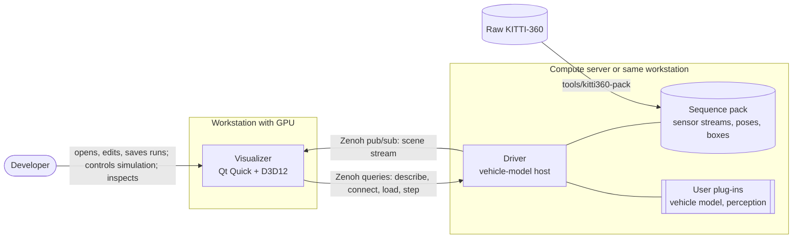
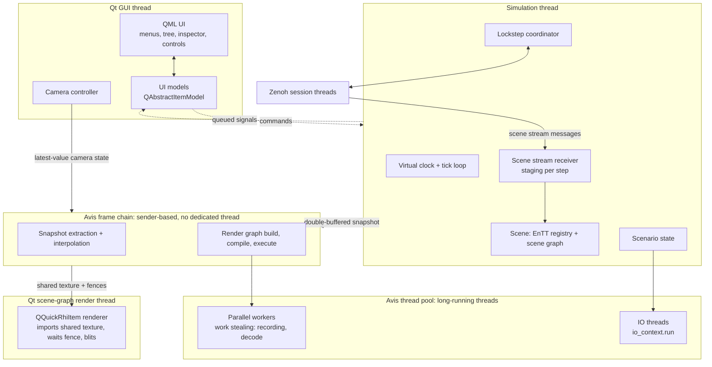
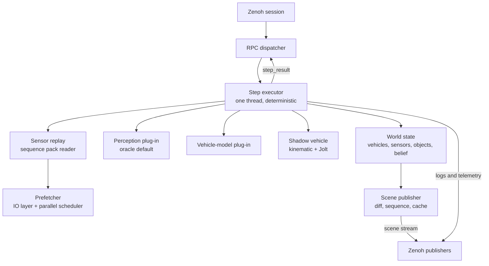
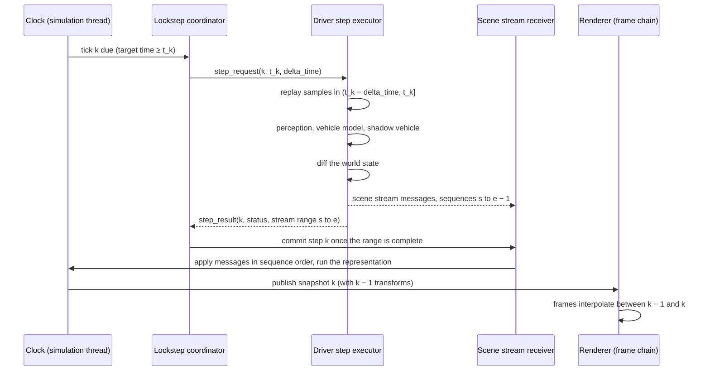

# 01 — System Architecture

## Code placement

| Feature | Namespace | CMake target | Location |
|---|---|---|---|
| Error type `avis::error`, `avis::result<T>` | `avis` | `AVIS_LIB` | `include/avis/error.h` |
| Logging facade | `avis::log` | `AVIS_LIB` | `include/avis/log.h` |
| Visualizer process (controller, threads, configuration loading, scene stream receiver) | `avis::visualizer` | `AVIS_VISUALIZER` | `apps/visualizer/` |
| Driver process (service, step executor, world state, scene publisher, configuration loading) | `avis::driver` | `AVIS_DRIVER` | `apps/driver/` |

## 1. Context



The Visualizer controls the run and time, and the Driver tells the Visualizer what the scene looks like. **Only the Driver reads datasets.** Everything the Visualizer shows arrives as scene stream messages ([02 §5.8](02-communication.md#58-scene-stream)).

## 2. Responsibilities

### 2.1 Visualizer: purpose and tasks
The Visualizer is the application a user works in to **open, edit and save a simulation run, connect to a Driver, control the simulation and view the results**. It is **agnostic to the vehicle model**: it doesn't interpret lidar data into a world, doesn't know where a vehicle can drive, and can't read KITTI-360 data. It renders an internal scene that the Driver fills through messages.

| Task | How |
|---|---|
| Open, edit and save a simulation run | A scenario file ([04 §2](04-scenario-and-dataset.md#2-scenario-file)). Editing means selecting the data source and input sensors (from the Driver's catalogue, [02 §5.2](02-communication.md#52-describe)), the plug-ins and their parameters, and the timestep. Editing is possible only while the simulation isn't running. |
| Find and connect to a Driver | Zenoh scouting started by the Visualizer, then `describe` and `connect` ([02 §2](02-communication.md#2-zenoh-topology-and-discovery)) |
| Own the virtual clock and control the simulation | Start, pause, single-step, stop and speed. The Visualizer tells the Driver when and by how much time advances with `step` messages ([03](03-simulation-core.md)). |
| Keep the active scene | The scene starts **empty** at the start of a run. Scene stream messages create and delete entities, move them and update their properties, geometry and sensor state ([02 §5.8](02-communication.md#58-scene-stream)). |
| Render the scene | The scene-agnostic renderer ([11](11-renderer.md)) draws the meshes that the scene representation derives from the streamed content ([12 §9](12-visualizer.md#9-scene-representation)) |
| Inspect the scene | A tree view of all entities, an entity inspector (selection synchronised with the tree), and a free-fly and a follow camera ([12 §5](12-visualizer.md#5-camera), [12 §6](12-visualizer.md#6-panels-and-controls)) |

### 2.2 Driver: purpose and tasks
The Driver hosts the user's autonomous-driving code. It replays the selected sensor data, runs perception and the vehicle model, simulates the shadow vehicle, keeps the **world state** it knows about (vehicles, sensors, perceived objects, the vehicle model's belief), and streams the changes to the Visualizer ([05](05-driver.md)).

### 2.3 Split of concerns

| Concern | Visualizer | Driver |
|---|---|---|
| Simulation clock, step authority and speed | **Owner** | Follower (steps only on request) |
| Scenario file (YAML) | **Owner**: opens, edits, saves, sends the Driver section with `load_scenario` | Receives its configuration |
| Data catalogue (sequences, sensors) | Shows it for editing | **Provides** it (`describe`) |
| Sensor data | Shows lidar sweeps it receives | **Replays** camera, lidar and GNSS/IMU from the pack |
| Perception | Shows the resulting entities and properties | **Runs** the perception plug-in (oracle by default) |
| Vehicle model / planning | Shows the belief geometry, trajectory and properties | **Runs** the vehicle-model plug-in |
| Ego and shadow vehicles | Shows them, follow camera | **Simulates** the shadow vehicle (kinematic model + Jolt), publishes both vehicles' states |
| World state and its changes | Applies them to its scene | **Owns** the world state, publishes deltas |
| Rendering | **Yes** (D3D12) | No (headless) |

## 3. Deployment

Supported topologies:

1. **Single machine.** Both processes are on one Windows 11 PC. Zenoh runs in peer mode over loopback.
2. **Distributed.** The Visualizer runs on a GPU workstation and the Driver on a compute server, on the same LAN. Zenoh uses peer mode with multicast scouting, or client/router mode with explicit endpoints when multicast is blocked.

Only the Driver's host needs the sequence packs (a local copy or a network share). The Visualizer needs no dataset at all.

Multiple independent simulations can share a network. Each Visualizer instance generates a **session id**, binds one Driver to it, and every session-scoped key expression is prefixed with it ([02 §3](02-communication.md#3-key-expressions)).

> Iteration 1 supports exactly **one Driver per session**, hosting one shadow vehicle. The protocol carries a `driver_id` so that more drivers can be added later.

## 4. Process internals

### 4.1 Visualizer



| Thread | Owner | Purpose |
|---|---|---|
| Qt GUI thread | Qt | QML, input events, UI models. It never blocks on simulation or GPU work. |
| Qt render thread | Qt | Renders the Qt Quick scene with Qt's own D3D12 device. The `QQuickRhiItem` renderer displays the latest Avis frame. |
| Simulation thread (pool) | Visualizer | Owns the EnTT registry, scenario state and virtual clock. Runs the tick loop, talks to the Driver through the lockstep coordinator, and applies committed scene stream steps. |
| Avis frame chain (no thread of its own) | Visualizer | A sender chain, re-armed every frame, that runs its stages on parallel workers and resumes on IO completions ([09 §4.2](09-rhi.md#42-frame-contexts-sender-based-non-blocking)). It uses the Avis D3D12 device (`render_hardware_interface`), extracts the latest snapshot, interpolates, builds and executes the render graph, and writes into the shared texture ring. Nothing ever blocks waiting for the GPU. |
| Parallel workers (`exec::static_thread_pool`, owned by the runtime) | Avis library | Short parallel work: command recording, PSO creation, asset decode ([15](15-parallel-scheduler.md), [10 §7](10-render-graph.md#7-execution-phase)) |
| IO threads (pool) | Avis library | `io_context::run()`: async IO completions ([07](07-io-layer.md)) |
| Zenoh threads | zenoh-c | Network IO. Callbacks only enqueue into lock-free queues that the simulation thread drains. |

Ownership rule: **only the simulation thread mutates the scene registry**. Every other thread sees scene data only through snapshots or queued messages.

### 4.2 Driver



The step executor runs on a single long-running pool thread, so step semantics don't depend on thread timing. The SDK offers no host-run parallelism. Plug-ins may create their own threads, but they must join them before returning from a call and must produce deterministic results ([05 §5.6](05-driver.md#56-calling-rules), [03 §6](03-simulation-core.md#6-determinism-rules)).

## 5. End-to-end data flow for one step



## 6. Error handling policy

The idea document asks for robustness: the Visualizer must **never crash** because of the Driver or a user plug-in.

### 6.1 Rules

1. **`std::expected<T, avis::error>`** is the default return type for operations that can fail for expected reasons: IO, parsing, network, plug-in errors, validation.
2. **Exceptions** are reserved for unrecoverable conditions where continuing is unsafe or meaningless: GPU device removal, out of memory, invariant violations, failed startup capability checks. They are caught at thread boundaries (top of each thread's loop). There they're logged and turned into a controlled shutdown or a fatal error dialog. They never cause an unhandled termination.
3. In **sender/receiver** pipelines, errors travel on the `set_error` channel ([07 §5](07-io-layer.md#5-error-propagation)). At the boundary where a sender is consumed, the error becomes a `std::expected` or an exception, following rules 1 and 2.
4. **Plug-in boundaries** are exception- and SEH-firewalled in the Driver ([05 §6](05-driver.md#6-fault-isolation)).
5. **Process boundary**: a Driver crash shows up as lost liveliness or as silence (no heartbeat, stream message or reply for `communication_timeout`). A slow Driver is never a failure: it slows the clock down silently. The Visualizer pauses the simulation ([02 §7](02-communication.md#7-failure-handling)).

### 6.2 Error type

```cpp
namespace avis
{
    enum class error_domain : std::uint16_t { generic, io, parse, network, rhi, scene, plugin, protocol };

    struct error
    {
        error_domain domain = error_domain::generic;
        std::int32_t code = 0;             // domain-specific code (e.g. HRESULT, errno, protocol status)
        std::string message;               // human-readable, already formatted
        std::source_location location = std::source_location::current();
    };

    template<typename T>
    using result = std::expected<T, error>;
}
```

`avis::error` is cheap to move and printable through `std::formatter`. Domain-specific helpers such as `avis::rhi::check(HRESULT)` convert native codes.

### 6.3 Severity mapping

| Situation | Mechanism | Visualizer reaction |
|---|---|---|
| Scenario YAML invalid | `expected` | Error panel with line/column, scenario not loaded |
| Data source or sensor not available on the Driver | `load_scenario` status | Load refused, message shown |
| Driver silent for `communication_timeout`, or communication error | `expected` → state change | **Simulation pauses**, driver status shown |
| Plug-in throws or faults | Driver reports `step_status::model_fault` | Simulation pauses, the fault text is shown |
| Driver process dies | Liveliness lost | Simulation pauses, driver shown as disconnected |
| Shader file missing | `expected` at load | Startup error dialog, exit |
| GPU lacks SM 6.6 / bindless tier 3 / enhanced barriers | Startup check | Error dialog, **application does not start** |
| `DXGI_ERROR_DEVICE_REMOVED` | `set_error` in the frame chain | DRED report logged, fatal dialog, controlled exit |

## 7. Configuration

Configuration is separate from scenarios. Scenarios are portable and shared between users. Application configuration is per machine.

| File | Location | Contents |
|---|---|---|
| `visualizer.yaml` | `%APPDATA%/Avis/` (overridable with `--configuration`) | Zenoh configuration (including the scouting timeout), lockstep settings (`lockstep: { communication_timeout: 5s, long_step_notice: 2s }`, [02 §6.2](02-communication.md#62-rules)), render settings (frames in flight, debug layer, GBV), runtime settings (IO threads, parallel workers, pool capacity), UI preferences, recent scenarios |
| `driver.yaml` | Next to the executable or `--configuration` | Dataset roots, Zenoh configuration, `driver_id`, plug-in search paths, runtime settings (IO threads, parallel workers), log level |

Example `driver.yaml`:

```yaml
driver_id: driver-0
datasets:
  kitti360: "E:/datasets/kitti360-avis"     # sequence packs, not the raw dataset
plugins:
  search_paths: ["./plugins"]
zenoh:
  mode: peer                                # peer | client
  connect: []                               # e.g. ["tcp/10.0.0.5:7447"] for client mode
  listen: []
  scouting:
    multicast: true                         # answer scouting requests
    autoconnect: []                         # never initiate; the Visualizer scouts and connects
runtime:
  io_threads: 1
  parallel_workers: 0                       # 0 = max(1, hardware_concurrency - 2)
  thread_pool_capacity: 0                   # 0 = computed (14 §3.1)
logging:
  level: info
  file: "./logs/driver.log"
debug:
  enabled: false                            # debug mode for plug-in debugging (05 §8); also on when started under a debugger
  zenoh_lease: 1h                           # Zenoh lease in debug mode, so breakpoints don't drop the connection
watchdog:
  hang_dump_after: 60s                      # minidump when one plug-in call runs this long (05 §6); off in debug mode
```

Command-line flags override configuration values (`--configuration`, `--driver-id`, `--log-level` for both; `--debug-layer`, `--gpu-validation` for the Visualizer; `--debug` for the Driver). The Driver has no session flag: it waits to be discovered and connected ([02 §2](02-communication.md#2-zenoh-topology-and-discovery)).

## 8. Startup and shutdown

**Visualizer startup:**
1. Parse the command line and load `visualizer.yaml`.
2. `avis::runtime` initialises logging, the default thread pool, the IO context and the parallel pool behind `stdexec::get_parallel_scheduler()` ([14](14-library-runtime.md), [06](06-thread-pool.md), [15](15-parallel-scheduler.md)).
3. Force Qt Quick onto the D3D12 backend (`QQuickWindow::setGraphicsApi(QSGRendererInterface::Direct3D12)`) and create the QML engine.
4. When the Qt scene graph is initialised, read Qt's adapter LUID and create the Avis RHI device **on the same adapter** ([12 §3](12-visualizer.md#3-viewport-integration-qquickrhiitem--shared-handles)). Run the capability checks, and fail with a dialog if they don't pass.
5. Load shaders (async IO) and create pipelines (in parallel on the parallel scheduler), then start the renderer's frame chain.
6. Start the simulation thread on the pool and open the Zenoh session, declaring the Visualizer liveliness token. Driver discovery (scouting) runs when the user opens *Connect Driver*, or automatically at startup to reconnect the last used Driver.

**Shutdown** happens in reverse: stop the simulation (sending `unload` and `disconnect` to the Driver), stop the frame chain (request stop on its async scope and wait until it has drained), wait for the GPU to idle (`wait_idle`), destroy the RHI, close Zenoh, then destroy `avis::runtime`. Each component stops its own pool threads and async work first (simulation thread, frame chain). The runtime then stops the parallel pool and IO, and runs the pool's signal-all-then-join-all backstop ([14 §4.2](14-library-runtime.md#42-destruction)).
