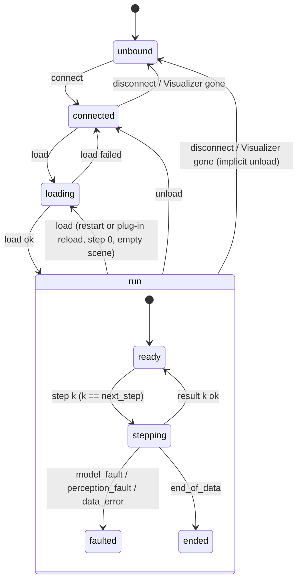

# 02 — Communication & Lockstep

> This document fixes the **transport, discovery, framing, topology, protocol state machine and failure behaviour** between the Visualizer and the Driver, and the **message catalogue**. The owner confirmed the catalogue ([99](99-decisions-and-open-questions.md), D-36 to D-39), so it's no longer provisional. Field lists can still grow through backward-compatible appends (§4).

## Code placement

| Feature | Namespace | CMake target | Location |
|---|---|---|---|
| Zenoh wrapper (`session`, `scout`, publishers, subscribers, queryables, liveliness) | `avis::network` | `AVIS_LIB` | `include/avis/network/`, `lib/avis/network/` |
| Message framing and `serializer` | `avis::network` | `AVIS_LIB` | `include/avis/network/serializer.h`, `framing.h` |
| Message catalogue (`describe`, `connect`, `load_scenario`, `step`, scene stream messages, …) | `avis::network::protocol` | `AVIS_LIB` | `include/avis/network/protocol/` |
| Driver discovery (scouting, `describe`) | `avis::visualizer` | `AVIS_VISUALIZER` | `apps/visualizer/simulation/driver_discovery.*` |
| Lockstep coordinator (Visualizer side) | `avis::visualizer` | `AVIS_VISUALIZER` | `apps/visualizer/simulation/lockstep_coordinator.*` |
| Scene stream receiver (staging per step, completeness check) | `avis::visualizer` | `AVIS_VISUALIZER` | `apps/visualizer/simulation/scene_stream.*` |
| Driver service / state machine (Driver side) | `avis::driver` | `AVIS_DRIVER` | `apps/driver/driver_service.*` |
| Scene publisher (world state diff → stream messages) | `avis::driver` | `AVIS_DRIVER` | `apps/driver/scene_publisher.*` |

## 1. Library component: `avis::network`

A thin library layer over zenoh-cpp, so applications never touch Zenoh types directly:

```cpp
namespace avis::network
{
    struct session_configuration { /* mode, connect, listen, scouting — mirrors app configuration */ };

    enum class reliability : std::uint8_t { best_effort, reliable };
    enum class congestion_control : std::uint8_t { drop, block };
    struct publisher_options { reliability reliability = reliability::reliable; congestion_control congestion = congestion_control::block; };

    struct scouted_node { std::string zenoh_id; node_kind kind; std::vector<std::string> locators; };   // from a Zenoh scouting reply

    // multicast scouting; completes on the IO scheduler after `timeout` with every reply received
    sender_of<result<std::vector<scouted_node>>> scout(const session_configuration& configuration,
                                                       std::chrono::milliseconds timeout);

    class session
    {
    public:
        static result<session> open(const session_configuration& configuration);

        result<void> connect(std::span<const std::string> locators);   // connect to scouted nodes

        result<publisher>  declare_publisher(std::string_view key, publisher_options options = {});
        result<subscriber> declare_subscriber(std::string_view key, message_handler handler);
        result<queryable>  declare_queryable(std::string_view key, query_handler handler);
        result<liveliness_token> declare_liveliness(std::string_view key);
        result<liveliness_watch> watch_liveliness(std::string_view key_pattern, liveliness_handler handler);

        // request/response with timeout; completes on the IO scheduler
        sender_of<result<message_buffer>> query(std::string_view key, message_buffer payload,
                                                std::chrono::milliseconds timeout);
    };
}
```

`scout` and `query` return stdexec senders, so the Visualizer composes discovery and request → timeout → continuation in the same style as the IO layer.

## 2. Zenoh topology and discovery

- **Mode:** peer by default. Client mode with an explicit router or endpoint is supported for networks that block multicast. Everything is configured per application ([01 §7](01-system-architecture.md#7-configuration)).
- **Discovery uses Zenoh scouting**, and the Visualizer is the side that initiates it:
  - The **Driver** enables multicast scouting replies (`scouting.multicast.enabled: true`, listening on its configured endpoints) but does **not** auto-connect to peers it hears (`autoconnect: []`). It just answers scouting requests and waits.
  - The **Visualizer** runs `network::scout` (default timeout 1 s) when the user opens *Connect Driver* or presses *Refresh*. It connects to the locators of each replying peer, then sends `describe` (§5.2) to `avis/driver/*/rpc/describe` to find out which of them are Avis Drivers and what they offer.
  - Zenoh's scouting reply carries only the node id, kind and locators, so `describe` supplies the Avis-level information (driver id, plug-ins, data catalogue).
  - In client mode, scouting goes through the router: the Visualizer scouts for the router and queries `describe` through it.
- **Session binding:** the Visualizer generates a **session id** when it starts (8 random hex characters). `connect` (§5.3) binds one Driver to that session exclusively; a bound Driver answers other Visualizers with `busy`. Session-scoped keys (§3) carry the session id.
- **Transport payload:** Zenoh carries opaque bytes. Avis frames them itself (§4).

## 3. Key expressions

| Key expression | Pattern | Direction | Purpose |
|---|---|---|---|
| `avis/driver/{driver_id}` | liveliness | D | Driver presence, bound or not |
| `avis/driver/{driver_id}/rpc/describe` | queryable on D | V → D | Identity, plug-ins and data catalogue, before connecting |
| `avis/driver/{driver_id}/rpc/connect` | queryable on D | V → D | Bind the Driver to a session |
| `avis/{session}/visualizer` | liveliness | V | Visualizer presence; the bound Driver unbinds when it disappears |
| `avis/{session}/driver/{driver_id}/rpc/disconnect` | queryable on D | V → D | Unbind |
| `avis/{session}/driver/{driver_id}/rpc/load` | queryable on D | V → D | Load the scenario's Driver section |
| `avis/{session}/driver/{driver_id}/rpc/step` | queryable on D | V → D | Lockstep pulse and step status |
| `avis/{session}/driver/{driver_id}/rpc/unload` | queryable on D | V → D | Release the scenario |
| `avis/{session}/driver/{driver_id}/rpc/rescan` | queryable on D | V → D | Rescan plug-ins and return the refreshed plug-in catalogue (§5.6a) |
| `avis/{session}/driver/{driver_id}/scene/entity` | pub/sub, reliable | D → V | `entity_update` |
| `avis/{session}/driver/{driver_id}/scene/transform` | pub/sub, reliable | D → V | `transform_update` |
| `avis/{session}/driver/{driver_id}/scene/vehicle` | pub/sub, reliable | D → V | `vehicle_state` |
| `avis/{session}/driver/{driver_id}/scene/properties` | pub/sub, reliable | D → V | `entity_properties` |
| `avis/{session}/driver/{driver_id}/scene/geometry` | pub/sub, reliable | D → V | `geometry_update` (world belief geometry) |
| `avis/{session}/driver/{driver_id}/scene/sensor/lidar` | pub/sub, reliable | D → V | `lidar_sweep` (sensor state) |
| `avis/{session}/driver/{driver_id}/status` | pub/sub, best effort | D → V | `driver_status` heartbeat while a load or a step is in progress (§5.11). Drives the inactivity timeout (§6.2) and the busy notice. |
| `avis/{session}/driver/{driver_id}/log` | pub/sub, best effort | D → V | Log records (Visualizer log panel) |
| `avis/{session}/driver/{driver_id}/telemetry` | pub/sub, best effort | D → V | Non-lockstep diagnostics (prefetch fill level, plug-in memory, cumulative timings) |

- **Requests** use Zenoh queries (`get` → queryable reply), which gives timeouts and correlation without a custom RPC layer.
- **Scene updates** use pub/sub. They're part of the lockstep result, so their publishers are declared **reliable with blocking congestion control**: the Driver's step executor waits rather than drops when the network is slow, and the Visualizer's silent slowdown absorbs the delay ([03 §4](03-simulation-core.md#4-tick-loop)). Zenoh fragments large payloads such as lidar sweeps.
- **Logs, telemetry and status heartbeats** are best effort with drop congestion control. They never affect determinism. A lost heartbeat doesn't matter, because the next one follows 500 ms later.

## 4. Message framing

Every payload starts with a fixed 24-byte header. Integers are little-endian.

| Offset | Size | Field | Notes |
|---|---|---|---|
| 0 | 4 | `magic` | `'A','V','I','S'` |
| 4 | 2 | `protocol_major` | Incompatible changes |
| 6 | 2 | `protocol_minor` | Backward-compatible additions |
| 8 | 2 | `message_type` | `enum class message_type : uint16_t` |
| 10 | 2 | `flags` | bit 0: payload compressed (reserved), bits 1–15 reserved |
| 12 | 4 | `payload_size` | Bytes after the header |
| 16 | 8 | `sequence` | Requests and replies: the step index (or 0). Scene stream: the Driver's **stream sequence** (§6.3). Logs and telemetry: monotonic per publisher. |

Payload encoding uses the existing `serializer` concept (`apps/driver/serializer.h`, which moves to `include/avis/network/serializer.h`):

- Fixed-width scalars are little-endian. `bool` is a `u8`.
- Strings: `u32` length followed by UTF-8 bytes.
- Arrays: `u32` count followed by elements. Bulk arrays of scalars (positions, indices, colours) are written as one contiguous block, so the reader can copy them in one go.
- `optional<T>`: a `u8` presence byte, then the value.
- Eigen vectors and quaternions: raw components (`f32` or `f64`, as declared).
- Each struct gets one `serialize(view)` function used for both reading and writing, so the two can't drift apart.
- **Forward compatibility:** new fields are only appended at the end of a message. Readers ignore trailing bytes they don't understand (minor version bump).

Size limits: request and reply messages ≤ 1 MiB. Scene stream messages ≤ 32 MiB (a full lidar sweep is about 1 MiB). The Driver splits larger geometry into chunks (§5.8.5), and a single message over the limit is a `data_error`.

## 5. Message catalogue

### 5.1 Overview

| Group | Message | Transport | Purpose |
|---|---|---|---|
| Discovery and session | `describe` | query | Driver identity, plug-ins and data catalogue (§5.2) |
| | `connect`, `disconnect` | query | Bind and unbind a Driver to a Visualizer session (§5.3) |
| Simulation control | `load_scenario` | query | Configure a run (§5.4) |
| | `step` | query | Advance time by one step; returns the status and the step's stream range (§5.5) |
| | `unload` | query | Release the run (§5.6) |
| | `rescan` | query | Rescan plug-ins, return the plug-in catalogue (§5.6a) |
| Scene stream: world belief | `entity_update` | pub/sub | Entities created or deleted on the Driver's side (§5.8.1) |
| | `transform_update` | pub/sub | Poses of moving entities (§5.8.2) |
| | `vehicle_state` | pub/sub | Full state of a vehicle entity (§5.8.3) |
| | `entity_properties` | pub/sub | Inspector properties such as classification and estimated dimensions (§5.8.4) |
| | `geometry_update` | pub/sub | Meshes, lines and point sets the vehicle model believes in, sent as chunked deltas (§5.8.5) |
| Scene stream: sensor state | `lidar_sweep` | pub/sub | One lidar sweep (§5.8.6) |
| Diagnostics | `log_record`, `telemetry` | pub/sub | §5.9 |
| | `driver_status` | pub/sub | Heartbeat while loading or stepping (§5.11) |

All Driver → Visualizer content describes **what the Driver knows**. The Visualizer doesn't interpret it beyond displaying it (§5.8).

### 5.2 `describe`
- **Request**: `protocol_major/minor`.
- **Reply** (`describe_reply`):

| Field | Type | Notes |
|---|---|---|
| `driver_id` | string | |
| `driver_version`, `host_name` | string | Shown in the connection dialog |
| `protocol_major/minor` | u16, u16 | |
| `binding` | enum + string | `unbound`, or `bound` with the owning session id |
| `plugins` | `plugin_catalogue` | From the latest plug-in scan (below) |
| `data_sources[]` | `data_source` | What the Driver can replay: `kind` (e.g. `kitti360`), `sequence`, `split` (`train`, `test`), `capabilities[]` (`boxes`, `semantics`, [04 §3.1](04-scenario-and-dataset.md#31-what-is-used)), `frame_first/last`, `duration_ns`, `sensors[]` {`name`, `kind` (camera, lidar, gnss_imu), `rate_hz`, `default_enabled`} |
| `debug_mode` | `{enabled u8, lease_ms u32}` | The Driver runs in debug mode, with its Zenoh lease ([05 §8](05-driver.md#8-debug-mode)). The Visualizer adapts its timeouts (§7.1). |

`plugin_catalogue`, shared by `describe` and `rescan` (§5.6a):

| Field | Type | Notes |
|---|---|---|
| `vehicle_models[]`, `perception_modules[]` | `{name, version, file, parameters_schema (YAML text, may be empty)}` | Loadable modules. The schema drives the Visualizer's parameter form and the Driver's validation ([05 §5.8](05-driver.md#58-parameter-schema)). |
| `rejected_plugins[]` | `{file, reason}` | DLLs found but not loadable, for example a plug-in API version or ABI fingerprint mismatch ([05 §5.4](05-driver.md#54-host-side)). Shown in the Driver panel so the user knows to rebuild. |
| `pinned_plugins[]` | `{file, reason}` | Modules kept loaded after a fault abandoned an instance; they can't be rebuilt until the Driver restarts ([05 §5.4](05-driver.md#54-host-side)) |
| `files_locked` | u8 | `1` while a run is loaded, so plug-in DLLs are locked and can't be rebuilt |

The Visualizer **doesn't read datasets**. Scenario editing picks the data source and sensors from this catalogue ([04 §2](04-scenario-and-dataset.md#2-scenario-file)).

### 5.3 `connect` / `disconnect`
- **`connect` request**: `protocol_major/minor`, `visualizer_version`, `session_id`.
- **`connect` reply**: `status (ok | busy | version_mismatch)`, `driver_id`. On `ok` the Driver declares the session-scoped queryables and publishers and watches `avis/{session}/visualizer`.
- **`disconnect` request**: empty. **Reply**: `status`. The Driver unloads any run and returns to `unbound`.
- The Visualizer refuses a Driver with a different `protocol_major`.

### 5.4 `load_scenario`
- **Request**: `scenario_name`, `data_source{kind, sequence, frame_start, frame_end}`, `enabled_sensors[]`, `timestep_ns`, `random_seed (u64)`, `vehicle_model{name, parameters (YAML text)}`, `perception{name, parameters (YAML text)}`, `shadow_vehicle{enabled, dynamics, resync_interval_ns, parameters (YAML text)}`. There's no timeout in the request: failure detection is the Visualizer's inactivity rule (§6.2), configured per machine.
- The load can take long (plug-in `create`, ground tiles). The Driver sends `driver_status` heartbeats with `phase = loading` meanwhile (§5.11), and the Visualizer's Zenoh query uses a long backstop timeout (10 min).
- **Reply**: `status (ok | data_not_found | sensor_not_found | plugin_not_found | plugin_load_failed | invalid_parameters)`, `message`, `diagnostics[]` {`severity` (error, warning), `path`, `message`}, `effective_parameters (YAML text)`, `world_origin (f64x3)`, `step_count (u64)`, `plugins (plugin_catalogue)`.
  - The Driver **rescans plug-ins** before loading ([05 §5.4](05-driver.md#54-host-side)), so a plug-in rebuilt while stopped is picked up. The refreshed catalogue comes back in `plugins`.
  - `diagnostics` reports parameter-schema problems with a path such as `driver.vehicle_model.parameters.target_speed` ([05 §5.8](05-driver.md#58-parameter-schema)). Errors give `invalid_parameters`. Warnings (unknown keys) don't stop the load.
  - `world_origin` is the run's origin in world coordinates (for KITTI-360, the ego position at `frame_start`). The Visualizer stores scene positions relative to it ([04 §4.4](04-scenario-and-dataset.md#44-coordinate-frames-and-precision)).
  - `step_count` is the number of steps the selected data covers: `ceil(t_end / Δt) + 1`, where `t_end` is the reference time of `frames.end` relative to `frames.start` ([04 §4.2a](04-scenario-and-dataset.md#42a-reference-timeline-framesavs)). Steps run from 0 to `step_count − 1`. The simulation bar uses it, and the run ends there.
  - A selected module whose required capability the sequence lacks fails the load with `data_not_found` and a diagnostic (for example *"ground_truth_oracle needs 3D boxes; sequence … is a test sequence"*).
- Plug-in parameters travel as YAML text, and each module's schema travels as YAML text too, so plug-ins define their own parameters without protocol changes.
- A successful load starts with an **empty scene** on both sides: the Visualizer clears its Driver-owned entities, and the Driver resets its stream sequence and world state.

### 5.5 `step`
- **Request** (`step_request`): `step_index (u64)`, `simulation_time_ns (i64)` = time at the *end* of the step, `delta_time_ns (i64)`.
- **Reply** (`step_result`). The step's scene content isn't in the reply. It travels on the scene stream, and the reply says which stream messages belong to the step.

| Field | Type | Notes |
|---|---|---|
| `step_index` | u64 | Echo |
| `status` | enum | `ok`, `model_fault`, `perception_fault`, `data_error`, `out_of_order`, `end_of_data` |
| `fault_message` | string | When status ≠ ok |
| `stream_first`, `stream_end` | u64, u64 | The scene stream messages of this step have sequences in `[stream_first, stream_end)` (§6.3). Equal values mean no scene change. |
| `timings` | `step_timings` | Microseconds spent in replay, perception, model, physics and publishing (diagnostics only) |

### 5.6 `unload`
- **Request**: empty. **Reply**: `status`. The Driver destroys the plug-in instances, unloads their DLLs (except pinned ones), releases file handles and caches, and stays bound. After `unload`, plug-in files can be rebuilt ([05 §5.4](05-driver.md#54-host-side)).

### 5.6a `rescan`
- **Request**: empty. **Reply**: `status`, `plugins (plugin_catalogue)`.
- The Driver rescans `plugins.search_paths` ([05 §5.4](05-driver.md#54-host-side)). It's allowed in every bound state, and it doesn't touch the loaded run: modules in use stay loaded. The Visualizer calls it from the Driver panel's *Rescan plug-ins* button and when the scenario editor opens ([12 §6](12-visualizer.md#6-panels-and-controls)).

### 5.7 Common types

| Type | Fields |
|---|---|
| `entity_id` | `u64`, assigned by the Driver, unique within a run, never reused. Bits 63–56 are the **source** (`0` Driver host, `1` perception, `2` vehicle model), bits 55–0 a source-local id. `0` means "none" or "world root". |
| `pose` | `position f64x3` (world), `orientation f32x4` (unit quaternion w, x, y, z) |
| `color` | `u8x4` RGBA, sRGB |
| `property_value` | `u8` type tag (`boolean`, `integer`, `number`, `text`, `vector3`) followed by `u8`, `i64`, `f64`, string or `f64x3` |

### 5.8 Scene stream

Every scene stream message starts with `step_index (u64)` and carries the stream sequence in its header. Within a step, the Driver publishes in a fixed order: `entity_update`, then `transform_update`, `vehicle_state`, `entity_properties`, `geometry_update`, `lidar_sweep`. The Visualizer still applies them strictly by sequence (§6.3), so delivery order across topics doesn't matter.

#### 5.8.1 `entity_update`

One message per step that creates or deletes entities. It holds an ordered list of operations.

| Field | Type | Notes |
|---|---|---|
| `operations[]` | `entity_operation` | Applied in order |
| ↳ `kind` | enum | `create`, `delete` |
| ↳ `entity` | `entity_id` | |
| ↳ `parent` | `entity_id` | `create` only. `0` = world root. Parents are created before children. |
| ↳ `name` | string | `create` only. Shown in the scene tree. |
| ↳ `category` | enum | `create` only: `group`, `vehicle`, `sensor`, `object`, `geometry`. Used for the tree icon and filters, never for logic. |
| ↳ `flags` | u16 | `create` only: `primary` (the vehicle of the vehicle model, the follow camera's default target), `pickable`, `hidden_by_default` |
| ↳ `display` | `display_description` | `create` only: how to draw the entity itself: `shape` (`none`, `box`, `vehicle`, `axes`, `frustum`), `extent f32x3`, `color`, `opacity f32`, and for `frustum`: `horizontal_fov`, `vertical_fov`, `range` (f32) |
| ↳ `local_pose` | `pose` | `create` only. Relative to the parent (world pose when the parent is the root). |

- `delete` removes the entity **and its subtree**.
- **Vehicles are root entities:** a `create` with category `vehicle` must have `parent = 0`. That makes the world pose in `vehicle_state` (§5.8.3) equal to the local pose. The Driver enforces it when it builds the world state, and the Visualizer treats a violation as `protocol_error` (§7). A vehicle's children (sensors, its trajectory) are unrestricted.
- Entity creation is how the scene builds up: at step 0 the scene is empty, and the Driver creates entities as its knowledge grows (the ego vehicle and its sensors first, then perceived objects, belief geometry, …).

#### 5.8.2 `transform_update`
| Field | Type | Notes |
|---|---|---|
| `transforms[]` | `{entity, local_pose, extent optional<f32x3>}` | Only entities whose pose or size changed this step. `extent` updates a `box` display, for example when the estimated size of an object changes. |

#### 5.8.3 `vehicle_state`
One message per vehicle entity per step (it replaces the old `ego_estimate` and `shadow_state` reply fields).

| Field | Type | Notes |
|---|---|---|
| `entity` | `entity_id` | A `vehicle` entity |
| `simulation_time_ns` | i64 | Time the state refers to |
| `pose` | `pose` | World pose of the vehicle frame (rear-axle centre on the ground, [00 §4.1](00-overview.md#41-coordinate-systems-and-units)) |
| `linear_velocity`, `angular_velocity`, `acceleration` | f32x3 each | Vehicle frame |
| `speed` | f32 | m/s, signed |
| `steering_angle` | f32 | rad, road-wheel angle |

Vehicles are always root entities (§5.8.1), so the Visualizer applies this world pose as the entity's local pose (after subtracting the run origin, [04 §4.4](04-scenario-and-dataset.md#44-coordinate-frames-and-precision)), like a `transform_update`. It keeps the rest for the inspector and the follow camera.

#### 5.8.4 `entity_properties`
Generic key/value properties for the inspector. The Visualizer shows them without knowing what they mean.

| Field | Type | Notes |
|---|---|---|
| `updates[]` | `{entity, set[], removed[]}` | Only changed properties |
| ↳ `set[]` | `{key string, value property_value, unit string}` | Dotted keys group the inspector rows, e.g. `perception.classification` = `"car"`, `perception.confidence` = `0.93`, `estimate.dimensions` = `(4.4, 1.8, 1.5)` m, `control.steering` = `0.12` rad |
| ↳ `removed[]` | string | Keys to drop |

Controls and the planner's state are properties now (`control.*`, `planner.*`), so they no longer need fields of their own.

#### 5.8.5 `geometry_update`
World belief geometry: the road surface or drivable area the model believes in, lane boundaries, an accumulated point map, the planned trajectory, …. Geometry is sent as **chunks**, so a large surface or point map changes by delta.

| Field | Type | Notes |
|---|---|---|
| `entity` | `entity_id` | A `geometry` entity. Vertex positions are relative to its frame. |
| `chunks[]` | `geometry_chunk` | Changed chunks only |
| ↳ `chunk` | u32 | Chunk id within the entity |
| ↳ `operation` | enum | `replace` (create or overwrite the chunk), `remove` |
| ↳ `topology` | enum | `triangles`, `lines`, `line_strip`, `points` |
| ↳ `origin` | f64x3 | Chunk origin relative to the entity, so positions stay small |
| ↳ `positions` | f32x3[] | Relative to `origin` |
| ↳ `indices` | optional u32[] | Triangles and lines |
| ↳ `normals` | optional f32x3[] | Lit triangles and points |
| ↳ `colors` | optional `color`[] | Per vertex |
| ↳ `style` | `geometry_style` | `color`, `opacity f32`, `lit u8`, `line_width f32` (px), `point_size f32` (m), `layer` (`world`, `overlay`) |
| `clear` | u8 | `1` = drop all chunks of the entity before applying `chunks` |

A point-map delta is a `geometry_update` with `points` chunks: new or changed cells are `replace`d and evicted cells `remove`d. The planned trajectory is a single `line_strip` chunk on a trajectory entity under the vehicle.

#### 5.8.6 `lidar_sweep`
Sensor state: one sweep of one lidar, published in the step whose interval contains the sweep's timestamp.

| Field | Type | Notes |
|---|---|---|
| `entity` | `entity_id` | The `sensor` entity of the lidar |
| `capture_time_ns` | i64 | Simulation time of the sweep |
| `sensor_pose` | `pose` | World pose of the sensor at capture, so the sweep lands in the right place even though the vehicle has moved since |
| `point_count` | u32 | |
| `encoding` | enum | `float32` (`f32x3`) or `quantized16` (`i16x3` × `scale`, default 5 mm, ±163 m) |
| `scale` | f32 | For `quantized16` |
| `positions` | block | Sensor frame |
| `channels` | u8 bitmask | `intensity` (`u8[]`), `ring` (`u8[]`), `color` (`color[]`) |
| `channel data` | blocks | One block per channel in bit order |
| `retention` | u8 | How many sweeps of this sensor the Visualizer keeps on screen (default 1: each sweep replaces the previous one) |

An HDL-64E sweep has about 120k points: about 0.85 MB with `quantized16` and intensity, which is about 8.5 MB/s at 10 Hz. That fits a wired LAN comfortably. On slower links the silent slowdown takes over.

### 5.9 Log record and telemetry (pub/sub, best effort)
- `log_record`: `timestamp_ns (wall)`, `level`, `logger`, `message`. The Visualizer shows these in its log panel, tagged with the driver id.
- `telemetry`: prefetch fill level, plug-in memory, cumulative timings. It carries no scene or sensor data.

### 5.10 Not yet in the catalogue
Deliberately left out of iteration 1, but expected later:

| Message | Why it's deferred |
|---|---|
| `scene_state` query (full scene at the current step) | Needed for a Visualizer that reconnects mid-run. Re-synchronisation is out of scope (A-16). |
| `camera_frame` (sensor state) | Live camera images are out of scope (D-08). |
| Ground-truth stream for side-by-side comparison | Close to evaluation, which is postponed. The Driver could publish ground truth as its own entity group later without protocol changes. |
| Interactive requests to the vehicle model (for example "explain this object") | No use case yet |

### 5.11 `driver_status` (pub/sub, best effort)
A heartbeat from the Driver's **service thread**, published every 500 ms while a `load` or a `step` is in progress, and once when it ends. It proves the Driver and the link are alive while the step executor is busy, and tells the user what the Driver is doing.

| Field | Type | Notes |
|---|---|---|
| `state` | enum | The Driver state (§6.1) |
| `step_index` | u64 | The step in progress (0 during a load) |
| `phase` | enum | `loading`, `replay`, `perception`, `model`, `physics`, `publishing` |
| `phase_elapsed_ms` | u32 | Time spent in the current phase |
| `stream_published` | u32 | Scene stream messages of this step published so far |
| `bytes_published` | u64 | Their total size |

The service thread reads `phase` and the counters from atomics that the step executor updates. A hung step executor therefore shows up as a phase whose time keeps growing, not as silence. Silence means the process or the link is gone.
## 6. Lockstep protocol

### 6.1 Driver state machine



`describe` is answered in every state. In every bound state, `connect` from another session is answered with `busy`.

**Requests per state:**

| State | `step k` | `load` | `unload` | `disconnect` / Visualizer gone |
|---|---|---|---|---|
| `unbound`, `connected` | `out_of_order` (no run) | `connected` only | `ok` (no-op) | → `unbound` |
| `loading` | `out_of_order` | deferred until the load finishes, then applied | deferred, then applied | deferred: the load finishes, is unloaded, then → `unbound` |
| `ready` | executes if `k == next_step`; cached retry if `k == next_step − 1` (§6.2); else `out_of_order` | restarts the run | → `connected` | implicit unload, → `unbound` |
| `stepping` | if `k` is the step being executed (a retry after a Visualizer timeout), the query is **held** and answered with the same result when the step finishes; the step runs and publishes once. Any other `k`: `out_of_order` | deferred until the step finishes | deferred until the step finishes | deferred until the step finishes, then implicit unload, → `unbound` |
| `faulted` | the failed step's cached fault result for its own `k`, else `out_of_order` | plug-in reload (new instances), restarts at step 0 | → `connected` | implicit unload, → `unbound` |
| `ended` | `end_of_data` (cached result) for every `k ≥ step_count` | restarts the run | → `connected` | implicit unload, → `unbound` |

- **Deferred** means the service thread queues the request and applies it as soon as the step executor returns. Plug-in calls can't be interrupted ([05 §6](05-driver.md#6-fault-isolation)), so a hung step keeps these requests queued until the user restarts the Driver.
- `rescan` is answered immediately in every bound state, including `loading` and `stepping`, by the service thread. It only reads plug-in files and never touches loaded modules.
- `data_error` goes to `faulted` like a plug-in fault: retrying a corrupt chunk returns the same error, so only a reload or an unload leaves the state.

### 6.2 Rules

1. **One step in flight.** The Visualizer sends `step k` only after it has **committed** step `k−1`: its `step_result` arrived and its stream range is complete (§6.3). This is what makes the protocol lockstep.
2. **Strict ordering.** The Driver keeps `next_step`. A request with `k == next_step` executes. A request with `k == next_step − 1` returns the **cached** last result and **re-publishes** that step's cached stream messages with their original sequences (an idempotent retry). Any other `k` is answered with `out_of_order`.
3. **The Visualizer owns time.** The Driver never reads wall-clock time for simulation logic. All time comes from `simulation_time_ns` and `delta_time_ns`, and the Visualizer alone decides when and by how much time advances, including the speed of a running simulation.
4. **Step 0** is sent right after a successful `load`. It covers `(−Δt, 0]`, so it delivers the samples at exactly `t = 0` ([04 §4.2a](04-scenario-and-dataset.md#42a-reference-timeline-framesavs)). Its stream creates the first entities (typically the ego vehicle and its sensors).
5. **Inactivity timeout, not a step timeout.** A slow Driver, whether it's computing or publishing over a slow link, is a **silent slowdown**, never a failure (idea.md). The Visualizer's timer for the in-flight `load` or `step` measures **silence**: it restarts whenever anything arrives for that request (a `driver_status` heartbeat, §5.11; a scene stream message of the step; the reply). Only when **nothing** has arrived for `communication_timeout` (default 5 s, `visualizer.yaml` → `lockstep`, [01 §7](01-system-architecture.md#7-configuration)) is it a communication failure (§7).
   - A long step is shown, not punished. After `long_step_notice` (default 2 s) the status bar shows what the Driver reports, for example *"Driver busy: vehicle_model.step, 12 s"* or *"publishing 18 MB"*. The simulation stays `running`.
   - There's no special grace period for the first step after a load: warm-up sends heartbeats like any other phase.
   - Zenoh query timeouts are only a backstop (10 min for `load`, 60 s for `step`). The inactivity timer cancels the query earlier when the Driver goes silent.
6. **End of data:** the last step, `step_count − 1`, returns `end_of_data` after its stream is complete. It has full content (it covers the last frame) and is committed like any other step. The Visualizer stops the clock.

### 6.3 Scene stream sequencing and commit
- The Driver numbers every scene stream message with a **stream sequence** that starts at 0 after each `load` and increases by one per message, across all scene topics.
- `step_result k` carries `[stream_first, stream_end)`. Zenoh doesn't order messages across topics, or replies against publications, so the Visualizer's `scene_stream` stages incoming messages by sequence and commits step `k` only when the reply **and** every sequence in the range have arrived. It then applies them in sequence order ([03 §4.3](03-simulation-core.md#43-apply_resultk)).
- Messages for future steps (a fast Driver) stay staged. Duplicates from a retry are dropped by sequence.
- Stream messages that keep arriving count as activity (§6.2). If the reply is in but sequences of the range are still missing and **nothing** has arrived for `communication_timeout`, it's a communication failure, `stream_incomplete` (§7).

### 6.4 Interaction with the clock
The clock ([03](03-simulation-core.md)) tells the coordinator when a tick is *due*. If the previous step hasn't been committed yet, the tick waits. Virtual time is clamped, so it does not run ahead. This is the specified **silent slowdown**: no error and no pause, just a lower effective speed, which the UI still shows as information. It covers every cause of slowness: Driver compute, plug-in warm-up and slow transfers alike. Only silence pauses (§6.2).

## 7. Failure handling

> Idea document: *"When lockstep execution fails due to communication errors, the simulation should pause."*

| Failure | Detection | Action |
|---|---|---|
| Driver silent | No heartbeat, stream message or reply for the in-flight request for `communication_timeout` (§6.2), and no reply yet | Pause. Driver status = `unresponsive`. **Retry** re-sends the same step (safe thanks to rule 6.2.2). |
| Stream incomplete | The reply arrived, but sequences of the range are missing, and nothing has arrived for `communication_timeout` | Pause, status = `stream_incomplete`. **Retry** re-sends the step, and the Driver re-publishes the step's messages. |
| Driver slow (heartbeats keep coming) | `driver_status` shows a phase running past `long_step_notice` | **No pause** (silent slowdown). The status bar shows the phase and its duration. A hung plug-in looks the same; the user can press *Stop*. |
| Reply or stream message garbled | Header/magic/size validation fails | Pause, status = `protocol_error`, retry allowed |
| Driver liveliness lost | Liveliness watch callback | Pause, status = `disconnected` |
| Driver reappears (new liveliness) | Liveliness watch | Status = `available (stale)`. The user must **reconnect and restart the scenario**, because mid-run re-synchronisation is out of scope. |
| `model_fault` / `perception_fault` | `step_result.status` | Pause and show the fault message. The user can **reload the plug-in** (re-sends `load`, which restarts from step 0 with an empty scene) or stop. |
| `data_error` (corrupt pack chunk, oversized message) | `step_result.status` | Pause and show the error |
| Visualizer disappears | Driver watches the Visualizer liveliness | Driver unloads the run and returns to `unbound` |

**Late results after a pause on silence:** when the Visualizer pauses because the Driver went silent, it keeps staging the reply and stream messages of the in-flight step `k`. If step `k` completes before the user acts, *Retry* commits it without re-sending, and *Resume* continues from there. A retry sent while the Driver is still executing `k` is held and answered once (§6.1), so a slow step never runs twice. Replies and stream messages for any other step index are dropped.

A paused simulation keeps rendering. The user can still move the camera and inspect entities while the simulation is paused.

### 7.1 With a Driver in debug mode
When `describe` reports `debug_mode.enabled` ([05 §8](05-driver.md#8-debug-mode)), silence usually means a breakpoint: it freezes the whole process, heartbeats included. The Visualizer then changes two rows of the table above:

| Failure | Normal Driver | Driver in debug mode |
|---|---|---|
| Driver silent / stream incomplete | Pause after `communication_timeout` of silence | **No pause.** The status bar shows *"Waiting for Driver (debug mode), 42 s"*. The simulation stays `running` and resumes on its own when the step completes. *Stop* is still available. |
| Driver liveliness lost | Pause, status `disconnected` | Status *"Driver suspended?"*, and the Visualizer keeps waiting. If the liveliness token reappears, the pending step completes normally. If the Driver process really died, the user presses *Stop*. |

On the Driver side, debug mode opens Zenoh with a long lease (`debug_mode.lease_ms`, default 1 h), so a process frozen at a breakpoint doesn't drop the connection. Neither side declares the other gone while the other side is frozen.

All other failures (`model_fault`, `data_error`, `protocol_error`, …) behave as in the table above. Debug mode changes only wall-clock limits, so determinism is unaffected.

## 8. Security note
Zenoh sessions are unauthenticated by default. Iteration 1 assumes a trusted lab LAN. Zenoh's TLS and access-control configuration can be turned on through the `zenoh` configuration block without code changes. This is documented, not enforced.
