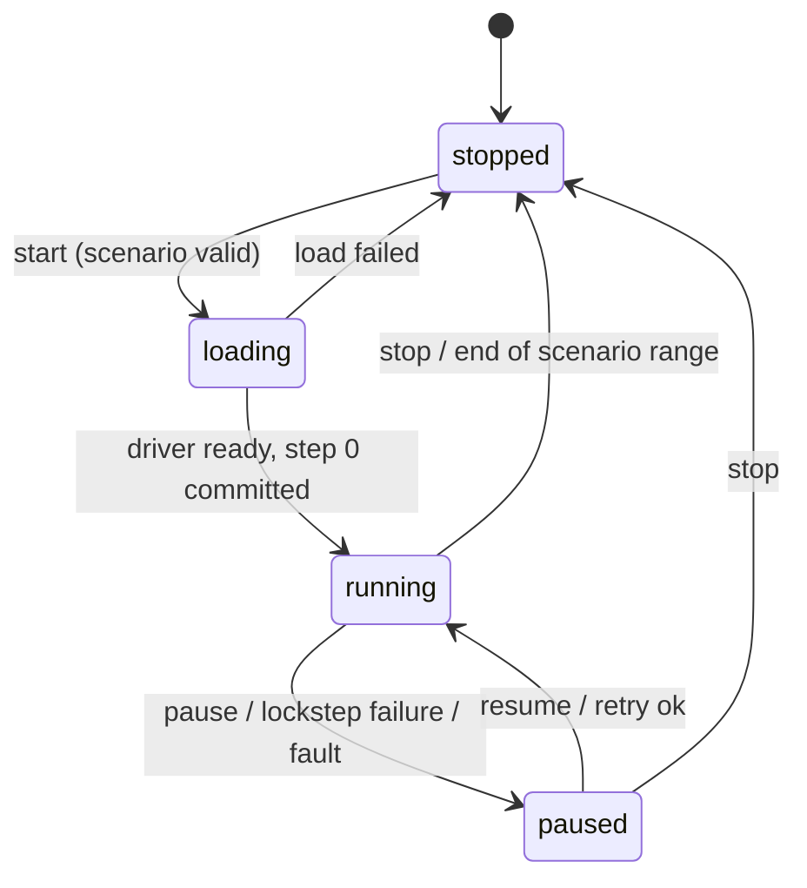

# 03 — Simulation Core

Covers the virtual clock, the fixed-timestep tick loop in the Visualizer, time scaling, silent slowdown, render interpolation, and the determinism rules that apply to both applications.

## Code placement

| Feature | Namespace | CMake target | Location |
|---|---|---|---|
| Virtual clock facade (`basic_virtual_clock`, `virtual_clock_state`) | `avis` | `AVIS_LIB` | `include/avis/virtual_clock*.h` (existing) |
| Finite state machine | `avis` | `AVIS_LIB` | `include/avis/finite_state_machine.h` (existing) |
| Simulation time types (`simulation_duration`, `step_index`), clock state machine | `avis::simulation` | `AVIS_LIB` | `include/avis/simulation/time.h`, `clock.h` |
| Tick loop, `apply_result`, interpolation anchor publishing | `avis::visualizer` | `AVIS_VISUALIZER` | `apps/visualizer/simulation/simulation_thread.*` |
| Render interpolation | `avis::visualizer` | `AVIS_VISUALIZER` | `apps/visualizer/rendering/` |

## 1. Requirements (from idea.md)

- The Visualizer main loop is based on a **virtual clock**, for determinism across runs.
- **Fixed timestep** with a configurable `delta_time`.
- Runs at wall-clock speed, or **slower/faster** on request. **No rewind.**
- Frame rendering and simulation ticks are **independent**. Poses are **interpolated** for frames between ticks.
- If the Driver can't keep up, the clock **silently slows down** to stay deterministic.
- The Visualizer can **start and pause** the simulation.

## 2. Time representation

```cpp
namespace avis::simulation
{
    using simulation_duration   = std::chrono::nanoseconds;         // int64
    using simulation_time_point = std::chrono::time_point<simulation_clock, simulation_duration>;
    using step_index     = std::uint64_t;

    // t_k = k * delta_time, exactly; never accumulated
    constexpr simulation_duration time_of_step(step_index k, simulation_duration delta_time) { return delta_time * static_cast<std::int64_t>(k); }
}
```

- Simulation time is always derived from the **step index**: `t_k = k · delta_time`. Accumulating floating-point time is forbidden.
- `delta_time` must be a whole number of nanoseconds. It defaults to **20 ms (50 Hz)**, and the scenario may set any value from 1 ms to 100 ms. KITTI-360 sensors run at about 10 Hz, so 50 Hz leaves the vehicle model and physics finer resolution than the sensor rate.
- The existing `avis::basic_virtual_clock<StoragePolicy>` / `virtual_clock_state` stay as the **`std::chrono`-compatible clock facade**: `now()` returns the time of the current committed tick. Code that needs "simulation now" uses this facade, bound to the simulation thread's state through `tls_state_policy`.

## 3. Clock state machine

Implemented with the existing `avis::finite_state_machine`.



| State | Ticks? | Rendering? | Scenario editing? |
|---|---|---|---|
| `stopped` | No | Yes (the last run's scene until *Reset* or the next start, otherwise an empty scene with the grid) | **Yes** (only here) |
| `loading` | No | Yes | No |
| `running` | Yes | Yes | No |
| `paused` | No | Yes (shows the last committed step exactly, §5.2) | No |

There's also a **single step** command, available while paused, which issues exactly one tick.

Reaching the end of the selected data (`end_of_data`, [02 §6.2](02-communication.md#62-rules)) moves the clock to `stopped`. The final state stays visible until the user presses *Reset*.

## 4. Tick loop

### 4.1 Variables

| Symbol | Meaning |
|---|---|
| `s` | Time scale: 0.1×–10×, plus `max` (as fast as the Driver allows) |
| `k_c` | Last **committed** step (its result has been applied) |
| `T` | Virtual target time, advanced by wall time × `s` |
| `in_flight` | Whether a step request is outstanding |

### 4.2 Algorithm (simulation thread)

```text
loop:
    wall_now = steady_clock::now()
    if state == running:
        T += (wall_now - wall_previous) * s          # in simulation_duration, integer arithmetic via ratio
        # silent slowdown: never let T run more than one step ahead of committed time
        T = min(T, time_of_step(k_c + 1, delta_time))
        if not in_flight and T >= time_of_step(k_c + 1, delta_time):
            send step_request(k_c + 1)            # async; reply and stream messages post to the simulation thread queue
            in_flight = true
    wall_previous = wall_now

    drain queue:
        on step k committed:          apply_result(k); k_c = k; in_flight = false
                                      update_commit_rate(wall_now)                     # §5.1
                                      anchor = { t_{k-1}, wall_now, s_effective }      # §5.2
                                      publish_snapshot(k)                              # reply + complete stream range (02 §6.3)
        on failure:                   transition(paused); anchor = { t_k, wall_now, 0 }; republish_snapshot()
        on simulation command:        start / pause / resume / step / stop / set_scale (pause, step and resume set the anchor, §5.2)
        on presentation command:      apply it; re-run the representation for affected entities; snapshot_dirty = true   # §4.4

    if snapshot_dirty and wall_now - last_presentation_publish >= 16 ms:
        republish_snapshot()          # same step and times, §4.4
        snapshot_dirty = false

    wait until next event, next due tick or pending republish (condition variable with timeout)
```

- **Clamping `T`** is how silent slowdown works. If the Driver is slow (long compute, plug-in warm-up or a slow transfer), `T` stops at `t_{k_c+1}`. Slowness is never a failure: only silence pauses ([02 §6.2](02-communication.md#62-rules)). Nothing accumulates, so there are no catch-up bursts once the Driver recovers. The deterministic step sequence is unaffected; only wall-clock pacing changes.
- With `s = max`, the `T` check is skipped and the next step is sent the moment the previous one commits.
- The loop doesn't spin. It blocks on a condition variable until a result, a command or the next due time.
- **Effective speed** is `s_effective` (§5.1). It's published to the UI status bar, for information only.

### 4.3 `apply_result(k)`
On the simulation thread, in a fixed order:
1. Apply the step's scene stream messages **in stream-sequence order** ([02 §6.3](02-communication.md#63-scene-stream-sequencing-and-commit)): entity creations and deletions, transforms and vehicle states, properties, belief geometry chunks and lidar sweeps ([08 §3.1](08-scene-management.md#31-driver-entities)). Driver entity ids map to scene entities through the `driver_entity` index.
2. Run the scene representation, which updates the mesh and material components for display shapes, belief geometry and lidar sweeps ([12 §9](12-visualizer.md#9-scene-representation)).
3. Update the scene graph's world transforms.
4. Publish the snapshot ([08 §6](08-scene-management.md#6-simulation--render-synchronisation-snapshots)).

The Visualizer adds no simulation content of its own: everything in the scene except its helpers (grid, axes, sun) comes from the Driver.

### 4.4 Presentation-only republish
Some UI commands change only what is shown, not the simulation: selection, visibility, helper toggles, representation settings, `visualization` edits and *Reset* (the full list is in [12 §4.1](12-visualizer.md#41-presentation-commands)). They work in **every** clock state, including `paused` and `stopped`, and must not wait for the next step.
- The simulation thread applies the command and re-runs the scene representation for the affected entities only. A lidar recolour, for example, produces new mesh versions ([08 §5.2](08-scene-management.md#52-cpu-ownership-and-versions)). It then marks the snapshot dirty.
- After draining the queue, a dirty snapshot is rebuilt with `make_snapshot` and republished. The rebuild is **coalesced**: at most one presentation republish per 16 ms (about 60 Hz), so dragging a slider doesn't rebuild on every event.
- A republish keeps the step fields **unchanged**: `step`, `time_previous`, `time_current`, the time anchor, and every `world_previous` / `world_current`. (Pause, single step and resume use the same republish path but change the anchor, §5.2.) The `previous_world` cache isn't rewritten, because no tick happened. Interpolation is therefore unaffected: nothing moves and nothing jumps.
- When a step commits while a presentation change is pending, the step's normal publish already includes it, and the dirty flag is cleared.
- Presentation commands never touch Driver state or the step sequence, so determinism is unaffected.

## 5. Render interpolation

The renderer runs at display rate, independently of ticks. Each snapshot `k` carries, for every renderable entity, `world(t_{k-1})` and `world(t_k)` plus the times `t_{k-1}` and `t_k`.

The simulation thread also publishes a **time anchor** with each snapshot: `{t_base, wall_base, rate}` (§5.2). The renderer's frame chain computes its presentation time as

```text
t_render = clamp(t_base + (wall_now - wall_base) * rate,  t_{k-1},  t_k)
alpha    = (t_render - t_{k-1}) / (t_k - t_{k-1})
```

That means rendering lags simulation by one tick, which is the standard price for smooth interpolation. If a commit comes later than expected, `alpha` saturates at 1 and the image holds still instead of extrapolating. Interpolation and the anchor are presentation only: they use wall time and floating-point rates freely, and never affect simulation state.

### 5.1 Effective speed (`s_effective`)
The rendered time should advance as fast as steps **actually** commit, not as fast as the requested scale says. Otherwise a slow Driver makes the image run ahead, hold, then jump.

- At every commit the simulation thread measures `r = Δt / (wall_commit_k − wall_commit_{k−1})` and keeps an exponential moving average over about the last 8 commits: `ema = ema + (r − ema) / 8`.
- `s_effective = min(s, ema)` for a finite scale, and `s_effective = ema` for `max`.
- In steady state at a finite scale, commits are paced by the clock, so `ema` converges to `s` and the rendering moves at exactly `s`. When the Driver slows down, `s_effective` drops with it, so motion slows smoothly instead of stuttering. At `max` it follows whatever rate the Driver delivers.
- Intervals that contain a pause aren't measured: the first commit after *start* or *resume* only records its wall time. Until there's a sample, `ema` starts at `s` (or, for `max`, at `Δt` divided by that first step's round-trip time).

### 5.2 Time anchor: commit, pause, single step, resume

| Event | Anchor `{t_base, wall_base, rate}` | What you see |
|---|---|---|
| Step `k` commits while running | `{t_{k−1}, commit time, s_effective}` | Motion from `t_{k−1}` towards `t_k` |
| *Pause*, or a pause caused by a failure | `{t_k, now, 0}` | The image **snaps to step `k`**, the committed state. That's a jump of at most one tick, and the picture then matches the inspector and screenshot metadata, which both refer to step `k`. |
| *Single step* (while paused) commits step `k` | `{t_k, now, 0}` | The new step, at `t_k`, right away |
| *Resume* | stays `{t_k, …, 0}` until step `k + 1` commits | The image holds at `t_k`, then interpolates `t_k → t_{k+1}` normally. No jump in either direction. |
| *Stop*, end of data | `{t_k, now, 0}` | The final committed state, until *Reset* |

Pause, single step, resume and stop republish the snapshot with only the anchor changed, through the presentation-republish path (§4.4).

Interpolation per entity:
- Position: `lerp`. Rotation: `slerp` on the shortest arc. Scale: `lerp`.
- Entities that appear in snapshot `k` but weren't in `k−1` (`world_previous` invalid) are not interpolated; they pop in.
- Interpolation lives purely in the renderer. Simulation state is never interpolated, so determinism is unaffected.

## 6. Determinism rules

"Deterministic" in iteration 1 means: **the same scenario file, the same sequence pack (by hash), the same Driver binaries and plug-in versions, on the same machine configuration, produce bit-identical step results and scene stream messages for every step index.**

| Rule | Applies to |
|---|---|
| Simulation time comes from `step_index · delta_time`, never from wall clock | Both |
| No reading of wall-clock time in simulation logic (pacing only) | Both |
| A single seeded PRNG per subsystem, seeded from `scenario.random_seed` mixed with a subsystem id via SplitMix64. Use `std::mt19937_64` or PCG32, never `std::random_device` | Driver plug-ins, oracle noise |
| Sensor samples selected by integer timestamp intervals `(t_{k-1}, t_k]` | Driver replay |
| Results must not depend on thread timing. Parallel work (Driver work on the parallel scheduler, threads a plug-in creates itself) combines results in a fixed order, for example by index | Driver, plug-ins |
| Jolt Physics: built with `JPH_CROSS_PLATFORM_DETERMINISTIC`, fixed step = `delta_time` (substeps fixed), bodies added in deterministic order | Shadow vehicle |
| World-state diffs are published in a stable order (entities sorted by `entity_id`), and the Visualizer applies them in stream-sequence order | Driver scene publisher, Visualizer `apply_result` |
| Floating-point environment: default rounding, `/fp:precise` | Both |
| Containers iterated for simulation logic must have deterministic order (no iteration over `unordered_map` for logic) | Both |

**Rendering is not part of determinism.** TAA jitter, async compute timing and frame pacing are free to vary.

A **determinism check mode** (driver flag `--record-hashes`) writes an xxh3 hash of every `step_result` payload and of the step's scene stream payloads to a file, so you can diff two runs ([13 §6](13-build-and-quality.md#6-testing-strategy)).
