# 05 — Driver Application

## Code placement

| Feature | Namespace | CMake target | Location |
|---|---|---|---|
| Driver application (service, step executor, sensor replay, plug-in host, shadow vehicle) | `avis::driver` | `AVIS_DRIVER` | `apps/driver/` |
| World state and scene publisher | `avis::driver` | `AVIS_DRIVER` | `apps/driver/world_state.*`, `apps/driver/scene_publisher.*` |
| Ground-truth oracle (built-in perception module) | `avis::driver::oracle` | `AVIS_DRIVER` | `apps/driver/oracle/` |
| Plug-in C ABI (`avis_plugin.h`) | C, `avis_` prefix (no namespace) | `AVIS_DRIVER_SDK` (header-only `INTERFACE` target, see note) | `include/avis/driver_sdk/avis_plugin.h` |
| Optional C++ plug-in wrapper (`avis_plugin.hpp`) | `avis::sdk` | `AVIS_DRIVER_SDK` | `include/avis/driver_sdk/avis_plugin.hpp` |
| Example plug-ins | plug-in specific | `AVIS_PLUGIN_EXAMPLE_LANE_FOLLOWER`, `AVIS_PLUGIN_EXAMPLE_CONSTANT_SPEED` (`SHARED`) | `apps/driver/plugins/<name>/` |

## 1. Purpose

The Driver hosts the user's autonomous-driving code. On every lockstep pulse it:

1. replays the KITTI-360 sensor samples for the step interval,
2. runs a **perception module**, which extracts other road users (cars, bikes, pedestrians, …),
3. runs the **vehicle model**, which plans and outputs control commands,
4. advances the **shadow vehicle** with those commands, using kinematic and physics simulation,
5. updates its **world state** (vehicles, sensors, perceived objects, the vehicle model's belief) and **publishes the changes** on the scene stream ([02 §5.8](02-communication.md#58-scene-stream)),
6. replies with a `step_result` that carries the status and the step's stream range.

The Visualizer knows nothing about the vehicle model or the dataset, so the Driver is the only source of scene content. At the start of a run the world state is empty, and it grows as the Driver learns about the world.

It is headless, starts as a console application, and is meant to run on a remote compute server as well as locally.

## 2. Process structure

```
apps/driver/
  main.cpp                    # CLI, configuration, avis::runtime, run loop
  driver_service.{h,cpp}      # Zenoh queryables, state machine (02 §6.1)
  step_executor.{h,cpp}       # deterministic step pipeline (long-running pool thread)
  sensor_replay.{h,cpp}       # sequence-pack readers + prefetch
  plugin_host.{h,cpp}         # DLL loading, ABI checks, fault firewall
  shadow_vehicle.{h,cpp}      # kinematic bicycle + Jolt integration
  world_state.{h,cpp}         # entities the Driver knows about, per step (§3.4)
  scene_publisher.{h,cpp}     # diff → scene stream messages, stream sequence, retry cache (§3.4)
  oracle/ground_truth_oracle.{h,cpp}   # built-in perception module
include/avis/driver_sdk/      # public plug-in SDK: avis_plugin.h (C ABI) + avis_plugin.hpp (optional C++ wrapper)
```

> The current `apps/driver` content (`simulator_driver`, `sensor_injector`, `field_reader`, `serializer`) is reworked into the structure above. `serializer.h` moves to `avis::network` ([02 §4](02-communication.md#4-message-framing)).

### 2.1 Threads
| Thread | Role |
|---|---|
| Main | Startup and shutdown, waits for the stop signal (Ctrl+C / console close handler) |
| Zenoh threads | Receive queries, forward them to the service queue |
| Service thread (pool, long-running) | Runs the state machine and replies to queries. While a load or step is in progress it publishes the `driver_status` heartbeat every 500 ms ([02 §5.11](02-communication.md#511-driver_status-pubsub-best-effort)), reading the phase and counters from atomics the step executor updates. |
| Step executor (pool, long-running) | Runs exactly one step at a time. All plug-in calls happen here (§5.6), and it publishes the step's scene stream messages before replying. |
| IO threads (pool, long-running) | Async reads for prefetch ([07 §3](07-io-layer.md#3-execution-model)) |
| Parallel workers (runtime's `exec::static_thread_pool`) | PNG decode for prefetch ([15](15-parallel-scheduler.md)). They only ever run Driver code: the plug-in SDK offers no host-run parallelism (§5.6). |
| Plug-in threads (optional, owned by plug-ins) | Whatever threads a plug-in creates for its own parallel work (§5.6). They're not pool threads, and the host doesn't fault-isolate them. |

All Driver threads except Main and Zenoh's are long-running threads on the default thread pool ([06](06-thread-pool.md)). Shutdown stops them in the order service → step executor. The runtime then stops the parallel pool and IO.

## 3. Step pipeline

```mermaid
flowchart LR
    request["step_request k, t_k, delta_time"] --> select["Select samples<br/>(t_k − delta_time, t_k]"]
    select --> frame["sensor_frame"]
    frame --> ego["Ego estimate<br/>from OXTS"]
    frame --> perception["perception.perceive"]
    ego --> perception
    perception --> objects["object_list"]
    frame --> model["vehicle_model.step"]
    objects --> model
    ego --> model
    model --> output["trajectory + control + belief"]
    output --> shadow["shadow_vehicle.integrate delta_time"]
    shadow --> world["world state k"]
    objects --> world
    output --> world
    frame --> world
    world --> publish["scene publisher: diff, publish"]
    publish --> result["step_result k: status, stream range"]
```



### 3.1 Sensor replay
- `sensor_replay` opens the enabled `.avs` streams from the pack ([04 §4](04-scenario-and-dataset.md#4-sequence-pack-format)).
- Simulation time is measured on the pack's **reference timeline** (`image_00` frame timestamps, t = 0 at `frames.start`, [04 §4.2a](04-scenario-and-dataset.md#42a-reference-timeline-framesavs)). Each stream keeps its own timestamps on that clock.
- For step `k`, it collects every record with timestamp in `(t_{k-1}, t_k]` from each stream; step 0 covers `(−Δt, 0]`. With `delta_time` = 20 ms and sensors at 10 Hz, most steps carry no camera or lidar sample, and that's expected: the model sees a `sensor_frame` with empty optionals.
- **Prefetch:** a sliding window (default 2 s of simulated time ahead) is read asynchronously through the IO layer and decoded on parallel workers (`continues_on(stdexec::get_parallel_scheduler())`). PNGs are decoded with WIC into `RGB8`. The step executor only *waits* on a sample's future, so replay is deterministic whatever the prefetch timing.
- Samples carry the **original absolute timestamp** and the sensor's calibration.

### 3.2 Ego estimate
The OXTS record nearest at or before `t_k` is converted to world `f64` pose and velocity: lat/lon/alt go to world through the KITTI-360 Mercator scale and the sequence origin, and roll/pitch/yaw go to a quaternion. This is the **measured** ego state handed to plug-ins. Ground-truth `poses.txt` is *not* exposed to the vehicle model, but the oracle may use it (documented as a ground-truth module).

### 3.3 Shadow vehicle
The shadow vehicle shows what the vehicle model *would* do. It starts at the recorded ego pose and speed at `t = 0`.

| Dynamics | Description |
|---|---|
| `kinematic_bicycle` (default) | Rear-axle reference bicycle model. State: `x, y, ψ, v`, height from the recorded pose, plus a ground-height lookup (see below). Inputs: steering angle δ (clamped by `maximum_steer` and the rate limit), acceleration a. Integrated with RK4 at `delta_time`. |
| `jolt_wheeled` | Jolt `VehicleConstraint` with a `WheeledVehicleController` on the static ground (below). Steps at `delta_time` with a fixed number of collision steps. Requires the sequence capability `semantics` ([04 §3.1](04-scenario-and-dataset.md#31-what-is-used)). |

Jolt is used in **both** modes:
- as a collision world: the static ground, kinematic boxes for perceived objects (updated each step), and the shadow vehicle body. Collision and proximity events are published as `collision.*` properties on the shadow vehicle;
- for ground-height raycasts, so the kinematic model sits on the terrain.

**Ground.** The packer builds the ground offline as height-grid tiles ([04 §4.6a](04-scenario-and-dataset.md#46a-ground-tiles-avt-avg)). At `load_scenario` the Driver:
1. computes a **corridor** of ±50 m (configurable as a shadow-vehicle parameter) around the recorded ego trajectory over the frame range;
2. loads every ground tile that intersects it, and creates one static Jolt `HeightFieldShape` body per tile, positioned relative to the run origin `O` (see below). Bodies are created in tile-index order, for determinism;
3. treats "no ground" samples as no collision. The kinematic model's raycast then misses, and it keeps its last height.

A 1 km run covers about 0.1 km², about 2.5M samples (about 10 MB), and loads in milliseconds. **Without `semantics`** (test sequences), there's no ground: `jolt_wheeled` can't be selected, and `kinematic_bicycle` takes its height from the recorded ego pose nearest in time, with a load-time warning.

**Re-synchronization:** when `resync_interval > 0`, the shadow state is reset to the recorded ego state every interval. That shows short-horizon behaviour without unbounded drift in open loop.

Jolt is configured for determinism: `JPH_CROSS_PLATFORM_DETERMINISTIC`, a single-threaded job system inside the step executor, and bodies created in sorted order.

**Jolt works in origin-relative single precision.** Jolt is built with `DOUBLE_PRECISION=OFF` ([13 §4](13-build-and-quality.md#4-dependency-management)), while the Driver keeps world coordinates in `f64` at kilometre scale ([04 §4.4](04-scenario-and-dataset.md#44-coordinate-frames-and-precision)). Everything that enters Jolt (the height field, the kinematic object boxes, the shadow vehicle body, raycast origins) is therefore expressed relative to the run origin `O` and converted at one boundary in `shadow_vehicle`: `jolt = float(p − O)` going in, `p = O + double(jolt)` coming out. Velocities and orientations need no conversion. KITTI-360 runs stay within a few kilometres of `O`, where `f32` resolves better than 0.5 mm. That's enough for contact and ground-height queries, and avoids the cost and the determinism surface of a double-precision Jolt build.

### 3.4 World state and scene publishing
The **world state** is the Driver's model of everything it can tell the Visualizer about. After each step, the scene publisher compares it with the previous step and publishes only the differences.

| Content | Source | Published as |
|---|---|---|
| Ego vehicle (`primary` flag) | Host: recorded pose (open loop), calibration | `entity_update` at step 0 (`vehicle` display), `vehicle_state` every step. The OXTS-based estimate is shown as `estimate.*` properties. |
| Sensor rig | Host: enabled sensors and calibration | `sensor` entities under the ego vehicle at step 0 (`frustum` display for cameras, `axes` for lidar and GNSS/IMU), intrinsics as properties |
| Lidar sweeps | Host: replayed `velodyne` samples | `lidar_sweep` for every sweep in the step interval ([02 §5.8.6](02-communication.md#586-lidar_sweep)) |
| Shadow vehicle | Host: shadow simulation | `vehicle` entity (ghost opacity) and `vehicle_state` every step. The last control command is published as `control.*` properties. |
| Perceived objects | Perception plug-in | `object` entities (source `perception`, id = `track_id`) under a `perception` group, `transform_update` with extent, and `perception.classification`, `perception.confidence`, `perception.velocity` properties. Tracks that disappear are deleted. |
| Vehicle-model belief: objects | Vehicle model (`avis_world_belief.objects`, §5.3) | `object` entities (source `vehicle_model`) under a `belief` group with the plug-in's own properties (for example the estimated class and dimensions) |
| Vehicle-model belief: geometry | Vehicle model (`avis_world_belief.geometries`) | `geometry` entities with chunked `geometry_update` deltas: drivable area, lane boundaries, point maps, … |
| Planned trajectory | Vehicle model (`avis_vehicle_model_output.trajectory`) | A `line_strip` `geometry_update` on a `trajectory` entity under the shadow vehicle |

- **Vehicles are root entities** ([02 §5.8.1](02-communication.md#581-entity_update)): the ego and shadow vehicles are created with parent `0`, so their `vehicle_state` world pose is also their local pose.
- **Entity ids** combine the source and a source-local id ([02 §5.7](02-communication.md#57-common-types)), so ids are deterministic and never collide between the host, the perception module and the vehicle model.
- **Diffing** is per entity and per property, in ascending `entity_id` order. Geometry isn't diffed: the plug-in reports changed and removed chunks itself, because only it knows what changed.
- **Ordering:** creations sort parents before children, deletions remove subtrees. Each message gets the next **stream sequence**, which resets to 0 at every `load` ([02 §6.3](02-communication.md#63-scene-stream-sequencing-and-commit)).
- **Retry cache:** the publisher keeps the serialised messages of the last step. A retried `step k` re-publishes them unchanged ([02 §6.2](02-communication.md#62-rules)).
- Publishing happens on the step executor, before the reply. The publishers use blocking congestion control, so a slow network slows the step down instead of losing scene data.

## 4. Built-in perception: ground-truth oracle

`ground_truth_oracle` makes the system usable before any learned detector exists. It produces plausible detections from annotations:

1. Look up the dynamic and static boxes active at `t_k` (`boxes.avb`). Use static boxes only for the movable classes, such as parked cars.
2. Keep the classes listed in the parameters.
3. **Visibility filter:** keep a box if its centre is within `maximum_range` of the lidar, **and** at least `minimum_lidar_points` points of the most recent velodyne sweep fall inside the box (computed in the box frame). This approximates occlusion with real sensor data.
4. **Noise model** (optional, seeded): Gaussian position and yaw noise, random dropouts, and a constant per-track size bias.
5. Velocity is the finite difference of the instance centre between annotation frames.
6. `track_id` = KITTI-360 object id, so tracks are perfect.

Outputs are in **world** coordinates. The Driver publishes them as `object` entities with box displays and `perception.*` properties (§3.4).

## 5. Plug-in SDK

The plug-in boundary is a **plain C interface** (owner decision D-06). Plug-ins can be built with any compiler (MSVC, clang-cl, MinGW-w64 GCC) and any runtime library. They can be written in any language that can export C functions (C, C++, Rust, Zig, …). The Driver's own toolchain choices never leak into plug-ins.

### 5.1 Packaging
- Plug-ins are Windows x64 DLLs found under `plugins.search_paths`. One DLL can provide several modules (perception modules and/or vehicle models). A plug-in's private dependency DLLs sit next to it, and they're found through `LOAD_LIBRARY_SEARCH_DLL_LOAD_DIR`.
- DLLs are loaded only while a run is loaded, so they can be rebuilt whenever the simulation is stopped (§5.4).
- The SDK has two headers in `include/avis/driver_sdk/`:

| Header | Language | Purpose |
|---|---|---|
| `avis_plugin.h` | **C11** (`<stdint.h>`, `<stddef.h>` only) | The ABI contract: types, function tables and the entry point. This is the only thing the Driver and a plug-in share. |
| `avis_plugin.hpp` | C++20, header-only, optional | A convenience wrapper **compiled into the plug-in**: base classes, exception-to-status trampolines, a definition macro. It never crosses the boundary, so it adds no ABI constraints. |

- There's no Eigen, STL, Zenoh, Qt or D3D type in the C contract. The SDK is the header-only `INTERFACE` target **`AVIS_DRIVER_SDK`**, exported as a CMake package (`find_package(avis_driver_sdk)`) for out-of-tree plug-ins. It's deliberately **not** part of `AVIS_LIB`, because plug-ins must never link the Avis library ([13 §2.1.1](13-build-and-quality.md#211-other-targets)). Non-CMake users only need the header.

### 5.2 ABI rules
1. **Calling convention:** the default x64 convention (Windows has only one). Every exported or table function is declared with `AVIS_CALL` (`__cdecl`, which is a no-op on x64), so the header stays explicit.
2. **Plain data only:** structs contain fixed-width integers, `float`/`double`, pointers and nested structs. There are no bitfields or `bool` (use `uint8_t`), and no `long` (its width differs between compilers). Enums are passed as `int32_t` typedefs with `#define`d values, so their size is fixed.
3. **Layout:** natural alignment, no `#pragma pack`. The header has `_Static_assert` checks on `sizeof`/`offsetof` for every struct, so a compiler that disagrees fails to build instead of corrupting data at runtime.
4. **Versioning: exact match.** `AVIS_PLUGIN_API_VERSION = (major << 16) | minor`. The host loads a plug-in only when its `api_version` **equals** the host's (major **and** minor) **and** its `abi_fingerprint` equals the host's (below). Host and plug-in therefore always share one identical header, so there's no backward compatibility to maintain:
   - Any change to `avis_plugin.h` (adding, removing or reordering fields, in any struct, including array elements and nested structs) is allowed, and **bumps the version**. Changes that don't touch the header don't, so existing plug-ins keep loading across Driver updates.
   - Every ABI change means rebuilding all plug-ins against the new SDK. That's accepted: plug-ins are built by the user, usually alongside the Driver.
   - **Layout fingerprint:** `AVIS_PLUGIN_ABI_FINGERPRINT` is a C11 integer constant expression in the header, built from the `sizeof` and `offsetof` of every ABI struct and field (a polynomial mix with fixed primes, evaluated by the plug-in's own compiler). The plug-in exports it in `avis_plugin_information`. A mismatch catches a forgotten version bump, or a compiler that lays a struct out differently, at load time instead of as memory corruption.
   - Top-level structs still start with `uint32_t struct_size`. It has no compatibility meaning any more; it's a cheap sanity check that must equal the receiver's `sizeof`.
   - Arrays are plain C arrays indexed with `pointer[i]`. No element strides are needed.
5. **Memory ownership:** memory is always freed by the side that allocated it. No CRT objects (`FILE*`, `malloc`'d blocks, C++ objects) cross the boundary.
   - *Inputs* (sensor frames, ego state) are host-owned and valid only for the duration of the call.
   - *Outputs* with variable length (objects, trajectories) point to **plug-in-owned** memory that must stay valid until the next call on the same instance or until `destroy`. The host copies them right away.
   - *Errors* are written into a host-provided fixed buffer.
6. **No unwinding across the boundary:** a C++ plug-in must not let exceptions escape a table function. The C++ wrapper catches everything and returns `AVIS_STATUS_ERROR`. A leaking exception still gets caught by the host's SEH firewall (§6), but it's treated as a hard fault.
7. **Strings:** UTF-8. `avis_string_view` (pointer + length) for inputs, NUL-terminated `const char*` for static names in descriptors.

### 5.3 C interface (`avis_plugin.h`, abridged)

```c
#define AVIS_PLUGIN_API_VERSION ((1u << 16) | 0u)
/* layout fingerprint over every ABI struct (rule 4); the full expression lists all structs and fields */
#define AVIS_PLUGIN_ABI_FINGERPRINT \
    ((uint64_t)sizeof(avis_sensor_frame) * 0x9E3779B97F4A7C15ull ^ (uint64_t)offsetof(avis_sensor_frame, lidars) * 0xC2B2AE3D27D4EB4Full /* ^ … */)
#define AVIS_CALL __cdecl
#define AVIS_PLUGIN_EXPORT __declspec(dllexport)

typedef int32_t avis_status;            /* AVIS_STATUS_OK = 0, AVIS_STATUS_ERROR = 1, AVIS_STATUS_INVALID_ARGUMENT = 2, AVIS_STATUS_OUT_OF_MEMORY = 3 */
typedef int32_t avis_module_kind;       /* AVIS_MODULE_PERCEPTION = 1, AVIS_MODULE_VEHICLE_MODEL = 2 */
typedef int32_t avis_object_class;      /* AVIS_CLASS_CAR = 1, ... (04 §3.2) */
typedef int32_t avis_log_level;         /* trace .. error */

typedef struct avis_string_view { const char* data; size_t size; } avis_string_view;
typedef struct avis_vector3f
{
    float x;
    float y;
    float z;
} avis_vector3f;
typedef struct avis_vector3d
{
    double x;
    double y;
    double z;
} avis_vector3d;
typedef struct avis_quaterniond
{
    double w;
    double x;
    double y;
    double z;
} avis_quaterniond;
typedef struct avis_error { char message[512]; } avis_error;         /* host-provided, plug-in writes NUL-terminated text */

/* ---- sensor data (host-owned, valid during the call) ---- */
typedef struct avis_sample_header { avis_string_view sensor; int64_t timestamp_ns; int64_t simulation_time_ns; } avis_sample_header;
typedef struct avis_image_view
{
    uint32_t width;
    uint32_t height;
    uint32_t row_stride;
    int32_t format;                       /* AVIS_IMAGE_RGB8 */
    const uint8_t* pixels;
} avis_image_view;
typedef int32_t avis_camera_model;      /* AVIS_CAMERA_MODEL_PINHOLE = 0 (rectified, no distortion), AVIS_CAMERA_MODEL_MEI = 1 (fisheye) */
typedef struct avis_camera_calibration
{
    avis_camera_model model;
    uint32_t width;                       /* image size the intrinsics refer to, pixels */
    uint32_t height;
    double focal_length_x;                /* pinhole: fx; MEI: gamma1 */
    double focal_length_y;                /* pinhole: fy; MEI: gamma2 */
    double principal_point_x;             /* pinhole: cx; MEI: u0 */
    double principal_point_y;             /* pinhole: cy; MEI: v0 */
    double distortion[8];                 /* pinhole: all 0; MEI: [0] xi, [1] k1, [2] k2, [3] p1, [4] p2, [5..7] 0 */
    double sensor_to_vehicle[16];         /* column-major (calibration.yaml is row-major; the host converts) */
} avis_camera_calibration;
typedef struct avis_lidar_point
{
    float x;
    float y;
    float z;
    float intensity;
} avis_lidar_point;
typedef struct avis_camera_sample   { avis_sample_header header; avis_camera_calibration calibration; avis_image_view image; } avis_camera_sample;
typedef struct avis_lidar_sample    { avis_sample_header header; double sensor_to_vehicle[16]; const avis_lidar_point* points; uint32_t point_count; } avis_lidar_sample;
typedef struct avis_gnss_imu_sample { avis_sample_header header; avis_oxts_record record; } avis_gnss_imu_sample;

typedef struct avis_sensor_frame
{
    uint32_t struct_size;
    int64_t  simulation_time_ns;
    const avis_camera_sample*   cameras;  uint32_t camera_count;    /* samples in (t_{k-1}, t_k] */
    const avis_lidar_sample*    lidars;   uint32_t lidar_count;
    const avis_gnss_imu_sample* gnss_imu; uint32_t gnss_imu_count;
} avis_sensor_frame;

typedef struct avis_vehicle_state { avis_vector3d position; avis_quaterniond orientation; avis_vector3d velocity; avis_vector3d angular_velocity; } avis_vehicle_state;
typedef struct avis_detected_object { uint32_t track_id; avis_object_class classification; avis_vector3d center; avis_vector3f extent; float yaw; avis_vector3f velocity; float confidence; } avis_detected_object;
typedef struct avis_trajectory_point { int64_t time_offset_ns; avis_vector3d position; float yaw; float speed; } avis_trajectory_point;
typedef struct avis_control_command { float steering_angle; float acceleration; float brake; } avis_control_command;

/* ---- host services (host-owned, valid for the module lifetime) ---- */
typedef struct avis_host_api
{
    uint32_t struct_size;
    uint32_t api_version;
    void*    host_context;
    /* thread-safe: may be called from any plug-in thread, including threads the plug-in created */
    void        (AVIS_CALL* log)(void* host_context, avis_log_level level, avis_string_view message);
    const avis_dataset_information* dataset;     /* sequence name, calibration, time base (read-only) */
    /* how many worker threads a plug-in should use for its own parallel work (§5.6); at least 1 */
    uint32_t suggested_thread_count;
} avis_host_api;

typedef struct avis_module_initialization
{
    uint32_t struct_size;
    const avis_host_api* host;
    uint64_t seed;                        /* per-module deterministic seed (03 §6) */
    avis_string_view yaml_parameters;     /* parameters block from the scenario */
} avis_module_initialization;

/* ---- module function tables ---- */
typedef struct avis_object_list { const avis_detected_object* objects; uint32_t count; } avis_object_list;   /* plug-in-owned */

typedef struct avis_perception_vtable
{
    uint32_t struct_size;
    avis_status (AVIS_CALL* create)(const avis_module_initialization* initialization, void** out_instance, avis_error* error);
    void        (AVIS_CALL* destroy)(void* instance);
    avis_status (AVIS_CALL* perceive)(void* instance, const avis_sensor_frame* frame,
                                      const avis_vehicle_state* ego_estimate, avis_object_list* out, avis_error* error);
} avis_perception_vtable;

typedef struct avis_vehicle_model_input
{
    uint32_t struct_size;
    const avis_sensor_frame*    sensors;
    const avis_vehicle_state*   ego_estimate;
    const avis_detected_object* objects; uint32_t object_count;
    int64_t delta_time_ns;
} avis_vehicle_model_input;

/* ---- world belief (plug-in-owned, valid until the next call) ---- */
typedef int32_t avis_property_type;     /* AVIS_PROPERTY_BOOLEAN, _INTEGER, _NUMBER, _TEXT, _VECTOR3 */
typedef struct avis_property
{
    avis_string_view key;                 /* dotted, e.g. "estimate.classification" */
    avis_property_type type;
    int64_t integer;                      /* boolean (0/1) and integer */
    double number[3];                     /* number uses [0], vector3 uses all three */
    avis_string_view text;
    avis_string_view unit;                /* SI unit symbol, may be empty */
} avis_property;

typedef struct avis_belief_object
{
    uint64_t object_id;                   /* stable while the model tracks the object */
    avis_string_view name;
    avis_vector3d center;
    avis_quaterniond orientation;
    avis_vector3f extent;
    const avis_property* properties; uint32_t property_count;
} avis_belief_object;

typedef int32_t avis_topology;          /* AVIS_TOPOLOGY_TRIANGLES, _LINES, _LINE_STRIP, _POINTS */
typedef struct avis_geometry_style
{
    uint32_t color;                       /* RGBA8, sRGB */
    float opacity;
    uint8_t lit;
    uint8_t overlay;                      /* 0 = world layer, 1 = overlay layer */
    float line_width;                     /* pixels */
    float point_size;                     /* metres */
} avis_geometry_style;

typedef struct avis_geometry_chunk
{
    uint64_t geometry_id;                 /* the belief geometry this chunk belongs to */
    uint32_t chunk_id;
    uint8_t remove;                       /* 1 = remove the chunk, the arrays below are ignored */
    avis_topology topology;
    avis_vector3d origin;                 /* world */
    const float* positions; uint32_t vertex_count;   /* xyz relative to origin */
    const uint32_t* indices; uint32_t index_count;   /* optional */
    const float* normals;                 /* optional, xyz per vertex */
    const uint32_t* colors;               /* optional, RGBA8 per vertex */
    avis_geometry_style style;
} avis_geometry_chunk;

typedef struct avis_world_belief
{
    uint32_t struct_size;
    const avis_belief_object* objects; uint32_t object_count;   /* the full set every step; the host diffs it */
    const avis_geometry_chunk* changed_chunks; uint32_t changed_chunk_count;   /* only chunks that changed this step */
} avis_world_belief;

typedef struct avis_vehicle_model_output
{
    uint32_t struct_size;
    const avis_trajectory_point* trajectory; uint32_t trajectory_count;   /* plug-in-owned */
    avis_control_command control;
    const avis_world_belief* belief;      /* optional (NULL = nothing to show) */
    const avis_property* properties; uint32_t property_count;   /* optional planner state, shown on the shadow vehicle as planner.* */
} avis_vehicle_model_output;

typedef struct avis_vehicle_model_vtable
{
    uint32_t struct_size;
    avis_status (AVIS_CALL* create)(const avis_module_initialization* initialization, void** out_instance, avis_error* error);
    void        (AVIS_CALL* destroy)(void* instance);
    avis_status (AVIS_CALL* reset)(void* instance, const avis_vehicle_state* initial_state, avis_error* error);
    avis_status (AVIS_CALL* step)(void* instance, const avis_vehicle_model_input* input,
                                  avis_vehicle_model_output* out, avis_error* error);
} avis_vehicle_model_vtable;

/* ---- entry point ---- */
typedef struct avis_module_descriptor
{
    uint32_t struct_size;
    avis_module_kind kind;
    const char* name;                     /* e.g. "example_lane_follower" (unique per Driver) */
    const char* version;
    const void* vtable;                   /* avis_perception_vtable* or avis_vehicle_model_vtable* by kind */
    const char* parameters_schema;        /* YAML text (§5.8), NUL-terminated; NULL or "" = no schema */
} avis_module_descriptor;

typedef struct avis_plugin_information
{
    uint32_t struct_size;
    uint32_t api_version;                 /* AVIS_PLUGIN_API_VERSION the plug-in was built against; must equal the host's */
    uint64_t abi_fingerprint;             /* AVIS_PLUGIN_ABI_FINGERPRINT as computed by the plug-in's compiler; must equal the host's */
    const char* plugin_name;
    uint32_t module_count;
    const avis_module_descriptor* modules;
} avis_plugin_information;

AVIS_PLUGIN_EXPORT const avis_plugin_information* AVIS_CALL avis_get_plugin_information(void);
```

Two more structs are fully defined in the header and left out above for brevity:
- **`avis_oxts_record`**: the 30 OXTS fields in KITTI order, matching the pack's `oxts` record ([04 §4.2](04-scenario-and-dataset.md#42-stream-file-avs)): 25 `double` fields `lat, lon, alt, roll, pitch, yaw, vn, ve, vf, vl, vu, ax, ay, az, af, al, au, wx, wy, wz, wf, wl, wu, pos_accuracy, vel_accuracy`, then 5 `int32_t` fields `navstat, numsats, posmode, velmode, orimode`.
- **`avis_dataset_information`**: `struct_size`; `sequence` (`avis_string_view`); `time_base_ns` and the reference times of `frames.start` / `frames.end` (`int64_t`); `capabilities` (`uint32_t` bit mask: `AVIS_CAPABILITY_BOXES`, `AVIS_CAPABILITY_SEMANTICS`); `imu_to_vehicle[16]` (column-major); and a sensor array `{name, kind, sensor_to_vehicle[16], camera (avis_camera_calibration, cameras only)}` with its count. It's built from `calibration.yaml` and the manifest ([04 §4.7–4.8](04-scenario-and-dataset.md#48-calibration-calibrationyaml)).

**Camera models.** `pinhole` is used for the rectified perspective cameras (`image_00/01`); its distortion is zero. `MEI` is the unified camera model of KITTI-360's fisheye cameras (`image_02/03`): a point is projected onto the unit sphere, shifted by `xi` along the optical axis, then distorted (`k1, k2` radial, `p1, p2` tangential) and mapped with `gamma1/gamma2, u0/v0`. The C++ wrapper provides `project` / `unproject` for both models (§5.5). C plug-ins implement the formulas from the SDK documentation.

### 5.4 Host side
- **Scanning.** For every DLL under `plugins.search_paths`, `plugin_host` loads it with `LoadLibraryExW(..., LOAD_LIBRARY_SEARCH_DLL_LOAD_DIR | LOAD_LIBRARY_SEARCH_DEFAULT_DIRS)`, resolves `avis_get_plugin_information`, checks that `api_version` and `abi_fingerprint` exactly equal the host's (rule 4), that every `struct_size` equals the host's `sizeof`, and that module names are unique. It **copies** the module descriptors (names, versions, `parameters_schema` text) into Driver-owned memory, then calls `FreeLibrary` again. Only `avis_get_plugin_information` is resolved at scan time.
- **When a scan runs:** at startup, at the start of every `load_scenario` (before any module is created), and on an explicit `rescan` request ([02 §5.6a](02-communication.md#56a-rescan)). A scan is cheap: a DLL whose size and modification time are unchanged since the last scan isn't loaded again, and its cached descriptors are reused.
- **DLLs are loaded only while a run is loaded.** `load_scenario` loads the DLLs that provide the scenario's modules and calls `create`. `unload` (and a restarting `load`) calls `destroy` on every instance and then `FreeLibrary` on every module. So while no run is loaded, which is the Visualizer's `stopped` state, **no plug-in file is locked**.
- **Rebuild workflow: unload before rebuild.** To rebuild a plug-in, the user stops the run in the Visualizer (*Stop* sends `unload`, [02 §5.6](02-communication.md#56-unload)), builds, and presses *Start*. The `load` rescans and picks up the new DLL. While a run is loaded, the DLL is locked and a rebuild fails at link time. The Driver panel shows *"plug-ins locked: run loaded"* as a reminder ([12 §6](12-visualizer.md#6-panels-and-controls)).
- **Pinned modules.** A module with an instance **abandoned** after an SEH fault (§6) can't be freed safely: its threads (§5.6) may still be running its code. It stays loaded, and its file locked, until the Driver restarts. `describe` and `rescan` list it in `pinned_plugins[]` with the reason *"abandoned after a fault: restart the Driver to rebuild"*. The next `load` of a pinned plug-in reuses the loaded module, so there's no new code until the restart.
- A plug-in that fails a check is **rejected, not loaded further**. It's listed in the plug-in catalogue's `rejected_plugins[]` (in `describe`, `rescan` and the `load_scenario` reply, [02 §5.2](02-communication.md#52-describe)) and in the Driver log with a reason that tells the user what to do, for example *"example_lane_follower.dll: built against plug-in API 1.2, Driver has 1.3. Rebuild against the current SDK."* or *"… ABI fingerprint differs from the Driver's (same version, different layout). Rebuild against the current SDK, or check for a mismatched header copy."* The Visualizer shows these in its Driver panel and the connection dialog.
- The host converts its internal types into the C structs **without copying bulk data**: `avis_image_view.pixels` and `avis_lidar_sample.points` point straight into the replay buffers.
- Plug-in outputs are copied into Driver-owned storage right after each call, then merged into the world state (§3.4).
- Every table call goes through the fault firewall (§6).

### 5.5 Optional C++ wrapper (`avis_plugin.hpp`)
For C++ authors, the wrapper offers idiomatic base classes and generates the C tables. It's compiled into the plug-in with the plug-in's own compiler:

```cpp
class my_model : public avis::sdk::vehicle_model
{
public:
    explicit my_model(const avis::sdk::module_initialization& initialization);                          // parse initialization.yaml_parameters()
    void reset(const avis_vehicle_state& initial) override;
    avis::sdk::vehicle_model_result step(const avis::sdk::vehicle_model_input& in) override;   // throw on error
};

AVIS_DEFINE_PLUGIN("my_plugin",
    AVIS_VEHICLE_MODEL("my_model", "1.0.0", my_model),
    AVIS_PERCEPTION_MODULE("my_detector", "0.3.0", my_detector));
```

- The trampolines catch all exceptions and convert them into `AVIS_STATUS_ERROR` with `what()` copied into `avis_error`.
- `std::span` views over the input arrays and a `std::vector` scratch area for outputs, which keeps output pointers valid until the next call as rule 5 requires.
- Optional Eigen conversion helpers (`#if __has_include(<Eigen/Core>)`), so plug-ins can work with Eigen types internally without them appearing in the ABI.
- **Camera projection helpers:** `avis::sdk::project(calibration, point_in_camera)` → pixel and `unproject(calibration, pixel)` → unit ray, for both the pinhole and the MEI model (§5.3). They're plain header-only functions with no dependencies.
- A `belief_builder` that collects objects, properties and geometry chunks in owned storage and fills `avis_world_belief`, so C++ models don't manage the pointer lifetimes by hand.
- A **parameter declaration helper**: a module declares each parameter once, and the wrapper generates both the `parameters_schema` text (§5.8) and the typed parsing of `yaml_parameters`. For example:
  ```cpp
  struct lane_follower_parameters
  {
      double target_speed;
      double lookahead;
  };
  AVIS_PARAMETERS(lane_follower_parameters,
      AVIS_PARAMETER(target_speed, number, 8.0, "m/s", "Cruise speed", minimum(0.0), maximum(40.0)),
      AVIS_PARAMETER(lookahead,    number, 6.0, "m",   "Pure-pursuit look-ahead distance", minimum(1.0)));
  ```
  The wrapper parses YAML with a tiny embedded parser for the schema subset, so plug-ins don't need yaml-cpp.

### 5.6 Calling rules
- All calls happen on the step executor thread, in a fixed order per step: `perceive` → `step`.
- `create` and `reset` are called at `load_scenario` / step 0. `destroy` is called at `unload`, or when the instance is replaced after a fault.
- A non-OK status is a **soft fault**: the step reports `perception_fault` or `model_fault` with the `avis_error` message.
- Plug-ins must not keep global mutable state shared between instances, must not read the wall clock for logic, and must use `seed` for all randomness ([03 §6](03-simulation-core.md#6-determinism-rules)).
- **Parallel work is the plug-in's own business.** The SDK has no host-run parallel loop. A plug-in that wants parallelism uses its own language's or runtime's facilities (`std::thread`, OpenMP, TBB, rayon, …), under these rules:
  - **Lifetime:** threads are created in `create` (or lazily) and joined in `destroy`. No plug-in work may still be running when `perceive` / `step` returns.
  - **Determinism:** results must not depend on thread timing. Per-item results are combined in a fixed order, for example by index ([03 §6](03-simulation-core.md#6-determinism-rules)).
  - **Sizing:** use `avis_host_api.suggested_thread_count` (the logical processors left after the Driver's own threads, at least 1) to avoid oversubscribing the CPU.
  - **No fault isolation:** threads a plug-in creates run outside the host's SEH thunk (§6). A crash on such a thread terminates the Driver process. An instance abandoned after a fault is never called again, so its threads keep running until the process exits.
  - `host->log` is thread-safe and may be called from any of these threads. No other host function may be.

### 5.7 Example plug-ins
- `apps/driver/plugins/example_lane_follower` (C++ through `avis_plugin.hpp`) is the reference model. It follows the recorded future ego path (from the dataset, an explicit "cheat" for demos) with pure-pursuit steering and a speed PID that slows down for perceived objects in the path corridor. It serves as a template.
- `apps/driver/plugins/example_constant_speed` (**pure C11**) holds the current heading at a constant speed. It exists to prove the C contract compiles and runs without C++, and it's built in CI with both MSVC and clang-cl.

### 5.8 Parameter schema
Each module can describe its parameters with `avis_module_descriptor.parameters_schema`, a YAML text in a small schema subset. Because it's plain text in the ABI, it works the same from any language.

```yaml
avis_parameters: 1
fields:
  target_speed: { type: number, default: 8.0, minimum: 0.0, maximum: 40.0, unit: m/s, description: "Cruise speed" }
  lookahead:    { type: number, default: 6.0, minimum: 1.0, unit: m, description: "Pure-pursuit look-ahead distance" }
  mode:         { type: enum, values: [cautious, normal, sporty], default: normal }
  offsets:      { type: vector3, default: [0.0, 0.0, 0.0], unit: m }
  pid:
    type: map
    fields:
      kp: { type: number, default: 0.5 }
      ki: { type: number, default: 0.05 }
  ignored_classes: { type: list, items: text, default: [] }
```

- **Types:** `number`, `integer`, `boolean`, `text`, `enum` (with `values`), `vector3`, `map` (nested `fields`), `list` (of one scalar type). **Attributes:** `default` (required for every non-map field; a map's default is made of its fields' defaults), `minimum` / `maximum` (numbers, integers and list length), `unit`, `description`.
- **Validation at `load_scenario`:** the Driver checks the scenario's parameters against the schema before calling `create`:
  - wrong type, out of range or an unknown enum value → an **error** diagnostic with its path, for example `driver.vehicle_model.parameters.pid.kp`, and `invalid_parameters`;
  - unknown keys → a **warning** diagnostic. The load continues, and the key is passed on to the plug-in untouched.
  - Diagnostics travel in the `load_scenario` reply ([02 §5.4](02-communication.md#54-load_scenario)).
- **Defaults:** missing fields are filled in from `default`. The plug-in receives the merged YAML in `yaml_parameters`, and the Visualizer receives it as `effective_parameters`.
- **A malformed schema** (unparseable, unknown type, missing default) puts the plug-in in `rejected_plugins[]` with the schema error, so authors notice at scan time.
- A module without a schema still works: its parameters are passed through unchecked, and the Visualizer edits them as raw YAML ([12 §6.1](12-visualizer.md#61-editing-workflow)).
- The built-in modules publish schemas too: `ground_truth_oracle` (§4) and the shadow-vehicle dynamics (§3.3), so `driver.perception.parameters` and `driver.shadow_vehicle.parameters` get forms and validation like any plug-in.

## 6. Fault isolation

| Fault | Handling |
|---|---|
| Plug-in returns a non-OK `avis_status` | `step_result.status = *_fault` with the `avis_error` message, plug-in marked faulted. The instance stays usable after a reload. |
| Malformed output (count > 0 with a null pointer, NaN in a control command or belief geometry, index out of range, `struct_size` different from the host's `sizeof`) | The host validates every output → `*_fault` with a description of the violation |
| An exception unwinds out of a table function (an ABI violation, rule 5.2.6) | Caught by the SEH thunk (an MSVC C++ exception is SEH code `0xE06D7363`; other runtimes raise their own codes) → hard fault, handled like the next row |
| SEH exception (access violation, divide by zero) | Every table call is wrapped in a `__try/__except` thunk (a separate translation unit, since SEH and C++ objects don't mix) → `*_fault` with the exception code and the faulting module name. The plug-in instance is **abandoned**: never called again, and its memory is leaked deliberately because its state is suspect. Its module is **pinned** until the Driver restarts (§5.4). A reload creates a fresh instance from the same loaded module. |
| Plug-in hangs | Not killable in-process, and indistinguishable from a very slow plug-in. The service thread keeps sending `driver_status` heartbeats, so the Visualizer doesn't pause: it shows *"Driver busy: vehicle_model.step, 95 s"* ([02 §7](02-communication.md#7-failure-handling)), and the user can press *Stop* and restart the Driver. A watchdog writes a stack snapshot via `MiniDumpWriteDump` once a single plug-in call has run for `hang_dump_after` (`driver.yaml`, default 60 s), once per call. In debug mode (§8) the watchdog is off. |
| Stack overflow or heap corruption | Process dies → liveliness lost → Visualizer pauses. A `SetUnhandledExceptionFilter` handler writes a minidump to `logs/` first. |
| Fault on a thread the plug-in created (§5.6) | Not isolatable: the host doesn't run that code. Handled like the previous row (process dies, minidump, Visualizer pauses as `disconnected`). The minidump names the faulting module, and the Driver log notes the last plug-in call in progress. |

The Visualizer is a separate process, so none of these can crash it, which meets the idea document's requirement.

## 7. Configuration and CLI

```
avis_driver.exe [--configuration driver.yaml] [--driver-id <id>]
                [--log-level trace|debug|info|warn|error] [--record-hashes <file>]
                [--debug]
```

On startup the Driver loads its configuration, initialises `avis::runtime`, scans plug-ins (reading only their info) and its data roots (building the data catalogue for `describe`), opens Zenoh with scouting replies enabled, declares its liveliness token and the `describe` and `connect` queryables, and waits `unbound` until a Visualizer connects ([02 §2](02-communication.md#2-zenoh-topology-and-discovery)).

## 8. Debug mode
Plug-in authors debug their code inside the Driver process, for example by attaching Visual Studio and stopping at a breakpoint in `step`. A breakpoint freezes the **whole** process, Zenoh's threads included. Without special handling, the Visualizer's step timeout fires, the watchdog writes a minidump, and the Zenoh lease expires, so each side declares the other gone and the run is lost. A frozen process can't be told apart from a hung one, so debugging gets an explicit mode.

- **Enabling it:** `--debug` on the command line, or `debug: { enabled: true }` in `driver.yaml` ([01 §7](01-system-architecture.md#7-configuration)). It also turns on automatically when the Driver is **started** under a debugger (`IsDebuggerPresent()` at startup).
- **Effects on the Driver:**
  - Zenoh is opened with a long lease (`debug.zenoh_lease`, default 1 h) instead of Zenoh's default (about 10 s), so a breakpoint doesn't drop the connection.
  - The hang watchdog (§6) is off.
  - `describe` reports `debug_mode {enabled, lease_ms}` ([02 §5.2](02-communication.md#52-describe)), and the Driver logs a warning at startup that debug mode is on.
- **Effects on the Visualizer:** silence doesn't pause (a breakpoint stops the heartbeats too), and a liveliness loss is shown as *"Driver suspended?"* instead of pausing ([02 §7.1](02-communication.md#71-with-a-driver-in-debug-mode)).
- **Attach after startup:** the lease is fixed when the Zenoh session opens, so attaching a debugger to a Driver started **without** debug mode doesn't help with breakpoints longer than the normal lease. The SDK documentation tells plug-in authors to start the Driver with `--debug` whenever they plan to debug.
- **Determinism:** unaffected. Debug mode changes only wall-clock limits, never step contents.
- **Not for production runs:** with a long lease, a Driver that really crashes is noticed only when the user presses *Stop*, or after the lease.

> To verify early with a quick test: that zenoh-c honours a long `transport/link/tx/lease` advertised by the frozen peer, and that it re-declares liveliness tokens automatically after a connection drops and recovers. If it does, even an expired lease recovers once the process continues.
