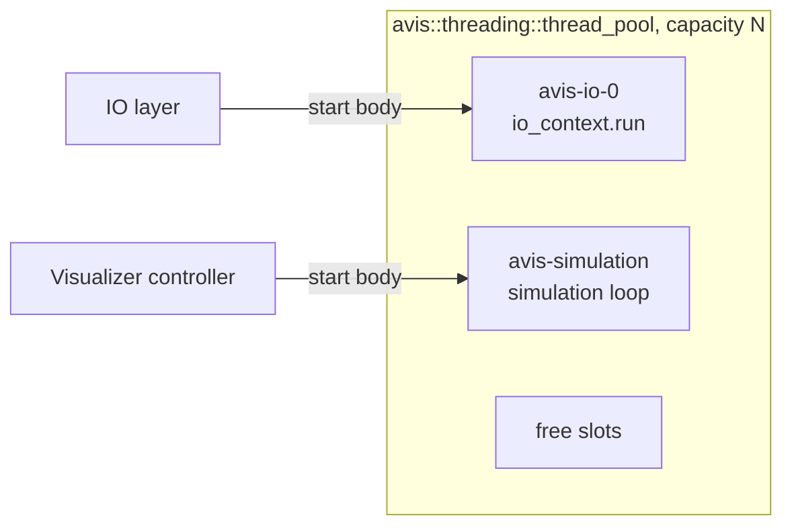
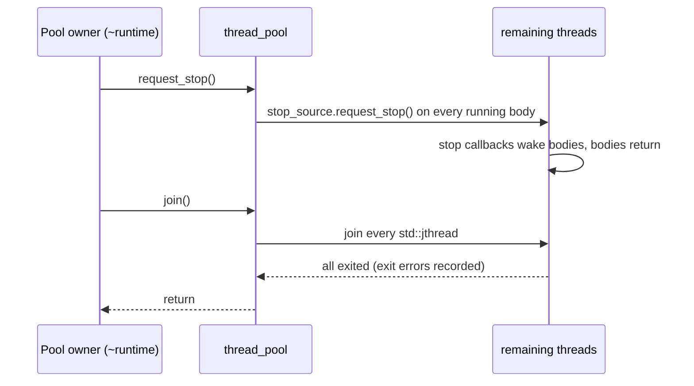

# 06 — Thread Pool

| | |
|---|---|
| Namespace | `avis::threading` |
| Headers | `include/avis/threading/thread_pool.h`, `include/avis/threading/thread_handle.h`, `include/avis/threading/thread_priority.h` (`thread_priority`, `to_win32_priority`), `include/avis/threading/thread_options.h` (`thread_options`, `thread_body`) |
| Sources | `lib/avis/threading/` |
| CMake target | `AVIS_LIB` (the single Avis library target, shared with every library feature) |

## 1. Requirements

From idea.md:
- A **custom** thread pool in the Avis library.
- Initialised with the library and **generally available** after that.
- **Configurable** thread count.
- On shutdown it **signals every thread to finish**, then **waits until all threads have finished**.
- The IO execution context runs **on a thread of this pool** ([07](07-io-layer.md)).

From the owner's design review ([99](99-decisions-and-open-questions.md), D-10 to D-15):
- The pool is concerned **only with long-running work**: work that typically lives for the whole application run, such as an ASIO `io_context` acting as the IOCP completion loop.
- The default pool has **static semantics**. Its lifetime is tied to the library runtime, so **access goes through `avis::runtime`** ([14](14-library-runtime.md)), which also configures it.
- **Short parallel work** is a separate feature with its own design ([15](15-parallel-scheduler.md)): the standard parallel scheduler, backed by an `exec::static_thread_pool` that the runtime owns. That pool creates its own worker threads, so **the thread pool neither provides them nor knows about them** (D-60).
- Library runtime configuration is a separate concept with its own document ([14](14-library-runtime.md)).

## 2. Concept

The thread pool is a **bounded set of named, long-lived OS threads**. A component asks the pool for a thread and hands it a *body*: a function that runs until it is asked to stop. The pool owns:

- thread creation, naming and OS-level options,
- the stop protocol (`std::stop_token`),
- failure containment (exceptions escaping a body),
- the guaranteed **signal-all-then-join-all** shutdown,
- diagnostics: thread naming, exit errors on the `thread_handle`, and the `join_warning` log of threads that don't stop. A queryable listing of all threads (`snapshot()`) was dropped as unneeded for now.

It doesn't own any work queue, scheduler, work abstraction or sender/receiver integration. What a body does inside its loop (run an `io_context`, run a simulation loop, run a Driver service loop) is entirely up to the component that started it.



The pool doesn't know what any of these bodies do. The parallel scheduler's workers aren't pool threads: they belong to the runtime's `exec::static_thread_pool` ([15](15-parallel-scheduler.md)).

### 2.1 Typical long-running bodies

| Application | Body | Count | Started by |
|---|---|---|---|
| Both | ASIO `io_context::run()` (IOCP completions) | `io.threads` (default 1) | IO layer ([07](07-io-layer.md)) |
| Visualizer | Simulation loop | 1 | Visualizer controller ([03](03-simulation-core.md)) |
| Driver | Service loop (state machine, query replies) | 1 | Driver service ([05](05-driver.md)) |
| Driver | Step executor | 1 | Driver ([05 §3](05-driver.md#3-step-pipeline)) |

Threads owned by third-party libraries (Qt's GUI and scene-graph threads, Zenoh's network threads) are not pool threads.

## 3. API

```cpp
namespace avis::threading
{
    struct thread_pool_configuration
    {
        std::size_t capacity = 16;                        // maximum number of concurrently running long-running threads
        std::chrono::milliseconds join_warning{ 5000 };   // log threads that haven't exited after this long
    };

    enum class thread_priority : std::int8_t { below_normal = -1, normal = 0, above_normal = 1, highest = 2 };

    struct thread_options
    {
        thread_priority priority = thread_priority::normal;
        std::optional<std::uint64_t> affinity_mask;                          // none = OS decides
        std::move_only_function<void(const std::optional<error>&)> on_exit;  // optional, runs on the exiting thread
    };

    // body: runs until stop is requested (or until it decides to finish); must return promptly once the token is signalled
    using thread_body = std::move_only_function<void(std::stop_token)>;

    class thread_handle;                                  // move-only owner of one running body

    class thread_pool
    {
    public:
        explicit thread_pool(const thread_pool_configuration& configuration);
        ~thread_pool();                                   // request_stop() + join()
        thread_pool(const thread_pool&) = delete;
        thread_pool& operator=(const thread_pool&) = delete;

        result<thread_handle> start(std::string_view name, thread_body body, thread_options options = {});

        void request_stop() noexcept;                     // signals every running body
        void join();                                      // waits until every thread has exited

        std::size_t capacity() const noexcept;
        std::size_t running() const noexcept;

        static std::optional<std::uint32_t> current_index() noexcept;   // dense index of the calling pool thread, nullopt elsewhere
    };

    class thread_handle
    {
    public:
        std::string_view name() const noexcept;
        void request_stop() noexcept;                     // signals this body only
        void join();                                      // waits for this body's thread to exit
        bool running() const noexcept;
        std::optional<error> exit_error() const;   // copy of the error if the body exited by exception, nullopt while running
        ~thread_handle();                                 // request_stop() + join() (RAII ownership)
    };
}
```

### 3.1 Static semantics through the runtime
- The **default thread pool** is created, configured, owned and destroyed by `avis::runtime`. Its lifetime equals the runtime's, so the static access point lives on the runtime too:

  ```cpp
  avis::threading::thread_pool& pool = avis::runtime::thread_pool();   // static; see 14 §2
  ```

- `thread_pool` itself has **no static or global state** and no notion of a "default". It's an ordinary class that can also be constructed directly, for example by tests that want an isolated pool.
- Calling `avis::runtime::thread_pool()` with no runtime alive is a programming error. The rules are in [14 §5](14-library-runtime.md#5-static-access-rules).

### 3.2 Capacity
- `capacity` caps how many long-running threads may run **at the same time**. Threads are created when `start` is called (no idle pre-spawned threads), because long-running bodies are started once and live for the whole run, so there's nothing to reuse.
- When a body returns, its slot is freed and can be used by a later `start`.
- `start` fails with `error{ domain = generic, code = pool_exhausted }` once `running() == capacity`. That's deliberate: exhausting the pool means the application's configuration is wrong, and it should surface at startup, not silently oversubscribe the CPU.
- The runtime computes the required capacity from its own configuration (IO threads) plus what the application declares it needs ([14 §3.1](14-library-runtime.md#31-sizing-the-default-pool)).

### 3.3 Body contract
1. **Stop:** the body must poll or wait on its `std::stop_token` and return promptly once stop is requested. Common patterns:
   - `std::condition_variable_any::wait(lock, token, predicate)` for queue-driven loops;
   - `std::stop_callback` calling a wake-up function, for example `io_context.stop()` (IO layer) or notifying a condition variable the body waits on;
   - checking `token.stop_requested()` once per loop iteration for loops that are naturally periodic (simulation tick loop).
2. **Exceptions:** an exception escaping a body is **caught by the pool's thread wrapper**. It's logged with the thread name, stored as `exit_error()` (converted to `avis::error`), and the thread exits. Other threads are unaffected. Owners check `exit_error()` or use `on_exit` to react, for example turning a render-thread failure into the fatal-error dialog ([01 §6](01-system-architecture.md#6-error-handling-policy)).
3. **No blocking on other pool threads during shutdown:** a body must not wait indefinitely on another pool thread after stop is requested.

### 3.4 Options and hooks
- **Naming:** `SetThreadDescription(L"avis-<name>")`, so PIX, debuggers and crash dumps show the role.
- **Priority:** `SetThreadPriority` from `thread_priority`. Defaults: simulation `normal`, IO `normal`. Parallel workers aren't pool threads and run at the OS default priority (D-62).
- **Affinity:** optional mask through `SetThreadAffinityMask`. Unset by default.
- **Exit callback:** `on_exit` runs on the exiting thread after the body returns. Owners use it to post a notification, never to block.
- **Thread index:** each running pool thread gets a small dense index (`thread_pool::current_index()`, `std::nullopt` on non-pool threads). Indices are reused after a thread exits. The index covers pool threads only; parallel workers have none ([15 §6](15-parallel-scheduler.md#6-determinism-and-priorities)), so components that need per-thread state there, such as the RHI's command allocator pools, use their own per-thread slots ([09 §4.3](09-rhi.md#43-command-lists-and-multi-threaded-recording)).

## 4. Lifecycle

### 4.1 Startup
1. `avis::runtime` constructs the default pool from its configuration ([14 §4](14-library-runtime.md#4-initialisation-and-shutdown-order)).
2. The runtime then starts the IO layer's bodies on it. The parallel pool's workers are created separately ([14 §4.1](14-library-runtime.md#41-construction)).
3. Applications start their own long-running bodies (simulation, render, step executor, …) as they initialise, keeping the returned `thread_handle`s.

### 4.2 Shutdown (as specified)

Shutdown happens in **two layers**:

1. **Owner-driven, ordered:** each component stops the threads it owns by destroying its `thread_handle`s (`request_stop` + `join`), in the reverse order of dependency. Applications stop their own threads before the runtime is destroyed. The runtime then stops the parallel pool and the IO layer, which stop their own threads ([14 §4.2](14-library-runtime.md#42-destruction)).
2. **Pool backstop, signal-all-then-join-all:** when the pool is destroyed, any threads still running are handled like this:



- `request_stop()` signals **every** thread first. Only then does `join()` wait. That way one slow thread doesn't delay the stop signal reaching the others.
- `join()` returns only when **every** thread has exited, as idea.md requires.
- After `join_warning` (5 s) the pool logs every thread that is still running, with name and state, then keeps waiting. Hangs are diagnosed, not hidden by detaching.
- After `request_stop()`, `start` returns `error{ code = pool_stopping }`.

## 5. Relation to the parallel scheduler
The thread pool and the parallel scheduler ([15](15-parallel-scheduler.md)) are independent:

| `thread_pool` | Parallel scheduler |
|---|---|
| `thread_pool.h/.cpp`, `thread_handle.h/.cpp`, private `pool_thread.h/.cpp` (one thread's state and wrapper) | `parallel_backend.h/.cpp`, `parallel_helpers.h`, on top of stdexec's `parallel_scheduler` and `exec::static_thread_pool` |
| Long-lived OS threads, one body each | Many short pieces of work multiplexed over a fixed set of workers |
| No queues, no scheduler, no stdexec | stdexec scheduler, work stealing and `bulk` from `exec::static_thread_pool` |
| Creates the IO and application threads | `exec::static_thread_pool` creates its own workers |

Neither side uses the other. The thread pool must stay free of stdexec, which a CI include check enforces ([13 §9](13-build-and-quality.md#9-coding-standards)): `thread_pool.*` and `thread_handle.*` must not include `parallel_configuration.h`, `parallel_backend.h`, `parallel_helpers.h` or any stdexec header. The check is `tools/checks/check-threading-includes.ps1`, registered as a CTest test.

## 6. Testing
- Start and stop single bodies. Every handle `join()` returns after `request_stop()`.
- `capacity` enforcement (`pool_exhausted`) and slot reuse after a body returns.
- Exception escaping a body → `exit_error()` set, `on_exit` called, other threads unaffected.
- Signal-all-then-join-all: with several bodies that each need a stop signal to exit, a single `~thread_pool` returns, and every body observed the stop before any join completed.
- `join_warning` logging with a deliberately slow body (test logger sink).
- `current_index()` is dense, unique among live threads, and `nullopt` on the test's main thread.
- No leaked threads after destruction (thread-count snapshot via `CreateToolhelp32Snapshot`).
