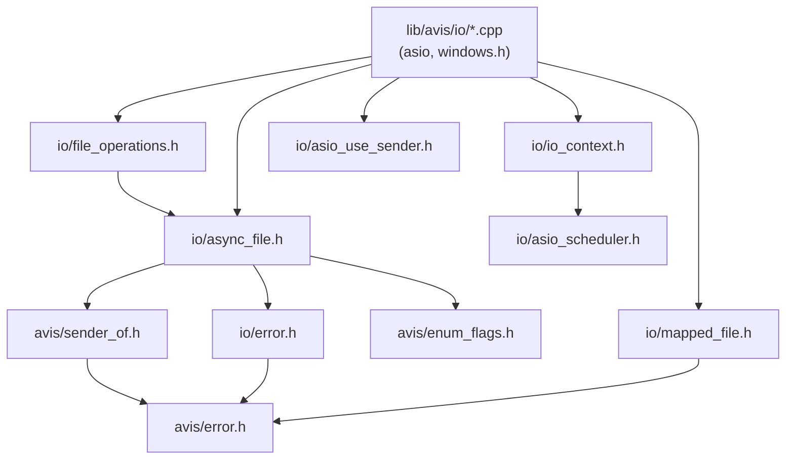

# 07 — IO Layer

## Code placement

| Feature | Namespace | CMake target | Location |
|---|---|---|---|
| Sender completion signatures (`sender_of`), shared by every Avis sender | `avis` | `AVIS_LIB` | `include/avis/sender_of.h` |
| IO context, scheduler, `use_sender` token, IO configuration | `avis::io` | `AVIS_LIB` | `include/avis/io/`, `lib/avis/io/` |
| Async files, whole-file operations, memory-mapped files, IO errors | `avis::io` | `AVIS_LIB` | `include/avis/io/async_file.h`, `file_operations.h`, `mapped_file.h`, `error.h` |
| `sync_wait_result` | `avis::threading` | `AVIS_LIB` | `include/avis/threading/parallel_helpers.h` |

## 1. Requirements (from idea.md)
- **Asynchronous loading and writing** of files.
- The async machinery uses the **sender/receiver** pattern (stdexec).
- **ASIO** provides the underlying async file operations.
- The execution context runs **on a thread of the Avis thread pool** ([06](06-thread-pool.md)).
- Errors propagate through **`set_error`**.

Out of scope for iteration 1: the dataset readers built on this layer (`avis::dataset::*`, [04](04-scenario-and-dataset.md)), buffer pooling for record payloads (owned by those readers), directory watching and listing, and non-Windows backends.

## 2. Components

| Header | Type | Purpose | Includes asio? |
|---|---|---|---|
| `avis/sender_of.h` | `avis::completions`, concept `avis::sender_of` | The completion signatures every Avis sender uses (§4.1) | No |
| `avis/io/io_context.h` | `avis::io::io_context` | Owns the `asio::io_context` and runs it on `io.threads` long-running threads of the thread pool it's given. Tracks live operations so shutdown can cancel them (§3.3). The runtime creates the default instance, reached through `avis::runtime::io_context()` ([14](14-library-runtime.md)). | Yes |
| `avis/io/io_configuration.h` | `avis::io::io_configuration` | Number of IO threads and the shutdown drain timeout (§3.3). Free of asio, so `runtime_configuration.h` can include it ([14 §3](14-library-runtime.md#3-configuration)). | No |
| `avis/io/asio_scheduler.h` | `avis::io::scheduler` | stdexec scheduler whose `schedule()` completes on an IO thread | Yes |
| `avis/io/asio_use_sender.h` | `avis::io::use_sender` | ASIO completion token that turns any async ASIO operation into a stdexec sender (§4.6) | Yes |
| `avis/io/async_file.h` | `avis::io::async_file`, `open_mode`, `read_at_sender`, `write_at_sender` | Random-access async file handle (§4.2–4.4) | **No** (pimpl) |
| `avis/io/detail/file_sender.h` | `detail::file_sender`, `file_operation_state`, `file_operation` | The sender templates behind `read_at` / `write_at` (§4.4), included by `async_file.h` | No |
| `avis/io/file_operations.h` | `read_file`, `write_file`, `file_size`, `write_policy` | Whole-file compositions (§4.5) | No |
| `avis/io/mapped_file.h` | `avis::io::mapped_file` | Read-only memory mapping for indices and small packs (§6) | No (no `<windows.h>` either) |
| `avis/io/error.h` | `avis::io::error_kind` | IO error codes and their mapping to `avis::error` (§5.1) | No |



Keeping asio out of `async_file.h` and `file_operations.h` means scene, RHI and dataset code that loads files doesn't compile asio. Only `io_context.h` pulls it in (needed by whoever opens a file against a non-default context), and `async_file.h` only forward-declares `io_context`.

`async_file` and `open_mode` replaced the earlier `avis::io::file` and `mode_flags` (`include/avis/io/file.h`, removed in task 5.8, D-65).

`async_file.h`, `file_operations.h`, `mapped_file.h`, `error.h` and `sender_of.h` include neither asio nor `<windows.h>`; `tests/test_io_public_headers.cpp` fails to compile if one of them starts to.

## 3. Execution model


- ASIO on Windows uses **IOCP** (`ASIO_HAS_IOCP`) with `asio::random_access_file` (`ASIO_HAS_FILE`). Files are opened with `FILE_FLAG_OVERLAPPED`.
- The IO context starts `io.threads` (default **1**) long-running bodies on the thread pool through `thread_pool::start("io-<n>", …)`. Each body runs `io_context::run()`, which meets the "runs on a thread within the threadpool" requirement ([06](06-thread-pool.md)). A work guard keeps the context alive until shutdown, and a `std::stop_callback` on the body's stop token calls `io_context::stop()`. Each body holds a `threading::detail::forbid_blocking_waits` scope, so `sync_wait` there throws.
- IO senders **always complete on an IO thread**. They never hop on their own, even when the receiver's environment has a scheduler. CPU work after IO (decode, parse, checksum) moves explicitly to the **parallel scheduler** ([15](15-parallel-scheduler.md)) with `stdexec::continues_on(stdexec::get_parallel_scheduler())`, so it's visible where each continuation runs.
- ASIO completion handlers only complete the stdexec receiver, or start the next chunk of a read or write loop. Nothing heavy runs inline in the handler.

### 3.1 Threading: one strand per file
asio documents a shared `random_access_file` as unsafe for concurrent use, and the 1.36 Windows code shows why. Starting a read (`win_iocp_handle_service::start_read_op`) writes the shared field `safe_cancellation_thread_id_` without synchronization and reads `handle_`, which `close()` overwrites after `CloseHandle`. A read started concurrently with a close could pass a stale handle value to `ReadFile`, and Windows reuses handle values, so it could hit an unrelated object. Concurrent starts aren't limited to caller threads either: follow-up chunks start from completion handlers, so a caller thread and an IO thread (or two IO threads when `io.threads > 1`) can start operations on one file at the same time.

**Rule (D-69):** every asio call on a file's `random_access_file` runs on that file's `asio::strand`, which the file's internal state owns:
- the first chunk of `read_at` / `write_at` (posted from `start()`; the calling thread never calls asio);
- follow-up chunks (dispatched from the completion handler, inline when already on the strand);
- per-operation cancellation (`cancellation_signal::emit`, posted from the stop callback; asio's cancellation signals aren't thread-safe either);
- `random_access_file::cancel()` from `close()`, destruction and `io_context::request_stop()`.

Completion handlers themselves don't need the strand.

**Closing without a race.** `close()` doesn't call `CloseHandle`. It posts the cancel to the strand, which also sets a `closed` flag in the state, and drops the `async_file`'s reference to the state. A sender created before `close()` but started after it sees the flag on the strand and completes with `set_stopped` without calling `ReadFile`. Operations still in flight hold their own references, so the handle is closed when the state is destroyed, after the last of them completed. The handle therefore never changes while anyone can still start an operation. The synchronous members (`size()`, `resize()`, `flush()`) only read the handle, so they run on the caller thread without the strand.

**Cost, accepted for iteration 1:**
- One extra hop per `read_at` / `write_at` (a few µs), small next to disk latency.
- Every `ReadFile` / `WriteFile` call runs on an IO thread. When Windows serves an "async" read from its file cache, it often completes inside `ReadFile` with a copy on the calling thread, so a large cached read can hold an IO thread for milliseconds and delay other completions. The Driver, which issues many prefetch reads, therefore runs with `io_threads: 2` ([01 §7](01-system-architecture.md#7-configuration), [14 §3.1](14-library-runtime.md#31-sizing-the-default-pool)).
- **Revisit when** profiling shows IO threads busy in `ReadFile`. The alternative is to start operations on the caller thread with `asio::windows::overlapped_ptr` and direct `ReadFile` / `WriteFile` / `CancelIoEx` calls. That stays within asio's documented rules and keeps the copies off the IO threads, at the cost of about 100–150 lines of Win32 code in `async_file.cpp`. It's an implementation change behind the pimpl, and the interface doesn't change.

### 3.2 Blocking file work
`FlushFileBuffers` and the final rename block, so they never run on an IO thread. `write_file` with `atomic_replace` runs them on the **parallel scheduler**, a brief block that [15 §4.3](15-parallel-scheduler.md#43-waiting) allows (D-70).
- On a busy disk the flush can hold a parallel worker for tens of ms. Atomic replaces are rare (scenario saves, autosave, screenshots), so the occasional stalled worker is acceptable in iteration 1.
- **Revisit when** atomic writes become frequent or show up as parallel-pool stalls in profiling. The fallback is a long-running pool thread dedicated to blocking file work (flush, rename), fed through a queue.

### 3.3 Shutdown
[14 §4.2](14-library-runtime.md#42-destruction) step 2 requires: stop accepting new operations, cancel outstanding ones, then stop. `io_context` keeps an intrusive registry of live operations, each with a cancel function (internal to the IO layer, used by the file state and `use_sender`):

```cpp
namespace avis::io
{
    class io_context
    {
    public:
        io_context(threading::thread_pool& pool, const io_configuration& configuration);
        // ... get_scheduler(), native(), request_stop(), current() as today ...

        // True once request_stop() was called. New file operations then complete with set_stopped at start().
        bool stopping() const noexcept;

    private:
        detail::operation_registry* operations_; // an asio service of the context's asio::io_context
    };

    struct io_configuration
    {
        std::size_t threads = 1;                             // long-running io_context bodies on the default pool
        std::chrono::milliseconds shutdown_timeout{ 1000 };  // drain limit for cancelled operations in request_stop()
    };
}
```

The registry is an asio service (`asio::make_service`) of the context's `asio::io_context`, so any operation that holds one of its executors finds it with `detail::find_operation_registry(context)`; a plain `asio::io_context` has none. Operations see it through the small asio-free interface in `avis/io/detail/registered_operation.h` (`registered_operation`, `add_operation`, `remove_operation`); the service itself is private to `lib/avis/io/detail/`. An operation registers before it starts (a closed registry makes it complete with `set_stopped` without starting) and removes itself before it completes its receiver.

`request_stop()`: set `stopping`, cancel every registered operation (each cancel posted to its file's strand), release the work guard, run until the registry is empty **or `shutdown_timeout` expires** (logged as a warning when hit), then `stop()`. The timeout keeps a stuck operation from hanging shutdown. A timeout of 0 cancels and stops straight away (D-71).

- `io_context` takes the whole `io_configuration`, replacing the `(pool, std::size_t threads)` constructor.
- `<chrono>` keeps `io_configuration.h` free of asio.
- YAML key `runtime.io_shutdown_timeout_ms` (integer milliseconds), next to `io_threads` ([14 §3.2](14-library-runtime.md#32-mapping-from-application-configuration)).

## 4. API

### 4.1 Senders: `avis/sender_of.h`
The design documents write `sender_of<T>` as a return type. It means a sender whose completions are exactly:

```cpp
namespace avis
{
    template<typename... Values>
    using completions = stdexec::completion_signatures<
        stdexec::set_value_t(Values...),
        stdexec::set_error_t(avis::error),
        stdexec::set_stopped_t()>;

    // True when Sender completes with exactly completions<Values...>, in any order.
    // sender_of<S> (no values) is the "sender_of<void>" of the design documents.
    template<typename Sender, typename... Values>
    concept sender_of = /* stdexec::sender_in<Sender, stdexec::env<>> and the completion set equals completions<Values...> */;
}
```

- In design documents, `sender_of<T>` stays as notation. In code, functions return **named sender types** (`read_at_sender`, `read_file_sender`, …), and tests check them with `static_assert(avis::sender_of<read_at_sender, std::size_t>)`.
- Value types are passed **by value** in signatures (`set_value_t(std::vector<std::byte>)`), never as references.

**No type erasure in iteration 1 (D-66).** Every pipeline built on an IO sender has its own unnameable type. That's fine while the sender is composed further, or connected and started where it's built. A type-erased sender (`exec::any_sender_of`) would only be needed to keep different pipelines in one container, to return a sender from a virtual function, or to store a sender whose pipeline is chosen at runtime. A container of one sender type (`std::vector<read_at_sender>`) doesn't need it.
- Type erasure costs a heap allocation and virtual calls per operation, drops environment queries such as the completion scheduler unless listed explicitly, and `exec::any_sender_of` is in stdexec's experimental `exec::` namespace.
- The likeliest candidate, the Driver's prefetch window ([05](05-driver.md)), stores **results**, not senders: each slot is started straight away into a `stdexec::counting_scope` owned by the prefetcher, and its pipeline writes the decoded sample into the slot the step executor waits on. Polymorphism across sensor types sits above the sender (a virtual `start_prefetch(slot&)`), not in a return type.
- If a consumer later needs an erased sender (most likely the dataset readers or the plug-in SDK), it's defined **once**, as an alias in `avis/sender_of.h`, so the IO layer doesn't change:

  ```cpp
  template<typename... Values>
  using any_sender_of = exec::any_receiver_ref<avis::completions<Values...>>::any_sender<>;
  ```

- **Revisit when** a component needs a backlog of unstarted operations it reorders or prioritises before starting them (for example a priority-ordered prefetch).

### 4.2 Open mode

```cpp
namespace avis::io
{
    enum class open_mode : std::uint8_t
    {
        read = 1,
        write = 2,
        create = 4,     // create if missing; requires write
        truncate = 8,   // requires write
        exclusive = 16  // requires create; fail with error_kind::already_exists if the file exists
    };
}
ALLOW_FLAGS_FOR_ENUM(avis::io::open_mode)   // global scope, as the macro requires

namespace avis::io
{
    using open_flags = avis::flags<open_mode>;   // avis/enum_flags.h
}
```

- `open` validates the combination before touching the file system and returns `error_kind::invalid_argument` for: neither `read` nor `write`; `create` or `truncate` without `write`; `exclusive` without `create`.
- There's no `append` (meaningless for random-access offsets) and no `sync_all_on_write`: durability is explicit through `flush()`.
- Files are opened with share mode `FILE_SHARE_READ`, plus `FILE_SHARE_DELETE` for read-only opens, so an atomic replace can rename over a file someone is reading. That rename must use POSIX semantics (§4.5): a classic `MoveFileExW` replace fails with access denied while the target has any open handle, whatever its share mode.

### 4.3 `async_file`

```cpp
namespace avis::io
{
    class io_context;
    class read_at_sender;
    class write_at_sender;

    namespace detail
    {
        // Owns the asio::random_access_file and the file's strand (§3.1); closes the handle in its destructor, once
        // the async_file and every operation have released it. Defined in lib/avis/io/detail/async_file_state.h.
        class async_file_state;
    }

    // Random-access async file handle. Move-only. Operations co-own the internal state, so destroying or moving the
    // file while operations are in flight is safe: they complete with set_stopped. Buffers must still outlive them.
    class async_file
    {
    public:
        async_file() noexcept = default;  // closed
        ~async_file();                    // close()
        async_file(async_file&&) noexcept;
        async_file& operator=(async_file&&) noexcept;  // closes the current file first
        async_file(const async_file&) = delete;
        async_file& operator=(const async_file&) = delete;

        // Synchronous: opening a local file is fast and its errors are needed right away
        static result<async_file> open(const std::filesystem::path& path, open_flags mode);  // default context
        static result<async_file> open(io_context& context, const std::filesystem::path& path, open_flags mode);

        // set_value(std::size_t bytes) | set_error(avis::error) | set_stopped()
        // Loops until buffer is full or end of file. Reading at or past the end completes with 0.
        read_at_sender read_at(std::uint64_t offset, std::span<std::byte> buffer) const;

        // set_value(std::size_t bytes) | set_error(avis::error) | set_stopped()
        // Loops until all of data is written; on success bytes == data.size(). Extends the file when needed.
        write_at_sender write_at(std::uint64_t offset, std::span<const std::byte> data) const;

        result<std::uint64_t> size() const;
        result<void> resize(std::uint64_t size) const;

        // FlushFileBuffers. Blocking: call it from a parallel worker or a caller thread, never from an IO thread.
        result<void> flush() const;

        // Posts a cancel of outstanding operations to the file's strand (they complete with set_stopped) and releases
        // this handle's reference; the OS handle is closed once those operations finished (§3.1). Callable from any
        // thread, but not concurrently with other calls on this same object; idempotent.
        void close() noexcept;

        bool is_open() const noexcept;
        const std::filesystem::path& path() const noexcept;  // empty when closed; used in error messages

    private:
        explicit async_file(std::shared_ptr<detail::async_file_state> state) noexcept;

        std::shared_ptr<detail::async_file_state> state_;
    };
}
```

- Overloads without an `io_context&` use `avis::runtime::io_context()`. Tests that build their own pool and context use the explicit overloads.
- `read_at`, `write_at`, `size()`, `resize()` and `flush()` are `const`: they don't change which file the handle refers to, so a `const async_file&` can be shared between concurrent readers.
- **Thread safety of the object:** the `const` members may be called concurrently from any threads. `close()`, move assignment and destruction change the object itself, so like any standard type they must not race with other calls on the **same** `async_file`. They don't wait for operations in flight: those hold their own reference to the state.
- Operations on a closed or moved-from `async_file` don't throw: the sender completes with `set_error(error_kind::not_open)`.
- `size()` on a file with writes in flight returns whatever the OS reports at that moment.

### 4.4 Sender types
`read_at_sender` and `write_at_sender` are aliases declared in `async_file.h`. The templates behind them are in `avis/io/detail/file_sender.h` and share one non-template core, `detail::file_operation`, implemented in `lib/avis/io/detail/file_sender.cpp`:

```cpp
namespace avis::io
{
    namespace detail
    {
        // Non-template part of a read or write operation; the asio calls live in file_sender.cpp
        class file_operation
        {
        public:
            virtual void complete(result<std::size_t> outcome) noexcept = 0;  // error or bytes
            virtual void complete_stopped() noexcept = 0;

        protected:
            void start_read(std::shared_ptr<async_file_state> state, std::uint64_t offset, std::span<std::byte> buffer) noexcept;
            void start_write(std::shared_ptr<async_file_state> state, std::uint64_t offset, std::span<const std::byte> data) noexcept;
            void request_cancel() noexcept;  // called from the receiver's stop callback; posts the emit to the strand
            ~file_operation();
        };
    }

    class read_at_sender
    {
    public:
        using sender_concept = stdexec::sender_tag;
        using completion_signatures = avis::completions<std::size_t>;

        template<stdexec::receiver Receiver>
        auto connect(Receiver receiver) &&;   // returns an operation_state deriving from detail::file_operation


    private:
        std::shared_ptr<detail::async_file_state> state_;
        std::uint64_t offset_;
        std::span<std::byte> buffer_;
    };

    // write_at_sender: same shape with std::span<const std::byte>
}
```

- Senders are **single-shot** (`connect() &&`) and cheap to move (a `shared_ptr`, an offset, a span).
- `read_at_sender` and `write_at_sender` are aliases of one class template, `detail::file_sender<Kind>`. They have no `get_env()`: naming the IO scheduler as their completion scheduler would pull asio into `async_file.h`. They still always complete on an IO thread.
- Each started operation allocates a small shared state (progress, cancellation signal, flags) that its posted cancellations hold, so a cancellation that runs after the completion never touches the destroyed operation state.
- asio passes each buffer size to `ReadFile` / `WriteFile` as a 32-bit `DWORD`, so the loop issues chunks of at most 1 GiB.
- `start()` posts the first chunk to the file's strand; follow-up chunks are dispatched from the completion handler through the same strand (§3.1).
- Cancellation is described in §5.3.

### 4.5 Whole-file operations: `avis/io/file_operations.h`

```cpp
namespace avis::io
{
    enum class write_policy : std::uint8_t
    {
        atomic_replace, // write <path>.<unique>.tmp, flush, POSIX-semantics rename over <path>
        truncate,       // open with create | truncate and write in place
        create_new      // open with create | exclusive; fail with error_kind::already_exists
    };

    class read_file_sender;   // set_value(std::vector<std::byte>)
    class write_file_sender;  // set_value()

    read_file_sender read_file(const std::filesystem::path& path);
    read_file_sender read_file(io_context& context, const std::filesystem::path& path);

    // data must outlive the operation
    write_file_sender write_file(const std::filesystem::path& path, std::span<const std::byte> data,
                                 write_policy policy = write_policy::atomic_replace);
    write_file_sender write_file(io_context& context, const std::filesystem::path& path,
                                 std::span<const std::byte> data, write_policy policy = write_policy::atomic_replace);

    // Owning variants for fire-and-forget writers (screenshots, autosave): the sender keeps data alive. An lvalue
    // vector picks these overloads and is copied; move it in to avoid the copy.
    write_file_sender write_file(const std::filesystem::path& path, std::vector<std::byte> data,
                                 write_policy policy = write_policy::atomic_replace);
    write_file_sender write_file(io_context& context, const std::filesystem::path& path,
                                 std::vector<std::byte> data, write_policy policy = write_policy::atomic_replace);

    // Synchronous metadata query; no handle kept open. Call it qualified (avis::io::file_size): unqualified, argument-
    // dependent lookup also finds std::filesystem::file_size and the call is ambiguous.
    result<std::uint64_t> file_size(const std::filesystem::path& path);

    namespace detail
    {
        // Test hook: while enabled, atomic_replace fails after flushing the temporary file and before the rename,
        // so tests can check the target is untouched and the temporary file was removed (§7)
        void inject_atomic_replace_failure(bool enabled) noexcept;
    }
}
```

- `atomic_replace` (the default) writes to `<path>.<unique>.tmp` (unique = process id + counter, so concurrent writers of one path don't share a temporary file), flushes it, then renames it over the target with POSIX semantics (`SetFileInformationByHandle(FileRenameInfoEx)` with `FILE_RENAME_FLAG_REPLACE_IF_EXISTS | FILE_RENAME_FLAG_POSIX_SEMANTICS`, Windows 10 1709+). A classic `MoveFileExW` replace would fail while anyone has the target open, even with `FILE_SHARE_DELETE`; the last rename wins. Scenario saves, autosave and screenshots ([11](11-renderer.md)) use it, so a crash never leaves a half-written file. On any failure the temporary file is deleted (best effort) and the target is left untouched.
- The flush and rename run on the parallel scheduler (§3.2), so `write_file_sender` completes on a parallel worker for `atomic_replace` and on an IO thread for the other policies. Errors found in `start()` (an open failure, a stopping context) and empty data complete inline in `start()`, like `read_at` with an empty span.
- Every whole-file operation closes its handle **before** it completes: `read_file`, `truncate` and `create_new` on the file's strand in the last completion, `atomic_replace` right after the flush. The temporary file is then reopened with `DELETE` access for the rename. A handle left for the state's destructor would close later on an IO thread, and until then a write handle (which shares neither write nor delete) would make a `read_file` right after the write fail with a sharing violation, and a concurrent `atomic_replace`'s rename fail.
- `atomic_replace` registers with the operation registry for its whole duration (§3.3), since the flush and rename run outside the write loop. A stop request or shutdown before the rename completes with `set_stopped` and deletes the temporary file.
- `read_file` reads the whole file; there's no size limit parameter (D-68). It sizes its buffer from `size()` at open time: a file that grows while being read is truncated to that size, one that shrinks returns a shorter vector. A file whose size doesn't fit a `std::vector<std::byte>` fails with `error_kind::file_too_large`. `read_file` owns its buffer and moves it into `set_value`. An empty file completes inline in `start()` with an empty vector.
- Both senders are hand-written state machines in `file_operations.cpp` (open → size → read loop; open temporary → write loop → flush → close → rename), not `let_value` chains. That keeps the return types nameable and the implementation out of the header. The read and write loops are the `async_file` core (`detail::file_operation`, §4.4); files are opened with `async_file::open`, and a private friend of `async_file` lets the operation take over the file's state so it can close the handle itself. `write_file_sender` is move-only, since its span may point into the vector it owns.
- There are no free `read_at` / `write_at` functions; use the `async_file` members.

### 4.6 `use_sender` and `scheduler`
`use_sender` stays public for asio operations outside files: timers ([12](12-visualizer.md)) and `object_handle::async_wait` for fences ([09](09-rhi.md)). Its sender follows the same rules as the file senders:

| Before | Now |
|---|---|
| Handler `(std::error_code, std::size_t)` completes with `set_value(error_code, size_t)` | A leading `std::error_code` is peeled off: `operation_aborted` → `set_stopped`, any other error → `set_error(io::make_error(code, "<asio operation>", {}))`, success → `set_value(remaining arguments...)` |
| `set_error_t(std::exception_ptr)` | `set_error_t(avis::error)`; an exception thrown by the initiation becomes `make_error(std::current_exception())` |
| Hops to the receiver's scheduler when its environment has one | Completes on the IO thread (§3) |
| Two copies of the operation state (`sender`, `transfer_sender`) | One |

Merging the copies also fixes two latent bugs in the cancellation path, which compile today only because they're never instantiated: `execution_state::construction` doesn't exist (the enumerator is `constructed`), and `base::complete(std::forward(args)...)` is missing its template argument.

A `use_sender` operation can be cancelled through its stop token while it runs when the asio initiation exposes `get_executor()`, which every asio I/O object's initiation does. The operation then binds its completion handler to a strand on that executor and posts every cancellation emit to the same strand. The same applies to the IO context's shutdown: such an operation registers with the context's operation registry (§3.3), so `request_stop()` cancels it even when its receiver can't be stopped (`exec::start_detached`). Without `get_executor()`, the stop token is only checked before the operation starts, and shutdown can't cancel it.

`scheduler`'s schedule sender completes with `set_value_t(), set_error_t(avis::error), set_stopped_t()`. Its only error source is `asio::post` throwing (allocation failure).

### 4.7 Example

```cpp
auto load_scenario_async(std::filesystem::path path)
{
    return avis::io::read_file(path)
         | stdexec::continues_on(stdexec::get_parallel_scheduler())
         | stdexec::then([](std::vector<std::byte> bytes) { return parse_scenario(bytes); })  // throws on failure
         | avis::threading::into_internal_error();
}

// a caller thread that isn't an IO thread or a parallel worker:
avis::result<scenario> loaded = avis::threading::sync_wait_result(load_scenario_async("scenario.yaml"));
```

## 5. Error propagation

| Source | Channel | Payload |
|---|---|---|
| ASIO `error_code` (other than `operation_aborted`) | `set_error` | `avis::error{ domain = io, code = io::error_kind, message = "<operation> '<path>': <system message> (system error <n>)" }` |
| Errors Avis detects itself (bad flags, closed file, short write) | `set_error` | `avis::error{ domain = io, code = io::error_kind, message = … }` |
| `operation_aborted` (stop token, `close()`, shutdown) | `set_stopped` | — |
| Exceptions thrown inside `then` lambdas | `set_error` | Converted to `avis::error` by `avis::threading::into_internal_error()` ([15 §4.2](15-parallel-scheduler.md#42-error-type)) |

Every IO sender uses the **single error type `avis::error`**, which keeps completion signatures small: `set_value_t(T), set_error_t(avis::error), set_stopped_t()` (§4.1).

### 5.1 IO error codes: `avis/io/error.h`

```cpp
namespace avis::io
{
    // Codes of errors in error_domain::io. Portable classification, stable for tests and callers.
    enum class error_kind : std::int32_t
    {
        ok = 0,
        not_found,           // ERROR_FILE_NOT_FOUND, ERROR_PATH_NOT_FOUND
        permission_denied,   // ERROR_ACCESS_DENIED
        sharing_violation,   // ERROR_SHARING_VIOLATION, ERROR_LOCK_VIOLATION
        already_exists,      // ERROR_FILE_EXISTS (open_mode::exclusive)
        invalid_argument,    // bad open_flags combination, offset overflow
        not_open,            // operation on a closed or moved-from file
        disk_full,           // ERROR_DISK_FULL, ERROR_HANDLE_DISK_FULL
        file_too_large,      // read_file on a file whose size doesn't fit a std::vector<std::byte>
        short_write,         // a write transferred 0 bytes without an error code
        mapping_failed,      // CreateFileMappingW / MapViewOfFile
        system_error         // anything not classified above; the native code is in the message
    };

    std::string_view to_string(error_kind code) noexcept;

    avis::error make_error(error_kind code, std::string message,
                           std::source_location location = std::source_location::current());

    // Classifies a native error and formats "<operation> '<path>': <system message> (system error <n>)"
    avis::error make_error(const std::error_code& code, std::string_view operation, const std::filesystem::path& path,
                           std::source_location location = std::source_location::current());

    // True when error is in error_domain::io with the given code
    bool is_error(const avis::error& error, error_kind code) noexcept;
}
```

**`avis::error::code` holds an `io::error_kind`, not the native code (D-67).** The alternative, native codes in `code` plus an `io::classify()` function, was rejected because:
- a bare native value is ambiguous: an asio `error_code` is a value **and** a category (`asio::error::eof` and `ERROR_FILE_NOT_FOUND` are both 2), and `avis::error::code` has room for the value only;
- some IO errors have no native code (`invalid_argument`, `not_open`, `short_write`, `file_too_large`), so native codes would have to be mixed with invented ones;
- `is_error(e, error_kind::sharing_violation)` is portable and readable where `e.code == 32` is neither;
- the `generic` domain already stores an Avis enum (`generic_error_kind`) in `code`.

The native code and system message are never lost: `make_error(const std::error_code&, operation, path)` always appends them to `message`. Because of that, the formatter's `[io:<code>]` prefix shows the `error_kind` value, not the Win32 code. `error_kind::system_error` is the catch-all for unclassified native errors; when a caller needs to react to a specific condition (for example retrying a rename on `sharing_violation`), an `error_kind` value is added for it rather than exposing the native code.

Cancellation is not an `io::error_kind`: it travels on `set_stopped`.

### 5.2 Consuming IO senders
- Asynchronous consumers stay in sender land (`upon_error`, `let_error`, `upon_stopped`).
- Synchronous consumers, such as tests and startup code on threads other than IO threads and parallel workers, use `avis::threading::sync_wait_result`. It lives next to `sync_wait` in `parallel_helpers.h`, because nothing about it is IO-specific and the thread check it needs is already there:

```cpp
namespace avis::threading
{
    // Like sync_wait, but turns the three channels into a result:
    //   set_value(T)   -> result<T>   (no values: result<void>; several values: result<std::tuple<...>>)
    //   set_error(E)   -> unexpected(to_internal_error(E))
    //   set_stopped()  -> unexpected(generic_error_kind::cancelled)
    // Throws std::logic_error on a parallel worker or an IO thread, like sync_wait.
    template<stdexec::sender Sender>
    auto sync_wait_result(Sender&& sender);
}
```

### 5.3 Cancellation

| Trigger | Mechanism | Completion |
|---|---|---|
| Receiver's stop token fires before `start()` | checked in `start()` | `set_stopped` without touching the file |
| Stop token fires while the operation runs | `stop_callback` posts `asio::cancellation_signal::emit(total)` for **this** operation to the file's strand (`CancelIoEx` on its `OVERLAPPED`) | `set_stopped` |
| `async_file::close()` / `async_file` destroyed | `random_access_file::cancel()` posted to the file's strand | every outstanding operation on the file: `set_stopped` |
| `io_context::request_stop()` | registry cancel (§3.3), each cancel posted to its file's strand | every outstanding operation: `set_stopped` |

- A stop token cancels only its own operation, through a per-operation cancellation slot. `random_access_file::cancel()` would cancel every operation on the file, including other readers'.
- A partially completed read that gets cancelled completes with `set_stopped`, not with the partial count. The bytes already in the buffer are unspecified.

## 6. Memory-mapped access
Sequence-pack indices and point-cloud tile headers are read through `mapped_file` (`CreateFileMappingW` / `MapViewOfFile`). Mapping is synchronous and returns `result<mapped_file>`. Large record payloads (images, lidar sweeps, tile bodies) go through async `read_at` into pooled buffers. That avoids page-fault stalls on the step executor and the frame chain: a mapping's page faults happen on whichever thread reads the bytes.

```cpp
namespace avis::io
{
    // Read-only memory mapping of a whole file. Move-only; unmaps and closes on destruction.
    class mapped_file
    {
    public:
        mapped_file() noexcept = default;
        ~mapped_file();
        mapped_file(mapped_file&&) noexcept;
        mapped_file& operator=(mapped_file&&) noexcept;
        mapped_file(const mapped_file&) = delete;
        mapped_file& operator=(const mapped_file&) = delete;

        static result<mapped_file> open(const std::filesystem::path& path);

        std::span<const std::byte> bytes() const noexcept;
        std::size_t size() const noexcept;
        bool is_open() const noexcept;
        const std::filesystem::path& path() const noexcept;

    private:
        void* file_handle_ = nullptr;     // HANDLE, kept as void* so <windows.h> stays out of the header
        void* mapping_handle_ = nullptr;  // HANDLE
        const std::byte* view_ = nullptr;
        std::size_t size_ = 0;
        std::filesystem::path path_;
    };
}
```

- An empty file opens successfully with an empty span (`CreateFileMappingW` rejects zero-length mappings, so none is created).
- Opened with `FILE_SHARE_READ | FILE_SHARE_DELETE`, so an atomic replace (a POSIX-semantics rename, §4.5) of the same path succeeds while it's mapped; the mapping keeps showing the old contents.
- Errors: opening and sizing the file are classified like any IO error (`not_found`, `permission_denied`, …). A failed `CreateFileMappingW` or `MapViewOfFile` reports `error_kind::mapping_failed`, with the native code in the message.

| | `async_file` | `mapped_file` |
|---|---|---|
| Model | Async sender, completes on an IO thread | Synchronous, plain memory access |
| Direction | Read and write | Read only |
| Data lives in | Caller's buffer (copied in) | The OS page cache (no copy) |
| Disk wait | In the OS, no thread blocked | Page fault on the reading thread |
| Cancellation | Yes | Not applicable |
| Typical use | Large records, any writes | Small indices and headers |

## 7. Testing

| Test | Covers |
|---|---|
| Round trip: `write_at` then `read_at`, several offsets | §4.3, §4.4 |
| `read_at` at and beyond end of file → 0 / partial count | §4.3 loop semantics |
| Missing path → `is_error(e, error_kind::not_found)`; read-only file opened for write → `error_kind::permission_denied` | §5.1 |
| Invalid flag combinations → `error_kind::invalid_argument` | §4.2 |
| Stop token mid-read → `set_stopped`; a second concurrent read on the same file still completes | §5.3 |
| Many threads issuing `read_at` on one `const async_file&` with `io.threads` 1 and 2: every read returns the right bytes | §3.1 |
| `close()` while other threads start `read_at` senders created before it: each completes with bytes or `set_stopped` (never a read on a closed handle); the OS handle is closed only after the last completion | §3.1 |
| `close()` and destroying the `async_file` with reads in flight → `set_stopped`, no crash | §4.3 |
| `io_context::request_stop()` with reads in flight → `set_stopped`, then a clean join; with a stuck operation, the drain stops at `shutdown_timeout` | §3.3 |
| `atomic_replace` with `inject_atomic_replace_failure` → target unchanged, no temporary file left | §4.5 |
| `atomic_replace` while the target is mapped → succeeds; the mapping keeps the old bytes | §4.5, §6 |
| Empty file → `read_file` returns an empty vector; `mapped_file` returns an empty span | §4.5, §6 |
| `sync_wait_result` on an IO thread → `std::logic_error` | §5.2 |
| `use_sender` with a timer: success, cancel → `set_stopped`, error → `set_error(avis::error)` | §4.6 |
| `static_assert(avis::sender_of<...>)` for every IO sender | §4.1 |

The existing `tests/test_asio_senders_receivers.cpp` and `tests/test_io_context.cpp` move to the `avis::error` completion signatures and the `io_configuration` constructor.
