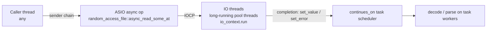

# 07 — IO Layer

## Code placement

| Feature | Namespace | CMake target | Location |
|---|---|---|---|
| IO context, scheduler, `use_sender` token | `avis::io` | `AVIS_LIB` | `include/avis/io/`, `lib/avis/io/` |
| Async files, file ops, memory-mapped files, IO errors | `avis::io` | `AVIS_LIB` | `include/avis/io/file*.h`, `mapped_file.h`, `error.h` |

## 1. Requirements (from idea.md)
- **Asynchronous loading and writing** of files.
- The async machinery uses the **sender/receiver** pattern (stdexec).
- **ASIO** provides the underlying async file operations.
- The execution context runs **on a thread of the Avis thread pool** ([06](06-thread-pool.md)).
- Errors propagate through **`set_error`**.

## 2. Components

| Header | Type | Purpose |
|---|---|---|
| `avis/io/io_context.h` | `avis::io::io_context` | Owns the `asio::io_context` and runs it on `io.threads` long-running threads of the thread pool it's given. The runtime creates the default instance, reached through `avis::runtime::io_context()` ([14](14-library-runtime.md)). Replaces the current `io_executor`, which spawns its own threads. |
| `avis/io/asio_scheduler.h` | `avis::io::scheduler` | stdexec scheduler whose `schedule()` completes on the IO thread |
| `avis/io/asio_use_sender.h` | `avis::io::use_sender` | ASIO completion token that turns any async ASIO operation into a stdexec sender (existing) |
| `avis/io/file.h` | `avis::io::file` | Random-access async file handle |
| `avis/io/file_operations.h` | free functions | `read_file`, `write_file`, `read_at`, `write_at`, `file_size` |
| `avis/io/mapped_file.h` | `avis::io::mapped_file` | Read-only memory mapping (indices, small packs) |
| `avis/io/error.h` | `avis::io::errc` | IO error codes and their mapping to `avis::error` |

## 3. Execution model



- ASIO on Windows uses **IOCP** (`ASIO_HAS_IOCP`) with `asio::random_access_file` / `asio::stream_file` (`ASIO_HAS_FILE`). Files are opened with `FILE_FLAG_OVERLAPPED`.
- The IO context starts `io.threads` (default **1**, which is plenty for IOCP) long-running bodies on the thread pool through `thread_pool::start("io-<n>", …)`. Each body runs `io_context::run()`, which meets the "runs on a thread within the threadpool" requirement ([06](06-thread-pool.md)). A work guard keeps the context alive until shutdown, and a `std::stop_callback` on the body's stop token calls `io_context::stop()`.
- CPU work after IO (decode, parse, checksum) is moved to the **task system** ([15](15-task-system.md)) with `stdexec::continues_on(avis::runtime::task_system().get_scheduler())`. IO threads only handle completions, so IOCP latency stays low no matter how heavy the decoding is.
- ASIO completion handlers only complete the stdexec receiver. Nothing heavy runs inline in the handler.

## 4. API

```cpp
namespace avis::io
{
    enum class open_mode : std::uint8_t { read = 1, write = 2, create = 4, truncate = 8, exclusive = 16 };

    class file
    {
    public:
        static result<file> open(io_context& context, const std::filesystem::path& path, enum_flags<open_mode> mode);

        // senders: set_value(std::size_t bytes) | set_error(avis::error) | set_stopped()
        sender_of<std::size_t> read_at(std::uint64_t offset, std::span<std::byte> buffer);
        sender_of<std::size_t> write_at(std::uint64_t offset, std::span<const std::byte> data);

        result<std::uint64_t> size() const;
        void close();                               // cancels outstanding ops (they complete with set_stopped)
    };

    // convenience compositions
    sender_of<std::vector<std::byte>> read_file(const std::filesystem::path& path);
    sender_of<void>                   write_file(const std::filesystem::path& path, std::span<const std::byte> data,
                                                 write_policy policy = write_policy::atomic_replace);
}
```

- `read_at` / `write_at` loop internally until the whole span is transferred or EOF is reached (short reads at EOF return the partial count).
- `write_policy::atomic_replace` writes to `<path>.tmp`, flushes (`FlushFileBuffers`), then `MoveFileExW(..., MOVEFILE_REPLACE_EXISTING | MOVEFILE_WRITE_THROUGH)`. Scenario saves and autosave use this, so a crash never leaves a half-written scenario.
- Buffers must outlive the operation. `read_file` owns its buffer and moves it into `set_value`.
- `enum_flags` is the existing `avis/enum_flags.h`.

### 4.1 Example

```cpp
auto load_scenario_async(std::filesystem::path path)
{
    return avis::io::read_file(path)
         | stdexec::continues_on(avis::runtime::task_system().get_scheduler())
         | stdexec::then([](std::vector<std::byte> bytes) { return parse_scenario(bytes); });  // returns result<scenario>
}
```

## 5. Error propagation

| Source | Channel | Payload |
|---|---|---|
| ASIO `error_code` (other than `operation_aborted`) | `set_error` | `avis::error{ domain = io, code = error_code.value(), message = "<operation> '<path>': <error_code.message()>" }` |
| `operation_aborted` (cancel/close/stop) | `set_stopped` | — |
| Exceptions thrown inside `then` lambdas | `set_error` | Converted to `avis::error` (`std::exception_ptr` is translated at the IO boundary, so receivers see one error type) |

- Every IO sender uses the **single error type `avis::error`**, which keeps completion signatures small: `set_value_t(T), set_error_t(avis::error), set_stopped_t()`.
- At the consumer boundary:
  - asynchronous consumers stay in sender land (`upon_error`, `let_error`);
  - synchronous consumers, such as tests and startup code on threads other than the IO threads, use `avis::io::sync_wait_result(sender)`, which turns the three channels into `result<T>` (stopped becomes `errc::cancelled`).
- Stop tokens: operations register a `stop_callback` that calls `asio::random_access_file::cancel()`.

## 6. Memory-mapped access
Sequence-pack indices and point-cloud tile headers are read through `mapped_file` (`CreateFileMappingW` / `MapViewOfFile`). Mapping is synchronous and returns `result<mapped_file>`. Large record payloads (images, lidar sweeps, tile bodies) go through async `read_at` into pooled buffers. That avoids page-fault stalls on the step executor and the frame chain.

## 7. Testing
- Read and write round trips, offsets beyond EOF, cancellation mid-read (expect `set_stopped`), and errors for missing paths and permission denied (expect `set_error` with `domain == io`).
- An atomic-replace test that simulates a failure between the temp write and the rename.
- The existing `tests/test_asio_senders_receivers.cpp` is extended to cover the pool-hosted IO context, including a clean stop through the body's stop token.
- `sync_wait_result` called from an IO thread is detected and rejected (asserted in debug builds), because it would deadlock a single-threaded context.
