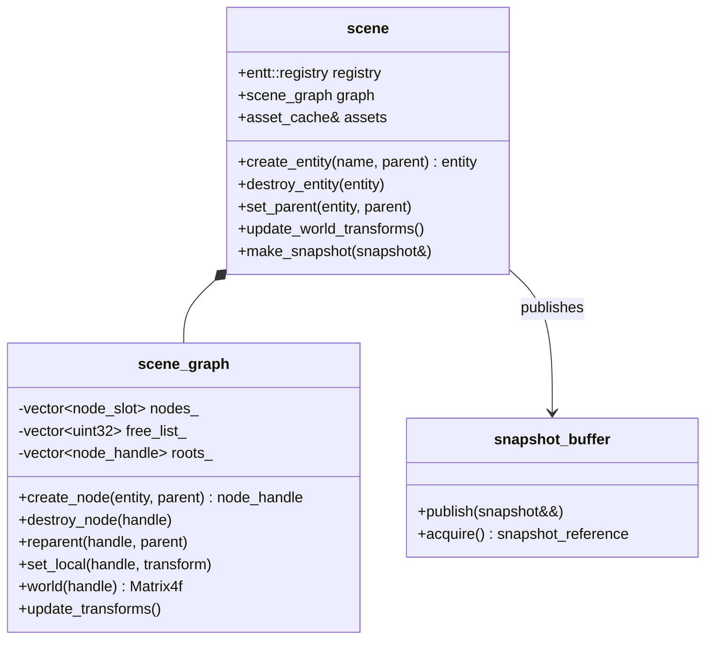

# 08 — Scene Management

## Code placement

| Feature | Namespace | CMake target | Location |
|---|---|---|---|
| Scene (`scene`, registry ownership), scene graph | `avis::scene` | `AVIS_LIB` | `include/avis/scene/scene.h`, `scene_graph.h` |
| Components (mesh, material, vehicle, sensor, …) and reflection | `avis::scene::components` | `AVIS_LIB` | `include/avis/scene/components/` |
| Asset cache, glTF import | `avis::scene` | `AVIS_LIB` | `include/avis/scene/assets/`, `lib/avis/scene/assets/` |
| Snapshots (`snapshot`, `snapshot_buffer`) | `avis::scene` | `AVIS_LIB` | `include/avis/scene/snapshot.h` |
| UI models for tree and inspector | `avis::visualizer` | `AVIS_VISUALIZER` | `apps/visualizer/ui/` |

## 1. Requirements (from idea.md)
- Hold and track all entities in a scene, based on an **ECS**, using **EnTT 4.0.0**.
- Provide the components **mesh, material, vehicle and sensor**.
- Mesh and texture formats are based on **glTF**. Materials use **PBR metallic-roughness**.
- A **separate scene graph** for positional relations and **world-transform propagation**.
- Simulation → renderer synchronisation through a **snapshot with double-buffering semantics**.

Namespace `avis::scene`. It's generic: no KITTI-360 or Driver knowledge. In the Visualizer, almost every entity is created from the Driver's scene stream ([02 §5.8](02-communication.md#58-scene-stream)), and the Visualizer layer maps those messages onto the components below (§3.1).

## 2. Structure



- `scene` owns one `entt::registry` and one `scene_graph`. Only the **simulation thread** touches them ([01 §4.1](01-system-architecture.md#41-visualizer)).
- The **scene graph is the source of truth for transforms**. ECS entities hold a `node_reference` component pointing at their graph node, and each graph node stores its `entt::entity`. That two-way link is kept consistent by `scene`; clients never manipulate the graph directly for entities.
- Entities without a spatial meaning (scenario settings, environment) have no node.

## 3. Components

All components are plain aggregates in `include/avis/scene/components/`. The **required** set from idea.md is marked ★. The rest are best-guess additions that the system needs.

| Component | Fields | Notes |
|---|---|---|
| `identity` | `std::uint64_t id`, `std::string name` | Stable id for UI selection: the Driver's `entity_id` for streamed entities, a reserved range for Visualizer helpers. `entt::entity` values are runtime-only. |
| `node_reference` | `node_handle node` | Link to the scene graph |
| ★ `mesh` | `asset_handle<mesh_asset> asset`, `std::uint32_t primitive_first`, `primitive_count` | A glTF mesh; primitives map to sub-ranges |
| ★ `material` | `std::vector<asset_handle<material_asset>> materials` | One per mesh primitive, PBR metallic-roughness ([11 §3.3](11-renderer.md#33-materials-pbr-metallic-roughness)) |
| ★ `vehicle` | `bool primary`, `vehicle_state state` (pose time, linear and angular velocity, acceleration, speed, steering angle) | Filled from `vehicle_state` messages. `primary` marks the vehicle of the vehicle model, the follow camera's default target. |
| ★ `sensor` | `sensor_kind kind` (camera, lidar, gnss_imu) | A `sensor` entity from the Driver, mounted as a child node of its vehicle with the calibration extrinsic as the local pose. Intrinsics arrive as properties. |
| `light` | `light_kind` (directional, point, spot), colour, intensity, range, cone angles, `bool casts_shadows` | The sun is a Visualizer helper set from the scenario's `visualization.environment` |
| `driver_entity` | `entity_category category`, `enum_flags<driver_entity_flags> flags` | Marks an entity created by the Driver. Read-only in the UI. |
| `display_shape` | `shape` (none, box, vehicle, axes, frustum), `Eigen::Vector3f extent`, colour, opacity, frustum angles and range | How the entity itself is drawn (`entity_update.display`, `transform_update.extent`). Semantic-free, but given mesh/material by the scene representation. |
| `properties` | Ordered `key → {property_value, unit}` map | Driver properties for the inspector (`entity_properties`) |
| `belief_geometry` | `chunk_id → {topology, origin, positions, indices, normals, colours, style}` | Chunked geometry from `geometry_update`. The scene representation turns each chunk into a mesh. |
| `lidar_points` | Ring of the last `retention` sweeps: sensor pose, positions, channels | From `lidar_sweep`. The scene representation turns each sweep into a point mesh. |
| `render_options` | `draw_layer layer`, `std::uint8_t layer_priority`, `enum_flags<instance_flags> flags` | Generic render settings for an entity that has `mesh` + `material`. Optional (defaults: `world`, visible, casts shadows, pickable). |
| `visibility` | `bool visible`, `render_layer_mask layers` | UI toggles per entity or class |

Component reflection: every component registers its fields once with a small reflection table (`avis::scene::reflect<T>()`: field name, type, getter, unit). The inspector UI is generated from it, so a new component needs no extra UI code. The `properties` component is shown as its own rows, grouped by the dotted keys.

### 3.1 Driver entities
The Visualizer's `scene_stream` applies committed messages ([02 §6.3](02-communication.md#63-scene-stream-sequencing-and-commit)) through a `driver_entity_index` (`entity_id → entt::entity`):

| Message | Effect |
|---|---|
| `entity_update` create | `create_entity(name, parent)`, then `identity`, `driver_entity`, `display_shape`, the local pose, and `vehicle` or `sensor` by category |
| `entity_update` delete | `destroy_entity` (subtree) and index removal |
| `transform_update` | `set_local` on the node, `display_shape.extent` when present |
| `vehicle_state` | `set_local` from the pose (a world pose; vehicles are always root entities, [02 §5.8.1](02-communication.md#581-entity_update), so world equals local), `vehicle.state` |
| `entity_properties` | Set or remove keys in `properties` |
| `geometry_update` | Replace or remove chunks in `belief_geometry` (the component is created on first use) |
| `lidar_sweep` | Push the sweep into `lidar_points`, dropping the oldest beyond `retention` |

The Visualizer creates only its own helpers (grid, axes, sun). At the start of each run all Driver entities are destroyed, so the scene starts empty.

## 4. Scene graph

The existing `scene_graph` (generational slot map, first-child/next-sibling links, dirty flags) is kept and extended:

| Operation | Behaviour |
|---|---|
| `create_node(entity, parent)` | Allocates a slot (free list reuse, generation++) and links it as the first child of `parent`, or as a root |
| `destroy_node(h)` | Destroys the **subtree** (children first), unlinks, frees slots, and reports the destroyed entities so `scene` can destroy them in the registry |
| `reparent(h, p, keep_world)` | Unlinks and relinks. Rejects cycles. With `keep_world = true`, the local transform is recomputed so the world transform stays the same. |
| `set_local(h, t)` | Stores the TRS and marks the subtree dirty (only the node, see below) |
| `update_transforms()` | Recomputes `world` for dirty nodes in **parent-before-child order** |

### 4.1 Transform propagation
- `transform` is TRS (`Vector3f position`, `Quaternionf rotation`, `Vector3f scale`). Composition order is `T · R · S`.
  > The existing `transform::to_matrix()` composes `scale → rotate → translate` through `Eigen::Affine3f`, which applies them in the wrong order for TRS. The target implementation builds the matrix as `Translation · Rotation · Scaling`.
- **Dirty propagation:** `set_local` flags only the node. `update_transforms` walks from the roots depth-first with an explicit stack, carrying an "ancestor dirty" bit, so it touches every node at most once per update and skips clean subtrees.
- Iteration 1 runs propagation single-threaded on the simulation thread; at 10k nodes it costs about 0.1 ms. Root-level subtrees could later be split across the parallel scheduler with `bulk` ([15](15-parallel-scheduler.md)).
- World transforms are stored as `Eigen::Affine3f` (or `Matrix4f`) relative to the scenario origin ([04 §4.4](04-scenario-and-dataset.md#44-coordinate-frames-and-precision)).

### 4.2 Typical hierarchy
```
world (root, scenario origin)
├── ego_vehicle            [vehicle(primary), display_shape(vehicle), properties(estimate.*)]
│   ├── image_00           [sensor(camera), display_shape(frustum)]
│   ├── image_01           [sensor(camera), display_shape(frustum)]
│   ├── velodyne           [sensor(lidar), display_shape(axes), lidar_points]
│   └── oxts               [sensor(gnss_imu), display_shape(axes)]
├── shadow_vehicle         [vehicle, display_shape(vehicle, ghost), properties(control.*, planner.*)]
│   └── trajectory         [belief_geometry(line_strip)]
├── perception             (group)
│   └── car 1042           [display_shape(box), properties(perception.*)]
├── belief                 (group, vehicle model)
│   ├── drivable_area      [belief_geometry(triangles, chunked)]
│   └── lane_boundaries    [belief_geometry(lines)]
└── helpers                (Visualizer: grid, axes, sun)
```

## 5. Assets (glTF)

### 5.1 Asset cache
```cpp
template<typename T> struct asset_handle { std::uint32_t index; std::uint32_t generation; };

// CPU-side only: the asset cache never touches the GPU (§5.2)
class asset_cache
{
public:
    auto load_gltf(const std::filesystem::path& path) -> sender_of<gltf_asset_set>;   // meshes, materials, textures (decoded CPU data)
    // procedural and dynamic geometry (display shapes, belief geometry chunks, lidar sweeps) created by the Visualizer's scene representation
    result<mesh_handle> create_mesh(mesh_data data);                   // stores an immutable copy as version 1
    result<void> update_mesh(mesh_handle mesh, mesh_data data);        // stores a new immutable copy, version + 1
    result<material_handle> create_material(const material_description& description);
    template<typename T> const T* get(asset_handle<T>) const;
    versioned_mesh current(mesh_handle mesh) const;                    // { version, std::shared_ptr<const mesh_data> }
    void release(asset_handle<T>);                  // ref-counted; the CPU data lives on while a snapshot references it
};
```
- Assets are deduplicated by canonical path plus a content hash.
- Loading pipeline: **IO layer** read → **fastgltf** parse (parallel worker) → image decode via **WIC** (parallel workers, one operation per image), or direct use of DDS/KTX2 BCn if present. The decoded CPU data stays in the cache. GPU upload and mip generation (compute downsample for PNG/JPEG) are done by the renderer's residency cache when the asset first appears in a snapshot ([11 §3.6](11-renderer.md#36-gpu-residency)).
- `mesh_asset` holds the geometry already converted to the Avis vertex format ([11 §3.2](11-renderer.md#32-geometry)) and the axis convention (glTF Y-up → Avis Z-up, [00 §4.1](00-overview.md#41-coordinate-systems-and-units)).
- `material_asset` = glTF `pbrMetallicRoughness` + `normalTexture` + `occlusionTexture` + `emissiveTexture` + `alphaMode`/`alphaCutoff`/`doubleSided`. The `KHR_materials_emissive_strength` and `KHR_texture_transform` extensions are supported, and other extensions are ignored with a warning.
- Supported glTF features: `.gltf` + `.bin` and `.glb`, node hierarchy (imported as child scene-graph nodes), multiple primitives. **Not** supported in iteration 1: skinning, morph targets, animations, cameras, punctual lights (`KHR_lights_punctual` could be added later).
- A default proxy vehicle mesh (`data/assets/vehicle_proxy.glb`) is used for the `vehicle` display shape, scaled to the entity's extent. `box` shapes use a built-in unit cube.

### 5.2 CPU ownership and versions
- The asset cache owns **CPU data only**. Meshes, materials and textures are immutable once stored: `update_mesh` doesn't modify the stored data, it stores a new `std::shared_ptr<const mesh_data>` and increments the mesh's `version`.
- The **renderer** owns every GPU copy. It uploads a version when it first sees it in a snapshot, and frees GPU memory by frame retirement ([11 §3.6](11-renderer.md#36-gpu-residency)). The simulation thread never calls the RHI, and the two threads share nothing mutable: the snapshot hands immutable data over through reference counting.
- A version's CPU data stays alive while the cache, any snapshot slot or a pending renderer upload holds it. That's at most the current version plus the ones referenced by the two snapshot slots.
- Version numbers are per mesh, start at 1 and never repeat, so `(mesh_handle, version)` uniquely identifies one piece of geometry for the whole run.

### 5.3 Texture formats
- Runtime formats: BC7 (colour), BC5 (normals), BC4 (single channel), uncompressed RGBA8 as fallback.
- PNG/JPEG from glTF files are decoded and uploaded uncompressed (RGBA8 with GPU-generated mips) in iteration 1. Offline BC compression can be added later in the Python asset tool.

## 6. Simulation → render synchronisation (snapshots)

### 6.1 Snapshot contents
```cpp
// generic render data only: meshes, materials, transforms (11 §3.1)
struct render_instance
{
    std::uint64_t object_id;              // stable id derived from identity; opaque to the renderer
    mesh_handle mesh;
    std::uint32_t submesh;
    material_handle material;
    Eigen::Matrix4f world_previous;       // at t_{k-1}
    Eigen::Matrix4f world_current;        // at t_k
    draw_layer layer = draw_layer::world; // world | overlay | overlay_on_top
    std::uint8_t layer_priority = 0;
    enum_flags<instance_flags> flags;     // visible, casts_shadows, selected, pickable
};

struct snapshot
{
    step_index step;
    simulation_duration time_previous;
    simulation_duration time_current;
    time_anchor anchor;               // { t_base, wall_base, rate } for interpolation (03 §5.2)
    std::vector<render_instance> instances;
    std::vector<light_instance> lights;
    environment_settings environment;
    std::uint64_t scene_version;      // increments on structural change (UI refresh hint)
    std::uint64_t publish_sequence;   // increments on every publish: step commits and presentation-only republishes (03 §4.4)

    // every mesh and material referenced by `instances`, once each, with its immutable CPU data (§5.2)
    std::vector<versioned_mesh_entry> meshes;          // { mesh_handle, version, std::shared_ptr<const mesh_data> }
    std::vector<versioned_material_entry> materials;   // { material_handle, version, std::shared_ptr<const material_asset> } (textures included)
};
```
Only generic render data goes into a snapshot: meshes, materials, transforms, lights and the environment. **No semantic data** (display shapes, belief geometry, lidar sweeps, vehicles) reaches the renderer; the Visualizer's scene representation turns those into mesh and material components first ([12 §9](12-visualizer.md#9-scene-representation)). That keeps the scene renderer agnostic to what's in the scene ([11 §2.1](11-renderer.md#21-scene-agnostic-boundary)). UI-relevant data (component values for the inspector) goes through a separate, lower-frequency path (§7).

### 6.2 Double buffering
```cpp
class snapshot_buffer
{
public:
    snapshot& begin_write();                 // simulation thread: returns the back buffer (blocks if reader holds it)
    void publish();                          // swaps front/back, bumps sequence
    snapshot_reference acquire();                  // renderer (frame chain): shared read access to the front buffer
};
```
- **Two slots**, front and back, as the idea document requires.
- The writer fills the back slot, reusing vector capacity so steady state doesn't allocate, then `publish()` swaps the indices under a short spinlock and increments a sequence number.
- The reader `acquire()`s the front slot at the start of extraction and holds an `snapshot_reference` (RAII) **only while extracting** into its own GPU-side arrays, which takes well under 1 ms. During that window the writer can still fill the back slot and publish. The next `begin_write` blocks only when the slot that just became the back buffer is still being read, which means a tick committed during the extraction window. Even then the wait is bounded by the remaining extraction time, well under 1 ms. Ticks are ≥ 1 ms apart, so this is rare and short.
- If several ticks commit between two frames, the renderer just sees the newest snapshot. Each snapshot carries both `world_previous` and `world_current`, so interpolation never needs an older snapshot.
- Skipped snapshots lose no geometry either: the `meshes` table holds the **current** version of every referenced mesh, and the renderer uploads whatever version it doesn't have yet ([11 §3.6](11-renderer.md#36-gpu-residency)). An intermediate version that no frame ever saw is simply never uploaded.
- Reusing a slot releases the `shared_ptr`s it held, so superseded CPU versions are freed once neither slot references them.
- **No new snapshot means reuse the last one.** The front slot stays readable until the next `publish()`, and the renderer `acquire()`s it every frame, so between publishes it simply sees the same snapshot again. This is what keeps rendering and camera motion going while the simulation is paused or stopped. The renderer must not keep pointers into a slot after releasing its `snapshot_reference`: after the next publish that slot becomes the back buffer and is overwritten. Whatever must persist across frames (resident GPU data, previous-frame transforms) lives in the renderer's own state ([11 §3.5](11-renderer.md#35-extraction-and-interpolation), [11 §3.6](11-renderer.md#36-gpu-residency)).
- Publishes happen on step commits and on presentation-only republishes ([03 §4.4](03-simulation-core.md#44-presentation-only-republish)). A republish carries the same step fields as the snapshot it replaces and a higher `publish_sequence`.

### 6.3 Building the snapshot
`scene::make_snapshot(snapshot&)` iterates **only** the generic EnTT views `view<node_reference, mesh, material>` (plus `render_options` for layer and flags) and `view<node_reference, light>`, in **stable entity order** (sorted by `identity` once per structural change) and fills `instances`. `world_previous` comes from a `previous_world` cache component written at the end of each tick. While filling `instances` it collects the distinct mesh and material handles and writes their `asset_cache::current(...)` entries into `meshes` and `materials`, sorted by handle. That's a reference-count increment per entry, no geometry copy.

## 7. UI synchronisation
- After each structural change (entity created, destroyed or reparented), the simulation thread posts a **tree diff** (added/removed/moved nodes with names and ids) to the GUI thread through a queued Qt signal.
- For the **selected entity only**, the simulation thread posts reflected component values at up to 20 Hz.
- The inspector is read-only: every entity comes from the Driver or is a Visualizer helper, so there's nothing to edit there. Scenario edits go through the scenario model instead ([04 §2.4](04-scenario-and-dataset.md#24-editing-rules)).

## 8. Testing
- Scene graph: create/destroy subtree, reparent with keep-world, cycle rejection, dirty propagation correctness (comparison against brute-force recomputation), generation checks on stale handles.
- Snapshot buffer: a concurrency stress test with a writer at 1 kHz and a reader at 240 Hz under TSAN-like checking (Visual Studio's `/fsanitize=address`, plus a custom invariant checker), with no torn reads.
- Asset versions: `update_mesh` bumps the version and leaves earlier `shared_ptr`s valid; a version is freed once the cache and both snapshot slots drop it.
- glTF import: axis conversion, materials, multiple primitives. Fixtures use Khronos sample models (Box, BoxTextured, DamagedHelmet).
