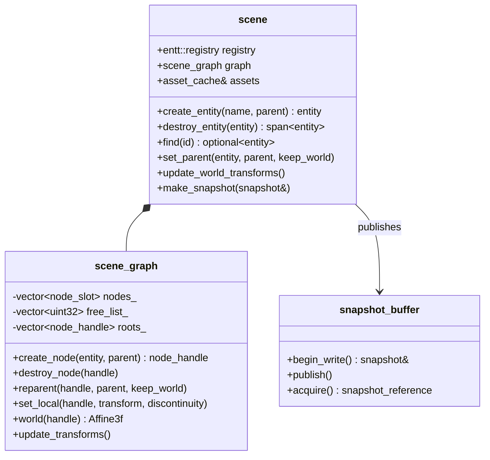

# 08 — Scene Management

> **Status:** implemented in [task 10](../tasks/10-scene-management.md) (2026-11-01), apart from the Visualizer's parts (the scene stream, the representation, the UI models; [12](12-visualizer.md)). The sections below describe the code, with **As implemented** notes where it departs from the first draft.

## Code placement

| Feature | Namespace | CMake target | Location |
|---|---|---|---|
| Scene (`scene`, registry ownership), scene graph, common types and errors | `avis::scene` | `AVIS_LIB` | `include/avis/scene/scene.h`, `scene_graph.h`, `types.h`, `error.h` |
| Components (mesh, material, vehicle, sensor, …) and reflection | `avis::scene::components`, `avis::scene` | `AVIS_LIB` | `include/avis/scene/components/`, `reflection.h` |
| Asset cache, glTF import | `avis::scene` | `AVIS_LIB` | `include/avis/scene/assets/`, `lib/avis/scene/assets/` |
| Snapshots (`snapshot`, `snapshot_buffer`) | `avis::scene` | `AVIS_LIB` | `include/avis/scene/snapshot.h` |
| Viewing aids: `aabb`, world bounds, label formatting, trail sampling, update stamps, statistics (§8) | `avis::scene` | `AVIS_LIB` | `include/avis/scene/bounds.h`, `statistics.h`, components in `include/avis/scene/components/`; `lib/avis/scene/labels.cpp`, `trails.cpp` |
| Simulation time types the scene uses (`simulation_duration`, `step_index`, `time_anchor`) | `avis::simulation` | `AVIS_LIB` | `include/avis/simulation/time.h`: the types only; the clock's state machine belongs to the simulation core ([03 §2](03-simulation-core.md)) |
| Label and trail meshes, staleness (§8.1, §8.2, §8.4) | `avis::visualizer::representation` | `AVIS_VISUALIZER` | `apps/visualizer/representation/` |
| UI models for tree and inspector | `avis::visualizer` | `AVIS_VISUALIZER` | `apps/visualizer/ui/` |

## 1. Requirements (from idea.md)
- Hold and track all entities in a scene, based on an **ECS**, using **EnTT 4.0.0**.
- Provide the components **mesh, material, vehicle and sensor**.
- Mesh and texture formats are based on **glTF**. Materials use **PBR metallic-roughness**.
- A **separate scene graph** for positional relations and **world-transform propagation**.
- Simulation → renderer synchronisation through a **snapshot with double-buffering semantics**.

Namespace `avis::scene`. It's generic: no KITTI-360 or Driver knowledge. In the Visualizer, almost every entity is created from the Driver's scene stream ([02 §5.8](02-communication.md#58-scene-stream)), and the Visualizer layer maps those messages onto the components below (§3.1).

## 2. Structure



- The diagram is an overview; the full interface is in §9.
- `scene` owns one `entt::registry` and one `scene_graph`. Only the **simulation thread** touches them ([01 §4.1](01-system-architecture.md#41-visualizer)).
- The **scene graph is the source of truth for transforms**. ECS entities hold a `node_reference` component pointing at their graph node, and each graph node stores its `entt::entity`. That two-way link is kept consistent by `scene`; clients never manipulate the graph directly for entities.
- Entities without a spatial meaning (scenario settings, environment) have no node.
- **`scene` keeps an id index** (`identity.id → entt::entity`) for every entity with an `identity`, Driver entities and Visualizer helpers alike. `find(id)` resolves picking results (`render_instance::object_id`) and UI selections (tree, inspector) without knowing where an entity came from. The Visualizer's `driver_entity_index` (§3.1) only maps the Driver's `entity_id`s and is kept in step with it.
- **Destruction reports the subtree.** `destroy_entity` destroys the entity's whole subtree and returns every destroyed entity, so callers that keep their own indices (the `driver_entity_index`, §3.1) can remove all of them, not only the root they asked for.
- **Component lifetime.** Components that hold asset handles (`mesh`, `material`) release them when they are removed or their entity is destroyed: `scene` connects EnTT's `on_destroy` signals for these components to `asset_cache::release`, so no caller has to remember it.

## 3. Components

All components are plain aggregates in `include/avis/scene/components/`. The **required** set from idea.md is marked ★. The rest are best-guess additions that the system needs.

| Component | Fields | Notes |
|---|---|---|
| `identity` | `object_id id`, `std::string name`, `entity_category category` | Stable id for UI selection: the Driver's `entity_id` for streamed entities, a reserved range for Visualizer helpers. `entt::entity` values are runtime-only. |
| `represents` | `entity owner` | Marks a helper the representation created for another entity (box edges, a label, a trail). Picking it selects the owner, and the scene tree hides it (§9.2). |
| `node_reference` | `node_handle node` | Link to the scene graph |
| `previous_world` | `Eigen::Affine3f world` | The node's world transform at the end of the previous tick, for `render_instance::world_previous` (§6.3). Written by `scene`, never by clients. |
| ★ `mesh` | `mesh_handle asset`, `std::uint32_t primitive_first`, `primitive_count` | A glTF mesh; primitives map to sub-ranges |
| ★ `material` | `std::vector<material_handle> materials` | One per mesh primitive, PBR metallic-roughness ([11 §3.3](11-renderer.md#33-materials-pbr-metallic-roughness)) |
| ★ `vehicle` | `bool primary`, `vehicle_state state` (pose time, linear and angular velocity, acceleration, speed, steering angle) | Filled from `vehicle_state` messages. `primary` marks the vehicle of the vehicle model, the follow camera's default target. |
| ★ `sensor` | `sensor_kind kind` (camera, lidar, gnss_imu) | A `sensor` entity from the Driver, mounted as a child node of its vehicle with the calibration extrinsic as the local pose. Intrinsics arrive as properties. |
| `light` | `light_kind` (directional, point, spot), colour, intensity, range, cone angles, `bool casts_shadows` | The sun is a Visualizer helper set from the scenario's `visualization.environment` |
| `driver_entity` | `entity_category category`, `avis::flags<driver_entity_flags> flags` | Marks an entity created by the Driver. Read-only in the UI. |
| `display_shape` | `shape` (none, box, vehicle, axes, frustum), `Eigen::Vector3f extent`, colour, opacity, frustum angles and range | How the entity itself is drawn (`entity_update.display`, `transform_update.extent`). Semantic-free, but given mesh/material by the scene representation. The extent never becomes the entity node's scale (§4.3). |
| `properties` | Ordered `key → {property_value, unit}` map | Driver properties for the inspector (`entity_properties`) |
| `belief_geometry` | `chunk_id → {topology, origin, positions, indices, normals, colours, style}` | Chunked geometry from `geometry_update`. The scene representation turns each chunk into a mesh. |
| `lidar_points` | Ring of the last `retention` sweeps: sensor pose, positions, channels | From `lidar_sweep`. The scene representation turns each sweep into a point mesh. |
| `render_options` | `draw_layer layer`, `std::uint8_t layer_priority`, `avis::flags<instance_flags> flags`, `float maximum_view_distance` | Generic render settings for an entity that has `mesh` + `material`. Optional (defaults: `world`, visible, casts shadows, pickable, no distance limit). `screen_aligned` and `maximum_view_distance` are used by labels (§8.1). |
| `visibility` | `bool visible`, `render_layer_mask layers` | UI toggles per entity or class |
| `label` | `std::string text_template`, `Eigen::Vector3f anchor_offset`, `Eigen::Vector2f pixel_offset`, `label_style style` | A text label above the entity (§8.1). Added by the scene representation from its configuration, never by the Driver. |
| `trail` | `trail_settings settings` (duration, spacing, colour, width), ring of `trail_sample` | The entity's recent path in world space (§8.2) |
| `update_stamp` | `simulation_duration created`, `pose`, `properties`, `geometry`, each with its `step_index` | When the Driver last created or changed the entity, per kind of change (§8.4). Written by the Visualizer's `scene_stream`. |

Component reflection: every component the inspector shows declares its fields once, in a `reflection<T>` specialisation with a `constexpr` table of field names, units and readers (§9.7). The inspector UI is generated from it, so a new component needs no extra UI code. The `properties` component is shown as its own rows, grouped by the dotted keys.

### 3.1 Driver entities
The Visualizer's `scene_stream` applies committed messages ([02 §6.3](02-communication.md#63-scene-stream-sequencing-and-commit)) through a `driver_entity_index` (`entity_id → entt::entity`):

| Message | Effect |
|---|---|
| `entity_update` create | `create_entity(name, parent)`, then `identity`, `driver_entity`, `display_shape`, the local pose, and `vehicle` or `sensor` by category |
| `entity_update` delete | `destroy_entity` (subtree), then remove **every** destroyed entity from the index, using the list `destroy_entity` returns (§2) |
| `transform_update` | `set_local` on the node, with `discontinuity` when the message marks a jump (§4.1); `display_shape.extent` when present |
| `vehicle_state` | `set_local` from the pose (a world pose; vehicles are always root entities, [02 §5.8.1](02-communication.md#581-entity_update), so world equals local), with `discontinuity` when the message marks a jump; `vehicle.state` |
| `entity_properties` | Set or remove keys in `properties` |
| `geometry_update` | Replace or remove chunks in `belief_geometry` (the component is created on first use) |
| `lidar_sweep` | Push the sweep into `lidar_points`, dropping the oldest beyond `retention` |

Every message also stamps the entity's `update_stamp` with the step and simulation time it was committed in (§8.4): `entity_update` create sets every field, `transform_update` and `vehicle_state` set `pose`, `entity_properties` sets `properties`, and `geometry_update` and `lidar_sweep` set `geometry`.

The Visualizer creates only its own helpers (grid, axes, sun). At the start of each run all Driver entities are destroyed, so the scene starts empty.

## 4. Scene graph

The existing `scene_graph` (generational slot map, first-child/next-sibling links, dirty flags) is kept and extended:

| Operation | Behaviour |
|---|---|
| `create_node(entity, parent)` | Allocates a slot (free list reuse, generation++) and links it as the first child of `parent`, or as a root |
| `destroy_node(h)` | Destroys the **subtree** (children first), unlinks, frees slots, and reports the destroyed entities so `scene` can destroy them in the registry |
| `reparent(h, p, keep_world)` | Unlinks and relinks. Rejects cycles. With `keep_world = true`, the local transform is recomputed so the world transform stays the same. That is exact only when the new parent's world transform has uniform scale, since TRS can't represent shear; otherwise the closest TRS is kept and a debug warning is logged. **No caller in iteration 1:** the scene stream sets parents at creation only ([02 §5.8.1](02-communication.md#581-entity_update)). It stays because the scene graph is generic and the operation is small, but only unit tests cover it. |
| `set_local(h, t, discontinuity = false)` | Stores the TRS and marks the node dirty (see below). With `discontinuity = true`, the node is also marked as having jumped (§4.1). |
| `update_transforms()` | Recomputes `world` for dirty nodes in **parent-before-child order** |

### 4.1 Transform propagation
- `transform` is TRS (`Vector3f position`, `Quaternionf rotation`, `Vector3f scale`). Composition order is `T · R · S`.
  > The existing `transform::to_matrix()` composes `scale → rotate → translate` through `Eigen::Affine3f`, which applies them in the wrong order for TRS. The target implementation builds the matrix as `Translation · Rotation · Scaling`.
- **Dirty propagation:** `set_local` flags only the node. `update_transforms` walks from the roots depth-first with an explicit stack, carrying an "ancestor dirty" bit, so it touches every node at most once per update and skips clean subtrees.
- **Discontinuities.** The renderer blends each instance from `world_previous` to `world_current` ([03 §5](03-simulation-core.md#5-render-interpolation)) and derives motion vectors from the pair. That is wrong for a jump: the shadow vehicle's re-synchronization to the recorded pose ([05 §3.3](05-driver.md#33-shadow-vehicle)), a large pose correction, or a reset. The car would slide across the gap and TAA would smear it. So `set_local(h, t, true)` flags the node, `update_transforms` carries the flag down the subtree like the dirty bit, and at the end of the tick every flagged node's `previous_world` is set to its new world transform, so `world_previous == world_current` in the next snapshot and the instance doesn't interpolate. The flag is cleared after the tick. The Driver marks jumps with `transform_update.discontinuous[]` and `vehicle_state.discontinuity` ([02 §5.8.2–5.8.3](02-communication.md#582-transform_update)).
- Iteration 1 runs propagation single-threaded on the simulation thread; at 10k nodes it costs about 0.1 ms. Root-level subtrees could later be split across the parallel scheduler with `bulk` ([15](15-parallel-scheduler.md)).
- World transforms are stored as `Eigen::Affine3f` relative to the scenario origin ([04 §4.4](04-scenario-and-dataset.md#44-coordinate-frames-and-precision)); the snapshot converts them to `Matrix4f`.

### 4.2 Typical hierarchy
```
world (root, scenario origin)
├── ego_vehicle            [vehicle(primary), display_shape(vehicle), properties(estimate.*)]
│   ├── image_00           [sensor(camera), display_shape(frustum)]
│   ├── image_01           [sensor(camera), display_shape(frustum)]
│   ├── velodyne           [sensor(lidar), display_shape(axes), lidar_points]
│   └── oxts               [sensor(gnss_imu), display_shape(axes)]
├── shadow_vehicle         [vehicle, display_shape(vehicle, ghost), properties(control.*, planner.*)]
│   └── trajectory         [belief_geometry(line_strip)]
├── perception             (group)
│   └── car 1042           [display_shape(box), properties(perception.*)]
├── belief                 (group, vehicle model)
│   ├── drivable_area      [belief_geometry(triangles, chunked)]
│   └── lane_boundaries    [belief_geometry(lines)]
└── helpers                (Visualizer: grid, axes, sun)
```

### 4.3 Extent is not scale
An entity's node carries only its pose, with unit scale. The size of what represents it (`display_shape.extent`, scaled proxy meshes, unit cubes) is applied to a representation-owned child node or directly to the instance's world matrix, never to the entity's own node. Otherwise the scale would propagate to the entity's children: the sensors under `ego_vehicle` would be moved and their frustums stretched by the vehicle's extent. The scene representation ([12 §9](12-visualizer.md#9-scene-representation)) follows this rule, and `scene` asserts in debug builds that the nodes of Driver entities have unit scale.

## 5. Assets (glTF)

### 5.1 Asset cache
```cpp
template<typename T> struct asset_handle { std::uint32_t index; std::uint32_t generation; };
using mesh_handle = asset_handle<mesh_asset>;
using material_handle = asset_handle<material_asset>;

// CPU-side only: the asset cache never touches the GPU (§5.2)
class asset_cache
{
public:
    auto load_gltf(const std::filesystem::path& path) -> sender_of<gltf_asset_set>;   // meshes, materials, textures (decoded CPU data)
    // procedural and dynamic geometry (display shapes, belief geometry chunks, lidar sweeps) created by the Visualizer's scene representation
    result<mesh_handle> create_mesh(mesh_data data);                   // stores an immutable copy as version 1
    result<void> update_mesh(mesh_handle mesh, mesh_data data);        // stores a new immutable copy, version + 1
    result<material_handle> create_material(const material_description& description);
    template<typename T> const T* get(asset_handle<T>) const;
    versioned_mesh current(mesh_handle mesh) const;                    // { version, std::shared_ptr<const mesh_data> }
    void release(asset_handle<T>);                  // ref-counted; the CPU data lives on while a snapshot references it
};
```
- Assets are deduplicated by canonical path plus a content hash.
- Loading pipeline: **IO layer** read → **fastgltf** parse (parallel worker) → image decode via **WIC** (parallel workers, one operation per image). Direct use of DDS/KTX2 BCn images is planned, not implemented (below). The decoded CPU data stays in the cache. GPU upload and mip generation (compute downsample for PNG/JPEG) are done by the renderer's residency cache when the asset first appears in a snapshot ([11 §3.6](11-renderer.md#36-gpu-residency)).
- **Bounds.** `create_mesh`, `update_mesh` and the glTF import compute each version's local axis-aligned bounding box (`aabb`, §8.3) once, on the CPU, and store it in `mesh_data` (per primitive and for the whole mesh). The renderer's residency cache takes it from there for culling, sort depth and progressive point counts ([11 §3.2](11-renderer.md#32-geometry)), so the renderer never scans vertices itself. An empty mesh has empty bounds and is culled.
- `mesh_asset` holds the geometry already converted to the Avis vertex format ([11 §3.2](11-renderer.md#32-geometry)) and the axis convention (glTF Y-up → Avis Z-up, [00 §4.1](00-overview.md#41-coordinate-systems-and-units)).
- `material_asset` = glTF `pbrMetallicRoughness` + `normalTexture` + `occlusionTexture` + `emissiveTexture` + `alphaMode`/`alphaCutoff`/`doubleSided`. The `KHR_materials_emissive_strength`, `KHR_materials_unlit` and `KHR_texture_transform` extensions are supported (the last one partly, below), and other extensions are ignored with a warning.
- Supported glTF features: `.gltf` + `.bin` and `.glb`, node hierarchy (imported as child scene-graph nodes), multiple primitives. **Not** supported in iteration 1: skinning, morph targets, animations, cameras, punctual lights (`KHR_lights_punctual` could be added later).
- A default proxy vehicle mesh (`data/assets/vehicle_proxy.glb`) is used for the `vehicle` display shape, scaled to the entity's extent. `box` shapes use a built-in unit cube.

**As implemented** (task 10.6):
- **Extensions.** `KHR_materials_emissive_strength`, `KHR_materials_unlit` (→ `shading_model::unlit`), `KHR_mesh_quantization` and `KHR_texture_transform`. A texture transform works on the base colour texture only, for offset and scale (rotation is ignored with a warning), and is baked into the primitive's uvs; when a primitive's textures use different transforms, it's ignored with a warning. Other extensions in use are ignored with a warning; a *required* extension outside this set fails with `gltf_unsupported`.
- **Images.** PNG and JPEG only, decoded by WIC into `rgba8_srgb` (colour) or `rgba8_unorm` (data), with `generate_mips`. COM is initialised once per worker thread by a `thread_local` guard. DDS (`MSFT_texture_dds`) and KTX2 (`KHR_texture_basisu`) images are ignored with a warning, or fail with `gltf_unsupported` when the extension is required.
- **Geometry.** Strips, fans and line loops become lists. Flat normals are generated for a primitive without normals, and tangents for a normal-mapped primitive without tangents. Indices are relative to the primitive's `vertex_first`.
- **Deduplication** is by canonical path plus the XXH3-64 hash of the file's bytes: a second load of an unchanged file retains every handle and completes with a copy of the set, without parsing.
- A cache constructed without an IO context (procedural assets, unit tests) fails `load_gltf` with a generic `logic_error`. The Visualizer's cache uses the runtime's IO context, and loads `vehicle_proxy.glb` at startup when the file exists (it comes with the representation, 12).

### 5.2 CPU ownership and versions
- The asset cache owns **CPU data only**. Meshes, materials and textures are immutable once stored: `update_mesh` doesn't modify the stored data, it stores a new `std::shared_ptr<const mesh_data>` and increments the mesh's `version`.
- The **renderer** owns every GPU copy. It uploads a version when it first sees it in a snapshot, and frees GPU memory by frame retirement ([11 §3.6](11-renderer.md#36-gpu-residency)). The simulation thread never calls the RHI, and the two threads share nothing mutable: the snapshot hands immutable data over through reference counting.
- A version's CPU data stays alive while the cache, any snapshot slot or a pending renderer upload holds it. That's at most the current version plus the ones referenced by the two snapshot slots.
- Version numbers are per mesh, start at 1 and never repeat, so `(mesh_handle, version)` uniquely identifies one piece of geometry for the whole run.

### 5.3 Texture formats
- Runtime formats: BC7 (colour), BC5 (normals), BC4 (single channel), uncompressed RGBA8 as fallback.
- PNG/JPEG from glTF files are decoded and uploaded uncompressed (RGBA8 with GPU-generated mips) in iteration 1. Offline BC compression can be added later in the Python asset tool.

## 6. Simulation → render synchronisation (snapshots)

### 6.1 Snapshot contents
```cpp
// generic render data only: meshes, materials, transforms (11 §3.1)
struct render_instance
{
    std::uint64_t object_id;              // identity::id: stable, opaque to the renderer
    mesh_handle mesh;
    std::uint32_t submesh;
    material_handle material;
    Eigen::Matrix4f world_previous;       // at t_{k-1}
    Eigen::Matrix4f world_current;        // at t_k
    draw_layer layer = draw_layer::world; // world | overlay | overlay_on_top
    std::uint8_t layer_priority = 0;
    avis::flags<instance_flags> flags;     // visible, casts_shadows, selected, pickable, screen_aligned (§8.1), history_invalid (§6.3)
    float maximum_view_distance = 0.0f;   // metres from the camera; 0 = unlimited (§8.1)
};

struct snapshot
{
    step_index step;
    simulation_duration time_previous;
    simulation_duration time_current;
    time_anchor anchor;               // { t_base, wall_base, rate } for interpolation (03 §5.2)
    std::vector<render_instance> instances;
    std::vector<light_instance> lights;
    environment_settings environment;
    std::uint64_t scene_version;      // increments on structural change (UI refresh hint)
    std::uint64_t publish_sequence;   // increments on every publish: step commits and presentation-only republishes (03 §4.4)

    // every mesh and material referenced by `instances`, once each, with its immutable CPU data (§5.2)
    std::vector<versioned_mesh_entry> meshes;          // { mesh_handle, version, std::shared_ptr<const mesh_data> }
    std::vector<versioned_material_entry> materials;   // { material_handle, versioned_material }
    std::vector<versioned_texture_entry> textures;     // { texture_handle, versioned_texture }: every material's textures, once each
};
```
**As implemented** (task 10.11): the textures aren't inside each material entry, as first drafted, but in their own `textures` table, sorted by handle, once each however many materials share them; the renderer resolves a material's texture handles against it. A vector inside each material entry would be freed and reallocated on every `begin_write`, so a steady-state build couldn't avoid allocating. The step fields and the anchor are set by whoever calls `make_snapshot`, `publish_sequence` by `snapshot_buffer::publish`. Instances are sorted by `object_id`, then submesh, and lights by id.
Only generic render data goes into a snapshot: meshes, materials, transforms, lights and the environment. **No semantic data** (display shapes, belief geometry, lidar sweeps, vehicles) reaches the renderer; the Visualizer's scene representation turns those into mesh and material components first ([12 §9](12-visualizer.md#9-scene-representation)). That keeps the scene renderer agnostic to what's in the scene ([11 §2.1](11-renderer.md#21-scene-agnostic-boundary)). UI-relevant data (component values for the inspector) goes through a separate, lower-frequency path (§7).

### 6.2 Double buffering
```cpp
class snapshot_buffer
{
public:
    snapshot& begin_write();                 // simulation thread: returns the back buffer (blocks if reader holds it)
    void publish();                          // swaps front/back, bumps sequence
    snapshot_reference acquire();                  // renderer (frame chain): shared read access to the front buffer
};
```
- **Two slots**, front and back, as the idea document requires.
- The writer fills the back slot, reusing vector capacity so steady state doesn't allocate, then `publish()` swaps the indices under a short spinlock and increments a sequence number.
- The reader `acquire()`s the front slot at the start of extraction and holds an `snapshot_reference` (RAII) **only while extracting** into its own GPU-side arrays, which takes well under 1 ms. During that window the writer can still fill the back slot and publish. The next `begin_write` blocks only when the slot that just became the back buffer is still being read, which means a tick committed during the extraction window. Even then the wait is bounded by the remaining extraction time, well under 1 ms. Ticks are ≥ 1 ms apart, so this is rare and short.
- If several ticks commit between two frames, the renderer just sees the newest snapshot. Each snapshot carries both `world_previous` and `world_current`, so interpolation never needs an older snapshot.
- Skipped snapshots lose no geometry either: the `meshes` table holds the **current** version of every referenced mesh, and the renderer uploads whatever version it doesn't have yet ([11 §3.6](11-renderer.md#36-gpu-residency)). An intermediate version that no frame ever saw is simply never uploaded.
- Reusing a slot releases the `shared_ptr`s it held, so superseded CPU versions are freed once neither slot references them.
- **No new snapshot means reuse the last one.** The front slot stays readable until the next `publish()`, and the renderer `acquire()`s it every frame, so between publishes it simply sees the same snapshot again. This is what keeps rendering and camera motion going while the simulation is paused or stopped. The renderer must not keep pointers into a slot after releasing its `snapshot_reference`: after the next publish that slot becomes the back buffer and is overwritten. Whatever must persist across frames (resident GPU data, previous-frame transforms) lives in the renderer's own state ([11 §3.5](11-renderer.md#35-extraction-and-interpolation), [11 §3.6](11-renderer.md#36-gpu-residency)).
- Publishes happen on step commits and on presentation-only republishes ([03 §4.4](03-simulation-core.md#44-presentation-only-republish)). A republish carries the same step fields as the snapshot it replaces and a higher `publish_sequence`.

### 6.3 Building the snapshot
`scene::make_snapshot(snapshot&)` iterates **only** the generic EnTT views `view<node_reference, mesh, material>` (plus `render_options` for layer and flags) and `view<node_reference, light>`, in **stable entity order** (sorted by `identity` once per structural change) and fills `instances`. `world_previous` comes from the `previous_world` component written at the end of each tick: the previous tick's world transform, or the current one for a node that jumped (§4.1). An entity created during the tick has no `previous_world` yet, so it pops in ([03 §5](03-simulation-core.md#5-render-interpolation)): its instances get `world_previous = world_current` and `instance_flags::history_invalid`, which also tells TAA to drop the instance's history ([11 §3.1](11-renderer.md#31-render-snapshot)). It collects the distinct mesh, material and texture handles and writes their `asset_cache::current(...)` entries into `meshes`, `materials` and `textures`, sorted by handle. That's a reference-count increment per entry, no geometry copy.

**As implemented** (task 10.11): the sorted entity order is cached and rebuilt only when `scene_version` changed or an entity gained or lost `mesh` or `material` (EnTT signals set a flag). Each entity gives one instance per primitive of its range, clamped to the current version's primitives, with the matching material, the last one repeating when there are fewer. `visibility.visible == false` clears `instance_flags::visible`. Once the snapshot's vectors have grown, a build allocates nothing: the scratch handle lists are `scene` members, and the `shared_ptr` copies only change reference counts.

## 7. UI synchronisation
- After each structural change (entity created, destroyed or reparented), the simulation thread posts a **tree diff** (added/removed/moved nodes with names and ids) to the GUI thread through a queued Qt signal.
- For the **selected entity only**, the simulation thread posts reflected component values at up to 20 Hz, together with its `update_stamp` (§8.4) and its world bounds (§8.3).
- **Scene statistics** (§8.5) go to the GUI at 2 Hz, through the same kind of queued signal.
- The inspector is read-only: every entity comes from the Driver or is a Visualizer helper, so there's nothing to edit there. Scenario edits go through the scenario model instead ([04 §2.4](04-scenario-and-dataset.md#24-editing-rules)).

## 8. Viewing aids

Features that make the scene easier to read without adding meaning to it. The scene library provides the generic parts (components, queries, counters); the Visualizer's scene representation ([12 §9](12-visualizer.md#9-scene-representation)) turns labels and trails into meshes, like every other visual. Toggling any of them is a presentation command ([12 §4.1](12-visualizer.md#41-presentation-commands)), so it works in every clock state and never touches the Driver.

### 8.1 Labels
A short text above an entity, for example `car 1042 · 8.3 m/s`, readable without selecting it.

```cpp
struct label_style
{
    color text_color{ 1.0f, 1.0f, 1.0f, 1.0f };
    color background{ 0.0f, 0.0f, 0.0f, 0.5f };  // a quad behind the text; alpha 0 = none
    float pixel_height = 14.0f;                   // constant on screen, scaled by the device pixel ratio
    float maximum_view_distance = 80.0f;          // metres; farther labels aren't drawn
};

struct label
{
    std::string text_template;                    // "{name} · {property:perception.speed:.1f} m/s"
    Eigen::Vector3f anchor_offset = Eigen::Vector3f::Zero();   // metres, in the entity's frame
    Eigen::Vector2f pixel_offset = Eigen::Vector2f::Zero();    // pixels, after projection
    label_style style;
};
```

- **Templates.** `{name}` and `{id}` come from `identity`; `{property:<key>[:<format>]}` from the `properties` component, formatted with `std::format` and the optional format spec, with the property's unit appended when it has one. A missing key gives `–`. `scene::format_label(entity)` evaluates the template; it's generic, because it only reads `identity` and `properties`.
  **As implemented** (task 10.12): `{{` and `}}` are escapes. Strings and booleans ignore the format spec, a vector is `(x, y, z)` with the spec per element, and an integer whose spec suits only floating point (`.1f`) is formatted as a double. A bad spec or an unknown field also gives `–`, and logs a warning once per template. Parsed templates are cached by the template's hash. `format_label(text_template, entity)` formats another template for the entity.
- **Who adds them.** The representation adds a `label` per category from its configuration. The default anchor is the top of the display shape (`extent.z / 2` plus 0.3 m), so labels clear the box they belong to.
  ```yaml
  representation:
    labels:
      enabled: true
      maximum_count: 200                     # the nearest ones to the primary vehicle are kept
      templates:
        vehicle: "{name}"
        object: "{name} · {property:perception.speed:.1f}"
        sensor: ""                            # empty: no label
  ```
- **Text to mesh.** Labels are meshes, like everything else, so the renderer stays agnostic to text:
  - A **font atlas** (a bitmap texture with glyph metrics) is loaded once at startup into the asset cache as a texture and an unlit, alpha-blended material.
  - The representation lays each label out into a mesh of glyph quads (positions in pixels relative to the anchor, UVs into the atlas), plus the background quad, and caches it by text and style. The mesh is rebuilt through `update_mesh` only when the formatted text changes, and at most every 250 ms per label, so speeds that change every step don't churn versions.
  - Each label is a child helper entity of its entity, at `anchor_offset`, in the `overlay_on_top` layer with `layer_priority` above box edges. It is `screen_aligned` and has `maximum_view_distance` from its style, so it reads at any distance up to the limit and never hides behind the geometry it labels.
- **Two generic renderer additions** (11 §3.1, §10.5):
  - `instance_flags::screen_aligned`: the instance's mesh is in pixels, facing the camera, anchored at the projected origin of `world_current`. The vertex shader projects the origin and adds the vertex offset in pixels, so the size is constant on screen. The renderer knows nothing of text.
  - `maximum_view_distance`: instances farther from the camera are culled. That keeps far labels from piling up, and is useful for any small overlay.
- **Clutter.** Iteration 1 doesn't move overlapping labels apart. The distance limit and `maximum_count` keep the number small; decluttering can come later in the representation without changing the renderer.
- **Bounds.** Labels are `screen_aligned`, so they're excluded from world bounds (§8.3).

### 8.2 Trails
The recent path of an entity, as a line in world space. It shows where the shadow vehicle drifts from the recorded path (99 Q-08), and whether a perceived object's track jumps.

```cpp
struct trail_settings
{
    float duration_seconds = 10.0f;   // simulation time kept
    float minimum_spacing = 0.25f;    // metres between samples
    color line_color{ 1.0f, 0.8f, 0.2f, 1.0f };
    float line_width = 2.0f;          // pixels
};

struct trail_sample
{
    simulation_duration time;
    Eigen::Vector3f position;         // world, relative to the scenario origin
    bool starts_segment = false;      // after a discontinuity: no line from the previous sample
};

struct trail
{
    trail_settings settings;
    std::deque<trail_sample> samples; // oldest first
};
```

- **Sampling** is generic and part of `scene`: at the end of each tick, after `update_transforms`, `scene::update_trails(time)` visits `view<node_reference, trail>`, appends the node's world origin when it moved at least `minimum_spacing` from the last sample (or is the first one), and drops samples older than `duration_seconds`. A node that jumped this tick (§4.1) appends a sample with `starts_segment`, so a re-synchronised shadow vehicle doesn't draw a line across the jump. No tick, no sample: a paused scene keeps its trails.
  **As implemented** (task 10.12): `update_world_transforms` records the entities that jumped, and `end_tick` clears the set. Debug builds assert a second `update_trails` in one tick and one before the transforms are propagated. EnTT's signals fire per component, not per field, so they can't guard `trail::samples`: `update_trails` keeps each trail's sample count and checks that nothing else changed it since its last call (§9.2). The sample count in the statistics follows what's there.
- **Rendering.** The trail is in world space, so its mesh must not move with the entity. The representation gives each trailed entity a helper entity at the world root, under `helpers` (named `<name> trail`, hidden from the scene tree), with line meshes in world coordinates in the `overlay` layer.
- **Chunked meshes.** Rewriting the whole line every tick would create a new version of a large mesh each step. Instead, samples go into blocks of 128: completed blocks are immutable meshes, only the newest block is rewritten with `update_mesh` each tick, and consecutive blocks share their boundary sample so the line has no gaps. The oldest block is rewritten when samples expire from it and dropped when it's empty. That bounds the per-tick work to two small mesh updates per trail, whatever its length. Trail meshes count against the representation's geometry budget ([12 §9.1](12-visualizer.md#91-geometry-budget-and-eviction)), with the same priority as belief geometry.
- **Defaults.** Configured per category in `representation.trails` (`vehicle: 30 s`, `object: off`), switched per category in the *View* menu and per entity from the scene tree's context menu. Trails are cleared with their entities at the start of a run.

### 8.3 World bounds
```cpp
struct aabb
{
    Eigen::Vector3f minimum{ +infinity, +infinity, +infinity };
    Eigen::Vector3f maximum{ -infinity, -infinity, -infinity };
    bool empty() const noexcept;
    void extend(const aabb& other) noexcept;
    aabb transformed(const Eigen::Affine3f& transform) const noexcept;   // Arvo's method: exact AABB of the box
};

// scene: the union of every mesh instance in the entity's subtree, in world space
std::optional<aabb> world_bounds(entt::entity entity) const;
```

- `world_bounds` walks the entity's subtree and, for each entity with `mesh`, transforms the bounds of the current mesh version's primitive range (§5.1) by the node's world transform. That includes the representation's child helpers (box faces and edges, the vehicle proxy), so the bounds are those of what's drawn. `screen_aligned` instances (labels) are skipped, and trails aren't in the subtree. An entity with nothing drawn returns `nullopt`; callers fall back to the node's position.
- It's computed **on demand**, with no cache: it's O(subtree), and its only users are the selected entity's 20 Hz update (§7) and the follow target.
- **Uses in the Visualizer** (12 §5):
  - *Frame selection* (`F`, or double-click in the scene tree) moves the free-fly camera so the bounding sphere of the selection fills the view with a 1.2 margin, keeping the view direction.
  - The **follow camera** scales its configured offset with the target's bounding radius, so following a truck and a cyclist both look right. The target's bounds are posted with the follow target, and again when its extent changes.

### 8.4 Update stamps and staleness
```cpp
struct update_time
{
    step_index step;
    simulation_duration time;
};

struct update_stamp
{
    update_time created;
    std::optional<update_time> pose;          // transform_update, vehicle_state
    std::optional<update_time> properties;    // entity_properties
    std::optional<update_time> geometry;      // geometry_update, lidar_sweep
    update_time latest() const noexcept;      // the newest of the four
};
```

- `scene_stream` stamps every message (§3.1). The inspector shows each kind as *"pose: 1.2 s ago (step 1234)"*, relative to the current simulation time, so it's clear whether an object is being tracked or was left behind.
- **Staleness** (optional): with `representation.stale: { after_seconds: 2.0, categories: [object] }`, an entity whose `latest()` is older than `after_seconds` is drawn with a dimmed variant of its materials (opacity × 0.4, desaturated; one variant per material, created on first use and cached), and the scene tree shows a stale marker. It's evaluated once per tick over the listed categories.
- **Off by default.** The Driver sends a `transform_update` only when a pose changes ([02 §5.8.2](02-communication.md#582-transform_update)), so a tracked object that stands still gets no updates and would look stale. Staleness is only meaningful for a Driver that refreshes its objects every step, for example through a property like `perception.confidence`. The stamps themselves are always kept and shown.

### 8.5 Scene statistics
```cpp
struct scene_statistics
{
    step_index step;                               // of the last snapshot, as its caller set it before make_snapshot
    std::uint32_t entities = 0;
    std::uint32_t nodes = 0;
    std::array<std::uint32_t, entity_category_count> entities_per_category{};   // by entity_category; helper is the last
    std::uint32_t instances = 0;                   // in the last snapshot
    std::uint32_t lights = 0;
    std::uint32_t meshes = 0;
    std::uint32_t materials = 0;
    std::uint32_t textures = 0;
    std::uint64_t current_geometry_bytes = 0;      // current versions held by the asset cache
    std::uint64_t retained_geometry_bytes = 0;     // older versions still held by snapshot slots or uploads (§5.2)
    std::uint32_t labels = 0;
    std::uint32_t trails = 0;
    std::uint32_t trail_samples = 0;
    double transform_update_milliseconds = 0.0;    // last tick: update_world_transforms and end_tick
    double snapshot_build_milliseconds = 0.0;      // last make_snapshot
};

scene_statistics scene::statistics() const;
```

- **Cheap to read.** Entity and category counts are maintained with EnTT's `on_construct`/`on_destroy` signals; the asset cache keeps atomic byte counters, updated on create, update and free (the free happens in the `shared_ptr` deleter, which can run on the render thread, hence atomics). `statistics()` copies the counters and the two last timings; it's O(1).
- The simulation thread posts it to the GUI at 2 Hz (§7). The statistics overlay (12) shows it next to the representation's reduction level ([12 §9.1](12-visualizer.md#91-geometry-budget-and-eviction)) and the renderer's GPU timings, so a slow frame or a thinned-out picture can be traced to its cause.

### 8.6 Changes to other documents
Applied:
- **11:** `instance_flags::screen_aligned` and `render_instance::maximum_view_distance` (§3.1), screen-aligned instances only in the overlay layers (§3.4), distance and anchor culling (§4.5), and the screen-aligned vertex path (§10.5).
- **12:** the label, trail and staleness representations, their files and `representation` configuration keys (§2, §9, §9.1); the presentation commands for them (§4.1) and what the simulation thread posts to the GUI (§4); *Frame selection* and the follow distance from the target's bounds (§5); the *View* and *Render* menus, the scene tree's context menu and stale marker, and the inspector's update stamps (§6).
- **13 §5:** `dt font-atlas` bakes the label font to `data/assets/fonts/labels*.png` plus glyph metrics, at 1× and 2× for high-DPI screens. The output is checked in, so the build doesn't run it.
- **99:** Q-08 points at trails.

Open: which font to use. It needs a licence that allows redistribution (the SIL Open Font License, for example) and a glyph set covering Latin-1 plus `·`, `±`, `°` and `–`.

## 9. Interface

The public headers of `avis::scene`, in dependency order. Everything is in `include/avis/scene/`, follows [13 §9](13-build-and-quality.md#9-coding-standards), and reports failures with `avis::result<T>` in `error_domain::scene` ([01 §6](01-system-architecture.md#6-error-handling-policy)). Programming errors (a stale handle, a call from the wrong thread) are debug checks through `AVIS_CHECK` on the "scene" logger, not errors.

It replaces the prototype's API in `include/avis/scene/`: `scene::view_entities` (a `std::generator` over a view) gives way to `scene::registry()` views, `scene_graph::get_node` and `mark_dirty` to the handle-based calls of §9.3, and `transform::to_matrix` (wrong order, §4.1) to `transform::to_affine`. The prototype's `components::mesh` and `components::material` become the components of §3.

```mermaid
flowchart LR
    types[types.h, bounds.h, error.h] --> components[components/*.h]
    types --> graph[scene_graph.h]
    types --> assets[assets/*.h]
    components --> reflection[reflection.h]
    assets --> snapshot[snapshot.h]
    graph --> scene[scene.h]
    components --> scene
    snapshot --> scene
    reflection --> scene
    scene --> statistics[statistics.h]
```

### 9.1 `scene/types.h`, `scene/bounds.h`, `scene/error.h`

```cpp
namespace avis::scene
{
    using entity = entt::entity;                         // runtime only; never stored across runs or sent anywhere

    // identity.id: the Driver's entity_id (02 §5.7) for streamed entities; helpers use source 0xFF in bits 63–56
    using object_id = std::uint64_t;
    inline constexpr std::uint64_t helper_source = 0xFF;
    constexpr bool is_helper(object_id id) noexcept { return (id >> 56) == helper_source; }

    // the Driver's entity categories (02 §5.8.1), plus helpers
    enum class entity_category : std::uint8_t { group, vehicle, sensor, object, geometry, helper };
    inline constexpr std::size_t entity_category_count = 6;

    struct color                                         // linear RGBA; conversions from the protocol's sRGB u8x4
    {
        float red = 1.0f;
        float green = 1.0f;
        float blue = 1.0f;
        float alpha = 1.0f;
        static color from_srgb8(std::array<std::uint8_t, 4> rgba) noexcept;
    };

    struct transform                                     // TRS, composed as T · R · S (§4.1)
    {
        Eigen::Vector3f position = Eigen::Vector3f::Zero();
        Eigen::Quaternionf rotation = Eigen::Quaternionf::Identity();
        Eigen::Vector3f scale = Eigen::Vector3f::Ones();

        Eigen::Affine3f to_affine() const noexcept;      // Translation · Rotation · Scaling
        static transform from_affine(const Eigen::Affine3f& affine) noexcept;   // closest TRS (§4, reparent)
    };

    struct node_handle
    {
        std::uint32_t index = std::numeric_limits<std::uint32_t>::max();
        std::uint32_t generation = 0;
        bool valid() const noexcept;                     // not default; says nothing about being alive
        friend auto operator<=>(const node_handle&, const node_handle&) = default;
    };
}
```

The simulation time types (`simulation_duration`, `step_index`, `time_anchor`) come from `avis/simulation/time.h`, which holds only the types of [03 §2](03-simulation-core.md) and [03 §5.2](03-simulation-core.md) that the scene needs.

`bounds.h` holds `aabb` (§8.3). `error.h`:

```cpp
namespace avis::scene
{
    enum class error_kind : std::int32_t
    {
        ok = 0,
        duplicate_id,           // create_entity with an identity id that already exists
        invalid_parent,         // the parent isn't alive, or has no node
        cycle,                  // set_parent would make an entity its own ancestor
        invalid_mesh,           // mesh_data with indices out of range, mismatched streams or empty primitives
        invalid_material,       // a texture handle that isn't alive
        gltf_invalid,           // fastgltf rejected the file; the message has its path and fastgltf's reason
        gltf_unsupported,       // a required feature outside §5.1 (skinning, morph targets, required extensions)
        image_decode_failed     // WIC couldn't decode a texture; names the image and the file
    };

    std::string_view to_string(error_kind kind) noexcept;
    avis::error make_error(error_kind kind, std::string message,
                           std::source_location location = std::source_location::current());
    bool is_error(const avis::error& error, error_kind kind) noexcept;
}
```

IO errors from loading pass through unchanged (`error_domain::io`).

### 9.2 `scene/components/*.h`

Plain aggregates in `avis::scene::components`, one header per group, with the fields of §3 and §8. The enums and value types they share (`instance_flags`, `draw_layer`, `entity_category`, `color`, …) are in `avis::scene`, so the snapshot and the asset cache can use them without the components. All are default-constructible and movable, so EnTT can store them in its pools; none holds a pointer into the registry.

| Header | Components |
|---|---|
| `components/identity.h` | `identity { object_id id; std::string name; entity_category category; }`, `represents { entity owner; }` |
| `components/spatial.h` | `node_reference { node_handle node; }`, `previous_world { Eigen::Affine3f world; }` |
| `components/rendering.h` | `mesh`, `material`, `render_options`, `visibility`, `light` |
| `components/vehicle.h` | `vehicle`, `vehicle_state` |
| `components/sensor.h` | `sensor`, `sensor_kind` |
| `components/driver.h` | `driver_entity`, `display_shape`, `properties`, `property_value`, `belief_geometry`, `lidar_points` |
| `components/viewing.h` | `label`, `label_style`, `trail`, `trail_settings`, `trail_sample`, `update_stamp`, `update_time` (§8) |

Additions beyond the table of §3:
- **`identity::category`** is set for every entity (helpers get `helper`), so statistics, visibility per category and the tree don't need `driver_entity` to know it.
- **`represents`** marks a helper entity that the representation created for another entity: a box's edges, a label, a trail. Picking a helper selects its owner (`scene::selection_target`, §9.5), and the tree hides entities with `represents`. Each helper keeps its own `identity` in the helper range, so every `render_instance::object_id` stays unique and the renderer's per-object history (motion vectors) never mixes two instances.
- **`property_value`** is `std::variant<bool, std::int64_t, double, std::string, Eigen::Vector3d>`, the five types of [02 §5.7](02-communication.md#57-common-types). `properties` keeps insertion order: `std::vector<property_entry>` with `{ std::string key; property_value value; std::string unit; }` and a sorted index for lookups by key.
- **Flags** use `avis::flags<E>` (`avis/enum_flags.h`): `render_options::flags` is `avis::flags<instance_flags>`, `driver_entity::flags` is `avis::flags<driver_entity_flags>`.

```cpp
namespace avis::scene
{
    enum class instance_flags : std::uint8_t
    {
        visible = 1 << 0,
        casts_shadows = 1 << 1,
        selected = 1 << 2,
        pickable = 1 << 3,
        screen_aligned = 1 << 4,      // §8.1
        history_invalid = 1 << 5      // set by make_snapshot only: no previous_world yet (§6.3)
    };
    enum class draw_layer : std::uint8_t { world, overlay, overlay_on_top };
    enum class driver_entity_flags : std::uint16_t { primary = 1 << 0, pickable = 1 << 1, hidden_by_default = 1 << 2 };
}
ALLOW_FLAGS_FOR_ENUM(avis::scene::instance_flags)
ALLOW_FLAGS_FOR_ENUM(avis::scene::driver_entity_flags)
```

**As implemented** (task 10.7): these enums, with `light_kind` and `render_layer_mask` (the visibility toggles' bits), are in `scene/flags.h`. `trail::samples` is a `std::deque`, whose move constructor isn't `noexcept` on MSVC, so `trail` is the one component that isn't nothrow-move-constructible.

**Components `scene` owns.** `identity`, `node_reference`, `previous_world` and `trail::samples` are written only by `scene`. Clients get them through `scene` calls, and debug builds check this: `scene` connects `on_construct`/`on_update`/`on_destroy` for these components and asserts unless it is writing them itself. **As implemented:** the signals guard `identity`, `node_reference` and `previous_world`; destroying entities through `scene` (`destroy_entity`, `clear`, the destructor) is allowed. A field can't be guarded by signals, so `trail::samples` is checked by its count in `update_trails` (§8.2).

### 9.3 `scene/scene_graph.h`

Generic: it knows entities only as a payload. `scene` is its only user for entities (§2), but it can be used and tested on its own.

```cpp
namespace avis::scene
{
    class scene_graph
    {
    public:
        scene_graph();
        scene_graph(const scene_graph&) = delete;
        scene_graph& operator=(const scene_graph&) = delete;
        scene_graph(scene_graph&&) noexcept;
        scene_graph& operator=(scene_graph&&) noexcept;

        // ---- structure ----
        node_handle create_node(entity payload, node_handle parent = {}, const transform& local = {});
        // destroys the subtree, children first; appends each destroyed node's payload to `destroyed`
        void destroy_node(node_handle node, std::vector<entity>& destroyed);
        result<void> reparent(node_handle node, node_handle parent, bool keep_world);   // cycle, invalid_parent
        void clear() noexcept;

        bool alive(node_handle node) const noexcept;
        entity payload(node_handle node) const noexcept;
        node_handle parent(node_handle node) const noexcept;
        std::span<const node_handle> roots() const noexcept;

        // depth-first, parent before children; `visit` returns false to skip a node's children
        template<std::invocable<node_handle> Visit>
        void for_each_in_subtree(node_handle node, Visit&& visit) const;

        // ---- transforms ----
        void set_local(node_handle node, const transform& local, bool discontinuity = false) noexcept;
        const transform& local(node_handle node) const noexcept;
        const Eigen::Affine3f& world(node_handle node) const noexcept;    // as of the last update_transforms

        // incremental: only dirty nodes and their subtrees. Calls jumped(node) for every node that jumped since the
        // last call, itself or through an ancestor (§4.1). May run more than once per tick.
        template<std::invocable<node_handle> Jumped>
        void update_transforms(Jumped&& jumped);
        void update_transforms();

        std::size_t size() const noexcept;               // live nodes
    };
}
```

- Every call taking a `node_handle` checks it in debug builds. In release builds a dead handle makes setters do nothing and getters return the identity transform or `entt::null`.
- `world` is only current after `update_transforms`; debug builds assert when it's read on a dirty node.
- Not thread-safe. The simulation thread owns it (§2).

### 9.4 `scene/assets/*.h`

```cpp
namespace avis::scene
{
    struct mesh_asset;
    struct material_asset;
    struct texture_asset;
    template<typename T> struct asset_handle
    {
        std::uint32_t index = 0;
        std::uint32_t generation = 0;                    // 0 = invalid
        bool valid() const noexcept { return generation != 0; }
        friend auto operator<=>(const asset_handle&, const asset_handle&) = default;
    };
    using mesh_handle = asset_handle<mesh_asset>;
    using material_handle = asset_handle<material_asset>;
    using texture_handle = asset_handle<texture_asset>;

    // ---- assets/mesh_data.h: geometry in the Avis vertex format (11 §3.2) ----
    enum class mesh_topology : std::uint8_t { triangles, lines, points };
    enum class vertex_attribute : std::uint8_t { normal = 1 << 0, tangent = 1 << 1, uv0 = 1 << 2, color0 = 1 << 3 };

    struct mesh_primitive
    {
        std::uint32_t index_first = 0;
        std::uint32_t index_count = 0;                   // 0 for a non-indexed primitive
        std::uint32_t vertex_first = 0;
        std::uint32_t vertex_count = 0;
        aabb bounds;                                     // local; computed by the cache (§5.1)
    };

    struct mesh_data
    {
        mesh_topology topology = mesh_topology::triangles;
        bool progressive = false;                        // vertices in random order (11 §9.3)
        avis::flags<vertex_attribute> attributes{ avis::empty };
        std::vector<Eigen::Vector3f> positions;          // always present
        std::vector<std::array<std::uint16_t, 2>> normals;   // octahedral, when attributes has normal
        std::vector<std::array<std::uint16_t, 2>> tangents;  // octahedral; the sign is in tangent_signs
        std::vector<std::int8_t> tangent_signs;
        std::vector<std::array<std::uint16_t, 2>> uv0;       // f16x2 bit patterns
        std::vector<std::array<std::uint8_t, 4>> color0;     // sRGB u8x4
        std::vector<std::uint32_t> indices;
        std::vector<mesh_primitive> primitives;          // at least one
        aabb bounds;                                     // union of the primitives' bounds
        std::uint64_t byte_size() const noexcept;        // vertex and index bytes, for budgets and statistics
    };

    // Builds mesh_data from plain float attributes, encoding normals, tangents and uvs; for display shapes, belief
    // geometry, lidar sweeps, trails and labels
    class mesh_builder
    {
    public:
        explicit mesh_builder(mesh_topology topology, bool progressive = false);
        mesh_builder& add_vertex(const Eigen::Vector3f& position);
        mesh_builder& normal(const Eigen::Vector3f& normal);       // for the last added vertex
        mesh_builder& uv(const Eigen::Vector2f& uv);
        mesh_builder& color(std::array<std::uint8_t, 4> srgb);
        mesh_builder& add_index(std::uint32_t index);
        mesh_builder& end_primitive();                   // closes the primitive started after the previous one
        void reserve(std::size_t vertices, std::size_t indices);
        mesh_data build() &&;                            // checks that every vertex has the same attributes
    };

    // ---- assets/material.h: glTF metallic-roughness plus the Avis extensions (11 §3.3) ----
    enum class shading_model : std::uint8_t { lit, unlit };
    enum class alpha_mode : std::uint8_t { opaque, mask, blend };
    enum class blend_operation : std::uint8_t { normal, additive, subtractive };

    struct material_description
    {
        color base_color_factor;
        float metallic_factor = 1.0f;
        float roughness_factor = 1.0f;
        float normal_scale = 1.0f;
        float occlusion_strength = 1.0f;
        Eigen::Vector3f emissive_factor = Eigen::Vector3f::Zero();
        float alpha_cutoff = 0.5f;
        texture_handle base_color_texture;               // invalid = none
        texture_handle metallic_roughness_texture;
        texture_handle normal_texture;
        texture_handle occlusion_texture;
        texture_handle emissive_texture;
        shading_model shading = shading_model::lit;
        alpha_mode alpha = alpha_mode::opaque;
        blend_operation blend = blend_operation::normal;
        bool double_sided = false;
        bool use_vertex_color = false;
        float point_size = 0.05f;                        // metres, point topology
        float line_width = 1.0f;                         // pixels, line topology
        std::string debug_name;
    };

    // ---- assets/texture_data.h ----
    enum class texture_format : std::uint8_t { rgba8_unorm, rgba8_srgb, bc4_unorm, bc5_unorm, bc7_unorm, bc7_srgb };
    struct texture_data
    {
        std::uint32_t width = 0;
        std::uint32_t height = 0;
        texture_format format = texture_format::rgba8_srgb;
        bool generate_mips = false;                      // decoded PNG/JPEG: the renderer generates them (§5.3)
        std::vector<std::vector<std::byte>> mips;        // tightly packed, mip 0 first
    };

    // ---- assets/asset_cache.h ----
    template<typename T> struct versioned
    {
        std::uint64_t version = 0;                       // from 1, never repeated (§5.2)
        std::shared_ptr<const T> data;
    };
    using versioned_mesh = versioned<mesh_data>;
    using versioned_material = versioned<material_description>;
    using versioned_texture = versioned<texture_data>;

    struct gltf_node
    {
        std::string name;
        transform local;                                 // already in Avis axes (Z up)
        std::int32_t parent = -1;                        // index into gltf_asset_set::nodes
        mesh_handle mesh;                                // invalid = no mesh
        std::vector<material_handle> materials;          // one per primitive
    };

    struct asset_statistics
    {
        std::uint32_t meshes = 0;
        std::uint32_t materials = 0;
        std::uint32_t textures = 0;
        std::uint64_t current_geometry_bytes = 0;        // current versions (§8.5)
        std::uint64_t retained_geometry_bytes = 0;       // superseded versions still held by snapshots or uploads
    };

    struct gltf_asset_set                                // holds one reference to each handle; release with release_all
    {
        std::filesystem::path path;
        std::vector<mesh_handle> meshes;
        std::vector<material_handle> materials;
        std::vector<texture_handle> textures;
        std::vector<gltf_node> nodes;                    // parents before children
    };

    class asset_cache
    {
    public:
        explicit asset_cache(io::io_context& io);        // reads go through the IO layer (07)
        ~asset_cache();                                  // asserts that only the cache's own references remain

        // named sender (D-66), static_assert(avis::sender_of<gltf_load_sender, gltf_asset_set>):
        // set_value(gltf_asset_set), set_error(avis::error), set_stopped().
        // Reads with io::read_file, parses with fastgltf and decodes images with WIC on parallel workers.
        // Deduplicated by canonical path plus content hash: a second load of the same file returns new references
        // to the same handles.
        gltf_load_sender load_gltf(std::filesystem::path path);

        result<mesh_handle> create_mesh(mesh_data data);                         // version 1, one reference
        result<void> update_mesh(mesh_handle mesh, mesh_data data);              // version + 1
        result<material_handle> create_material(material_description description);
        result<void> update_material(material_handle material, material_description description);
        result<texture_handle> create_texture(texture_data data);

        versioned_mesh current(mesh_handle mesh) const;
        versioned_material current(material_handle material) const;
        versioned_texture current(texture_handle texture) const;

        // reference counting: create_* returns one reference; components hold their own (§2)
        void retain(mesh_handle mesh) noexcept;
        void retain(material_handle material) noexcept;
        void retain(texture_handle texture) noexcept;
        void release(mesh_handle mesh) noexcept;         // the CPU data lives on while a snapshot holds it
        void release(material_handle material) noexcept; // a material releases its textures when it is freed
        void release(texture_handle texture) noexcept;
        void release_all(const gltf_asset_set& set) noexcept;

        asset_statistics statistics() const noexcept;    // counts and the byte counters of §8.5
    };
}
```

- **Thread-safety.** Every member is thread-safe. The simulation thread is the main user; `load_gltf` completions insert from parallel workers. A `std::shared_mutex` guards the slot tables: `current` and `retain` take it shared, `create_*`, `update_*` and the last `release` exclusive. The byte counters are atomics, because the `shared_ptr` deleters that decrement them run wherever the last snapshot or upload lets go, including the render thread.
- **Validation.** `create_mesh` and `update_mesh` check the streams (equal lengths per present attribute, indices in range, at least one primitive, primitives within the streams) and compute the bounds; a failure is `invalid_mesh` and stores nothing. `update_mesh` may change the topology, attributes and size.
- **Ownership.** A `versioned<T>` is a value: copying it copies the `shared_ptr`, never the data.

### 9.5 `scene/scene.h`

```cpp
namespace avis::scene
{
    struct entity_description
    {
        object_id id = 0;                                // 0 = allocate a helper id
        std::string name;
        entity_category category = entity_category::helper;
        entity parent = entt::null;                      // null = a root
        transform local;
        bool spatial = true;                             // false: no node (scenario settings, environment, §2)
        entity represents = entt::null;                  // a helper's owner: `represents` comes with the added change
    };

    struct destroyed_entity
    {
        entity handle;                                   // no longer valid
        object_id id;
    };

    enum class tree_change_kind : std::uint8_t { added, removed, moved, renamed };
    struct tree_change                                   // for the GUI's scene tree (§7)
    {
        tree_change_kind kind;
        object_id id;
        object_id parent = 0;                            // 0 = root
        std::string name;
        entity_category category;
        bool hidden = false;                             // helpers with `represents`
    };

    class scene
    {
    public:
        explicit scene(asset_cache& assets);
        scene(const scene&) = delete;
        scene& operator=(const scene&) = delete;
        ~scene();                                        // destroys every entity, releasing their assets

        // ---- entities ----
        result<entity> create_entity(const entity_description& description);   // duplicate_id, invalid_parent
        std::vector<destroyed_entity> destroy_entity(entity entity);           // the whole subtree (§2)
        void clear();                                    // every entity; the start of a run (§3.1)
        bool alive(entity entity) const noexcept;
        std::optional<entity> find(object_id id) const noexcept;
        entity selection_target(entity entity) const noexcept;   // follows `represents` to the owner
        object_id allocate_helper_id() noexcept;

        // components other than the ones scene owns (§9.2)
        entt::registry& registry() noexcept;
        const entt::registry& registry() const noexcept;

        // ---- hierarchy and transforms ----
        result<void> set_parent(entity child, entity parent, bool keep_world);    // cycle, invalid_parent
        void set_local(entity entity, const transform& local, bool discontinuity = false);
        const transform& local(entity entity) const;
        const Eigen::Affine3f& world(entity entity) const;
        Eigen::Affine3f relative_transform(entity from, entity to) const;          // world(from)⁻¹ · world(to)
        std::optional<aabb> world_bounds(entity entity) const;                    // §8.3

        // ---- per tick (§9.6) ----
        void update_world_transforms();
        void update_trails(simulation::simulation_duration time);                 // §8.2
        void make_snapshot(snapshot& target);
        void end_tick();

        // ---- environment ----
        void set_environment(const environment_settings& environment);           // copied into every snapshot
        const environment_settings& environment() const noexcept;

        // ---- viewing aids, UI ----
        std::string format_label(entity entity) const;                            // §8.1
        std::string format_label(std::string_view text_template, entity entity) const;
        std::vector<tree_change> take_tree_changes();                             // since the last call (§7)
        reflected_entity reflect(entity entity) const;                            // §9.7
        scene_statistics statistics() const;                                      // §8.5, O(1)
        std::uint64_t scene_version() const noexcept;    // increments on structural change

        asset_cache& assets() noexcept;
    };
}
```

- **Assets and components.** `scene` connects EnTT's signals for `mesh` and `material`: emplacing or replacing one retains its handles and releases the previous ones, and removing it or destroying its entity releases them (§2). Code that creates an asset holds its own reference until it calls `release`.
- **Unit scale.** `set_local` on an entity with `driver_entity` asserts in debug builds when the scale isn't 1 (§4.3).
- **`clear`** destroys every entity, including helpers; the Visualizer recreates its helpers after it. Trails and update stamps go with their entities.
- **`find`** and the id index cover every entity with an `identity`. `destroy_entity` and `clear` remove the ids, and the returned `destroyed_entity` list carries them, so the Visualizer's `driver_entity_index` can drop them without looking them up first.

**As implemented** (tasks 10.9–10.12):
- **Shadow copies.** EnTT's `on_update` runs after the new value is stored, so it can't hand over the previous handles. `scene` keeps the handles each entity's `mesh` and `material` retained in two private storages, and releases those on replace, patch, remove or destroy. `replace` and `patch` stay allowed.
- **Tree changes.** `create_entity` records `added`, `set_parent` `moved`, and `destroy_entity` one `removed` for the root of the destroyed subtree, since the GUI drops the rows below it. `clear` records one `removed` per graph root and per non-spatial entity. `hidden` is read when the change is recorded, and the representation emplaces `represents` after `create_entity`: while that entity's `added` change hasn't been taken yet, it's marked hidden in place; after that, emplacing `represents` records a `renamed` change with `hidden` set, and removing it a `renamed` change with `hidden` cleared. `scene` destroying an entity records nothing extra for its `represents`.
- **Environment.** `set_environment` stores the `environment_settings` that every snapshot copies. The Visualizer calls it from the scenario's `visualization.environment` (a presentation command, D-42); there's no environment component.
- **Tick order.** `make_snapshot` and `update_trails` assert when a `create_entity`, `set_local` or `set_parent` came after the last `update_world_transforms`. So does `end_tick`, which then propagates the change itself (release builds log it), so `previous_world` gets current worlds; it also asserts when called twice with no change or update in between.
- **`set_parent`'s** first parameter is `child`: a parameter named `entity` would hide the type for the parameter after it.
- **`statistics()`** isn't `noexcept`, and **`world_bounds`** returns `nullopt` for a non-spatial entity.

### 9.6 Tick sequence
The simulation thread calls `scene` in this order within one tick ([03 §4.3](03-simulation-core.md#43-apply_resultk)):

| Step | Call | Notes |
|---|---|---|
| 1 | `scene_stream` applies the committed messages (§3.1) | `create_entity`, `destroy_entity`, `set_local`, components, update stamps |
| 2 | `update_world_transforms()` | Worlds of moved nodes; jumped nodes get `previous_world = world` (§4.1) |
| 3 | `update_trails(time)` | Samples the trails from the new worlds (§8.2) |
| 4 | Scene representation ([12 §9](12-visualizer.md#9-scene-representation)) | Creates and updates meshes, labels, trail meshes and helper entities; may call `set_local` on its helpers |
| 5 | `update_world_transforms()` | Only the helpers changed in step 4 are dirty, so this is cheap |
| 6 | `snapshot_buffer::begin_write()`, `make_snapshot(…)`, `publish()` | `world_previous` from `previous_world`, `world_current` from the current world (§6.3) |
| 7 | `end_tick()` | `previous_world = world` for every node, clears the jump flags, records the tick's timings for the statistics |

A presentation-only republish ([03 §4.4](03-simulation-core.md#44-presentation-only-republish)) runs steps 4–6 without steps 1–3 and 7, so `previous_world` isn't rewritten and nothing moves. Debug builds assert the order: `make_snapshot` without a transform update after the last change, and `end_tick` twice without a tick between them.

### 9.7 `scene/reflection.h`

Component reflection for the inspector (§3). Each component declares its fields once; the inspector and the 20 Hz selected-entity update (§7) use only this.

```cpp
namespace avis::scene
{
    using field_value = std::variant<bool, std::int64_t, std::uint64_t, double, std::string,
                                     Eigen::Vector3d, Eigen::Quaterniond, color, simulation::simulation_duration>;

    struct field_description
    {
        std::string_view name;
        std::string_view unit;                           // "m", "m/s", "rad", "" …
        field_value (*read)(const void* component);
    };

    // specialised next to each component; components without one aren't shown
    template<typename Component> struct reflection;
    // example:
    //   template<> struct reflection<vehicle>
    //   {
    //       static constexpr std::string_view name = "vehicle";
    //       static constexpr std::array fields = { field_description{ "speed", "m/s", read_speed }, … };
    //   };

    struct reflected_field
    {
        std::string_view name;                           // points into the static reflection tables
        std::string_view unit;
        field_value value;
    };

    struct reflected_component
    {
        std::string_view name;
        std::vector<reflected_field> fields;             // in declaration order
    };

    struct reflected_entity                              // value type, posted to the GUI thread
    {
        object_id id = 0;
        std::string name;
        std::vector<reflected_component> components;
        std::vector<property_entry> properties;          // grouped by dotted key in the inspector
        update_stamp stamp;                              // §8.4
        std::optional<aabb> world_bounds;                // §8.3
    };
}
```

- `scene::reflect(entity)` visits the components registered with `reflection<T>` in a fixed order (the order of the headers in §9.2), so the inspector's layout doesn't depend on EnTT's pool order.
- `field_description::read` is a plain function pointer: no allocation per field, and the tables are `constexpr`.

### 9.8 `scene/snapshot.h`

```cpp
namespace avis::scene
{
    // render_instance, light_instance, environment_settings and snapshot as in §6.1, with
    //   versioned_mesh_entry     { mesh_handle handle; versioned_mesh mesh; }
    //   versioned_material_entry { material_handle handle; versioned_material material; }
    //   versioned_texture_entry  { texture_handle handle; versioned_texture texture; }
    // and snapshot::clear(), which empties the vectors and keeps their capacity

    struct light_instance
    {
        object_id id = 0;
        light_kind kind = light_kind::directional;
        color light_color;
        float intensity = 1.0f;                          // lux (directional), candela (point, spot)
        float range = 0.0f;
        float inner_cone_angle = 0.0f;
        float outer_cone_angle = 0.0f;
        Eigen::Matrix4f world = Eigen::Matrix4f::Identity();   // −Z is the light direction
        bool casts_shadows = false;
    };

    struct environment_settings
    {
        Eigen::Vector3f sun_direction = Eigen::Vector3f(0.0f, 0.0f, -1.0f);
        float sun_illuminance = 100'000.0f;              // lux
        float sky_turbidity = 2.5f;
        float ambient_intensity = 1.0f;
    };

    class snapshot_reference                             // RAII read access to one slot; move-only
    {
    public:
        snapshot_reference() noexcept = default;         // empty
        snapshot_reference(snapshot_reference&&) noexcept;
        snapshot_reference& operator=(snapshot_reference&&) noexcept;
        ~snapshot_reference();                           // releases the slot
        const snapshot& operator*() const noexcept;
        const snapshot* operator->() const noexcept;
        explicit operator bool() const noexcept;         // false before the first publish
    };

    class snapshot_buffer
    {
    public:
        snapshot_buffer();
        ~snapshot_buffer();                              // asserts that no reference is alive

        // simulation thread only. Returns the back slot, cleared with its capacity kept; waits (briefly, §6.2) while
        // the reader still holds that slot. Exactly one publish() per begin_write().
        snapshot& begin_write();
        void publish();

        // any one reader thread (the frame chain). Never waits. Empty before the first publish.
        snapshot_reference acquire();

        std::uint64_t publish_sequence() const noexcept;
    };
}
```

- **The wait in `begin_write`** is the one blocking call in the scene layer. It's bounded by the reader's extraction time (§6.2), which is why the reader must hold its reference only while extracting. Debug builds log a warning when the wait exceeds 2 ms.
- **One reader.** The renderer is the only reader; a second concurrent `acquire` asserts, and gives an empty reference. The buffer protects one slot per reader, and the Visualizer has one renderer.
- **As implemented** (task 10.11): a `std::atomic_flag` spinlock guards the front index and the reader's hold bits. `begin_write` pauses, then yields, while the reader holds the back slot. `publish` without a `begin_write`, and `begin_write` twice, are debug checks.
- Snapshots hold only values and `shared_ptr<const …>`, so a `snapshot_reference` is safe to read on any thread while it lives.

### 9.9 Threading summary

| Object | Thread |
|---|---|
| `scene`, `scene_graph`, the registry and every component | Simulation thread only (debug check on the thread id) |
| `asset_cache` | Any thread (internally synchronised, §9.4) |
| `snapshot_buffer::begin_write`, `publish` | Simulation thread |
| `snapshot_buffer::acquire`, `snapshot_reference` | One reader thread at a time (the renderer's frame chain) |
| `reflected_entity`, `tree_change`, `scene_statistics` | Value types; created on the simulation thread, posted to the GUI |
| `gltf_load_sender` | Started from any thread; completes on a parallel worker |

## 10. Testing
- Scene graph: create/destroy subtree, reparent with keep-world (exact with uniform scale, closest TRS with a warning otherwise), cycle rejection, dirty propagation correctness (comparison against brute-force recomputation), generation checks on stale handles.
- Transforms: `T · R · S` composition against a hand-computed matrix (the order fix of §4.1). A discontinuity on a parent gives `world_previous == world_current` for it and its whole subtree in the next snapshot, and normal interpolation the tick after.
- Scene: `destroy_entity` returns the whole subtree; `find(id)` works for Driver entities and helpers and fails after destruction; destroying an entity releases its mesh and material handles (asset refcounts); debug builds assert on a non-unit scale on a Driver entity's node.
- Driver mapping (§3.1, tested with the Visualizer, 12), on a scripted message sequence: create, transform, vehicle state, properties, geometry and lidar messages produce the expected components; deleting a vehicle removes it, its sensors and their index entries.
- Snapshot building: instances come out in stable `identity` order across structural changes; each mesh and material appears once in `meshes`/`materials`; `world_previous` is the previous tick's transform, and an entity created this tick has `history_invalid`.
- Interface: every public scene header compiles on its own and pulls in no `<windows.h>`, fastgltf or WIC header; the components are default-constructible and nothrow-movable (`static_assert`s); writing a scene-owned component (§9.2) from outside `scene` asserts; the tick order of §9.6 is asserted (`make_snapshot` after a change without a transform update, `end_tick` twice); a second concurrent `acquire` on the snapshot buffer asserts.
- Snapshot buffer: a concurrency stress test with a writer at 1 kHz and a reader at 240 Hz under TSAN-like checking (Visual Studio's `/fsanitize=address`, plus a custom invariant checker), with no torn reads. As implemented, the invariant checker is the test itself: every instance carries its snapshot's `publish_sequence`, and the reader checks that they match and never go backwards, in every build.
- Asset versions: `update_mesh` bumps the version and leaves earlier `shared_ptr`s valid; a version is freed once the cache and both snapshot slots drop it. Each version's bounds match a brute-force scan of its vertices.
- glTF import: axis conversion, materials, multiple primitives. Fixtures use Khronos sample models (Box, BoxTextured, DamagedHelmet).
- Labels: `format_label` with names, ids, properties with and without format specs and units, and missing keys; a label mesh is rebuilt only when its text changes, and at most every 250 ms (the representation, 12).
- Trails: samples respect spacing and duration; a discontinuity starts a new segment; nothing is sampled without a tick; only the newest and oldest blocks get new versions per tick (the representation, 12); trails disappear with their entity.
- World bounds: `aabb::transformed` against a brute-force transform of the eight corners; `world_bounds` of a vehicle includes its proxy mesh and sensors' shapes and skips labels; an entity with nothing drawn returns `nullopt`.
- Update stamps: each message kind sets its field and `latest()`; staleness switches to the dimmed material after `after_seconds` and back on the next update (the representation, 12).
- Statistics: counts match a full registry scan after random creates and destroys; geometry bytes go back to their starting value once every mesh is released and both snapshot slots are reused.
