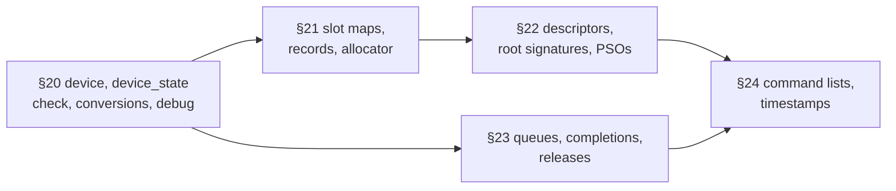
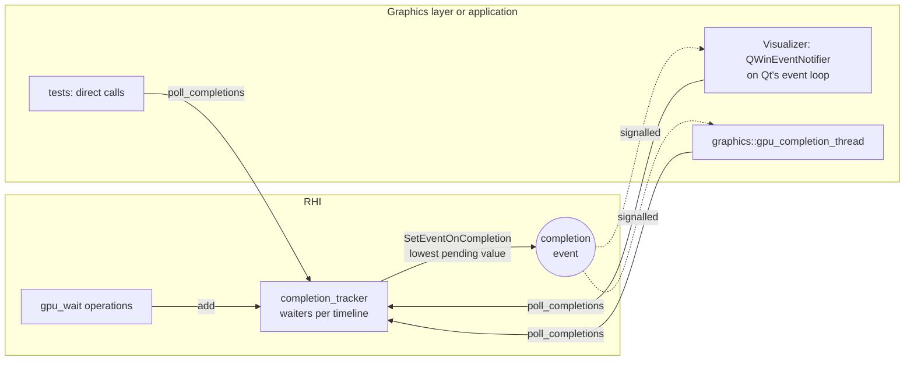

# 09 — RHI (Render Hardware Interface)

## Code placement

| Feature | Namespace | CMake target | Location |
|---|---|---|---|
| Public RHI API: the root object, subsystem views, handles, descriptions, command lists and recorders, barriers, pipelines and root signatures, transient objects, sharing | `avis::rhi` | `AVIS_LIB` | `include/avis/rhi/` (§2.1) |
| Sender templates, the private-state accessor | `avis::rhi::detail` | `AVIS_LIB` | `include/avis/rhi/detail/` |
| D3D12 implementation (private) | `avis::rhi::d3d12` | `AVIS_LIB` | `lib/avis/rhi/d3d12/`, headers not installed (§2.2, Part II: §19–§24) |
| Graphics layer built on the RHI: frame scheduler, upload and readback queues, `gpu_completion_thread`, shader library, binding layout, root signature registry, pipeline cache | `avis::graphics` | `AVIS_LIB` | [17](17-graphics-frames-and-transfers.md), [18](18-graphics-shaders-and-pipelines.md) |

The document has two parts. **Part I (§0–§18)** is the design and the public interface. **Part II (§19–§24)** is implementation notes for the private side under `lib/avis/rhi/d3d12/`.

## 0. Summary

- **One root object, used through views.** `rhi::render_hardware_interface` stays the entry point (D-18) and owns every subsystem through a private state object, so its header includes no D3D12, DXGI, asio or `<windows.h>`. Its own members are only creation, capabilities, the memory budget and the blocking `wait_idle` (D-93). Everything else goes through **subsystem views** (D-90): small non-owning classes built from the RHI, one per concern and header (`resources`, `memory`, `pipelines`, `synchronization`, `completion_driver`, `queue<Queue>`, `transient_objects`, `command_lists`, `sharing`, §4.3). A consumer takes the views it uses as parameters, so its signature states what it touches (D-96).
- **Owning lists and recorders.** `command_lists::acquire` returns an owning `command_list<Queue>`, the only thing a queue submits. Pass code records through `command_recorder<Queue>`, a non-owning view that a list or a narrowed list hands out, and that can never be submitted (§7, D-92).
- **Value types and handles.** The public API is handles (32-bit index + 32-bit generation), descriptions, enums and a few move-only RAII types (`linear_upload_allocator`, `descriptor_range`, `timestamp_query_set`, `shared_fence`). No COM type and no `com_ptr` appears in a public header.
- **Named senders.** Every asynchronous call returns a named sender type (D-66) that satisfies `avis::sender_of`, built as a template operation state in an `rhi/detail/` header over a non-template core in `lib/avis/rhi/d3d12/`.
- **No dependency on the IO layer.** The RHI owns no thread and no execution context. GPU waits are tracked by the RHI and completed when a higher layer calls `completion_driver::poll_completions()` (§5.2), usually when the RHI's completion event fires. Pipelines take shader bytecode directly (§12).
- **No frames.** The RHI knows queues, submissions and synchronization points, not frames. Frame pacing, frame indices and per-frame resets are the graphics layer's frame scheduler ([17](17-graphics-frames-and-transfers.md)). Command allocators and deferred releases are recycled by synchronization point; short-lived memory, descriptors and timestamps live in objects the caller resets (§6).
- **Mechanism, not policy.** The RHI offers device access, memory and resources, resource state, pipelines, synchronization and recording. Policies built on them live in the graphics layer: the upload and readback queues ([17](17-graphics-frames-and-transfers.md)), the shader library and pipeline cache ([18](18-graphics-shaders-and-pipelines.md)), frames ([17](17-graphics-frames-and-transfers.md)), and the binding layout and the choice of root signature per pipeline ([18](18-graphics-shaders-and-pipelines.md)).
- **Errors.** Failure paths return `avis::result<T>` or complete with `set_error(avis::error)` in `error_domain::rhi`, with codes from `rhi::error_kind` (D-72). Device removal is unrecoverable. Synchronous calls throw `rhi::device_lost`, and senders complete with `set_error(error_kind::device_lost)`.

## 1. Goals and constraints

| Requirement (idea.md) | Design response |
|---|---|
| DirectX 12 only, no Vulkan | One backend. No abstract backend interface or virtual dispatch. |
| No D3D12 types leak to users | Public headers declare only Avis types (handles, descriptions, enums, views). D3D12, DXGI, D3D12MemoryAllocator and `<windows.h>` are included only under `lib/avis/rhi/` (§2.1). |
| Renderer-agnostic | The RHI knows nothing about passes, G-buffers, materials or frames. Those belong to the render graph, the renderer and the graphics layer ([17](17-graphics-frames-and-transfers.md), [18](18-graphics-shaders-and-pipelines.md)). |
| Mechanism, not policy | The RHI offers device access, memory and resources, resource state, pipelines, synchronization and recording. Frames, uploads, readbacks, the shader library, the pipeline cache and the binding layout are graphics-layer policies built on it (17, 18). |
| Device management | `render_hardware_interface` (the existing class, reworked, D-18): adapter selection (by LUID for Qt interop), capability gate, debug configuration (§4). COM lifetimes through `com_ptr` (§4.6). |
| Command lists: allocation, recording, execution; **multi-threaded recording** | An owning `command_list<Queue>` and a non-owning `command_recorder<Queue>` (D-92), per-thread allocator pools reused by synchronization point, a timeline fence per queue (§5, §7). |
| Async compute and copy queues | Three queues with GPU-side cross-queue waits on synchronization points (§5). |
| PSO management (no pipeline libraries) | Thread-safe `create_pipeline` from bytecode and a root signature (§12); deduplication is the graphics layer's pipeline cache ([18 §11](18-graphics-shaders-and-pipelines.md#11-graphicspipeline_cacheh)). |
| Shaders compiled offline by DXC and loaded from file; no hot reload | The RHI takes bytecode. The shader library that loads `.cso` files is the graphics layer's ([18 §2](18-graphics-shaders-and-pipelines.md#2-graphicsshader_libraryh)). |
| Bindless; **SM 6.6 required**, otherwise refuse to start | Every root signature is directly indexed (`ResourceDescriptorHeap` / `SamplerDescriptorHeap`, §9, §12.1); startup capability gate (§4.4). |
| **Enhanced barriers**, without the Agility SDK | `ID3D12GraphicsCommandList7::Barrier` from the OS runtime, checked with `D3D12_OPTIONS12` (§10). |
| Resource allocation and lifetime | D3D12MemoryAllocator, generational handles, deferred destruction tagged with synchronization points (§8, §23.8). |
| Configurable frames in flight | Not in the RHI: the frame scheduler's `frames_in_flight` (1–3, default 2, [17 §4](17-graphics-frames-and-transfers.md#4-graphicsframe_schedulerh)). The RHI offers transient objects whose reset the caller decides (§6). |
| Staging ring buffer for uploads; readback | The graphics layer's `upload_queue` and `readback_queue` ([17 §7](17-graphics-frames-and-transfers.md#7-graphicsupload_queueh), [17 §8](17-graphics-frames-and-transfers.md#8-graphicsreadback_queueh)), built on upload and readback buffers, copies and `when_complete` (§11). |
| Debug layer and GBV configurable | `debug_configuration`, info-queue routing, DRED (§14). |
| HDR output out of scope | The RHI owns no swap chain; Qt presents ([12](12-visualizer.md)). |

### 1.1 Platform baseline
- **Windows 11 24H2 (build 26100) or later.** Enhanced barriers without the Agility SDK need the inbox D3D12 runtime from that release. Creation checks the build first and fails with `unsupported_os` and a clear message on older builds (§20.3.2). This minimum is confirmed ([99](99-decisions-and-open-questions.md), decision D-05).
- Windows SDK ≥ 10.0.26100 for the headers (`ID3D12Device10`, `ID3D12GraphicsCommandList7`, `D3D12_FEATURE_D3D12_OPTIONS12`).

## 2. Module layout

Public headers are in `include/avis/rhi/` and contain no D3D12 type (§2.1). The D3D12 implementation is private, in `lib/avis/rhi/d3d12/` (§2.2), and Part II describes it. The existing `com_ptr.h` moved there unchanged (D-85); native objects are reachable only through the private `lib/avis/rhi/d3d12/native_access.h`, for RHI internals and RHI tests (§20.2.4).

### 2.1 Public headers

All public headers are in `include/avis/rhi/` and follow these include rules:
- **Never** `<d3d12.h>`, `<dxgi*.h>`, `<windows.h>`, `<Unknwn.h>`, D3D12MemAlloc, asio, or any `avis/io/` header. A compile test, `tests/test_rhi_public_headers.cpp`, includes all of them first and fails if `_WINDOWS_`, `__d3d12_h__`, `D3D12MA_RECOMMENDED_ALLOCATOR_FLAGS` (D3D12MemAlloc.h uses `#pragma once` and has no include guard, so the check uses a macro it always defines), `ASIO_DETAIL_CONFIG_HPP` or an `AVIS_IO_*` include guard is defined afterwards, like the IO header check. The private sources under `lib/avis/rhi/` don't include `avis/io/` either; that is a convention checked in review, not by a build check (16 §3, 16 Q2).
- Allowed: the standard library, `avis/error.h`, `avis/enum_flags.h`, `avis/sender_of.h`, and stdexec (only in the headers that declare senders).

| Header | Contents | Section |
|---|---|---|
| `rhi/types.h` | `queue_type`, `gpu_address`, `bindless_index`, `adapter_luid`, `subresource`, `subresource_range`, `viewport`, `rectangle`, handle types | §3 |
| `rhi/error.h` | `error_kind`, `make_error`, `is_error`, `device_lost` | §3.4 |
| `rhi/formats.h` | `format`, `format_traits`, `traits(format)` | §3.5 |
| `rhi/configuration.h` | `adapter_configuration`, `debug_configuration`, `descriptor_heap_configuration`, `render_hardware_interface_configuration` | §4.1 |
| `rhi/render_hardware_interface.h` | `hardware_capabilities`, `memory_budget`, `render_hardware_interface` | §4 |
| `rhi/queue.h` | `synchronization_point`, the `queue<Queue>` view | §5 |
| `rhi/synchronization.h` | the `synchronization` view: `is_complete`, `when_complete` | §5.1 |
| `rhi/completion_driver.h` | the `completion_driver` view: `poll_completions`, `completion_event`, `has_pending_work` | §5.2 |
| `rhi/transient.h` | `linear_upload_allocator`, `upload_allocation`, `descriptor_range`, `timestamp_query_set`, the `transient_objects` view | §6 |
| `rhi/command_list.h` | `command_recorder<Queue>`, `command_list<Queue>`, their aliases, the `command_lists` view | §7 |
| `rhi/resources.h` | `texture_description`, `buffer_description`, `sampler_description`, `texture_view`, usages, `clear_value`, `copy_footprint`, the `resources` view | §8, §11.1 |
| `rhi/memory.h` | `heap_kind`, `heap_description`, `allocation_requirements`, the `memory` view | §8.5 |
| `rhi/barriers.h` | `access_state`, `access_states::*`, `texture_barrier`, `buffer_barrier`, `global_barrier` | §10 |
| `rhi/pipeline.h` | pipeline state, descriptions with bytecode and a root signature, the `pipelines` view | §12 |
| `rhi/shared.h` | `shared_handle`, `shared_fence`, the `sharing` view | §13 |
| `rhi/root_signature.h` | `root_parameter_kind`, `shader_visibility`, `root_parameter`, `static_sampler`, `root_signature_description` | §12.1 |
| `rhi/detail/*.h` | `completion_waiter.h` and the sender templates with their non-template operation bases (`gpu_wait_sender.h`) | §4.3, §16 |

Private: `lib/avis/rhi/d3d12/` holds `device_state.h` (the composition root of the private subsystems, §20.3.1), `conversions/` (public RHI types to D3D12, one header per group of types, §20.2.3), `native_access.h`, the slot maps, allocators and the sender cores. `rhi::check(HRESULT)` from [01 §6.2](01-system-architecture.md#62-error-type) is private there too, because `HRESULT` is a Windows type.

### 2.2 Private implementation

Everything private is in `avis::rhi::d3d12`. These are the only headers that include `<d3d12.h>`, `<dxgi1_6.h>`, `D3D12MemAlloc.h` and `<windows.h>`; nothing in the RHI includes asio or `avis/io/`. The files, with the section of Part II that describes each:

```
lib/avis/rhi/
  render_hardware_interface.cpp      create, capabilities, budget, state()
  resources.cpp, memory.cpp, pipeline.cpp, synchronization.cpp, completion_driver.cpp, queue.cpp,
  transient.cpp, shared.cpp
                                     the subsystem views (§4.3): one forwarding call per member
  command_list.cpp                   command_recorder<Queue> and command_list<Queue> members (§24.3), the command_lists view
  ...                                one .cpp per public header with out-of-line members
  d3d12/
    d3d12.h, com_ptr.h, check.*, native_access.h   §20.1
    conversions/  formats, queues, barriers, samplers, pipelines, resources   §20.2.3
    device.*, device_state.*, adapter_selector.*, capability_gate.*, debug.*   §20.1
    slot_map.h, resource_records.h, memory_allocator.*   §21.1
    shared_objects.*  (shared textures §21, shared fences §23)
    resource_manager.*   §21.1
    descriptor_heaps.*, root_signature.*, pipeline_factory.*   §22.1
    device_queues.*, completion_tracker.*, gpu_wait_operation.cpp   §23.1
    transient_upload.*, open_list_epochs.h, deferred_release.*, lifetime_manager.*   §23.1
    command_list_pool.*, timestamp_query_set_state.*   §24.1
```

The existing `lib/avis/rhi/buffer.cpp`, `command_context.cpp`, `gpu_resource.cpp` and `resource_allocator.cpp` go away; `render_hardware_interface.cpp` is rewritten. Tests reach these headers through the `lib/` include path that task 5.4 added to `AVIS_TESTS`.

### 2.3 What replaced the existing code

| Existing | Becomes |
|---|---|
| `render_hardware_interface` (constructor with `use_warp`, `enable_debug`; `native_device()`, `native_adapter()`, `create_command_list<T>`) | Reworked as in §4: `create()` factory, configuration structs, no native accessors (native access moves to the private `lib/avis/rhi/d3d12/native_access.h`) |
| `command_context`, `copy_context`, `compute_context`, `graphics_context` (inheritance over `com_ptr<ID3D12CommandList>`) | Replaced by the owning `command_list<Queue>` and the non-owning `command_recorder<Queue>` (§7, D-25, D-92) |
| `gpu_resource`, `vertex_buffer`, `index_buffer` | Replaced by `buffer_handle` / `texture_handle` (§8). Vertex and index data are plain buffers (vertex pulling: there is no input assembler). |
| `resource_allocator` | Private: the D3D12MemoryAllocator wrapper inside `lib/avis/rhi/d3d12/` |
| `com_ptr.h` | Unchanged class (`avis::rhi::com_ptr`), moved to the private `lib/avis/rhi/d3d12/com_ptr.h` (D-85) |

## 3. Basic types

### 3.1 `rhi/types.h`

```cpp
namespace avis::rhi
{
    enum class queue_type : std::uint8_t
    {
        graphics, // DIRECT
        compute,  // COMPUTE
        copy      // COPY
    };

    // GPU virtual address (D3D12_GPU_VIRTUAL_ADDRESS); 0 is invalid
    struct gpu_address
    {
        std::uint64_t value = 0;
        friend constexpr bool operator==(gpu_address, gpu_address) noexcept = default;
        constexpr gpu_address offset_by(std::uint64_t bytes) const noexcept { return { value + bytes }; }
    };

    // Index into the shader-visible CBV/SRV/UAV heap or the sampler heap. 0 is the null descriptor of the region
    // (§9.2), so a default-constructed index samples zero instead of faulting.
    struct bindless_index
    {
        std::uint32_t value = 0;
        friend constexpr bool operator==(bindless_index, bindless_index) noexcept = default;
    };

    // Locally unique adapter id, as reported by Qt (adapterLuidLow / adapterLuidHigh) and DXGI
    struct adapter_luid
    {
        std::uint32_t low = 0;
        std::int32_t high = 0;
        friend constexpr bool operator==(adapter_luid, adapter_luid) noexcept = default;
    };

    struct subresource
    {
        std::uint16_t mip = 0;
        std::uint16_t layer = 0; // array layer; for cubes, cube index × 6 + face
    };

    struct subresource_range
    {
        std::uint16_t first_mip = 0;
        std::uint16_t mip_count = all;
        std::uint16_t first_layer = 0;
        std::uint16_t layer_count = all;

        static constexpr std::uint16_t all = 0xFFFF; // up to the last mip or layer
    };
    inline constexpr subresource_range all_subresources{};

    struct viewport
    {
        float x = 0.0f;
        float y = 0.0f;
        float width = 0.0f;
        float height = 0.0f;
        float minimum_depth = 0.0f;
        float maximum_depth = 1.0f;
    };

    struct rectangle
    {
        std::int32_t left = 0;
        std::int32_t top = 0;
        std::int32_t right = 0;
        std::int32_t bottom = 0;
    };

    // Depth test and comparison samplers (used by pipeline.h and resources.h)
    enum class comparison : std::uint8_t { never, less, equal, less_equal, greater, not_equal, greater_equal, always };
}
```

### 3.2 Handles

```cpp
namespace avis::rhi
{
    // 32-bit slot index + 32-bit generation into a slot map of the RHI (§8.2). A default-constructed handle is
    // invalid; a handle whose slot was destroyed is detected (stale generation) and rejected.
    template<class Tag>
    class handle
    {
    public:
        constexpr handle() noexcept = default;
        constexpr bool is_valid() const noexcept { return generation_ != 0; }
        friend constexpr bool operator==(handle, handle) noexcept = default;

    private:
        friend struct detail::handle_access;    // the private side reads and builds handles through it (§4.3)
        std::uint32_t index_ = 0;
        std::uint32_t generation_ = 0;
    };

    using texture_handle = handle<struct texture_tag>;
    using buffer_handle = handle<struct buffer_tag>;
    using sampler_handle = handle<struct sampler_tag>;
    using heap_handle = handle<struct heap_tag>;
    using graphics_pipeline_handle = handle<struct graphics_pipeline_tag>;
    using compute_pipeline_handle = handle<struct compute_pipeline_tag>;
    using root_signature_handle = handle<struct root_signature_tag>;   // §12.1
}

template<class Tag>
struct std::hash<avis::rhi::handle<Tag>>; // for caches keyed by handle (render graph physical resource cache)
```

- Distinct tag types make the pipeline handles distinct, so overload resolution picks the right `set_pipeline` (§7).
- Handles don't know which `render_hardware_interface` created them. Using a handle with another instance is a programming error: each slot map puts a 12-bit instance tag in the top bits of the index it hands out, so a foreign handle is rejected (`nullptr`) in every build and asserted in debug builds (§21.2).

### 3.3 Flags

Usage and synchronization sets use `avis::flags<E>` from `avis/enum_flags.h`, enabled with `ALLOW_FLAGS_FOR_ENUM` at global scope.

### 3.4 `rhi/error.h`

```cpp
namespace avis::rhi
{
    enum class error_kind : std::int32_t
    {
        ok = 0,
        unsupported_os,               // older than Windows 11 24H2 (D-05)
        unsupported_hardware,         // a capability gate check failed (§4.4); the message names it
        adapter_not_found,            // no adapter with the configured LUID, or no hardware adapter passed the gate
        debug_layer_unavailable,      // debug layer or GPU-based validation requested but not installed
        out_of_memory,                // E_OUTOFMEMORY or a D3D12MA allocation failure
        descriptor_heap_full,         // persistent region, sampler, RTV or DSV heap exhausted
        transient_memory_exhausted,   // a linear upload allocator, descriptor range or timestamp query set is full (§6)
        invalid_argument,             // invalid description or parameter (zero size, bad format/usage combination)
        invalid_handle,               // stale or default-constructed handle
        pipeline_creation_failed,     // CreatePipelineState failed; the message carries the debug name and HRESULT
        device_lost,                  // DXGI_ERROR_DEVICE_REMOVED and friends (§4.7)
        native_error                  // any other failing HRESULT; the code and system message are in the message
    };

    std::string_view to_string(error_kind kind) noexcept;
    avis::error make_error(error_kind kind, std::string message,
                           std::source_location location = std::source_location::current());
    bool is_error(const avis::error& error, error_kind kind) noexcept;

    // Unrecoverable device removal (§4.7, 01 §6). Thrown by synchronous calls that touch a queue or fence after
    // the device was removed; the DRED report has already been logged on the "rhi" logger.
    class device_lost : public avis::runtime_error
    {
    public:
        using avis::runtime_error::runtime_error;
    };
}
```

Native failures carry the `HRESULT` in the message as `"<operation>: <system message> (HRESULT 0x887A0005)"`, the same pattern as the IO errors.

### 3.5 `rhi/formats.h`

```cpp
namespace avis::rhi
{
    enum class format : std::uint8_t
    {
        unknown,
        rgba8_unorm, rgba8_unorm_srgb, bgra8_unorm, rgb10a2_unorm, r11g11b10_float,
        rgba16_float, rg16_float, rg16_unorm, rg16_snorm, r16_float, r16_uint,
        r8_unorm, r8_uint, r32_float, r32_uint, rg32_float, rgba32_float, rgba32_uint,
        d32_float,
        bc1_unorm, bc1_unorm_srgb, bc3_unorm, bc3_unorm_srgb, bc4_unorm, bc5_unorm, bc7_unorm, bc7_unorm_srgb
    };

    struct format_traits
    {
        std::uint8_t bytes_per_block = 0;  // per texel for uncompressed formats
        std::uint8_t block_width = 1;      // 4 for BC formats
        std::uint8_t block_height = 1;
        bool depth = false;
        bool srgb = false;
        bool compressed = false;
    };

    constexpr format_traits traits(format value) noexcept;     // constexpr table in the header
    std::string_view to_string(format value) noexcept;
}
```

The enum covers the formats the renderer uses (RGBA8 UNORM/SRGB, RGB10A2, R11G11B10F, RGBA16F, RG16F, RG16 UNORM/SNORM, R8, R16F, R32F, RG32F, RGBA32F, D32F, BC1/3/4/5/7 variants), `bgra8_unorm` (common in decoded images) and the integer formats the renderer's id buffers use. The mapping to `DXGI_FORMAT` is a private table.

## 4. Render hardware interface

The root object of the RHI is the existing `avis::rhi::render_hardware_interface` class (D-18), reworked: a `create()` factory with one configuration per concern, no native accessors and no `<d3d12.h>` in its header, and subsystem views for everything beyond creation, device information and `wait_idle` (§4.3, D-90).

### 4.1 Configuration (`rhi/configuration.h`)

One configuration per concern: each private subsystem receives only its own part (D-19), so changing descriptor counts, for example, never touches device creation. Frame and upload settings are the graphics layer's ([17 §4](17-graphics-frames-and-transfers.md#4-graphicsframe_schedulerh), [17 §7](17-graphics-frames-and-transfers.md#7-graphicsupload_queueh)). The Visualizer fills these from the `render` block of `visualizer.yaml` ([11 §14](11-renderer.md#14-configuration-visualizeryaml--render)):

```cpp
namespace avis::rhi
{
    struct adapter_configuration
    {
        std::optional<adapter_luid> adapter;   // the Visualizer passes Qt's adapter LUID
        bool allow_software_adapter = false;   // WARP (tests)
    };

    struct debug_configuration
    {
        bool debug_layer = false;
        bool gpu_based_validation = false;     // implies debug_layer
        bool device_removed_extended_data = true;
        bool break_on_error = false;
        bool object_names = true;              // SetName on every object (off saves the string work in release)
    };

    struct descriptor_heap_configuration
    {
        std::uint32_t persistent_descriptor_count = 900'000;
        std::uint32_t transient_descriptor_count = 100'000;   // region that descriptor ranges are carved from (§6)
        std::uint32_t sampler_count = 2'048;
        std::uint32_t render_target_view_count = 4'096;
        std::uint32_t depth_stencil_view_count = 1'024;
    };

    struct render_hardware_interface_configuration
    {
        adapter_configuration adapter;
        debug_configuration debug;
        descriptor_heap_configuration descriptor_heaps;
    };
}
```

Values outside their range (descriptor counts above the Tier 3 limits, or a persistent plus transient count that doesn't fit one shader-visible heap) make `create` fail with `error_kind::invalid_argument`.

### 4.2 The root object (`rhi/render_hardware_interface.h`)

```cpp
namespace avis::rhi
{
    struct hardware_capabilities
    {
        std::string adapter_name;               // UTF-8, from DXGI_ADAPTER_DESC3
        adapter_luid luid;
        std::uint32_t vendor_id = 0;
        std::uint32_t device_id = 0;
        std::uint64_t dedicated_video_memory = 0;
        bool software_adapter = false;          // WARP
        bool copy_queue_timestamps = false;     // D3D12_OPTIONS3::CopyQueueTimestampQueriesSupported
        std::uint32_t minimum_wave_lane_count = 0;   // D3D12_OPTIONS1
        std::uint32_t maximum_wave_lane_count = 0;
        std::uint64_t timestamp_frequency = 0;  // graphics queue ticks per second; per queue: queue::timestamp_frequency
    };

    // Local (dedicated) video memory, from IDXGIAdapter3::QueryVideoMemoryInfo
    struct memory_budget
    {
        std::uint64_t budget = 0;               // what the OS currently grants this process
        std::uint64_t usage = 0;
    };

    // Root object of the RHI (D-18). Not copyable or movable: handles, views, command lists and senders refer
    // back to it. Everything beyond creation, device information and wait_idle goes through the subsystem views (§4.3).
    class render_hardware_interface
    {
    public:
        // Creates the device, queues, heaps and allocators, after the capability gate (§4.4). No root signature:
        // the caller creates the ones it needs (§12.1).
        // Starts no thread: GPU waits complete when the caller drives completion_driver::poll_completions() (§5.2).
        static result<std::unique_ptr<render_hardware_interface>> create(
            const render_hardware_interface_configuration& configuration);

        // Waits for the GPU (wait_idle) and releases everything, including deferred releases. No command list may
        // be open and no sender of this object may still be running (leftover waiters complete with
        // set_stopped, logged). Must not run on a parallel worker or inside a completion (it blocks).
        ~render_hardware_interface();

        render_hardware_interface(const render_hardware_interface&) = delete;
        render_hardware_interface& operator=(const render_hardware_interface&) = delete;

        const hardware_capabilities& capabilities() const noexcept;
        memory_budget local_memory_budget() const;          // from the memory allocator (§21.4); a few µs;
                                                            // the renderer reads it once per frame at most

        // Blocks until every queue is idle, then runs completion_driver::poll_completions(). The only blocking call besides the
        // destructor: shutdown and tests. On the root, not on a view, because only the RHI's owner holds the root (D-93).
        void wait_idle();

        // The private state: the views' one way in (§4.3), and native_access.h's (§20.2.4). For RHI code only;
        // device_state is an incomplete type outside lib/avis/rhi/.
        d3d12::device_state& state() noexcept;

    private:
        explicit render_hardware_interface(std::unique_ptr<d3d12::device_state> state) noexcept;
        std::unique_ptr<d3d12::device_state> state_;     // lib/avis/rhi/d3d12/device_state.h
    };
}
```

- **Thread safety.** Every member, of the root and of every view, may be called from any thread, except where §7 and the threading table (§15) say otherwise.
- **Lifetime.** Views, recorders and senders hold a reference to the RHI and must not outlive it; senders must complete before it's destroyed. In the Visualizer, `frame_loop`'s async scope drains and the frame scheduler is destroyed before the renderer destroys the RHI ([12 §3.4](12-visualizer.md#34-frame-pacing)).

### 4.3 Subsystem views

The RHI's operations are grouped by concern into **views** (D-90). A view is a small, non-owning, copyable value built from the RHI. It holds a pointer to the private subsystem behind it ([§20.3.1](#2031-d3d12deviceh-and-d3d12device_stateh)) and forwards every call to it. All state stays in the RHI: creating, copying or dropping a view costs nothing and changes nothing, and two views of the same kind on one RHI are interchangeable.

| View | Header | Operations | Private class |
|---|---|---|---|
| `resources` | `rhi/resources.h` | textures, buffers, samplers, `destroy` of those (placed ones included), descriptions, persistent bindless indices, addresses, mapped bytes, `copyable_footprint` (§8, §11.1) | `resource_manager` (§21) |
| `memory` | `rhi/memory.h` | `requirements`, heaps, placed textures and buffers, `destroy(heap_handle)` (§8.5, D-95) | `resource_manager` (§21) |
| `pipelines` | `rhi/pipeline.h` | `create_root_signature`, `create_pipeline` (§12) | `pipeline_factory` (§22) |
| `synchronization` | `rhi/synchronization.h` | `is_complete`, `when_complete` (§5.1) | `device_queues`, `completion_tracker` (§23) |
| `completion_driver` | `rhi/completion_driver.h` | `poll_completions`, `completion_event`, `has_pending_work` (§5.2, D-93) | `device_state` housekeeping (§20.3.1, §23.4) |
| `queue<Queue>` | `rhi/queue.h` | `submit`, shared-fence `signal`/`wait`, `last_submitted`, `timestamp_frequency` (§5) | `device_queue`, `command_list_pool` (§23, §24) |
| `transient_objects` | `rhi/transient.h` | `create_linear_upload_allocator`, `create_descriptor_range`, `create_timestamp_query_set` (§6) | `resource_manager`, `descriptor_heaps`, `device`; each state gets its `transient_links` (§23.6) |
| `command_lists` | `rhi/command_list.h` | `acquire<Queue>` (§7) | `command_list_pool` (§24) |
| `sharing` | `rhi/shared.h` | shared textures and fences, `when_reached` (§13) | `resource_manager`, `completion_tracker` (§21, §23) |

```cpp
namespace avis::rhi
{
    // rhi/resources.h
    class resources
    {
    public:
        explicit resources(render_hardware_interface& hardware_interface) noexcept;

        result<texture_handle> create_texture(const texture_description& description);
        result<buffer_handle> create_buffer(const buffer_description& description);
        result<sampler_handle> create_sampler(const sampler_description& description);
        // deferred until the GPU is done with it (§8.2); placed textures and buffers too (memory creates them)
        void destroy(texture_handle texture) noexcept;
        void destroy(buffer_handle buffer) noexcept;
        void destroy(sampler_handle sampler) noexcept;

        const texture_description& description(texture_handle texture) const;   // debug_name is empty here
        const buffer_description& description(buffer_handle buffer) const;

        // persistent bindless indices, created with the resource from its usage (§8.3)
        bindless_index srv(texture_handle texture) const;
        bindless_index uav(texture_handle texture, std::uint32_t mip = 0) const;
        bindless_index srv(buffer_handle buffer) const;
        bindless_index uav(buffer_handle buffer) const;
        bindless_index sampler_index(sampler_handle sampler) const;

        gpu_address buffer_address(buffer_handle buffer) const;
        std::span<std::byte> mapped_bytes(buffer_handle buffer) const;   // upload and readback buffers only

        // copies (§11.1)
        copy_footprint copyable_footprint(texture_handle texture, subresource subresource) const;

    private:
        d3d12::device_state* state_;
    };

    // rhi/memory.h: placed resources for aliasing (§8.5, D-95). Only the render graph's transient pool needs it.
    class memory
    {
    public:
        explicit memory(render_hardware_interface& hardware_interface) noexcept;

        allocation_requirements requirements(const texture_description& description) const;
        allocation_requirements requirements(const buffer_description& description) const;
        result<heap_handle> create_heap(const heap_description& description);
        void destroy(heap_handle heap) noexcept;             // deferred; no placed resource may still be alive
        result<texture_handle> create_placed_texture(heap_handle heap, std::uint64_t offset,
                                                     const texture_description& description);
        result<buffer_handle> create_placed_buffer(heap_handle heap, std::uint64_t offset,
                                                   const buffer_description& description);

    private:
        d3d12::device_state* state_;
    };

    // rhi/pipeline.h
    class pipelines
    {
    public:
        explicit pipelines(render_hardware_interface& hardware_interface) noexcept;

        result<root_signature_handle> create_root_signature(const root_signature_description& description);
        result<graphics_pipeline_handle> create_pipeline(const graphics_pipeline_description& description);
        result<compute_pipeline_handle> create_pipeline(const compute_pipeline_description& description);

    private:
        d3d12::device_state* state_;
    };

    // rhi/synchronization.h: waiting for GPU work. Never blocks.
    class synchronization
    {
    public:
        explicit synchronization(render_hardware_interface& hardware_interface) noexcept;

        bool is_complete(synchronization_point point) const;
        gpu_wait_sender when_complete(synchronization_point point);
        gpu_wait_sender when_complete(std::span<const synchronization_point> points);

    private:
        d3d12::device_state* state_;
    };

    // rhi/completion_driver.h: running the RHI's housekeeping (§5.2, D-93). For whoever drives the RHI (the
    // application's event loop, gpu_completion_thread, tests), not for components that only wait. Never blocks.
    class completion_driver
    {
    public:
        explicit completion_driver(render_hardware_interface& hardware_interface) noexcept;

        // One non-blocking pass, like asio's io_context::poll(): completes the GPU waits that are due, then frees
        // destroyed objects whose GPU work is done (capped per call). Any thread; returns the waits it completed.
        std::size_t poll_completions() noexcept;
        void* completion_event() const noexcept;            // auto-reset Win32 event (HANDLE); signalled when due
        bool has_pending_work() const noexcept;             // GPU waits, or destroyed objects not yet freed

    private:
        d3d12::device_state* state_;
    };

    // rhi/transient.h
    class transient_objects
    {
    public:
        explicit transient_objects(render_hardware_interface& hardware_interface) noexcept;

        result<linear_upload_allocator> create_linear_upload_allocator(std::size_t size,
                                                                       std::string_view debug_name = {});
        result<descriptor_range> create_descriptor_range(std::uint32_t count, std::string_view debug_name = {});
        result<timestamp_query_set> create_timestamp_query_set(queue_type queue, std::uint32_t count,
                                                               std::string_view debug_name = {});

    private:
        d3d12::device_state* state_;
    };

    // rhi/command_list.h
    class command_lists
    {
    public:
        explicit command_lists(render_hardware_interface& hardware_interface) noexcept;

        template<queue_type Queue>
        result<command_list<Queue>> acquire(std::string_view debug_name = {});   // explicit instantiations

    private:
        d3d12::device_state* state_;
    };

    // rhi/shared.h
    class sharing
    {
    public:
        explicit sharing(render_hardware_interface& hardware_interface) noexcept;

        result<texture_handle> create_shared_texture(const texture_description& description);
        result<shared_handle> export_shared_handle(texture_handle texture);
        result<shared_fence> create_shared_fence(std::uint64_t initial_value = 0);
        result<shared_fence> import_shared_fence(shared_handle handle);
        result<shared_handle> export_shared_handle(const shared_fence& fence);
        gpu_wait_sender when_reached(const shared_fence& fence, std::uint64_t value);

    private:
        d3d12::device_state* state_;
    };
}

// rhi/types.h
namespace avis::rhi::detail
{
    struct handle_access;   // reads and builds handle<Tag> bits for the slot maps (§3.2); private definition
}
```

- **Usage.** A consumer builds the views it uses from the RHI:
  ```cpp
  rhi::resources resources{ hardware_interface };
  rhi::queue<rhi::queue_type::copy> copy_queue{ hardware_interface };
  result<rhi::buffer_handle> staging =
      resources.create_buffer({ .size = 1 << 20, .memory = rhi::memory_type::upload });
  ```
- **Components take views, not the root** (D-96). Every component built on the RHI receives the views it uses as constructor parameters, by value: the graphics layer's pipeline cache and root signature registry take `rhi::pipelines` ([18](18-graphics-shaders-and-pipelines.md)), and components spanning several groups list each one. Only the code that creates the RHI and owns its lifetime holds the `render_hardware_interface&`: the application's composition (the Visualizer's renderer, a tool's `main`) and tests. That code builds the views and hands them out. The expected signatures:

  | Component | Views it takes |
  |---|---|
  | render graph ([10 §3.1](10-render-graph.md#31-building)) | `resources`, `command_lists`, `queue<graphics>`, `queue<compute>`, `queue<copy>` |
  | transient resource pool ([10 §6.4](10-render-graph.md#64-aliasing-and-transient-memory)) | `memory`, `resources` |
  | frame scheduler ([17 §4](17-graphics-frames-and-transfers.md#4-graphicsframe_schedulerh)) | `synchronization`, `transient_objects`; it doesn't drive the RHI (D-94) |
  | GPU profiler ([17 §6](17-graphics-frames-and-transfers.md#6-graphicsgpu_profilerh)) | `transient_objects`, `queue<graphics>`, `queue<compute>`, `queue<copy>` (timestamp frequencies) |
  | upload queue ([17 §7](17-graphics-frames-and-transfers.md#7-graphicsupload_queueh)) | `resources`, `command_lists`, `queue<copy>`, `synchronization` |
  | readback queue ([17 §8](17-graphics-frames-and-transfers.md#8-graphicsreadback_queueh)) | `resources`, `command_lists`, `queue<graphics>`, `queue<compute>`, `queue<copy>` (a readback names its queue), `synchronization` |
  | `gpu_completion_thread` (§5.2) | `completion_driver` |
  | pipeline cache, root signature registry ([18](18-graphics-shaders-and-pipelines.md)) | `pipelines` |

  A long list is the point: it shows what the component touches. A component that would take most views is a sign that it does too much.
- **Each view holds the `device_state*`** and reaches its subsystems through it, so a view stays valid with no reference to anything but the RHI's state. Members are defined out of line in `lib/avis/rhi/<header>.cpp`, so the public headers stay free of D3D12; each one forwards to the private classes in the table above (§20.3.1).
- **Views are copyable**, cheap to pass by value, and never outlive the RHI they were built from, like handles and senders (§4.2).
- **One accessor, no friend list.** The root has one public accessor, `render_hardware_interface::state()`, which returns the private `device_state` (an incomplete type outside `lib/avis/rhi/`), so a new view is a new class in its own header and needs no edit to `render_hardware_interface.h`. Calling `state()` outside the RHI is possible but outside the API: it is for RHI code.
- **Why views** instead of one flat class or accessors on the root: D-90.

### 4.4 Capability gate
`render_hardware_interface::create` fails with `error_kind::unsupported_hardware` (or `unsupported_os`, `adapter_not_found`, §3.4) and a user-readable message if a check fails. The application then shows a dialog and **does not start**.

| Check | Query | Required |
|---|---|---|
| Feature level | `D3D12CreateDevice` | `D3D_FEATURE_LEVEL_12_0` |
| Shader model | `D3D12_FEATURE_SHADER_MODEL` | ≥ `D3D_SHADER_MODEL_6_6` |
| Resource binding tier | `D3D12_OPTIONS::ResourceBindingTier` | `TIER_3` |
| Resource heap tier | `D3D12_OPTIONS::ResourceHeapTier` | `TIER_2` (mixed buffers and textures in one heap, needed for aliasing) |
| Enhanced barriers | `D3D12_OPTIONS12::EnhancedBarriersSupported` | `TRUE` |
| Typed UAV loads | `D3D12_OPTIONS::TypedUAVLoadAdditionalFormats` | `TRUE` (R16G16B16A16_FLOAT / R11G11B10 UAV loads in TAA and lighting) |
| Interfaces | `QueryInterface` | `ID3D12Device10`, `ID3D12GraphicsCommandList7` |

Optional capabilities are recorded in `hardware_capabilities` (§4.2): copy-queue timestamps (`D3D12_OPTIONS3::CopyQueueTimestampQueriesSupported`), wave lane counts and the timestamp frequency. The VRAM budget is queried with `local_memory_budget()` (§4.2). The checks are a free function, `check_capabilities`, run for each adapter candidate (§20.3.2).

### 4.5 Adapter selection
1. If `adapter_configuration::adapter` is set: `IDXGIFactory6::EnumAdapterByLuid`, with no fallback. This is mandatory for Qt interop, because shared handles must be opened on the same adapter.
2. Otherwise: `EnumAdapterByGpuPreference(DXGI_GPU_PREFERENCE_HIGH_PERFORMANCE)`, taking the first hardware adapter that passes the gate.
3. WARP only if `allow_software_adapter` is set, after the hardware adapters.

The `adapter_selector` (§20.3.2) tries the candidates in this order and keeps every candidate's rejection reason for the failure message.

### 4.6 COM object lifetime
Every DirectX 12 and DXGI object is a COM interface. **All of them are owned through the existing `avis::rhi::com_ptr<T>`**, private in `lib/avis/rhi/d3d12/com_ptr.h` (D-85): devices, queues, fences, command allocators and lists, heaps, resources, PSOs, root and command signatures, debug and info-queue interfaces, and the DXGI factory and adapter.
- No raw `AddRef`/`Release` calls in RHI code. Ownership transfers by moving a `com_ptr`, and interface casts use `com_ptr::as<T>()` (`QueryInterface`).
- `com_ptr<ID3D12…>` members appear only in private headers and sources. The slot maps behind public handles hold private records that own the `com_ptr`s (§21.3), so no COM type reaches the public API.
- Deferred destruction moves the record into the release queue; the last `Release` happens when the GPU is done with the object (§23.8, D-91).
- D3D12MemoryAllocator objects (`D3D12MA::Allocation`, `D3D12MA::Allocator`) are COM-style reference counted and held through `com_ptr` as well.

### 4.7 Device removal
Every fence wait and submission checks for `DXGI_ERROR_DEVICE_REMOVED`. On the first detection, the RHI collects the DRED breadcrumbs and page-fault data, logs them once on the "rhi" logger, and marks the device lost. From then on, synchronous calls that touch a queue or fence throw `rhi::device_lost` (unrecoverable, [01 §6](01-system-architecture.md#6-error-handling-policy)) and senders complete with `set_error(device_lost)`. Re-creating the device is out of scope for iteration 1. The mechanism is in §20.4.

## 5. Queues and synchronization (`rhi/queue.h`)

| `queue_type` | D3D12 | Use |
|---|---|---|
| `graphics` | DIRECT | Raster passes, everything that needs RTV/DSV |
| `compute` | COMPUTE | Async compute passes (light clustering, GTAO, histogram) |
| `copy` | COPY | Uploads and streaming, readback copies |

Each queue owns a **timeline fence**. A `synchronization_point` names a point on that timeline.

```cpp
namespace avis::rhi
{
    // A point on a queue's timeline fence. value 0 means "nothing to wait for" and is always complete.
    struct synchronization_point
    {
        queue_type queue = queue_type::graphics;
        std::uint64_t value = 0;
        friend constexpr bool operator==(synchronization_point, synchronization_point) noexcept = default;
    };

    // The later of two points on the same queue
    constexpr synchronization_point latest(synchronization_point a, synchronization_point b) noexcept;

    // A view of one of the RHI's three queues (§4.3): non-owning and copyable, built from the RHI
    template<queue_type Queue>
    class queue
    {
    public:
        explicit queue(render_hardware_interface& hardware_interface) noexcept;

        // Executes the lists in order after GPU-side waits for `waits` (ID3D12CommandQueue::Wait on the producer
        // queues' fences; no CPU thread waits). The lists are closed and become invalid, and so do the recorders
        // they handed out. Only owning lists are accepted, so a narrowed recorder can't reach a queue (§7, D-92).
        // Throws device_lost after device removal.
        result<synchronization_point> submit(std::span<command_list<Queue>> lists,
                                             std::span<const synchronization_point> waits = {});

        // Cross-device fences (§13). wait() is a GPU-side wait that can't be cancelled: only use it when the
        // signal is already guaranteed to be submitted (§13).
        void signal(const shared_fence& fence, std::uint64_t value);
        void wait(const shared_fence& fence, std::uint64_t value);

        synchronization_point last_submitted() const noexcept;
        std::uint64_t timestamp_frequency() const noexcept;   // ticks per second, for timestamp_query_set (§6)

    private:
        d3d12::device_state* state_;
    };
}
```

- `submit` is **thread-safe**, also against itself on one queue (D-101). Several components submit to the copy queue independently: the render graph, the upload queues and the readback queue ([17 Q8](17-graphics-frames-and-transfers.md#q8-serialising-copy-queue-submissions--decided-a)). Concurrent submissions to one queue execute in the order they take the queue's `submission_mutex_` (§23.2). Callers that need an order between their own submissions still issue them in that order from one thread, as the render graph does with a stage's batches.
- `submit` also appends `ResolveQueryData` for the timestamp indices the lists wrote (§6), and returns their allocators to the pool tagged with the returned point (§24.2).
- `submit` takes the lists by span: they're small move-only values the caller already holds in an array.

### 5.1 Waiting for completion

`when_complete` and `when_reached` return a `gpu_wait_sender`:
- `set_value()` once every point (or the shared fence value) is reached. It completes **inline** in `start()` when they are already complete, otherwise inside a later `poll_completions()` call (§5.2), on the thread that made it.
- `set_error(avis::error)` with `device_lost` after device removal.
- `set_stopped()` when its receiver's stop token fires first, on the thread that requested the stop. The wait is removed; the GPU work isn't affected.

`static_assert(avis::sender_of<gpu_wait_sender>)`. Continuations that do real work move to the parallel scheduler with `continues_on`. Every GPU wait in the layers above (the frame scheduler's `begin_frame`, upload back-pressure, readbacks) is built on `when_complete`.

### 5.2 Driving completions

The RHI decides **what** is complete; the layer above decides **when** to check. Nothing completes a pending wait except a call to `poll_completions()`. These calls are on the `completion_driver` view, apart from the waits of §5.1 (D-93): a component that only waits takes `synchronization` and can't drive the RHI. The blocking `wait_idle` is on the root (§4.2), which only the RHI's owner holds.
- **`poll_completions()`** reads each fence that has waiters once, completes every due waiter on the calling thread, frees destroyed objects whose GPU work is done (at most 256 per call, [§23.8](#238-deferred-release)), and returns how many waiters it completed. It never blocks, may be called from any thread and from inside a completion, and concurrent calls don't wait for each other (§23.4).
- **`completion_event()`** is an auto-reset Win32 event, returned as `void*` to keep `<windows.h>` out. The RHI keeps it armed for the lowest value any waiter needs, so it is signalled when calling `poll_completions()` would complete something (and occasionally when it wouldn't). It's also signalled again while freeable objects remain after a capped call. The RHI owns it; callers wait on it but never close or reset it.
- **`has_pending_work()`** lets a frame loop or a test skip the call when nothing is waiting and no destroyed object is still to be freed. Skipping the call while objects are destroyed but not yet freed would keep their memory alive, so it covers both.

Who drives it is the application's choice. The expected drivers:

| Consumer | Driver |
|---|---|
| Visualizer (12) | A `QWinEventNotifier` on `completion_event()` in Qt's event loop calls `poll_completions()`. No extra thread; it also covers waits on Qt's `consumed` fence while Avis renders nothing. |
| Frame scheduler (17) | Doesn't drive (D-94). `begin_frame` completes inline when the frame's context is already free, otherwise from the application's driver. |
| Headless apps, tools, the Driver | `graphics::gpu_completion_thread`: one long-running body on the Avis thread pool that waits on `completion_event()` and a stop event, then calls `poll_completions()`. |
| Tests | Call `poll_completions()` directly, which makes GPU waits deterministic. |

```cpp
// Graphics layer (include/avis/graphics/gpu_completion_thread.h), not part of the RHI
namespace avis::graphics
{
    // Drives an RHI's completions from one long-running thread of the given pool ("gpu-completions")
    class gpu_completion_thread
    {
    public:
        gpu_completion_thread(threading::thread_pool& pool, rhi::completion_driver driver);   // §4.3
        ~gpu_completion_thread();          // signals its stop event and joins; destroy before the RHI
    };
}
```

- **Without a driver, waits never complete.** Debug builds log a warning when waiters have been pending for over a second and `poll_completions()` hasn't run since (§23.4).
- An application may combine drivers (the Qt notifier and a `gpu_completion_thread`, or a test calling `poll_completions()` next to either); the RHI handles concurrent calls.
- **`poll_completions` was `process_completions`** in earlier versions of this design. "Poll" says what kind of call it is: one non-blocking pass over whatever is ready, like asio's `io_context::poll()`. The pass also frees deferred releases, which the name leaves to its comment.

## 6. Transient memory, descriptors and timestamps (`rhi/transient.h`)

The RHI has **no notion of frames**. Frame pacing, frame indices and per-frame resets belong to the graphics layer's frame scheduler ([17](17-graphics-frames-and-transfers.md)). What the RHI offers instead are three objects whose contents are short-lived and whose **reset is the caller's decision**, checked against the GPU timeline. The frame scheduler owns one of each per frame context; a tool or a streaming system can own its own.

```cpp
namespace avis::rhi
{
    // Memory from a linear allocator in an upload heap (write-combined): write only, never read back
    struct upload_allocation
    {
        std::span<std::byte> cpu;
        gpu_address gpu;
    };

    // Lock-free bump allocator over one persistently mapped upload buffer. Move-only; destroyed through the
    // deferred release, so it may be destroyed while the GPU still reads from it.
    class linear_upload_allocator
    {
    public:
        linear_upload_allocator(linear_upload_allocator&&) noexcept;
        linear_upload_allocator& operator=(linear_upload_allocator&&) noexcept;
        ~linear_upload_allocator();

        // Any thread, concurrently. Fails with transient_memory_exhausted.
        result<upload_allocation> allocate(std::size_t size, std::size_t alignment = 256) noexcept;

        // Copies a trivially copyable T into a 256-byte-aligned allocation and returns its address
        template<class T>
        result<gpu_address> write(const T& value) noexcept;

        // Rewinds to empty. `uses` must cover every submission that read from the allocator since the last
        // reset; debug builds assert each is complete. Not concurrent with allocate.
        void reset(std::span<const synchronization_point> uses);

        std::size_t capacity() const noexcept;
        std::size_t high_water_mark() const noexcept;   // since creation; for sizing

    private:
        friend class transient_objects;
        d3d12::linear_upload_allocator_state* state_ = nullptr;   // carries its own links (§23.6)
    };

    // A range of the shader-visible resource heap's transient region, for views of placed (transient) resources
    // and other short-lived views. Descriptors are bump-allocated and valid until reset.
    class descriptor_range
    {
    public:
        descriptor_range(descriptor_range&&) noexcept;
        descriptor_range& operator=(descriptor_range&&) noexcept;
        ~descriptor_range();                             // returns the range to the transient region (deferred)

        // Any thread, concurrently. Fail with transient_memory_exhausted.
        result<bindless_index> create_srv(texture_handle texture, subresource_range range = all_subresources);
        result<bindless_index> create_uav(texture_handle texture, std::uint32_t mip = 0);
        result<bindless_index> create_srv(buffer_handle buffer);
        result<bindless_index> create_uav(buffer_handle buffer);

        void reset(std::span<const synchronization_point> uses);   // as linear_upload_allocator::reset
        // The views it holds between resets: the count asked for. The range takes one more slot for its null
        // descriptor (§22.2.1).
        std::uint32_t capacity() const noexcept;

    private:
        friend class transient_objects;
        d3d12::descriptor_range_state* state_ = nullptr;          // §22.2.1
    };

    // Timestamp queries of one queue type. Results are resolved automatically when a list that wrote into the
    // set is submitted, and readable once that submission is complete.
    class timestamp_query_set
    {
    public:
        timestamp_query_set(timestamp_query_set&&) noexcept;
        timestamp_query_set& operator=(timestamp_query_set&&) noexcept;
        ~timestamp_query_set();

        queue_type queue() const noexcept;
        std::uint32_t capacity() const noexcept;

        // Raw GPU ticks (see queue<Queue>::timestamp_frequency); the submissions that wrote them must be complete
        std::span<const std::uint64_t> ticks(std::uint32_t first, std::uint32_t count) const;

        void reset(std::span<const synchronization_point> uses);   // as linear_upload_allocator::reset

    private:
        friend class transient_objects;
        d3d12::timestamp_query_set_state* state_ = nullptr;       // §24.4
    };
}
```

- **What a transient object reaches.** Each object holds only a pointer to its private state, and each state carries the links it needs: a `transient_links` (§23.6) with the `completion_source` for the reset check and the `lifetime_manager` its destructor hands the state to, plus, for a descriptor range, the descriptor heaps and the resource manager that resolves `texture_handle` / `buffer_handle` to native resources. The `transient_objects` view fills in those links at creation. None of them holds the `device_state`.

Created through the `transient_objects` view (§4.3):

```cpp
rhi::transient_objects transient{ hardware_interface };
result<linear_upload_allocator> uploads = transient.create_linear_upload_allocator(16ull << 20, "frame 0 uploads");
result<descriptor_range> views = transient.create_descriptor_range(32'768, "frame 0 views");
result<timestamp_query_set> timings = transient.create_timestamp_query_set(queue_type::graphics, 1'024);
```

- **Reset is checked, not inferred.** The RHI can't know which submissions read an upload address or a bindless index, so the caller names them. Debug builds assert `is_complete` on every point passed to `reset`; release builds trust it. The frame scheduler passes the last submissions of the frame that used the context ([17 §5](17-graphics-frames-and-transfers.md#5-recycling-a-frame-context)).
- **Placed resources get no persistent descriptors** (§8.5), so transient resources never consume the persistent region; their views come from a `descriptor_range` (D-88). RTV/DSV for placed resources come from the lazy view cache, as for committed ones (§8.3).
- **Timestamps** are written with `command_recorder::write_timestamp(set, index)` (§7). At `submit`, the RHI appends `ResolveQueryData` for exactly the indices each list wrote (runs of consecutive indices, §24.4), so callers never record a resolve, and a list never resolves an index another list writes. Copy-queue sets fail with `unsupported_hardware` when `capabilities().copy_queue_timestamps` is false. Named, nested scopes and millisecond results are the graphics layer's GPU profiler's ([17 §6](17-graphics-frames-and-transfers.md#6-graphicsgpu_profilerh)).
- **Sizes** come from the caller. The transient region of the resource heap is sized by `descriptor_heap_configuration::transient_descriptor_count` (§4.1); ranges are carved from it at creation and returned when destroyed.

## 7. Command lists and recorders (`rhi/command_list.h`)

Command lists are acquired through the `command_lists` view (`command_lists::acquire<Queue>`, which returns a `result`, D-86). Root arguments are set generically by parameter index (§12.1), and timestamps are written into caller-owned query sets (§6). Recording is split into two types (D-92):
- **`command_recorder<Queue>`** records the operations of queue type `Queue`. It's a non-owning, copyable view, valid while the list it came from is open. It can't be submitted and destroying it does nothing. Pass code takes recorders.
- **`command_list<Queue>`** owns an open native list: move-only, the only type `queue<Queue>::submit` accepts, and discarded when destroyed unsubmitted. It derives publicly from `command_recorder<Queue>`, so a list can be passed wherever a recorder of its own queue type is expected; recording through the list and through a recorder it handed out is the same thing.

Every recorder of a given type has the same contract, wherever it came from: a `command_recorder<queue_type::compute>` cut from a graphics list (`narrow()`) and one from a compute list differ only in `submission_queue()`, which is part of every recorder's interface. A narrowed recorder can never reach a queue, which a narrowed list with a runtime "recording-only" flag couldn't promise (D-92).

```cpp
namespace avis::rhi
{
    enum class index_type : std::uint8_t { uint16, uint32 };

    struct draw_arguments            // D3D12_DRAW_ARGUMENTS, for indirect argument buffers written by shaders
    {
        std::uint32_t vertex_count;
        std::uint32_t instance_count;
        std::uint32_t first_vertex;
        std::uint32_t first_instance;
    };
    struct draw_indexed_arguments;   // D3D12_DRAW_INDEXED_ARGUMENTS, same layout
    struct dispatch_arguments;       // D3D12_DISPATCH_ARGUMENTS

    // Records the operations of queue type Queue into an open command list (D-25). Non-owning and copyable; valid
    // until the owning command_list is submitted or destroyed (a stale recorder is caught by the generation check).
    // The native list, its allocator and the bound pipeline kind live in the RHI's private pool.
    template<queue_type Queue>
    class command_recorder
    {
    public:
        // ---- every queue type ----
        void copy_buffer(buffer_handle destination, std::uint64_t destination_offset,
                         buffer_handle source, std::uint64_t source_offset, std::uint64_t size);
        void copy_texture(texture_handle destination, subresource destination_subresource,
                          texture_handle source, subresource source_subresource);
        void copy_buffer_to_texture(texture_handle destination, subresource destination_subresource,
                                    buffer_handle source, std::uint64_t source_offset);   // footprint computed
        void copy_texture_to_buffer(buffer_handle destination, std::uint64_t destination_offset,
                                    texture_handle source, subresource source_subresource);
        void barrier(std::span<const global_barrier> global_barriers,
                     std::span<const buffer_barrier> buffer_barriers,
                     std::span<const texture_barrier> texture_barriers);
        void begin_event(std::string_view name);             // PIX-compatible
        void end_event();
        // §6; set.queue() must be submission_queue() (the owning list's queue for a narrowed recorder)
        void write_timestamp(timestamp_query_set& set, std::uint32_t index);

        // ---- compute and graphics ----
        void set_pipeline(compute_pipeline_handle pipeline) requires (Queue != queue_type::copy);
        // root arguments of the bound pipeline's root signature (§12.1); undefined after a signature switch
        void set_root_constants(std::uint32_t parameter, std::span<const std::uint32_t> values,
                                std::uint32_t offset = 0) requires (Queue != queue_type::copy);
        template<class Constants>                            // trivially copyable, multiple of 4 bytes
        void set_root_constants(std::uint32_t parameter, const Constants& constants)
            requires (Queue != queue_type::copy);
        void set_root_constant_buffer(std::uint32_t parameter, gpu_address address)
            requires (Queue != queue_type::copy);
        void set_root_shader_resource(std::uint32_t parameter, gpu_address address)
            requires (Queue != queue_type::copy);
        void set_root_unordered_access(std::uint32_t parameter, gpu_address address)
            requires (Queue != queue_type::copy);
        void dispatch(std::uint32_t group_count_x, std::uint32_t group_count_y, std::uint32_t group_count_z)
            requires (Queue != queue_type::copy);
        void dispatch_indirect(buffer_handle arguments, std::uint64_t offset) requires (Queue != queue_type::copy);
        void clear_unordered_access_float(texture_handle texture, std::uint32_t mip, std::span<const float, 4> values)
            requires (Queue != queue_type::copy);
        void clear_unordered_access_uint(texture_handle texture, std::uint32_t mip,
                                         std::span<const std::uint32_t, 4> values)
            requires (Queue != queue_type::copy);
        // Placed (transient) textures: `view` is the UAV index a descriptor_range returned for that texture and mip
        void clear_unordered_access_float(texture_handle texture, bindless_index view,
                                          std::span<const float, 4> values) requires (Queue != queue_type::copy);
        void clear_unordered_access_uint(texture_handle texture, bindless_index view,
                                         std::span<const std::uint32_t, 4> values)
            requires (Queue != queue_type::copy);

        // ---- graphics only ----
        void set_pipeline(graphics_pipeline_handle pipeline) requires (Queue == queue_type::graphics);
        void set_render_targets(std::span<const texture_view> colors, std::optional<texture_view> depth = {})
            requires (Queue == queue_type::graphics);
        void set_viewport(const viewport& value) requires (Queue == queue_type::graphics);
        void set_scissor(const rectangle& value) requires (Queue == queue_type::graphics);
        void set_index_buffer(buffer_handle buffer, index_type type, std::uint64_t offset = 0)
            requires (Queue == queue_type::graphics);
        void draw(std::uint32_t vertex_count, std::uint32_t instance_count = 1,
                  std::uint32_t first_vertex = 0, std::uint32_t first_instance = 0)
            requires (Queue == queue_type::graphics);
        void draw_indexed(std::uint32_t index_count, std::uint32_t instance_count = 1, std::uint32_t first_index = 0,
                          std::int32_t vertex_offset = 0, std::uint32_t first_instance = 0)
            requires (Queue == queue_type::graphics);
        void draw_indirect(buffer_handle arguments, std::uint64_t offset, std::uint32_t maximum_count,
                           std::optional<buffer_handle> count = {}, std::uint64_t count_offset = 0)
            requires (Queue == queue_type::graphics);
        void draw_indexed_indirect(buffer_handle arguments, std::uint64_t offset, std::uint32_t maximum_count,
                                   std::optional<buffer_handle> count = {}, std::uint64_t count_offset = 0)
            requires (Queue == queue_type::graphics);
        void clear_render_target(const texture_view& view, std::span<const float, 4> color)
            requires (Queue == queue_type::graphics);
        void clear_depth(const texture_view& view, float depth) requires (Queue == queue_type::graphics);

        // The queue the native list executes on: Queue for a list's own recorder, the owning list's queue for a
        // narrowed one. Timestamps (query set choice, frequency) follow this queue, not Queue.
        queue_type submission_queue() const noexcept;

    protected:
        command_recorder() noexcept = default;
        d3d12::command_list_record* record_ = nullptr;
        std::uint32_t generation_ = 0;
    };

    // Owns an open command list for queue type Queue: what command_lists::acquire returns and queue<Queue>::submit
    // takes. Move-only. Records like a command_recorder<Queue> (public base).
    template<queue_type Queue>
    class command_list : public command_recorder<Queue>
    {
    public:
        command_list(command_list&& other) noexcept;
        command_list& operator=(command_list&& other) noexcept;
        command_list(const command_list&) = delete;
        command_list& operator=(const command_list&) = delete;
        ~command_list();             // an unsubmitted list is discarded: closed, and its allocator reused at once

        // A recorder of a smaller operation set, recording into this list (§7, A-39). Capabilities nest
        // (graphics ⊃ compute ⊃ copy), so a graphics list narrows to compute or copy and a compute list to copy.
        template<queue_type Narrower>
            requires ((Queue == queue_type::graphics && Narrower != queue_type::graphics) ||
                      (Queue == queue_type::compute && Narrower == queue_type::copy))
        command_recorder<Narrower> narrow() const noexcept;

    private:
        friend class command_lists;
        template<queue_type> friend class queue;
    };

    using graphics_command_list = command_list<queue_type::graphics>;
    using compute_command_list = command_list<queue_type::compute>;
    using copy_command_list = command_list<queue_type::copy>;

    using graphics_recorder = command_recorder<queue_type::graphics>;
    using compute_recorder = command_recorder<queue_type::compute>;
    using copy_recorder = command_recorder<queue_type::copy>;
}
```

- **Errors while recording.** Recording calls return `void`. Invalid handles, missing usages (a UAV clear on a texture without `unordered_access`), and calls on a submitted or moved-from list (or through a recorder whose list was) are programming errors, asserted in debug builds and ignored with an error log in release. Recording stays free of `result` checks in the hot path.
- **Recorders** share their list's native list and private record, so the list must stay open while they're used. Creating, copying or dropping one changes nothing. A narrowed recorder's `submission_queue()` is the owning list's queue, so on a graphics list `write_timestamp` takes a graphics-queue set and the ticks use the graphics queue's frequency. The render graph hands every pass a recorder of the pass's type, cut from the list of the queue the pass was assigned to (§7's table, with "view" read as "recorder").
- **Threads.** A list is recorded by one thread at a time, through itself or any of its recorders, but may move between threads between calls (a sender continuation on another worker). Debug builds check that no two calls on one list overlap, not that every call comes from the acquiring thread.
- **Allocators** are reused by synchronization point, not by frame: a submitted list's allocator is reset once its point is complete, a discarded list's at once (§24.2). A list may be acquired, recorded and submitted at any time, inside a frame of the graphics layer or not.
- **Root signatures** are switched by `set_pipeline` when the pipeline's differs from the bound one, which leaves every root argument undefined until it's set again. A fresh list has no signature bound, so root calls come after the first `set_pipeline` (§12.1).
- **Indirect draws** use command signatures created once by the RHI (draw, draw indexed, dispatch), independent of root signatures, so no command-signature type is public. Indirect draws don't change root constants per draw; per-draw data comes from `first_instance` and the instance buffer (vertex pulling: there is no input assembler).
- **Clears** take a texture and a mip rather than a `texture_view`, because the CPU-visible UAV descriptor they need is per mip (§9.2). A placed texture has no persistent UAV, so its clear takes the transient UAV index the frame's `descriptor_range` returned instead of a mip ([D-89](#d-89-uav-clears-on-transient-textures)); the render graph's resource bag hands out that index. The index must come from a live range and name a UAV of that texture (asserted in debug builds).

### 7.1 Multi-threaded recording
- **Allocators are pooled per thread and per queue type**, and reused by synchronization point: an allocator is reset once the GPU has finished the last submission that used it (§24.2). Nothing depends on frames.
- **The pool is picked by an RHI-owned, process-wide per-thread slot** (D-64), not by a thread-pool index: the recording threads are the parallel scheduler's workers, which have no Avis index ([15 §6](15-parallel-scheduler.md#6-determinism-and-priorities)).
  - A thread gets its slot on its first `acquire`: the lowest free number. It gives the number back when it exits, and the next new thread reuses it together with that slot's allocators. Numbers stay bounded by the threads recording at once.
  - Each `render_hardware_interface` keeps its per-slot pools in a table that grows when it first sees a higher number. Growing takes a mutex once per thread; after that, acquiring a list is lock-free.
  - Any thread can record. A debug warning fires if more than 2 × `hardware_concurrency` threads hold a slot at the same time.
- **Submission order** across lists is the caller's. The render graph handles it ([10 §7](10-render-graph.md#7-execution-phase)).

### 7.2 Render graph integration
The render graph keeps the owning lists and hands each pass a recorder of the type fixed by the pass's add function ([10 §3.1](10-render-graph.md#31-building)):

| Add function | Assigned queue | Recorder in the pass context |
|---|---|---|
| `add_graphics_pass` | graphics | `graphics_recorder` of the graphics list |
| `add_compute_pass` | compute (async) | `compute_recorder` of the compute list |
| `add_compute_pass` | graphics (async compute disabled or not hinted) | `compute_recorder` narrowed from the graphics list |
| `add_copy_pass` | copy | `copy_recorder` of the copy list |
| `add_copy_pass` | graphics (fallback, [10 §6.2](10-render-graph.md#62-scheduling-and-queue-assignment)) | `copy_recorder` narrowed from the graphics list |

## 8. Resources (`rhi/resources.h`, `rhi/memory.h`)

### 8.1 Descriptions

```cpp
namespace avis::rhi
{
    enum class texture_dimension : std::uint8_t { texture_1d, texture_2d, texture_3d, cube };

    enum class texture_usage : std::uint32_t
    {
        shader_resource = 1,
        unordered_access = 2,
        render_target = 4,
        depth_stencil = 8,
        shared = 16,               // cross-device sharing (§13); committed, never placed
        copy_source = 32,
        copy_destination = 64
    };

    enum class buffer_usage : std::uint32_t
    {
        shader_resource = 1,       // structured (structure_stride > 0) or raw ByteAddressBuffer
        unordered_access = 2,
        index = 4,
        indirect_arguments = 8,
        constant = 16,             // root CBV target; size rounded up to 256
        copy_source = 32,
        copy_destination = 64
    };

    enum class memory_type : std::uint8_t
    {
        gpu_only,                  // DEFAULT heap
        upload,                    // UPLOAD heap, persistently mapped (mapped_bytes)
        readback                   // READBACK heap, persistently mapped (mapped_bytes)
    };

    struct clear_value
    {
        std::array<float, 4> color{};    // for render targets
        float depth = 0.0f;              // reverse-Z: 0 is the far plane
        std::uint8_t stencil = 0;
    };

    struct texture_description
    {
        texture_dimension dimension = texture_dimension::texture_2d;
        std::uint32_t width = 1;
        std::uint32_t height = 1;
        std::uint32_t depth_or_layers = 1;   // 3D: depth; arrays: layers; cube: number of cubes (6 faces each)
        std::uint32_t mip_levels = 1;    // 0 = full chain
        rhi::format format = rhi::format::rgba8_unorm;
        avis::flags<texture_usage> usage = texture_usage::shader_resource;
        std::optional<clear_value> optimized_clear;
        texture_layout initial_layout = texture_layout::common;   // §10; uploads expect common
        std::string_view debug_name;     // copied at creation
    };

    struct buffer_description
    {
        std::uint64_t size = 0;
        std::uint32_t structure_stride = 0;              // 0 = raw / byte-address
        avis::flags<buffer_usage> usage{ avis::empty };  // flags' default constructor leaves the value uninitialised
        memory_type memory = memory_type::gpu_only;
        std::string_view debug_name;
    };

    enum class filter : std::uint8_t { point, linear, anisotropic };
    enum class address_mode : std::uint8_t { wrap, clamp, mirror, border };

    // Heap samplers (sampler_index), and the sampler state of a root signature's static samplers (§12.1)
    struct sampler_description
    {
        filter minification = filter::linear;
        filter magnification = filter::linear;
        filter mip = filter::linear;
        address_mode address_u = address_mode::wrap;
        address_mode address_v = address_mode::wrap;
        address_mode address_w = address_mode::wrap;
        std::uint32_t maximum_anisotropy = 1;
        std::optional<comparison> compare;               // shadow samplers
        float mip_bias = 0.0f;
        std::array<float, 4> border_color{};
    };
}
```

- `initial_layout` is the layout `CreateResource3` starts in (§8.2), and `mip_levels = 0` requests a full chain. `resources.h` includes `barriers.h` for `texture_layout`.
- **Cubes:** `depth_or_layers` counts cubes; the native array size is 6 × `depth_or_layers`. Layers in `subresource`, `subresource_range` and `texture_view` count faces (cube index × 6 + face, in D3D12's order +X, −X, +Y, −Y, +Z, −Z).
- Description validation: a format/usage combination the device doesn't support (`CheckFeatureSupport(FORMAT_SUPPORT1)`) fails with `invalid_argument`, naming the format and usage.

### 8.2 Creation and destruction

- `create_texture` / `create_buffer` allocate through D3D12MemoryAllocator (committed or sub-allocated, §8.2) and create the persistent descriptors their usage needs (§8.3).
- `destroy` is **deferred** (§8.2) and `noexcept`. Destroying an invalid or stale handle is a no-op with a debug assertion.
- **When the release is tagged.** Tagging a release with each queue's latest submitted value at the call would miss lists that are open (recorded but not yet submitted) at the call: their later submission isn't covered by the tag. So the RHI waits until **every command list open at the call has been submitted or discarded**, then tags the release with each queue's latest submitted value (§23.8, D-79). Callers can destroy a resource right after recording its last use, with no notion of frames. When no list is open, it's tagged at the call.
- `description(handle)` returns the stored description, used by the render graph's resource bag and by tests.

### 8.3 Persistent views and bindless indices

| Usage | Created at creation | Query |
|---|---|---|
| texture `shader_resource` | SRV over all mips and layers (persistent region) | `srv(texture)` |
| texture `unordered_access` | one UAV per mip (persistent region + CPU staging copy for clears) | `uav(texture, mip)` |
| texture `render_target` / `depth_stencil` | none; RTV/DSV per mip/layer created lazily on first use in `set_render_targets` and cached | `texture_view` |
| buffer `shader_resource` | structured or raw SRV | `srv(buffer)` |
| buffer `unordered_access` | structured or raw UAV | `uav(buffer)` |

Querying an index the resource's usage didn't create returns the null descriptor (index 0) and asserts in debug builds.

```cpp
namespace avis::rhi
{
    // Selects the subresources a render target or depth view covers (§8.3)
    struct texture_view
    {
        texture_handle texture;
        std::uint16_t mip = 0;
        std::uint16_t first_layer = 0;
        std::uint16_t layer_count = 1;
        rhi::format format = rhi::format::unknown;       // unknown = the texture's own format
    };
}
```

### 8.4 Views for transient resources

The render graph caches its placed resources across frames ([10 §6.4](10-render-graph.md#64-aliasing-and-transient-memory) step 4) and takes their bindless indices fresh each frame. They come from `descriptor_range` objects (§6) carved from the heap's transient region; the frame scheduler owns one per frame context and the render graph creates views through it ([17 §4](17-graphics-frames-and-transfers.md#4-graphicsframe_schedulerh)). Placed resources get no persistent descriptors (D-88).

### 8.5 Placed resources and heaps (`rhi/memory.h`)

```cpp
namespace avis::rhi
{
    enum class heap_kind : std::uint8_t
    {
        all_resources,                   // buffers, textures and render targets (resource heap tier 2, required)
        buffers,
        render_targets_and_textures
    };

    struct heap_description
    {
        std::uint64_t size = 0;          // rounded up to 64 KiB
        heap_kind kind = heap_kind::all_resources;
        std::string_view debug_name;
    };

    // GetResourceAllocationInfo2 for a description, so the render graph can plan placements before creating
    struct allocation_requirements
    {
        std::uint64_t size = 0;
        std::uint64_t alignment = 0;     // 64 KiB for everything Avis uses (no MSAA)
    };
}
```

- **The `memory` view** (§4.3, D-95) holds every call of this section: `requirements`, `create_heap`, `destroy(heap_handle)`, `create_placed_texture`, `create_placed_buffer`. Placed resources are ordinary `texture_handle` / `buffer_handle` values afterwards, so their views come from a `descriptor_range` (§6) and they're destroyed through `resources::destroy` like any other.
- `create_placed_texture` / `create_placed_buffer` use `D3D12MA::Allocator::CreateAliasingResource2` at the offset (§8.2). The offset must respect `requirements(description).alignment`. Their initial layout is `undefined`: the first use is an aliasing barrier with `discard` (§10.1).
- **Destroying a heap** while handles to resources placed in it are still alive is a programming error (asserted). Destroying the placed resources first, even in the same frame, is enough: the heap's memory stays alive until the GPU is done with the heap and every resource placed in it, whatever order they're released in ([§21.3](#213-d3d12resource_recordsh)).
- `heap_kind::all_resources` is what the render graph uses: the capability gate requires resource heap tier 2 (§4.4), so 10's "combined when Tier 2 allows" is always true. The other kinds exist for completeness and tests.

## 9. Bindless descriptor model

### 9.1 Heaps
| Heap | Visibility | Size (default) | Allocator |
|---|---|---|---|
| CBV/SRV/UAV | **shader-visible**, one per device, lifetime of the RHI | 1,000,000 (persistent + transient) | Regions (§9.2) |
| CBV/SRV/UAV staging | CPU-only, same indices as the shader-visible heap | 1,000,000 | Mirrors every persistent view and every transient UAV |
| Sampler | **shader-visible** | 2,048 | Free list |
| RTV | CPU-only | 4,096 | Free list, through each texture's view cache (§8.3) |
| DSV | CPU-only | 1,024 | Free list, through each texture's view cache |

The sizes come from `descriptor_heap_configuration` (§4.1). The two shader-visible heaps are bound on every command list when it's acquired (`SetDescriptorHeaps`).

### 9.2 Regions of the shader-visible CBV/SRV/UAV heap
```
index 0 ─────────────────────────────── 899,999 │ 900,000 ───────────── 999,999
      persistent region (lower range)            │ transient region (upper range)
      free list, indices freed with their owner  │ carved into descriptor ranges
```
- **Persistent (lower range):** the views created with a committed resource from its usage (§8.3): SRVs and UAVs of textures and buffers. Allocation is a lock-free free list (a tagged-index stack). An index returns to it only when the record that owns it is freed, after the GPU is done with it (§8.2, D-91). Views are written to the **staging heap** at the same index first, then copied to the shader-visible heap. The CPU copy stays, because `ClearUnorderedAccessView*` needs a CPU-visible handle.
- **Transient (upper range):** carved into `descriptor_range` objects (§6, D-88) whose owners reset them: views of placed (transient) resources and other short-lived views. Transient views are written straight into the shader-visible heap; transient UAVs also get a staging copy at the same index, so UAV clears work on placed textures too (D-89).
- The first index of the persistent region and of every descriptor range holds a **null descriptor**, so a default `bindless_index` samples zero instead of faulting under GBV.
- Every root signature is created with `CBV_SRV_UAV_HEAP_DIRECTLY_INDEXED | SAMPLER_HEAP_DIRECTLY_INDEXED` (§12.1), so shaders index `ResourceDescriptorHeap[i]` / `SamplerDescriptorHeap[i]` with these indices under any signature. The HLSL conventions and the Avis binding layout are the graphics layer's ([18 §9](18-graphics-shaders-and-pipelines.md#9-graphicsbinding_layouth)).

The index layout and the heap classes are in §22.2.

## 10. Barriers (`rhi/barriers.h`)

The barrier types map 1:1 to `D3D12_TEXTURE_BARRIER` / `D3D12_BUFFER_BARRIER` / `D3D12_GLOBAL_BARRIER` and are grouped into one `Barrier()` call per batch. The predefined `access_states` cover imports into the render graph and code outside it.

```cpp
namespace avis::rhi
{
    // Values equal D3D12_BARRIER_SYNC's, so the conversion is a cast (§20.2.3)
    enum class pipeline_synchronization : std::uint32_t   // D3D12_BARRIER_SYNC
    {
        none = 0, all = 0x1, draw = 0x2, index_input = 0x4, vertex_shading = 0x8, pixel_shading = 0x10,
        depth_stencil = 0x20, render_target = 0x40, compute_shading = 0x80, copy = 0x200,
        execute_indirect = 0x800, clear_unordered_access_view = 0x8000
    };

    // Values equal D3D12_BARRIER_ACCESS's. `common` is 0, so an empty set means COMMON, not "no access".
    enum class resource_access : std::uint32_t            // D3D12_BARRIER_ACCESS
    {
        common = 0, vertex_buffer = 0x1, constant_buffer = 0x2, index_buffer = 0x4, render_target = 0x8,
        unordered_access = 0x10, depth_write = 0x20, depth_read = 0x40, shader_resource = 0x80,
        indirect_argument = 0x200, copy_destination = 0x400, copy_source = 0x800,
        no_access = 0x8000'0000
    };

    enum class texture_layout : std::uint8_t              // D3D12_BARRIER_LAYOUT, through a table (§20.2.3)
    {
        undefined, common, shader_resource, unordered_access, render_target, depth_read, depth_write,
        copy_source, copy_destination,
        direct_queue_common, direct_queue_shader_resource, direct_queue_unordered_access,
        compute_queue_common, compute_queue_shader_resource, compute_queue_unordered_access
    };

    // The default {none, no_access, common} is valid in D3D12: SYNC_NONE requires ACCESS_NO_ACCESS
    struct access_state
    {
        avis::flags<pipeline_synchronization> synchronization = pipeline_synchronization::none;
        avis::flags<resource_access> access = resource_access::no_access;
        texture_layout layout = texture_layout::common;   // ignored for buffers and global barriers
    };

    // Common states, for imports into the render graph (10 §3.6) and code outside it (uploads, interop)
    namespace access_states
    {
        inline constexpr access_state undefined{ pipeline_synchronization::none, resource_access::no_access,
                                                 texture_layout::undefined };
        inline constexpr access_state common{ pipeline_synchronization::all, resource_access::common,
                                              texture_layout::common };
        inline constexpr access_state shader_resource{ pipeline_synchronization::pixel_shading |
                                                           pipeline_synchronization::compute_shading,
                                                       resource_access::shader_resource,
                                                       texture_layout::shader_resource };
        inline constexpr access_state unordered_access{ pipeline_synchronization::compute_shading,
                                                        resource_access::unordered_access,
                                                        texture_layout::unordered_access };
        inline constexpr access_state render_target{ pipeline_synchronization::render_target,
                                                     resource_access::render_target, texture_layout::render_target };
        inline constexpr access_state depth_write{ pipeline_synchronization::depth_stencil,
                                                   resource_access::depth_write, texture_layout::depth_write };
        inline constexpr access_state copy_source{ pipeline_synchronization::copy, resource_access::copy_source,
                                                   texture_layout::copy_source };
        inline constexpr access_state copy_destination{ pipeline_synchronization::copy,
                                                        resource_access::copy_destination,
                                                        texture_layout::copy_destination };
    }

    struct texture_barrier
    {
        texture_handle texture;
        subresource_range range = all_subresources;
        access_state before;
        access_state after;
        bool discard = false;
    };

    struct buffer_barrier
    {
        buffer_handle buffer;
        access_state before;
        access_state after;
    };

    struct global_barrier
    {
        access_state before;
        access_state after;
    };
}
```

These are `constexpr` because `enum | enum` and the single-enum `flags` constructor are `constexpr` (task 5.5). Brace-initialising `flags` from one enum picks the initializer-list constructor, which isn't `constexpr`, so the constants above pass enums positionally.

### 10.1 Rules
- The RHI **doesn't track state automatically**. The render graph computes barriers ([10 §6.3](10-render-graph.md#63-barriers)). Code outside the graph (the upload and readback queues, interop) uses explicit states, often the predefined `access_states`.
- **Copy queue:** textures accessed on the copy queue must use `texture_layout::common`.
- **Cross-queue:** textures shared between graphics and async compute within a frame use the common-compatible layouts (`common`, `shader_resource`, `unordered_access`, which work on both queues) or queue-specific layouts with an explicit transition on the owning queue.
- **Aliasing:** the first use of an aliased placed resource gets `before = access_states::undefined`, and `discard = true` for render and depth targets (§8.5).
- **Cross-device shared textures (Qt interop):** these must be in `texture_layout::common` at hand-off ([12 §3](12-visualizer.md#3-viewport-integration-qquickrhiitem--shared-handles)).
- One `barrier` call records one `Barrier()` with up to three groups (§24.3).

## 11. Copy footprints and readback

### 11.1 Copy footprints

Uploads and readbacks are the graphics layer's ([17](17-graphics-frames-and-transfers.md)), built on upload- and readback-memory buffers, copy lists and `when_complete`. What they need from the RHI beyond that is where texture rows sit in a buffer:

```cpp
namespace avis::rhi
{
    // The buffer layout of one subresource for copy_buffer_to_texture / copy_texture_to_buffer (GetCopyableFootprints1)
    struct copy_footprint
    {
        std::uint64_t offset = 0;        // from the buffer offset passed to the copy; 0 for a single subresource
        std::uint32_t width = 0;
        std::uint32_t height = 0;
        std::uint32_t depth = 0;
        std::uint32_t row_pitch = 0;     // 256-byte aligned
        std::uint32_t row_count = 0;     // block rows for BC formats
        std::uint64_t row_size = 0;      // meaningful bytes per row
        std::uint64_t total_size = 0;    // bytes the copy reads or writes
    };
}
```

- `copyable_footprint(texture, subresource)` returns exactly the layout `copy_buffer_to_texture` and `copy_texture_to_buffer` use, so a caller that writes rows at `row_pitch` (or reads them) agrees with the copy. Thread-safe, no GPU work.
- `copy_buffer_to_texture` and `copy_texture_to_buffer` require their buffer offset to be 512-byte aligned (`D3D12_TEXTURE_DATA_PLACEMENT_ALIGNMENT`); `invalid_argument` otherwise. Row pitches are 256-byte aligned (`D3D12_TEXTURE_DATA_PITCH_ALIGNMENT`). `copy_buffer` has no alignment requirement.

### 11.2 Readback

The RHI has no readback API of its own. A readback is a copy into a `memory_type::readback` buffer (`copy_buffer` or `copy_texture_to_buffer` with `copyable_footprint`, §11.1), a submit, `when_complete`, and `mapped_bytes`:
- **In-frame** (picking, screenshots), the render graph does exactly that with a buffer it imported ([11 §5.1](11-renderer.md#51-picking), [11 §12.1](11-renderer.md#121-screenshot-capture)).
- **Standalone** (tests, tools), the graphics layer's `readback_queue` adds pooled buffers and leases ([17 §8](17-graphics-frames-and-transfers.md#8-graphicsreadback_queueh)).

## 12. Pipelines (`rhi/pipeline.h`)

```cpp
namespace avis::rhi
{
    enum class cull_mode : std::uint8_t { none, front, back };
    enum class fill_mode : std::uint8_t { solid, wireframe };
    enum class blend_factor : std::uint8_t { zero, one, source_alpha, inverse_source_alpha, destination_alpha,
                                             inverse_destination_alpha, source_color, inverse_source_color };
    enum class blend_operation : std::uint8_t { add, subtract, reverse_subtract, minimum, maximum };
    enum class primitive_topology : std::uint8_t { triangle_list, triangle_strip, line_list, line_strip, point_list };

    struct rasterizer_state
    {
        cull_mode cull = cull_mode::back;
        fill_mode fill = fill_mode::solid;
        bool front_counter_clockwise = true;   // glTF convention
        std::int32_t depth_bias = 0;
        float slope_scaled_depth_bias = 0.0f;
        float depth_bias_clamp = 0.0f;
        bool depth_clip = true;
    };

    struct depth_state
    {
        bool test = true;
        bool write = true;
        comparison compare = comparison::greater_equal;   // reverse-Z
    };

    struct blend_state
    {
        bool enable = false;
        blend_factor source_color = blend_factor::one;
        blend_factor destination_color = blend_factor::zero;
        blend_operation color_operation = blend_operation::add;
        blend_factor source_alpha = blend_factor::one;
        blend_factor destination_alpha = blend_factor::zero;
        blend_operation alpha_operation = blend_operation::add;
        std::uint8_t write_mask = 0xF;
    };

    // Everything of a graphics pipeline except its shaders; shared with the graphics layer's descriptions (18 §11)
    struct graphics_pipeline_state
    {
        rasterizer_state rasterizer;
        depth_state depth;
        std::array<blend_state, 8> blend{};
        std::uint32_t render_target_count = 0;
        std::array<format, 8> render_target_formats{};
        format depth_format = format::unknown;
        primitive_topology topology = primitive_topology::triangle_list;
    };

    struct graphics_pipeline_description
    {
        root_signature_handle root_signature;       // required (§12.1)
        std::span<const std::byte> vertex_shader;   // DXIL; only read during create_pipeline
        std::span<const std::byte> pixel_shader;    // empty = depth-only
        graphics_pipeline_state state;
        std::string_view debug_name;
    };

    struct compute_pipeline_description
    {
        root_signature_handle root_signature;       // required
        std::span<const std::byte> compute_shader;
        std::string_view debug_name;
    };
}
```

- **Every call creates a PSO.** `create_pipeline` doesn't cache; deduplicating equal descriptions is the graphics layer's `pipeline_cache` ([18 §11](18-graphics-shaders-and-pipelines.md#11-graphicspipeline_cacheh)). It's thread-safe, so the renderer's startup `bulk` can call it from every worker.
- **Bytecode in, nothing kept.** D3D12 copies the bytecode into the PSO, so the spans only need to stay valid during the call. Shader ids, libraries and manifests are the graphics layer's (18).
- **Root signature:** the PSO is created against the description's root signature, and `set_pipeline` binds it. Which signature a pipeline uses is decided by the graphics layer ([18 §10](18-graphics-shaders-and-pipelines.md#10-graphicsroot_signature_registryh)).
- Fails with `invalid_handle` for a missing or stale root signature, `invalid_argument` for an empty vertex or compute shader, and `pipeline_creation_failed` (debug name and HRESULT in the message) when D3D12 rejects it.
- Pipelines and root signatures live as long as the RHI and have no `destroy` (D-87).

### 12.1 Root signatures (`rhi/root_signature.h`)

A root signature says which root arguments (constants and buffer addresses set per draw or dispatch) and static samplers the shaders of a pipeline see. The RHI only creates them from descriptions and binds them; the Avis layout and the choice of signature per pipeline are the graphics layer's ([18](18-graphics-shaders-and-pipelines.md)).

```cpp
namespace avis::rhi
{
    enum class root_parameter_kind : std::uint8_t
    {
        constants,           // 32-bit root constants at b<register>
        constant_buffer,     // root CBV at b<register>: a gpu_address
        shader_resource,     // root SRV at t<register>: a raw or structured buffer's gpu_address
        unordered_access     // root UAV at u<register>: a raw or structured buffer's gpu_address
    };

    // Which shader stages see a parameter or static sampler (D3D12_SHADER_VISIBILITY). Compute shaders only see `all`.
    enum class shader_visibility : std::uint8_t { all, vertex, pixel };

    struct root_parameter
    {
        root_parameter_kind kind = root_parameter_kind::constants;
        std::uint32_t shader_register = 0;
        std::uint32_t register_space = 0;
        std::uint32_t constant_count = 0;      // constants only: number of 32-bit values
        shader_visibility visibility = shader_visibility::all;
    };

    // A sampler baked into the signature: no heap slot, register s<register>
    struct static_sampler
    {
        sampler_description sampler;           // border_color must be transparent black, opaque black or opaque white
        std::uint32_t shader_register = 0;
        std::uint32_t register_space = 0;
        shader_visibility visibility = shader_visibility::all;
    };

    // Parameter i of the description is root parameter i. Only read during create_root_signature.
    struct root_signature_description
    {
        std::span<const root_parameter> parameters;
        std::span<const static_sampler> static_samplers;
        std::string_view debug_name;
    };
}
```

Related members elsewhere in this document: `root_signature_handle` (§3.2), `pipelines::create_root_signature` (§4.3), the `root_signature` field of the pipeline descriptions (§12), and the root-argument calls of `command_recorder` (§7).

The root signature layout constants (`rhi::root_signature_layout`, 18 §9) left the RHI: the Avis binding model is now `graphics::binding_layout` ([18 §9](18-graphics-shaders-and-pipelines.md#9-graphicsbinding_layouth)), and the RHI creates root signatures from descriptions.

**Rules:**
- **Bindless is mandatory.** There are no descriptor tables in a description. The RHI adds `CBV_SRV_UAV_HEAP_DIRECTLY_INDEXED | SAMPLER_HEAP_DIRECTLY_INDEXED` to every signature, so `ResourceDescriptorHeap[i]` and `SamplerDescriptorHeap[i]` work under every signature, with the indices from `srv()`, `uav()`, `sampler_index()` and descriptor ranges.
- **Switching.** `set_pipeline` compares the pipeline's root signature with the one bound on the list (graphics and compute are tracked separately, as D3D12 does) and calls `SetGraphicsRootSignature` / `SetComputeRootSignature` when they differ. **After a switch every root argument is undefined** until it's set again: D3D12 clears them, and the RHI doesn't keep copies to re-apply. Pipelines that share a signature switch nothing and keep their arguments.
- **Root calls go to the bound pipeline's kind** (graphics or compute slots). A root call before any `set_pipeline` on the list is a programming error.
- **Visibility** (D-74). A parameter or static sampler with `vertex` or `pixel` visibility is only seen by that stage of a graphics pipeline; `all` is seen by every stage. Compute pipelines only see `all` (as in D3D12), so a signature shared by graphics and compute pipelines keeps the compute shader's parameters at `all`. Root arguments are still set by parameter index, whatever the visibility.
- **Why it matters:** on GPUs that give each stage its own fast registers for root arguments, an `all` parameter is loaded for every stage, while a stage-limited one is only loaded where it's used. The 64-DWORD limit counts the whole signature, whatever the visibility.
- **Debug checks** (§7 error policy): the parameter index exists in the bound signature, its kind matches the call, `offset + values.size()` fits its `constant_count`, and, on the compute slots, its visibility is `all` (otherwise the compute shader can't see it).
- **Validation at creation:** the total size must fit in 64 DWORDs (constants count one each, root descriptors two), no two parameters or samplers share a register and space of the same class with overlapping visibility (`all` overlaps everything; `vertex` and `pixel` don't overlap, so `b0` may be a vertex-only and a pixel-only parameter at once), static sampler border colors are one of the three fixed colors → `invalid_argument` naming the parameter. D3D12 serialisation failures → `native_error` with the serialiser's message.
- **No deduplication.** Every call creates a native root signature; sharing equal descriptions is the caller's job (the graphics layer's `root_signature_registry`, [18 §10](18-graphics-shaders-and-pipelines.md#10-graphicsroot_signature_registryh)).
- **Lifetime:** root signatures live as long as the RHI and have no `destroy`, like pipelines (D-87). A pipeline can't outlive its signature, and a signature in use by a pipeline can't be freed.
- **Command signatures stay independent of root signatures.** Indirect arguments don't change root arguments (§7), so the three shared command signatures (draw, draw indexed, dispatch) work with every signature. Per-draw root constants in `ExecuteIndirect` would need command signatures per root signature, which is out of scope.
- **Thread safety:** `create_root_signature` from any thread, like `create_pipeline`.

## 13. Cross-device sharing (`rhi/shared.h`)

```cpp
namespace avis::rhi
{
    // An NT handle value (HANDLE), opaque to keep <windows.h> out. Non-owning: the exporting texture or fence owns
    // it and closes it when destroyed (§13).
    struct shared_handle
    {
        void* value = nullptr;
    };

    // A fence that another device can open and signal. Move-only; destroyed through the RHI's deferred release.
    class shared_fence
    {
    public:
        shared_fence(shared_fence&&) noexcept;
        shared_fence& operator=(shared_fence&&) noexcept;
        ~shared_fence();
        std::uint64_t completed_value() const noexcept;     // ID3D12Fence::GetCompletedValue; any device's signals

    private:
        friend class sharing;                            // creates and imports them (§4.3)
        template<queue_type> friend class queue;         // signal / wait
        d3d12::shared_fence_state* state_ = nullptr;
    };
}
```

- `create_shared_texture` requires `texture_usage::shared` in the description and creates a committed resource with `D3D12_HEAP_FLAG_SHARED`. `export_shared_handle(texture)` creates the handle once, on the first call, and returns the same value afterwards.
- `when_reached(fence, value)` behaves like `when_complete` (§5.1), including for values another device signals. It's how the Visualizer observes Qt's `consumed` fence ([12 §3.3](12-visualizer.md#33-shared-frame-ring), D-43).
- `import_shared_fence(handle)` opens a fence exported by another device (`OpenSharedHandle`); the RHI doesn't take ownership of the handle.
- Shared handles are created with `CreateSharedHandle(..., GENERIC_ALL)`. The exporting texture or fence owns its handle and closes it with `CloseHandle` when it's destroyed.
- `queue<Queue>::wait` on a shared fence is a GPU-side wait that can't be cancelled. Avis code only uses it on fences whose signal is already submitted; the Visualizer doesn't use it for Qt interop ([12 §3.3](12-visualizer.md#33-shared-frame-ring)).
- The full interop protocol is in [12 §3](12-visualizer.md#3-viewport-integration-qquickrhiitem--shared-handles).

## 14. Debugging and profiling
| Feature | Mechanism |
|---|---|
| Debug layer | `D3D12GetDebugInterface(ID3D12Debug)->EnableDebugLayer()` before device creation (`debug_configuration::debug_layer`) |
| GPU-based validation | `ID3D12Debug1::SetEnableGPUBasedValidation(TRUE)` (slow; off by default) |
| Message routing | `ID3D12InfoQueue1::RegisterMessageCallback` → spdlog `rhi` logger. Break on corruption or error is optional (`break_on_error`). |
| DRED | `ID3D12DeviceRemovedExtendedDataSettings1`: auto-breadcrumbs, page-fault reporting; the report is logged once on removal (§4.7) |
| Object names | `SetName` with the `debug_name` of every resource, PSO, root signature, queue, list and transient object, unless `debug_configuration::object_names` is off |
| PIX events | `command_recorder::begin_event` / `end_event` emit `BeginEvent` / `EndEvent` with PIX-compatible metadata. The render graph wraps every pass. |
| GPU timings | `timestamp_query_set` and `write_timestamp` (§6, §14.1) |

Debug flags come from `visualizer.yaml` (`render.debug_layer`, `render.gpu_validation`) and from `--debug-layer` / `--gpu-validation`. The implementation is in §20.3.3.

### 14.1 GPU timings

The RHI provides the raw parts only: `timestamp_query_set` and `command_recorder::write_timestamp` (§6, §7), automatic resolves at `submit`, and `queue<Queue>::timestamp_frequency()`. Named and nested scopes, the per-frame results and their conversion to milliseconds (`gpu_timing`) are the graphics layer's GPU profiler's ([17 §6](17-graphics-frames-and-transfers.md#6-graphicsgpu_profilerh)). Copy-queue query sets require `capabilities().copy_queue_timestamps`.

## 15. Threading

| Call | Thread safety | Blocks |
|---|---|---|
| Building, copying and dropping a view (§4.3) or a recorder (§7) | Any thread, concurrently | No |
| `create_*`, `destroy`, `srv`/`uav`/`buffer_address`, `requirements`, `create_root_signature`, `create_pipeline` | Any thread, concurrently | No |
| `linear_upload_allocator::allocate`/`write`, `descriptor_range::create_*` | Any thread, concurrently | No |
| `reset` of a transient object | One thread, not concurrent with allocations from the same object | No |
| `command_lists::acquire` | Any thread, lock-free after a thread's first call (D-64) | No |
| Recording into one `command_list`, through it or its recorders | One thread at a time | No |
| `queue::submit` | Any thread, concurrently, also on one queue (D-101) | Briefly: the queue's `submission_mutex_`, around `execute` only |
| `when_complete`, `when_reached` | Any thread; complete inline or from `poll_completions()` | No |
| `copyable_footprint` | Any thread | No |
| `poll_completions`, `completion_event`, `has_pending_work` | Any thread, concurrently, also inside a completion | No |
| `is_complete`, `shared_fence::completed_value`, `local_memory_budget` | Any thread | No |
| `wait_idle`, destructor | One thread; refused (`std::logic_error`) on parallel workers and inside a completion | **Yes** |

`wait_idle` uses the same per-thread check as `avis::threading::sync_wait` (`blocking_wait_forbidden()`), so a blocking wait on a thread that must not block fails loudly instead of deadlocking. It waits on the queue fences with a private event and runs `poll_completions()` before returning.

## 16. Sender implementation pattern

Every RHI sender has the same shape as the IO layer's `read_at_sender`, without depending on it:
- `include/avis/rhi/detail/<name>_sender.h`: the sender class with `completion_signatures = avis::completions<…>` and a template operation state over a non-template base (`detail::gpu_wait_operation`, …) declared there. The bases derive from `detail::completion_waiter` (`rhi/detail/completion_waiter.h`), the intrusive node the RHI's completion tracker keeps per fence (§23.4). The operation state installs the receiver's stop callback through `avis::detail::receiver_stop_callback` ([07 §4.8](07-io-layer.md#48-shared-sender-helpers-avisdetail)).
- `lib/avis/rhi/d3d12/<name>_operation.cpp`: the base's members and the fence calls.
- No kernel object and no allocation per wait: the waiter lives in the operation state, and the RHI has one completion event in total.

| Sender | Value | Returned by |
|---|---|---|
| `gpu_wait_sender` | `()` | `when_complete`, `when_reached` |

## 17. Example: one frame

The frame and the uploads ([17](17-graphics-frames-and-transfers.md)) and the pipelines ([18](18-graphics-shaders-and-pipelines.md)) are the graphics layer's; the RHI calls in it are the submissions inside the render graph. The graph returns the last submission of every queue it used ([10 §7](10-render-graph.md#7-execution-phase)), so async compute work is covered when the frame context is recycled:

```cpp
using namespace avis;

auto frame_once(graphics::frame_scheduler& frames, graphics::upload_queue& uploads, renderer& renderer)
{
    return stdexec::when_all(frames.begin_frame(), renderer.next_frame_tick())
         | stdexec::continues_on(stdexec::get_parallel_scheduler())
         | stdexec::then(
               [&](graphics::frame_token frame)
               {
                   renderer.retire(frame.completed_index());                        // 11 §3.6
                   renderer.prepare(frame);                                         // uploads via upload_queue
                   return frame;
               })
         | stdexec::let_value(
               [&](graphics::frame_token& frame)
               {
                   const rhi::synchronization_point uploaded = uploads.flush().value();   // tickets resolve now
                   return renderer.graph().execute(frame)                           // 10 §7
                        | stdexec::then(
                              [&, uploaded](const graphics::submitted_frame& submitted)
                              {
                                  // the upload flush plus the last submission of every queue the graph used
                                  std::array<rhi::synchronization_point, 4> last{ uploaded };
                                  std::ranges::copy(submitted.last_submissions(), last.begin() + 1);
                                  frames.end_frame(std::move(frame),
                                                   std::span(last).first(submitted.count + 1));
                              });
               });
}
```

Inside a pass, recording looks the same as in [10 §3.2](10-render-graph.md#32-example-one-pass), through the pass's `rhi::compute_recorder` (§7), with the graphics layer's typed helper for the standard signature ([18 §9](18-graphics-shaders-and-pipelines.md#9-graphicsbinding_layouth)):

```cpp
struct gtao_constants
{
    rhi::bindless_index depth_mips;
    rhi::bindless_index normals;
    rhi::bindless_index ambient_occlusion;
};

recorder.set_pipeline(pipelines.gtao_main);
graphics::binding_layout::push_draw_constants(
    recorder, gtao_constants{ resources.srv(data.depth_mips), resources.srv(data.normals),
                                  resources.uav(data.ambient_occlusion) });
```

## 18. Design decisions

Each decision records the options that were considered and why one was chosen; [99](99-decisions-and-open-questions.md) has its summary under the same number. Questions that moved to the graphics layer with frames, uploads, readbacks and pipelines are in [17 §12](17-graphics-frames-and-transfers.md#12-open-questions) and [18 §14](18-graphics-shaders-and-pipelines.md#14-open-questions).

### D-90: One root class, or subsystem objects?

**Subsystem views built from the RHI** (D-90), as §4.3 describes: `resources`, `pipelines`, `synchronization`, `queue<Queue>`, `transient_objects`, `command_lists` and `sharing` (plus `completion_driver` from D-93 and `memory` from D-95), each a non-owning class in its own header that takes the `render_hardware_interface` as its dependency. The root keeps only creation, capabilities and the memory budget.

The flat class had about 50 members.
- **A: flat.** It matched the first design, 10 and 11, which called `render_hardware_interface::…` directly; one object to pass around, one pimpl. The cost is a long header, kept readable by section comments, and no consumer can say in its signature which part it uses.
- **B: subsystem accessors on the root** (`rhi.resources().create_texture(…)`, `rhi.synchronization().when_complete(…)`), each a small class over the same private state. Shorter headers per concern, but the root still lists every accessor, and calls get an extra hop.
- **C (chosen): views constructed from the RHI** (`rhi::resources resources{ hardware_interface }`). Like B, but the root doesn't know the views, so a new subsystem is a new header with no edit to the root, and consumers state their dependencies in their signatures (the pipeline cache takes `rhi::pipelines`). The calls in 10, 11, 17 and 18 changed with it.

**Why the views don't own their state.** Views that held their own part of the state (the user creates `rhi::resources`, and it owns the texture slot maps and the allocator) were rejected, because the private subsystems are linked: recording looks up texture and pipeline records, handles don't know which object owns them, deferred release frees records across subsystems from `poll_completions()`, and `~device_state` must wait for the GPU and drain the release queue before any subsystem goes (§19.3). So all state stays in `device_state`, owned by the RHI, and the views only point into it.

**Rules that follow** (§4.3): views are copyable values that must not outlive the RHI; they reach the private state through the single accessor `render_hardware_interface::state()`, so the root needs no friend per view; components spanning several groups took the RHI and built their views internally, until D-96 had every component take its views as parameters. A further option, free functions per header (`rhi::create_texture(hardware_interface, description)`), gives the same header split without narrowing dependencies, and was not taken.

### D-88: Views for transient resources

**`descriptor_range` objects carved from the transient region, and no persistent descriptors for placed resources** (D-88). The frame scheduler owns one range per frame context, and the render graph creates its transient views through it each frame. Views of part of a resource (single-mip SRVs for a depth pyramid or a bloom chain) need ranges anyway, so every render-graph view comes from one place with one lifetime rule; the fixed budget keeps transient views out of the persistent region. UAV clears on placed textures are settled with it ([D-89](#d-89-uav-clears-on-transient-textures)).

10 needs fresh bindless indices for its cached placed resources every frame, which the first design didn't provide.
- **A (chosen):** `descriptor_range` objects (§6) carved from a transient region, and placed resources get no persistent descriptors.
- **B:** placed resources get persistent descriptors at creation like committed ones. Simpler, but the physical resource cache of 10 then holds persistent indices for every cached placed resource, and the persistent region's free list sees create/destroy churn whenever the graph's resource set changes (resizes, debug toggles).

### D-87: Pipeline lifetime

**No `destroy` for pipelines and root signatures** (D-87). They live as long as the RHI. The renderer creates its pipelines at startup, there's no hot reload, and no current consumer needs to free one. The cost is accepted: PSOs a short-lived consumer created, and the rare duplicate from a cache race (18 Q2), stay alive until the RHI is destroyed.

- **A (chosen): no `destroy`**, for pipelines and root signatures. PSOs are created at startup and kept for the RHI's lifetime; the graphics layer's pipeline cache (18) holds the handles. There's no hot reload.
- **B: deferred `destroy`** like other resources, for tools that create pipelines dynamically. Not needed by any current consumer; it would also let the pipeline cache drop a duplicate created on a race (18 Q2).

**Reminder: adding B later.** Adding `destroy(graphics_pipeline_handle)`, `destroy(compute_pipeline_handle)` and `destroy(root_signature_handle)` is an additive API change: no existing call changes, and handles are already generational, so stale ones are detected. A tool that creates pipelines at runtime, or a sensor visualisation with its own binding model that can be closed, would be the trigger. The places that rely on A today, and what each needs:
1. **Deferred release** ([§23.8](#238-deferred-release)). Pass the extracted `graphics_pipeline_record`, `compute_pipeline_record` and `root_signature_record` to `lifetime_manager::destroy`; the release queue itself needs no change (D-91), since the records release their COM objects in their destructors. The existing rules then cover them: the open-list grace period covers lists that bound the pipeline but aren't submitted yet, and the submitted-value tag covers GPU use. `pipeline_factory` gets `destroy` overloads that `extract` the record and hand it to `lifetime_manager::destroy`, as `resource_manager` does, so it needs a `lifetime_manager&` ([§20.3.1](#2031-d3d12deviceh-and-d3d12device_stateh) construction order: it's created before the pipeline factory, so the dependency stays acyclic).
2. **Root signature ownership** ([§21.3](#213-d3d12resource_recordsh)). Pipeline records hold a raw `const root_signature_record*`, which is only safe because signatures are never freed. Under B, pipeline records hold a `std::shared_ptr` to the signature's native object and parameter copy (as placed resources share their heap's `placed_heap`), so a signature's memory lives until its last pipeline is released, in any release order. `destroy(root_signature)` still asserts that no live pipeline handle uses it, with a live-pipeline count like `placed_heap::live_resources`. The shared-ownership variant is the safer choice; an assert alone would leave the raw pointers dangling if a release order went wrong.
3. **Command list records** ([§24.2](#242-d3d12command_list_poolh)) cache the bound signatures as `graphics_root` / `compute_root` pointers, compared in `set_pipeline`. They stay valid because an open list holds back every release (grace period), and a list that's reset after submit starts with none bound. Comparing by pointer stays correct as long as a signature's memory can't be reused while a list still holds its pointer, which shared ownership (step 2) together with the grace period guarantees.
4. **Pipeline cache** ([18 §11](18-graphics-shaders-and-pipelines.md#11-graphicspipeline_cacheh)). Destroying through the cache must also drop its map entry, or the cache returns a stale handle. Either the cache owns destruction (`pipeline_cache::release(key)`), or it validates handles on lookup. A duplicate PSO from a race (18 Q2) can then be destroyed straight away by the worker that lost the race.
5. **Root signature registry** ([18 §10](18-graphics-shaders-and-pipelines.md#10-graphicsroot_signature_registryh)). It holds candidate handles. It needs `remove(name)`, refused while the cache holds pipelines on that signature, or destroying a registered signature must be refused.
6. **Renderer.** The redundant-state filter (11 §9) and the pipeline variant registry (11 §4) hold pipeline handles across frames. They must drop them before destroying, and the filter must reset when the handle it remembers is destroyed; generational handles make a forgotten one fail loudly instead of aliasing a new pipeline.
7. **Tests** ([§22.5](#225-testing)). Destroy a pipeline right after recording its last use and check, with GPU-based validation, that the PSO stays alive until the submission completes; destroy a signature before its pipelines and check nothing is freed early.

### D-86: `result` from `acquire_command_list`

**Acquiring returns `result<command_list<Queue>>`** (D-86), as `command_lists::acquire` does in §4.3 (first designed as `acquire_command_list` on the root; the view came with D-90), following 13 §9. It can only fail when allocating a new native list or allocator (out of memory), with `out_of_memory` (or `device_lost` after removal). The render graph turns a failed acquire into `set_error` of its `execute` sender ([10 §7](10-render-graph.md#7-execution-phase)).

- **A (chosen): `result<command_list<Queue>>`**, following 13 §9 ("every public API returning a failure path uses `avis::result`").
- **B: return the list and throw** `avis::runtime_error` on allocation failure, which keeps recording code free of `result` handling. Recording groups already run inside the render graph's sender, where an exception becomes `set_error`.

### D-85: Where `com_ptr.h` lives

**Move it to `lib/avis/rhi/d3d12/com_ptr.h`** (D-85). The class and its namespace (`avis::rhi`) are unchanged; only the file moves, so it's no longer installed. `com_ptr.h` includes `<Unknwn.h>`, which pulls in `<windows.h>`. §2 kept it in `include/avis/rhi/`, but after this redesign no public header uses it.

- **A (chosen):** move it to `lib/avis/rhi/d3d12/com_ptr.h`. The public-header check (§2.1) then covers all of `include/avis/rhi/`, and D-20's "existing `com_ptr`" stays true.
- **B:** leave it public and exclude it from the header check, for code outside the RHI that may want it later (none does today).

### D-84: `adapter_luid` and the naming rule

**Keep `adapter_luid`**, and `luid` is in the domain acronym list of 13 §9.2 (D-84). "LUID" is the term DXGI and Qt use (`adapterLuidLow`), so it falls under "names fixed by external APIs".

- **A (chosen):** keep `adapter_luid` and add `luid` to the domain acronym list in 13 §9.2.
- **B:** spell it out as `adapter_locally_unique_identifier`.

### D-73: A YAML parser for the build's shader manifest

**No parser in the library.** The graphics layer only defines `shader_manifest` and the loader that takes one ([18 §3–4](18-graphics-shaders-and-pipelines.md#3-graphicsshader_manifesth)); it stays free of the build's file format. Each application that loads the build's shaders parses `manifest.yaml` itself. The Visualizer's parser is designed in [12a](12a-visualizer-shader-manifest.md). Rejected: an optional `graphics::parse_shader_manifest` helper, which would tie the library to one build format.

### D-74: Shader visibility per root parameter

**A `visibility` field** (`all`, `vertex`, `pixel`) on `root_parameter` and `static_sampler` (§12.1), checked by the graphics layer's matching ([18 §10.1](18-graphics-shaders-and-pipelines.md#101-compatibility)). The Avis standard description keeps everything at `all` ([18 §9](18-graphics-shaders-and-pipelines.md#9-graphicsbinding_layouth)); stage-limited parameters are for binding models with stage-specific data. More stages (mesh, amplification) extend the enum when they're supported.

- **A: all stages see every parameter.** Matches the old single signature; the cost of `all` on hardware that loads root arguments per stage is small for a 20-DWORD signature with two graphics stages.
- **B (chosen): a `visibility` field,** so a parameter can be limited to one stage, the same register reused per stage, and drivers can skip loading arguments a stage doesn't use.

### D-92: Narrowed lists and substitution

**Recording is split from ownership** (D-92), as §7 describes: passes record through `command_recorder<Queue>`, which is non-owning and never submittable; `command_list<Queue>` owns the native list, derives from `command_recorder<Queue>` and is the only type `queue<Queue>::submit` accepts; `narrow()` returns a recorder. `is_recording_only()` and `recording_only_list_submitted` are gone.

The first design's narrowed list was a `command_list<compute>` (or `<copy>`) that broke the contract of its own type: it couldn't be submitted (caught only at runtime, with `recording_only_list_submitted`), its timestamps needed a graphics-queue set, destroying it did nothing, and it had to die before its parent. Code holding a `compute_command_list` couldn't tell which kind it had, short of asking `is_recording_only()`. That breaks the Liskov substitution principle.

- **A (chosen): split recording from ownership** (§7). `command_recorder<Queue>` is the recording interface, non-owning and never submittable. `command_list<Queue>` owns the native list, is the only type `submit` accepts, and derives from `command_recorder<Queue>`. `narrow()` returns a recorder. A wrong submit no longer compiles, `is_recording_only()` and the error code go away, and `submission_queue()` is part of every recorder's contract instead of an exception for one kind. Passes take recorders; the render graph keeps the lists. Cost: a second type in the API, and 10 and 11 switch their pass contexts to recorders.
- **B: keep the narrowed `command_list`** with the runtime flag and the error code. One type, no change to 10 and 11; the substitution problem stays and is documented.
- **C: put the submission queue in the type**, `command_recorder<Operations, Submission>`, so the timestamp precondition is checked at compile time too. Rejected: the render graph assigns a compute pass to the compute or the graphics queue when it compiles the graph, at runtime, so pass code can't name the second parameter.

### D-93: Waiting versus driving: one view or two

**Two views, `wait_idle` on the root, and `process_completions` renamed to `poll_completions`** (D-93). `synchronization` keeps `is_complete` and `when_complete`; `completion_driver` has `poll_completions`, `completion_event` and `has_pending_work`; `wait_idle` is a member of `render_hardware_interface` (§4.2, §4.3, §5.2). The frame scheduler doesn't drive the RHI (D-94), so it takes only `synchronization`.

The `synchronization` view held three jobs: waiting (`is_complete`, `when_complete`), driving the RHI (`process_completions`, `completion_event`, `has_pending_work`) and the blocking `wait_idle`. The frame scheduler and the upload and readback queues only wait, but their `synchronization` dependency also let them drive the RHI and block on it; `gpu_completion_thread` only drives, but received the waits.

- **A (chosen): two views** (§4.3, §5.2). `synchronization` keeps the waits; `completion_driver` has the driving calls. A component's signature says whether it may drive. Three details were settled with it:
  - **`wait_idle` is on the root**, not on `completion_driver`. It's a lifetime operation like the destructor next to it, and under D-96 only the RHI's owner holds the root. A driver (Qt's notifier, `gpu_completion_thread`) can't block, and a waiter can't either.
  - **The frame scheduler only waits.** It used to call the driver in `begin_frame` to make progress when the application's driver was slow; that call is dropped (D-94). A frame then depends on the application driving the RHI, which every consumer does already (§5.2's table), and the debug watchdog reports a missing driver.
  - **`process_completions` is renamed `poll_completions`**: one non-blocking pass over what is ready, like asio's `io_context::poll()`. "Poll" makes the non-blocking, one-pass nature visible at the call site, which "process" didn't; "completions" keeps the name searchable and close to the old one, and the comment says the pass also frees deferred releases. `completion_tracker::process` and the debug watchdog keep their names; `device_state::process_completions` becomes `device_state::poll_completions`.
- **B: one `synchronization` view**, as before. Fewer types; every waiter can also drive and block.

### D-95: A `memory` view for placed resources

**A `memory` view for aliasing** (D-95): `requirements`, `create_heap`, `destroy(heap_handle)`, `create_placed_texture` and `create_placed_buffer` move from `resources` to `rhi::memory` in `rhi/memory.h` (§4.3, §8.5). Placed resources stay ordinary texture and buffer handles, destroyed through `resources::destroy`. `local_memory_budget` stays on the root.

The `resources` view mixed resource creation and queries with aliasing: heaps, placed resources and allocation requirements, which only the render graph's transient pool uses. `rhi/memory.h` already held the heap types, with no operations.

- **A (chosen): a `memory` view** in `rhi/memory.h` with `requirements`, `create_heap`, `destroy(heap_handle)` and placed creation (§4.3, §8.5). Placed resources are still texture and buffer handles, destroyed through `resources::destroy`. Both views forward to the same `resource_manager`, because placed records share the texture and buffer slot maps. `local_memory_budget` stays on the root for now: it's device information that the renderer polls, and moving it would change D-90's "root keeps creation, capabilities and the memory budget". Moving it to `memory` is a small change if wanted.
- **B: keep everything on `resources`**, as before.

### D-96: Components take views or the root

**Every component takes the views it uses as constructor parameters, by value** (D-96), as §4.3's table lists. Only the code that creates the RHI and owns its lifetime holds the `render_hardware_interface&`: the application's composition and tests.

Under D-90 as decided, components spanning several groups (the render graph, the frame scheduler, the upload and readback queues) took the `render_hardware_interface&` and built their views internally. That gives up the benefit D-90 chose views for: their signatures don't say what they touch, and each of them could reach every subsystem.

- **A (chosen): views as constructor parameters, by value** (§4.3's table). Only the code that creates the RHI and owns its lifetime holds the root. Signatures in 10 and 17 change; D-90's sentence about spanning components changes with them.
- **B: keep the root for spanning components**, as D-90 says. Shorter constructors; dependencies hidden.
- **C: a per-component struct of views** (`frame_scheduler::dependencies { synchronization, transient_objects }`). Same information as A, grouped; worth it only if constructor lists get unwieldy. Compatible with A later.

### D-75: Slot map locking

§21.2 describes the chosen design.

- **A (chosen):** chunked storage with stable addresses, lock-free `find` (generation check), and one mutex per map for `insert`/`extract` (§21.2). Creation and destruction are rare compared to lookups, which happen on every recorded command.
- **B:** a `std::shared_mutex` per map around a plain vector of records. Simpler, but every lookup on every recording thread takes a shared lock, and records move when the vector grows, so lookups can't hand out pointers.

### D-89: UAV clears on transient textures

**CPU copies of transient UAVs, written next to the shader-visible descriptor and valid as long as the range's index** (D-89), as §22.2.1 describes. Two details are settled with the decision, because A as first written left them open:
- **Storage: the staging heap mirrors the transient region too**, at the same indices, instead of a separate small ring per range. A clear then finds its CPU descriptor by the same index as its GPU descriptor (`staging_cpu_handle(index)`), with no index-to-ring mapping, no ring size to tune, and nothing to reset: a range's reset makes its indices reusable, and the next `create_uav` overwrites both copies. The cost is CPU-only memory for the transient region's descriptors (100,000 × the descriptor size, a few MB), and SRV slots in the mirror stay unused.
- **The clear names the transient UAV**: `clear_unordered_access_*(texture, bindless_index view, values)` ([§7](#7-command-lists-and-recorders-rhicommand_listh)). The `(texture, mip)` form can't work for a placed texture, because the command list doesn't know which index the frame's range handed out for it. The render graph's resource bag passes the index it already has.

`ClearUnorderedAccessView*` needs a CPU descriptor. Persistent textures keep a staging copy; placed textures don't have persistent descriptors ([D-88](#d-88-views-for-transient-resources)).
- **A (chosen):** CPU-only copies of transient UAVs for clears, written next to the shader-visible transient descriptor and reused with the range (first drafted as a small ring per range, a few hundred entries; settled as the staging mirror above).
- **B:** forbid `clear_unordered_access_*` on placed textures and have the render graph clear with a compute pass. No extra heap, but every pass that clears a transient UAV (light clustering counters, histograms) needs a clear dispatch.

### D-76: Where completions run

**On the driving thread** (§23.5). Consumers that need to keep the driving thread free (Qt's GUI thread) move their continuations with `continues_on`, or have the driver call `poll_completions()` from a parallel task.

- **A (chosen): on the driving thread**, as in §23.5. `poll_completions()` completes receivers directly; continuations that do real work use `continues_on(parallel scheduler)`, which every consumer already does. The driver decides the thread: Qt's GUI thread in the Visualizer, the helper thread in headless apps.
- **B: always post to the parallel scheduler.** `poll_completions()` only schedules the completions, so the driving thread never runs consumer code (good for Qt's GUI thread). It costs a scheduling hop per completion, and the RHI then depends on the parallel scheduler. The same effect is available under A by having the driver call `poll_completions()` from a parallel task.

### D-77: Where deferred releases are freed

**On the driving thread, capped at 256 entries per call** (§23.8, §23.8.1); the completion event is signalled again while ready entries remain.

`collect` runs at the end of `poll_completions()`, on the thread that drives completions. Freeing many objects there (a scene unload destroying thousands of textures) could hold that thread for milliseconds, and in the Visualizer that thread is Qt's GUI thread.
- **A (chosen):** free on the driving thread, but cap the work per call (for example 256 entries); the rest is freed in later calls.
- **B:** hand the collected entries to the parallel scheduler as a spawned task. The driving thread does only bookkeeping, but releases are then freed concurrently with recording. Descriptor indices stay safe, because they only return to the free lists inside the task.

### D-78: One completion event or one per timeline

**One auto-reset event for every timeline** (§23.4), returned by `completion_event()` (§5.2).

- **A (chosen): one event** for every timeline (§23.4). A driver waits on a single handle and never needs to know which fences exist; shared fences come and go without the driver noticing.
- **B: one event per timeline**, exposed as a span of handles. A driver could tell which queue completed without calling `poll_completions()`, but nothing needs that, and drivers would have to track a changing set of handles.

### D-79: How releases learn about open command lists

**Grace periods over open lists** (§23.7), as described. The open-epoch warning stays debug-only: a list that is never submitted or destroyed is a bug, and should be rare. An explicit `destroy_after(handle, points)` can still be added later as an optional precise path without changing anything else.

- **A (chosen): grace periods over open lists** (§23.7). Correct without frames and without caller input; two atomics per list. Any long-open list delays all releases.
- **B: explicit `destroy_after(handle, points)`.** The caller names the submissions that used the object, like the transient resets. No hidden coupling between unrelated lists, but every `destroy` site has to know those points, which the render graph knows and asset code usually doesn't.
- **C: tag at the call** (the first design's rule) and document that a resource must not be destroyed while a list that uses it is still open. Simplest, and wrong by default for "destroy right after recording the last use".

### D-91: How released objects are freed

**Freeing is destruction** (D-91), as §23.8 describes: records own their descriptor indices through `descriptor_lease` and their RTV/DSV entries through a self-freeing `view_cache`, `release_entry` is a type-erased owner, and the lifetime manager depends on the device queues only.

`release_entry` was a closed `std::variant` of every destroyable kind, and `deferred_release::free` handled each one: returning descriptor indices, freeing view cache entries, closing handles. Every new destroyable kind (pipelines under D-87's option B, for example) meant editing the release queue, and the lifetime manager depended on the descriptor heaps only to free them. That breaks the open/closed principle and widens the lifetime manager's dependencies.

- **A (chosen): freeing is destruction** (§23.8). Records own their descriptor indices through `descriptor_lease` and their RTV/DSV entries through a `view_cache` that frees them in its destructor ([§22.2.1](#2221-d3d12descriptor_heapsh), [§22.2.3](#2223-rtvdsv-view-cache)); transient states free their ranges in theirs. `release_entry` is a type-erased owner, `deferred_release` has no `free`, and the lifetime manager depends on the device queues only. Cost: one small allocation per `destroy`, and a `descriptor_heaps*` in each lease (8 bytes per index).
- **B: keep the variant and `free()`**, as before. No allocation per destroy; every new kind edits the release queue.

### D-64: Per-thread slot: process-wide or per RHI?

**Process-wide, with numbers reused when a thread exits** (§24.2): `thread_slot_numbers` hands out the lowest free number, and a `thread_local`'s destructor gives it back. The next thread inherits the slot in every RHI, so numbers and slot tables stay bounded by the threads alive at once, and a dead thread's allocators get reused. Nothing changes on the `acquire` path. D-64 gains this reuse rule.

- **A:** process-wide (§24.2), as D-64 says. Several RHIs in one process (tests create and destroy them) share slot numbers; each RHI's table just grows to the highest slot it sees.
- **B:** per RHI, with a `thread_local` map from RHI to slot. Denser tables per RHI, but a map lookup on every acquire.
- **C (chosen):** process-wide, with numbers reused on thread exit. Same lookup cost as A; numbers stay bounded under thread churn, and a dead thread's slot is inherited by the next thread.

## 19. Implementation overview

Part II describes the **private** side of the RHI: the headers and types under `lib/avis/rhi/d3d12/`, in namespace `avis::rhi::d3d12`, that implement Part I. Nothing here is installed or visible to users of `AVIS_LIB`. Read and implement in the order of the sections: device (§20), resources (§21), binding and pipelines (§22), synchronization and lifetime (§23), command recording (§24). Pipelines don't need synchronization, and recording needs both binding and synchronization. The same order works as the step order of an RHI task document, as task 5 was for the IO layer.



- **Namespace and location.** Everything is in `avis::rhi::d3d12` under `lib/avis/rhi/d3d12/` (Code placement). These are the only headers that include `<d3d12.h>`, `<dxgi1_6.h>`, `D3D12MemAlloc.h` and `<windows.h>`. Nothing in the RHI includes asio or `avis/io/`.
- **Small classes, one composition root.** `render_hardware_interface` holds a `std::unique_ptr<d3d12::device_state>`, and the public subsystem views ([§4.3](#43-subsystem-views)) point into it. `device_state` owns the subsystems (`device`, `device_queues`, `completion_tracker`, `descriptor_heaps`, `lifetime_manager`, `resource_manager`, `pipeline_factory`, `command_list_pool`), each with one responsibility and built from its own configuration struct (D-19). Each receives references to exactly the classes it uses; no private class receives `device_state&`, and command lists and transient objects reach their collaborators through narrow links (`recording_context`, `transient_links`) ([§20.3.1](#2031-d3d12deviceh-and-d3d12device_stateh)).
- **Mechanism only.** Uploads, readbacks, the shader library and the PSO cache are policies built on the public API in the graphics layer ([17](17-graphics-frames-and-transfers.md), [18](18-graphics-shaders-and-pipelines.md)); none of them has private state here.
- **COM ownership.** Every COM interface is held through `com_ptr` (D-20). Records in slot maps own their objects; deferred destruction moves the `com_ptr`s into the release queue (§4.6).
- **No blocking, no threads.** Only `render_hardware_interface::wait_idle` (and the destructor) block. Every other wait is a waiter in the completion tracker ([§23.4](#234-d3d12completion_trackerh)), completed when a higher layer calls `poll_completions()`, typically when the RHI's single completion event fires ([§5.2](#52-driving-completions)). The RHI starts no thread and needs no execution context.
- **Independent of the IO layer.** Sender cores have the same shape as the IO layer's (a template operation state over a non-template base), but share only the small helpers of [07 §4.8](07-io-layer.md#48-shared-sender-helpers-avisdetail): `avis::detail::receiver_stop_callback` and the generic `safe_error`. Pipelines take bytecode ([§12](#12-pipelines-rhipipelineh)).
- **No frames.** Nothing in the RHI knows frame indices or frame contexts. Every reuse and release is decided by synchronization points (§19.2); frame pacing is the graphics layer's ([17](17-graphics-frames-and-transfers.md)).

### 19.1 Shared rules

- **Errors.** Native failures go through `check` / `check_device` ([§20.2.2](#2022-d3d12checkh)). Paths that complete operations use `noexcept` error factories built on `avis::detail::safe_error` ([07 §4.8](07-io-layer.md#48-shared-sender-helpers-avisdetail)).
- **Device removal is sticky** ([§20.4](#204-device-removal)): after the first removal, synchronous calls throw `device_lost` without calling D3D12, and senders complete with `set_error(device_lost)`.
- **Ownership.** A slot map record owns its native objects. Destroying a handle extracts the record and moves it into the deferred release ([§23.8](#238-deferred-release)); nothing is released while the GPU may still use it.
- **Short-lived state** lives in transient objects (linear upload allocators, descriptor ranges, timestamp query sets) that the caller resets with the points that used them; the RHI only checks the reset (§19.2).
- **Completions stay short.** Work that runs inside `poll_completions()` (GPU wait completions, release tagging and collection) runs on whatever thread drives the RHI, possibly Qt's GUI thread. It does bookkeeping only; anything heavy moves to the parallel scheduler.

### 19.2 Lifetime by synchronization point

Without frames, every piece of GPU-visible state is reused or freed by one of two rules: **the RHI sees the point** (it knows which submission used the object), or **the caller names the points** (the RHI can't know, so the owner resets with them and the RHI checks).

| State | Rule | Reused or freed when | Who triggers it |
|---|---|---|---|
| Command allocators ([§24.2](#242-d3d12command_list_poolh)) | RHI sees the point (`submit` returns it) | The submission's point is complete; a discarded list's allocator at once | `acquire` checks the oldest in-flight allocator |
| Command list records ([§24.2](#242-d3d12command_list_poolh)) | RHI sees the point | Submitted or discarded (generation bump makes old views stale) | `submit`, view destructor |
| Destroyed resources, heaps, samplers, shared fences, transient objects ([§23.8](#238-deferred-release)) | RHI sees the point, after the grace period over open lists ([§23.7](#237-open-command-lists-and-release-grace-periods)) | Every queue's tag is complete | `poll_completions()` (capped at 256 entries per call, D-77) |
| Linear upload allocators ([§23.6](#236-transient-upload-memory-and-reset-checks)) | Caller names the points | `reset(uses)`; debug builds assert the points are complete | The owner, for example the frame scheduler ([17 §5](17-graphics-frames-and-transfers.md#5-recycling-a-frame-context)) |
| Descriptor ranges ([§22.2](#222-descriptor-heaps)) | Caller names the points | `reset(uses)` | The owner |
| Timestamp query sets ([§24.4](#244-d3d12timestamp_query_set_stateh)) | Caller names the points | `reset(uses)` | The owner |

- The first three rows need no caller cooperation. The last three are the frame-shaped state of the old design; the frame scheduler owns one of each per frame context and resets them in its own recycle step ([17 §5](17-graphics-frames-and-transfers.md#5-recycling-a-frame-context)), which replaces the recycle protocol this section used to describe. The upload ring space and readback leases that used to be listed here are the graphics layer's now ([17](17-graphics-frames-and-transfers.md)).
- `completion_driver::poll_completions()` (`process_completions` in earlier versions of this design) is the RHI's housekeeping point. The composition root runs, in order, the tracker (completes waiters) and the lifetime manager (advances the open-list epoch, tags parked releases, collects a capped batch) (§23.4).

### 19.3 Destruction order

`device_state` constructs its subsystems in dependency order and destroys them in reverse ([§20.3.1](#2031-d3d12deviceh-and-d3d12device_stateh)):

| Order | Class | Depends on |
|---|---|---|
| 1 | `device` (factory, adapter, native device, capabilities, debug state) | — |
| 2 | `device_queues` | device |
| 3 | `completion_tracker` | device, device queues |
| 4 | `descriptor_heaps` | device |
| 5 | `lifetime_manager` | device queues |
| 6 | `resource_manager` (+ memory allocator, resource slot maps) | device, descriptor heaps, lifetime manager |
| 7 | `pipeline_factory` (+ command signatures, root signature and pipeline slot maps) | device |
| 8 | `command_list_pool` (+ the recording context it passes to records) | device, device queues, descriptor heaps, lifetime manager; through the recording context: resource manager, pipeline factory |

- **Every class outlives the classes that use it**, because a class is only ever given references to classes constructed before it.
- **Before any member is destroyed**, `~device_state` runs `wait_idle` and `lifetime_manager::drain`, so every parked or tagged release is freed while the resource manager (and its allocator) and the descriptor heaps still exist. Transient objects (§6) are destroyed by their owners before the RHI, so their states are already in the release queue by then.
- **Then reverse order:** the command list pool releases allocators and lists, the pipeline factory its PSOs, the resource manager the resources still alive (the GPU is idle) and their descriptors, then the lifetime manager (empty), the heaps, the tracker, the queues, and the device last. The debug layer reports live objects at the very end in debug builds. The graphics layer's queues, caches and frame scheduler are destroyed before the RHI, and their buffers are already in the release queue.

### 19.4 Locking

| Lock | Guards | Taken by | Notes |
|---|---|---|---|
| `slot_map::allocation_mutex_` (§21, one per map in the resource manager and pipeline factory) | free list, growth | `create_*`, `destroy` | `find` is lock-free (§21.2, D-75); the native object is created before the lock is taken |
| descriptor free lists, descriptor ranges (§22) | — | descriptor creation | lock-free (tagged stack, atomic bump) |
| `descriptor_heaps::range_mutex_` (§22) | the transient region's free ranges | `create_descriptor_range`, range release | rare |
| `view_cache::mutex_` (§22) | one texture's RTV/DSV entries | `set_render_targets` | per texture; the cache's destructor (freeing the texture) takes no lock, because no list can still use it then |
| `device_queue::submission_mutex_` (§23) | fence values, `ExecuteCommandLists` order | `submit`, from any number of threads (D-101) | per queue. Resolves and `Close()` run before it's taken; pool bookkeeping after a submit (allocator hand-back, open-list epoch) runs after it's released |
| `completion_tracker::mutex_` (§23) | waiter lists, arming | waits starting and stopping, `poll_completions` | try-locked by `process`; completions, release collection and `retire_and_wake` run after it's released |
| `deferred_release::mutex_` (§23, inside the lifetime manager) | parked and tagged lists | `destroy`, tagging, `collect` | frees outside the lock; open-list epochs are lock-free atomics |
| `command_list_pool::mutex_` (§24) | slot table growth | a thread's first acquire | acquire is lock-free after that |
| `thread_slot_numbers::mutex_` (§24.2) | the process-wide free slot numbers | a thread's first acquire, thread exit | never while recording |
| `resource_manager::export_mutex_` (§21.6), `shared_fence_state::export_mutex` (§23.9) | the exported handle | `export_shared_handle`'s first call | rare |

**Lock order.** There is no nesting: every lock is a **leaf**, and no code takes another RHI lock while holding it. (The one nesting an earlier design had, the upload ring's lock around the copy queue's submission lock, left with the uploads: the graphics layer's upload queue resolves tickets to the point its flush returns, so nothing has to reserve fence values ahead of a submission, [17 §7](17-graphics-frames-and-transfers.md#7-graphicsupload_queueh).)

**How the leaf rule is kept.** Work that takes other locks or runs other code is moved outside the lock that found it, by collecting it into a local list under the lock and doing it after releasing:
- **Completions.** The tracker completes waiters after releasing its mutex, so a completion that starts a new wait, submits or destroys resources nests nothing.
- **Freeing.** `deferred_release::collect` destroys entries after releasing its mutex; destroying a record pushes its descriptor indices back (lock-free) and frees its view cache entries.
- **Creation.** `create_*` builds the native object (D3D12MemoryAllocator, `CreatePlacedResource`, descriptor writes) before taking the slot map mutex, which only guards inserting the record.

**How the leaf rule is checked.** Every lock in the table is a `d3d12::leaf_mutex` (`leaf_mutex.h`), constructed with a name. In release builds it's a `std::mutex` with a constructor that ignores the name (not an alias, since `std::mutex` can't be constructed from one; same size, no cost). In debug builds it wraps one, and a `thread_local` flag shared by all instances records that the thread holds an RHI lock: `lock` and `try_lock` report a held flag through `AVIS_RHI_CHECK` (§19.5) with the lock's name, then set it, and `unlock` clears it. The only lock on the recording path is the view cache's, once per texture in `set_render_targets`, so the check stays on in every debug build. No RHI lock is used with a condition variable, so the wrapper needs nothing beyond `lock`, `try_lock` and `unlock`.

**Locks above and outside the RHI.** The graphics layer may hold its own locks while calling the RHI (the upload queue holds its mutex across `submit`, 17 §7.1); the RHI never calls back into the graphics layer, so its locks are always the inner ones.

**Locks outside the RHI.** D3D12, DXGI and D3D12MemoryAllocator take internal locks of their own. Some RHI locks are held across calls into them (`ExecuteCommandLists` under `submission_mutex_`, for example). That's safe because those libraries never call back into the RHI, so their locks are always innermost.

### 19.5 Testing hooks

| Hook | Use |
|---|---|
| `native_access.h` ([§20.2.4](#2024-d3d12native_accessh)) | Inspect native objects (heap flags of shared textures, resource states in tests that use the debug layer) |
| `ID3D12Device5::RemoveDevice` through `rhi.state().device().native()` | Device-lost tests ([§20.4](#204-device-removal)) |
| WARP (`allow_software_adapter`) | GPU tests on machines without a capable GPU, including CI. The inbox WARP passes every check of the capability gate (§4.4) on Windows build 26200: SM 6.8, binding tier 3, heap tier 2, enhanced barriers, typed UAV loads, `ID3D12Device10` and `ID3D12GraphicsCommandList7`, plus copy-queue timestamps. A device test on WARP checks this on every machine the tests run on |
| `debug_configuration::debug_layer` + an info-queue capture sink | Tests fail on any D3D12 error message (`tests/helpers/log_capture.h` on the "rhi" logger). A missing debug layer (`debug_layer_unavailable`) fails the device tests rather than skipping them, with a message naming the "Graphics Tools" install command |
| `deferred_release` sizes, `open_list_epochs::current()` | White-box checks that a release waits for every list open at `destroy`, then for its tag |
| Allocator pool counters (§24.2) | Steady-state submissions reuse allocators and create none |
| `slot_map::slots_used`, `resource_manager::texture_slots_used` / `buffer_slots_used` (§21.2, §21.6) | The stress test checks the slot maps stop growing |
| An extra reference to the native device, held across the RHI's destruction | `Release` returns 0 when nothing the RHI created is still alive (every D3D12 child object holds a reference to its device). The debug layer's live-object report can't be read by a test: it goes to the debugger output once the info-queue callback is detached |
| A transient `reset` with an incomplete point | Debug builds assert (§19.2) |
| `AVIS_RHI_CHECK` + `avis::detail::set_assertion_handler` | Every debug assertion in this document goes through `AVIS_RHI_CHECK(condition, message)` (`d3d12/check.h`), a wrapper that passes the "rhi" logger to the library-wide `AVIS_CHECK` ([01 §6.1](01-system-architecture.md#61-rules) rule 6). Tests install a recording handler and check that an assertion fired, in Debug, without a death test |
| `poll_completions()` called by the test | Deterministic GPU waits: a test submits, waits on the queue fence, then calls `poll_completions()` and checks exactly which senders completed. No driver thread in tests |

## 20. Device and diagnostics

The foundations every other private header builds on, the `device` class, the composition root that wires the subsystems, device creation, and diagnostics.

### 20.1 Files

| File | Contents | Section |
|---|---|---|
| `d3d12.h` | the one include point for `<windows.h>`, `<d3d12.h>`, `<dxgi1_6.h>`, `D3D12MemAlloc.h`; interface version aliases | §20.2.1 |
| `unique_handle.h` | `unique_handle`: move-only owner of a Win32 `HANDLE` | §20.2.1 |
| `com_ptr.h` | moved unchanged from `include/avis/rhi/` ([D-85](#d-85-where-com_ptrh-lives)) | — |
| `check.h` / `.cpp` | `HRESULT` → `avis::error`, device-removal detection, `AVIS_RHI_CHECK` | §20.2.2, §19.5 |
| `leaf_mutex.h` | the mutex of every RHI lock; checks the leaf rule in debug builds | §19.4 |
| `conversions/*.h` / `.cpp` | public RHI types → D3D12 types, one header per group of types | §20.2.3 |
| `native_access.h` | native objects for RHI internals and RHI tests | §20.2.4 |
| `device.h` / `.cpp` | native device, capabilities, debug state, sticky removal | §20.3.1 |
| `device_state.h` / `.cpp` | composition root: creates and wires the subsystems, orders their destruction | §20.3.1 |
| `adapter_selector.h` / `.cpp` | `adapter_selector`: candidate enumeration, per-candidate device creation, rejection report | §20.3.2 |
| `capability_gate.h` / `.cpp` | `check_capabilities`: the required checks of §4.4, optional capabilities | §20.3.2 |
| `debug.h` / `.cpp` | debug layer, info-queue routing, DRED | §20.3.3 |

### 20.2 Foundations

#### 20.2.1 `d3d12/d3d12.h`

```cpp
// The only include point for the Windows and D3D12 headers inside the RHI
#ifndef WIN32_LEAN_AND_MEAN
#    define WIN32_LEAN_AND_MEAN
#endif
#ifndef NOMINMAX
#    define NOMINMAX
#endif
#include <windows.h>
#include <d3d12.h>
#include <dxgi1_6.h>
#include <D3D12MemAlloc.h>
```

- The interface versions Avis uses are fixed here as aliases, so a version bump touches one line: `using device_interface = ID3D12Device10; using graphics_list_interface = ID3D12GraphicsCommandList7; using factory_interface = IDXGIFactory6; using adapter_interface = IDXGIAdapter4;`.
- `unique_handle.h` (next to it, including it) defines `unique_handle`, a move-only owner of a Win32 `HANDLE` that calls `CloseHandle` when destroyed or reset (shared texture and fence handles, [§21.3](#213-d3d12resource_recordsh)).
- Windows SDK ≥ 10.0.26100 and `_WIN32_WINNT=0x0A00` (already a public define of `AVIS_LIB`, task 5.5) are required (§1.1).

#### 20.2.2 `d3d12/check.h`

```cpp
namespace avis::rhi::d3d12
{
    // "<operation>: <system message> (HRESULT 0x887A0005)", classified into rhi::error_kind:
    // E_OUTOFMEMORY → out_of_memory, E_INVALIDARG → invalid_argument, DXGI_ERROR_DEVICE_REMOVED / _RESET / _HUNG
    // → device_lost, anything else → native_error. noexcept: falls back to a message-less error.
    avis::error make_error(HRESULT result, std::string_view operation,
                           std::source_location location = std::source_location::current()) noexcept;

    // check() from 01 §6.2: success → {}, failure → unexpected(make_error(...))
    result<void> check(HRESULT result, std::string_view operation,
                       std::source_location location = std::source_location::current()) noexcept;

    // For paths that throw on device removal (§4.7): if result is a removal code, collects the DRED report
    // (§20.3.3), logs it once on the "rhi" logger and throws rhi::device_lost. Other failures return the error.
    result<void> check_device(device& device, HRESULT result, std::string_view operation);   // removal → device.report_removed

    bool is_device_removed_code(HRESULT result) noexcept;
}
```

Device removal handling is described in §20.4.

#### 20.2.3 `d3d12/conversions/`

Conversions from public RHI types to D3D12 types. They stay **private free functions**: the source types are public and mostly enums, so they can't hold members, and a member returning a D3D12 type would put D3D12 into the public headers (§2.1). Instead, each public type has **one home**: a header per group of related types, so reading one file shows everything those types turn into.

| Header | Converts | Used by |
|---|---|---|
| `conversions/formats.h` | `format` | resource creation (§21), views (§22) |
| `conversions/queues.h` | `queue_type` | queues (§23.2), command list pool (§24.2) |
| `conversions/barriers.h` | `pipeline_synchronization`, `resource_access`, `texture_layout`, `subresource_range` | `command_recorder::barrier` (§24.3) |
| `conversions/samplers.h` | `comparison`, `filter`, `address_mode` | sampler creation (§22) |
| `conversions/pipelines.h` | `primitive_topology`, `shader_visibility` | pipeline factory (§22.3–§22.4), `draw*` (§24.3) |
| `conversions/resources.h` | `texture_description`, `buffer_description`, `memory_type` | memory allocator (§21.4) |

```cpp
namespace avis::rhi::d3d12
{
    // One name per direction: to_native(x), overloaded on the source type
    DXGI_FORMAT to_native(format value) noexcept;                                            // formats.h
    D3D12_COMMAND_LIST_TYPE to_native(queue_type value) noexcept;                            // queues.h
    D3D12_BARRIER_SYNC to_native(avis::flags<pipeline_synchronization> value) noexcept;      // barriers.h
    D3D12_BARRIER_ACCESS to_native(avis::flags<resource_access> value) noexcept;
    D3D12_BARRIER_LAYOUT to_native(texture_layout value) noexcept;
    D3D12_BARRIER_SUBRESOURCE_RANGE to_native(subresource_range range, const texture_description& texture) noexcept;
    D3D12_COMPARISON_FUNC to_native(comparison value) noexcept;                              // samplers.h
    D3D12_TEXTURE_ADDRESS_MODE to_native(address_mode value) noexcept;
    D3D_PRIMITIVE_TOPOLOGY to_native(primitive_topology value) noexcept;                     // pipelines.h
    D3D12_SHADER_VISIBILITY to_native(shader_visibility value) noexcept;                     // pipelines.h
    D3D12_RESOURCE_DESC1 to_native(const texture_description& description) noexcept;        // resources.h
    D3D12_RESOURCE_DESC1 to_native(const buffer_description& description) noexcept;
    D3D12_HEAP_TYPE to_native(memory_type value) noexcept;

    // Named variants only where one source has several targets, or several sources make one target
    DXGI_FORMAT to_native_typeless(format value) noexcept;           // formats.h: depth textures that are also sampled
    DXGI_FORMAT to_native_depth_view(format value) noexcept;         // formats.h: D32_FLOAT → R32_FLOAT for the SRV
    D3D12_PRIMITIVE_TOPOLOGY_TYPE to_native_topology_type(primitive_topology value) noexcept;   // pipelines.h
    D3D12_FILTER to_native_filter(filter minification, filter magnification, filter mip,
                                  bool compare) noexcept;            // samplers.h
}
```

- **Naming.** `to_native` replaces the earlier mix of `to_d3d12`, `to_dxgi`, `to_resource_description`, `to_heap_type` and `to_topology_type`. The target is visible from the return type at the call site; named variants exist only where an overload couldn't say which target is meant.
- **Includes.** Each header includes `d3d12/d3d12.h` and only the public RHI headers of its own types, so a source file includes just the group it uses.
- **Tests.** Each group has its `.cpp` with the definitions and a `static_assert` table per enum. Where the Avis values equal D3D12's bit-for-bit (`pipeline_synchronization`, `resource_access`, §10), the conversion is a cast and the table asserts every value matches. Where they can't (`texture_layout` is a dense `uint8_t`, while `D3D12_BARRIER_LAYOUT` has gaps and `UNDEFINED = 0xFFFFFFFF`; `format`), the conversion is a lookup table and the asserts check the table. `constexpr` where the D3D12 enums allow.
- Depth formats that are also sampled (`depth_stencil | shader_resource`) are created typeless (`to_native_typeless`), with typed DSV and SRV formats (`to_native`, `to_native_depth_view`).
- `to_native(texture_description)` sets `D3D12_RESOURCE_FLAG_ALLOW_UNORDERED_ACCESS` / `ALLOW_RENDER_TARGET` / `ALLOW_DEPTH_STENCIL` / `DENY_SHADER_RESOURCE` (depth without `shader_resource`) from the usage flags. `ALLOW_SIMULTANEOUS_ACCESS` is never set: enhanced barriers don't need it.

#### 20.2.4 `d3d12/native_access.h`

```cpp
namespace avis::rhi::d3d12
{
    // Native objects behind public handles. For RHI internals and RHI tests only (§2); never for applications.
    ID3D12CommandQueue& native_queue(render_hardware_interface& rhi, queue_type queue) noexcept;
    ID3D12Resource* native_resource(render_hardware_interface& rhi, texture_handle texture) noexcept;   // nullptr if stale
    ID3D12Resource* native_resource(render_hardware_interface& rhi, buffer_handle buffer) noexcept;
    graphics_list_interface* native_list(const command_list<queue_type::graphics>& list) noexcept;

    // Friend of command_recorder and command_list: reads their record pointer for native_list
    struct recorder_access;
}
```

They reach the state through `render_hardware_interface::state()` (§4.3), like the public views. RHI code and tests that need the state itself, or the device (`rhi.state().device().native()`), call that member directly. Tests use them for checks such as "the texture really is in a shared heap" or forcing device removal (§20.4).

### 20.3 Device, composition root and creation

#### 20.3.1 `d3d12/device.h` and `d3d12/device_state.h`

The private side is split into classes with one responsibility each (SOLID). Each class receives, through its `create` function, references to exactly the classes it uses, never the whole state. `device_state` only constructs them in dependency order and destroys them in reverse: it is the **composition root**, and no private class receives a `device_state&`. Only the public views hold a `device_state*` (to reach the classes they forward to); command lists, recorders and transient objects reach their collaborators through narrower links (`recording_context`, `transient_links`).

```cpp
namespace avis::rhi::d3d12
{
    // The native device and its health. Every other class takes a device& for native calls, capabilities,
    // debug names and the sticky removal flag.
    class device
    {
    public:
        // Steps 1–8 of §20.3.2 (step 5 through an adapter_selector); on failure nothing is left behind
        static result<std::unique_ptr<device>> create(const adapter_configuration& adapter,
                                                      const debug_configuration& debug);
        ~device();                                     // detaches the info-queue callback, reports live objects in debug

        device_interface& native() noexcept;
        factory_interface& factory() noexcept;
        adapter_interface& adapter() noexcept;
        const hardware_capabilities& capabilities() const noexcept;
        const debug_state& debug() const noexcept;     // §20.3.3: object names, DRED report

        // Device removal (§20.4)
        bool lost() const noexcept;
        void mark_removed(std::string_view operation) noexcept;          // sets lost, logs the DRED report once
        [[noreturn]] void report_removed(std::string_view operation);   // mark_removed, then throws rhi::device_lost
    private:
        com_ptr<factory_interface> factory_;
        com_ptr<adapter_interface> adapter_;
        com_ptr<device_interface> device_;
        hardware_capabilities capabilities_;
        debug_state debug_;
        std::atomic<bool> lost_{ false };
        std::once_flag removal_report_;
    };

    // Composition root: owns the subsystems, wires them, and orders their destruction
    class device_state
    {
    public:
        static result<std::unique_ptr<device_state>> create(const render_hardware_interface_configuration& configuration);
        ~device_state();                               // wait_idle, drain the lifetime manager, then members in reverse

        // For the public views (§4.3, through render_hardware_interface::state()), command_list.cpp and native_access.h
        d3d12::device& device() noexcept;
        device_queues& queues() noexcept;
        completion_tracker& completions() noexcept;
        lifetime_manager& lifetime() noexcept;
        descriptor_heaps& descriptors() noexcept;
        resource_manager& resources() noexcept;
        pipeline_factory& pipelines() noexcept;
        command_list_pool& command_lists() noexcept;

        // completion_driver::poll_completions() (§5.2): tracker, then lifetime housekeeping; when
        // housekeeping left ready releases (D-77), completion_tracker::signal so the driver calls again
        std::size_t poll_completions() noexcept;
        // completion_driver::has_pending_work(): waiters in the tracker, or deferred releases not yet freed
        bool has_pending_work() const noexcept;
        // render_hardware_interface::wait_idle() and ~device_state: waits on every queue fence with a private event,
        // then poll_completions()
        void wait_idle();

    private:
        // Construction order; destroyed in reverse
        std::unique_ptr<d3d12::device> device_;
        std::unique_ptr<device_queues> queues_;
        std::unique_ptr<completion_tracker> completions_;
        std::unique_ptr<descriptor_heaps> descriptors_;
        std::unique_ptr<lifetime_manager> lifetime_;
        std::unique_ptr<resource_manager> resources_;
        std::unique_ptr<pipeline_factory> pipelines_;
        std::optional<recording_context> recording_;       // references to the three above (§24.2)
        std::unique_ptr<command_list_pool> command_lists_;
    };
}
```

| Class | Responsibility | Created with | Doc |
|---|---|---|---|
| `device` | factory, adapter, native device, capabilities, debug state, sticky removal | configuration | §20.3.1 |
| `device_queues` | the three `device_queue`s (command queue + timeline fence each), submission, completed values | `device` | [§23.2](#232-d3d12device_queuesh) |
| `completion_tracker` | waiters per timeline, the completion event | `device`, `device_queues` | [§23.4](#234-d3d12completion_trackerh) |
| `descriptor_heaps` | persistent, transient (ranges), sampler, RTV/DSV heaps; view cache | `device` | [§22.2](#222-descriptor-heaps) |
| `lifetime_manager` | open-list epochs and deferred release | `device_queues` | [§23.8](#238-deferred-release) |
| `resource_manager` | memory allocator, texture/buffer/sampler/heap slot maps, persistent views, shared textures | `device`, `descriptor_heaps`, `lifetime_manager` | [§21.6](#216-d3d12resource_managerh) |
| `pipeline_factory` | root signatures from descriptions, command signatures, pipeline slot maps, PSO creation | `device` | [§22.4](#224-d3d12pipeline_factoryh) |
| `recording_context` | not a class with behaviour: the references recording calls look up (resource manager, pipeline factory, descriptor heaps, device) | `resource_manager`, `pipeline_factory`, `descriptor_heaps`, `device` | [§24.2](#242-d3d12command_list_poolh) |
| `command_list_pool` | per-thread allocators and lists, submit bookkeeping | `device`, `device_queues` (as `completion_source`), `descriptor_heaps`, `lifetime_manager`, `recording_context` (passed on to records) | [§24.2](#242-d3d12command_list_poolh) |

- **Dependencies form a graph without cycles**, in construction order. Where a later class must act on an earlier event, the composition root calls it, instead of the earlier class depending on the later one: `poll_completions()` calls the tracker, then `lifetime_manager::housekeeping`, so the tracker knows nothing of the lifetime manager.
- **Interfaces only at test seams.** Collaborators are concrete references; the hot paths (`is_complete`, descriptor writes, slot map lookups) stay non-virtual. Where a unit test gains from a fake, a class depends on a small interface instead (for example `completion_source` with `is_complete`, implemented by `device_queues`, for the command list pool and the transient objects' reset checks; the lifetime manager needs per-queue submitted and completed values and takes `device_queues` itself, §23.8.1).
- **Each class is created by a static `create(dependencies…, configuration)`** returning `result<std::unique_ptr<T>>`; classes hold mutexes and atomics, so they aren't movable, and `device_state` holds them by `unique_ptr`. Each class keeps its own invariants behind its member functions; nothing reaches into another's data.
- **Destruction order** follows from construction order; the overview ([§19.3](#193-destruction-order)) explains why it's safe.
- **The public side is views over these classes** ([§4.3](#43-subsystem-views), D-90). `render_hardware_interface` owns the `device_state` and keeps only creation, capabilities, the memory budget and `wait_idle` (D-93). Each public view (`resources`, `memory`, `pipelines`, `synchronization`, `completion_driver`, `queue<Queue>`, `transient_objects`, `command_lists`, `sharing`) holds the `device_state*` it gets from `render_hardware_interface::state()` and forwards each call to the classes listed for it in §4.3. That's why `device_state` exposes its subsystems: the views are its only public users, and the subsystems still receive references to each other only through `create`.

#### 20.3.2 Creation sequence (`adapter_selector.h`, `capability_gate.h`, `device.cpp`, `device_state.cpp`)

1. Validate the configuration ranges ([§4.1](#41-configuration-rhiconfigurationh)) → `invalid_argument`.
2. OS check: `RtlGetVersion` build ≥ 26100 → otherwise `unsupported_os` with the build number (D-05).
3. Debug setup (§20.3.3) **before** the device: `D3D12GetDebugInterface`, `EnableDebugLayer`, GBV, DRED settings.
4. `CreateDXGIFactory2` (with `DXGI_CREATE_FACTORY_DEBUG` when the debug layer is on).
5. Adapter selection (§4.5) with an `adapter_selector`: `EnumAdapterByLuid` when configured, else `EnumAdapterByGpuPreference(HIGH_PERFORMANCE)` over hardware adapters, then WARP if allowed. Steps 6–7 run for each candidate; the first that passes wins. The rejection reasons of every candidate are kept for the error message.
6. `D3D12CreateDevice(FEATURE_LEVEL_12_0)` and `QueryInterface` for `ID3D12Device10`.
7. Capability gate (§4.4, `check_capabilities`): shader model 6.6, binding tier 3, resource heap tier 2, enhanced barriers, typed UAV loads. Optional capabilities fill `hardware_capabilities`.
8. Info-queue routing and object-name policy (§20.3.3).
Steps 1–8 are `device::create`. Then `device_state::create`:

9. The subsystems in construction order (§20.3.1): device queues (+ fences), completion tracker (+ its event), descriptor heaps, lifetime manager, resource manager (+ memory allocator), pipeline factory (+ command signatures; root signatures are created later by the caller, §12.1), the recording context (references only, cannot fail), command list pool. Each `create` failure unwinds the ones before it. Nothing per frame is created here: transient objects are created later by their owners (§6).

##### `d3d12/adapter_selector.h`

```cpp
namespace avis::rhi::d3d12
{
    // One enumerated adapter, read from DXGI_ADAPTER_DESC3 before any device is created
    struct adapter_candidate
    {
        com_ptr<adapter_interface> adapter;
        std::string name;                      // UTF-8
        adapter_luid luid;
        std::uint32_t vendor_id = 0;
        std::uint32_t device_id = 0;
        std::uint64_t dedicated_video_memory = 0;
        bool software = false;                 // DXGI_ADAPTER_FLAG3_SOFTWARE (WARP)
    };

    struct adapter_rejection
    {
        adapter_candidate candidate;
        avis::error reason;                    // from D3D12CreateDevice, QueryInterface or check_capabilities
    };

    // The winner of step 5: the adapter, the device created on it, and its capabilities
    struct selected_adapter
    {
        com_ptr<adapter_interface> adapter;
        com_ptr<device_interface> device;
        hardware_capabilities capabilities;    // descriptive fields from the candidate, the rest from the gate
    };

    // Step 5 of §20.3.2 (with steps 6–7 per candidate). Short-lived: device::create makes one on the stack,
    // calls select() once, and moves the result into the device.
    class adapter_selector
    {
    public:
        adapter_selector(factory_interface& factory, const adapter_configuration& configuration);

        // The candidates in the order select() tries them (§4.5):
        //   LUID configured → that one adapter only (no fallback: Qt interop needs exactly that adapter);
        //   otherwise       → hardware adapters by EnumAdapterByGpuPreference(HIGH_PERFORMANCE),
        //                     then EnumWarpAdapter when allow_software_adapter is set.
        // No devices are created. Fails with adapter_not_found when the configured LUID doesn't exist.
        result<std::vector<adapter_candidate>> enumerate() const;

        // Tries each candidate: create the device, query device_interface, check_capabilities. Returns the first
        // that passes. On failure: adapter_not_found (no candidates) or unsupported_hardware, whose message lists
        // every candidate with its rejection reason. The info log names the chosen adapter either way.
        result<selected_adapter> select();

        // Every candidate rejected by the last select(), in the order tried (also used for the failure message)
        std::span<const adapter_rejection> rejections() const noexcept;

    private:
        result<selected_adapter> try_candidate(const adapter_candidate& candidate) const;
        avis::error failure() const;           // builds the multi-line message from rejections_

        factory_interface& factory_;
        adapter_configuration configuration_;
        std::vector<adapter_rejection> rejections_;
    };
}
```

- **One responsibility:** turning a configuration into a working device on the right adapter. It owns nothing after `select()` returns; `device` keeps the adapter (D3D12MemoryAllocator is created with it, [§21.4](#214-d3d12memory_allocatorh)) and the factory. `device` doesn't answer budget queries: the memory allocator is the budget's only owner.
- **Not part of `device`.** Selection runs once, before any `device` exists, and creates a native device per candidate; `device` is what the winner becomes. Keeping it apart keeps `device` to its own state and lets the selector be tested without building one.
- **`enumerate()` is public** so tests and diagnostics can list the candidates without creating devices. RHI tests check the ordering rules on the machine they run on (a configured LUID gives one candidate; WARP comes last and only when allowed) and, on WARP, that `select()` succeeds (§19.5).
- **Not movable**, since it holds a reference to the factory; it lives only inside `device::create`.

##### `d3d12/capability_gate.h`

```cpp
namespace avis::rhi::d3d12
{
    // One check per row of §4.4; the first failure names the check, the required and the reported value.
    // On success fills the optional fields of `capabilities` (copy-queue timestamps, wave sizes, timestamp frequency).
    result<void> check_capabilities(device_interface& device, hardware_capabilities& capabilities);
}
```

`check_capabilities` stays a free function: it's a list of independent queries with no state, and the selector calls it once per candidate.

#### 20.3.3 `d3d12/debug.h`

```cpp
namespace avis::rhi::d3d12
{
    class debug_state
    {
    public:
        // Before device creation: debug layer, GBV, DRED settings (ID3D12DeviceRemovedExtendedDataSettings1)
        result<void> enable_before_device(const debug_configuration& configuration);
        // After: ID3D12InfoQueue1::RegisterMessageCallback → "rhi" logger, break on error when configured
        result<void> attach(device_interface& device, const debug_configuration& configuration);
        void detach() noexcept;                        // unregisters the callback before the device goes

        // Formats auto-breadcrumbs (per command list: last completed operation, the operations around it) and the
        // page-fault allocation list into one multi-line report
        std::string device_removed_report(device_interface& device) const;

        bool object_names() const noexcept;

    private:
        com_ptr<ID3D12Debug1> debug_;
        com_ptr<ID3D12InfoQueue1> info_queue_;
        DWORD callback_cookie_ = 0;
        debug_configuration configuration_;
    };

    // SetName with UTF-16 conversion, skipped when object names are off
    void set_debug_name(const debug_state& debug, ID3D12Object& object, std::string_view name) noexcept;
}
```

- Info-queue severities map to log levels: corruption and error → `error`, warning → `warn`, info → `debug`, message → `trace`. A small deny list filters known-noisy IDs (configurable later).
- The callback runs on whichever thread issued the D3D12 call. It only logs; with `break_on_error` it calls `DebugBreak()` when a debugger is attached.

### 20.4 Device removal

- **Detection.** `check_device` sees a removal code from a D3D12 call, or a fence's `GetCompletedValue` returns `UINT64_MAX`, the documented signal of a removed device (§23.2).
- **Sticky.** `device::lost()` becomes true the first time a removal is seen (`device::report_removed`, called by `check_device`). From then on, every synchronous call that touches a queue or fence throws `device_lost` without calling D3D12, and every sender completes with `set_error(device_lost)` (§3.4).
- **One report.** The DRED report is collected only once, by whichever thread sees the removal first (`device::removal_report_`, a `std::once_flag`), and logged on the "rhi" logger.
- **Waking waiters.** A removed device signals its fences to `UINT64_MAX`, which fires every armed event, so outstanding GPU waits complete and re-check the flag (§23.5).
- **Tests** force removal with `ID3D12Device5::RemoveDevice` on the native device, `rhi.state().device().native()` (§4.3), and check that every sender completes with `device_lost`, synchronous calls throw, and the report is logged once.

## 21. Resources and memory

How resources are stored and allocated: the generational slot maps behind public handles, the records they hold, the D3D12MemoryAllocator wrapper, heaps and placed resources, and shared textures. Descriptors for these resources are in §22; their deferred destruction is in §23.8.

### 21.1 Files

| File | Contents | Section |
|---|---|---|
| `slot_map.h` | generational slot map template | §21.2 |
| `resource_records.h` | texture, buffer, sampler, heap, root signature and pipeline records | §21.3 |
| `memory_allocator.h` / `.cpp` | D3D12MemoryAllocator wrapper, heaps, placed and shared resources | §21.4 |
| `shared_objects.h` / `.cpp` | shared texture export (shared fences are in §23.9) | §21.5 |
| `resource_manager.h` / `.cpp` | owns the allocator and the resource slot maps; creation and destruction behind public handles | §21.6 |

### 21.2 `d3d12/slot_map.h`

```cpp
namespace avis::rhi::d3d12
{
    // Generational slot map with stable record addresses. Records live in fixed-size chunks that are never moved
    // or freed before the map, so a pointer obtained from find() stays valid while its slot is alive.
    template<class Record>
    class slot_map
    {
    public:
        // Inserts under the allocation mutex; reuses a free slot (generation + 1) or appends
        template<class... Arguments>
        result<handle_bits> insert(Arguments&&... arguments);

        // Lock-free: bounds check on the chunk number, chunk pointer load (acquire, nullptr if not allocated),
        // generation check (acquire); nullptr for stale, invalid or out-of-range handles
        Record* find(handle_bits handle) noexcept;
        const Record* find(handle_bits handle) const noexcept;

        // Moves the record out and frees the slot (generation + 1, back on the free list); the caller hands the
        // moved record to the release queue
        std::optional<Record> extract(handle_bits handle) noexcept;

        template<class Visitor>
        void for_each(Visitor&& visitor);             // shutdown and leak reports only

        // Slots ever used, live and free: the high-water mark, read without the mutex (an atomic copy of size_), for
        // tests that check the map stops growing
        std::uint32_t slots_used() const noexcept;

    private:
        static constexpr std::uint32_t chunk_size = 1024;
        struct slot
        {
            std::atomic<std::uint32_t> generation{ 0 };   // odd = alive, even = free
            alignas(Record) std::byte storage[sizeof(Record)];
        };
        static constexpr std::uint32_t chunk_count = 1024;   // up to 1M records per kind
        std::uint32_t tag_;                               // this map's instance tag, 1-4095 (index bits 31-20)
        leaf_mutex allocation_mutex_{ "slot_map::allocation_mutex_" };
        // Fixed table, never reallocated: an entry is written once (release, under the mutex) when its chunk is
        // allocated, and read lock-free (acquire). The chunks are owned by `owned_chunks_` and freed with the map.
        std::array<std::atomic<slot*>, chunk_count> chunks_{};
        std::vector<std::unique_ptr<slot[]>> owned_chunks_;   // guarded by allocation_mutex_
        std::vector<std::uint32_t> free_slots_;           // guarded by allocation_mutex_
        std::uint32_t size_ = 0;                          // guarded by allocation_mutex_
    };

    struct handle_bits                                    // what a public handle<Tag> stores
    {
        std::uint32_t index;
        std::uint32_t generation;
    };
}
```

- `find` concurrent with `extract` of the **same** handle is a use-after-destroy in the caller, as with any handle API. The generation check makes the common bug (using a handle after `destroy`) return `nullptr` instead of a dangling record.
- The odd/even generation scheme means generation 0 is never alive, which makes a default-constructed public handle invalid for free.
- **Index bits.** 31–20: the map's instance tag; 19–10: the chunk; 9–0: the slot in the chunk.
- **Any handle bits are safe to look up.** `find` rejects a foreign instance tag (asserted in debug builds, §3.2), then a chunk whose pointer is still null, then a generation that doesn't match or is even, without reading `size_` (which only the mutex guards). A handle from another RHI or a corrupted one therefore returns `nullptr` instead of dereferencing an unallocated chunk. A default handle (generation 0) returns `nullptr` without an assertion.
- Locking: lock-free `find`, one mutex per map for `insert` and `extract` (D-75).

### 21.3 `d3d12/resource_records.h`

```cpp
namespace avis::rhi::d3d12
{
    // The memory of a heap (§8.5), shared by the heap record and every resource placed in it. Freed when the
    // last owner is released, so the order in which deferred release frees a heap and its placed resources
    // doesn't matter.
    struct placed_heap
    {
        com_ptr<D3D12MA::Allocation> allocation;
        std::atomic<std::uint32_t> live_resources{ 0 };   // placed resources whose handle is alive; destroy(heap) asserts 0
    };

    struct texture_record
    {
        std::shared_ptr<placed_heap> heap;            // set for placed resources; declared first, so released last
        com_ptr<ID3D12Resource> resource;
        com_ptr<D3D12MA::Allocation> allocation;      // null for placed and shared resources
        texture_description description;              // debug_name cleared at creation (§4.2); see name
        std::string name;                             // the debug name, owned here
        bool placed = false;                          // heap != nullptr; no persistent descriptors (§8.4)
        descriptor_lease srv;                         // persistent region; empty (index 0) if none; §22.2.1
        small_vector<descriptor_lease, 4> uav;        // per mip; the CPU staging copy for clears is at the same
                                                      // index of the staging heap (§9.1)
        // Lazy RTV/DSV per (mip, layer, count, format), §22.2.3. On the heap because the cache holds a mutex,
        // which would make the record immovable; null for textures without render_target / depth_stencil usage.
        std::unique_ptr<view_cache> views;
        unique_handle shared_handle;                  // export_shared_handle; move-only, closes on release (§21.5)
    };

    struct buffer_record
    {
        std::shared_ptr<placed_heap> heap;            // as in texture_record
        com_ptr<ID3D12Resource> resource;
        com_ptr<D3D12MA::Allocation> allocation;
        buffer_description description;               // debug_name cleared at creation, as for textures
        std::string name;
        bool placed = false;                          // heap != nullptr
        gpu_address address;
        std::span<std::byte> mapped;                  // upload / readback memory, mapped for the record's lifetime
        descriptor_lease srv;
        descriptor_lease uav;
    };

    struct sampler_record { descriptor_lease index; };   // sampler heap
    struct heap_record { std::shared_ptr<placed_heap> heap; heap_description description; std::string name; };
    struct root_signature_record
    {
        com_ptr<ID3D12RootSignature> native;
        std::vector<root_parameter> parameters;       // copy of the description's, for the root call checks (§24.3)
        std::string name;
    };
    struct graphics_pipeline_record { com_ptr<ID3D12PipelineState> state; const root_signature_record* root_signature;
                                      std::string name;
                                      D3D_PRIMITIVE_TOPOLOGY topology; };   // IASetPrimitiveTopology in set_pipeline
    struct compute_pipeline_record { com_ptr<ID3D12PipelineState> state; const root_signature_record* root_signature;
                                     std::string name; };
}
```

`small_vector` is a fixed-capacity-then-heap vector local to the RHI (or `std::vector` until one exists). `unique_handle` is a small move-only owner of a Win32 `HANDLE` in `d3d12/unique_handle.h` that calls `CloseHandle` when destroyed.

**Records release what they own when destroyed.** COM objects through `com_ptr`, persistent and sampler indices through `descriptor_lease`, RTV/DSV entries through the view cache's destructor ([§22.2.1](#2221-d3d12descriptor_heapsh), [§22.2.3](#2223-rtvdsv-view-cache)), shared handles through `unique_handle`, heap memory through the `shared_ptr`. The deferred release therefore frees a record by destroying it and needs to know nothing about record types (D-91, [D-91](#d-91-how-released-objects-are-freed)). A record still alive at shutdown is freed when its slot map is destroyed, while the descriptor heaps still exist (§19.3).

**Records are movable values.** `slot_map::extract` moves a record out, and the deferred release stores it ([§23.8](#238-deferred-release)). Every member is therefore movable: COM objects, `shared_ptr`, strings, leases, `unique_handle`, and the view cache behind a `unique_ptr`. No record may hold a mutex or an atomic directly. A record's description holds no `string_view` into the record itself (that would dangle after a move with the short-string optimisation), so `debug_name` is cleared and the name lives in `name`. The root signature and pipeline records are filled by the pipeline factory ([§22.3–22.4](#223-d3d12root_signatureh)). A pipeline record points to its root signature's record, which never moves (slot map, §21.2) and is never destroyed (D-87). If pipeline and root signature `destroy` is ever added, this raw pointer becomes shared ownership ([D-87 reminder](#d-87-pipeline-lifetime), step 2).

**Placed resources and their heap.** A placed record holds a `shared_ptr` to its heap's `placed_heap`, the same one the heap record holds:

- **Memory lifetime:** the heap's memory is freed when the last owner is released, whether that's the heap record or a placed record. Deferred release ([§23.8](#238-deferred-release)) needs no ordering rule and doesn't need to know about heaps. Because `heap` is the first member, a record releases its native resource before its share of the heap.
- **The programming-error check** (§8.5) counts live handles, not unreleased memory. `live_resources` goes up when a placed resource is created and down in `resource_manager::destroy` of that resource, when its handle dies. `destroy(heap)` asserts it's 0. The render graph can destroy placed resources and then their heap in the same frame, before any of them is released.
- **Records stay movable:** the atomic lives in the shared `placed_heap`, so `heap_record` can be moved out of its slot map (`extract`) and into a release entry, like the other records.

### 21.4 `d3d12/memory_allocator.h`

```cpp
namespace avis::rhi::d3d12
{
    // Wraps D3D12MA::Allocator (§8.2). All resources are created with an initial barrier layout
    // (CreateResource3), since Avis uses enhanced barriers throughout.
    class memory_allocator
    {
    public:
        static result<std::unique_ptr<memory_allocator>> create(device& device);

        result<texture_record> create_texture(const texture_description& description);
        result<buffer_record> create_buffer(const buffer_description& description);
        result<std::shared_ptr<placed_heap>> create_heap(const heap_description& description);
        // The record shares ownership of `heap` and counts itself in live_resources
        result<texture_record> create_placed_texture(std::shared_ptr<placed_heap> heap, std::uint64_t offset,
                                                     const texture_description& description);
        result<buffer_record> create_placed_buffer(std::shared_ptr<placed_heap> heap, std::uint64_t offset,
                                                   const buffer_description& description);
        result<texture_record> create_shared_texture(const texture_description& description);   // committed, HEAP_FLAG_SHARED

        allocation_requirements requirements(const D3D12_RESOURCE_DESC1& description) const;   // GetResourceAllocationInfo2
        memory_budget local_budget() const;           // the budget's only owner: D3D12MA::Allocator::GetBudget (local)

    private:
        device& device_;
        com_ptr<D3D12MA::Allocator> allocator_;
        std::atomic<std::uint64_t> last_budget_warning_time_{ 0 };    // 90% warning, at most once per second
    };
}
```

- The records come back without descriptors. `resource_manager::create_texture` (§21.6) then asks the descriptor heaps for the persistent views ([§22.2](#222-descriptor-heaps)) and inserts the record into the slot map. Placed resources skip that step (§8.4).
- Upload and readback buffers are mapped once at creation (`Map(0, …)`), and stay mapped until released.
- Placed resources use `D3D12MA::Allocator::CreateAliasingResource2` on `heap->allocation` at the given offset, with initial layout `undefined` (§8.5). They keep a share of the heap and increment `heap->live_resources` (§21.3).
- **The memory budget has one owner: this class.** `local_budget` calls `D3D12MA::Allocator::GetBudget` for the local segment, which wraps `IDXGIAdapter3::QueryVideoMemoryInfo` on the adapter the allocator was created with. The same call drives the 90% warning (§8.2), logged at most once per second; it's checked when the budget is read, not on every creation.
- `create_heap` allocates a dedicated heap (`AllocateMemory` with `ALLOCATION_FLAG_COMMITTED`): `all_resources` → `ALLOW_ALL_BUFFERS_AND_TEXTURES`, `buffers` → `ALLOW_ONLY_BUFFERS`, `render_targets_and_textures` → `DENY_BUFFERS`. `resource_manager::local_budget` and the public `render_hardware_interface::local_memory_budget` only forward to it; no other class queries DXGI for the budget.

### 21.5 Shared textures (`d3d12/shared_objects.h`)

```cpp
namespace avis::rhi::d3d12
{
    // CreateSharedHandle(resource, nullptr, GENERIC_ALL, nullptr, &handle) on first export; later calls return the
    // same handle. The texture record owns the handle and closes it when the record is released.
    result<HANDLE> export_texture(device& device, texture_record& texture);
}
```

Shared textures are committed with `D3D12_HEAP_FLAG_SHARED` (`memory_allocator::create_shared_texture`), never placed or aliased (§13). Shared fences, which are synchronization objects, are in [§23.9](#239-shared-fences).

### 21.6 `d3d12/resource_manager.h`

The owner of resources behind public handles: the memory allocator and the four resource slot maps. It is what the public `resources` and `memory` views forward to ([§4.3](#43-subsystem-views)). They're two views over one class because placed textures and buffers live in the same slot maps as committed ones: the split is in what consumers may call, not in the state ([D-95](#d-95-a-memory-view-for-placed-resources)). It is also what recording reaches through the `recording_context` ([§24.2](#242-d3d12command_list_poolh)) and descriptor ranges through their `resources` link ([§22.2.1](#2221-d3d12descriptor_heapsh)), both read-only lookups.

```cpp
namespace avis::rhi::d3d12
{
    class resource_manager
    {
    public:
        static result<std::unique_ptr<resource_manager>> create(device& device, descriptor_heaps& descriptors,
                                                                lifetime_manager& lifetime);

        result<texture_handle> create_texture(const texture_description& description);
        result<buffer_handle> create_buffer(const buffer_description& description);
        result<sampler_handle> create_sampler(const sampler_description& description);
        result<heap_handle> create_heap(const heap_description& description);
        result<texture_handle> create_placed_texture(heap_handle heap, std::uint64_t offset,
                                                     const texture_description& description);
        result<buffer_handle> create_placed_buffer(heap_handle heap, std::uint64_t offset,
                                                   const buffer_description& description);
        result<texture_handle> create_shared_texture(const texture_description& description);
        result<HANDLE> export_shared_handle(texture_handle texture);

        // Extract the record and hand it to lifetime_manager::destroy (§23.8.1); stale handles are a no-op
        void destroy(texture_handle texture) noexcept;
        void destroy(buffer_handle buffer) noexcept;
        void destroy(sampler_handle sampler) noexcept;
        void destroy(heap_handle heap) noexcept;

        // Lock-free lookups for recording and views (§21.2); nullptr for a stale handle
        const texture_record* find(texture_handle texture) const noexcept;
        const buffer_record* find(buffer_handle buffer) const noexcept;
        const sampler_record* find(sampler_handle sampler) const noexcept;

        // Records not behind a public handle: transient objects' buffers (§23.6), timestamp resolve buffers (§24.4)
        result<buffer_record> create_internal_buffer(const buffer_description& description);

        allocation_requirements requirements(const texture_description& description) const;
        allocation_requirements requirements(const buffer_description& description) const;
        memory_budget local_budget() const;                      // forwards to memory_allocator (§21.4)

        // Slots ever used by the texture and buffer maps (slot_map::slots_used), for the stress test (§19.5)
        std::uint32_t texture_slots_used() const noexcept;
        std::uint32_t buffer_slots_used() const noexcept;

    private:
        device& device_;
        descriptor_heaps& descriptors_;
        lifetime_manager& lifetime_;
        std::unique_ptr<memory_allocator> allocator_;            // §21.4: an implementation detail of this class
        slot_map<texture_record> textures_;
        slot_map<buffer_record> buffers_;
        slot_map<sampler_record> samplers_;
        slot_map<heap_record> heaps_;
        leaf_mutex export_mutex_{ "resource_manager::export_mutex_" };   // export_shared_handle's first call (§21.5)
    };
}
```

- **Creation order:** native object (allocator), then persistent descriptors (descriptor heaps), then `insert` into the slot map. The slot map's mutex only guards the insert ([§19.4](#194-locking)).
- **Root signatures and pipelines** have their own slot maps in the pipeline factory ([§22.4](#224-d3d12pipeline_factoryh)); they share the `slot_map` template, not the owner.
- **Destruction** never frees anything itself: the record goes to the lifetime manager, which frees it once the GPU is done. The one thing `destroy` does first is for placed resources: it decrements `heap->live_resources` on the extracted record (§21.3), and `destroy(heap)` asserts that count is 0 before handing the heap record over.
- **View descriptions.** The SRV and UAV descriptions of textures and buffers are built by `d3d12/view_descriptions.h` (`texture_srv`, `texture_uav`, `buffer_srv`, `buffer_uav`), shared with descriptor ranges ([§22.2.1](#2221-d3d12descriptor_heapsh)).
- **Placed creation** looks up the heap record by handle and passes its `shared_ptr` to the allocator. A stale heap handle is `invalid_handle` (§3.4).

## 22. Binding and pipelines

How shaders see data: the descriptor heaps behind bindless indices (persistent views and transient descriptor ranges), the render target and depth view cache, root signatures created from descriptions, the command signatures, and PSO creation. Which root signature a pipeline uses, and the Avis layout, are the graphics layer's ([18](18-graphics-shaders-and-pipelines.md)).

### 22.1 Files

| File | Contents | Section |
|---|---|---|
| `descriptor_heaps.h` / `.cpp` | persistent, transient (ranges), sampler, RTV and DSV allocators; view cache | §22.2 |
| `root_signature.h` / `.cpp` | root signature records from descriptions; the three command signatures | §22.3 |
| `pipeline_factory.h` / `.cpp` | root signature and pipeline slot maps, command signatures, PSO creation, pipeline state streams | §22.4 |
| `view_descriptions.h` / `.cpp` | SRV and UAV descriptions for textures and buffers, shared by the resource manager and descriptor ranges | §21.6 |

### 22.2 Descriptor heaps

#### 22.2.1 `d3d12/descriptor_heaps.h`

```cpp
namespace avis::rhi::d3d12
{
    // Lock-free stack of free indices with a tag against ABA (§9.2): 64-bit {index, tag} head, next links in an
    // array parallel to the heap
    class index_free_list
    {
    public:
        void initialise(std::uint32_t begin, std::uint32_t end);     // [begin, end) free; lower indices (null
                                                                       // descriptors) are never handed out
        std::optional<std::uint32_t> pop() noexcept;
        void push(std::uint32_t index) noexcept;

    private:
        std::atomic<std::uint64_t> head_;
        std::unique_ptr<std::atomic<std::uint32_t>[]> next_;
    };

    // Owns one index of the persistent region or of the sampler heap, and gives it back to its free list when
    // destroyed. Records hold leases, so freeing a record frees its indices (§23.8, D-91: freeing is destruction).
    // Move-only; a moved-from or default lease owns nothing.
    class descriptor_lease
    {
    public:
        descriptor_lease() noexcept = default;
        descriptor_lease(descriptor_lease&& other) noexcept;
        descriptor_lease& operator=(descriptor_lease&& other) noexcept;
        ~descriptor_lease();                                           // free_persistent / free_sampler

        bindless_index index() const noexcept;                         // 0 (null descriptor) when empty

    private:
        friend class descriptor_heaps;
        enum class pool : std::uint8_t { persistent, sampler };
        descriptor_heaps* heaps_ = nullptr;
        bindless_index index_;
        pool pool_ = pool::persistent;
    };

    class descriptor_heaps
    {
    public:
        static result<std::unique_ptr<descriptor_heaps>> create(device& device,
                                                                const descriptor_heap_configuration& configuration);

        // ---- persistent region (lower range): written to the CPU staging heap, then copied (§9.2) ----
        result<descriptor_lease> create_srv(ID3D12Resource& resource, const D3D12_SHADER_RESOURCE_VIEW_DESC& view);
        result<descriptor_lease> create_uav(ID3D12Resource& resource, const D3D12_UNORDERED_ACCESS_VIEW_DESC& view);

        // ---- transient region (upper range): carved into descriptor ranges (§6) ----
        result<std::unique_ptr<descriptor_range_state>> create_range(std::uint32_t count);   // first-fit, range_mutex_
        result<bindless_index> create_transient_srv(descriptor_range_state& range, ID3D12Resource& resource,
                                                    const D3D12_SHADER_RESOURCE_VIEW_DESC& view);
        result<bindless_index> create_transient_uav(descriptor_range_state& range, ID3D12Resource& resource,
                                                    const D3D12_UNORDERED_ACCESS_VIEW_DESC& view);

        // ---- sampler heap, CPU-only RTV and DSV heaps: free lists ----
        result<descriptor_lease> create_sampler(const D3D12_SAMPLER_DESC& sampler);
        result<D3D12_CPU_DESCRIPTOR_HANDLE> create_rtv(ID3D12Resource& resource, const D3D12_RENDER_TARGET_VIEW_DESC& view);
        result<D3D12_CPU_DESCRIPTOR_HANDLE> create_dsv(ID3D12Resource& resource, const D3D12_DEPTH_STENCIL_VIEW_DESC& view);
        void free_rtv(D3D12_CPU_DESCRIPTOR_HANDLE handle) noexcept;    // from ~view_cache only (§22.2.3)
        void free_dsv(D3D12_CPU_DESCRIPTOR_HANDLE handle) noexcept;

        // for UAV clears; persistent and transient indices alike (the staging heap mirrors both regions, D-89)
        D3D12_CPU_DESCRIPTOR_HANDLE staging_cpu_handle(bindless_index index) const noexcept;
        D3D12_GPU_DESCRIPTOR_HANDLE shader_visible_gpu_handle(bindless_index index) const noexcept;
        std::array<ID3D12DescriptorHeap*, 2> shader_visible_heaps() noexcept;   // SetDescriptorHeaps on acquire

    private:
        friend class descriptor_lease;
        friend struct descriptor_range_state;
        void free_persistent(bindless_index index) noexcept;           // from ~descriptor_lease
        void free_sampler(bindless_index index) noexcept;              // from ~descriptor_lease
        void free_range(descriptor_range_state& range) noexcept;       // from ~descriptor_range_state

        com_ptr<ID3D12DescriptorHeap> resource_heap_;          // shader-visible, persistent + transient
        com_ptr<ID3D12DescriptorHeap> resource_staging_heap_;  // CPU-only mirror of both regions, same indices
        com_ptr<ID3D12DescriptorHeap> sampler_heap_;           // shader-visible
        com_ptr<ID3D12DescriptorHeap> render_target_heap_;
        com_ptr<ID3D12DescriptorHeap> depth_stencil_heap_;
        std::uint32_t resource_increment_ = 0;
        index_free_list persistent_free_;
        index_free_list sampler_free_;
        index_free_list render_target_free_;
        index_free_list depth_stencil_free_;
        std::mutex range_mutex_;
        std::vector<std::pair<std::uint32_t, std::uint32_t>> free_ranges_;   // (first, count) in the transient region
    };

    // Behind descriptor_range (§6): a bump allocator over [first, first + count); reset() stores 1 (past the
    // null descriptor) after check_reset_allowed (§23.6). Holds an atomic, so it's never moved: created and
    // released through a unique_ptr (create_range, §23.8). Its destructor returns the range (free_range).
    struct descriptor_range_state
    {
        ~descriptor_range_state();
        transient_links links;                             // reset check, deferred release (§23.6)
        descriptor_heaps* heaps;
        const resource_manager* resources = nullptr;       // resolves texture/buffer handles for create_srv/uav;
                                                           // set by the transient_objects view (§6)
        std::uint32_t first;
        std::uint32_t count;
        std::atomic<std::uint32_t> used{ 1 };              // index `first` is a null descriptor
        // UAVs are also written to the staging heap at the same index, for clears (D-89); no state of its own
    };
}
```

- The null descriptor at index 0 of each region is written once at creation: a null `Texture2D` SRV for the persistent region; the first index of every descriptor range gets one when the range is created, so `create_range(count)` needs `count` ≥ 2. Index 0 of the sampler heap is reserved the same way and holds a default linear/wrap sampler.
- Transient descriptors are written straight into the shader-visible heap, not copied from the staging heap. `create_transient_uav` also writes the same view into the staging heap at the same index, so a UAV clear on a transient texture finds its CPU descriptor like a persistent one (D-89). Transient SRVs get no staging copy.
- Ranges are carved once by their owners (the frame scheduler creates one per frame context at startup), so the first-fit search and its mutex are off the hot path. Destroyed ranges return through the deferred release.
- UAVs that need clears (`texture_usage::unordered_access`) keep their staging copy at their persistent index. Transient (placed) textures keep theirs at their transient index, and the copy is overwritten when the range is reset and the index reused (D-89).
- A persistent or sampler index returns to its free list when its `descriptor_lease` is destroyed. Leases live in records, and records are destroyed only by the deferred release, after the GPU is done with them (§9.2, [§23.8](#238-deferred-release)), or at shutdown after `wait_idle`. Nothing else frees an index, so the deferred release needs no descriptor code.

#### 22.2.2 Index layout

| Region | Indices (defaults) |
|---|---|
| Persistent null descriptor | 0 |
| Persistent | 1 … 899,999 |
| Transient | 900,000 … 999,999, carved into descriptor ranges on request; the first index of each range is a null descriptor |
| CPU staging heap | 0 … 999,999: the same indices as both regions above (persistent: every view; transient: UAVs only, for clears) |

#### 22.2.3 RTV/DSV view cache

```cpp
namespace avis::rhi::d3d12
{
    // Lazily created RTV/DSV per (mip, first_layer, layer_count, format) of one texture (§8.3)
    class view_cache
    {
    public:
        explicit view_cache(descriptor_heaps& heaps) noexcept;
        // Frees every entry (free_rtv / free_dsv). Runs when the texture record is destroyed: in the deferred
        // release, after every list that could use the texture has been submitted and completed, so no recording
        // thread is inside the cache and the destructor takes no lock.
        ~view_cache();

        result<D3D12_CPU_DESCRIPTOR_HANDLE> render_target(ID3D12Resource& resource,
                                                          const texture_description& texture, const texture_view& view);
        result<D3D12_CPU_DESCRIPTOR_HANDLE> depth_stencil(ID3D12Resource& resource,
                                                          const texture_description& texture, const texture_view& view);

    private:
        descriptor_heaps& heaps_;
        std::mutex mutex_;                             // set_render_targets may run on several recording threads;
                                                       // so the record holds the cache through a unique_ptr (§21.3)
        small_vector<std::pair<std::uint64_t, D3D12_CPU_DESCRIPTOR_HANDLE>, 4> entries_;   // key = packed view
    };
}
```

The cache lives in the texture record ([§21.3](#213-d3d12resource_recordsh)) and is used by `set_render_targets` ([§24.3](#243-recording)).

### 22.3 `d3d12/root_signature.h`

```cpp
namespace avis::rhi::d3d12
{
    // Validates the description (§12.1: 64 DWORDs, unique registers per visibility, border colors), then serialises
    // version 1.1 with CBV_SRV_UAV_HEAP_DIRECTLY_INDEXED | SAMPLER_HEAP_DIRECTLY_INDEXED always set, and no
    // descriptor tables. Static samplers go through to_native (conversions/samplers.h), and each parameter's and
    // sampler's shader_visibility through to_native (conversions/pipelines.h) into D3D12_SHADER_VISIBILITY.
    // Serialiser errors become native_error with the serialiser's message.
    result<root_signature_record> create_root_signature(device& device, const root_signature_description& description);

    // The three indirect command signatures (draw, draw indexed, dispatch). They change no root arguments
    // (§7), so they're created without a root signature and work with every one.
    class command_signatures
    {
    public:
        static result<command_signatures> create(device& device);

        ID3D12CommandSignature& draw() noexcept;              // D3D12_INDIRECT_ARGUMENT_TYPE_DRAW
        ID3D12CommandSignature& draw_indexed() noexcept;
        ID3D12CommandSignature& dispatch() noexcept;

    private:
        com_ptr<ID3D12CommandSignature> draw_;
        com_ptr<ID3D12CommandSignature> draw_indexed_;
        com_ptr<ID3D12CommandSignature> dispatch_;
    };
}
```

- The record ([§21.3](#213-d3d12resource_recordsh)) keeps the parameters next to the native object, for the debug checks of the root calls ([§24.3](#243-recording)).
- The RHI creates no root signature of its own. The Avis layout is the graphics layer's `binding_layout` ([18 §9](18-graphics-shaders-and-pipelines.md#9-graphicsbinding_layouth)), registered by the renderer at startup.

### 22.4 `d3d12/pipeline_factory.h`

```cpp
namespace avis::rhi::d3d12
{
    // Everything about pipelines: root signatures and command signatures (§22.3), the pipeline records, and PSO
    // creation. What the public `pipelines` view's create_root_signature and create_pipeline forward to (§4.3). No cache:
    // deduplicating equal descriptions and choosing signatures are the graphics layer's (18 §11, 18 §10).
    class pipeline_factory
    {
    public:
        static result<std::unique_ptr<pipeline_factory>> create(device& device);

        result<root_signature_handle> create_root_signature(const root_signature_description& description);
        result<graphics_pipeline_handle> create_pipeline(const graphics_pipeline_description& description);
        result<compute_pipeline_handle> create_pipeline(const compute_pipeline_description& description);

        const root_signature_record* find(root_signature_handle signature) const noexcept;
        const graphics_pipeline_record* find(graphics_pipeline_handle pipeline) const noexcept;   // recording
        const compute_pipeline_record* find(compute_pipeline_handle pipeline) const noexcept;
        d3d12::command_signatures& command_signatures() noexcept;   // indirect draws and dispatches (§24.3)

    private:
        device& device_;
        d3d12::command_signatures command_signatures_;
        slot_map<root_signature_record> root_signatures_;
        slot_map<graphics_pipeline_record> graphics_pipelines_;
        slot_map<compute_pipeline_record> compute_pipelines_;
    };

    // CD3DX12-style pipeline state stream built without d3dx12.h: the description's root signature, shaders (its
    // bytecode spans), rasterizer, depth stencil (DEPTH_STENCIL1 with D3D12_DEPTH_STENCIL_DESC1), blend, render
    // target formats, depth format, topology type, sample description {1, 0}
    result<com_ptr<ID3D12PipelineState>> create_pipeline_state(device& device, const root_signature_record& root,
                                                               const graphics_pipeline_description& description);
    result<com_ptr<ID3D12PipelineState>> create_pipeline_state(device& device, const root_signature_record& root,
                                                               const compute_pipeline_description& description);
}
```

- **Depth stencil subobject:** `DEPTH_STENCIL1` (`D3D12_DEPTH_STENCIL_DESC1`), not `DEPTH_STENCIL2`. `DESC2` needs `D3D12_OPTIONS14::IndependentFrontAndBackStencilRefMaskSupported`, which the capability gate doesn't check, and Avis uses no stencil.
- **Thread-safe without a lock of its own:** PSO creation is a D3D12 call that's safe from any thread, and the only shared state is the slot maps (their insert mutex, §21.2).
- **Validation** before any D3D12 call: a live root signature handle (`invalid_handle`), a non-empty vertex or compute shader, render target count ≤ 8 with formats set, a depth format when depth testing is on → `invalid_argument`.
- The PSO is stored in a pipeline record ([§21.3](#213-d3d12resource_recordsh)) in the factory's own slot maps, with a pointer to its root signature's record, which `set_pipeline` binds. Pipelines and root signatures live as long as the RHI ([D-87](#d-87-pipeline-lifetime)), so that pointer never dangles. What the factory would need for a `destroy` later is listed in [D-87's reminder](#d-87-pipeline-lifetime).
- Shader ids, the library, the cache and the choice of root signature are graphics-layer concerns ([18](18-graphics-shaders-and-pipelines.md), [18](18-graphics-shaders-and-pipelines.md)).

### 22.5 Testing

Root signatures and pipelines, on WARP with the debug layer and GPU-based validation:
- `create_root_signature` with the standard description and with a description using every parameter kind; validation failures (65 DWORDs, duplicate register with overlapping visibility, bad border color); `b0` as a vertex-only and a pixel-only parameter in one signature is accepted; two pipelines on different signatures recorded alternately in one list (the GPU-based validation layer reports no root signature mismatch); a root call before `set_pipeline` asserts in debug.

## 23. Synchronization and lifetime

Queues and their timeline fences, how CPU-side waits are tracked without a thread of the RHI's own and completed when a higher layer drives them, the GPU-wait sender core, transient upload memory, release grace periods over open command lists, deferred release, and shared fences. There are no frames in the RHI (§19.2).

### 23.1 Files

| File | Contents | Section |
|---|---|---|
| `completion_source.h` | `completion_source` (`is_complete`, for the classes that only check completions) and `release_tag` | §20.3.1, §23.8 |
| `device_queues.h` / `.cpp` | `device_queue` (command queue, timeline fence, submission) and the set of three | §23.2 |
| `completion_tracker.h` / `.cpp` | waiters per timeline, the completion event, `poll_completions` | §23.3, §23.4 |
| `gpu_wait_operation.cpp` | core of `gpu_wait_sender` (base declared in `include/avis/rhi/detail/`) | §23.5 |
| `transient_links.h` | `transient_links`, on its own so `descriptor_heaps.h` can include it without a cycle through `resource_records.h` | §23.6 |
| `transient_upload.h` / `.cpp` | state of `linear_upload_allocator`, `check_reset_allowed` | §23.6 |
| `open_list_epochs.h` | grace periods over open command lists | §23.7 |
| `deferred_release.h` / `.cpp` | release queue tagged with synchronization points | §23.8 |
| `lifetime_manager.h` / `.cpp` | open-list epochs + deferred release behind one interface | §23.8.1 |
| `shared_objects.h` / `.cpp` | shared fences (shared textures are in §21.5) | §23.9 |

### 23.2 `d3d12/device_queues.h`

```cpp
namespace avis::rhi::d3d12
{
    // One D3D12 command queue with its timeline fence
    class device_queue
    {
    public:
        // `siblings`: the set it belongs to, for the producers' fences of cross-queue waits
        static result<std::unique_ptr<device_queue>> create(device& device, device_queues& siblings, queue_type type);

        // Executes after the waits; returns the signalled value. An empty `lists` is a bare Signal. Serialised by
        // submission_mutex_. Throws device_lost after device removal.
        result<std::uint64_t> execute(std::span<ID3D12CommandList* const> lists,
                                      std::span<const synchronization_point> waits = {});

        // Shared fences (§23.9). Each also signals the queue's next timeline value, so last_submitted covers it.
        // Throw device_lost after device removal.
        result<void> signal(ID3D12Fence& fence, std::uint64_t value);
        result<void> wait(ID3D12Fence& fence, std::uint64_t value);

        std::uint64_t last_submitted() const noexcept;           // atomic
        std::uint64_t completed() const noexcept;                // fence GetCompletedValue, cached monotonic
        bool is_complete(std::uint64_t value) const noexcept;    // value <= cached completed, else refresh
        queue_type type() const noexcept;
        std::uint64_t timestamp_frequency() const noexcept;      // read at creation; 0 without timestamps

        ID3D12CommandQueue& native() noexcept;
        ID3D12Fence& fence() noexcept;

    private:
        result<std::uint64_t> signal_timeline();               // Signal(fence_, next_value_++); under submission_mutex_

        device* device_ = nullptr;
        device_queues* siblings_ = nullptr;
        queue_type type_ = queue_type::graphics;
        com_ptr<ID3D12CommandQueue> queue_;
        com_ptr<ID3D12Fence> fence_;                             // timeline, starts at 0
        std::uint64_t timestamp_frequency_ = 0;
        leaf_mutex submission_mutex_{ "device_queue::submission_mutex_" };
        std::uint64_t next_value_ = 1;                           // guarded by submission_mutex_
        std::atomic<std::uint64_t> last_submitted_{ 0 };
        mutable std::atomic<std::uint64_t> completed_cache_{ 0 };
    };

    // The graphics, compute and copy queues. Implements completion_source (§20.3.1) for the classes that only need
    // completed values.
    class device_queues : public completion_source
    {
    public:
        static result<std::unique_ptr<device_queues>> create(device& device);

        device_queue& operator[](queue_type type) noexcept;
        bool is_complete(synchronization_point point) const noexcept override;
        release_tag last_submitted() const noexcept;             // per queue (§23.8)
        release_tag completed() const noexcept;

    private:
        std::array<std::unique_ptr<device_queue>, 3> queues_;    // indexed by queue_type
    };
}
```

- `execute`: for each wait on another queue, `Wait(other.fence, value)` (skipping values already complete and duplicates, keeping the highest per queue); `ExecuteCommandLists`; `Signal(fence_, next_value_++)`; publish `last_submitted_`.
- A failing `Signal` goes through `check_device` ([§20.4](#204-device-removal)). A fence that returns `UINT64_MAX` from `GetCompletedValue` (the documented removal signal) is seen on `noexcept` paths, so `completed()` calls `device::mark_removed` instead and returns the cached value; the next `poll_completions()` fails every waiter.
- **Shared fence operations advance the timeline.** `signal` and `wait` on a shared fence end with `signal_timeline`, like `execute`. So `last_submitted` covers them, and a shared fence destroyed right after a queued `Signal` on it is tagged behind that `Signal` ([§23.8](#238-deferred-release)).
- No value is ever handed out ahead of a submission: a point exists only once `execute` returned it. (The upload tickets that needed reserved values are the graphics layer's now and name a flush instead, [17 §7](17-graphics-frames-and-transfers.md#7-graphicsupload_queueh).)

### 23.3 Completion processing: who checks the fences

The RHI owns **no thread and no execution context** for GPU completions. It keeps the bookkeeping (which operation waits for which fence value) and a higher layer decides **when** that bookkeeping runs, by calling `poll_completions()` on the RHI's `completion_driver` view (named `process_completions` in earlier versions of this design) ([§5.2](#52-driving-completions)). The RHI helps by keeping one Win32 event armed for the lowest value anyone waits for, so a driver can sleep until there is something to do.



- **`poll_completions()`** is non-blocking and callable from any thread. It reads each timeline's completed value once, completes every waiter that is due, and re-arms the event. It's cheap when nothing is due (one `GetCompletedValue` per timeline with waiters).
- **`completion_event()`** returns the event as `void*`. Drivers wait on it however they like: `WaitForMultipleObjects` in a thread, `QWinEventNotifier`, `asio::windows::object_handle`, or not at all (an application loop that calls `poll_completions()` on every iteration anyway). The graphics layer's frame scheduler doesn't drive: it waits like any other consumer (D-94).
- Senders still complete **inline** in `start()` when their points are already reached, without waiting for the next call.

### 23.4 `d3d12/completion_tracker.h`

```cpp
namespace avis::rhi::d3d12
{
    // A fence whose values waiters wait for: a queue's timeline fence, or a shared fence while it has waiters
    struct timeline
    {
        static constexpr std::uint8_t shared_index = 3;   // index of a shared fence's timeline
        ID3D12Fence* fence = nullptr;
        std::uint8_t index = 0;                     // the waiters' queue_values index, or shared_index
        std::uint64_t armed_value = 0;              // value the completion event is armed for; 0 = not armed
        intrusive_list<detail::completion_waiter> waiters;   // sorted by the value waited for on this timeline
    };

    class completion_tracker
    {
    public:
        // Creates the auto-reset completion event
        static result<std::unique_ptr<completion_tracker>> create(device& device, device_queues& queues);
        ~completion_tracker();                     // completes leftover waiters with set_stopped (logged), closes the event

        enum class add_outcome : std::uint8_t { added, reached, stopped, failed };

        // Queues a waiter on its first unreached timeline (checked under the mutex, so a value reached in between
        // isn't missed). reached: the caller completes inline. stopped: remove() came first. failed: device lost.
        add_outcome add(detail::completion_waiter& waiter) noexcept;

        // From a stop callback, any thread. True when the waiter was queued: the caller completes it with
        // set_stopped. False when poll_completions already took it (its completion is on the way), or when it
        // wasn't added yet: it's marked cancelled, and add() reports stopped.
        bool remove(detail::completion_waiter& waiter) noexcept;

        // completion_driver::poll_completions() (§5.2), through device_state::poll_completions
        std::size_t process() noexcept;

        HANDLE event() const noexcept;
        void signal() noexcept;                    // SetEvent: the driver calls poll_completions() again soon
                                                   // (deferred releases left after the cap, §23.8)
        bool has_waiters() const noexcept;
        std::chrono::steady_clock::time_point last_processed() const noexcept;   // debug watchdog

    private:
        void arm(timeline& line) noexcept;          // SetEventOnCompletion(front value) when it changed
        // A shared fence's first waiter attaches its timeline (add), and the last one detaches it (remove, process),
        // under the mutex, so process() polls only shared fences someone waits on (§23.9)
        void attach(timeline& line) noexcept;
        void detach(timeline& line) noexcept;
        device& device_;                            // device-lost check
        device_queues& queues_;                     // completed values
        unique_handle event_;
        leaf_mutex mutex_{ "completion_tracker::mutex_" };
        std::array<timeline, 3> timelines_;         // indexed by queue_type
        std::vector<timeline*> shared_;             // shared fences with waiters
        std::atomic<bool> again_{ false };          // set when process() found another caller running
        std::atomic<std::int64_t> last_processed_{ 0 };
    };
}
```

**Waiters.** A waiter is an intrusive node, declared in the public detail header because the sender templates derive from it ([§16](#16-sender-implementation-pattern)):

```cpp
namespace avis::rhi::detail
{
    // include/avis/rhi/detail/completion_waiter.h: free of <windows.h> and D3D12
    class completion_waiter
    {
    public:
        virtual void on_reached() noexcept = 0;                 // every point reached
        virtual void on_failed(avis::error error) noexcept = 0; // device lost
        virtual void on_stopped() noexcept = 0;                 // the tracker's destructor only; a stop request is
                                                                // completed by whoever removed the waiter (remove)

    protected:
        // Any set of synchronization points reduces to at most one value per queue (the latest), so a waiter
        // holds three values, or one shared fence value
        std::array<std::uint64_t, 3> queue_values{};            // 0 = nothing to wait for on that queue
        d3d12::shared_fence_state* shared_fence = nullptr;
        std::uint64_t shared_value = 0;

    private:
        friend class d3d12::completion_tracker;
        enum class waiter_state : std::uint8_t { idle, queued, taken, cancelled };   // guarded by the tracker's mutex
        completion_waiter* previous_ = nullptr;
        completion_waiter* next_ = nullptr;
        std::uint8_t current_timeline_ = 0;                     // the timeline it is queued on; 3: its shared fence
        waiter_state state_ = waiter_state::idle;
    };
}
```

- **Queued on one timeline at a time.** `add` puts the waiter on the timeline of its first unreached value, in value order. When `process` finds that value reached, it moves the waiter to its next unreached timeline, or completes it when none is left. A wait on all three queues therefore costs at most three moves.
- **Arming.** After any change to the front of a timeline (an `add` with a lower value, or `process` removing the front), `arm` calls `fence->SetEventOnCompletion(front value, event_)` for that timeline only, if the value differs from `armed_value`. When the value is already reached, D3D12 signals the event at once, so no separate "wake up" path is needed.
- **Stale registrations.** D3D12 keeps each registration until its value is reached; the event may then fire with nothing due. That's harmless, because `process` re-reads every fence. Re-arming happens only when a timeline's front changes, so a fence that stops advancing (Qt stopped rendering) holds at most one registration per distinct front value.
- **Concurrent callers.** `process` uses `try_lock`, so several drivers (the Qt notifier and a `gpu_completion_thread`, or a test calling `poll_completions()` next to either) don't block each other. A request that arrives while another caller holds the lock must not be lost: the event that woke it was auto-reset, and the D3D12 registration that signalled it is used up, so nothing would wake a driver again for that value. The handshake:
  1. A caller whose `try_lock` fails sets `again_` (release), then calls `try_lock` **once more**. If that succeeds, it processes itself; if it fails again, it returns 0.
  2. The holder, after unlocking, does `again_.exchange(false)` (acquire). If it was set, it calls `try_lock` again and repeats from the top; if that `try_lock` fails, the new holder is responsible.
  3. Why it's enough: if the holder's exchange in step 2 comes after the flag was set, the holder runs again. If it came before, the holder had already unlocked, so the second `try_lock` in step 1 either succeeds or finds a newer holder, whose own step 2 runs after the flag was set.
- **Housekeeping is the composition root's.** The public `poll_completions()` is `device_state::poll_completions` ([§20.3.1](#2031-d3d12deviceh-and-d3d12device_stateh)): `completion_tracker::process`, then `lifetime_manager::housekeeping` (§23.8.1). The tracker doesn't know the lifetime manager.
- **Completing outside the lock.** `process` moves the due waiters to a local list under the mutex, unlocks, then calls `on_reached` on each. Completions may start new waits (the frame scheduler's next `begin_frame`), which take the mutex again.
- **Device removal.** A removed device signals every fence to `UINT64_MAX` ([§20.4](#204-device-removal)), which fires the event. `process` checks `device_lost` first and then fails every waiter with `on_failed(device_lost)`.
- **Debug watchdog.** In debug builds, `add` and `submit` log a warning (once per second at most) when waiters have been pending for more than a second and `process` hasn't run since. That's the symptom of a missing driver.
- **Shutdown.** The RHI's destructor requires that no sender is running (§4.2). `~device_state` runs `wait_idle` first ([§19.3](#193-destruction-order)); then the tracker's destructor completes any waiter still present with `set_stopped` and logs it.

### 23.5 Sender cores on the tracker

The public senders ([§16](#16-sender-implementation-pattern)) are templates in `include/avis/rhi/detail/` over non-template bases derived from `completion_waiter`. Their members are defined in `lib/avis/rhi/d3d12/`.

```cpp
namespace avis::rhi::detail
{
    // Declared in include/avis/rhi/detail/gpu_wait_sender.h; members defined in gpu_wait_operation.cpp
    class gpu_wait_operation : public completion_waiter
    {
    protected:
        enum class start_outcome : std::uint8_t { added, reached, failed, stopped };

        // What a gpu_wait_sender waits for: the queue values, already reduced to one per queue by
        // synchronization::when_complete (so the sender holds no span), or one value of a shared fence (§23.9)
        struct gpu_wait_target
        {
            std::array<std::uint64_t, 3> queue_values{};
            d3d12::shared_fence_state* shared_fence = nullptr;
            std::uint64_t shared_value = 0;
        };

        gpu_wait_operation(d3d12::device_state& state, const gpu_wait_target& target) noexcept;

        // Queue values: drops those already reached without the tracker's lock, then adds the waiter. A shared fence:
        // the tracker checks its value under the lock. Anything but `added` completes inline (`error` is set for
        // `failed`).
        start_outcome start_wait(avis::error& error) noexcept;

        // From the stop callback, any thread: true when this call removed the waiter, so the caller completes
        // with set_stopped
        bool cancel_wait() noexcept;

    private:
        d3d12::device_state* state_;
    };
}
```

- The template operation state installs the receiver's stop callback with `avis::detail::receiver_stop_callback` ([07 §4.8](07-io-layer.md#48-shared-sender-helpers-avisdetail)) **before** `start_wait`, so a stop between the two isn't lost (the tracker marks the waiter cancelled and `add` reports it). It forwards `on_reached` to `set_value()`, `on_failed` to `set_error` and `on_stopped` to `set_stopped()`, and completes `set_stopped()` itself when `cancel_wait` returns true.
- **No allocation and no kernel object per wait.** The waiter lives in the operation state; the only event is the tracker's.
- **Where completions run.** On the thread that called `poll_completions()`, or inline in `start()`. Continuations that do real work move to the parallel scheduler with `continues_on`, as before (D-76).
- **No internal waiters.** Upload back-pressure and readbacks moved to the graphics layer, where they wait with the public `when_complete` ([17](17-graphics-frames-and-transfers.md)). Command allocators don't need a waiter either: the pool checks `is_complete` when it looks for a free allocator ([§24.2](#242-d3d12command_list_poolh)).

### 23.6 Transient upload memory and reset checks

The RHI has no frames ([§6](#6-transient-memory-descriptors-and-timestamps-rhitransienth)). The public transient objects are thin owners of private states; this one and the shared reset check are here, the descriptor range is in [§22.2](#222-descriptor-heaps) and the timestamp query set in [§24.4](#244-d3d12timestamp_query_set_stateh).

```cpp
namespace avis::rhi::d3d12
{
    // What every transient object's state needs beyond its own data. Filled in by the transient_objects view at
    // creation, so the public object holds only its state pointer and never the device_state (§6).
    struct transient_links
    {
        const completion_source* completions = nullptr;   // reset check
        lifetime_manager* lifetime = nullptr;             // the public destructor hands the state to destroy (§23.8)
    };

    // Behind linear_upload_allocator: an atomic bump pointer over one persistently mapped UPLOAD buffer.
    // Holds atomics, so it's never moved: owned through a unique_ptr, also in the deferred release (§23.8).
    struct linear_upload_allocator_state
    {
        transient_links links;
        buffer_record buffer;                       // released through deferred release with the public object
        std::atomic<std::size_t> offset{ 0 };
        std::atomic<std::size_t> high_water_mark{ 0 };
    };

    // The check every transient reset makes: debug builds assert each point is complete (is_complete refreshes
    // the cached fence value once); release builds do nothing
    void check_reset_allowed(const completion_source& completions, std::span<const synchronization_point> uses,
                             std::string_view object_name) noexcept;
}
```

- `allocate` is a CAS loop on `offset` with the alignment applied, then a `high_water_mark` max update; exhaustion fails with `transient_memory_exhausted` and logs the buffer's debug name (`buffer.name`) and capacity once per reset cycle.
- `reset` calls `check_reset_allowed` with `links.completions`, then stores 0. It isn't safe against concurrent `allocate` (§15).
- Destroying the public object hands the state to `links.lifetime->destroy` (§23.8), so a scheduler can drop an allocator while the GPU still reads its last contents. The descriptor range ([§22.2.1](#2221-d3d12descriptor_heapsh)) and the timestamp query set ([§24.4](#244-d3d12timestamp_query_set_stateh)) carry the same `transient_links`.

### 23.7 Open command lists and release grace periods

Without frames, the RHI needs another way to know when a destroyed object can no longer be referenced by a list that hasn't been submitted yet ([§8.2](#82-creation-and-destruction)). It uses **grace periods** over open command lists, in the style of RCU:

```cpp
namespace avis::rhi::d3d12
{
    // Counts open (acquired, not yet submitted or discarded) command lists per epoch
    class open_list_epochs
    {
    public:
        std::uint64_t enter() noexcept;                    // acquire_command_list: returns the list's epoch
        void leave(std::uint64_t epoch) noexcept;          // submit or discard
        std::uint64_t current() const noexcept;
        // Advances the epoch while every list of the previous epoch has left (at most twice, so with no list open a
        // release is clean in one call); returns the first epoch that isn't clean (everything parked in an earlier
        // epoch can be tagged), which is always current() - 1
        std::uint64_t try_advance() noexcept;
        std::uint32_t open_lists() const noexcept;         // tests and the debug warning

    private:
        std::atomic<std::uint64_t> epoch_{ 1 };             // from 1, so try_advance never returns a negative epoch
        std::array<std::atomic<std::uint32_t>, 2> open_{};   // by epoch parity
    };
}
```

- `enter` increments the counter of the current epoch's parity, then re-reads the epoch and retries if it moved, so a list is always counted in its own epoch; the list remembers its epoch. `leave` decrements it.
- **Invariant.** While the epoch is *e*, one counter holds the open lists of *e* only and the other those of *e* − 1 only: the epoch can't advance to *e* until the lists of *e* − 2 have left. A release parked in *p* is clean once the lists of *p* and *p* − 1 have left, which holds for every *p* < *e* − 1.
- A `destroy` parks its entry under the current epoch *e*. Once every list open at that time has left, which `try_advance` reports as "epoch *e* is clean", the entry is tagged with each queue's latest submitted value and moves to the tagged queue (§23.8). Every list that could reference the object has then been submitted, so its submission is covered by the tag.
- `try_advance` runs in `destroy`, in `submit`, and in `poll_completions()`, so parked entries are tagged soon after the last open list is submitted.
- **Cost:** two atomic increments per list (enter and leave) on the hot path; no lock.
- **A list that is never submitted or destroyed** keeps its epoch open and holds back every later release. Debug builds log a warning naming the list (its debug name and acquiring thread) when an epoch stays open for more than a second.
- Lists on unrelated work (a streaming thread recording a copy) also hold back releases until they're submitted. That delays freeing by the length of the longest open list, which is short in practice (D-79).

### 23.8 Deferred release

```cpp
namespace avis::rhi::d3d12
{
    // A destroyed object, kept alive until its tag completes. Freeing it is destroying it: every payload releases
    // what it owns in its destructor (COM objects through com_ptr, descriptor indices through descriptor leases,
    // shared handles through unique_handle, §21.3, §22.2.1), so the release queue knows no payload type (D-91).
    // Payloads are the movable records (§21.3) or unique_ptrs to states that hold atomics or a timeline.
    class release_entry
    {
    public:
        template<class Payload>
            requires std::is_nothrow_move_constructible_v<Payload> && std::is_nothrow_destructible_v<Payload>
        explicit release_entry(Payload&& payload);   // one allocation; destroy is rare next to recording

        release_entry(release_entry&&) noexcept = default;
        release_entry& operator=(release_entry&&) noexcept = default;

    private:
        struct holder { virtual ~holder() = default; };
        template<class Payload> struct typed_holder final : holder { Payload payload; };
        std::unique_ptr<holder> holder_;
    };

    // The completion values that make an entry safe to free: one per queue (§8.2). In completion_source.h, because
    // device_queues returns it too.
    using release_tag = std::array<std::uint64_t, 3>;

    // No epoch policy: the lifetime manager parks, tags and collects (§23.8.1)
    class deferred_release
    {
    public:
        struct collect_result { std::size_t freed = 0; bool more_ready = false; };

        // destroy(): parked under the open-list epoch it read (§23.7)
        void park(std::uint64_t epoch, release_entry entry);
        // Tags every entry parked before `clean_before` (try_advance's result) with each queue's last submitted value
        void tag_clean(std::uint64_t clean_before, const release_tag& last_submitted);
        // Frees entries whose tag is complete, at most `limit` (D-77); from poll_completions
        collect_result collect(const release_tag& completed, std::size_t limit);
        void drain() noexcept;                         // after wait_idle at shutdown
        std::size_t pending() const noexcept;          // parked() + tagged(), atomic counters
        std::size_t parked() const noexcept;
        std::size_t tagged() const noexcept;

    private:
        // no free(): an entry is freed by destroying it, outside the mutex
        leaf_mutex mutex_{ "deferred_release::mutex_" };
        std::deque<std::pair<std::uint64_t, std::vector<release_entry>>> parked_;   // by epoch
        std::deque<std::pair<release_tag, std::vector<release_entry>>> tagged_;     // in tag order
    };
}
```

- The tag is the latest **submitted** value of each queue at tagging time, which comes after every list that was open at `destroy` has been submitted (§23.7). Entries are freed when the **completed** value of all three queues has reached their tag.
- `collect` moves the ready entries out under the mutex and destroys them **outside** it, so freeing (which returns descriptor indices to lock-free lists, [§22.2](#222-descriptor-heaps)) never nests inside the release mutex.
- **Out of memory in `destroy`.** `destroy` is `noexcept`, but deferring allocates: the entry's holder (D-91) and growth of the `parked_` / `tagged_` containers. An allocation failure there calls `std::terminate`. That's accepted: a process that can't allocate a few dozen bytes to release an object can't recover anyway, and the alternative (a `result` from every `destroy`) would push an unhandleable error onto every caller.
- **Adding a destroyable kind** (pipelines and root signatures, if [D-87](#d-87-pipeline-lifetime) changes) needs no change here: its record releases what it owns in its destructor and is passed to `lifetime_manager::destroy` like the others.
- `collect` runs through `lifetime_manager::housekeeping` (§23.8.1), from `poll_completions()`, capped per call (D-77: `release_limit_per_call`, 256 entries), so memory is freed whenever the RHI is driven, frames or not.
- **Leftovers after the cap.** When ready entries remain after a capped `collect`, `housekeeping` reports it and `device_state::poll_completions` signals the completion event again (`SetEvent`), so the driver calls back soon even if no GPU work completes in the meantime. A scene unload that destroys thousands of textures is freed over several calls, about 256 entries each, without holding the driving thread (Qt's GUI thread in the Visualizer) for long.
- The payloads are the records of [§21.3](#213-d3d12resource_recordsh), shared fence states (§23.9), and the states of destroyed transient objects (§23.6, [§22.2](#222-descriptor-heaps), [§24.4](#244-d3d12timestamp_query_set_stateh)). Buffers the graphics layer destroys (dedicated upload buffers, readback buffers of stopped readbacks) are ordinary buffer records.
- **No ordering between entries.** A heap and the resources placed in it share ownership of the heap's memory (§21.3), so `collect` can destroy them in any order, including within one batch.

#### 23.8.1 `d3d12/lifetime_manager.h`

The two halves of object lifetime (§23.7 and §23.8) behind one class, so callers see one interface: "this list opened/closed", "this object is destroyed", "do your housekeeping".

```cpp
namespace avis::rhi::d3d12
{
    class lifetime_manager
    {
    public:
        static result<std::unique_ptr<lifetime_manager>> create(device_queues& queues);

        // Command list pool (§24.2)
        std::uint64_t list_opened() noexcept;                     // open_list_epochs::enter
        void list_closed(std::uint64_t epoch) noexcept;           // submit or discard

        // Destroyed objects
        void destroy(release_entry entry);                        // grace period, then tagged (§23.7, §23.8)

        // From device_state::poll_completions: advance the epoch, tag what's clean, free at most `limit`
        // completed entries (D-77). Returns true when ready entries remain, so the caller re-signals the
        // completion event.
        static constexpr std::size_t release_limit_per_call = 256;
        bool housekeeping(std::size_t limit = release_limit_per_call) noexcept;
        void drain() noexcept;                                    // after wait_idle at shutdown
        std::size_t pending() const noexcept;                     // completion_driver::has_pending_work

    private:
        device_queues& queues_;                                   // last submitted and completed values
        open_list_epochs epochs_;
        deferred_release releases_;
    };
}
```

- `deferred_release` and `open_list_epochs` become implementation details; no other class calls them directly.
- Freeing a `release_entry` needs nothing from the lifetime manager: native objects and D3D12MA allocations release themselves through their `com_ptr`s, and descriptor indices and RTV/DSV entries through the leases and view caches that hold their `descriptor_heaps*` (§22.2.1, §23.2.3). So the lifetime manager depends on the device queues only, and knows neither the descriptor heaps nor any record type.
- `lifetime_manager` takes the concrete `device_queues&`, not `completion_source`: tagging needs each queue's last submitted value and collecting each queue's completed value (`release_tag`), which `completion_source` doesn't offer.

### 23.9 Shared fences

```cpp
namespace avis::rhi::d3d12
{
    struct shared_fence_state
    {
        com_ptr<ID3D12Fence> fence;                // created with D3D12_FENCE_FLAG_SHARED, or opened from a handle
        timeline line;                             // waiters of when_reached (§23.4); attached while non-empty
        unique_handle exported;                    // created on first export (GENERIC_ALL); closed with the fence
        leaf_mutex export_mutex{ "shared_fence_state::export_mutex" };
        device* owner = nullptr;                   // export, debug names, removal check
        lifetime_manager* lifetime = nullptr;      // ~shared_fence hands the state to destroy (§23.8)
    };

    result<std::unique_ptr<shared_fence_state>> create_fence(device& device, std::uint64_t initial_value,
                                                             std::string_view debug_name);
    result<HANDLE> export_fence(device& device, shared_fence_state& fence);   // once; thread-safe
    result<std::unique_ptr<shared_fence_state>> open_fence(device& device, HANDLE handle);   // OpenSharedHandle
}
```

- Destroying a `shared_fence` defers the release of its state like any resource (§23.8), because a queue may still have a `Signal`/`Wait` on it in flight.
- `when_reached` adds a waiter on the shared fence's timeline (§23.4). The first waiter attaches the fence to the tracker and the last one detaches it, so only shared fences someone waits on are checked. It observes values another device (Qt) signals, the same as a queue fence.
- `device_queue::signal` / `wait` (§23.2) take the native fence; `wait` on a shared fence can't be cancelled (§13). Both also signal the queue's own timeline, so the deferred release of a fence destroyed right after them waits for them.
- `shared_fence::completed_value` marks the device lost (`device::mark_removed`) when it reads `UINT64_MAX`, like a queue fence ([§20.4](#204-device-removal)).

## 24. Command recording and timestamps

What sits behind the public `command_list<Queue>` and `command_recorder<Queue>` (§7): per-thread slots, the allocator and list pools, the owning record of each list, the recording context, how recording calls become D3D12 calls, and timestamp query sets. Nothing here knows about frames: allocators are reused by synchronization point (§19.2).

### 24.1 Files

| File | Contents | Section |
|---|---|---|
| `command_list_pool.h` / `.cpp` | `command_list_pool`, its `command_list_thread_slot`s and their `command_allocator_pool`s, `command_list_record`, `recording_context` | §24.2 |
| `lib/avis/rhi/command_list.cpp` | `command_recorder<Queue>` and `command_list<Queue>` members, explicit instantiations for the three queue types | §24.3 |
| `timestamp_query_set_state.h` / `.cpp` | query heap and resolve buffer behind `timestamp_query_set` | §24.4 |

### 24.2 `d3d12/command_list_pool.h`

```cpp
namespace avis::rhi::d3d12
{
    // Process-wide per-thread slot number (D-64), shared by every render_hardware_interface in the
    // process. Assigned on a thread's first acquire: the lowest free number, else the next new one. Returned when the
    // thread exits, by the destructor of a thread_local, so the next new thread reuses it.
    std::uint32_t current_thread_slot() noexcept;

    // Behind current_thread_slot(); one instance per process
    class thread_slot_numbers
    {
    public:
        std::uint32_t take() noexcept;                 // under mutex_: lowest free number, else next_++
        void give_back(std::uint32_t slot) noexcept;   // under mutex_; from the thread_local's destructor
        std::uint32_t live_count() const noexcept;     // for the debug warning (§24.2 notes)

    private:
        mutable leaf_mutex mutex_{ "thread_slot_numbers::mutex_" };   // only at thread start and exit
        std::vector<std::uint32_t> free_;              // kept sorted, so numbers stay low
        std::uint32_t next_ = 0;
        std::atomic<std::uint32_t> live_{ 0 };
    };

    enum class list_state : std::uint8_t { free, recording };
    enum class bound_pipeline : std::uint8_t { none, graphics, compute };

    // What recording calls look up (§24.3): texture and buffer records (barriers, copies, render target views, UAV
    // clears), pipeline and root signature records and the command signatures (set_pipeline, indirect calls), and
    // the descriptor heaps (view cache, staging handles for clears). Built once by the composition root (§20.3.1)
    // from references to those classes, and shared by every record; read-only after construction.
    struct recording_context
    {
        const resource_manager& resources;
        pipeline_factory& pipelines;
        descriptor_heaps& descriptors;
        device& device;                                // GetCopyableFootprints1 for copies, debug names
    };

    // The owning record behind a public command_list<Queue> and the recorders it hands out. Owned by its thread
    // slot; lent to one command_list at a time.
    struct command_list_record
    {
        const recording_context* context = nullptr;    // set when the pool creates the record
        command_list_pool* pool = nullptr;             // submitted() and discard() from the public list
        com_ptr<graphics_list_interface> list;
        allocator_entry* allocator = nullptr;          // lent from the slot's command_allocator_pool while recording
        queue_type queue = queue_type::graphics;       // the submission queue; every recorder's submission_queue()
        std::atomic<std::uint32_t> generation{ 0 };    // bumped when the record is reused; old lists and recorders are stale
        // free → recording by the owning thread (acquire); recording → free by whichever thread submits or discards,
        // as the last write to the record (release), so the owning thread can reuse it (acquire)
        std::atomic<list_state> state{ list_state::free };
        bound_pipeline pipeline = bound_pipeline::none;   // graphics or compute root slots (§7)
        // bound root signatures (§12.1); none after acquire. Raw pointers are safe because signatures are never
        // destroyed (D-87; see its reminder for what a destroy would need)
        const root_signature_record* graphics_root = nullptr;
        const root_signature_record* compute_root = nullptr;
        std::uint64_t epoch = 0;                       // open-list epoch (§23.7)
        std::vector<timestamp_range> timestamps;       // runs of query indices written, resolved at submit (§24.4)
        // debug: the thread inside a recording call, empty between calls; a list may move between threads
        // between calls (§7), but two calls never overlap
        std::atomic<std::thread::id> recording_thread;
    };

    struct command_allocator_pool;

    // A command allocator and the point of the last submission that used it
    struct allocator_entry
    {
        com_ptr<ID3D12CommandAllocator> allocator;
        command_allocator_pool* home = nullptr;        // the pool it returns to
        std::optional<synchronization_point> last_use; // set by submitted(); empty after discard()
        allocator_entry* next_returned = nullptr;      // link in home->returned
    };

    // The allocators of one queue type in one thread slot. Only the owning thread touches `entries`, `in_flight` and
    // `free`; any thread may push onto `returned`.
    struct command_allocator_pool
    {
        std::vector<std::unique_ptr<allocator_entry>> entries;   // owns every allocator of this pool
        std::deque<allocator_entry*> in_flight;        // submitted, in submission order (oldest first)
        std::vector<allocator_entry*> free;            // ready to Reset
        // Hand-back from submitted() and discard() on other threads: an intrusive lock-free stack. Producers push
        // (compare-exchange, release); the owning thread takes the whole stack with exchange(nullptr, acquire), so
        // there's no ABA problem.
        std::atomic<allocator_entry*> returned{ nullptr };
    };

    // Everything one thread needs to record command lists: an allocator pool and the list records per queue type
    struct command_list_thread_slot
    {
        std::array<command_allocator_pool, 3> allocators;                          // by queue_type
        std::array<std::vector<std::unique_ptr<command_list_record>>, 3> records;   // by queue_type
    };

    class command_list_pool
    {
    public:
        static result<std::unique_ptr<command_list_pool>> create(device& device,
                                                                 const completion_source& completions,
                                                                 descriptor_heaps& descriptors,
                                                                 lifetime_manager& lifetime,
                                                                 const recording_context& recording);

        // On the calling thread's slot, lock-free after its first call. Drains the hand-back stack, then takes a free
        // allocator, else the oldest in-flight one if its point is complete, else creates one; trims surplus free
        // allocators (§24.2 notes). Takes a free record, else creates one. device_lost after removal.
        result<command_list_record*> acquire(queue_type queue, std::string_view debug_name);

        // queue::submit, after execute, on the submitting thread (any thread): sets the allocator's last_use, pushes it
        // onto its home pool's hand-back stack, and frees the record
        void submitted(command_list_record& record, synchronization_point point) noexcept;

        // The command_list was destroyed without submit, on any thread: Close(), hand the allocator back without a
        // point (reusable at once), free the record
        void discard(command_list_record& record) noexcept;

        // White-box counters (§19.5): allocators created and released over the pool's lifetime
        std::size_t allocators_created() const noexcept;
        std::size_t allocators_released() const noexcept;

    private:
        result<command_list_thread_slot*> current_slot();   // grows slot_table_ under mutex_ on a thread's first call
        device& device_;
        const completion_source& completions_;        // device_queues: is_complete for allocator reuse
        descriptor_heaps& descriptors_;               // SetDescriptorHeaps on acquire
        lifetime_manager& lifetime_;                  // list_opened / list_closed
        const recording_context& recording_;          // handed to every record it creates; not used by the pool
        leaf_mutex mutex_{ "command_list_pool::mutex_" };
        using slot_table = std::vector<command_list_thread_slot*>;
        std::atomic<slot_table*> slot_table_{ nullptr };   // replaced (not mutated) on growth
        std::vector<std::unique_ptr<slot_table>> tables_;  // the current and the retired ones; freed at shutdown
        std::vector<std::unique_ptr<command_list_thread_slot>> slots_;   // owns the slots; guarded by mutex_
        std::atomic<std::size_t> allocators_created_{ 0 };
        std::atomic<std::size_t> allocators_released_{ 0 };
    };
}
```

- **Two sets of dependencies.** The pool's own job is lending lists and allocators and reusing them by synchronization point; for that it needs the device, `completion_source`, the descriptor heaps (`SetDescriptorHeaps` on acquire) and the lifetime manager. What recording calls need (resource, pipeline and descriptor lookups) is the `recording_context`, which the pool only passes on to each record it creates. A recorder or list reaches everything through `record_->context`, and no public type holds the `device_state`.
- **Slot numbers are reused** (D-64). When a thread exits, its number goes back to `thread_slot_numbers`, and the next thread that records takes it, together with that number's `command_list_thread_slot` in every RHI: its allocators and records. That's safe because a slot has at most one living owner: the old thread is gone, and the mutex around `give_back` and `take` orders its last access before the new owner's first. Allocators the old thread submitted still come back through `returned` and are collected on the new owner's first `acquire`. Numbers therefore stay bounded by the number of threads alive at once, and a dead thread's allocators are reused instead of sitting idle until the RHI is destroyed.
- **A thread that exits with a list still open** (a bug: the `command_list` outlived its thread or was leaked) leaves that record in `recording`; the new owner skips it, and debug builds log it when the number is given back.
- **Thread slots.** A thread gets its slot on its first `acquire` (`current_thread_slot()`), and only that thread ever calls `acquire` on it, so acquiring needs no lock. Submitting and discarding happen on other threads (the render graph records on parallel workers and submits a stage's lists together), so they never touch the slot's containers directly: they hand the allocator back through `returned`, and mark the record free with an atomic store.
- **Hand-back.** At the start of `acquire`, the owning thread takes the whole `returned` stack in one exchange. Entries with a `last_use` are sorted by value and merged into `in_flight`; entries without one (discarded lists, which never executed) go to `free`. Submissions to one queue may run concurrently (D-101), so a later point can be handed back before an earlier one. The merge therefore inserts each entry at its sorted position, searching from the back, which keeps `in_flight` in submission order. In practice it's nearly always an append. The cost on the submitting thread is one compare-exchange per list.
- **Reuse by synchronization point.** An allocator can be reset once the GPU has finished the last submission that used it. `acquire` checks only the front of `in_flight` with `is_complete` (one cached comparison), so it stays O(1). This is the scheme of MiniEngine's `CommandAllocatorPool`, per thread slot and per queue type.
- **Trimming** happens in `acquire`, on the owning thread: when a pool has more free allocators than a small cap (8 per queue type), the surplus is released from `entries`. No other thread frees allocators, so nothing races with the owner.
- **One allocator per list in use.** D3D12 allocators can't be shared between lists recording at the same time. A thread may hold several lists open (a recording group per queue), so each acquire takes its own allocator. In steady state the pool only cycles existing allocators.
- **Acquire** resets the allocator and the list (`Reset(allocator, nullptr)`), and calls `SetDescriptorHeaps` with both shader-visible heaps (except on copy lists, which can't bind descriptor heaps). It sets no root signature: the first `set_pipeline` does (§24.3, [§12.1](#121-root-signatures-rhiroot_signatureh)). It calls `lifetime_manager::list_opened` ([§23.7](#237-open-command-lists-and-release-grace-periods)) and names the list when object names are on.
- **Records** are found by a short scan of the slot's records for that queue type (a thread holds only a few lists at once) for one whose `state` is `free` (acquire load); `submitted` and `discard` store `free` (release) as their last access to the record, so the owning thread never reuses a record another thread is still finishing. The generation bump on reuse makes old lists and recorders stale.
- **Slot table growth** publishes a new, larger table with an atomic pointer swap and keeps the old one until shutdown, so readers never see a freed table. Growth happens only when a thread takes a number higher than any before, which with reuse means more threads recording at once than ever before.
- The debug warning above 2 × `hardware_concurrency` slots (§7) is logged from here. With reuse it counts live numbers (`live_count`), so it fires when that many threads record at the same time, not when threads are merely created and destroyed.
- There is one pool for every caller, the graphics layer's upload and readback queues included ([17](17-graphics-frames-and-transfers.md)); no separate pool for lists outside frames.
- **Shutdown:** `device_state` waits for the GPU and destroys the pool after every `command_list` is gone, so the hand-back stacks are drained and every allocator in `entries` is idle when the slots are freed.

### 24.3 Recording

How the public calls map to D3D12. Every call reaches the classes it needs through `record_->context` (§24.2). A `recording_call` guard at the start of each call checks, through `AVIS_RHI_CHECK` ([§19.5](#195-testing-hooks)), that the recorder's generation matches the record and the list is `recording`: debug builds assert, release builds log an error, and the call is ignored either way. Debug builds also check that no other thread is inside a call on the list (the guard swaps its id into `recording_thread` for the duration of the call and asserts the slot was empty).

| Public call | D3D12 |
|---|---|
| `barrier(global, buffer, texture)` | Converts the three spans into `D3D12_GLOBAL_BARRIER` / `D3D12_BUFFER_BARRIER` / `D3D12_TEXTURE_BARRIER` arrays (on the stack up to 32 entries each, else a per-thread scratch vector) with the `to_native` overloads of `conversions/barriers.h` ([§20.2.3](#2023-d3d12conversions)), and issues **one** `Barrier()` call with up to three groups |
| `set_pipeline(graphics / compute)` | `SetPipelineState`; records `bound_pipeline`. When the pipeline record's `root_signature` differs from the list's `graphics_root` / `compute_root`: `SetGraphicsRootSignature` / `SetComputeRootSignature`, and the record is updated |
| `set_root_constants`, `set_root_constant_buffer`, `set_root_shader_resource`, `set_root_unordered_access` | `SetGraphicsRoot32BitConstants` / `…RootConstantBufferView` / `…RootShaderResourceView` / `…RootUnorderedAccessView`, or the `SetComputeRoot*` versions, by `bound_pipeline` (§7); compute lists always use the compute slots. Debug builds check the parameter against the bound signature's `parameters` (index, kind, constant range, and `all` visibility on the compute slots) |
| `set_render_targets` | Resolves each `texture_view` through the texture's view cache ([§22.2.3](#2223-rtvdsv-view-cache)), then `OMSetRenderTargets` |
| `copy_buffer_to_texture` / `copy_texture_to_buffer` | `GetCopyableFootprints1` for the subresource, `CopyTextureRegion` with a placed footprint |
| `draw_indirect` / `draw_indexed_indirect` / `dispatch_indirect` | `ExecuteIndirect` with the pipeline factory's command signatures ([§22.3](#223-d3d12root_signatureh)), whatever root signature is bound |
| `clear_unordered_access_*` | `ClearUnorderedAccessView*` with the shader-visible and the CPU staging descriptor at the same index ([§22.2.1](#2221-d3d12descriptor_heapsh)): the texture's persistent `uav[mip]`, or for a placed texture the transient index passed to the call (D-89) |
| `begin_event` / `end_event` | `BeginEvent`/`EndEvent` with PIX-compatible Unicode metadata (§14) |
| `write_timestamp(set, index)` | Debug: asserts `set.queue()` is the record's submission queue (the owning list's queue, also for a narrowed recorder). `EndQuery(heap, D3D12_QUERY_TYPE_TIMESTAMP, index)`; extends the list's last run for that set when `index` is its `end`, otherwise starts a new run (§24.4) |

- **Root signature switches** clear every root argument in D3D12. The RHI doesn't re-apply them: after a switch they're undefined until the caller sets them (§12.1). Consecutive pipelines on the same signature switch nothing.
- **Recorders** are a record pointer and a generation, nothing else; a list's own recorder (its base) and a narrowed one (`narrow()`) are the same thing over the same record. They record into the same native list, and only the owning `command_list` reaches `queue::submit`, so nothing checks for "recording-only" at runtime ([D-92](#d-92-narrowed-lists-and-substitution)). `submission_queue()` is the record's `queue`, which is what timestamp checks use.
- **Submit** (`queue<Queue>::submit`, thread-safe, D-101): for every list `ResolveQueryData` for each timestamp run it wrote (§24.4), `Close()`, then hand the native lists to `device_queue::execute` ([§23.2](#232-d3d12device_queuesh)). With the returned point: `command_list_pool::submitted` for each list, which calls `lifetime_manager::list_closed`. When `execute` fails or throws (`device_lost`), the lists never ran: they're handed back with value 0, so their allocators are reusable at once, and the lists become invalid as after a successful submit.
- **Destroying an unsubmitted `command_list`** calls `discard` (dropping a recorder does nothing): the list is closed, its allocator reused at once, and `lifetime_manager::list_closed` called. Debug builds log it at `debug` level, since the frame scheduler's stopped frames do it on purpose ([17 Q2](17-graphics-frames-and-transfers.md#q2-frames-abandoned-by-a-stop-request--decided-a-with-an-raii-token)).

### 24.4 `d3d12/timestamp_query_set_state.h`

```cpp
namespace avis::rhi::d3d12
{
    // A run of consecutive query indices one list wrote into one set: resolved together at submit. A list keeps
    // several runs per set when its indices aren't consecutive.
    struct timestamp_range
    {
        timestamp_query_set_state* set;
        std::uint32_t first;
        std::uint32_t end;                         // one past the last index written; every index in between was
                                                   // written by this list
    };

    // Behind timestamp_query_set (§6). Owned through a unique_ptr (§23.8).
    struct timestamp_query_set_state
    {
        transient_links links;                     // reset check and deferred release (§23.6)
        com_ptr<ID3D12QueryHeap> heap;             // D3D12_QUERY_HEAP_TYPE_TIMESTAMP, or COPY_QUEUE_TIMESTAMP
        buffer_record resolved;                    // count × 8 bytes, READBACK memory, mapped (§21.6)
        queue_type queue;
        std::uint32_t count;
    };
}
```

- **Creation** fails with `unsupported_hardware` for a copy-queue set when `hardware_capabilities::copy_queue_timestamps` is false, and with `invalid_argument` for a count of 0.
- **Runs, not one widened range.** Several lists write into one set (the GPU profiler hands out indices from one counter per set, 17 §6), so their indices interleave. If a list resolved everything from its lowest to its highest index, it would resolve indices it never wrote: invalid in D3D12, and when it executes after the list that did write them, it overwrites their resolved values. A run only grows when the next index directly follows it, so a list resolves exactly what it wrote. With 17's paired begin/end indices, a scope is one run of two.
- **Resolve at submit** copies each run `[first, end)` into the same offsets of `resolved`, so `ticks(first, count)` is a span into the mapped buffer. Reading ticks before the resolving submission completes returns stale values; debug builds can't detect that from the span alone, so the GPU profiler only reads a context's ticks once the frame token proves its frame complete ([17 §6](17-graphics-frames-and-transfers.md#6-graphicsgpu_profilerh)).
- **`reset`** only runs `check_reset_allowed` ([§23.6](#236-transient-upload-memory-and-reset-checks)): query heaps need no clearing, so reset is a correctness check, not an operation.
- Named scopes, nesting and the conversion to milliseconds (with `queue::timestamp_frequency()`, from `GetTimestampFrequency`) are the GPU profiler's.
