# 10 — Render Graph

## Code placement

| Feature | Namespace | CMake target | Location |
|---|---|---|---|
| Render graph (`render_graph`, `render_pass_builder`, compiler, executor) | `avis::graphics` | `AVIS_LIB` | `include/avis/graphics/render_graph.h`, `render_pass_builder.h`, `lib/avis/graphics/` |
| Virtual resources (`resource`, `texture`, `buffer`) and their descriptions | `avis::graphics` | `AVIS_LIB` | `include/avis/graphics/resource.h`, `texture.h`, `buffer.h` |
| Pass contexts (`graphics_pass_context`, `compute_pass_context`, `copy_pass_context`) | `avis::graphics` | `AVIS_LIB` | `include/avis/graphics/pass_context.h` |
| Resource bag (virtual → physical mapping) | `avis::graphics` | `AVIS_LIB` | `include/avis/graphics/resource_bag.h` |
| Per-frame linear arena | `avis::graphics` | `AVIS_LIB` | `include/avis/graphics/linear_arena.h` |
| Transient resource pool, view history | `avis::graphics` | `AVIS_LIB` | `include/avis/graphics/transient_resource_pool.h` |

## 1. Requirements (from idea.md)
- Groups render, compute and copy commands into **render passes**. Compute and copy passes are first-class.
- **Rebuilt every frame.**
- Three phases:
  1. **Build:** passes declare created resources, inputs (reads of earlier outputs) and outputs. Resources are **virtual**. **External resources can be imported.**
  2. **Compile:** **cull** unreferenced passes, determine **execution order**, **resource lifetimes**, **state transitions**, and **resource aliasing / transient memory pooling**.
  3. **Execute:** bind virtual resources to **concrete GPU resources** and run the passes.
- **Multi-view** support.
- From the RHI: use **async compute** and the **copy queue**, and support **multi-threaded recording**.

Namespace `avis::graphics`. The graph depends only on the public RHI API ([09](09-rhi.md)).

### 1.1 Relation to the existing code
The current prototype in `include/avis/graphics/` (`render_pipeline`, `render_pass`, `render_pass_builder`, `resource`, `resource_bag`, `texture_descriptor`) is the starting point. This design keeps its main ideas and fills in the rest:

| Kept from the prototype | How it appears in this design |
|---|---|
| Typed pass data plus lambda captures | `PassData` struct, setup lambda and execute lambda (§3) |
| **One add function per pass type** (`add_graphics_pass`, `add_compute_pass`, `add_copy_pass`) | The pass type is part of the function name, which fixes the context type passed to the execute lambda at compile time (§3.1) |
| **Setup lambda runs inside the add call** (`configure_render_pass`) | Setup runs synchronously inside `add_*_pass`, on the calling thread, with no task spawning (§3.3) |
| **`resource_bag`** passed to the execute lambda | Maps virtual resources to RHI resources, bindless indices and views at execution time (§3.4) |
| `resource` as the virtual resource type | `resource` stays the common base. Typed `texture` and `buffer` handles derive from it (§2). |
| Fixed-size inline pass-data storage (64-byte `aligned_storage`) | Replaced by the per-frame **`linear_arena`** (§3.5). Pass data of any size gets a stable address, which also fixes the prototype's "return by copy" TODO: `add_*_pass` returns a reference. |

The prototype's `render_pipeline` class becomes **`render_graph`**. The name avoids confusion with RHI pipeline state objects (`graphics_pipeline_handle`). `texture_descriptor` becomes `texture_description`, following the naming guideline ([13 §9.2](13-build-and-quality.md#92-no-abbreviations-in-names)) and avoiding confusion with D3D12 descriptors.

## 2. Concepts

| Concept | Description |
|---|---|
| `render_graph` | Per-frame container: passes, virtual resources, compiled schedule |
| `render_pass` | A node with a name, `pass_type` (`graphics`, `compute`, `copy`), queue preference, pass data and an execute callback |
| Virtual resource | `texture` / `buffer` (both derived from `resource`): a typed handle (index + version) into the graph's resource table. Not an RHI resource: it's bound to one only during execution, through the `resource_bag`. |
| Resource version | Every write produces a new version of the handle. Reads refer to a specific version. This gives SSA-like dependencies and catches write-after-write mistakes. |
| Transient resource | Created by a pass inside the graph. Lifetime is limited to the frame and eligible for aliasing. |
| Imported resource | An external RHI resource (persistent history buffers, shared output texture, uploaded meshes). Not aliased. Has initial and final access states. |
| `resource_bag` | Read-only mapping from virtual resources to physical RHI resources for the current frame (§3.4) |
| Pass context | `graphics_pass_context`, `compute_pass_context` or `copy_pass_context`: the command list view and frame services for one pass (§3.1) |
| `linear_arena` | Per-frame bump allocator for pass data, callbacks and graph bookkeeping (§3.5) |
| View scope | A named sub-scope for one camera view. Resource names are qualified per view (§8). |
| Side-effect pass | A pass that may not be culled, because it writes to an imported resource or is flagged with side effects |

## 3. API

### 3.1 Building

```cpp
namespace avis::graphics
{
    enum class pass_type : std::uint8_t { graphics, compute, copy };
    enum class compute_queue_hint : std::uint8_t { graphics, async_compute };

    // virtual resources: handles into the graph's resource table, valid for one frame
    class resource
    {
    public:
        std::uint32_t index() const noexcept;
        std::uint32_t version() const noexcept;
        bool valid() const noexcept;
    };
    class texture : public resource {};
    class buffer : public resource {};

    // execute callback signatures; the context type is fixed by the add function
    template<typename PassData>
    using graphics_execute = void(const PassData& data, const resource_bag& resources, graphics_pass_context& context);
    template<typename PassData>
    using compute_execute = void(const PassData& data, const resource_bag& resources, compute_pass_context& context);
    template<typename PassData>
    using copy_execute = void(const PassData& data, const resource_bag& resources, copy_pass_context& context);

    class render_graph
    {
    public:
        render_graph(rhi::render_hardware_interface& hardware_interface, transient_resource_pool& pool);

        // setup runs immediately, inside the call; the returned reference stays valid until the next reset()
        template<typename PassData, std::invocable<render_pass_builder&, PassData&> Setup,
                 std::invocable<const PassData&, const resource_bag&, graphics_pass_context&> Execute>
        const PassData& add_graphics_pass(std::string_view name, Setup&& setup, Execute&& execute);

        template<typename PassData, std::invocable<render_pass_builder&, PassData&> Setup,
                 std::invocable<const PassData&, const resource_bag&, compute_pass_context&> Execute>
        const PassData& add_compute_pass(std::string_view name, Setup&& setup, Execute&& execute,
                                         compute_queue_hint queue = compute_queue_hint::graphics);

        template<typename PassData, std::invocable<render_pass_builder&, PassData&> Setup,
                 std::invocable<const PassData&, const resource_bag&, copy_pass_context&> Execute>
        const PassData& add_copy_pass(std::string_view name, Setup&& setup, Execute&& execute);

        texture import_texture(std::string_view name, rhi::texture_handle texture,
                               rhi::access_state initial, rhi::access_state final,
                               std::optional<rhi::upload_ticket> pending_upload = {});
        buffer import_buffer(std::string_view name, rhi::buffer_handle buffer,
                             rhi::access_state initial, rhi::access_state final,
                             std::optional<rhi::upload_ticket> pending_upload = {});

        view_scope begin_view(std::string_view view_name);      // RAII; qualifies names (§8.1)

        void reset();                                           // start a new frame: clears passes, resets the arena
        void compile();
        // records (bulk on the parallel scheduler) and submits; completes with the last graphics synchronization point
        auto execute(const rhi::frame_token& frame) -> sender_of<rhi::synchronization_point>;

        const graph_debug_information& debug_information() const;   // resources/passes for the debug UI (§9)
    };

    class render_pass_builder
    {
    public:
        texture create_texture(std::string_view name, const texture_description& description);
        buffer create_buffer(std::string_view name, const buffer_description& description);

        texture read(texture input, texture_read usage, subresource_range range = all_subresources);
        texture write(texture output, texture_write usage, subresource_range range = all_subresources);
        buffer read(buffer input, buffer_read usage);
        buffer write(buffer output, buffer_write usage);

        void set_side_effects();                                // never cull
        void set_render_area(std::uint32_t width, std::uint32_t height);
    };
}
```

- `texture_read`: `srv_pixel`, `srv_compute`, `depth_read`, `copy_source`. `texture_write`: `render_target`, `depth_write`, `uav`, `copy_destination`. `buffer_read`: `srv_pixel`, `srv_compute`, `indirect_arguments`, `copy_source`. `buffer_write`: `uav`, `copy_destination`.
- `texture_description` supports **relative sizes** (`size_mode::view_relative`, scale 0.5 for half-resolution GTAO), so passes declare sizes independently of the output resolution.
- **Why a function per pass type:** the context type passed to the execute lambda is fixed at compile time, so a compute pass can never call `draw()`:

| Add function | Execute receives | Command list view in the context | Queue |
|---|---|---|---|
| `add_graphics_pass` | `graphics_pass_context&` | `rhi::graphics_command_list` | graphics |
| `add_compute_pass` | `compute_pass_context&` | `rhi::compute_command_list` | compute when hinted `async_compute` and enabled, otherwise graphics |
| `add_copy_pass` | `copy_pass_context&` | `rhi::copy_command_list` | copy when eligible ([§6.2](#62-scheduling-and-queue-assignment)), otherwise graphics |

  When a compute or copy pass runs on the graphics queue, its context holds a **recording-only narrowed view** of the graphics list ([09 §4.3](09-rhi.md#43-command-lists-and-multi-threaded-recording)). The pass still sees only compute (or copy) operations, whichever queue it lands on.

```cpp
namespace avis::graphics
{
    class graphics_pass_context
    {
    public:
        rhi::graphics_command_list& command_list() noexcept;
        rhi::gpu_address allocate_constants(std::span<const std::byte> data);   // frame linear allocator (09 §8.2)
        template<typename T> rhi::gpu_address allocate_constants(const T& value);
        std::uint32_t render_width() const noexcept;
        std::uint32_t render_height() const noexcept;
    };
    // compute_pass_context and copy_pass_context have the same shape with
    // rhi::compute_command_list / rhi::copy_command_list (copy contexts have no constant allocation)
}
```

### 3.2 Example: one pass

```cpp
struct gtao_data
{
    texture depth_mips;
    texture normals;
    texture ambient_occlusion;
};

const gtao_data& gtao = graph.add_compute_pass<gtao_data>("gtao",
    [&](render_pass_builder& builder, gtao_data& data)
    {
        data.depth_mips = builder.read(linearize.depth_mips, texture_read::srv_compute);
        data.normals = builder.read(gbuffer.normal, texture_read::srv_compute);
        texture raw = builder.create_texture("ao_raw", { .size = half_resolution, .format = rhi::format::r8_unorm });
        data.ambient_occlusion = builder.write(raw, texture_write::uav);
    },
    [=](const gtao_data& data, const resource_bag& resources, compute_pass_context& context)
    {
        rhi::compute_command_list& command_list = context.command_list();
        command_list.set_pipeline(pipelines.gtao_main);
        command_list.push_constants(pack(resources.srv(data.depth_mips),
                                         resources.srv(data.normals),
                                         resources.uav(data.ambient_occlusion)));
        command_list.set_pass_constants(context.allocate_constants(gtao_parameters));
        command_list.dispatch(divide_up(resources.width(data.ambient_occlusion), 8),
                              divide_up(resources.height(data.ambient_occlusion), 8),
                              1);
    },
    compute_queue_hint::async_compute);
```

### 3.3 Rules for setup and execute
- **Setup runs inside `add_*_pass`**, synchronously on the calling thread, before the call returns. No task is spawned, and setup lambdas run in declaration order. That keeps build overhead minimal and lets later passes read the returned `PassData` right away.
- Setup must only declare resources through the builder and fill `PassData`. It records no GPU commands.
- Execute lambdas run during execution, **possibly in parallel on parallel workers** (§7). They may only touch their context, the `resource_bag`, the pass data and data captured by value or const reference.
- `PassData` and both callables are stored in the graph's `linear_arena` (§3.5), so they have stable addresses until the next `reset()`. `PassData` must be default-constructible. It may have a non-trivial destructor (the arena runs it).

### 3.4 Resource bag
The `resource_bag` is the execution-time mapping from virtual resources to physical ones. The executor fills it in the materialise step (§7), and passes see it read-only:

```cpp
namespace avis::graphics
{
    class resource_bag
    {
    public:
        // physical resources
        rhi::texture_handle texture_handle(texture resource) const;
        rhi::buffer_handle buffer_handle(buffer resource) const;
        rhi::gpu_address gpu_address(buffer resource) const;

        // bindless indices (dynamic descriptor region for transient resources, persistent ones for imports)
        rhi::bindless_index srv(texture resource) const;
        rhi::bindless_index uav(texture resource, std::uint32_t mip = 0) const;
        rhi::bindless_index srv(buffer resource) const;
        rhi::bindless_index uav(buffer resource) const;

        // render target / depth views for set_render_targets
        rhi::texture_view render_target_view(texture resource, std::uint32_t mip = 0, std::uint32_t layer = 0) const;
        rhi::texture_view depth_stencil_view(texture resource) const;

        // resolved description (relative sizes already applied)
        std::uint32_t width(texture resource) const;
        std::uint32_t height(texture resource) const;
        const texture_description& description(texture resource) const;
        const buffer_description& description(buffer resource) const;
    };
}
```

- Lookups are O(1): flat arrays indexed by the virtual resource index, allocated in the `linear_arena`.
- A pass may only look up resources it declared in its setup. Debug builds check this against the pass's declared read/write set and assert on undeclared access, which catches missing dependencies early.
- The bag is immutable during recording, so parallel recording groups share it without locks.

### 3.5 Per-frame linear arena (`linear_arena`)
A separate class used by the render graph for everything that lives for exactly one frame: pass nodes, `PassData`, type-erased execute callables, resource tables, the `resource_bag` arrays, and compiler scratch data.

```cpp
namespace avis::graphics
{
    struct linear_arena_configuration
    {
        std::size_t block_size = 256 * 1024;           // bytes per block
        std::size_t maximum_retained_blocks = 64;      // blocks kept across resets (16 MiB)
    };

    class linear_arena
    {
    public:
        explicit linear_arena(const linear_arena_configuration& configuration = {});
        ~linear_arena();                               // runs pending destructors, frees all blocks
        linear_arena(const linear_arena&) = delete;
        linear_arena& operator=(const linear_arena&) = delete;

        // raw allocation; never returns nullptr (throws std::bad_alloc only if the OS is out of memory)
        void* allocate(std::size_t size, std::size_t alignment = alignof(std::max_align_t));

        // constructs T in the arena; registers ~T for reset() unless T is trivially destructible
        template<typename T, typename... Arguments>
        T& create(Arguments&&... arguments);

        // uninitialised array of trivially-copyable T
        template<typename T>
        std::span<T> allocate_array(std::size_t count);

        // runs registered destructors in reverse creation order, then rewinds to the first block
        void reset() noexcept;

        std::size_t bytes_used() const noexcept;       // statistics for the debug overlay
        std::size_t bytes_reserved() const noexcept;
    };

    // std-compatible allocator so containers (std::vector, …) can use the arena
    template<typename T>
    class arena_allocator
    {
    public:
        using value_type = T;
        explicit arena_allocator(linear_arena& arena) noexcept;
        T* allocate(std::size_t count);
        void deallocate(T* pointer, std::size_t count) noexcept;   // no-op; memory returns on reset()
    };
}
```

| Aspect | Design |
|---|---|
| Storage | A list of fixed-size blocks (default 256 KiB). Allocation bumps an offset inside the current block, with alignment padding. Requests larger than half a block get a dedicated block of their own size. |
| Destructors | `create<T>` pushes a small destructor record (pointer + `void(*)(void*)`) onto an intrusive list *inside the arena* when `T` isn't trivially destructible. `reset()` walks the list in reverse. This is what lets `PassData` and lambdas with non-trivial captures live in the arena. |
| Reset | `render_graph::reset()` calls `linear_arena::reset()` at the start of each frame's build. Blocks are kept, up to `maximum_retained_blocks`, so a steady-state frame doesn't allocate from the OS at all. Blocks beyond the limit are released. |
| Lifetime | One arena per `render_graph`. The frame chain is strictly sequential ([09 §4.2](09-rhi.md#42-frame-contexts-sender-based-non-blocking)): frame *N+1*'s build starts only after frame *N*'s recording has finished, so the arena can be reset safely. The GPU never reads arena memory. |
| Threading | Not thread-safe. Allocation happens only during build and compile, which run on one thread. During parallel recording the arena is read-only, apart from per-group scratch blocks reserved before the `bulk` starts. |
| Type-erased callbacks | Execute lambdas are stored with `create<Lambda>` plus a function-pointer trampoline (`void(*)(const void* callable, const void* data, const resource_bag&, context&)`). No `std::function` and no heap allocation per pass. |

### 3.6 Complete minimal frame
An extremely simple but complete frame: clear a transient color target, draw a full-screen triangle into it, and copy the result into an imported output texture (for example, a slot of the shared texture ring). It shows every step from frame acquisition to `end_frame`:

```cpp
#include "avis/graphics/render_graph.h"
#include "avis/rhi/render_hardware_interface.h"
#include "avis/runtime.h"

namespace graphics = avis::graphics;
namespace rhi = avis::rhi;

struct triangle_data
{
    graphics::texture color;
};

struct present_data
{
    graphics::texture source;
    graphics::texture output;
};

// builds, compiles and executes one frame; completes when the frame is submitted
auto render_one_frame(rhi::render_hardware_interface& hardware_interface,
                      graphics::render_graph& graph,
                      rhi::graphics_pipeline_handle triangle_pipeline,
                      rhi::texture_handle output_texture)
{
    auto parallel = stdexec::get_parallel_scheduler();

    return hardware_interface.begin_frame()                              // completes when a frame context is free
         | stdexec::continues_on(parallel)
         | stdexec::let_value([&, triangle_pipeline, output_texture](rhi::frame_token& frame)
           {
               // ---- build ----
               graph.reset();

               graphics::texture output = graph.import_texture("output", output_texture,
                                                               rhi::access_states::common,       // initial
                                                               rhi::access_states::common);      // final

               const triangle_data& triangle = graph.add_graphics_pass<triangle_data>("triangle",
                   [&](graphics::render_pass_builder& builder, triangle_data& data)
                   {
                       graphics::texture color = builder.create_texture("color",
                           { .size = graphics::view_relative(1.0f), .format = rhi::format::rgba8_unorm });
                       data.color = builder.write(color, graphics::texture_write::render_target);
                   },
                   [triangle_pipeline](const triangle_data& data, const graphics::resource_bag& resources,
                                       graphics::graphics_pass_context& context)
                   {
                       rhi::graphics_command_list& command_list = context.command_list();
                       rhi::texture_view target = resources.render_target_view(data.color);
                       const float clear_color[4] = { 0.1f, 0.1f, 0.1f, 1.0f };
                       command_list.clear_render_target(target, clear_color);
                       command_list.set_render_targets({ &target, 1 }, std::nullopt);
                       command_list.set_viewport({ .width = static_cast<float>(context.render_width()),
                                                   .height = static_cast<float>(context.render_height()) });
                       command_list.set_pipeline(triangle_pipeline);
                       command_list.draw(3);                             // full-screen triangle from SV_VertexID
                   });

               graph.add_copy_pass<present_data>("present",
                   [&](graphics::render_pass_builder& builder, present_data& data)
                   {
                       data.source = builder.read(triangle.color, graphics::texture_read::copy_source);
                       data.output = builder.write(output, graphics::texture_write::copy_destination);
                   },
                   [](const present_data& data, const graphics::resource_bag& resources,
                      graphics::copy_pass_context& context)
                   {
                       context.command_list().copy_texture(resources.texture_handle(data.output), {},
                                                           resources.texture_handle(data.source), {});
                   });

               // ---- compile ----
               graph.compile();                                          // "present" writes an import: kept

               // ---- execute ----
               return graph.execute(frame)                               // bulk recording + submission
                    | stdexec::then([&hardware_interface, &frame](rhi::synchronization_point last)
                      {
                          hardware_interface.end_frame(std::move(frame), { &last, 1 });
                      });
           });
}

// usage (inside the renderer's async scope; nothing blocks):
// scope.spawn(render_one_frame(hardware_interface, graph, triangle_pipeline, shared_ring.slot(n)));
```

What happens: `triangle` writes a transient texture, and `present` reads it and writes the imported output, so neither is culled. The compiler inserts `render_target → copy_source` on `color` and `common → copy_destination → common` on `output`. The copy pass falls back to the graphics queue, because `color` isn't in `common` layout ([§6.2](#62-scheduling-and-queue-assignment)). Both passes form one recording group and one submission.

## 4. Lifecycle per frame

```mermaid
flowchart LR
    A[reset arena] --> B[build: renderer adds passes per view]
    B --> C[compile]
    C --> C1[cull]
    C1 --> C2[schedule + queue batches]
    C2 --> C3[lifetimes]
    C3 --> C4[aliasing / placement]
    C4 --> C5[barriers + cross-queue synchronization]
    C5 --> D[execute]
    D --> D1[materialise physical resources]
    D1 --> D2[parallel record]
    D2 --> D3[ordered submit per queue]
```



Rebuilding every frame keeps the renderer simple: resizes, toggling the debug view, and adding or removing views just work. Compile is designed to be cheap, below 0.2 ms for about 100 passes. Data structures are flat arrays in the frame arena, with no per-node heap allocation.

## 5. Build phase details
- Each `create_*` adds a resource entry with version 0, the producer pass, and its description. Entries live in the `linear_arena`.
- Setup runs inside `add_*_pass` (§3.3), so the build phase is just the sequence of add calls.
- `read(handle)` records an edge from `producer(handle.version)` to the current pass. `write(handle)` bumps the version, records the current pass as producer of the new version, and returns the new handle.
- Writing a resource version that has already been written raises an assertion in debug builds. The pass must use the handle returned by the previous write.
- Imports create version-0 entries flagged `imported`, with their initial and final states.

## 6. Compile phase

### 6.1 Culling
Reference counting, Frostbite FrameGraph style:
1. `refcount(pass)` = number of resources it writes that are read by someone, plus 1 if it has side effects or writes an imported resource.
2. Push every resource with zero readers. Pop each one, decrement its producer's refcount, and if that hits 0 (no side effects), cull the pass and decrement the refcounts of the resources it reads.
3. The result: passes whose outputs nobody consumes are removed. The debug blit pass "consumes" whichever resource is selected, which keeps its producer chain alive (§9).

### 6.2 Scheduling and queue assignment
- **Order:** declaration order is a valid topological order (reads can only name earlier versions), and the compiler keeps it. That makes behaviour predictable and debugging easier.
- **Queue assignment:** a compute pass runs on the async compute queue when its `compute_queue_hint` is `async_compute`, the capability exists, and the hint isn't overridden (`render.async_compute: false` forces everything onto graphics). `copy` passes go to the copy queue only if every resource they touch is a buffer, or a texture in `common` layout. Otherwise they fall back to graphics.
- **Batches:** consecutive passes on the same queue form a *submission batch*. A **cross-queue edge** (a producer on queue A, a consumer on queue B) makes the producer batch end with a fence signal and the consumer batch begin with a wait. Redundant waits are removed by transitive reduction, tracking the latest value of each foreign queue already waited on.
- Async compute work overlaps only with graphics passes **declared after** its producer that don't consume its output, because the order on each queue is the declaration order. The renderer orders its passes for this: cluster building overlaps the G-buffer, and GTAO overlaps the shadow cascades ([11 §2.3](11-renderer.md#23-pass-table)). A pass that consumes async output waits on its fence, so declaring a consumer too early serialises the queues.

### 6.3 Barriers
For each resource, walk its uses in execution order and compute `access_state` transitions (`synchronization`, `access`, `layout`) from the declared usages:

| Usage | synchronization | access | layout |
|---|---|---|---|
| `render_target` | render_target | render_target | render_target |
| `depth_write` | depth_stencil | depth_write | depth_write |
| `depth_read` | depth_stencil \| pixel/compute shading | depth_read (+ shader_resource) | depth_read |
| `srv_pixel` | pixel_shading | shader_resource | shader_resource |
| `srv_compute` | compute_shading | shader_resource | shader_resource |
| `uav` | compute_shading (or pixel) | unordered_access | unordered_access |
| `copy_source` / `copy_destination` | copy | copy_source / copy_destination | copy_source / copy_destination (`common` on the copy queue) |
| `indirect_arguments` | execute_indirect | indirect_argument | — |

- Barriers are emitted **at the start of the consuming pass**, batched into one `barrier()` call per pass.
- Consecutive reads with compatible layouts merge (no barrier between two `srv` reads).
- UAV→UAV on the same resource in consecutive passes emits an access-only barrier.
- Cross-queue resources: when a resource is produced on one queue and consumed on another, the transition is placed on the **producer** queue into a layout valid on both (`common` / `shader_resource` / `unordered_access`). The fence then makes it visible to the consumer.
- Imported resources start from their declared `initial` state and are transitioned to `final` after their last use.
- Subresource ranges are tracked per mip and layer for resources accessed with partial ranges (depth mip chain generation).

### 6.4 Aliasing and transient memory
1. **Lifetime:** for every transient resource, `[first_use, last_use]` in global execution order (pass index). For resources touched by async compute batches, the interval is widened to the span between the fences that bound those batches, because concurrently executing queues can't share memory safely.
2. **Placement:** resources are sorted by size (descending) and placed into **transient heaps** with a greedy interval-graph allocation. A resource can take an offset range already occupied by another only when their lifetimes don't overlap. Alignment is 64 KiB (4 MiB for MSAA, which is unused).
3. **Heaps:** the `transient_resource_pool` owns a set of placed-resource heaps per frame in flight (`heap_kind::render_targets_and_textures` and `heap_kind::buffers`, combined when Tier 2 allows). It grows in 64 MiB steps on demand and shrinks after 120 frames under the high-water mark.
4. **Physical resource cache:** placed resources are cached by `(description hash, heap, offset)` across frames, so a steady-state frame creates no D3D12 resources. Bindless SRV/UAV indices for transient resources come from the **dynamic descriptor region** each frame.
5. **Aliasing barriers:** the first use of a resource that shares memory with an earlier one gets `layout undefined → target` with `discard` (§6.3), followed by a clear or a full overwrite. Passes that write only part of a fresh aliased resource are flagged at compile time, and must declare `needs_clear`.
6. Aliasing can be switched off (`render.graph_aliasing: false`) for debugging, and is always off for resources selected in the debug blit pass.

### 6.5 Compiled output
```cpp
struct compiled_graph
{
    // all spans point into the render graph's linear_arena
    std::span<pass_index> order;                        // culled, ordered
    std::span<submission_batch> batches;                // per queue, with waits/signals
    std::span<barrier_batch> barriers_per_pass;
    memory_statistics statistics;                       // aliased vs non-aliased bytes (debug overlay)
};
```

## 7. Execution phase
1. **Materialise:** for each transient resource, look up or create the placed resource in the pool, then allocate dynamic descriptors (SRV, UAV per mip) and RTV/DSV views. Imported resources map directly. The results fill the **`resource_bag`** (§3.4).
2. **Record in parallel:** the ordered pass list (per queue) is split into **recording groups** of about 1 ms estimated GPU work. Estimates come from the previous frame's GPU timings; without timings, a group is 4 passes. Groups are recorded in parallel with `stdexec::bulk` on the parallel scheduler ([15 §4.1](15-parallel-scheduler.md#41-scheduler)). `execute` returns a sender: the bulk is composed into the frame chain with `let_value`, so nothing waits on it ([09 §4.2](09-rhi.md#42-frame-contexts-sender-based-non-blocking)). Each group acquires its own command list of the matching queue type (`render_hardware_interface::acquire_command_list<Queue>`, [09 §4.3](09-rhi.md#43-command-lists-and-multi-threaded-recording)), and for each pass:
   - emits the pass's barrier batch,
   - `begin_event(pass name)` and `begin_timing`,
   - calls the execute lambda with its pass data, the `resource_bag` and the pass context of the type fixed by its add function,
   - `end_timing` and `end_event`.
3. **Submit:** after all groups finish, the command lists are submitted **in order** per queue, with the waits and signals from the compiled batches. Imported resources with pending `upload_ticket`s add a wait on the copy queue's synchronization point to the first batch that uses them.
4. **End of frame:** final-state transitions for imported resources are recorded in a trailing list per queue that used them. The returned `synchronization_point` is handed to `render_hardware_interface::end_frame`.

Determinism of recording: command list contents don't depend on which worker recorded them, and submission order is fixed.

## 8. Multi-view
- A **view** is a camera plus an output target and size: the main viewport, picture-in-picture views (for example, a top-down view), or future sensor views.
- The renderer builds each view's pass chain inside `begin_view(name)`. Resource and pass names are qualified (`main/gbuffer.albedo`, `topdown/lighting.hdr`), so the debug UI can tell them apart.
- **Shared work across views** is declared once, outside any view scope: uploads, and the scene buffers (instances, materials, the global light list). Per-view passes read them. Work that depends on the view frustum is per view: CSM cascades, light clusters, and point-cloud LOD selection.
- Per-view **persistent resources** (TAA history, previous depth, exposure) are kept in a `view_history` store owned by the renderer, keyed by view name. They're imported every frame with ping-pong indices, and released when a view hasn't been used for 60 frames.
- Views are independent, so their recording groups parallelise naturally.

### 8.1 View scope API

```cpp
namespace avis::graphics
{
    // RAII: while alive, pass and resource names created through the graph get the "<view name>/" prefix
    class view_scope
    {
    public:
        view_scope(view_scope&&) noexcept;
        view_scope& operator=(view_scope&&) = delete;
        view_scope(const view_scope&) = delete;
        ~view_scope();                                   // ends the scope

        std::string_view name() const noexcept;
    };

    view_scope render_graph::begin_view(std::string_view view_name);
}
```

The scope **only affects naming**, plus everything keyed by name:
- qualified pass and resource names (`main/gbuffer.albedo`) in `graph_debug_information`, the debug UI and the debug blit selection (§9);
- the key for per-view persistent resources in `view_history`.

Dependencies still come only from the handles passed between passes, so a scope never changes culling, ordering, barriers or aliasing.

### 8.2 Rules
1. **No nesting.** Calling `begin_view` while a scope is alive is a programming error (asserted in debug builds).
2. **Ended before compile.** Every `view_scope` must be destroyed before `render_graph::compile()`. `compile()` asserts that no scope is open.
3. **Unique per frame.** A view name may be used for one scope per frame. A second `begin_view` with the same name in the same frame is asserted.
4. **Valid names.** View names are non-empty and contain no `/`, which is the qualification separator.
5. **Free cross-scope reads.** Resources created in another view's scope or in the shared section (outside any scope) can be read freely through their handles. Scopes don't restrict access.
6. **Shared work goes outside scopes.** Work that doesn't depend on the view frustum (uploads, scene buffers) is declared once, outside any scope, and keeps its unqualified name.
7. **Imports inside a scope are qualified too.** `import_texture("output", …)` inside `main` is named `main/output`, so per-view imports (output target, history) are distinct in the debug UI.

### 8.3 Example

```cpp
void scene_renderer::build_frame(graphics::render_graph& graph, std::span<const view_setup> views)
{
    graph.reset();

    // shared work, outside any scope: names stay unqualified ("upload_scene_data", "instances")
    const scene_buffers& scene = add_upload_scene_data(graph, snapshot_);

    for (const view_setup& view : views)                           // e.g. { "main", … }, { "topdown", … }
    {
        graphics::view_scope scope = graph.begin_view(view.name);   // names now get the "main/" prefix

        // per-view persistent resources, looked up by view name
        view_history& history = history_store_.acquire(view.name);
        graphics::texture taa_history = graph.import_texture("taa_history", history.taa_read(),
                                                             rhi::access_states::shader_resource,
                                                             rhi::access_states::shader_resource);
        graphics::texture output = graph.import_texture("output", view.output_texture,
                                                        rhi::access_states::common,
                                                        rhi::access_states::common);

        // the same pass-building functions for every view; they just call add_*_pass
        const depth_data& depth = add_depth_prepass(graph, scene, view.camera);        // "main/depth_prepass"
        const gbuffer_data& gbuffer = add_gbuffer_pass(graph, scene, depth, view);    // "main/gbuffer", "main/gbuffer.albedo"
        const lighting_data& lighting = add_lighting_pass(graph, scene, gbuffer, view);
        const taa_data& taa = add_taa_pass(graph, lighting, taa_history, view);
        add_tonemap_and_present(graph, taa, output);                                  // writes an import: never culled
    }   // scope ends here: the next view gets its own prefix

    graph.compile();                                                // rule 2: no scope is open any more
}
```

## 9. Debug introspection
`graph_debug_information` exposes, after compile:
- every pass (name, queue, culled flag, GPU time from the previous frame)
- every resource (qualified name, description, producer and consumer passes, aliased offset, lifetime interval)

The Visualizer shows this as a list ([12 §6](12-visualizer.md#6-panels-and-controls)), and the user picks a resource (and mip/slice) for the **debug blit pass** ([11 §11](11-renderer.md#11-debug-blit-pass)). The selection is given to the graph builder in the next frame. The debug pass then reads the selected resource, keeping it and its producers alive and excluding it from aliasing.


## 10. Testing
- Unit tests with a **null RHI recorder** (a test double that records barriers, submissions and placements, with no GPU): culling cases, versioning assertions, barrier sequences, cross-queue fence placement, aliasing correctness (no overlapping lifetimes share memory), and a stable placement result for a fixed graph.
- `linear_arena`: alignment, large allocations, destructor order on `reset()`, block retention limit, `arena_allocator` with `std::vector`.
- `resource_bag`: undeclared-access assertion in debug builds.
- Compile-time tests (`static_assert` on `requires`): a compute pass's execute lambda can't take a `graphics_pass_context`, and a compute context doesn't expose `draw`.
- GPU integration tests (skipped without a capable adapter): run the minimal frame of §3.6 and compare readback with the clear color and triangle.
