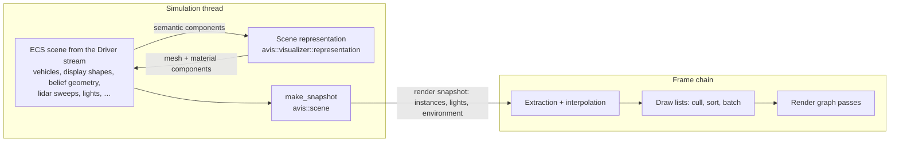
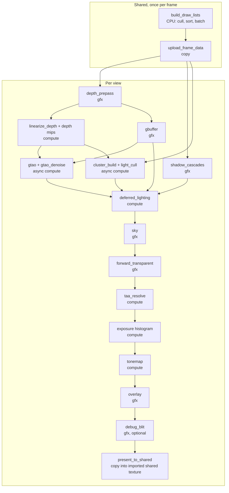
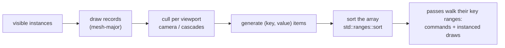

# 11 — Scene Renderer

The scene renderer lives in the Visualizer (`apps/visualizer/rendering/`). It's built on the Avis render graph ([10](10-render-graph.md)) and RHI ([09](09-rhi.md)). It is **scene-agnostic**: it renders a snapshot made of meshes, materials, transforms, lights and an environment, and knows nothing about what those meshes represent (§2.1).

## Code placement

| Feature | Namespace | CMake target | Location |
|---|---|---|---|
| Scene renderer (pass setup, extraction, draw lists, sorting) | `avis::visualizer::rendering` | `AVIS_VISUALIZER` | `apps/visualizer/rendering/` |
| Scene representation (turns scene semantics into meshes and materials; **not** part of the renderer) | `avis::visualizer::representation` | `AVIS_VISUALIZER` | `apps/visualizer/representation/` ([12 §9](12-visualizer.md#9-scene-representation)) |
| Renderer shader sources (`*.hlsl`, `*.hlsli`) | — (HLSL) | `AVIS_VISUALIZER` (`avis_add_shaders`) | `data/shaders/visualizer/scene/`, `data/shaders/visualizer/include/` |
| Compiled shaders + `manifest.yaml` (runtime data) | — | build output of `AVIS_VISUALIZER` | `<bin>/data/shaders/visualizer/` |

## 1. Requirements

From idea.md:
- **Clustered deferred** for opaque geometry, plus **forward** for transparent materials.
- **Cascaded shadow maps.**
- Passes, at minimum: **depth**, **linearize depth**, **G-buffer**, **lighting**, **ambient occlusion**, **tonemapping**, **anti-aliasing**.
- **PBR** lighting with the metallic-roughness model.
- **GTAO**, implemented from scratch (no external library).
- **TAA.**
- A **debug pass that blits selected resources.**
- HDR output is out of scope (SDR output).

From the owner's design review ([99](99-decisions-and-open-questions.md), D-32 to D-35):
- The renderer renders **only the current state of the scene**, which it receives **as a snapshot** from elsewhere.
- It is **agnostic to what is encoded in the scene**: it sees a collection of **meshes, materials and their world positions** (plus the lights and environment needed to shade them).
- Rendering is **as efficient as possible**: draw calls are **sorted** to minimise pipeline state changes. Sorting works on an array of `(key, value)` pairs: a **64-bit unsigned sort key** encoding state and context (fullscreen layer, viewport, viewport layer, translucency, command bit, then depth + material or sequence + command data), and an offset to the draw-call data. The array is sorted with a standard algorithm and then walked to submit the draws (§4).
- **Shaders are Visualizer data**, not part of the Avis library (§13).

## 2. Architecture

### 2.1 Scene-agnostic boundary



| Layer | Knows about | Doesn't know about |
|---|---|---|
| ECS scene + Visualizer systems | Driver entities: vehicles, sensors, display shapes, properties, belief geometry, lidar sweeps | GPU details |
| **Scene representation** (Visualizer, [12 §9](12-visualizer.md#9-scene-representation)) | How each semantic concept *looks*: which mesh, which material, which draw layer | Passes, sorting, shaders |
| `avis::scene` snapshot ([08 §6](08-scene-management.md#6-simulation--render-synchronisation-snapshots)) | Entities with `mesh` + `material` (+ `light`) components and their world transforms | Semantics |
| **Scene renderer** (this document) | Meshes, materials, transforms, draw layers, lights, environment, cameras/views | **Anything** semantic: there's no box, point cloud, vehicle or trajectory code in the renderer |

Rules:
- The renderer's only scene input is the **render snapshot** (§3.1). It never reads the ECS registry or semantic components.
- Everything visible is a mesh instance with a material. A `box` display shape is a unit-cube mesh instance with a translucent material, a trajectory is a line mesh, and a lidar sweep is a progressive point mesh. All of that is decided by the scene representation.
- Views (cameras, output targets, sizes) come from the Visualizer's presentation layer (camera controller, viewport), not from the snapshot, because cameras are presentation, not simulation state ([12 §5](12-visualizer.md#5-camera)).
- Renderer-internal effects (sky, debug blit, exposure, TAA) aren't scene content and stay in the renderer.

### 2.2 Frame overview



### 2.3 Pass table

| # | Pass | Type / queue | Inputs | Outputs |
|---|---|---|---|---|
| 0 | `upload_frame_data` | copy / copy | Extraction results and sorted draw lists (§4), residency uploads (§3.6) | `instances`, `instance_indices`, `lights` buffers (imported, persistent, ring-indexed); new mesh versions in the geometry arena, material slots, textures |
| 1 | `depth_prepass` | graphics | draw-list range `scene/camera/world/opaque` (§4.6) | `depth` D32F (reverse-Z) |
| 2 | `linearize_depth` | compute / graphics | depth | `linear_depth` R32F + 5-mip chain (`depth_mips`, view-space Z) |
| 3 | `cluster_build` + `light_cull` | compute / **async** | lights, view, depth_mips (min/max per tile) | `cluster_grid`, `light_index_list` |
| 4 | `gbuffer` | graphics | depth (EQUAL, no write), draw-list range `scene/camera/world/opaque` | `gbuffer_albedo`, `gbuffer_normal`, `gbuffer_material`, `gbuffer_emissive`, `velocity` |
| 5 | `gtao` | compute / **async** | depth_mips, gbuffer_normal | `ao_raw` (half-res R8 + packed edges) |
| 6 | `gtao_denoise` | compute / **async** | ao_raw, depth_mips | `ao` (half-res R8) |
| 7 | `shadow_cascades` | graphics | draw-list ranges `scene/shadow_cascade[0–3]/world/opaque`, sun light | `shadow_map` D32F Texture2DArray (4 × 2048²) |
| 8 | `deferred_lighting` | compute | G-buffer, depth, ao, shadow_map, clusters, IBL | `hdr_color` RGBA16F |
| 9 | `sky` | graphics | depth (far = 0) | hdr_color (write where depth == 0) |
| 10 | `forward_transparent` | graphics | draw-list range `scene/camera/world/blended…subtractive`, depth (read), clusters, shadow_map, IBL | hdr_color (blend), `reactive_mask` R8 |
| 11 | `taa_resolve` | compute | hdr_color, velocity, depth, history (imported), reactive_mask | `taa_output` RGBA16F → becomes history |
| 12 | `exposure` | compute | taa_output | `exposure` buffer (imported, persistent, 1 float + histogram) |
| 13 | `tonemap` | compute | taa_output, exposure | `ldr_color` RGBA8_UNORM (sRGB-encoded in shader) |
| 14 | `overlay` | graphics | draw-list range `scene/camera/overlay…overlay_on_top`, depth (read) | ldr_color |
| 15 | `debug_blit` (optional) | graphics | selected resource, draw-list range `fullscreen_effects/camera` | ldr_color (full or picture-in-picture) |
| 16 | `present_to_shared` | graphics | ldr_color | imported shared texture (slot *i*), state `common` |

The **linearize depth** pass (idea.md) produces both the full-resolution linear depth and the mip chain that GTAO and cluster building use.

**Declaration order is the overlap plan.** The render graph keeps declaration order on each queue ([10 §6.2](10-render-graph.md#62-scheduling-and-queue-assignment)), so async work only overlaps graphics passes that are declared *after* its producer and don't depend on its output. The table is ordered for that:
- `cluster_build` + `light_cull` need only `depth_mips`, so they run on async compute while the graphics queue draws the `gbuffer`.
- `gtao` + `gtao_denoise` need `gbuffer_normal`, so they start after the G-buffer and run while the graphics queue draws `shadow_cascades`, which reads neither.
- `deferred_lighting` waits for clusters, AO and shadows.

## 3. Renderer input

### 3.1 Render snapshot
The renderer consumes `avis::scene::snapshot` ([08 §6.1](08-scene-management.md#61-snapshot-contents)), which contains only generic render data:

```cpp
namespace avis::scene
{
    struct render_instance
    {
        std::uint64_t object_id;                 // stable id (motion-vector history, picking); opaque to the renderer
        mesh_handle mesh;
        std::uint32_t submesh;                   // primitive range within the mesh
        material_handle material;
        Eigen::Matrix4f world_previous;          // at t_{k-1}
        Eigen::Matrix4f world_current;           // at t_k
        draw_layer layer = draw_layer::world;    // §3.4
        std::uint8_t layer_priority = 0;         // ordering within overlay layers
        enum_flags<instance_flags> flags;        // visible, casts_shadows, selected, pickable
    };

    struct light_instance { /* kind, colour, intensity, range, cone angles, world transform, casts_shadows */ };
    struct environment { /* sun direction and illuminance, sky model parameters */ };
}
```

- `object_id` is an opaque 64-bit key. The renderer uses it only to look up previous-frame matrices (motion vectors) and to report picking results; it never interprets it.
- `mesh_handle` and `material_handle` refer to entries in the asset cache ([08 §5](08-scene-management.md#5-assets-gltf)), which owns only the **CPU** data. The snapshot's `meshes` and `materials` tables carry the current version of each referenced asset. The **renderer owns every GPU copy** through its residency cache (§3.6).

### 3.2 Geometry
- **Vertex pulling** from bindless `ByteAddressBuffer`s, with no input layouts.
- Meshes live in a global **geometry arena** owned by the renderer (one large vertex buffer and one index buffer, sub-allocated), so binding a different mesh only changes root constants. The residency cache (§3.6) maps `(mesh_handle, version)` → `{vertex_offset, index_offset, index_count, vertex_count, attribute_mask, topology, progressive, bounds}`.
- **Vertex attributes** (`attribute_mask`): position `f32x3` (always), normal octahedral `u16x2`, tangent octahedral `u16x2` + sign, `uv0` `f16x2`, `color0` `u8x4`. The shader variant is chosen by the mask (part of the pipeline variant, §4.2).
- **Topology** (`mesh_topology`): `triangles`, `lines`, `points`. Lines and points are expanded into screen-facing quads in the vertex shader (§9).
- **Progressive** flag: the vertices are in random order, so drawing any prefix gives a uniform subsample. The renderer may draw fewer vertices based on projected size (§9.3).
- **Dynamic meshes** (geometry rewritten every tick, such as trajectories, lidar sweeps and belief geometry chunks) are new **versions** of a mesh. They never overwrite a range in place: a new version gets a new range, and the old range is freed only after every frame that used it has completed on the GPU (§3.6).

### 3.3 Materials (PBR metallic-roughness)
```hlsl
struct material_data
{
    float4 base_color_factor;
    float  metallic_factor;
    float  roughness_factor;
    float  normal_scale;
    float  occlusion_strength;
    float3 emissive_factor;
    float  alpha_cutoff;
    uint   base_color_texture;            // bindless SRV index, 0 = none
    uint   metallic_roughness_texture;
    uint   normal_texture;
    uint   occlusion_texture;
    uint   emissive_texture;
    uint   sampler_index;
    uint   shading_model;                 // lit | unlit
    uint   alpha_mode;                    // opaque | mask | blend
    uint   blend_operation;               // normal | additive | subtractive (alpha_mode = blend only)
    uint   flags;                         // double_sided, use_vertex_color
    float  point_size;                    // metres, for point topology (minimum 1 px)
    float  line_width;                    // pixels, for line topology
};
```
- This maps directly onto glTF 2.0 `pbrMetallicRoughness`, extended with `shading_model`, `blend_operation`, `use_vertex_color`, `point_size` and `line_width`, so non-glTF content (boxes, lines, points) uses the same material system.
- All materials live in one renderer-owned GPU material buffer, indexed by the material's residency slot (§3.6). Texture fields hold the bindless indices of the renderer's resident textures. Switching material is a root-constant change, not a state change.
- `alpha_mode` routes `world`-layer instances: `opaque` and `mask` go through deferred, `blend` goes through forward. `blend_operation` picks the translucency value of the sort key (`blended`, `additive`, `subtractive`, §4.2) and the blend state of the pipeline set.

### 3.4 Draw layers
| `draw_layer` | Rendered in | Depth | Lighting | TAA |
|---|---|---|---|---|
| `world` | depth prepass + G-buffer (opaque/mask) or forward transparent (blend); shadow passes if `casts_shadows` | Test + write (opaque) / test only (blend) | Material `shading_model` | Yes |
| `overlay` | `overlay` pass, after tonemapping | Test against scene depth with a small bias, no write | Unlit (material colour only) | No (stays crisp) |
| `overlay_on_top` | `overlay` pass, after `overlay` | No test | Unlit | No |

Each draw layer maps to the *viewport layer* field of the sort key (§4.2). `layer_priority` orders instances within the overlay layers (higher on top) through the top bits of the depth field (§4.3). Selection highlighting is the generic `selected` flag: the renderer draws an outline for selected instances.

### 3.5 Extraction and interpolation
At the start of each frame (the prepare stage of the frame chain, [09 §4.2](09-rhi.md#42-frame-contexts-sender-based-non-blocking)) the renderer:
1. Acquires the latest snapshot and computes `t_render` and the interpolation `alpha` from the snapshot's time anchor `{t_base, wall_base, rate}` ([03 §5](03-simulation-core.md#5-render-interpolation)). While paused or stopped, `rate` is 0 and `alpha` is 1.
2. Updates residency (§3.6): it walks the snapshot's `meshes` and `materials` tables, queues uploads for versions that aren't resident, and marks every referenced entry as used by this frame. Instances whose mesh has no resident version yet are skipped this frame.
3. Builds `instance_data[]` (interpolated world matrix, previous-frame world matrix, mesh, material, flags, object id) and `light_data[]`.
4. Builds and sorts the draw lists (§4).
5. Writes everything into persistent GPU buffers. Large arrays go through the frame allocator plus a copy to `gpu_only` buffers on the copy queue (pass 0), together with the residency uploads. Small constants are root CBVs read straight from the upload heap.

**Previous-frame transforms** for motion vectors are the interpolated transforms used in the *previous rendered frame*, kept per `object_id` in a renderer-side map. They're not the previous tick's transforms.

**Reusing the last snapshot.** Between publishes, `acquire()` returns the same snapshot every frame ([08 §6.2](08-scene-management.md#62-double-buffering)), and the renderer renders it again from the current camera. As an **allowed shortcut** (not a requirement), when the acquired `publish_sequence` equals the previous frame's and `alpha` is unchanged (for example while paused), the renderer may skip step 2 (no new versions to make resident) and step 3 plus its upload, reusing the instance buffer of the previous frame instead of rewriting a ring slot. The reused slot is pinned: it isn't handed out for writing again until the frames that read it have retired. Culling, sorting and draw-list building (step 4) always run, because the camera can move.

### 3.6 GPU residency
The renderer is the **only owner of GPU copies** of meshes, materials and textures. The simulation thread works with immutable, versioned CPU data in the asset cache ([08 §5.2](08-scene-management.md#52-cpu-ownership-and-versions)) and never calls the RHI. Only the frame chain touches these GPU resources, so there are no cross-thread GPU races.

```cpp
namespace avis::visualizer::rendering
{
    struct resident_mesh
    {
        std::uint64_t version;
        geometry_range range;                  // vertex + index sub-allocation in the geometry arena
        rhi::upload_ticket upload;             // copy-queue point the first use waits on
        std::uint64_t last_used_frame;         // frame index of the last frame that drew it
    };

    class residency_cache
    {
    public:
        // prepare stage: makes the snapshot's versions resident (or queues their uploads)
        void update(const scene::snapshot& snapshot, std::uint64_t frame_index);
        const resident_mesh* find(scene::mesh_handle mesh) const;     // newest resident version, or nullptr
        // called when frame N - F is known to be complete (begin_frame completion, 09 §4.2)
        void retire(std::uint64_t completed_frame_index);
    };
}
```

**Upload.** For each entry in the snapshot's `meshes` table whose `(handle, version)` isn't resident:
1. Allocate a new range in the geometry arena.
2. Copy the CPU data into the staging ring with the non-blocking `rhi::upload_buffer` ([09 §8.1](09-rhi.md#81-staging-ring-buffer)), recorded in pass 0 (`upload_frame_data`). The geometry buffers are imported into the graph with the pending `upload_ticket`, so the first pass that draws the new range waits on the copy queue ([10 §7](10-render-graph.md#7-execution-phase)).
3. Make the new version current. The previous version stays allocated (see *Free*).

Textures and materials follow the same path. A new texture version is uploaded and gets its mips generated by a compute downsample on its first use. A new material version rewrites its slot in the material buffer, with texture indices resolved against resident textures.

If the staging ring is full (`upload_ring_full`) or the arena can't fit the new version, the upload is retried next frame, and instances keep drawing the **previous** resident version. A mesh with no resident version yet isn't drawn. The renderer never stalls a frame for an upload.

**Free (frame retirement).** Every resident entry records `last_used_frame`. A range is returned to the arena free list when **both** hold:
- it is no longer the newest version, or its mesh no longer appears in the latest snapshot;
- `last_used_frame ≤` the last frame known to be complete on the GPU. That's the frame whose context `begin_frame` just recycled ([09 §4.2](09-rhi.md#42-frame-contexts-sender-based-non-blocking)), the same point at which command allocators are reset.

A range is therefore never freed while a recorded or in-flight frame can still read it, however many snapshots were skipped. The renderer drops its `shared_ptr` to a version's CPU data as soon as the upload has been recorded.

**Budget.** The arena size is `render.geometry.arena_mib` (§14). It must exceed the scene representation's geometry budget ([12 §9](12-visualizer.md#9-scene-representation)) by enough to hold superseded versions during their *F* frames of retirement, which is why it defaults to 1.5 × that budget. Memory pressure is managed **upstream**, by the scene representation, because only it knows which geometry matters (12 §9.1). The renderer only falls back to "keep the previous version" and logs a warning when the arena is full.

## 4. Draw lists and draw-call sorting

### 4.1 Overview
Every frame, for every view, the renderer turns the visible instances into one **draw list**: an array of `(key, value)` pairs. The **key** is a 64-bit unsigned sort key that encodes state and context. The **value** is an offset to the actual draw-call data. Every visible scene object is processed into this array, the array is sorted with a standard sorting algorithm, and the passes then walk the sorted array and submit the draw calls.



```cpp
namespace avis::visualizer::rendering
{
    struct draw_item
    {
        std::uint64_t key;     // sort key (§4.2)
        std::uint32_t value;   // draw item: index of a draw_record; command item: offset of its arguments

        friend constexpr auto operator<=>(const draw_item&, const draw_item&) = default; // key first, then value
    };
}
```

- The sort compares `(key, value)` lexicographically. Values are unique, so the order is **total**: any correct sorting algorithm gives exactly the same result, and the frame is reproducible.
- The draw list orders draw calls **within** a pass. The order **between** passes, queues and views stays with the render graph ([10 §6](10-render-graph.md#6-compile-phase)). Each pass consumes one or more contiguous **key ranges** of the sorted list (§4.6).

### 4.2 Key layout
Fields that are sorted on first sit at the most significant end. The first 11 bits are shared by all items. The command bit selects how the remaining 53 bits are read.

| Bits | Field | Width | Values |
|---|---|---|---|
| 63–62 | Fullscreen layer | 2 | `scene` 0, `fullscreen_effects` 1, `hud` 2, 3 reserved |
| 61–59 | Viewport | 3 | Viewpoint within the view: `camera` 0, `shadow_cascade` 0–3 → 1–4, 5–7 reserved (mirrors, reflection views) |
| 58–56 | Viewport layer | 3 | `background` 0, `world` 1, `effects` 2, `overlay` 3, `overlay_on_top` 4, 5–7 reserved |
| 55–54 | Translucency | 2 | `opaque` 0, `blended` 1, `additive` 2, `subtractive` 3 |
| 53 | Command | 1 | 0 = draw, 1 = command |

**Draw items** (command bit clear):

| Bits | Field | Width | Contents |
|---|---|---|---|
| 52–29 | Depth | 24 | Depth ordering; meaning per group (§4.3) |
| 28–0 | Material | 29 | 28–17: **pipeline set** (12 bits, 4,096 sets, §4.4); 16–0: **material index** (17 bits, 131,072 materials) |

**Command items** (command bit set):

| Bits | Field | Width | Contents |
|---|---|---|---|
| 52–48 | Sequence number | 5 | Orders several commands in the same group (0–31) |
| 47–0 | Command data | 48 | Bit 47 = 0: **built-in command**, 46–39 opcode (8 bits), 38–0 immediate (39 bits). Bit 47 = 1: **callback**, 46–0 function address (47 bits) |

- A *group* is the set of items sharing the 11-bit prefix (fullscreen layer, viewport, viewport layer, translucency).
- Because the command bit sits below the translucency field, **a command runs after the draws of its group and before the next group**. That is the "between layers" position: a command meant to run before layer *L* is keyed into the last group drawn before *L* by the same pass.
- Callback addresses fit because Windows x64 user-mode code lives below 2⁴⁷. ASLR changes addresses between runs, so **commands that share a group and sequence number must be independent of each other's order**. Use distinct sequence numbers when order matters.
- Key construction and decoding are `constexpr` helpers (`make_draw_key`, `make_command_key`, `decode_key`) with `static_assert`ed field widths and debug range checks on every field.

How the snapshot maps onto the prefix:

| Source | Fullscreen layer | Viewport | Viewport layer | Translucency |
|---|---|---|---|---|
| `world` instance, material `opaque`/`mask` | `scene` | `camera`, plus `shadow_cascade[c]` for each cascade it is a caster in | `world` | `opaque` |
| `world` instance, material `blend` | `scene` | `camera` | `world` | from `blend_operation`: `blended` / `additive` / `subtractive` |
| `overlay` / `overlay_on_top` instance | `scene` | `camera` | `overlay` / `overlay_on_top` | `opaque`, or from `blend_operation` |
| Debug blit quads (renderer-internal) | `fullscreen_effects` | `camera` | `background` | `blended` |

`background`, `effects` and the `hud` fullscreen layer have no producers in iteration 1. The sky and the post-processing chain are render-graph passes, not draw items, and the HUD is Qt Quick UI drawn over the viewport ([12 §6](12-visualizer.md#6-panels-and-controls)). The values are reserved so that adding a producer doesn't change the key layout.

### 4.3 Depth field per group
The depth field sits above the material field. Taken literally, a full-precision depth for opaque geometry would give almost every item a unique depth and destroy material grouping. So the 24 bits are interpreted **per group**:

| Group | Depth field (24 bits) | Why |
|---|---|---|
| Opaque `world` (camera and shadow cascades) | **Coarse front-to-back band** in the top bits, lower bits zero. `render.draw_sorting.opaque_depth_bands` (power of two, default 16; 1 disables). | Items in the same band sort by pipeline set and material, so batching survives. Bands still give the depth prepass and shadow passes rough front-to-back order for early-Z. The G-buffer uses `depth EQUAL` and doesn't depend on order. |
| Translucent `world` (`blended`, `additive`, `subtractive`) | Full 24-bit depth, **back to front** (`2²⁴ − 1 − q`) | Correct blending comes before state changes |
| `overlay`, `overlay_on_top` | 23–16: `layer_priority` (higher draws later, on top). 15–0: opaque 0; translucent 16-bit back-to-front depth. | Keeps the explicit priority of the scene representation |
| `fullscreen_effects` | Stacking order (debug blit: fullscreen first, then picture-in-picture slots) | Later quads draw on top |

Depth is quantised logarithmically over [0.1 m, 2 km] (the cluster depth range, §6.3) from the instance's bounds centre in view space: `q = round((2²⁴ − 1) · log(d / near) / log(far / near))`, clamped. Opaque bands use the top `log2(bands)` bits of the same value.

### 4.4 Pipeline sets and draw records
**Pipeline sets.** The material field starts with a 12-bit pipeline set index. A `pipeline_variant_registry` maps each distinct combination of `(shading_model, alpha_mode, blend_operation, topology, attribute_mask, double_sided)` to a pipeline set. A set holds **one PSO per pass** that can draw it (depth, shadow, G-buffer, picking, forward, overlay). This is how one material can have several passes: a single item in the opaque `world` group is drawn by the depth prepass with the set's depth PSO and by the G-buffer pass with its G-buffer PSO. All base variants are known from the material model and created at startup ([09 §9.2](09-rhi.md#92-pso-cache)). Lower indices go to cheaper and more common sets.

**Draw records.** The value of a draw item is the index of a `draw_record` in the frame's `linear_arena` ([10 §3.5](10-render-graph.md#35-per-frame-linear-arena-linear_arena)):

```cpp
struct draw_record                     // one per visible instance per frame
{
    std::uint32_t instance;            // index into instance_data[] (§3.5)
    std::uint32_t mesh;                // geometry arena entry
    std::uint32_t submesh;
    enum_flags<instance_flags> flags;  // casts_shadows, selected, pickable
};
```

- Records are laid out **mesh-major**: extraction counts visible instances per `(mesh, submesh)`, takes a prefix sum and scatters the records. Because the sort breaks key ties by value, draws with an equal key and the same mesh end up **next to each other**, which is what instancing needs, even though the mesh isn't in the key.
- An instance drawn in several viewports (camera plus shadow cascades) has one record and several items.

### 4.5 Building and sorting
1. **Cull per viewport:** the camera frustum for `camera`, and each cascade's frustum for `shadow_cascade[c]` (only `casts_shadows` instances).
2. **Generate items** into one array in the frame's `linear_arena`, sized from the cull counts. The renderer appends its command items to the same array.
3. **Sort the array** once with `std::ranges::sort`.
4. **Index the groups:** a binary search per group start gives `draw_list::range(prefix)`, an empty span when no item has that prefix.

- Building and sorting run **single-threaded** on the frame chain's prepare stage, one view after the other (one draw list per view). Splitting the sort over parallel workers isn't worth the orchestration overhead at these item counts.
- Because `(key, value)` is a total order, an LSD radix sort can later replace `std::ranges::sort` without changing any output. That's the planned optimisation if sorting ever shows up in profiles.
- Expected cost: about 0.5 ms per 10k items on one core for `std::ranges::sort` on 16-byte items. With 10k instances, most of them casters in one or two cascades, a view holds roughly 25k items, which is about 1.2 ms (§15).

### 4.6 Consuming the draw list: passes and key ranges
Each pass names the ranges it walks when it's added to the graph, and walks them in key order:

| Pass | Key ranges (fullscreen layer / viewport / viewport layer / translucency) |
|---|---|
| `depth_prepass` | `scene` / `camera` / `world` / `opaque` (set's depth PSO) |
| `shadow_cascades` | `scene` / `shadow_cascade[0–3]` / `world` / `opaque` (set's shadow PSO) |
| `gbuffer` (+ picking target on click frames, §5.1) | `scene` / `camera` / `world` / `opaque` (set's G-buffer PSO; picking only for `pickable` records) |
| `forward_transparent` (+ picking target on click frames) | `scene` / `camera` / `world` / `blended` … `subtractive` |
| `overlay` (+ picking target on click frames) | `scene` / `camera` / `overlay` … `overlay_on_top`, all translucency values |
| `debug_blit` | `fullscreen_effects` / `camera` / all |

- **Render targets are not switched by commands.** A render-target change is a pass boundary, because the render graph must see every attachment access to place barriers and alias memory ([10 §6](10-render-graph.md#6-compile-phase)). A new value of the *viewport* field inside one pass (the shadow pass walking cascades 1–4) makes the recorder bind that viewpoint's array slice, viewport and scissor. The pass declared the whole shadow-map array, so this stays within the graph's knowledge.
- A command runs in whichever pass consumes its group, through that pass's typed context.

### 4.7 Commands
Commands are created by the renderer, never by the snapshot.

| Opcode | Effect | Immediate / arguments |
|---|---|---|
| `clear_depth_stencil` | Clears a depth-stencil attachment the pass declared as written | Arguments: depth, stencil, flags |
| `clear_render_target` | Clears a colour attachment the pass declared as written | Arguments: attachment index, colour |
| `set_viewport_scissor` | Overrides viewport and scissor for the rest of the range | Arguments: rectangles |
| `set_stencil_reference` | Sets the stencil reference value | Immediate: 8 bits |
| `set_write_mask` | Colour/depth write mask for the following draws in the range. Write masks are PSO state in D3D12, so this selects an override variant of each pipeline set, created on first use and cached. | Immediate: mask bits |
| `reset_state` | Drops the overrides above | — |
| *callback* | `void (*)(command_context& context, const void* arguments)` | Arguments at the item's value |

- Debug validation checks that a command touches only attachments its pass declared.
- Iteration 1 needs few commands. The mechanism is there for state changes between layers that the pass's own setup doesn't cover, such as clearing an attachment between two layers drawn by the same pass.
- Debug markers aren't commands: the recorder opens a PIX marker per group automatically.

### 4.8 Recording: instanced draws and the redundant-state filter
The recorder walks a range once:
- **Command item:** execute it.
- **Draw item:** start a run. The run continues while the next item has the **same key** and its record has the **same mesh and submesh**. Each run becomes **one instanced draw**. The instance indices of the run are written contiguously into the per-frame `instance_indices` buffer, the draw passes `{instance_index_offset, material, mesh}` as root constants, and the vertex shader reads `instance_indices[offset + SV_InstanceID]`.
- **Progressive meshes** (§9.3) aren't merged, because each instance draws its own vertex count. That count is computed per viewport, with the shadow LOD scale applied in shadow viewports.
- **Translucent groups** only merge items with an identical key, so back-to-front order is never broken.
- The **redundant-state filter** remembers the last pipeline, root constants and viewport state set on the command list, and only emits `set_pipeline` / `push_constants` when they change. With bindless resources and one geometry arena, a pipeline change is the only real state change, and because the pipeline set sits at the top of the material field each pipeline is set **once per depth band** in the common case.
- The geometry index buffer is bound once per command list.
- Large ranges are split into several **recording groups** ([10 §7](10-render-graph.md#7-execution-phase)) at run boundaries. Each group starts with clean filter state, so groups record in parallel.

### 4.9 Future extension
Draws reduce to `{pipeline, mesh, material, instance range}` in GPU buffers, so moving culling and batching to the GPU (compute culling + `ExecuteIndirect`) only replaces §4.5 and the run building of §4.8. It's out of scope for iteration 1.

## 5. G-buffer

| Target | Format | Contents |
|---|---|---|
| `gbuffer_albedo` | RGBA8_UNORM_SRGB | base color RGB (× vertex colour when `use_vertex_color`), material AO (glTF occlusion) in A |
| `gbuffer_normal` | RG16_UNORM | world-space normal, octahedral encoding |
| `gbuffer_material` | RGBA8_UNORM | R metallic, G roughness, B shading model (0 = lit, 1 = unlit), A flags |
| `gbuffer_emissive` | R11G11B10_FLOAT | emissive radiance (pre-exposure) |
| `velocity` | RG16_FLOAT | screen-space motion (current − previous UV, unjittered) |
| `depth` | D32_FLOAT | reverse-Z (from the prepass) |

That's 20 bytes per pixel plus 4 for depth. On frames where the user clicked the viewport, an extra `picking_id` target is bound (§5.1). The G-buffer pass uses `depth EQUAL` with depth writes off, so there's no overdraw for shading.

### 5.1 Picking
- **Format:** `picking_id` is `R32G32_UINT`, holding the full 64-bit `object_id` (low word in R, high word in G). `0` means "nothing". It's a transient render-graph texture at full resolution, created only on a click frame.
- **Coverage:** every pass that draws `pickable` instances writes it, as an extra render target with blending disabled on that target:

| Pass | Writes `picking_id` for | Rule |
|---|---|---|
| `gbuffer` | opaque and masked `world` instances | Depth `EQUAL`, so the visible surface wins |
| `forward_transparent` | translucent `world` instances (for example box faces) with coverage ≥ 0.1 | Drawn back to front, so the front-most translucent surface overwrites what's behind it |
| `overlay` | `overlay` and `overlay_on_top` instances (box edges, frusta, trajectories, axes) | Drawn after the scene, so overlays win over the world |

  Later passes overwrite earlier ones, so the result is "what the user sees on top" at the clicked pixel.
- **Readback:** a copy pass inside the graph copies a 9×9 texel window around the cursor into a readback buffer (`rhi::readback_buffer`, [09 §10](09-rhi.md#10-readback)). The Visualizer picks the non-zero id closest to the centre, which makes 1–2 px lines and small points clickable.
- The id the renderer reports is the opaque `object_id`. The Visualizer maps it back to the entity ([12 §5](12-visualizer.md#5-camera)).

## 6. Lighting

### 6.1 BRDF (`brdf.hlsli`)
- Specular: Cook-Torrance with GGX/Trowbridge-Reitz `D`, height-correlated Smith `V`, and Schlick `F` with `F0 = lerp(0.04, base_color, metallic)`.
- Diffuse: Lambert. Energy conservation: `(1 − F)·(1 − metallic)`.
- Roughness is clamped to ≥ 0.045 to avoid specular aliasing. A Toksvig-style normal-variance term is added from the normal map mips.

### 6.2 Lights
| Type | Parameters | Notes |
|---|---|---|
| Directional (sun) | direction, illuminance (lux), colour | One per scene, casts CSM shadows |
| Point | position, luminous power (lm), range, colour | Inverse-square falloff with smooth window `(1 − (d/r)^4)^2` |
| Spot | + direction, inner/outer angles | Same falloff, angular attenuation |

Point and spot lights don't cast shadows in iteration 1. Limits: 4,096 lights per scene, 256 per cluster.

### 6.3 Clustered light culling
- The cluster grid is **16 × 9 screen tiles × 24 exponential depth slices** per view (near 0.1 m, far 2 km).
- `cluster_build` (async compute) builds view-space AABBs per cluster. They're rebuilt only when the projection changes.
- `light_cull` tests every light's bounding sphere or cone against each cluster AABB, appending into `light_index_list` (a compact per-cluster offset/count + global index buffer). Tiles with no geometry are skipped using min/max depth from `depth_mips`.

### 6.4 Image-based / ambient lighting
- A **procedural sky** (Hosek–Wilkie analytic model) driven by the snapshot's `environment` (sun azimuth and elevation).
- When the environment changes, a compute pass bakes the sky into a 256² cubemap, a **prefiltered specular** cubemap (GGX, 6 mips) and **SH9 irradiance**. A split-sum **BRDF LUT** (RG16F 128²) is generated once at startup.
- Ambient = `irradiance(N) · albedo · diffuse_ao + prefiltered(R, roughness) · (F0·A + B) · specular_ao`. `diffuse_ao = min(gtao, material_ao)`, and the specular occlusion is derived from GTAO (Lagarde's approximation).

### 6.5 Deferred lighting pass
A compute shader with 8×8 thread groups, one pixel per thread. It reads the G-buffer, reconstructs the position from depth, fetches the cluster, and loops over the lights. Then it adds the sun with its shadow, the ambient IBL term with AO, and emissive. `unlit` pixels output their base colour unchanged. The output is `hdr_color` in **pre-exposed** linear radiance (multiplied by the previous frame's exposure to keep FP16 in range).

## 7. Shadows: cascaded shadow maps
- **4 cascades**, each 2048², in one `D32_FLOAT` Texture2DArray.
- Split scheme: practical (logarithmic/uniform blend, λ = 0.8), with a shadow distance of 200 m (configurable).
- **Stabilisation:** bounding-sphere cascade fitting and texel-snapped light-space origins. This removes shimmering when the camera moves.
- Reverse-Z orthographic projections, slope-scaled depth bias plus normal-offset bias in the receiver shader.
- Filtering: 16-tap Poisson-disk PCF using the hardware comparison sampler (`s4`), with per-pixel rotation from interleaved gradient noise (TAA cleans it up).
- **Cascade blending** over the last 10% of each cascade range. A cascade debug visualisation colours pixels by cascade.
- Shadow casters come from the `shadow_cascade[c]` viewports of the draw list (§4.2, §4.6). Progressive meshes use a reduced LOD in shadow passes (`render.progressive.shadow_lod_scale`, default 0.25).

## 8. GTAO (own implementation)
Based on Jimenez et al. 2016, "Practical Real-Time Strategies for Accurate Indirect Occlusion", with the structure of the public XeGTAO description. Written from scratch in `gtao.hlsl`.

| Stage | Details |
|---|---|
| Input | `depth_mips` (view-space linear depth, 5 mips, from `linearize_depth`) and `gbuffer_normal` (converted to view space) |
| Resolution | Half resolution by default (`render.ao.half_resolution`), full resolution optional |
| Horizon search | Per pixel, `slice_count` slices (default 2 at half res, 3 at full), `steps_per_side` 4 with quadratic step distribution. Effective radius 1.5 m (configurable), falloff over the last 40% of the radius. Samples go to depth mip levels by step distance, for cache efficiency. |
| Integration | Analytic cosine-weighted visibility integral over the two horizon angles per slice, projected-normal weighting |
| Noise | Spatio-temporal: Hilbert-curve index × R2 sequence per frame for the slice rotation and step offsets. The temporal variance gets resolved by TAA. |
| Output | AO term (R8) plus packed edge weights (R8) for the denoiser |
| Denoise | `gtao_denoise`: one or two passes of an edge-aware 3×3 spatial filter using the packed edges. Optional depth-aware upsampling to full resolution happens in the lighting pass. |
| Queue | Async compute, declared after the G-buffer and before `shadow_cascades`, so it overlaps the shadow pass (§2.3) |

Parameters are exposed in the debug UI: radius, falloff, slice count, step count, intensity (power curve), and half/full resolution.

## 9. Points, lines and progressive meshes
Generic geometry features. The renderer doesn't know what the points or lines represent.

### 9.1 Point topology
- Each point is a camera-facing quad, expanded in the vertex shader from `SV_VertexID` (6 vertices per point, no index buffer). The world-space size is the material's `point_size`, with a minimum of 1 px.
- The pixel shader discards outside the inscribed circle and writes depth. In the depth prepass and the G-buffer, points are ordinary opaque geometry: albedo from `color0` (when `use_vertex_color`), normal from the vertex normal (or facing the camera when the mesh has none). They're **lit, shadowed and ambient-occluded** like any other `world`-layer geometry.

### 9.2 Line topology
- Thick anti-aliased lines: each segment becomes a screen-space quad in the vertex shader, `line_width` pixels wide, with an analytic coverage falloff at the edges.
- Usually drawn in the overlay layers (unlit, after tonemapping), but lines in the `world` layer are supported too (unlit, through forward).

### 9.3 Progressive meshes (LOD)
- For a mesh flagged `progressive`, the renderer draws `n = clamp(k · projected_bounds_area_px, n_minimum, vertex_count)` vertices per visible instance. A random vertex order makes the prefix a uniform subsample.
- A **global progressive vertex budget** (`render.progressive.vertex_budget`) rescales `k` each frame so the total stays under budget. Frame-to-frame changes in `n` are rate-limited so popping isn't visible.
- This is generic: any large point set (for example lidar sweeps and belief point maps, which the scene representation turns into progressive point meshes, [12 §9](12-visualizer.md#9-scene-representation)) benefits without renderer changes.
- Future option (not in iteration 1): a compute-shader point rasteriser (64-bit atomic visibility buffer) for budgets above 50M points.

## 10. Transparency, TAA, exposure, tonemapping, overlays

### 10.1 Forward transparent pass
- Walks the translucent `world` groups of the draw list: `world`-layer instances with `alpha_mode = blend`, sorted back to front (§4.3). Depth test against the prepass depth, no depth writes. Premultiplied-alpha blending into `hdr_color`.
- Uses the same `brdf.hlsli` and the cluster lookup, so transparents get all lights, CSM and IBL (without SSAO).
- Writes a **reactive mask** that reduces TAA history weight where transparents changed.

### 10.2 TAA
- Jitter: a Halton(2,3) 16-sample sequence applied to the projection (sub-pixel), with the inverse jitter tracked for velocity.
- Resolve (compute): reproject history using the velocity of the **closest-depth pixel in a 3×3 neighbourhood** (velocity dilation). Sample history with 5-tap Catmull-Rom. Clip the history to the neighbourhood's **YCoCg variance AABB** (γ = 1.0). Blend factor 0.1 base, raised by the reactive mask and on disocclusions (depth-rejection test with the previous depth), with luminance-weighted (Karis) blending to suppress fireflies.
- Runs on **pre-exposed HDR**, before tonemapping. History is per view, imported, and ping-pong ([10 §8](10-render-graph.md#8-multi-view)). It's invalidated on camera cuts, resizes and scene reloads.

### 10.3 Exposure
- Default: **automatic exposure** from a 128-bin log-luminance histogram (compute), with an average that ignores the darkest 50% and brightest 5%, and asymmetric exponential adaptation (fast brighten, slower darken).
- Manual EV100 override in the UI. Exposure is stored in a persistent 1-element buffer, read the next frame for pre-exposure.

### 10.4 Tonemapping
- **ACES fitted** (Hill's RRT+ODT approximation) by default, with **AgX** selectable for comparison.
- Output is sRGB-encoded in the shader into `RGBA8_UNORM`, with blue-noise dithering (±0.5 LSB) to prevent banding. HDR output is out of scope.

### 10.5 Overlay pass
- Walks the `overlay` and then the `overlay_on_top` groups of the draw list into `ldr_color`, after tonemapping, so overlays stay crisp and unaffected by TAA.
- `overlay` instances are depth-tested against the scene depth with a small bias. The scene depth is jittered, but the sub-pixel error is acceptable for overlays. `overlay_on_top` ignores depth.
- Draws the outline for `selected` instances (a screen-space edge detect on a stencil-like mask written by the selected instances).
- What appears in the overlays (box edges, trajectories, grid, frusta, …) is decided entirely by the scene representation ([12 §9](12-visualizer.md#9-scene-representation)).

## 11. Debug blit pass
- Driven by the selection in the Visualizer's *Render Debug* panel ([12 §6](12-visualizer.md#6-panels-and-controls)): `{qualified resource name, mip, slice, channel mask, visualisation mode, value range, layout: fullscreen | picture-in-picture (corner, scale)}`.
- Each selected blit (fullscreen or picture-in-picture) is a draw item in the `fullscreen_effects` layer: a renderer-internal fullscreen-triangle mesh with a debug material, stacked through the depth field (§4.3). The renderer adds the pass only when a selection exists. The pass `read()`s the selected resource, which keeps the producer chain alive and turns off aliasing for it ([10 §9](10-render-graph.md#9-debug-introspection)).
- **Visualisation modes:** `raw` (with range remap), `depth_linear`, `normal_octahedral` (decoded to RGB), `velocity` (HSV direction/magnitude), `ao` (greyscale), `cascade_index` (false colour), `cluster_light_count` (heat map), `luminance_heat`, `alpha_only`.
- Format-aware sampling: integer formats use `Load`, depth formats are read through SRV views with `R32_FLOAT`.
- **Pixel inspector:** hovering with Alt held reads back the selected resource's texel under the cursor, using the RHI readback sender. The value is shown in the panel.

## 12. Output to Qt
`present_to_shared` copies or blits `ldr_color` into the shared texture slot the interop layer chose ([12 §3](12-visualizer.md#3-viewport-integration-qquickrhiitem--shared-handles)). The shared texture is imported with `final = common`. After submission the frame chain signals the shared fence. The viewport size follows the `QQuickRhiItem` size times the device pixel ratio. A resize is debounced by 100 ms and reallocates the shared ring.

### 12.1 Screenshot capture
Screenshots of the 3D viewport are taken **inside the renderer**, so they contain exactly the rendered image (scene, overlays and, optionally, the debug blit) without Qt's UI. A screenshot of the whole window with the UI is a separate, Qt-side feature ([12 §6.3](12-visualizer.md#63-screenshots)). Video capture is out of scope for this iteration ([00 §3](00-overview.md#3-scope-of-iteration-1)).

**Request.** The GUI posts a `screenshot_request {id, mode (viewport | custom), width, height, include_debug_blit}` as latest-value state to the renderer ([12 §4](12-visualizer.md#4-threads-visualizer-view)). One request is handled at a time; a request made while one is running is queued.

**Viewport resolution** (`mode = viewport`), on the next frame:
1. The renderer adds a `capture` copy pass to the main view, right after `overlay` (or after `debug_blit` when `include_debug_blit` is set). It copies `ldr_color` into an **imported `readback` buffer** (`copy_texture_to_buffer`), so the render graph places the barriers.
2. The frame is submitted as usual. `when_complete` on its graphics synchronization point ([09 §4.1](09-rhi.md#41-queues)) resumes the capture on a parallel worker. Nothing waits.
3. The worker encodes a PNG with WIC. `ldr_color` already holds sRGB-encoded `RGBA8` values, so they're written as they are (alpha forced to 255). It then writes the file with the IO layer's atomic replace ([07 §4.5](07-io-layer.md#45-whole-file-operations-avisiofile_operationsh)).

**Custom resolution** (`mode = custom`, for example 3840 × 2160 for a slide or a poster):
- The renderer adds a temporary offscreen **view** named `screenshot` ([10 §8](10-render-graph.md#8-multi-view)) at the requested size. It uses the main camera with the requested aspect ratio, keeping the vertical field of view.
- The presentation state is **frozen at the request**: the same snapshot, interpolation `alpha` and camera for every sub-frame, so the image is consistent even while the simulation runs.
- A fresh view has no TAA history, so TAA is off for it. Instead it renders **8 sub-frames** over 8 consecutive frames, with Halton jitter, accumulating the pre-exposed HDR colour into an `RGBA32F` accumulation texture. Tonemapping uses the **main view's current exposure**, so the brightness matches the viewport. Overlays are drawn once, after tonemapping, at full resolution.
- The progressive vertex budget (§9.3) is lifted for this view, so point clouds are drawn at full density.
- **Limits:** at most 7680 × 4320 (8K), and the request is refused with a message if the estimated transient memory exceeds 50% of the free VRAM budget ([09 §5.2](09-rhi.md#52-handles-and-lifetime)). The main view keeps rendering normally; those 8 frames just take longer.
- The output then goes through steps 1–3 above, from the `screenshot` view's output texture.

**File.** Written to `screenshots.folder` (default `%USERPROFILE%/Pictures/Avis`) as `avis-<scenario>-step<k>-<yyyyMMdd-HHmmss>.png`. PNG text chunks record the scenario name, step index, simulation time, Driver id, camera pose and render settings, so a screenshot can be traced back to its run. When the file is written, the renderer reports `{id, path}` or an error to the GUI.

Screenshots only observe the render output: determinism is unaffected, and they work in every clock state, paused included.

## 13. Shaders: location and build
Shaders are **Visualizer data**. Their sources live in the repository's runtime-data folder `data/` (next to `data/assets/`), not in the application source tree or the Avis library, which contains no HLSL. The build compiles them into the matching path under the build output.

| What | Where |
|---|---|
| Scene renderer shader sources | `data/shaders/visualizer/scene/*.hlsl` (one file per pass or pass family: `depth_prepass.hlsl`, `gbuffer.hlsl`, `deferred_lighting.hlsl`, `gtao.hlsl`, `taa.hlsl`, `tonemap.hlsl`, `overlay.hlsl`, `debug_blit.hlsl`, …) |
| Shared shader headers | `data/shaders/visualizer/include/*.hlsli`: `bindless.hlsli` (root signature contract, [09 §6.4](09-rhi.md#64-shader-side-conventions)), `brdf.hlsli`, `packing.hlsli`, `vertex_pulling.hlsli`, `shared_types.hlsli` (C++/HLSL shared structs, also included by `apps/visualizer/rendering/`, which adds `data/shaders/visualizer/include` to `AVIS_VISUALIZER`'s include directories) |
| Qt-side blit shaders (GLSL → `.qsb`) | `data/shaders/visualizer/qt/` |
| Compiled output (runtime data) | `<bin>/data/shaders/visualizer/*.cso` + `manifest.yaml`, written by `avis_add_shaders(TARGET AVIS_VISUALIZER …)` ([13 §3](13-build-and-quality.md#3-shader-build-pipeline)) and deployed next to the executable like other runtime data |

- At startup the renderer passes the shader directory (`<executable directory>/data/shaders/visualizer`, overridable with `render.shader_directory`) to `rhi::shader_library::load` ([09 §9.1](09-rhi.md#91-shader-library)). The RHI loads whatever directory it's given and has no built-in shader paths.
- `bindless.hlsli` mirrors the RHI's global root signature. The RHI publishes the layout as C++ constants (`rhi::root_signature_layout`), and a Visualizer test compiles a probe shader to check that the two match.

## 14. Configuration (`visualizer.yaml` → `render`)
```yaml
render:
  frames_in_flight: 2
  async_compute: true
  graph_aliasing: true
  debug_layer: false
  gpu_validation: false
  maximum_fps: 0                 # 0 = match display refresh reported by Qt
  shader_directory: ""           # empty = <executable directory>/data/shaders/visualizer
  shadows: { cascades: 4, resolution: 2048, distance: 200.0 }   # cascades ≤ 4: they use viewport slots 1–4 of the sort key (§4.2)
  ao: { half_resolution: true, radius: 1.5, slices: 2, steps: 4, intensity: 1.0 }
  taa: { enabled: true }
  exposure: { mode: auto, ev100: 12.0 }
  tonemapper: aces               # aces | agx
  progressive: { vertex_budget: 20000000, shadow_lod_scale: 0.25 }
  geometry: { arena_mib: 768 }   # renderer-owned geometry arena (§3.6); ≈ 1.5 × representation.geometry.budget_mib
  draw_sorting: { opaque_depth_bands: 16 }   # power of two; 1 = no depth banding for opaque groups (§4.3)
```

Settings for streamed content (such as lidar point colouring) belong to the scene representation, not the renderer ([12 §9](12-visualizer.md#9-scene-representation)).

## 15. Performance targets
| Item | Target (RTX 3060-class GPU, 1920×1080 viewport) |
|---|---|
| Frame time, 20M progressive points + 500 instanced meshes + 1 sun + 64 point lights | ≤ 12 ms GPU (> 60 fps with headroom) |
| GTAO half res | ≤ 0.8 ms |
| CSM 4 × 2048² | ≤ 2.0 ms (progressive meshes at reduced LOD) |
| Render-graph compile | ≤ 0.2 ms CPU |
| Extraction + draw-list build (cull, sort, batch) | ≤ 1.5 ms CPU for 10k instances, single-threaded (§4.5) |
| PSO changes per frame | ≤ distinct pipeline sets × opaque depth bands per pass range (each set once per band in the common case) |
