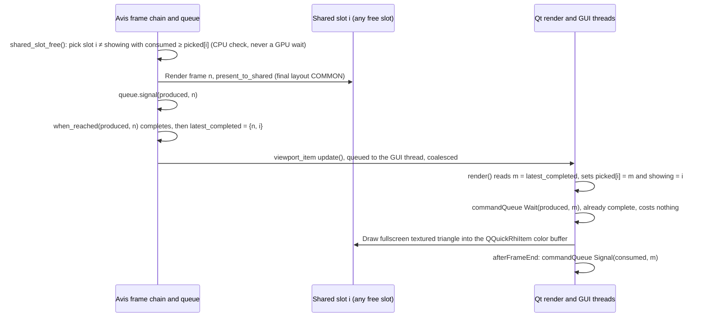

# 12 — Visualizer Application

## Code placement

| Feature | Namespace | CMake target | Location |
|---|---|---|---|
| Visualizer application (controller, simulation, UI models) | `avis::visualizer` | `AVIS_VISUALIZER` | `apps/visualizer/` |
| Scene representation (semantics → meshes + materials, §9) | `avis::visualizer::representation` | `AVIS_VISUALIZER` | `apps/visualizer/representation/` |
| Scene renderer (scene-agnostic, [11](11-renderer.md)) | `avis::visualizer::rendering` | `AVIS_VISUALIZER` | `apps/visualizer/rendering/` |
| Scene renderer shaders (HLSL data) | — | `AVIS_VISUALIZER` (`avis_add_shaders`) | `data/shaders/visualizer/scene/`, `include/` → `<bin>/data/shaders/visualizer/` |
| Shader manifest parser (`manifest.yaml` → `graphics::shader_manifest`, §10) | `avis::visualizer::rendering` | `AVIS_VISUALIZER` | `apps/visualizer/rendering/shader_manifest_parser.{h,cpp}` |
| QML UI | QML module `Avis.Visualizer` | `AVIS_VISUALIZER` (`qt_add_qml_module`) | `apps/visualizer/qml/` |
| Qt-side blit shaders | — (GLSL → `.qsb`) | `AVIS_VISUALIZER` (`qt_add_shaders`) | `data/shaders/visualizer/qt/` |

## 1. Purpose and scope
The Visualizer is the application a user works in to **open, edit and save a simulation run, connect to a Driver, control the simulation and view the results** ([01 §2.1](01-system-architecture.md#21-visualizer-purpose-and-tasks)):
- open, edit and save scenarios: select the data source and input sensors from the Driver's catalogue, the plug-ins and their parameters (editing only while stopped)
- discover Drivers with Zenoh scouting and connect to one
- own the virtual clock: start, pause, single-step, stop and set the speed of the simulation
- keep the active scene, which starts empty and is filled by the Driver's scene stream ([02 §5.8](02-communication.md#58-scene-stream))
- render the scene in real time (Avis renderer, [11](11-renderer.md)) in a Qt Quick UI
- inspect the scene: a tree view of all entities, an entity inspector with synchronised selection, and a free-fly and a follow camera
- debug rendering: resource blit selection, GPU timings

It is **agnostic to the vehicle model**. It doesn't read datasets, interpret sensor data or know where a vehicle can drive: it shows what the Driver sends.

UI technology: **Qt 6.11.1, Qt Quick / QML**. The 3D viewport uses **`QQuickRhiItem`**. Qt and Avis use **separate D3D12 devices**, sharing frames through **shared handles and fences** (idea.md).

## 2. Source layout
```
apps/visualizer/
  main.cpp                         # arguments, configuration, avis::runtime, QGuiApplication, D3D12 backend selection
  visualizer_driver.{h,cpp}        # application controller: owns simulation thread, frame chain, network session
  simulation/
    simulation_thread.{h,cpp}      # tick loop (03), apply_result, snapshot publish
    driver_discovery.{h,cpp}       # scouting + describe (02 §2)
    lockstep_coordinator.{h,cpp}   # connect, load, step, unload (02)
    scene_stream.{h,cpp}           # stage scene stream messages per step, commit, apply (02 §6.3, 08 §3.1)
    scenario_model.{h,cpp}         # in-memory scenario + YAML load/save + validation (04)
  representation/                  # streamed content → meshes + materials (§9); runs on the simulation thread
    representation_system.{h,cpp}
    shape_representation.{h,cpp}   # box, vehicle, axes, frustum display shapes
    geometry_representation.{h,cpp}  # belief geometry chunks
    lidar_representation.{h,cpp}   # lidar sweeps → point meshes
    helper_geometry.{h,cpp}        # grid, axes gizmo
  rendering/                       # scene-agnostic renderer (11)
    frame_loop.{h,cpp}             # sender-based frame chain (17 §4), RHI, render graph
    screenshot_capture.{h,cpp}     # capture pass, custom-resolution view, PNG encode (11 §12.1)
    scene_renderer.{h,cpp}         # pass setup
    draw_lists.{h,cpp}             # culling, (key, value) items, 64-bit sort keys, sorting, run building (11 §4)
    pipeline_variant_registry.{h,cpp}
    shader_manifest_parser.{h,cpp}   # manifest.yaml → graphics::shader_manifest (§10, 12a)
    shared_frame_ring.{h,cpp}      # interop ring (§3)
  ui/
    viewport_item.{h,cpp}          # QQuickRhiItem subclass (replaces viewport.{h,cpp})
    viewport_renderer.{h,cpp}      # QQuickRhiItemRenderer: imports shared textures, blits
    camera_controller.{h,cpp}
    scene_tree_model.{h,cpp}       # QAbstractItemModel
    inspector_model.{h,cpp}        # reflected component values + Driver properties
    render_debug_model.{h,cpp}     # render-graph resources/passes, selection
    log_model.{h,cpp}              # local + driver logs
    commands/                      # QUndoCommand implementations
  qml/
    main.qml, Viewport.qml, SceneTree.qml, Inspector.qml, SimulationBar.qml,
    RenderDebugPanel.qml, LogPanel.qml, ScenarioSettings.qml, ConnectDriverDialog.qml, dialogs/
```

Shader sources aren't part of the application source tree. They're Visualizer **data**, kept in the repository's `data/` folder ([11 §13](11-renderer.md#13-shaders-location-and-build)):

```
data/shaders/visualizer/
  scene/                           # scene renderer HLSL (avis_add_shaders TARGET AVIS_VISUALIZER)
  include/                         # bindless.hlsli, brdf.hlsli, packing.hlsli, shared_types.hlsli, …
  qt/                              # fullscreen_triangle.vert, fullscreen_texture.frag (qt_add_shaders)
```

## 3. Viewport integration: QQuickRhiItem + shared handles

### 3.1 Why two devices
Qt Quick renders with its own QRhi D3D12 device on the Qt render thread. The Avis renderer keeps its own device, queues (including async compute and copy) and frame pacing. Separate devices keep them decoupled, so a slow scene frame never stalls the UI. Frames cross over as **shared textures** synchronised by **shared fences**.

### 3.2 Setup sequence
1. `main.cpp` calls `QQuickWindow::setGraphicsApi(QSGRendererInterface::Direct3D12)` **before** creating the window.
2. When `QQuickWindow::sceneGraphInitialized` fires, read Qt's adapter from `QRhi::nativeHandles()` → `QRhiD3D12NativeHandles { dev, minimumFeatureLevel, adapterLuidLow, adapterLuidHigh, commandQueue }`.
3. Create the Avis `rhi::render_hardware_interface` with `adapter = {adapterLuidLow, adapterLuidHigh}` ([09 §4.5](09-rhi.md#45-adapter-selection)). Both devices are now on the same GPU, which shared NT handles require.
4. The renderer creates the **shared frame ring** (§3.3) at the viewport's pixel size and exports the handles.
5. The `viewport_renderer` (Qt render thread) opens the handles on Qt's device: `ID3D12Device::OpenSharedHandle` for the textures and the fences. It wraps each texture with `QRhiTexture::createFrom({ quint64(resource), D3D12_RESOURCE_STATE_COMMON })`.

> Steps 2 and 5 are the **only** places native D3D12 types appear in the Visualizer. They're isolated in `ui/viewport_renderer.cpp` and use Qt's public native-handle API, not Avis RHI internals. The Avis side sees only the opaque `rhi::shared_handle` ([09 §13](09-rhi.md#13-cross-device-sharing-rhisharedh)).

### 3.3 Shared frame ring
- **3 slots**, each a shared `RGBA8_UNORM` texture (sRGB-encoded values) at viewport resolution.
- Two shared fences, both created by Avis and opened by Qt:
  - `produced` (signalled by the Avis graphics queue): value `n` means frame `n` has been written into its slot.
  - `consumed` (signalled by Qt's command queue): value `m` means Qt has finished sampling frame `m`.
- Shared CPU state (atomics, written by one side each):

| State | Written by | Meaning |
|---|---|---|
| `latest_completed` = `{frame n, slot i}` | Avis frame chain | The newest frame whose `produced` signal has **completed** on the GPU |
| `picked[i]` | Qt render thread | The last frame number Qt picked from slot `i` (0 = never) |
| `showing` | Qt render thread | The slot Qt's most recent `render()` sampled |

**Protocol:**



1. **Avis never waits on Qt on the GPU.** Slot reuse is gated on the CPU by `shared_slot_free()` (§3.4). A slot `i` is free when it isn't `showing`, and either `picked[i] == 0` or `consumed ≥ picked[i]`. If no slot is free yet, the sender completes later through `rhi::sharing::when_reached(consumed, picked[i])`, completed by the RHI's completion driver (§3.4) ([09 §13](09-rhi.md#13-cross-device-sharing-rhisharedh)). No thread and no queue blocks.
2. **Avis picks any free slot**, not `n % 3`, preferring the one released longest ago.
3. **Qt only sees completed frames.** `latest_completed` is set only once the frame chain has observed `produced ≥ n` complete. Qt's GPU `Wait(produced, m)` is kept for correctness but is always already satisfied, so a slow Avis frame never delays Qt's UI frame. The cost is about one frame of extra viewport latency.
4. **`consumed` is signalled after Qt's submission.** `QQuickRhiItemRenderer::render()` runs before Qt executes its command list in `QRhi::endFrame`, so a `Signal` there would land too early. `viewport_renderer` connects to `QQuickWindow::afterFrameEnd` with `Qt::DirectConnection` (it's emitted on the render thread after `endFrame`) and issues `commandQueue->Signal(consumed, m)` there, through `QRhiD3D12NativeHandles::commandQueue`.
   - **Fallback**, if a Qt render loop turns out not to emit `afterFrameEnd` after submission: in the *next* `render()`, signal `consumed` for the *previous* pick before recording. That's one frame later, and the last pick stays pinned while Qt is idle, which is harmless with three slots (rule 6).
5. **Avis wakes Qt.** `QQuickRhiItem` re-renders only after `update()`. When `latest_completed` advances, the frame chain posts `viewport_item->update()` to the GUI thread with `QMetaObject::invokeMethod(..., Qt::QueuedConnection)`. An `update_pending` atomic, cleared by `render()`, keeps at most one call in flight.
6. **No deadlock, and no stall when Qt stops rendering.** Qt holds at most two slots: the one it's `showing` and one still being sampled by its previous in-flight frame. So at least one slot is always free for Avis. When Qt stops rendering (window minimised or occluded, or nothing to update), its last pick simply stays pinned, and Avis alternates between the other two slots at its reduced rate (§3.4).
7. **The Qt side shows the newest completed frame.** If none is new, it re-shows the last one (no stall).
8. **Resize** without `wait_idle`: the item reports its new pixel size to the renderer (debounced 100 ms). The frame chain creates a new ring at the start of its next frame and publishes it with a generation number. The Qt side re-imports when the generation changes. The old ring is destroyed once `consumed` has reached every `picked[i]` of that ring, using the same CPU check and `when_reached` sender.

> To verify early with a quick test against Qt 6.11: that `afterFrameEnd` is emitted after `QRhi::endFrame` has submitted, for the threaded render loop on Windows. If not, use the fallback in rule 4.

### 3.4 Frame pacing
The Avis renderer has **no dedicated render thread**. Frames are produced by a sender chain ([17 §4](17-graphics-frames-and-transfers.md#4-graphicsframe_schedulerh)) owned by `frame_loop`, inside an `async_scope`:

```text
when_all(begin_frame(), next_frame_tick(), shared_slot_free())
  → continues_on(parallel scheduler) → prepare (gpu_profiler::prepare_frame, extract snapshot, interpolate, residency uploads + upload_queue::flush, build + compile graph)
  → let_value: render_graph::execute (bulk recording, submit)
  → present_to_shared + signal produced fence → end_frame
  → re-arm the next frame (unless stop was requested)

in parallel, per frame: when_reached(produced, n) → publish latest_completed → post update() to the item
```

- `next_frame_tick()` is an `asio::steady_timer` sender on the IO context. It paces frames at the display refresh rate reported by the window's screen, or at `render.maximum_fps`, and at 5 fps when the window is minimised or occluded.
- `shared_slot_free()` is the **CPU-side gate** of the interop ring (§3.3, rule 1). It completes with a free slot index: inline when one is free (the normal case), otherwise through `when_reached(consumed, …)`, which completes from the RHI's completion driver (below). It never issues a GPU wait, so Qt not rendering can't stall the Avis queues.
- Publishing a frame to Qt is a separate small sender per frame (`when_reached(produced, n)`), spawned into the same async scope. The next frame doesn't wait for it.
- No stage blocks a thread: GPU completions resume the chain from the completion driver, timers from IO completions, and CPU work runs on parallel workers.
- **Driving GPU completions.** The RHI owns no thread ([09 §5.2](09-rhi.md#52-driving-completions)). A `QWinEventNotifier` on `rhi::completion_driver::completion_event()`, in Qt's GUI event loop, calls `poll_completions()` whenever the event fires (D-93). That completes every GPU wait of the Visualizer: `begin_frame` (which doesn't drive the RHI itself, D-94), `shared_slot_free()`, the `when_reached` publishes, uploads and readbacks, and it frees destroyed objects. It covers waits on Qt's `consumed` fence while Avis renders nothing. Completions run on the GUI thread, so every continuation that does real work moves to the parallel scheduler with `continues_on` (each stage above already starts with one).
- **Who holds the RHI.** The renderer creates the `rhi::render_hardware_interface` and is its only holder (D-96). It builds the views each component takes ([09 §4.3](09-rhi.md#43-subsystem-views)): `completion_driver` for the notifier; `synchronization` and `transient_objects` for the frame scheduler; `transient_objects` and the queues for the GPU profiler; `resources`, `command_lists` and the queues for the render graph, which also gets the frame scheduler and the profiler; `memory` and `resources` for its transient pool; and the upload queue, readback queue and pipeline cache get theirs.
- The chain keeps running while the simulation is paused, so camera motion stays fluid.
- Errors (device lost) arrive on `set_error`, and `frame_loop` turns them into the fatal-error path (§7). The exception is `transient_memory_exhausted` from `render_graph::execute`: the frame's upload memory or descriptors ran out, so `frame_loop` ends the frame with no submissions, skips it and re-arms the next one ([17 §4](17-graphics-frames-and-transfers.md#4-graphicsframe_schedulerh), D-98). The log warning names the budget to raise. Stopping requests stop on the scope's stop source; the chain finishes its current frame and completes with `set_stopped`. A frame stopped before anything was submitted, including one whose token is still inside the opening `when_all`, ends with no submissions: the dropped token ends itself ([17 §4](17-graphics-frames-and-transfers.md#4-graphicsframe_schedulerh), D-102). The controller then waits for the scope to drain at shutdown. After that the renderer destroys the notifier and the graphics-layer objects (render graph, GPU profiler, frame scheduler, upload and readback queues, pipeline cache), then the RHI, whose destructor waits for the GPU (`render_hardware_interface::wait_idle`, D-93).

## 4. Threads (Visualizer view)
See [01 §4.1](01-system-architecture.md#41-visualizer). Communication paths:

| From → To | Mechanism |
|---|---|
| GUI → simulation | `command_queue<simulation_command>` (MPSC) + condition-variable wake. Carries both simulation and presentation commands (§4.1). |
| Zenoh → simulation | Lock-free queues of replies and scene stream messages, drained by `scene_stream` and the coordinator |
| Simulation → GUI | Queued Qt signals (`QMetaObject::invokeMethod(..., Qt::QueuedConnection)`) carrying value types |
| Simulation → renderer | `snapshot_buffer` ([08 §6](08-scene-management.md#6-simulation--render-synchronisation-snapshots)) |
| GUI → renderer | Latest-value atomics: camera state, viewport size, debug selection, render settings, screenshot requests |
| Renderer → GUI | Render-graph debug info and GPU timings, about 4 Hz via queued signal |
| Renderer → Qt render thread | Shared frame ring |

### 4.1 Presentation commands
UI commands sent to the simulation thread are of two kinds:
- **Simulation commands** drive the clock: start, pause, resume, single step, stop, set speed ([03 §3](03-simulation-core.md#3-clock-state-machine)).
- **Presentation commands** change only what's shown. The simulation thread applies them in any clock state, re-runs the representation where needed, and republishes the snapshot without a step (coalesced to at most one republish per 16 ms, [03 §4.4](03-simulation-core.md#44-presentation-only-republish)).

| Presentation command | Effect before the republish |
|---|---|
| Select / clear selection | Moves the `selected` instance flag (tree, inspector and viewport picking all send this) |
| Entity visibility, category visibility (*View* menu) | Updates `visibility` and therefore the `visible` instance flag |
| Helper toggles (grid, axes gizmo) | Adds or removes the helper instances |
| Representation settings (lidar colour mode, point size, box edge width) | Re-runs the affected representations, which produces new mesh or material versions |
| `visualization` edits while `stopped` (sun, sky) | Updates the light and `environment` |
| *Reset* | Destroys all Driver entities, so the republished snapshot has only the helpers |

Camera motion, viewport size, debug-blit selection and render settings are **not** presentation commands: they go straight to the renderer as latest-value state (table above) and need no snapshot.

## 5. Camera
The camera is a **presentation concept**: it isn't part of the simulation state and doesn't affect determinism. Two modes:

| Mode | Controls |
|---|---|
| **Free fly** | Roams through the 3D world. RMB held + WASD/QE to move, mouse to look, Shift ×4 speed, wheel to adjust speed. |
| **Follow** (default while running) | Chase camera on a vehicle: the `primary` vehicle (the vehicle of the vehicle model) by default, or the selected vehicle entity. Offset and lag are configurable (`visualization.camera.follow`), and LMB drag orbits around the vehicle; the orbit offset is kept while following. |

- Following uses the interpolated vehicle pose at render rate, so the chase stays smooth between ticks. Lag is a critically damped spring on the camera position.
- Switching from follow to free fly keeps the current viewpoint. When the followed entity is deleted, the camera switches to free fly at its last viewpoint.
- **Picking:** clicking the viewport makes the renderer write a 64-bit `picking_id` target (`R32G32_UINT`) in the G-buffer, forward-transparent and overlay passes on that frame, and read back a small window around the cursor ([11 §5.1](11-renderer.md#51-picking)). Opaque geometry, translucent boxes and overlay lines are all pickable. The returned `object_id` maps back to the entity (through `identity`), which is then selected in the tree and inspector.

## 6. Panels and controls

```
┌───────────────────────────────────────────────────────────────────────────────┐
│ File  Edit  Simulation  View  Render  Help                                    │
├──────────────────┬────────────────────────────────────────┬───────────────────┤
│ Scene Tree       │                                        │ Inspector         │
│  ▾ ego_vehicle   │                                        │  identity         │
│     image_00     │              3D viewport               │  transform        │
│     velodyne     │           (QQuickRhiItem)              │  vehicle          │
│  ▸ shadow_vehicle│                                        │  perception       │
│  ▸ perception(37)│                                        │   classification  │
│  ▸ belief (5)    │                                        │   confidence      │
├──────────────────┴────────────────────────────────────────┴───────────────────┤
│ ▶ ❚❚ ⏭ ■  speed [1.0x ▾]  t = 12.340 s  step 617/6000  effective 0.93x  Driver: ● ok │
├───────────────────────────────────────────────────────────────────────────────┤
│ [Log] [Render Debug] [Driver]                                                 │
└───────────────────────────────────────────────────────────────────────────────┘
```

| Panel | Content |
|---|---|
| **Menus** | File: New, Open, Save, Save As, Recent, Screenshot ▸ (viewport, custom resolution…, window with UI), Exit. Edit: Undo, Redo, Scenario Settings. Simulation: Connect Driver, Start, Pause, Step, Stop, Reset, Speed ▸. View: panels, camera mode (free fly, follow), helpers (grid, axes), visibility per entity category. Render: debug view, AO/TAA/shadows toggles, tonemapper, exposure, statistics overlay. Help: About, Open logs folder. |
| **Scene tree** | `scene_tree_model` (QAbstractItemModel) over all entities, with hierarchy, name, category icon and a visibility toggle. Has a search filter, and large groups are lazily populated. Entities appear and disappear as the Driver creates and deletes them. |
| **Inspector** | Read-only view of the selected entity: reflected component values ([08 §3](08-scene-management.md#3-components)) and the Driver's properties grouped by their dotted keys, with units (for example the classification the vehicle model gave the entity, or its estimated dimensions). Values refresh at 20 Hz while running. |
| **Simulation bar** | Start/Pause/Step/Stop, speed (0.1×, 0.25×, 0.5×, 1×, 2×, 4×, 10×, max), simulation time, step index / `step_count`, effective speed (`s_effective`, [03 §5.1](03-simulation-core.md#51-effective-speed-s_effective)), driver status light (connected, *busy* with the phase and duration from `driver_status` after `long_step_notice` ([02 §6.2](02-communication.md#62-rules)), unresponsive, faulted, disconnected, plus *waiting (debug mode)* and *suspended?* for a Driver in debug mode, [02 §7.1](02-communication.md#71-with-a-driver-in-debug-mode)) with a tooltip |
| **Scenario settings** | A form over the scenario `simulation`, `dataset`, `driver` and `visualization` sections. The data source, frame range and sensors are picked from the connected Driver's catalogue ([02 §5.2](02-communication.md#52-describe)); without a connected Driver the values can still be edited as text but aren't checked. The **frame range** fields show the approximate time next to each frame (from the catalogue's `duration_ns` and frame count) and also accept input in seconds, which is converted to the nearest frame; the file always stores frames ([04 §2.3](04-scenario-and-dataset.md#23-validation)). The exact end time comes back with `step_count` after `load`. **Plug-in parameters** get a form generated from the module's `parameters_schema` (§6.1). Opening the editor sends `rescan`, so the module list and schemas are current. |
| **Render debug** | The render graph's passes (queue colour, GPU ms, culled) and resources (qualified name, format, size, aliased). Selecting a resource adds the debug blit with mode, channel, range, mip/slice and fullscreen/PiP options ([11 §11](11-renderer.md#11-debug-blit-pass)). Also: memory statistics (aliased vs non-aliased). |
| **Log** | Local and driver logs with level filter, logger filter and text search. Faults are highlighted. |
| **Driver** | Connection details, debug-mode indicator, the plug-in catalogue (loadable modules; rejected and pinned plug-ins with their reasons; *"plug-ins locked: run loaded"* while a run is loaded), a **Rescan plug-ins** button ([02 §5.6a](02-communication.md#56a-rescan)), data sources (from `describe`), per-step timing breakdown chart (replay/perception/model/physics/publishing), scene stream rate |

**Selection is shared** by the scene tree, the inspector and viewport picking: one selected entity id lives in a `selection_model`, and all three follow it. Selecting in the tree shows that entity in the inspector, and picking in the viewport selects it in the tree (expanding its parents). When the Driver deletes the selected entity, the selection clears.

### 6.1 Editing workflow
- Editing is available only in `stopped`. Controls are disabled otherwise, and a banner explains why.
- Every edit is a `QUndoCommand` on the scenario model. The dirty flag is shown in the title.
- *Start* validates the scenario ([04 §2.3](04-scenario-and-dataset.md#23-validation)). Errors open the problems list, and clicking an entry jumps to the field. The Driver's `load_scenario` diagnostics (parameter-schema errors and warnings with their paths) land in the same list.
- **Plug-in parameter forms:** when the selected module publishes a `parameters_schema` ([05 §5.8](05-driver.md#58-parameter-schema)), its parameters are edited in a generated form. Each field shows its type-appropriate control, default, range, unit and description, and is checked as you type. Values equal to the default are still written to the scenario, so the file is self-describing. A module without a schema, or YAML the schema doesn't cover, falls back to the raw YAML editor.
- **Rebuilding plug-ins:** stopping the run unloads the plug-ins, so their DLLs can be rebuilt; *Start* rescans and loads the new build ([05 §5.4](05-driver.md#54-host-side)).

### 6.2 Driver connection
- *Connect Driver* runs Zenoh **scouting** (the Visualizer initiates it, [02 §2](02-communication.md#2-zenoh-topology-and-discovery)), connects to the peers that reply and sends `describe` to each. The dialog lists every Avis Driver found with its id, host, version, plug-ins and whether it's already bound to another session. *Refresh* scouts again.
- Choosing a Driver runs `connect`. The status shows the Driver id, host name, version and plug-ins. *Start* requires a connected Driver with no run loaded.
- At startup the Visualizer scouts once in the background and reconnects the last used Driver if it's available and unbound.

### 6.3 Screenshots
Available in every clock state, from *File → Screenshot* and a toolbar button over the viewport:

| Command | Shortcut | What it captures |
|---|---|---|
| *Viewport* | F12 | The 3D viewport at its current pixel size, rendered by the Avis renderer ([11 §12.1](11-renderer.md#121-screenshot-capture)). No Qt UI. The debug blit is included only if *Include debug view* is ticked. |
| *Custom resolution…* | Shift+F12 | A dialog with width and height (presets 1920×1080, 2560×1440, 3840×2160, 7680×4320, or the last used value) and *Include debug view*. Rendered offscreen with 8-sample accumulation ([11 §12.1](11-renderer.md#121-screenshot-capture)). |
| *Window with UI* | Ctrl+F12 | The whole window, panels included, through `QQuickWindow::grabWindow()` on the GUI thread. The viewport shows the frame Qt is currently displaying. The `QImage` is saved as PNG on a parallel worker. |

- When the file is written, a toast shows the file name with *Open* and *Show in folder*. Errors (VRAM limit, disk) appear as a toast and in the log.
- Configuration (`visualizer.yaml` → `screenshots`):
  ```yaml
  screenshots:
    folder: ""                       # empty = %USERPROFILE%/Pictures/Avis
    custom: { width: 3840, height: 2160 }   # last used custom resolution
    include_debug_view: false
  ```
- **Video capture** of the viewport is out of scope for this iteration ([00 §3](00-overview.md#3-scope-of-iteration-1)).

## 7. Error presentation
- Startup capability failure ([09 §4.4](09-rhi.md#44-capability-gate)): a modal dialog naming the missing feature (for example *"Shader Model 6.6 is required; your GPU/driver reports 6.5"*), then exit.
- Startup shader failure (§10): a missing or malformed `manifest.yaml`, a missing blob, a hash mismatch or a missing shader. A modal dialog with the message (file, line and key path for manifest errors) and the log path, then exit ([12a §5](12a-visualizer-shader-manifest.md#5-shader-loading-at-visualizer-startup)).
- Lockstep failures ([02 §7](02-communication.md#7-failure-handling)), meaning silence for `communication_timeout` or a fault, not slowness: the simulation pauses, a non-modal banner over the viewport offers *Retry step*, *Reload plug-ins* or *Stop*, and the detail goes to the log. *Reload plug-ins* re-sends `load`, which rescans first. A pinned plug-in (abandoned after an SEH fault) reloads from the same build, and the banner says a Driver restart is needed to pick up a rebuild. With a Driver in debug mode, timeouts and liveliness loss don't pause ([02 §7.1](02-communication.md#71-with-a-driver-in-debug-mode)).
- Unrecoverable render error (device lost): a modal dialog with the log path, then a controlled exit. The scenario is autosaved first if dirty.

## 8. Settings persistence
`visualizer.yaml` ([01 §7](01-system-architecture.md#7-configuration)) holds the render settings, Zenoh configuration (scouting timeout), the last used Driver and recent files. Window geometry and panel layout are kept with `QSettings` (registry), since they're per-user UI state.

## 9. Scene representation
The **scene representation** (`avis::visualizer::representation`, `apps/visualizer/representation/`) is the layer between the Driver-streamed scene and the scene-agnostic renderer ([11 §2.1](11-renderer.md#21-scene-agnostic-boundary)). It runs on the simulation thread at the end of `apply_result` ([03 §4.3](03-simulation-core.md#43-apply_resultk)). For each streamed component it ensures the entity, or helper child entities, carry `mesh`, `material` and `render_options` components. The snapshot then picks those up like any other mesh. It never interprets what an entity *means*: it only looks at display shapes, geometry and sweeps.

| Streamed content | Representation | Draw layer |
|---|---|---|
| `display_shape` `box` | Instance of the shared unit-cube mesh scaled to `extent`, with a translucent material in the entity's colour and opacity (`alpha_mode = blend`), **plus** a child instance of the shared unit-cube **edge line mesh** with an unlit material in the same colour | faces: `world`; edges: `overlay` |
| `display_shape` `vehicle` | The proxy glTF mesh (`data/assets/vehicle_proxy.glb`) scaled to `extent`. Opacity below 1 (for example the shadow vehicle) uses a translucent "ghost" material. | `world` |
| `display_shape` `axes` | Small shared axes line mesh | `overlay` |
| `display_shape` `frustum` | Line mesh built from the horizontal and vertical field of view and range | `overlay` |
| `belief_geometry` chunk | One mesh per chunk, created or rewritten through `asset_cache::create_mesh` / `update_mesh` with the chunk's topology, vertex colours and normals; material from the chunk `style` (colour, opacity, lit or unlit, line width, point size). `points` chunks are progressive point meshes. | `world` or `overlay` from the style |
| `lidar_points` sweep | One progressive point mesh per kept sweep, placed at the sweep's sensor pose; colour by intensity, height, ring or uniform (`visualization.lidar.color_mode`); lit point material with `point_size` | `world` |
| World grid and axes gizmo | Visualizer helpers: static line meshes | `overlay` (grid), `overlay_on_top` (axes gizmo) |
| Selection | The `selected` instance flag on the selected entity's instances | — |

- The representation owns a small library of shared meshes (unit cube, unit-cube edges, axes, vehicle proxy) and materials, created once through the asset cache.
- All visual choices that the Driver doesn't specify (edge widths, lidar colouring, which helpers are visible from the *View* menu) live here, so changing how something looks never touches the renderer.
- Configuration (`visualizer.yaml` → `representation`):
  ```yaml
  representation:
    boxes: { edge_width: 2.0 }
    lidar: { maximum_points_per_sweep: 200000 }
    geometry: { budget_mib: 512 }       # CPU-side budget for dynamic meshes (belief geometry, lidar sweeps), §9.1
  ```

### 9.1 Geometry budget and eviction
The representation creates all dynamic geometry, so it is the place that knows what matters and enforces the budget. The renderer stays agnostic ([11 §3.6](11-renderer.md#36-gpu-residency)): it only uploads what it receives, and sizes its GPU arena at about 1.5 × this budget, so superseded versions fit while they retire.

- The budget counts the vertex and index bytes of the **current** version of every dynamic mesh the representation owns. The shared static meshes (unit cube, edges, axes, vehicle proxy) are excluded.
- Before a `create_mesh` / `update_mesh` that would exceed `representation.geometry.budget_mib`, the representation frees space in this order:
  1. **Drop the oldest lidar sweeps first.** Each lidar sensor's kept sweeps are lowered below their `retention` count, oldest first, down to a minimum of the newest sweep per sensor. The `lidar_points` component keeps its configured retention, and the reduction is undone as soon as there's room again.
  2. **Shrink progressive point meshes.** Progressive meshes (lidar sweeps, belief point chunks) are stored in random order, so their vertex lists are truncated to a prefix, largest mesh first, down to 25% of their points. That's still a uniform subsample, so the picture thins out evenly instead of losing regions.
  3. **Skip new geometry.** If that's still not enough, the new mesh or chunk isn't created (an update keeps the previous version), and a rate-limited warning goes to the log and the statistics overlay.
- The current reduction level (sweeps dropped, prefix fraction, chunks skipped) is shown in the statistics overlay, so a thinned-out picture is never mistaken for missing Driver data.
- These choices are presentation only: they never change what the Driver sends, so determinism is unaffected.

## 10. Shader loading

The Visualizer owns where its shaders come from. The graphics layer loads a `graphics::shader_library` from a `graphics::shader_manifest` and creates pipelines from it through its pipeline cache [18](18-graphics-shaders-and-pipelines.md); the RHI only sees bytecode. Neither knows the build's `manifest.yaml`. The Visualizer reads and parses that file itself, with its own parser ([12a](12a-visualizer-shader-manifest.md)):

1. Resolve the shader directory: `render.shader_directory`, or `<executable directory>/data/shaders/visualizer` ([11 §13](11-renderer.md#13-shaders-location-and-build)).
2. Read `manifest.yaml` with `io::read_file`.
3. On a parallel worker, `rendering::parse_shader_manifest(text, path)` → `graphics::shader_manifest`. Errors carry `file:line:column` and a key path (`shaders[3].stage`).
4. `graphics::load_shader_library(manifest, directory)`: reads the blobs, checks their xxh3 hashes, creates the `graphics::shader_library`.
5. Create the renderer's pipelines with `graphics::pipeline_cache` from the library ([18 §11](18-graphics-shaders-and-pipelines.md#11-graphicspipeline_cacheh)).

This runs during renderer startup, after the RHI is created (§3.2 step 3) and before the first frame. Any failure is a startup error (§7). The parser is a pure function, tested in `AVIS_TESTS` against hand-written cases and against the manifest the build actually wrote (12a §6).
