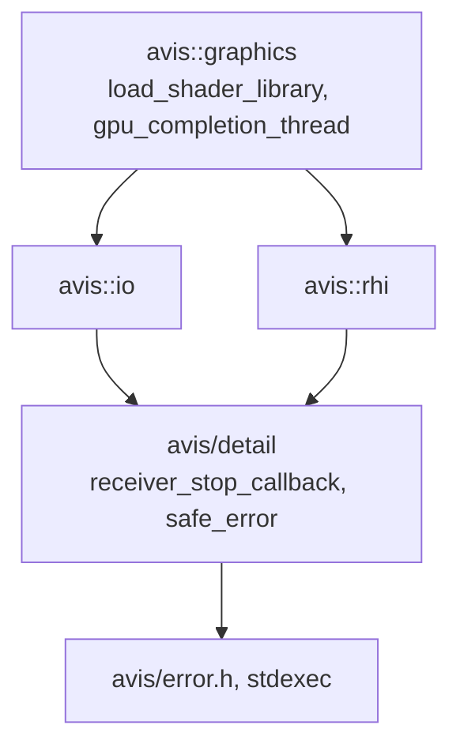

# 13 — Build, Tooling & Quality

## 1. Toolchain
| Item | Choice |
|---|---|
| OS | Windows 11 24H2+ x64 |
| Compiler | MSVC (Visual Studio 2022 17.12+ or newer), `/std:c++latest` until C++23 is fully exposed as `/std:c++23` |
| Build | CMake ≥ 3.30, Ninja Multi-Config generator (VS generator supported) |
| Windows SDK | ≥ 10.0.26100 |
| Shader compiler | DXC from `tools/dxc` (pinned) |
| Qt | 6.11.1 (MSVC 2022 x64 kit) |
| Python | ≥ 3.14 with `uv` (also needed by the shader build, §3) |

Compiler flags: `/W4 /permissive- /utf-8 /Zc:__cplusplus /Zc:preprocessor /fp:precise /EHsc`. Warnings are errors in CI (`/WX`) for Avis code, not for `external/`. Release builds add `/O2 /GL` with `/LTCG`, and debug info (`/Zi`) is always generated.

## 2. CMake structure
```
CMakeLists.txt                  # project, options, Qt find, add_subdirectory(external, lib, apps, tests)
cmake/
  AvisShaders.cmake             # avis_add_shaders()
  WinDeployQT.cmake             # existing
  AvisWarnings.cmake
external/CMakeLists.txt         # vendored dependencies (EXCLUDE_FROM_ALL)
lib/avis/CMakeLists.txt         # AVIS_LIB: the single Avis library target (all library features)
apps/visualizer/CMakeLists.txt  # AVIS_VISUALIZER (Qt, AVIS_LIB)
apps/driver/CMakeLists.txt      # AVIS_DRIVER (AVIS_LIB, Jolt)
include/avis/driver_sdk/        # AVIS_DRIVER_SDK: header-only INTERFACE target for plug-ins
apps/driver/plugins/*/          # example plug-ins (SHARED libraries)
apps/stepper/CMakeLists.txt     # AVIS_STEPPER (headless lockstep CLI for tests, AVIS_LIB)
tests/CMakeLists.txt            # AVIS_TESTS (Catch2)
```

### 2.1 Library targets
All Avis library features build into **one CMake target, `AVIS_LIB`** (a static library defined in `lib/avis/CMakeLists.txt`). There are no per-feature sub-targets or object libraries. Features are separated by **namespace and directory**, not by CMake target.

`AVIS_LIB` links: stdexec, asio, spdlog, zenoh-cpp/zenoh-c, EnTT, Eigen, fastgltf, yaml-cpp, xxHash, D3D12MemoryAllocator, `d3d12.lib`, `dxgi.lib`, `dxguid.lib`. Public include directory: `include/`. Dependencies no public header includes are `PRIVATE`: D3D12MemoryAllocator (and through it `d3d12.lib`, `dxgi.lib`, `dxguid.lib`), fastgltf, yaml-cpp. A static library's private dependencies still reach the executables as link-only ones. `AVIS_TESTS` links them directly where white-box tests include private headers (`lib/avis/rhi/d3d12/` needs D3D12MemoryAllocator).

spdlog is linked `PUBLIC`, because `include/avis/log.h` exposes `spdlog::logger`. yaml-cpp and fastgltf are linked `PRIVATE`: no public Avis header includes them, so applications and tests don't inherit their include paths. An application that parses its own YAML (`visualizer.yaml`, `driver.yaml`, [01 §7](01-system-architecture.md#7-configuration)) links `yaml-cpp::yaml-cpp` itself.

| Feature | Namespace | Location | Document |
|---|---|---|---|
| Error type, logging, enum flags, virtual clock, FSM | `avis`, `avis::log` | `include/avis/*.h` | [01 §6](01-system-architecture.md#6-error-handling-policy), [03](03-simulation-core.md) |
| Library runtime | `avis` | `include/avis/runtime.h` | [14](14-library-runtime.md) |
| Thread pool, parallel scheduler backend (independent) | `avis::threading` | `include/avis/threading/` | [06](06-thread-pool.md), [15](15-parallel-scheduler.md) |
| Async IO | `avis::io` | `include/avis/io/` | [07](07-io-layer.md) |
| Networking (Zenoh wrapper, framing, protocol messages) | `avis::network`, `avis::network::protocol` | `include/avis/network/` | [02](02-communication.md) |
| Simulation time, clock state, scenario model | `avis::simulation` | `include/avis/simulation/` | [03](03-simulation-core.md), [04](04-scenario-and-dataset.md) |
| Sequence-pack readers (used by the Driver only) | `avis::dataset` | `include/avis/dataset/` | [04 §4](04-scenario-and-dataset.md#4-sequence-pack-format) |
| Scene, components, scene graph, assets, snapshots | `avis::scene`, `avis::scene::components` | `include/avis/scene/` | [08](08-scene-management.md) |
| RHI (public API; D3D12 implementation private) | `avis::rhi` (`avis::rhi::d3d12` internal) | `include/avis/rhi/`, `lib/avis/rhi/d3d12/` | [09](09-rhi.md) |
| Render graph | `avis::graphics` | `include/avis/graphics/` | [10](10-render-graph.md) |

Sources mirror the headers under `lib/avis/<feature>/`.

### 2.1.1 Other targets
| Target | Kind | Namespace | Links | Document |
|---|---|---|---|---|
| `AVIS_VISUALIZER` | executable | `avis::visualizer` | `AVIS_LIB`, Qt | [12](12-visualizer.md), [11](11-renderer.md) |
| `AVIS_DRIVER` | executable | `avis::driver` | `AVIS_LIB`, Jolt, `AVIS_DRIVER_SDK` | [05](05-driver.md) |
| `AVIS_STEPPER` | executable (headless test CLI) | `avis::stepper` | `AVIS_LIB` | §6 |
| `AVIS_DRIVER_SDK` | header-only `INTERFACE` | C ABI (`avis_` prefix), `avis::sdk` (C++ wrapper) | — | [05 §5](05-driver.md#5-plug-in-sdk) |
| `AVIS_PLUGIN_EXAMPLE_*` | `SHARED` | plug-in specific | `AVIS_DRIVER_SDK` only | [05 §5.7](05-driver.md#57-example-plug-ins) |
| `AVIS_TESTS` | executable | test code | `AVIS_LIB`, Catch2 | §6 |

**Why the SDK isn't part of `AVIS_LIB`:** plug-ins only need the C header and must **not** link the Avis library (D-06: any compiler, any language). `AVIS_DRIVER_SDK` contains no compiled code. It just exposes `include/avis/driver_sdk/` as an include path, and it's the one CMake target outside `AVIS_LIB` that has headers under `include/avis/`.

### 2.2 Options
Options declared in the root `CMakeLists.txt`. Each component has an *include* switch (are its targets generated at all) and a *build* switch (are they part of the default `all` build):

| Option | Default | Effect |
|---|---|---|
| `AVIS_INCLUDE_APPS` | ON | Generates the application targets (`add_subdirectory(apps)`): the subdirectories listed in `apps/CMakeLists.txt`. Today that's only `visualizer`; the Driver, stepper and example plug-ins are added there as they're built. |
| `AVIS_BUILD_APPS` | ON | Builds the application targets by default. If OFF, the targets are generated but built only on request. **Declared but not wired up yet:** nothing reads it. |
| `AVIS_INCLUDE_TESTS` | ON | Generates `AVIS_TESTS` (`add_subdirectory(tests)`) |
| `AVIS_BUILD_TESTS` | **OFF** | Builds the unit tests by default. **Declared but not wired up yet:** nothing reads it, so the tests build whenever `AVIS_INCLUDE_TESTS` is ON. |

Wiring the two *build* switches up means marking the targets `EXCLUDE_FROM_ALL` when the switch is OFF (for example `set_target_properties(AVIS_TESTS PROPERTIES EXCLUDE_FROM_ALL $<NOT:$<BOOL:${AVIS_BUILD_TESTS}>>)`, or passing `EXCLUDE_FROM_ALL` to `add_subdirectory`).

Qt 6.11 is found with `find_package(Qt6 … REQUIRED)` **before** these options are evaluated, so every configure needs Qt, even with `AVIS_INCLUDE_APPS=OFF`. Making Qt optional for library-and-test builds (moving `find_package(Qt6)` under `if(AVIS_INCLUDE_APPS)`) is needed for CI runners without Qt (§10).

Planned options, not in `CMakeLists.txt` yet:

| Option | Default | Effect |
|---|---|---|
| `AVIS_SHADER_DEBUG` | ON in Debug | `-Zi -Qembed_debug -Od` for DXC (§3) |
| `AVIS_ENABLE_ASAN` | OFF | `/fsanitize=address` on Avis targets |

There are no per-application switches: the Visualizer, Driver, stepper and example plug-ins are all covered by `AVIS_INCLUDE_APPS` / `AVIS_BUILD_APPS`.

## 3. Shader build pipeline
`avis_add_shaders(TARGET <target> SOURCES <files> OUTPUT_DIRECTORY <directory> [DEFINES …] [INCLUDE_DIRECTORIES …])`. Shaders are application data: the Visualizer calls it with `OUTPUT_DIRECTORY ${CMAKE_BINARY_DIR}/bin/data/shaders/visualizer` and `INCLUDE_DIRECTORIES data/shaders/visualizer/include` ([11 §13](11-renderer.md#13-shaders-location-and-build)). The Avis library contains no shaders.
- Each `.hlsl` file declares its entry points in a header comment, parsed by the CMake function:
  ```hlsl
  // @avis-shader entry=main stage=cs
  // @avis-shader entry=vertex_main stage=vs  entry=pixel_main stage=ps  permutations=ALPHA_MASK
  ```
  `stage` belongs to the `entry` before it. `permutations` (comma-separated) applies to every entry of its line: each entry is compiled once without them and once per permutation, with that name defined. A malformed comment, or a source without one, fails the configure step with the file and line.
- DXC command per entry and permutation:
  `dxc -T <stage>_6_6 -E <entry> -HV 2021 -enable-16bit-types -WX -O3 -I data/shaders/visualizer/include [-D…] -Fo <directory>/<name>.<entry>[.<permutation>].<stage>.cso -Fre <reflection directory>/<name>.<entry>[.<permutation>].<stage>.ref -Qstrip_reflect`
  In debug: `-Zi -Qembed_debug -Od -Fd <directory>/pdb/` instead of `-O3`. `-Fd` is debug-only because DXC rejects it without debug info.
  The permutation appears in lower case in the id and the file name (`gbuffer.vertex_main.alpha_mask.vs`), and its name is the define (`ALPHA_MASK`).
  `-Qstrip_reflect` keeps the deployed `.cso` files small; `-Fre` writes the reflection to a separate file in the build tree (`<current binary dir>/shaders/<target>/reflection/`), which is never deployed.
- Dependency tracking via depfiles (Ninja `DEPFILE`), so header changes recompile the dependent shaders. DXC's `-MD`/`-MF` compile nothing and name the source as the depfile's target, which Ninja would treat as always dirty. So each shader's command runs `dxc -M -MF` first, then a `cmake -P` step (`AvisShaders.cmake` in script mode) rewrites the target to the `.cso`, then the compile.
- The configure step fails with what to install when `uv` or `tools/dxc` (`dxc.exe`, `dxcompiler.dll`) is missing. The manifest step is a custom target `<target>_shaders` that `<target>` depends on; one call per target.
- **Shader list.** At configure time, `avis_add_shaders` writes `<binary dir>/shaders/<target>/shaders.yaml` with `file(GENERATE)`: one entry per compiled shader with its id, stage, entry, defines, `.cso` path and reflection path (`avis_shader_list: 1`).
- **Manifest.** A final custom command writes `<directory>/manifest.yaml` with the `shader-manifest` command of `tools/data-trace`:
  ```
  uv run --project ${CMAKE_SOURCE_DIR}/tools/data-trace dt shader-manifest <list> --output <directory>/manifest.yaml --dxc ${CMAKE_SOURCE_DIR}/tools/dxc/bin/x64
  ```
  It runs after every shader of the target (`DEPENDS` on the `.cso` and `.ref` files and the list), with `WORKING_DIRECTORY` in the build tree, because data-trace writes its `debug.log` to the current directory.
  - Per shader it writes id, file (relative to the manifest), stage, entry, defines, the xxh3 hash of the `.cso` (`xxhash` package), and the `bindings` read from the reflection file ([18 §6](18-graphics-shaders-and-pipelines.md#6-reflection-data-sources)): constant buffers with their size, buffers bound by register, and samplers bound by register. Resources accessed through `ResourceDescriptorHeap` aren't in the reflection and need nothing.
  - The reflection is read through `dxcompiler.dll` from `tools/dxc` with `ctypes` (`IDxcUtils::CreateReflection`, `ID3D12ShaderReflection`), so the tool and the shaders always use the same DXC.
  - **Build errors:** a binding no root signature can provide (a texture, typed buffer or array bound by register, an append/consume buffer) fails the build with the shader id, the resource name and its register. So does a duplicate id or a `.cso` outside the manifest's directory.
  - The manifest is only rewritten when its content changes, so an unchanged manifest doesn't trigger the deployment steps that depend on it.
  - Format `avis_shader_manifest: 2` (version 1 had no `bindings`). YAML rather than JSON, because yaml-cpp is already a dependency. The application reads it at runtime: the Visualizer parses it into a `graphics::shader_manifest` ([12a](12a-visualizer-shader-manifest.md)); the library has no parser for this format.
  - Code: `tools/data-trace/src/data_trace/shaders/` (`manifest.py`, `bindings.py`, `dxc_reflection.py`), tests in `tools/data-trace/tests/shaders/`, including probe shaders compiled with `tools/dxc`.
- The Qt-side shaders (`data/shaders/visualizer/qt/*.vert|frag`) keep using `qt_add_shaders`. Qt compiles them to `.qsb`.
- Deployment: the compiled `data/shaders/visualizer/` directory (from the build output) is copied next to the executable by the install/deploy step, together with the other runtime data (`data/assets/`).

## 4. Dependency management
- Vendored sources live in `external/<name>-<version>/` with pinned versions. Each gets an entry in `external/README.md` with its version, licence and upstream URL.
- **zenoh-c** needs Rust to build from source. Iteration 1 vendors the **prebuilt release** of zenoh-c (DLL + import lib + headers) plus header-only **zenoh-cpp**. The DLL is copied next to the executables by a post-build step.
- **Jolt** is built from source with `CROSS_PLATFORM_DETERMINISTIC=ON`, `DOUBLE_PRECISION=OFF`, and the floating-point exception checks turned off in release. Single precision works because the Driver hands Jolt only coordinates relative to the run origin ([05 §3.3](05-driver.md#33-shadow-vehicle)).
- **xxHash** is vendored, built as a static library through upstream's CMake (`xxHash::xxhash`), and used for every xxh3 hash on the C++ side, so C++ and the Python tools (`xxhash` package) produce identical values. The shader manifest's hashes are computed in Python by `dt shader-manifest` (§3).
- **CRC-32** (IEEE 802.3 polynomial, as `zlib.crc32` in Python) for the `.avs` record index is a small table-driven function in `AVIS_LIB` (`include/avis/dataset/crc32.h`). It needs no dependency.
- **fastgltf** brings simdjson. That JSON parser is internal to glTF loading (glTF is a JSON format) and isn't used for any Avis file format: Avis's own files are YAML or binary.
  - Unless a `simdjson::simdjson` target already exists, fastgltf 0.9.1 **downloads** the simdjson 4.6.11 single-header amalgamation from GitHub at configure time, into its own source tree (`external/fastgltf-0.9.1/deps/simdjson`). That breaks offline builds and modifies a vendored directory. So simdjson is vendored too, as the full source tree `external/simdjson-4.6.11/`. `external/CMakeLists.txt` adds it with `add_subdirectory` (static, `SIMDJSON_DEVELOPER_MODE=OFF`, `SIMDJSON_INSTALL=OFF`) **before** `add_subdirectory(fastgltf-0.9.1)`, so simdjson's own `simdjson::simdjson` target exists and fastgltf links it instead of downloading.
  - Options: `FASTGLTF_COMPILE_AS_CPP20=ON`, `FASTGLTF_ENABLE_INSTALL=OFF`; tests, examples and docs stay off (their defaults).
- **spdlog** is built as a compiled static library (`spdlog::spdlog`) with `SPDLOG_USE_STD_FORMAT=ON`, so Avis uses `std::format` only and the bundled fmt isn't compiled. `SPDLOG_INSTALL=OFF`, `SPDLOG_BUILD_EXAMPLE=OFF`.
- **yaml-cpp** is built as a static library (`yaml-cpp::yaml-cpp`) with `YAML_CPP_BUILD_TOOLS=OFF`, `YAML_CPP_BUILD_CONTRIB=OFF`, `YAML_CPP_BUILD_TESTS=OFF`, `YAML_CPP_INSTALL=OFF`, `YAML_CPP_FORMAT_SOURCE=OFF`, `YAML_BUILD_SHARED_LIBS=OFF`. `YAML_MSVC_SHARED_RT` stays `ON` (`/MD`), matching the rest of the build.
- Third-party option values are set in `external/CMakeLists.txt` right before the matching `add_subdirectory`, as is already done for Eigen, EnTT and H3.
- **Configure-time downloads that remain.** A fresh configure still needs the network: `external/stdexec`'s own `CMakeLists.txt` downloads `RAPIDS.cmake` and `execution.bs` with `file(DOWNLOAD)` and pulls rapids-cmake, CPM and icm, and Catch2 comes through `FetchContent` (§6). Once a build folder is populated, re-configuring with `-DFETCHCONTENT_FULLY_DISCONNECTED=ON` works offline. A fully offline fresh configure needs Catch2 vendored and stdexec added through a plain `INTERFACE` target instead of its own CMake project.
- Qt is deployed with the existing `WinDeployQT.cmake`.
- Python tools use `uv` lockfiles (`uv.lock`), with one project per tool under `tools/`.

## 5. Python tools
| Tool | Path | Purpose |
|---|---|---|
| `kitti360-pack` | `tools/kitti360-pack` | Raw KITTI-360 → sequence pack ([04 §5](04-scenario-and-dataset.md#5-packer-tool-toolskitti360-pack)) |
| `avis-pack-inspect` | `tools/kitti360-pack` (second entry point) | Print the manifest, verify hashes, dump records, export a frame to PNG/PLY for checking |
| `data-trace` | `tools/data-trace` (existing) | Data tracing utility; `dt shader-manifest` writes the shader manifest during the build (§3) |
| `avis-hashdiff` | `tools/avis-hashdiff` | Compare two `--record-hashes` outputs and report the first diverging step (determinism checks) |

Tools follow the existing `data-trace` layout (`pyproject.toml`, `src/<package>`, `tests/`, `uv_build` backend) and use `pytest`. They're not embedded in the applications (idea.md: no scripting role).

## 6. Testing strategy
| Level | Scope | Tooling |
|---|---|---|
| Unit | runtime, thread pool, parallel scheduler backend, IO, FSM, virtual clock, scene graph, snapshot buffer, render-graph compiler (null RHI), serializer, scenario validation, sequence-pack readers | Catch2, `AVIS_TESTS` |
| GPU integration | RHI resource and barrier smoke tests, small render-graph executions with readback, GTAO/TAA shader unit tests on synthetic inputs | Catch2 tag `[gpu]`, skipped when the capability gate fails |
| Golden image | Render a fixed scenario frame (fixed camera, TAA off, fixed exposure) and compare to a reference PNG with a perceptual threshold (FLIP/PSNR). The golden images are produced with the renderer's own screenshot capture (11 §12.1), so that path is exercised too. | `[gpu][golden]`, references in `tests/data/golden/` |
| Screenshot | The viewport capture equals a direct readback of `ldr_color` byte for byte; a custom-resolution capture has the requested size, its 8-sample accumulation is stable across runs, and its mean luminance matches the viewport capture within a tolerance; the PNG text chunks hold the expected metadata; requests over the size or VRAM limit are refused with a message | `[gpu]` |
| Protocol | Visualizer lockstep coordinator and scene stream ↔ a mock Driver in-process, over a Zenoh loopback session: scouting and `describe`, `connect` (including `busy`), retries with stream re-publication, out-of-order, stream messages arriving before the reply or missing (`stream_incomplete`), liveliness loss. **Inactivity timeout:** a mock step that computes for 20 s while sending heartbeats doesn't pause (busy notice shown); a mock publish that trickles a 30 MB step over 10 s doesn't pause; a mock Driver that goes silent mid-step pauses with `unresponsive` after `communication_timeout`; a late result after that pause is committed by *Retry* without re-executing the step. | Catch2 |
| Determinism | Run a scenario headless twice (Driver + a headless "stepper" CLI that speaks the Visualizer protocol) and compare `--record-hashes` output | CTest script + `avis-hashdiff` |
| Plug-in fault | A test plug-in that throws, returns errors, dereferences null, returns malformed outputs, or sleeps, to confirm Driver fault reporting and Visualizer pause behaviour. After an SEH fault the module is reported in `pinned_plugins[]` and its file stays locked. | CTest |
| Plug-in workflow | (1) **Unload before rebuild:** with no run loaded, a plug-in DLL can be overwritten; after `load` it's locked; after `unload` it can be overwritten again; the next `load` runs the new build. (2) **Rescan:** a DLL added, changed or removed under the search path shows up in `rescan` and in the next `load` reply. (3) **Parameter schema:** valid parameters load with defaults merged; type, range and enum errors give `invalid_parameters` with the right paths; unknown keys give warnings; a malformed schema rejects the plug-in. (4) **Debug mode:** with `--debug`, a step that freezes the whole process (no heartbeats) for longer than `communication_timeout` and Zenoh's default lease completes without a pause or a disconnect. | CTest + stepper |
| Plug-in ABI | `avis_plugin.h` compiled as C11 with MSVC and clang-cl (the `_Static_assert` layout checks must pass), the pure-C example plug-in loaded and stepped by the Driver, `AVIS_PLUGIN_ABI_FINGERPRINT` identical under MSVC and clang-cl, and test plug-ins with a different `api_version` (major or minor) or a different fingerprint rejected at scan time with the expected `rejected_plugins[]` reason | CTest |
| Python | Packer on two synthetic mini-sequence fixtures, a **training** one (boxes and semantics) and a **test-split** one (sensor data and poses only), and a format round trip with the C++ reader (via a small C++ test executable). Checks: the reference timeline (`frames.avs`, per-stream timestamps relative to it, `step_count`, step 0 covering `(−Δt, 0]`); capabilities in the manifest; ground tiles (median per cell, hole filling up to 2 m, no-ground beyond, shared tile edges); `calibration.yaml` for pinhole and MEI cameras; and MEI `project` / `unproject` round trips against reference values computed with the KITTI-360 devkit formulas. | pytest + Catch2 |
| Dataset capabilities | Loading `ground_truth_oracle` or `jolt_wheeled` on the test-split fixture fails with the expected diagnostic; `kinematic_bicycle` loads with a warning and follows the recorded height | CTest + stepper |

A small **headless stepper** (`apps/stepper`, a CLI) implements the Visualizer side of the lockstep protocol without UI or rendering. It's used for determinism tests and CI.

## 7. Logging
- **spdlog**, with named loggers per component: `core`, `io`, `network`, `rhi`, `graph`, `render`, `scene`, `simulation`, `ui`, `driver`, `plugin.<name>`.
- Sinks: a rotating file (`logs/<application>-<date>.log`, 5 × 10 MiB), an MSVC debug output sink, a console sink (Driver), and a UI ring-buffer sink (Visualizer log panel).
- The Driver additionally forwards `info` and above to Zenoh (`…/log`).
- Format: `[2026-10-16 14:03:22.123] [rhi] [warn] [t:avis-worker-3] message`.
- Levels are configurable per logger in the app configuration.

## 8. Diagnostics
- Crash handling: `SetUnhandledExceptionFilter` writes a minidump to `logs/` (both apps).
- PIX: debug and release builds carry PIX event markers. A `--pix-capture` flag loads `WinPixGpuCapturer.dll` if present, for programmatic captures.
- A statistics overlay in the viewport shows CPU frame, GPU per-pass timings, the point budget in use, and memory (aliased and non-aliased).

## 9. Coding standards
- `.clang-format` (existing) is enforced by `clang-format-all.ps1` and a CI check.
- `clang-tidy` (from `tools/llvm`) runs with a curated profile: modernize, bugprone, performance, and readability-identifier-naming for `snake_case`.
- Public headers must not include `<d3d12.h>`, `<dxgi*.h>`, Qt or Zenoh headers (except for app code). A CI grep rule enforces this for `include/avis/` ([09 §1](09-rhi.md#1-goals-and-constraints)). For the RHI, the compile test `tests/test_rhi_public_headers.cpp` also checks that no public RHI header pulls in `<windows.h>`, D3D12, D3D12MemoryAllocator, asio or the IO layer ([09 §2.1](09-rhi.md#21-public-headers)).
- `avis/threading/thread_pool.*` and `thread_handle.*` must not include the parallel scheduler headers (`parallel_configuration.h`, `parallel_backend.h`, `parallel_helpers.h`) or stdexec. This keeps the thread pool independent of the parallel scheduler ([06 §5](06-thread-pool.md#5-relation-to-the-parallel-scheduler)).
- `STDEXEC_PARALLEL_SCHEDULER_HEADER_ONLY` stays undefined and stdexec's `STDEXEC_BUILD_PARALLEL_SCHEDULER` stays `OFF`, because `AVIS_LIB` provides the parallel scheduler backend ([15 §3.1](15-parallel-scheduler.md#31-replacing-the-backend-at-link-time)).
- Every public API returning a failure path uses `avis::result<T>` or a sender with `set_error(avis::error)`.

### 9.1 One variable per declaration
Declare **one variable per declaration statement**. Never declare several variables on one line with a single type:

```cpp
// not allowed
std::uint32_t width = 1, height = 1;
float x, y, z;

// required
std::uint32_t width = 1;
std::uint32_t height = 1;
float x;
float y;
float z;
```

This applies to local variables, struct and class members (including one-line C structs in the plug-in SDK), and function-scope statics. Function parameter lists aren't declarations in this sense. clang-tidy's `readability-isolate-declaration` check enforces it.

### 9.2 No abbreviations in names
Names are written out in full words: types, functions, variables, members, enumerators, namespaces, files, configuration keys and CLI flags. For example `description` not `desc`, `configuration` not `config`, `context` not `ctx`, `command_list` not `cl`, `simulation` not `sim`, `network` not `net`, `parameters` not `params`, `maximum`/`minimum` not `max`/`min`, `previous`/`current` not `prev`/`curr`, `source`/`destination` not `src`/`dst`, `delta_time` not `dt`, `synchronization` not `sync`, `information` not `info`.

Exceptions apply only in these extreme cases:

| Exception | Examples | Rationale |
|---|---|---|
| Established acronyms of the problem domain | `gpu`, `cpu`, `io`, `rhi`, `sdk`, `id`, `uuid`, `luid`, `ui`, `rpc`, `pso`, `srv`, `uav`, `rtv`, `dsv`, `ao`, `gtao`, `taa`, `csm`, `pbr`, `ibl`, `hdr`, `ldr`, `lod`, `aabb`, `fov`, `fps`, `gltf`, `yaml`, `hlsl`, `oxts`, `gnss`, `imu` | These are the names the domain uses. Spelling them out (`unordered_access_view`) hurts readability. |
| SI unit suffixes | `_ns`, `_ms`, `_hz`, `_px`, `_m` | Units are part of the value's meaning and are universally recognised |
| Names fixed by external APIs or formats | `com_ptr`, `sync_wait`, `D3D12_BARRIER_SYNC_*`, Qt's `adapterLuidLow`, KITTI-360 field names | Must match the external definition |
| Mathematical notation in formulas and pseudocode | `t_k`, `alpha`, loop indices `i`, `j`, `k`, components `x`, `y`, `z`, `w` | Conventional notation, not names in the API |
| Existing type names explicitly kept | `com_ptr` (existing class) | Retained by decision |

clang-tidy's `readability-identifier-naming` can't detect abbreviations, so this guideline is checked in code review. A list of banned name fragments (`desc`, `config`, `ctx`, `cfg`, `tmp`, `idx`, `cnt`, `num`, `prev`, `curr`, `src`, `dst`, …) is kept in `tools/naming-check/banned.txt` for an optional CI grep.

### 9.3 Layering between IO, the RHI and the shared helpers
The RHI doesn't depend on the IO layer: it owns no execution context and creates pipelines from bytecode ([09 §5.2](09-rhi.md#52-driving-completions), [09 §12](09-rhi.md#12-pipelines-rhipipelineh)). Both share only the sender helpers in `avis/detail/` ([07 §4.8](07-io-layer.md#48-shared-sender-helpers-avisdetail)).

| Rule | Check |
|---|---|
| No public RHI header includes `avis/io/`, `<windows.h>`, D3D12, DXGI, D3D12MemoryAllocator or asio | `tests/test_rhi_public_headers.cpp` includes every header under `include/avis/rhi/` first, from a list `tests/CMakeLists.txt` generates from the directory, then fails to compile if one of their include guards (or a macro the header always defines) is set ([09 §2.1](09-rhi.md#21-public-headers)) |
| No RHI source includes `avis/io/` | Convention, checked in review |
| `avis/detail/` includes neither `avis/io/` nor `avis/rhi/` | Convention, checked in review |

There is no configure-time scan of the private sources: the header test is the only automated check (D-81). The graphics layer may include both the IO layer and the RHI; the compositions that need both live there: `graphics::load_shader_library` ([18 §4](18-graphics-shaders-and-pipelines.md#4-graphicsshader_loadingh)) and `graphics::gpu_completion_thread` ([09 §5.2](09-rhi.md#52-driving-completions)).



## 10. Continuous integration (suggested)
GitHub Actions on `windows-2025` runners:
1. Configure and build Debug and Release (Ninja).
2. Install the Windows "Graphics Tools" optional feature, which provides the D3D12 debug layer: `Add-WindowsCapability -Online -Name Tools.Graphics.DirectX~~~~0.0.1.0`. The RHI's device tests fail without it rather than skip ([09 §19.5](09-rhi.md#195-testing-hooks)).
3. Unit tests. Hosted runners have no GPU, so the RHI's device tests run on WARP (`AVIS_TEST_ADAPTER=warp`). The inbox WARP passes the RHI's capability gate on build 26200 ([09 §19.5](09-rhi.md#195-testing-hooks)); the runners' build 26100 is confirmed by the first CI run.
4. Format and clang-tidy checks.
5. `uv run pytest` for each tool.
6. A determinism test with the stepper on the synthetic mini-sequence.

A self-hosted GPU runner can be added later for `[gpu]` and golden-image tests, and for tests too slow on WARP or whose output differs from a hardware GPU.
