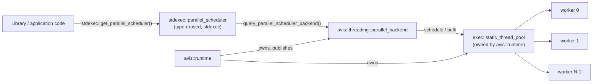

# 15 — Parallel Scheduler

| | |
|---|---|
| Namespace | `avis::threading` (Avis parts); `stdexec`, `exec` (vendored stdexec) |
| Headers | `include/avis/threading/parallel_configuration.h` (`parallel_configuration`, no stdexec), `include/avis/threading/parallel_backend.h` (`parallel_backend`; used by the runtime), `include/avis/threading/parallel_helpers.h` (`into_internal_error`, `sync_wait`) |
| Sources | `lib/avis/threading/parallel_backend.cpp`; Avis's definition of `stdexec::parallel_scheduler_replacement::query_parallel_scheduler_backend()` is in `lib/avis/runtime.cpp` (§3.1) |
| Third-party | `stdexec::get_parallel_scheduler()` / `stdexec::parallel_scheduler`, `exec::static_thread_pool` |
| CMake target | `AVIS_LIB` (the single Avis library target; links stdexec) |

## 1. Requirements

- **Parallel CPU work** for the use cases identified in the design (command recording, decoding, pipeline creation). Plug-ins don't use it: the plug-in SDK has no host-run parallelism ([05 §5.6](05-driver.md#56-calling-rules)).
- **Sender/receiver** (stdexec) is the only interface. Library and application code reach parallel work through the **standard parallel scheduler**, `stdexec::get_parallel_scheduler()` (C++26 `std::execution::get_parallel_scheduler()`). No Avis-specific scheduler type appears in call sites, so moving to `std::execution` later only changes the namespace (D-60).
- The parallel scheduler's backend is an **`exec::static_thread_pool` owned by `avis::runtime`** ([14](14-library-runtime.md)), so its size comes from the runtime configuration and its lifetime is the runtime's (D-60).
- **Work stealing** is what `exec::static_thread_pool` provides: a queue per worker, own queue first, stealing from other workers (randomised, NUMA-aware). The earlier requirement of round-robin stealing is dropped (D-61).
- Separate from the thread pool ([06](06-thread-pool.md)): the parallel workers are created by `exec::static_thread_pool`, not by `thread_pool`. The thread pool knows nothing about them.

Deliberately **not** required (D-62, D-63):
- Worker names (`avis-…`) and worker priority. The workers show up with the OS defaults in debuggers and crash dumps.
- Work scheduled after the pool has stopped. It may never execute and its operation may never complete (§5).

## 2. Use cases

| Use case | Mechanism | Document |
|---|---|---|
| Parallel render command recording | `stdexec::bulk` over recording groups, composed into the frame chain | [10 §7](10-render-graph.md#7-execution-phase) |
| Parallel PSO creation at startup | `bulk` over pipeline descriptions | [18 §11](18-graphics-shaders-and-pipelines.md#11-graphicspipeline_cacheh) |
| CPU work after IO (PNG/glTF decode, point-cloud tile decode, scenario parsing) | `continues_on(stdexec::get_parallel_scheduler())` after an IO sender | [07 §3](07-io-layer.md#3-execution-model), [08 §5](08-scene-management.md#5-assets-gltf) |
| Driver sensor decode during prefetch | IO sender → `continues_on` → decode | [05 §3.1](05-driver.md#31-sensor-replay) |

## 3. Structure



### 3.1 Replacing the backend at link time
- `stdexec::get_parallel_scheduler()` asks `stdexec::parallel_scheduler_replacement::query_parallel_scheduler_backend()` for a `std::shared_ptr<parallel_scheduler_backend>` on **every call**, and wraps it in a `parallel_scheduler`.
- The vendored stdexec only **declares** that function. Its default definition (a lazily created, process-wide `exec::static_thread_pool` with `hardware_concurrency` threads) is compiled only when `STDEXEC_PARALLEL_SCHEDULER_HEADER_ONLY` is defined or when the optional `STDEXEC::parallel_scheduler` library (`STDEXEC_BUILD_PARALLEL_SCHEDULER`) is linked. **Avis uses neither.** `AVIS_LIB` provides the only definition, in `runtime.cpp`, which fails to compile with an `#error` if either macro is defined.
- This is the link-time replacement the standard intends, and it doesn't rely on weak symbols, which MSVC doesn't have. If someone enables stdexec's default as well, the link fails with a duplicate symbol, so the mistake is loud. The deprecated run-time hook `set_parallel_scheduler_backend` is not used.
- Avis's definition lives in `runtime.cpp` and returns the live runtime's backend, or `nullptr`. The runtime publishes its backend in a file-level atomic there at the end of construction and clears it at the start of shutdown (§5); nothing else can publish one, so there's no install function. The cost is that the parallel scheduler can only be used, and tested, with a runtime alive (the runtime fixture, [14 §2](14-library-runtime.md#2-api)). With `nullptr`, `get_parallel_scheduler()` throws `std::runtime_error`. Using the parallel scheduler with no runtime alive is a programming error, like the runtime's own accessors ([14 §5](14-library-runtime.md#5-static-access-rules)).

### 3.2 `parallel_backend`

```cpp
namespace avis::threading
{
    struct parallel_configuration   // parallel_configuration.h, free of stdexec
    {
        std::size_t workers = 0;   // 0 = max(1, hardware_concurrency - 2)
    };

    // stdexec parallel_scheduler backend that runs work on an exec::static_thread_pool it doesn't own
    class parallel_backend final : public stdexec::parallel_scheduler_replacement::parallel_scheduler_backend
    {
    public:
        explicit parallel_backend(exec::static_thread_pool& pool);

        void schedule(receiver_proxy& receiver, std::span<std::byte> scratch) noexcept override;
        void schedule_bulk_chunked(std::size_t count, bulk_item_receiver_proxy& receiver,
                                   std::span<std::byte> scratch) noexcept override;
        void schedule_bulk_unchunked(std::size_t count, bulk_item_receiver_proxy& receiver,
                                     std::span<std::byte> scratch) noexcept override;

        // From now on every operation completes with set_stopped() without touching the pool (§5)
        void detach() noexcept;
    };
}
```

- `schedule` starts `stdexec::schedule(pool.get_scheduler())` and completes the receiver proxy on the worker. The operation state is built in `scratch` when it fits, otherwise allocated. This mirrors stdexec's own default backend (`__generic_impl`), which Avis can't reuse because it owns its pool and always sizes it to `hardware_concurrency`.
- `schedule_bulk_chunked` runs `stdexec::bulk_chunked` on the pool, with stdexec's default chunking: chunks of `count / workers / 2` items when `count > 3 × workers`, otherwise one item per chunk. `schedule_bulk_unchunked` runs `bulk_unchunked`. The pool's own `bulk` customisation spreads the chunks over the workers.
- While the backend runs work on a worker (a `schedule` completion or a bulk item), it sets a thread-local marker. `avis::threading::sync_wait` uses it (§4.3). It is the only per-thread state Avis keeps on parallel workers.
- `exec::static_thread_pool` is part of stdexec's experimental `exec` namespace. Only `parallel_backend.cpp` and the runtime refer to it. Everything else sees the standard `parallel_scheduler`, which keeps a stdexec update that changes `exec` contained.

## 4. Sender/receiver use

### 4.1 Scheduler
- `stdexec::get_parallel_scheduler()` returns a `stdexec::parallel_scheduler`. It's cheap to copy (it holds a `shared_ptr` to the backend). Code may keep a copy for the duration of a pipeline, but shouldn't keep one beyond the runtime's lifetime (§5).
- `schedule()` completes on a parallel worker. Its completion signatures are `set_value_t()`, `set_error_t(std::exception_ptr)` and `set_stopped_t()`.
- `bulk`, `bulk_chunked` and `bulk_unchunked` on this scheduler go to the backend's bulk functions (§3.2), so they run in parallel. stdexec's forward-progress query reports `parallel`.

### 4.2 Error type
Like the IO layer ([07 §5](07-io-layer.md#5-error-propagation)), Avis pipelines use the single error type **`avis::error`**. The parallel scheduler and stdexec's adaptors (`then`, `bulk`, …) report exceptions as `set_error(std::exception_ptr)`; for `bulk`, stdexec delivers the first exception and skips the remaining work where it can. Pipelines therefore end with the explicit adaptor `avis::threading::into_internal_error()`, which maps `std::exception_ptr` and `std::error_code` to `avis::error`. Completion signatures then stay small:
`set_value_t(Ts...)`, `set_error_t(avis::error)`, `set_stopped_t()`.

### 4.3 Waiting
- `stdexec::sync_wait` **must not be called from parallel work**: it would block a worker and could deadlock when every worker waits. Library code calls `avis::threading::sync_wait` instead. It throws `std::logic_error` when the thread-local marker of §3.2 is set (in every build, because the check is cheap and testable) and otherwise forwards to `stdexec::sync_wait`.
- The same rule covers **IO threads**: a wait in an IO context body could deadlock the completions it waits for. Each body runs inside a `detail::forbid_blocking_waits` scope (a second thread-local marker), and `sync_wait` throws there too. `avis::threading::sync_wait_result` ([07 §5.2](07-io-layer.md#52-consuming-io-senders)) goes through `sync_wait`, so it has the same checks.
- Other threads (the step executor, tests, shutdown code) may call `sync_wait`. The renderer never does: its frame chain composes the recording `bulk` with `let_value` ([17 §4](17-graphics-frames-and-transfers.md#4-graphicsframe_schedulerh)).
- Inside parallel work, composition (`let_value`, `when_all`) replaces blocking. Work may block only briefly. Long or indefinite blocking (waiting on a fence, sleeping on IO) belongs to IO senders or to long-running pool threads ([06](06-thread-pool.md)).

### 4.4 Fire-and-forget
There is no Avis `submit`. Work that nobody waits for is started with stdexec's own tools, for example `stdexec::spawn(stdexec::schedule(scheduler) | stdexec::then(work), scope.get_token())` with a `stdexec::counting_scope` owned by the component, or `exec::start_detached`. The owner ends the chain with an `upon_error` that logs, because spawned senders must not complete with an error. Routing every spawn through a runtime-owned scope isn't required in iteration 1 (D-63); it can be added if work lost at shutdown becomes a problem.

### 4.5 Examples

```cpp
auto parallel = stdexec::get_parallel_scheduler();

// render graph: record groups in parallel, composed into the frame chain (no waiting)
auto record = stdexec::schedule(parallel)
            | stdexec::bulk(stdexec::par, groups.size(), [&](std::size_t index) { record_group(groups[index]); });

// IO → decode on parallel workers
auto image = avis::io::read_file(path)
           | stdexec::continues_on(parallel)
           | stdexec::then([](std::vector<std::byte> bytes) { return decode_png(bytes); })
           | avis::threading::into_internal_error();
```

## 5. Lifecycle
- **Construction** (by the runtime, after the thread pool and IO context, [14 §4.1](14-library-runtime.md#41-construction)): create `exec::static_thread_pool(workers)`, create a `parallel_backend` for it, and publish it for the backend query (§3.1). `get_parallel_scheduler()` works from then on.
- **Shutdown** (by the runtime, before the IO layer and the thread pool are torn down, [14 §4.2](14-library-runtime.md#42-destruction)):
  1. **Unpublish** the backend: new `get_parallel_scheduler()` calls throw.
  2. **Detach** the backend: schedulers that were copied earlier keep the backend alive through their `shared_ptr`, but their operations now complete with `set_stopped()` and never touch the pool.
  3. **Destroy the pool**: `exec::static_thread_pool` requests stop and joins its workers. Work still queued may or may not run.
- **Work after stop is not guaranteed** (D-63): an operation whose work was queued but never executed doesn't complete, so a `sync_wait` or scope join on it would hang. Applications therefore finish or cancel their parallel work before destroying the runtime, which is already the rule for their other services ([14 §4.2](14-library-runtime.md#42-destruction)). Scheduling during the runtime's destruction is a programming error.

## 6. Determinism and priorities
- Which worker runs a piece of work, and in what order, varies between runs. Driver code on the simulation path that uses the parallel scheduler must therefore reduce per-index results **in index order** ([03 §6](03-simulation-core.md#6-determinism-rules)). Plug-in code never runs on parallel workers.
- **No priorities** in iteration 1: all parallel work is equal. Frame-critical recording competes with background decode. The mitigations are the pool's LIFO local queues (a recording batch issued from the frame chain is picked up first) and keeping decode work small (one image or tile per operation). A priority lane would need a second scheduler and is out of scope.
- Per-thread state that a component needs on parallel workers (for example the RHI's command allocator pools) is keyed by the component's own per-thread slot, not by a worker index ([09 §7](09-rhi.md#7-command-lists-and-recorders-rhicommand_listh)). The parallel scheduler exposes no worker index.

## 7. Configuration
From `runtime_configuration::parallel` ([14 §3](14-library-runtime.md#3-configuration)):

| Setting | Default | Notes |
|---|---|---|
| `workers` | `max(1, hardware_concurrency − 2)` | Leaves room for the simulation thread, the IO thread and Qt's threads. Not part of the thread pool's capacity. |

## 8. Testing
- Link-time replacement: with a runtime alive, `get_parallel_scheduler()` runs work on the runtime's pool (the worker's thread id is one of the pool's); without one it throws.
- `schedule` completes on a worker; `bulk` covers `[0, n)` exactly once for sizes around the chunking thresholds; an exception in a `bulk` body arrives as one `set_error`, mapped to `avis::error` by `into_internal_error()`.
- Stop: a receiver whose stop token is signalled completes with `set_stopped()`.
- After `detach()`, a scheduler copied earlier completes new operations with `set_stopped()`.
- `avis::threading::sync_wait` throws on a parallel worker and on an IO thread, and works on other threads.
- Runtime shutdown with no outstanding parallel work leaves no worker running (thread count before and after).
