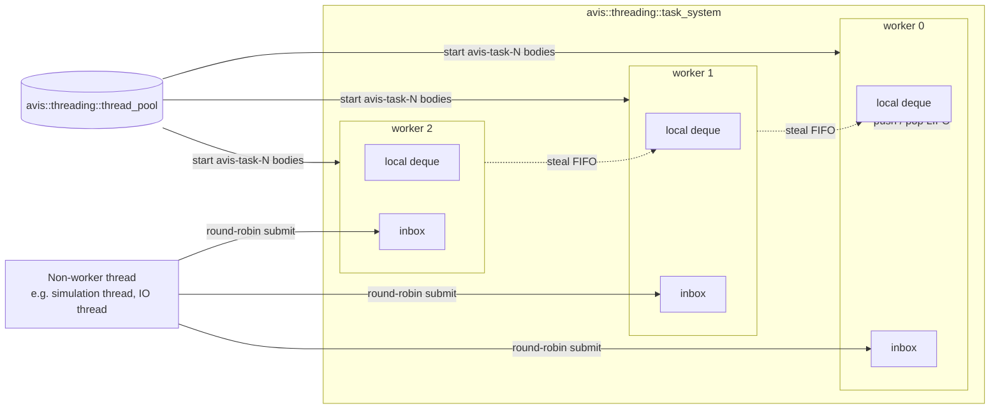

# 15 — Task System

| | |
|---|---|
| Namespace | `avis::threading` (shared with the thread pool, as a separate class) |
| Headers | `include/avis/threading/task_system.h`, `include/avis/threading/task_scheduler.h`, `include/avis/threading/work_stealing_deque.h` |
| Sources | `lib/avis/threading/` (task_system.cpp, …) |
| CMake target | `AVIS_LIB` (the single Avis library target; links stdexec) |

## 1. Requirements

From the owner's design review ([99](99-decisions-and-open-questions.md), D-13 to D-15):
- A **task-based execution system** for the parallel use cases identified in the design (command recording, decoding, pipeline creation). Plug-ins don't use it: the plug-in SDK has no host-run parallelism ([05 §5.6](05-driver.md#56-calling-rules)).
- It gets the threads it needs **from the thread pool** ([06](06-thread-pool.md)).
- It's based on **work stealing**:
  - each worker thread has **its own thread-local task queue**;
  - when a worker finishes a task, it **checks its own queue first**;
  - if its own queue is empty, it looks in **other workers' queues** and **steals** a task;
  - stealing works in a **round-robin** fashion.
- It **integrates the sender/receiver paradigm** (stdexec).
- It stays **separate from the thread pool** at class level, although both share the `avis::threading` namespace and the `AVIS_LIB` target. The task system knows the pool; the pool doesn't know the task system ([06 §5](06-thread-pool.md#5-separation-from-the-task-system)).

## 2. Use cases

| Use case | Mechanism | Document |
|---|---|---|
| Parallel render command recording | `stdexec::bulk` over recording groups, composed into the frame chain | [10 §7](10-render-graph.md#7-execution-phase) |
| Parallel PSO creation at startup | `bulk` over pipeline descriptions | [09 §9.2](09-rhi.md#92-pso-cache) |
| CPU work after IO (PNG/glTF decode, point-cloud tile decode, scenario parsing) | `continues_on(task scheduler)` after an IO sender | [07 §3](07-io-layer.md#3-execution-model), [08 §5](08-scene-management.md#5-assets-gltf) |
| Driver sensor decode during prefetch | IO sender → `continues_on` → decode | [05 §3.1](05-driver.md#31-sensor-replay) |

## 3. Structure



### 3.1 Workers
- At construction, the task system starts `workers` long-running bodies on the thread pool it's given (`thread_pool::start("task-<n>", …)`) and keeps their `thread_handle`s. Those are the **only** threads that execute tasks.
- Each worker owns:
  - a **local work-stealing deque** (Chase–Lev, a growable ring buffer of task pointers). The owner pushes and pops at the bottom (LIFO, cache-hot); thieves steal from the top (FIFO, oldest work first);
  - an **inbox**: a lock-free MPSC queue (intrusive Vyukov queue) for tasks submitted by threads that aren't workers. Chase–Lev allows only the owner to push, so this is how outside work reaches a worker's queue.
- A thread-local pointer (`task_system::current_worker()`) identifies the calling worker. It's `nullptr` on other threads.

### 3.2 Submission
| Caller | Destination |
|---|---|
| A worker of this task system | Its **own local deque** (bottom), so tasks spawned by a task stay local and other workers can steal them |
| Any other thread | The **inbox** of the next worker in round-robin order (an atomic counter mod `workers`). One parked worker is woken. |

### 3.3 Worker loop

```text
loop:
    task = local.pop()                       # 1. own queue first (LIFO)
    if !task: task = inbox.drain_into(local) # 2. own inbox: move all into the local deque, pop one
    if !task: task = steal_round_robin()     # 3. other workers' queues
    if task: execute(task); continue
    if stop_requested and nothing left: exit
    spin briefly (~2 µs, with _mm_pause), then park
```

**Round-robin stealing:**
- Worker `i` keeps a `next_victim` cursor, initialised to `(i + 1) mod N`.
- One steal pass visits the victims `next_victim, next_victim + 1, …` (mod N, skipping itself), **at most N − 1 victims**. For each victim it tries the victim's deque top first, then the victim's inbox (`try_pop`), so work that hasn't yet been drained into a deque can still be balanced.
- On a successful steal, `next_victim` moves to the victim **after** the one that was robbed, so successive steals rotate fairly across workers instead of draining one victim.
- If a full pass finds nothing, the worker goes to the spin-then-park phase.

**Parking:**
- An `std::atomic<std::uint32_t> sleepers` counter and a per-worker `std::atomic<std::uint32_t> epoch` with C++20 `wait`/`notify_one`.
- Submitting from outside wakes the target worker if it's parked. A worker pushing to its own deque wakes one parked worker only when `sleepers > 0`, so stealing can start.
- The worker's thread-pool body registers a `std::stop_callback` that bumps every epoch and notifies, so parked workers notice shutdown immediately.

### 3.4 Tasks
- Tasks are **intrusive nodes**: `struct task { task* next; void (*execute)(task*) noexcept; };`. A stdexec operation state embeds the node, so `schedule()` never allocates.
- `task_system::submit(F&&)` is the low-level escape hatch for plain callables. It allocates a node from a per-worker free list (or a global pool for non-workers).
- Tasks must not throw. In sender pipelines, exceptions travel on `set_error` (§4.3). A plain `submit` callable that throws is caught and logged as a programming error, and the worker continues.
- Tasks may block only briefly. Long or indefinite blocking (waiting on a fence, sleeping on IO) belongs to IO senders or to long-running pool threads, never to task workers.

## 4. Sender/receiver integration

### 4.1 API

```cpp
namespace avis::threading
{
    struct task_system_configuration
    {
        std::size_t workers = 0;                                   // 0 = max(1, hardware_concurrency - 2)
        thread_priority worker_priority = thread_priority::normal;
        std::size_t bulk_chunks_per_worker = 4;
    };

    class task_system
    {
    public:
        task_system(thread_pool& pool, const task_system_configuration& configuration);   // starts workers on the pool
        ~task_system();                                            // stop + drain + join workers (§5)

        class scheduler;                                           // models stdexec::scheduler (task_scheduler.h)
        scheduler get_scheduler() noexcept;

        template<std::invocable F> void submit(F&& f);             // fire-and-forget escape hatch

        std::size_t worker_count() const noexcept;
        static task_system* current() noexcept;                    // task system of the calling worker, or nullptr
        void request_stop() noexcept;
    };
}
```

The **default task system** is owned by `avis::runtime` and reached through `avis::runtime::task_system()` ([14 §2](14-library-runtime.md#2-api)), in the same way as the default thread pool.

### 4.2 Scheduler
- `stdexec::schedule(scheduler)` returns a sender whose operation state contains the task node. `start()` submits it following the rules in §3.2. When the task runs, it calls `set_value()` on the receiver, or `set_stopped()` if the receiver's stop token is already signalled.
- Queries:
  - `get_forward_progress_guarantee(scheduler)` → `parallel`;
  - `get_completion_scheduler<set_value_t>` on the sender → this scheduler;
  - the domain customisation for `bulk` (below).
- Equality: two schedulers compare equal when they refer to the same `task_system`.

### 4.3 `bulk`
A customised `stdexec::bulk` for this scheduler:
1. The shape `[0, n)` is split into `min(n, workers × bulk_chunks_per_worker)` contiguous chunks.
2. All chunk tasks are pushed as one batch: onto the **local deque** when the caller is a worker, otherwise **round-robin over the inboxes**, waking enough parked workers. Idle workers then pick them up through the normal own-queue → steal path.
3. An atomic countdown tracks completion. The task that finishes the last chunk completes the downstream receiver with the original values.
4. An exception in any chunk is captured once (first error wins). The remaining chunks are skipped as soon as they observe the error flag, and `set_error(avis::error)` is delivered when the last chunk finishes.
5. Stop requests are checked per chunk, and a stopped bulk completes with `set_stopped()`.

### 4.4 Error type
Like the IO layer ([07 §5](07-io-layer.md#5-error-propagation)), the task system's senders use the single error type **`avis::error`**. Exceptions thrown inside `then` / `bulk` bodies are converted to `avis::error` at the scheduler boundary, so completion signatures stay small:
`set_value_t(Ts...)`, `set_error_t(avis::error)`, `set_stopped_t()`.

### 4.5 Waiting
- `stdexec::sync_wait` **must not be called from a task worker**: it would block the worker and could deadlock when every worker waits. This is asserted in debug builds.
- Non-worker threads (the step executor, tests, shutdown code) may call `sync_wait`. The renderer never does: its frame chain composes the recording `bulk` with `let_value` ([09 §4.2](09-rhi.md#42-frame-contexts-sender-based-non-blocking)).
- Inside tasks, composition (`let_value`, `when_all`) replaces blocking.

### 4.6 Examples

```cpp
auto tasks = avis::runtime::task_system().get_scheduler();

// render graph: record groups in parallel, composed into the frame chain (no waiting)
auto record = stdexec::schedule(tasks)
            | stdexec::bulk(stdexec::par, groups.size(), [&](std::size_t index) { record_group(groups[index]); });

// IO → decode on task workers
auto image = avis::io::read_file(path)
           | stdexec::continues_on(tasks)
           | stdexec::then([](std::vector<std::byte> bytes) { return decode_png(bytes); });
```

## 5. Lifecycle
- **Construction** (by the runtime, after the thread pool and IO context, [14 §4](14-library-runtime.md#4-initialisation-and-shutdown-order)): allocate the per-worker queues, start `workers` bodies on the pool, and wait on a latch until all of them have registered.
- **Shutdown** (`~task_system`, run by the runtime before the IO layer and the pool are torn down):
  1. `request_stop()`: from now on `schedule()` completes immediately with `set_stopped()`, and `submit` drops the callable with a warning.
  2. Workers **drain** the tasks already queued. Receivers observe their stop tokens and complete with `set_stopped()` where they choose to, so every started operation completes, which keeps stdexec's guarantees.
  3. Once every queue is empty, each worker body returns.
  4. The task system destroys its `thread_handle`s, which joins the workers.
- The thread pool's signal-all-then-join-all backstop ([06 §4.2](06-thread-pool.md#42-shutdown-as-specified)) applies only if something goes wrong. The task system normally stops its own workers.

## 6. Determinism and priorities
- Which worker runs a task, and in what order, varies between runs. Driver code on the simulation path that uses the task system must therefore reduce per-index results **in index order** ([03 §6](03-simulation-core.md#6-determinism-rules)). Plug-in code never runs on task workers.
- **No task priorities** in iteration 1: every task is equal. Frame-critical recording competes with background decode. The mitigations are LIFO local execution (a recording batch issued from the frame chain is spread across the workers and picked up first by idle workers), plus keeping decode tasks small (one image or tile per task). A priority lane can be added later without changing the scheduler API, as a second scheduler from `get_scheduler(priority)`.

## 7. Configuration
From `runtime_configuration::tasks` ([14 §3](14-library-runtime.md#3-configuration)):

| Setting | Default | Notes |
|---|---|---|
| `workers` | `max(1, hardware_concurrency − 2)` | Leaves room for the render and simulation threads. The runtime adds this to the pool capacity. |
| `worker_priority` | `normal` | Raised to `above_normal` by the Visualizer, so recording keeps up with frames |
| `bulk_chunks_per_worker` | 4 | Balance between stealing overhead and load balance |

## 8. Testing
- Each task runs exactly once: 1M tiny tasks from several external producers and from inside tasks.
- Own-queue-first order: a worker that spawns children runs them LIFO before stealing.
- Round-robin stealing: with work placed in one worker's deque, every other worker steals. The victim cursor advances (statistics counters in debug builds).
- Inbox stealing: work submitted to a parked worker's inbox gets stolen by an active worker.
- `bulk`: correct coverage of `[0, n)`, error propagation (first error wins), stop handling.
- `sync_wait` from a worker asserts in debug builds.
- Shutdown with queued work: every started operation completes (value or stopped), and no worker is left running.
- A stress test under Application Verifier and ASan.
