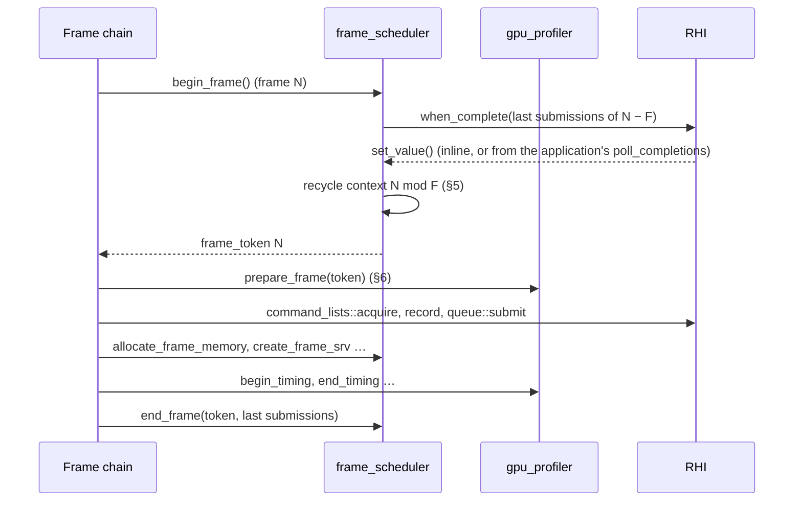

# 17 — Graphics layer: frames and transfers (draft for review)

> **Status: draft.** The RHI offers mechanism only ([09](09-rhi.md)); the graphics layer builds the policies on top of it. This document covers two of them: **frames** (the frame scheduler: frame pacing with *F* frames in flight, the frame token, per-frame upload memory and descriptors; and the GPU profiler, which turns timestamp queries into named per-frame timings), which left the RHI ([09 §6](09-rhi.md#6-transient-memory-descriptors-and-timestamps-rhitransienth)), and **CPU↔GPU transfers** (the upload and readback queues: staging ring, upload tickets, readback pooling and leases), which left it too ([09 §11](09-rhi.md#11-copy-footprints-and-readback)) and replace the former RHI draft 09h. It also defines the graphics error domain. Implemented in [task 7](../tasks/07-graphics-frames-and-transfers.md); the sections below describe the code, with **As implemented** notes where it departs from the first draft. The draft status stays until task 8 settles the parts shared with [18](18-graphics-shaders-and-pipelines.md) (the error domain). Shaders, root signatures and pipelines are in [18](18-graphics-shaders-and-pipelines.md). The render graph ([10](10-render-graph.md)) and the renderer ([11](11-renderer.md)) use these pieces where they used RHI frames and uploads before (§11). Once decided, the graphics-layer design is folded into 10 or 11, or kept as its own document.

## 0. Summary

**Frames**

- **One object, `graphics::frame_scheduler`,** created from two RHI views (`synchronization`, `transient_objects`, D-96) and a configuration. It owns *F* frame contexts, each holding one `rhi::linear_upload_allocator` and one `rhi::descriptor_range`, plus the last synchronization points of the frame that used it.
- **`begin_frame()`** is a sender: it waits with `rhi::synchronization::when_complete` for the last submissions of frame *N − F*, recycles context *N mod F* (§5), and delivers a `graphics::frame_token`. **`end_frame(token, last_submissions)`** records those points. The pacing rules are the ones the RHI's frame contexts had before they moved here: one `begin_frame` outstanding, never waiting on a thread.
- **Per-frame services** take the token: `allocate_frame_memory`, `write_frame_constants`, `create_frame_srv/uav`. Their names match what 10 and 11 already call, so those documents change only in the namespace of the token. They fail with `transient_memory_exhausted` when the context is full, and the frame is skipped (Q3, decided A).
- **GPU timings are a separate object, `graphics::gpu_profiler`** (Q1, decided B). It owns one `rhi::timestamp_query_set` per queue type per frame context and takes the frame token. It recycles its own context in `prepare_frame(token)`, with the submissions the token reports as complete (`frame_token::recycled_submissions()`), so the scheduler needs no hook for it (§6).
- **What it doesn't do.** Command allocators and deferred releases are the RHI's, reused or freed by synchronization point ([09 §19.2](09-rhi.md#192-lifetime-by-synchronization-point)); the scheduler never resets them. Driving the RHI with `rhi::completion_driver::poll_completions()` (named `process_completions` in earlier drafts) is the application's, and the scheduler doesn't do it either (Q4, decided B) ([09 §5.2](09-rhi.md#52-driving-completions)).

**Transfers**

- **`graphics::upload_queue`**: a staging ring in an upload-heap buffer, synchronous and asynchronous uploads into buffers and textures, and `flush()`, which records and submits the queued copies on the copy queue. An upload returns a **ticket that names a flush**, not a pre-reserved fence value; after the flush, the ticket resolves to the flush's real synchronization point.
- **`graphics::readback_queue`**: pooled readback buffers, standalone buffer and texture readbacks as senders, and leases that return the buffer to the pool (Q6, decided A).
- **Several queues per RHI** (Q7, decided B). The queues are ordinary objects. The renderer's per-frame uploads and asset streaming get separate upload queues, so a streaming burst can't fill the ring the frame needs. A ticket is only valid with the queue that issued it.
- **Only public RHI calls,** through the views of [09 §4.3](09-rhi.md#43-subsystem-views): `resources` (`create_buffer` with `upload` / `readback` memory, `mapped_bytes`, `copyable_footprint`, `destroy`), `command_lists::acquire<copy>`, the copy calls on the list (`copy_buffer`, `copy_buffer_to_texture`, `copy_texture_to_buffer`), `queue<copy>::submit`, and `synchronization` (`is_complete`, `when_complete`). No RHI internals, no RHI locks held across calls back into this code.
- **What went away with the move:** `reserve_next_value`, routing every copy-queue submission through the ring, the one lock nesting in the RHI, and 09h Q1. Other copy work can't signal an upload's point any more, because tickets don't name a point until their flush has one.

## 1. Code placement

| Feature | Namespace | CMake target | Location |
|---|---|---|---|
| `frame_scheduler`, `frame_scheduler_configuration` | `avis::graphics` | `AVIS_LIB` | `include/avis/graphics/frame_scheduler.h`, `lib/avis/graphics/frame_scheduler.cpp` |
| `frame_token` | `avis::graphics` | `AVIS_LIB` | `include/avis/graphics/frame_token.h` (its own header, because `detail/frame_sender.h` delivers it) |
| `gpu_profiler`, `gpu_profiler_configuration`, `gpu_scope_id`, `gpu_timing` | `avis::graphics` | `AVIS_LIB` | `include/avis/graphics/gpu_profiler.h`, `lib/avis/graphics/gpu_profiler.cpp` |
| `frame_sender` and its operation state | `avis::graphics` | `AVIS_LIB` | `include/avis/graphics/detail/frame_sender.h` |
| Graphics error codes | `avis::graphics` | `AVIS_LIB` | `include/avis/graphics/error.h` |
| Upload queue | `avis::graphics` | `AVIS_LIB` | `include/avis/graphics/upload_queue.h`, `lib/avis/graphics/upload_queue.cpp` |
| `upload_ticket`, `subresource_data` | `avis::graphics` | `AVIS_LIB` | `include/avis/graphics/upload_ticket.h` (shared with `detail/upload_sender.h`) |
| Readback queue | `avis::graphics` | `AVIS_LIB` | `include/avis/graphics/readback_queue.h`, `lib/avis/graphics/readback_queue.cpp` |
| Readback leases (`readback_data`, `readback_image`) | `avis::graphics` | `AVIS_LIB` | `include/avis/graphics/readback_data.h` (shared with `detail/readback_sender.h`) |
| Sender templates | `avis::graphics` | `AVIS_LIB` | `include/avis/graphics/detail/upload_sender.h`, `readback_sender.h` |
| `gpu_completion_thread` ([09 §5.2](09-rhi.md#52-driving-completions)) | `avis::graphics` | `AVIS_LIB` | `include/avis/graphics/gpu_completion_thread.h`, `lib/avis/graphics/gpu_completion_thread.cpp` |
| Texture mip and layer counts (private) | `avis::graphics::detail` | `AVIS_LIB` | `lib/avis/graphics/texture_subresources.h`, used by both queues |

Everything here depends on `avis/rhi/` only: not on the IO layer, not on D3D12. The frame scheduler, the GPU profiler and the upload and readback queues each span several RHI groups, and take each view they use as a `create` parameter, never the `render_hardware_interface&` (D-96, [09 §4.3](09-rhi.md#43-subsystem-views)). None of them takes `rhi::completion_driver`: they wait, and the application drives the RHI (D-93, D-94). The other graphics-layer pieces built on the RHI are `gpu_completion_thread` ([09 §5.2](09-rhi.md#52-driving-completions)) and the shader library, root signatures and pipeline cache ([18](18-graphics-shaders-and-pipelines.md)).

## 2. `graphics/error.h`

The graphics layer gets its own error domain, `error_domain::graphics` (a new value in `avis/error.h`), like the RHI's `rhi::error_kind` (D-72):

```cpp
namespace avis::graphics
{
    enum class error_kind : std::int32_t
    {
        ok = 0,
        upload_queue_full,        // a synchronous upload didn't fit the staging ring right now
        invalid_argument,         // bad destination, size or subresource data
        shader_not_found,         // 18: a shader id isn't in the library
        shader_stage_mismatch,    // 18: a shader used in the wrong pipeline slot
        shader_hash_mismatch,     // 18: a blob doesn't match its manifest hash
        duplicate_shader_id,      // 18: two blobs with the same id or id hash
        no_compatible_root_signature,   // 18: no registered root signature fits the pipeline's shaders
        root_signature_incompatible,    // 18: the pipeline's named root signature doesn't fit its shaders
        shader_bindings_missing         // 18: a shader has no bindings and the pipeline names no root signature
    };

    std::string_view to_string(error_kind kind) noexcept;
    avis::error make_error(error_kind kind, std::string message,
                           std::source_location location = std::source_location::current());
    bool is_error(const avis::error& error, error_kind kind) noexcept;   // graphics domain and this kind
}

template<> struct std::formatter<avis::graphics::error_kind>;            // prints to_string(kind), like the RHI's
```

RHI errors pass through unchanged (`error_domain::rhi`, `device_lost` included). Arguments the graphics layer rejects itself (a size of 0 in a configuration, a range outside a destination, a subresource outside a texture, a token that isn't the frame being recorded) fail with `graphics::error_kind::invalid_argument`.

## 3. Frame scheduler: concepts

| Term | Meaning |
|---|---|
| Frame *N* | The *N*-th call of `begin_frame` that delivered a token; the first frame is 1 |
| Frame context *c* | *N mod F*: the per-frame objects frame *N* uses. Frame *N* reuses the context of frame *N − F* |
| Last submissions | The points `end_frame` received for a frame: at most one per queue (the latest). The context is free once all are complete |
| Completed index | The newest frame known to be complete on the GPU when a token is delivered; at least *N − F*. The renderer's residency retirement uses it ([11 §3.6](11-renderer.md)) |



## 4. `graphics/frame_scheduler.h`

```cpp
namespace avis::graphics
{
    struct frame_scheduler_configuration
    {
        std::uint32_t frames_in_flight = 2;                // 1..3 (was rhi::frame_configuration)
        std::size_t upload_memory_per_frame = 16ull << 20; // linear upload allocator per context
        std::uint32_t descriptors_per_frame = 32'768;      // descriptor range per context; F × this must fit the
                                                           // RHI's transient_descriptor_count
    };

    // Frame N and its context N mod F. Move-only. Ended exactly once: explicitly with end_frame, or by its destructor
    // with no submissions (Q2).
    class frame_token
    {
    public:
        frame_token(frame_token&& other) noexcept;
        frame_token& operator=(frame_token&& other) noexcept;   // ends the frame it held first, like the destructor
        frame_token(const frame_token&) = delete;
        frame_token& operator=(const frame_token&) = delete;
        ~frame_token();                                    // not ended: end_frame(*this, {}), logged at debug level

        std::uint64_t index() const noexcept;              // N
        std::uint32_t context_index() const noexcept;      // N mod F
        std::uint64_t completed_index() const noexcept;    // newest frame known complete at delivery (≥ N − F)
        // Last submissions of frame N − F, which used this context before; all complete. Empty for the first F
        // frames. Valid until the token is ended.
        std::span<const rhi::synchronization_point> recycled_submissions() const noexcept;

    private:
        friend class frame_scheduler;
        frame_scheduler* owner_ = nullptr;
        std::uint64_t index_ = 0;
        std::uint32_t context_index_ = 0;
        std::uint64_t completed_index_ = 0;
    };

    class frame_scheduler
    {
    public:
        // Creates the per-context transient objects. Fails with invalid_argument for frames_in_flight outside 1..3 or
        // a size of 0, and passes the RHI's errors through (transient_memory_exhausted when the descriptor ranges
        // don't fit the RHI's transient region).
        // Views (D-96): waits for frame N − F; the per-context transient objects
        static result<std::unique_ptr<frame_scheduler>> create(rhi::synchronization synchronization,
                                                               rhi::transient_objects transient_objects,
                                                               const frame_scheduler_configuration& configuration);
        ~frame_scheduler();              // no frame may be outstanding; destroy before the RHI

        // ---- pacing ----
        frame_sender begin_frame() noexcept;
        std::optional<frame_token> try_begin_frame();      // never waits
        void end_frame(frame_token&& frame, std::span<const rhi::synchronization_point> last_submissions);
        std::uint32_t frames_in_flight() const noexcept;

        // ---- per-frame upload memory (the context's linear_upload_allocator) ----
        result<rhi::upload_allocation> allocate_frame_memory(const frame_token& frame, std::size_t size,
                                                             std::size_t alignment = 256);
        template<class T>
        result<rhi::gpu_address> write_frame_constants(const frame_token& frame, const T& value);

        // ---- per-frame views (the context's descriptor_range), for placed resources ----
        result<rhi::bindless_index> create_frame_srv(const frame_token& frame, rhi::texture_handle texture,
                                                     rhi::subresource_range range = rhi::all_subresources);
        result<rhi::bindless_index> create_frame_uav(const frame_token& frame, rhi::texture_handle texture,
                                                     std::uint32_t mip = 0);
        result<rhi::bindless_index> create_frame_srv(const frame_token& frame, rhi::buffer_handle buffer);
        result<rhi::bindless_index> create_frame_uav(const frame_token& frame, rhi::buffer_handle buffer);
    };
}
```

**`begin_frame()`** returns a `frame_sender`:
- `set_value(frame_token)` once the GPU has finished every submission `end_frame` recorded for frame *N − F*, after the context is recycled (§5). It completes inline when they are already complete (the usual case when the GPU keeps up), otherwise from the application's `completion_driver::poll_completions()`, on the thread that drives it.
- `set_error(avis::error)` with `device_lost`, forwarded from `when_complete`.
- `set_stopped()` if the receiver's stop token fires before the context is free. No frame is started, so nothing has to be ended.
- `static_assert(avis::sender_of<frame_sender, frame_token>)`. Internally it's `rhi::synchronization::when_complete(points)` with the recycle step on its value path; the operation state is a template in `graphics/detail/frame_sender.h`.

**`end_frame(frame, last_submissions)`** stores, per queue, the latest point of the frame in the context. Queues without a submission contribute nothing.

**Stopped and abandoned frames** (Q2, decided A with an RAII token):
- **Ending with no submissions is valid.** `end_frame(frame, {})` frees the context at once, because the GPU never used it. Lists acquired under the frame but never submitted are discarded by the RHI when their `command_list`s are destroyed ([09 §24.3](09-rhi.md#243-recording)); the scheduler doesn't track them.
- **The token ends itself.** Destroying a token that wasn't ended, or move-assigning over one, ends its frame with no submissions, exactly like `end_frame(frame, {})`. Debug builds log it at `debug` level, the way discarded command lists are logged. So a stop path that just drops the token is correct. That includes a token stored inside an adaptor that is stopped, such as `when_all(begin_frame(), …)` when another branch stops (12 §3.4). A moved-from token does nothing.
- **The one rule:** a token may only be ended without points (explicitly or by its destructor) if nothing was submitted under it. When batches did reach the GPU, the chain must pass their points to `end_frame`, or the context is recycled while the GPU may still read it. The render graph meets this by construction: it submits only after every recording group has finished, so a stopped or failed `execute` submits nothing (10 §7). The scheduler can't check the rule, because it knows no submissions but the ones it's given.
- Tokens must not outlive the scheduler: its destructor asserts that no frame is outstanding.

**Ordering:** one `begin_frame()` outstanding at a time, and the next one only after the current token is ended, explicitly or by its destructor (asserted).

**As implemented.**
- The pacing state is one atomic (idle, waiting, recording), so the ordering checks take no lock. A second `begin_frame` while one is outstanding asserts and completes with `generic_error_kind::logic_error`.
- A per-frame service called with a token that isn't the frame being recorded (ended, or of another scheduler) asserts and returns `invalid_argument`.
- Exhaustion warnings are kept to one per frame by two atomic flags per context (memory, descriptors), cleared by the recycle.
- The reset check of 09 §23.6 asserts only that the points it's given are complete. A frame ended with points that miss one of its submissions can't be caught when that submission happens to be complete already, so task 7's planned test for it was dropped.

**`frame_token::recycled_submissions()`** returns the points `end_frame` recorded for frame *N − F*, the frame that used the context before. They are all complete when the token is delivered. Components that keep their own per-context objects reset them with these points after the token arrives, as the GPU profiler does (§6), so the scheduler has no recycle hook to register with.

**Per-frame services** forward to the context's objects: `allocate_frame_memory` and `write_frame_constants` to the linear upload allocator, `create_frame_*` to the descriptor range. They are lock-free and callable from any thread for the current frame.

**Exhaustion** (Q3, decided A): a full allocator or descriptor range fails with `rhi::error_kind::transient_memory_exhausted`. Nothing grows. The RHI logs the object's name and capacity once per reset cycle ([09 §23.6](09-rhi.md#236-transient-upload-memory-and-reset-checks)), and the scheduler logs one warning per frame with the allocator's `high_water_mark()`, so the budget in `frame_scheduler_configuration` can be raised. The renderer skips the frame: the render graph completes `execute` with that error before it submits anything (10 §7), the frame chain ends the frame with no submissions (`end_frame(frame, {})`, Q2) and starts the next one. Unlike `device_lost`, this error doesn't take the fatal path ([12 §3.4](12-visualizer.md#34-frame-pacing)). The render graph's `allocate_constants` forwards to `write_frame_constants` ([10 §3.1](10-render-graph.md#31-building)), and its transient views come from `create_frame_srv/uav` ([10 §6.4](10-render-graph.md#64-aliasing-and-transient-memory)).

## 5. Recycling a frame context

When `when_complete` reports the last submissions of frame *N − F* complete, the scheduler recycles context *c* in this order before delivering the token. Each step is a call on an RHI object, passing the context's last submissions so the RHI can check the reset in debug builds ([09 §23.6](09-rhi.md#236-transient-upload-memory-and-reset-checks)).

| Step | Object | What it does |
|---|---|---|
| 1 | scheduler | Publishes the completed index (the frame index the context last held, or newer if another context is known complete) |
| 2 | `linear_upload_allocator` | `reset(last_submissions)` |
| 3 | `descriptor_range` | `reset(last_submissions)` (its UAVs' CPU copies for clears live in the RHI's staging heap at the same indices and need no reset, D-89) |

- All steps are fixed-cost and short; they run on the thread that completed the wait, which may be Qt's GUI thread in the Visualizer.
- The GPU profiler's query sets aren't part of this: the profiler recycles its own context in `prepare_frame`, after the token is delivered (§6).
- The old RHI recycle protocol also reset command allocators, recycled unsubmitted lists and collected deferred releases. Those are the RHI's now, driven by synchronization points and `poll_completions()` ([09 §19.2](09-rhi.md#192-lifetime-by-synchronization-point)); the scheduler needs no hook for them.
- **`begin_frame` doesn't drive the RHI** (Q4, decided B). It only waits, so it takes `rhi::synchronization` and no `completion_driver`. When the context isn't free yet, the wait completes from whatever drives the application's RHI (the Visualizer's `QWinEventNotifier`, a `gpu_completion_thread`, a test calling `poll_completions()`). An application without a driver stalls once the GPU is *F* frames ahead; the RHI's debug watchdog reports a wait pending for over a second with no `poll_completions()` (09 §5.2).

## 6. `graphics/gpu_profiler.h`

GPU timings are a separate object from the frame scheduler (Q1, decided B). It is built on the RHI's `timestamp_query_set` and `command_recorder::write_timestamp` ([09 §6](09-rhi.md#6-transient-memory-descriptors-and-timestamps-rhitransienth)) and uses the frame token for its per-frame state.

```cpp
namespace avis::graphics
{
    struct gpu_profiler_configuration
    {
        std::uint32_t timestamps_per_frame = 1'024;        // per queue type (2 per scope)
    };

    struct gpu_scope_id                  // the queue and the scope's index in its context; 0 = a dropped scope
    {
        std::uint32_t value = 0;
        constexpr bool is_valid() const noexcept;
    };

    struct gpu_timing
    {
        std::string_view name;           // valid as long as the span returned by completed_gpu_timings
        rhi::queue_type queue = rhi::queue_type::graphics;
        std::uint32_t depth = 0;         // nesting depth of begin_timing scopes
        double start_milliseconds = 0.0; // relative to the frame's first timestamp on that queue
        double duration_milliseconds = 0.0;
    };

    class gpu_profiler
    {
    public:
        // Creates one query set per queue type for each of the scheduler's frames_in_flight() contexts.
        // Views (D-96): the query sets; each queue's timestamp_frequency()
        static result<std::unique_ptr<gpu_profiler>> create(rhi::transient_objects transient_objects,
                                                            rhi::queue<rhi::queue_type::graphics> graphics_queue,
                                                            rhi::queue<rhi::queue_type::compute> compute_queue,
                                                            rhi::queue<rhi::queue_type::copy> copy_queue,
                                                            std::uint32_t frames_in_flight,
                                                            const gpu_profiler_configuration& configuration);
        ~gpu_profiler();                 // no frame may be recording; destroy before the RHI

        // Once per frame token, before any begin_timing for it: converts the results of frame N − F and resets
        // the context's query sets with frame.recycled_submissions()
        void prepare_frame(const frame_token& frame);

        template<rhi::queue_type Queue>
        gpu_scope_id begin_timing(const frame_token& frame, rhi::command_recorder<Queue>& recorder, std::string_view name);
        template<rhi::queue_type Queue>
        void end_timing(const frame_token& frame, rhi::command_recorder<Queue>& recorder, gpu_scope_id scope);
        std::span<const gpu_timing> completed_gpu_timings(const frame_token& frame) const;   // frame N − F
    };
}
```

- **One context per frame context.** The profiler is created with the scheduler's `frames_in_flight()` and uses `frame.context_index()` to pick its context, so its contexts follow the scheduler's without the scheduler knowing about it.
- **`prepare_frame(frame)`** is the profiler's recycle step. The token is only delivered once frame *N − F* is complete on the GPU, so the profiler can read that frame's ticks and reset its query sets with `frame.recycled_submissions()` (§4). The frame chain calls it once per token, before recording starts (in the Visualizer, at the start of the prepare stage). A frame chain stopped between delivery and `prepare_frame` skips a token. A skipped frame writes no timestamps, because `begin_timing` is only allowed for the prepared frame, so each profiler context remembers the index of the frame that last wrote it:
  - **Results.** `prepare_frame(N)` converts the context's ticks only when that index is *N − F*. Otherwise the ticks belong to an older frame, so they're dropped, and frame *N − F* has no results.
  - **Reset.** The query sets are still free: the frame that last wrote them is older than *N − F*, and the scheduler waited for its submissions when it recycled that frame's context. The reset passes `frame.recycled_submissions()`, frame *N − F*'s points, which then don't cover that older frame's submissions as 09's reset contract asks. That's harmless, since those submissions are complete and the RHI's debug check only asserts that the points it's given are complete ([09 §23.6](09-rhi.md#236-transient-upload-memory-and-reset-checks)).

  Debug builds assert that frame indices only increase, and that `begin_timing` is only called for the prepared frame.
- **Why not a hook in the scheduler:** a recycle callback registered with the scheduler would run before the token is delivered, but it needs registration and lifetime rules, and it would run on the thread that completed the wait (possibly Qt's GUI thread). The explicit call keeps the scheduler unaware of the profiler, and the recycle runs on the frame chain.
- **`begin_timing(frame, recorder, name)`** takes a recorder, so a pass's narrowed recorder works as well as a whole list (D-92). It takes the next two (consecutive) query indices of the context's set for the recorder's `submission_queue()` (the owning list's queue for a narrowed recorder, [09 §7](09-rhi.md#7-command-lists-and-recorders-rhicommand_listh)), writes the first timestamp, copies `name` into the context's name arena, and raises the nesting depth. `end_timing` writes the second timestamp and lowers it.
- **Nesting depth (as implemented)** is kept per thread for each profiler, not per list: the public `command_recorder` has no list identity to key a stack by. So **a scope begins and ends on one thread**. The render graph meets this, because it times each pass from the thread recording it. A dropped scope (out of indices, or a copy-queue scope without copy-queue timestamps) doesn't change the depth, and `end_timing` ignores it.
- **Resolve** happens automatically when the list is submitted (09 §24.4).
- **Results.** In `prepare_frame`, the profiler reads frame *N − F*'s ticks with `timestamp_query_set::ticks`, converts them with the `timestamp_frequency()` of the queue the set belongs to, relative to the frame's first timestamp on each queue, and fills the context's results. `completed_gpu_timings(frame)` returns them until the next `prepare_frame`. The first *F* frames have no results.
- **Name lifetime.** Each context has two name arenas: one collects frame *N*'s scope names, the other holds the names that frame *N − F*'s results point to. `prepare_frame` swaps them and clears the new collecting arena, so result names stay valid while frame *N* records new scopes. **As implemented,** an arena is a fixed buffer sized from `timestamps_per_frame` (64 bytes per scope), filled through an atomic bump offset, so concurrent `begin_timing` calls take no lock. A name that doesn't fit is truncated, and it's empty once the arena is full.
- Running out of query indices drops the remaining scopes with one warning per frame. Copy-queue scopes are skipped when the device has no copy-queue timestamps: `create` asks for a copy-queue set and, when `create_timestamp_query_set` fails with `unsupported_hardware` (09 §6), goes on without one. So the profiler needs no `hardware_capabilities` and no root.
- The render graph takes the profiler as an optional constructor argument. It times every pass with it and uses the results to size recording groups ([10 §7](10-render-graph.md#7-execution-phase)). The Visualizer forwards the results to the statistics overlay.

## 7. `graphics/upload_queue.h`

```cpp
namespace avis::graphics
{
    struct upload_queue_configuration
    {
        std::size_t staging_ring_size = 64ull << 20;     // was rhi::upload_configuration
    };

    // graphics/upload_ticket.h. Names the flush that carries an upload's copy. Resolves to a copy-queue point once
    // that flush happened.
    struct upload_ticket
    {
        std::uint64_t flush_index = 0;                   // 0 = nothing to wait for
        std::uint32_t queue_id = 0;                      // the issuing queue; point() asserts it (Q7)
    };

    struct subresource_data
    {
        rhi::subresource target;
        std::span<const std::byte> bytes;
        std::uint32_t row_pitch = 0;                     // bytes per row (per block row for BC formats)
        std::uint32_t slice_pitch = 0;                   // bytes per depth slice (3D textures)
    };

    class upload_queue
    {
    public:
        // Views (D-96): ring and dedicated buffers, the flush's copy list and submission, waits for space
        static result<std::unique_ptr<upload_queue>> create(rhi::resources resources,
                                                            rhi::command_lists command_lists,
                                                            rhi::queue<rhi::queue_type::copy> copy_queue,
                                                            rhi::synchronization synchronization,
                                                            const upload_queue_configuration& configuration);
        ~upload_queue();                                 // no async upload may be outstanding; destroy before the RHI

        // Copy into the ring and queue the copy; fail with upload_queue_full instead of waiting (A-59). Requests
        // larger than half the ring use a dedicated upload buffer and never fail for ring space.
        result<upload_ticket> upload_buffer(rhi::buffer_handle destination, std::uint64_t destination_offset,
                                            std::span<const std::byte> data);
        result<upload_ticket> upload_texture(rhi::texture_handle destination,
                                             std::span<const subresource_data> data);

        // Complete once the data is in the ring (inline when it fits now). The data must stay valid until then.
        upload_sender upload_buffer_async(rhi::buffer_handle destination, std::uint64_t destination_offset,
                                          std::span<const std::byte> data) noexcept;
        upload_sender upload_texture_async(rhi::texture_handle destination,
                                           std::span<const subresource_data> data) noexcept;

        // Records the queued copies on a copy list and submits it on the copy queue. Returns the submission's point,
        // or the last flush's point when nothing was queued. An acquire or submit failure keeps the copies queued.
        result<rhi::synchronization_point> flush();

        // The copy-queue point a ticket waits on: the point of its flush, a default point (always complete) when
        // that flush has completed and been retired, or nullopt when its flush hasn't happened yet
        std::optional<rhi::synchronization_point> point(upload_ticket ticket) const noexcept;
    };
}
```

- **Tickets name a flush.** Uploads queued between two flushes share the next flush index. `flush()` submits and records `flush_index → point`. Waiting needs a point, so a consumer resolves the ticket with `point(ticket)` after the flush: the renderer flushes once per frame before executing the render graph, and asset streaming flushes after its batch (Q5, decided A). A ticket whose flush hasn't happened resolves to `nullopt`. That's a programming error at the consumer, and the consumer asserts on it before using the point: passed on as `ready_after`, `nullopt` would mean "no wait" ([11 §3.6](11-renderer.md#36-gpu-residency)).
- **Several queues** (Q7, decided B). Nothing in the queue is per RHI: each `create` makes an independent ring, configuration and flush counter. The Visualizer creates one upload queue for the renderer's per-frame uploads, flushed once per frame by the frame chain, and one for asset streaming, flushed after each streaming batch, each with its own `staging_ring_size`. Flush indices are per queue, so each queue stamps its tickets with a process-unique `queue_id`, and `point(ticket)` asserts in debug builds that the ticket is its own. A consumer that holds tickets from both queues keeps the queue with the ticket, or resolves it to a point right after the flush. All upload queues, the readback queue and the render graph's copy passes submit to the same copy queue. That needs no coordination between them, because `queue::submit` is thread-safe (Q8, decided A).
- **No race with other copy work.** The ticket's point is the value `queue::submit` returned for this flush's list, so no other copy-queue submission can signal it. That's what the RHI's `reserve_next_value` and copy-queue routing had to guarantee before (former 09h §2.1).
- **Textures** are in `common` after an upload, because the copy runs on the copy queue, where textures are only used in `common` layout ([10 §6.3](10-render-graph.md#63-barriers)). Importers declare `common` as the initial state. Destinations must be `gpu_only` buffers or textures; uploading into an `upload` buffer is `invalid_argument` (write through `rhi::resources::mapped_bytes` instead).
- `upload_sender`: `set_value(upload_ticket)`, `set_error(avis::error)`, `set_stopped()`. `static_assert(avis::sender_of<upload_sender, upload_ticket>)`.

### 7.1 Staging ring and flush

```cpp
// lib/avis/graphics/upload_queue.cpp (private state)
struct pending_copy
{
    enum class kind : std::uint8_t { buffer, texture } type;
    rhi::buffer_handle source;                  // the ring buffer or a dedicated upload buffer
    std::uint64_t source_offset;
    rhi::buffer_handle destination_buffer;      // buffers
    std::uint64_t destination_offset;
    rhi::texture_handle destination_texture;    // textures
    rhi::subresource destination_subresource;
    std::uint64_t size;                         // buffers
};

struct in_flight_flush
{
    std::uint64_t flush_index;
    rhi::synchronization_point point;
};

// Ring space handed out and not yet free again, in ring order
struct reservation
{
    std::uint64_t end;                          // ring counter past the reservation
    std::uint64_t flush_index;                  // the flush carrying its copies; 0 while they aren't queued yet
};
```

- **Ring.** One RHI buffer (`rhi::buffer_handle`) in `memory_type::upload`, mapped for its lifetime (`mapped_bytes`). Reservations are aligned to 512 bytes (the placement alignment of texture copies) and wrap to the start when a request doesn't fit before the end, the padding counted as used.
- **Reservations take `mutex_` (as implemented).** The first draft reserved with a lock-free CAS on an atomic `head`. That allows a bug: an upload reserves space before a flush and queues its copy after it, so retiring that flush frees space whose copy hasn't run yet. Now `head`, `tail` and a deque of reservations in ring order are all under `mutex_`. A reservation records the flush that carries its copies, and the tail only advances over leading reservations whose own flush is complete. The bytes are still copied without the lock, and the lock is held only for the reservation and for queueing the copy.
- **Texture rows** are laid out with `rhi::resources::copyable_footprint(texture, subresource)` ([09 §11.1](09-rhi.md#111-copy-footprints)): its row pitch and offset are where the copy will read, so the queue copies the caller's rows (`row_pitch`) into those positions. `copy_buffer_to_texture` computes the same footprint on the RHI side.
- **Dedicated buffers** for requests larger than half the ring are created with `rhi::resources::create_buffer` (`memory_type::upload`) before `mutex_` is taken, and destroyed with `rhi::resources::destroy` right after their flush is submitted. The RHI's deferred release keeps them alive until the GPU is done ([09 §23.7–23.8](09-rhi.md#237-open-command-lists-and-release-grace-periods)), so the queue doesn't track them.
- **Flush sequence:**
  1. Under `mutex_`: if nothing is queued, return the last flush's point.
  2. Without the lock: `command_lists::acquire<copy>`.
  3. Under `mutex_`: take the pending copies and dedicated buffers, record the copies, `submit` the list on the copy queue view (`rhi::queue<copy>`), push `in_flight_flush{index, point}`, stamp the queued reservations with the index, advance the flush index, and note whether async uploads wait for space. `mutex_` is held across `submit` so flushes are submitted in flush-index order. Holding it across an RHI call is safe: RHI locks are leaves and the RHI never calls back into the graphics layer ([09 §19.4](09-rhi.md#194-locking)).
  4. Without the lock: `rhi::resources::destroy` the dedicated buffers; if uploads wait for space, start a `when_complete(point)` whose continuation retires and wakes them (§7.2).
- **Retiring.** In-flight flushes whose point `is_complete` says is done are dropped, and their tickets resolve to the default point from then on. The tail then advances over the leading reservations whose flush is no longer in flight. Retiring happens in every upload call, in `flush` and in the space waiters' continuation; it's a few comparisons.

### 7.2 Asynchronous uploads and back-pressure

- An async upload first tries the synchronous path. On `upload_queue_full` it registers a waiter in a FIFO under `mutex_`.
- When space can free up (a flush is in flight), the queue holds one `rhi::synchronization::when_complete` on the oldest in-flight point. Its continuation runs from the RHI's `poll_completions()`, retires, unlinks the waiters that now fit under `mutex_` (stopping at the first that doesn't, so a large request isn't starved), **releases the lock**, and resumes them. Each retries the synchronous path; one that loses the space to another upload goes back to the front.
- When nothing is in flight but the ring is full (all space queued, not flushed), the next `flush` starts that wait (§7.1 step 4).
- **Stop:** the stop callback removes the waiter under `mutex_` and completes with `set_stopped` after releasing it; a waiter already unlinked is being resumed, and its retry completes it.

**As implemented.**
- A new async upload first tries the synchronous path, like `upload_buffer`, so one that fits right away doesn't wait behind the queue. One that doesn't fit links itself at the back, and retries ahead of the queue only when no waiter is queued. A waiter checks a stop flag under `mutex_` before it links itself, so a stop that arrives during its first attempt isn't missed.
- The space wait's operation states are heap-allocated and owned by the queue, not kept in one fixed slot. A wait whose point is already complete completes inside its own `start()`, and the next wait it starts would overwrite a slot that is still running. Finished waits are freed only once no space-wait completion is running.
- If the space wait fails (`device_lost`), every queued waiter completes with that error.
- The destructor requests stop on a space wait still pending, then asserts that no waiter is queued and no wait is completing on another thread.

## 8. `graphics/readback_queue.h`

```cpp
namespace avis::graphics
{
    // A lease on a pooled readback buffer: the bytes stay mapped until the lease is destroyed, then the buffer
    // returns to the pool (Q6). Move-only; must not outlive the readback queue.
    class readback_data
    {
    public:
        readback_data(readback_data&&) noexcept;
        readback_data& operator=(readback_data&&) noexcept;
        ~readback_data();
        std::span<const std::byte> bytes() const noexcept;
    };

    class readback_image
    {
    public:
        readback_image(readback_image&&) noexcept;
        readback_image& operator=(readback_image&&) noexcept;
        ~readback_image();
        std::span<const std::byte> bytes() const noexcept;   // row_pitch × height bytes
        std::uint32_t width() const noexcept;
        std::uint32_t height() const noexcept;
        std::uint32_t row_pitch() const noexcept;            // 256-byte aligned (D3D12 pitch rule)
        rhi::format format() const noexcept;
    };

    class readback_queue
    {
    public:
        // Views (D-96): pooled buffers, copy lists and submission on the queue a readback names, completion waits
        static result<std::unique_ptr<readback_queue>> create(rhi::resources resources,
                                                              rhi::command_lists command_lists,
                                                              rhi::queue<rhi::queue_type::graphics> graphics_queue,
                                                              rhi::queue<rhi::queue_type::compute> compute_queue,
                                                              rhi::queue<rhi::queue_type::copy> copy_queue,
                                                              rhi::synchronization synchronization);
        ~readback_queue();                               // no lease or readback may be outstanding; before the RHI

        // Record a copy into a pooled buffer on `queue`, submit it, complete when its point is reached
        readback_buffer_sender read_buffer(rhi::buffer_handle source, std::uint64_t offset, std::uint64_t size,
                                           rhi::queue_type queue = rhi::queue_type::copy);
        readback_texture_sender read_texture(rhi::texture_handle source, rhi::subresource source_subresource = {},
                                             rhi::queue_type queue = rhi::queue_type::graphics);
    };
}
```

- **Senders:** `set_value(readback_data)` / `set_value(readback_image)` from the RHI's `poll_completions()` (the `when_complete` they're built on), `set_error`, `set_stopped`. `static_assert(avis::sender_of<readback_buffer_sender, readback_data>)` and the same for images. The source must be in a state the copy can read: `copy_source`, or `common` on the copy queue.
- **Pool.** Size classes of powers of two from 64 KiB, each a list of `rhi::buffer_handle`s in `memory_type::readback` (mapped at creation); larger requests get an exact-size buffer that isn't pooled. Classes are trimmed above 4 entries. Guarded by one mutex.
- **Texture readbacks** use `rhi::resources::copyable_footprint` for the size and the 256-byte-aligned row pitch reported in `readback_image`.
- **Leases** return the buffer to its class when destroyed. The GPU is done with it then (a lease is only delivered after the copy completed), so no deferred release is needed.
- **Stop before completion:** the copy still runs, and the GPU may be writing the buffer. The queue doesn't wait for it: it `rhi::resources::destroy`s the buffer instead of pooling it, and the RHI's deferred release frees it once the GPU is done. No detached wait is needed.
- **As implemented:**
  - The leases are in `graphics/readback_data.h`, and the two senders are aliases of one template, `detail::readback_sender<Value>`. `read_buffer` and `read_texture` are `noexcept`; every error arrives through `set_error`.
  - The size classes run from `smallest_pooled_size` (64 KiB) to `largest_pooled_size` (64 MiB), and `buffers_per_class` (4) are kept free per class. `statistics()` returns a `readback_pool_statistics` (buffers created and destroyed, pooled buffers, live leases, outstanding readbacks) for tests and diagnostics.
  - The queue type is a runtime argument, so the operation switches on it to the matching `command_lists::acquire<Queue>` and `queue<Queue>`.
  - `invalid_argument` for an invalid source, a size of 0, a range outside the buffer, or a subresource outside the texture. A stop requested before `start()` submits nothing. An acquire or submit failure returns the buffer to the pool, since nothing was submitted.
  - `readback_image::bytes()` is `row_pitch × rows × depth` bytes, where the rows are block rows for BC formats. The buffer is sized to whole rows, although the copy leaves the last row's padding unwritten.
  - The source must already hold its data: the copy waits for no point, so a caller reading what an upload wrote waits for the upload first.
- **In-frame readbacks** (picking, screenshots) don't use this queue: the render graph copies into a `memory_type::readback` buffer it imported, waits with `when_complete`, and reads `mapped_bytes` ([11 §5.1](11-renderer.md#51-picking), [11 §12.1](11-renderer.md#121-screenshot-capture)). The readback queue is for tests, tools, and work outside the frame.

## 9. Threading

### 9.1 Frame scheduler

| Call | Thread safety |
|---|---|
| `begin_frame`, `try_begin_frame`, `end_frame` | Serialised by the frame chain (asserted) |
| `allocate_frame_memory`, `write_frame_constants`, `create_frame_*` | Any thread, concurrently, for the current frame |
| Destructor | One thread, no frame outstanding |

The destructor destroys the transient objects; the RHI defers their release until the GPU is done ([09 §23.8](09-rhi.md#238-deferred-release)), so it doesn't wait.

### 9.2 GPU profiler

| Call | Thread safety |
|---|---|
| `prepare_frame`, `completed_gpu_timings` | Serialised by the frame chain (asserted) |
| `begin_timing`, `end_timing` | The thread recording that list; one scope begins and ends on one thread; different lists concurrently |
| Destructor | One thread, no frame recording |

Like the scheduler, the destructor leaves its query sets to the RHI's deferred release.

### 9.3 Upload and readback queues

| Call | Thread safety |
|---|---|
| `upload_buffer`, `upload_texture`, `*_async`, `flush`, `point` | Any thread, concurrently |
| `read_buffer`, `read_texture` | Any thread, concurrently |
| Lease destruction | Any thread |
| Destructors | One thread, nothing outstanding |

Completions (async uploads resumed, readbacks delivered) run on the thread that drives the RHI's `poll_completions()`, like every GPU wait ([09 §5.2](09-rhi.md#52-driving-completions)). Continuations that do real work move to the parallel scheduler.

## 10. Testing

### 10.1 Frame scheduler

- On WARP with the RHI's test setup, a test calls `poll_completions()` itself ([09 §5.2](09-rhi.md#52-driving-completions)), so frame pacing is deterministic: with *F* = 2, frame 3's `begin_frame` completes only after frame 1's submissions are complete and `poll_completions()` ran.
- Recycle steps: after a frame completes, the context's allocator and descriptor range are empty, and the other context is untouched. `recycled_submissions()` is empty for the first *F* tokens and then holds the points `end_frame` recorded for frame *N − F*.
- Reset checks: not tested. The RHI's debug check only asserts that the points it's given are complete, so ending a frame with points that miss one of its submissions isn't detectable (§4, As implemented).
- Stopped frames: `end_frame(frame, {})` with acquired but unsubmitted lists frees the context at once, and the lists' allocators are reused. Dropping a token, move-assigning over one, and stopping a `when_all(begin_frame(), stopped_sender)` after the token was delivered each end the frame (logged at debug level), and the next `begin_frame` completes. A moved-from token ends nothing.
- Exhaustion: allocating past `upload_memory_per_frame` (or `descriptors_per_frame`) fails with `transient_memory_exhausted` and one warning with the high-water mark; `end_frame(frame, {})` after it, and the next frame allocates normally.

### 10.2 GPU profiler

On WARP, with a frame scheduler and the test calling `poll_completions()` itself:
- Timings: nested scopes on two queues produce the expected depths and non-negative durations; overflow drops scopes with one warning.
- `completed_gpu_timings` is empty for the first *F* frames, then returns frame *N − F*'s scopes, with names that stay valid while frame *N* records.
- A skipped `prepare_frame` leaves that frame without results: with *F* = 2, skipping frame 3's `prepare_frame` makes frame 5's `completed_gpu_timings` empty, not frame 1's results relabelled. The next frames time normally. Asserted in debug builds: `prepare_frame` twice for one frame, and `begin_timing` for a frame that wasn't prepared.
- Without copy-queue timestamps, copy-queue scopes are skipped and the other queues still time.

### 10.3 Upload and readback queues

On WARP with the test calling `poll_completions()` itself:
- tickets: an upload's ticket resolves to `nullopt` before its flush, to the flush's point after it, and to the default point once retired; a copy-queue submission between upload and flush doesn't complete the ticket;
- back-pressure: with a small ring, an async upload waits, completes after the earlier flush is complete and `poll_completions()` ran, and is stopped cleanly by its stop token;
- texture rows: an upload with an unaligned caller `row_pitch` reads back identical texels through the readback queue;
- dedicated buffers for large uploads are destroyed (the RHI's release counters show them freed after completion);
- readback pool reuse, trimming, and a stopped readback that destroys its buffer instead of pooling it.

## 11. Changes elsewhere

Applied:
- **RHI (09):** `upload_buffer`, `upload_texture`, `*_async`, `flush_uploads`, `rhi::upload_ticket`, `rhi::subresource_data`, `upload_ring_full`, `readback_buffer`/`readback_texture`, `rhi::readback_data`/`readback_image` and `upload_configuration` are removed. `copyable_footprint` is added (09 §11.1).
- **10 and 11:** imports take `ready_after` points, and the upload queue's flush carries the residency uploads (Q5, D-103). The render graph takes the frame scheduler and an optional GPU profiler (Q1, D-97).

- **11 §5.1 and §12.1:** the in-frame readback path is unchanged (render-graph copy, `when_complete`, `mapped_bytes`); the reference to `rhi::readback_buffer` became an imported readback buffer, and standalone readbacks point at `graphics::readback_queue`.

## 12. Open questions

### Q1. Timings in the scheduler or a separate profiler — decided: B
**A separate `graphics::gpu_profiler`** (D-97, §6). The scheduler loses its query sets, its queue views and the timing API. The ordering of the two recycle steps is settled by the token: it is delivered only once frame *N − F* is complete, and it carries that frame's points (`recycled_submissions()`), so the profiler recycles its own context in `prepare_frame(token)` with no hook in the scheduler.

- **A: in the scheduler.** Timings are per frame by nature, the query sets are per context, and 10 already calls `begin_timing` next to the other per-frame services.
- **B (chosen): a separate `graphics::gpu_profiler`** owning the query sets and taking the frame token. Smaller scheduler, and a component that doesn't time anything doesn't pay for it. The cost is one more object, and the frame chain has to call `prepare_frame`.

### Q2. Frames abandoned by a stop request — decided: A, with an RAII token
**`end_frame(frame, {})` is valid, and a token that is destroyed without being ended ends itself the same way** (D-102, §4). The RAII part closes a gap neither option covered: a sender adaptor can drop a delivered token without calling `end_frame`. In the Visualizer, `when_all(begin_frame(), next_frame_tick(), shared_slot_free())` destroys the token it stored when another branch stops; with an asserting destructor, that would trip the assertion and leave the scheduler waiting for a frame that never ends. The cost is the same as A's: a token dropped after a real submission recycles its context too early. The render graph's all-or-nothing submission covers this for the frame chain.

When the frame chain is stopped after `begin_frame` delivered a token, lists may have been acquired but not submitted.
- **A (chosen):** `end_frame(frame, {})` is valid. The unsubmitted lists are discarded by the RHI when their owning `command_list`s are destroyed ([09 §7](09-rhi.md#7-command-lists-and-recorders-rhicommand_listh)), and the context is immediately reusable. No extra API.
- **B:** an explicit `abandon_frame(frame_token&&)`, and ending a frame while lists acquired under it are unsubmitted becomes an assertion. Stricter, and catches forgotten submissions, but every stop path needs its own call, and the scheduler would have to track which lists belong to the frame.

### Q3. Frame memory exhaustion — decided: A
**Fail** (D-98, §4). The allocation fails with `transient_memory_exhausted`, a warning gives the high-water mark, and the frame is skipped: the render graph submits nothing, and the frame chain ends the frame with no submissions and starts the next. Skipping relies on `end_frame(frame, {})` being valid (Q2, D-102).

The per-context allocator (16 MiB) and descriptor range are fixed-size.
- **A (chosen for iteration 1): fail** with `transient_memory_exhausted` and log the allocator's high-water mark, so the configuration can be raised. The renderer treats it as fatal for the frame (skips it).
- **B: grow** by creating an overflow `linear_upload_allocator` (or descriptor range) for the context on demand and destroying it at recycle. Never fails, and simpler than before because transient objects are ordinary RHI objects now, but it hides budget problems and puts a creation on the hot path when it triggers.

### Q4. Does `begin_frame` drive completions? — decided: B
**No** (D-94). `begin_frame` only waits; driving the RHI is the application's (§5). Decided with D-93, which separates waiting (`rhi::synchronization`) from driving (`rhi::completion_driver`): with B the frame scheduler needs only the waiting view, and which thread runs completions and frees releases stays a choice made in one place, by the application.

- **A: yes, once per `begin_frame`.** Cheap when nothing is due, and a renderer makes progress on releases and waits even with a slow driver. But the scheduler then needs the driving view, and housekeeping also runs on whichever parallel worker starts the frame chain, next to the application's chosen thread.
- **B (chosen): no;** only the application's driver calls `poll_completions()`. One fewer hidden call. A missing or slow driver also stalls frames, not just other waits; every consumer has a driver (09 §5.2), and the debug watchdog reports a missing one.

### Q5. Who records the upload copies? — decided: A
**The upload queue's own flush** (D-103, §7.1). The renderer flushes its per-frame queue in the prepare stage, resolves the tickets to points, and imports the destinations with `ready_after` ([10 §3.1](10-render-graph.md#31-building), [11 §3.6](11-renderer.md#36-gpu-residency)). Pass 0 keeps only the renderer's frame-memory copies. The queue learns each flush's point from its own `submit`, so retiring ring space and waking async uploads need nothing from the graph. A frame that is stopped or skipped (Q2, Q3) loses no upload copies, and streaming queues flush the same way (Q7). The cost is one more copy-queue submission per frame.

(Moved from the RHI design.) 11 §3.6 said the upload copies are "recorded in pass 0 (`upload_frame_data`)" of the render graph.
- **A (chosen): the upload queue's own flush** (§7.1). Tickets resolve to real copy-queue points, the render graph only waits on them, and streaming outside the frame works the same way. 11's pass 0 keeps only its own frame-memory-to-buffer copies, and its wording is updated.
- **B: graph-recorded.** The queue exposes `record_pending(rhi::copy_recorder&)` and the graph's pass 0 calls it. Uploads share the frame's copy submission, but asset streaming outside the frame needs a second path. The queue would also have to learn the graph's copy point after `execute` before it could retire ring space, and put the copies back when a frame is stopped or skipped after recording them.

### Q6. Readback results: lease or copy? — decided: A
**A lease** (D-99, §8), as §8 already describes. The results of standalone readbacks are never copied by the queue.

(Moved from the RHI design.)
- **A (chosen): a lease** on the pooled readback buffer (§8). Zero-copy, and the completion stays cheap even for an 8K screenshot (133 MB). The caller must destroy the lease before the readback queue.
- **B: copy into a `std::vector<std::byte>`.** Simpler ownership, but the copy runs inside the completion on the driving thread (Qt's GUI thread in the Visualizer). It could hop to the parallel scheduler first, at the cost of an internal `continues_on`.

### Q7. One queue object per RHI, or per user? — decided: B
**Several** (D-100, §7). The Visualizer creates separate upload queues for the renderer's per-frame uploads and for asset streaming; one readback queue is enough for now, and more can be made the same way. Tickets carry their queue's id. The several copy-queue submitters need no coordination, because `queue::submit` is thread-safe (Q8).

- **A: one `upload_queue` and one `readback_queue` per RHI,** owned by the renderer (the Visualizer) and shared with streaming. One staging ring to size, one flush per frame.
- **B (chosen): several,** for example a separate upload queue for asset streaming so its large batches can't fill the renderer's ring. More memory, but isolates per-frame uploads from streaming bursts. The API stays the same apart from the ticket's `queue_id`.

### Q8. Serialising copy-queue submissions — decided: A
**`queue<Queue>::submit` is thread-safe** (D-101, [09 §5](09-rhi.md#5-queues-and-synchronization-rhiqueueh)). The lock already existed: `device_queue::execute` runs under the queue's leaf `submission_mutex_`. The RHI drops the debug assertion against concurrent submits, and the command-list pool merges handed-back allocators in point order, because concurrent submits can hand them back out of order ([09 §24.2](09-rhi.md#242-d3d12command_list_poolh)). Upload queues, the readback queue and the render graph submit to the copy queue without coordinating.

Before this decision, the RHI required callers to serialise submissions per queue and asserted it in debug builds. Each upload and readback queue submits under its own `mutex_`, and the render graph submits its copy-queue batches from its submit stage. Those are separate locks, so two of these submitters on different threads could call `submit` on the copy queue at the same time. That was already possible with one upload queue and one readback queue; Q7's several upload queues made it more likely.
- **A (chosen): make `submit` thread-safe in the RHI** with a short leaf lock per queue in `device_queue`, held only around `ExecuteCommandLists` and the signal. Submissions are few per frame, so contention is negligible, and every caller stays correct without coordination. It changes 09 §5 and §15 and replaces the debug assertion.
- **B: a shared graphics-layer submission lock** per queue (a small object created next to the RHI and passed to every component that submits to that queue). The RHI stays as it is, but every component gains a parameter, and forgetting it is only caught by the RHI's debug assertion.
