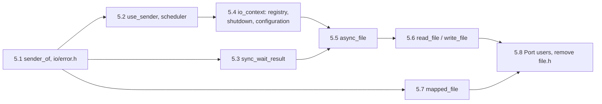

# Task 5 — IO layer

| | |
|---|---|
| Design | [07 — IO Layer](../design/07-io-layer.md), decisions D-65 to D-71, A-22 ([99](../design/99-decisions-and-open-questions.md)), [14 §3](../design/14-library-runtime.md#3-configuration) and [§4.2](../design/14-library-runtime.md#42-destruction) (configuration, shutdown step 2) |
| Namespace | `avis` (`sender_of`), `avis::io`, `avis::threading` (`sync_wait_result`) |
| New headers | `include/avis/sender_of.h`, `include/avis/io/error.h`, `include/avis/io/detail/registered_operation.h`, `include/avis/io/async_file.h`, `include/avis/io/detail/file_sender.h`, `include/avis/io/detail/receiver_stop_callback.h`, `include/avis/io/file_operations.h`, `include/avis/io/mapped_file.h` |
| New sources | `lib/avis/io/error.cpp`, `lib/avis/io/async_file.cpp`, `lib/avis/io/detail/file_sender.cpp`, `lib/avis/io/detail/async_file_state.h` (private), `lib/avis/io/file_operations.cpp`, `lib/avis/io/detail/safe_error.h` (private), `lib/avis/io/mapped_file.cpp`, `lib/avis/io/detail/operation_registry.h` (private), `lib/avis/io/detail/operation_registry.cpp` |
| Changed | `include/avis/io/asio_use_sender.h`, `asio_scheduler.h`, `io_context.h`, `io_configuration.h`, `lib/avis/io/io_context.cpp`, `include/avis/threading/parallel_helpers.h`, `include/avis/error.h` (comment), `lib/avis/runtime.cpp`, `lib/avis/runtime_configuration.cpp` |
| Removed | `include/avis/io/file.h`, `lib/avis/io/file.cpp` (replaced by `async_file`, D-65) |
| Tests | `tests/test_sender_of.cpp`, `tests/test_io_error.cpp`, `tests/test_operation_registry.cpp`, `tests/test_async_file.cpp`, `tests/test_file_operations.cpp`, `tests/test_mapped_file.cpp`, `tests/test_io_public_headers.cpp`, `tests/helpers/temporary_directory.h`; update `tests/test_asio_senders_receivers.cpp`, `tests/test_io_context.cpp`, `tests/test_runtime_configuration.cpp`, `tests/test_parallel_backend.cpp` (next to the existing `sync_wait` guard tests) |
| Prerequisites | [Task 1](01-foundations.md) (`avis::error`), [Task 3](03-parallel-scheduler.md) (`into_internal_error`, `sync_wait`, `forbid_blocking_waits`), [Task 4](04-library-runtime.md) (pool-hosted `io_context`, runtime, YAML configuration) |
| Reference | `external/asio-1.36.0/include/asio/detail/impl/win_iocp_handle_service.ipp` (read/write start, cancellation), `detail/impl/win_iocp_file_service.ipp` (open, size, resize, `sync_all`) |

> **Status (2026-10-23): 5.1–5.8 done in Debug and ASan.** All 134 test cases pass in both builds, and 20 random-order ASan runs of every `[io]` test (39 test cases) found no failure. The Driver ports (5.8) were checked by reading only, since the Driver has no build target yet. Windows Device Guard sometimes blocks a freshly linked test binary; relinking (touch a test source and rebuild) has produced one that runs. The Release run is left to you, as for tasks 3 and 4.

The IO layer gives Avis asynchronous file reads and writes as stdexec senders over asio's IOCP backend, plus a synchronous memory mapping for small indices. Every Avis sender completes with `set_value_t(…)`, `set_error_t(avis::error)` and `set_stopped_t()` ([07 §4.1](../design/07-io-layer.md#41-senders-avissender_ofh)).

5.7 only needs 5.1 and can be done any time after it.

## 5.1 Completion signatures and IO errors
- [x] `include/avis/sender_of.h` ([07 §4.1](../design/07-io-layer.md#41-senders-avissender_ofh)):
  - `template<typename... Values> using completions = stdexec::completion_signatures<set_value_t(Values...), set_error_t(avis::error), set_stopped_t()>`;
  - `concept sender_of<Sender, Values...>`: `stdexec::sender_in<Sender, stdexec::env<>>` and the set of `stdexec::completion_signatures_of_t<Sender, stdexec::env<>>` equals `completions<Values...>` in any order. Write the set comparison with a small helper of its own (each signature of one list is in the other, and the sizes match). Don't use stdexec `__detail` names, for the same reason as task 3.2.
  - No type-erased sender (D-66). Leave a comment pointing at 07 §4.1 for the `any_sender_of` alias to add if a consumer ever needs one.
- [x] `include/avis/io/error.h` and `lib/avis/io/error.cpp` ([07 §5.1](../design/07-io-layer.md#51-io-error-codes-avisioerrorh)): `enum class error_kind`, `to_string(error_kind)`, both `make_error` overloads, `is_error`.
  - `make_error(const std::error_code&, operation, path)` classifies by **category**, not by value alone (D-67):
    - `std::system_category()` (Win32 codes, which asio uses on Windows): `ERROR_FILE_NOT_FOUND`/`ERROR_PATH_NOT_FOUND` → `not_found`, `ERROR_ACCESS_DENIED` → `permission_denied`, `ERROR_SHARING_VIOLATION`/`ERROR_LOCK_VIOLATION` → `sharing_violation`, `ERROR_FILE_EXISTS`/`ERROR_ALREADY_EXISTS` → `already_exists`, `ERROR_DISK_FULL`/`ERROR_HANDLE_DISK_FULL` → `disk_full`, `ERROR_INVALID_PARAMETER` → `invalid_argument`, anything else → `system_error`;
    - `std::generic_category()` (errno values, e.g. from `std::filesystem`): map the `std::errc` equivalents of the same conditions;
    - any other category (asio's misc and netdb categories, …) → `system_error`.
  - The message is `"<operation> '<path>': <code.message()> (<category name> error <value>)"`, with the path printed as UTF-8. An empty path drops the `'<path>'` part (used by `use_sender`, 5.2).
  - Don't include `<windows.h>` in the header; the Win32 constants stay in `error.cpp`.
- [x] `include/avis/error.h`: update the comment on `error::code` to name `generic_error_kind` and `io::error_kind` (as in [01 §6.2](../design/01-system-architecture.md#62-error-type)).

**Tests** (`tests/test_sender_of.cpp`, `tests/test_io_error.cpp`):
- [x] `static_assert`s: `stdexec::just(1)` isn't a `sender_of<int>` (it has no `set_error` or `set_stopped`); a hand-written test sender with `completions<int>` is; signature order doesn't matter; extra or missing value types fail.
- [x] Each Win32 code in the table maps to its `error_kind`; an unknown Win32 code gives `system_error` with the number in the message; `asio::error::eof` (value 2, misc category) does **not** give `not_found`.
- [x] The message contains the operation, the path and the native number; `std::format("{}", error)` starts with `[io:<error_kind value>]`.

## 5.2 `use_sender` and `scheduler` on `avis::error`
Rework `include/avis/io/asio_use_sender.h` as listed in [07 §4.6](../design/07-io-layer.md#46-use_sender-and-scheduler).

- [x] **One operation state.** Merge `sender` and `transfer_sender` into one sender with one cancellable and one non-cancellable operation state. Fix the two latent bugs on the way: `execution_state::construction` (the enumerator is `constructed`) and `base::complete(std::forward(args)...)` (missing template argument).
- [x] **No hop.** Remove the `get_scheduler(env)` branch in `connect`: the sender completes on the IO thread that ran the handler ([07 §3](../design/07-io-layer.md#3-execution-model)).
- [x] **Error channel.** Compute the completion signatures from the asio signature `void(Args...)`:
  - when the first argument is `std::error_code` (`asio::error_code`), it's peeled off: `set_value_t(rest...)`, and at completion `operation_aborted` → `set_stopped`, any other error → `set_error(io::make_error(code, "<operation>", {}))`, success → `set_value(rest...)`;
  - otherwise `set_value_t(Args...)` as today;
  - `set_error_t(avis::error)` in both cases; an exception thrown by the initiation becomes `make_error(std::current_exception())`.
  - The operation name comes from the initiation type where possible, otherwise `"asio operation"`.
- [x] **Cancellation is serialised.** asio's cancellation signals aren't thread-safe, and with `io.threads > 1` a completion handler and a stop callback can run on two threads at once. Each cancellable operation creates an `asio::strand` on its I/O object's executor, binds the completion handler to it (`asio::bind_executor`), and the stop callback **posts** `signal_.emit(total)` to that strand instead of emitting inline. This replaces the current inline emit in `stop_callback_impl`.
- [x] **Registry.** *(Done in 5.4, where the registry is created.)* Cancellable operations register with their `io_context`'s operation registry for shutdown (5.4). They find it through the asio service on the executor's context (`asio::has_service` / `asio::use_service`); when the executor belongs to a plain `asio::io_context` without the service (a test), they skip registration.
- [x] `include/avis/io/asio_scheduler.h`: `schedule_sender_t::completion_signatures` become `set_value_t(), set_error_t(avis::error), set_stopped_t()`; a throwing `asio::post` completes with `set_error(make_error(std::current_exception()))`.

**Tests** (update `tests/test_asio_senders_receivers.cpp`; it currently throws `asio::system_error` from a `then` on the error code):
- [x] A `steady_timer::async_wait(use_sender)` completes with `set_value()` (no error-code argument any more) and runs the continuation on an IO thread even when the receiver's environment has a different scheduler (`sync_wait` with its `run_loop`).
- [x] Cancelling the timer through a stop token (`stdexec::stop_when` or an `inplace_stop_source`) completes with `set_stopped`; repeat 1000 times with `io.threads = 2` without a failure or an ASan report.
- [x] An asio operation that fails (e.g. `async_read_some_at` on a closed `random_access_file`) completes with `set_error(avis::error)` in `error_domain::io`.
- [x] `static_assert(avis::sender_of<decltype(timer.async_wait(use_sender))>)` and `static_assert(avis::sender_of<decltype(schedule(io.get_scheduler()))>)`.
- [x] `tests/test_io_context.cpp` and `tests/test_parallel_backend.cpp` still pass (they use `use_sender` and `io::scheduler`).

## 5.3 `sync_wait_result`
- [x] Add `template<stdexec::sender Sender> auto sync_wait_result(Sender&& sender)` to `include/avis/threading/parallel_helpers.h` ([07 §5.2](../design/07-io-layer.md#52-consuming-io-senders)). Implement it as `avis::threading::sync_wait(std::forward<Sender>(sender) | into_internal_error())` (so it inherits the `std::logic_error` on parallel workers and IO threads) and map the outcome:
  - no value types → `result<void>`; one → `result<T>`; several → `result<std::tuple<…>>`;
  - error → `std::unexpected(error)`;
  - `std::nullopt` from `sync_wait` (stopped) → `std::unexpected(make_error(generic_error_kind::cancelled, "operation stopped"))`.
- [x] Senders with more than one value signature aren't supported (like `sync_wait`); a `static_assert` with a readable message says so.

**Tests** (next to the existing `sync_wait` tests):
- [x] Value, `void`, multi-value, `just_error(avis::error)`, `just_error(std::exception_ptr)` (converted), `just_stopped()` → `generic_error_kind::cancelled`.
- [x] Called from an IO thread (inside `schedule(io.get_scheduler()) | then(…)`) and from parallel work: throws `std::logic_error`.

## 5.4 `io_context`: operation registry, shutdown, configuration
[07 §3.3](../design/07-io-layer.md#33-shutdown), D-71. Task 4 left `request_stop()` abandoning in-flight operations; this step replaces that with cancel-then-drain.

- [x] `include/avis/io/io_configuration.h`: add `std::chrono::milliseconds shutdown_timeout{ 1000 };` (include `<chrono>`, still no asio).
- [x] `io_context(threading::thread_pool& pool, const io_configuration& configuration)` replaces `(pool, std::size_t threads)`. Port `lib/avis/runtime.cpp` (`make_unique<io::io_context>(*pool, active.io)`) and `tests/test_io_context.cpp`.
- [x] `lib/avis/io/detail/operation_registry.h` (private, not installed): `detail::operation_registry`, an `asio::execution_context::service` that `avis::io::io_context` adds to its `asio::io_context` (`asio::make_service`), so anything holding an executor of that context can find it. It keeps an intrusive doubly linked list of `registered_operation` nodes (a `cancel()` virtual plus list links), guarded by a `std::mutex`, with a `std::condition_variable` signalled when it becomes empty.
  - `bool add(registered_operation&)` returns false once the registry is closed, and the caller then completes with `set_stopped` without starting;
  - `remove(registered_operation&)` is called by the operation just before it completes its receiver;
  - `close_and_cancel_all()` closes the registry and calls `cancel()` on every node under the lock. `cancel()` only **posts** to a strand, so it never runs a completion under the lock.
  - `bool wait_empty(std::chrono::milliseconds timeout)`.
  - ~~`detail::operation_registry_access`~~ *(not needed: `async_file` finds the registry through the same service lookup as `use_sender`, see As implemented)*.
- [x] Hook `use_sender` up to the registry (moved from 5.2): cancellable operations find it through the asio service on their executor's context (`asio::has_service` / `asio::use_service`), register in `start()`, and remove themselves in `complete()`. When the executor belongs to a plain `asio::io_context` without the service (a test), they skip registration. The registry's `cancel()` for a `use_sender` operation is the same posted emit as its stop callback.
- [x] `bool io_context::stopping() const noexcept` (true once `request_stop()` began).
- [x] `request_stop()`:
  1. set `stopping`, `operations_.close_and_cancel_all()`;
  2. release the work guard;
  3. if the calling thread isn't one of this context's IO threads (`current() != this`) and `shutdown_timeout > 0`: `wait_empty(shutdown_timeout)`; on timeout, log a warning on the `"io"` logger with the number of operations left;
  4. `context_.stop()`.
  
  It stays `noexcept` and idempotent. Called from an IO thread it skips the wait, because waiting there would block the completions it waits for.
- [x] `lib/avis/runtime_configuration.cpp`: read `runtime.io_shutdown_timeout_ms` (non-negative integer) into `io.shutdown_timeout`, with a `parse` error on a wrong type, like `io_threads` ([14 §3.2](../design/14-library-runtime.md#32-mapping-from-application-configuration)).

**Tests** (`tests/test_io_context.cpp`, `tests/test_runtime_configuration.cpp`):
- [x] A timer started with `use_sender` 10 s in the future: `request_stop()` completes it with `set_stopped` and returns well before the timeout.
- [x] An operation that ignores cancellation (a test-only registered node whose `cancel()` does nothing, completed manually later): `request_stop()` returns after about `shutdown_timeout` (configure 100 ms) and logs the warning; with `shutdown_timeout = 0` it returns immediately.
- [x] After `request_stop()`, a new `use_sender` operation completes with `set_stopped` without starting.
- [x] The existing constructor tests, ported to `io_configuration` (`threads = 2` on a one-slot pool throws, `threads = 0` throws).
- [x] YAML: `io_shutdown_timeout_ms: 250` → 250 ms; missing → 1000 ms; `io_shutdown_timeout_ms: soon` → `parse` error with the key path. Update the expected values of the `driver.yaml` example from 01 §7, which now sets `io_threads: 2`.

## 5.5 `async_file`
`include/avis/io/async_file.h` and `lib/avis/io/async_file.cpp`, as in [07 §4.2–4.4](../design/07-io-layer.md#42-open-mode), [§3.1](../design/07-io-layer.md#31-threading-one-strand-per-file) and [§5.3](../design/07-io-layer.md#53-cancellation). The header includes no asio and no `<windows.h>`.

### 5.5.1 Open mode and opening
- [x] `enum class open_mode`, `ALLOW_FLAGS_FOR_ENUM(avis::io::open_mode)` at global scope, `using open_flags = avis::flags<open_mode>`.
- [x] Validation before touching the file system: `error_kind::invalid_argument` when neither `read` nor `write`, `create` or `truncate` without `write`, or `exclusive` without `create`.
- [x] **Open the handle with `CreateFileW`, not asio's `open`.** asio 1.36's `win_iocp_file_service::open` calls `CreateFileA` (narrow path, so non-ASCII paths fail) with share mode `FILE_SHARE_READ | FILE_SHARE_WRITE` and no `FILE_SHARE_DELETE`. Instead:
  - `CreateFileW(path.c_str(), access, share, nullptr, disposition, FILE_ATTRIBUTE_NORMAL | FILE_FLAG_OVERLAPPED, nullptr)`;
  - access: `GENERIC_READ` and/or `GENERIC_WRITE`;
  - share: `FILE_SHARE_READ` for write opens, `FILE_SHARE_READ | FILE_SHARE_DELETE` for read-only opens (07 §4.2);
  - disposition from the flags: `exclusive` → `CREATE_NEW`; `create` + `truncate` → `CREATE_ALWAYS`; `create` → `OPEN_ALWAYS`; `truncate` → `TRUNCATE_EXISTING`; otherwise `OPEN_EXISTING`;
  - then hand the handle to `asio::random_access_file(executor, handle)`, which registers it with the IOCP. On failure close the handle and return `io::make_error(GetLastError(), "open", path)`.
- [x] Both `open` overloads; the path-only one uses `avis::runtime::io_context()`.

### 5.5.2 State, strand and close
- [x] `detail::async_file_state` (defined in `async_file.cpp`): the `asio::random_access_file`, an `asio::strand<asio::io_context::executor_type>`, the path, a back pointer to the `io_context`, and `bool closed_` (only touched on the strand). Its destructor closes the `random_access_file` (and so the handle); it runs when the `async_file` and every operation have released the state ([07 §3.1](../design/07-io-layer.md#31-threading-one-strand-per-file)).
- [x] `async_file` holds `std::shared_ptr<detail::async_file_state>`. Move constructor and assignment (assignment closes the current file first), destructor calls `close()`.
- [x] `close()`: if open, post to the strand `{ closed_ = true; file.cancel(); }` (capturing the `shared_ptr`), then reset `state_`. Idempotent, `noexcept` (a failing post is logged).
- [x] `size()`, `resize()`, `flush()`: synchronous on the caller thread through `random_access_file::size`, `resize`, `sync_all`; errors through `io::make_error(…, "size"/"resize"/"flush", path)`; on a closed object `error_kind::not_open`. `flush()` asserts in debug builds that it isn't called on an IO thread (`io_context::current() == nullptr`).
- [x] `is_open()`, `path()` (empty when closed).

### 5.5.3 `read_at_sender` and `write_at_sender`
- [x] `detail::file_operation`: the non-template core in `async_file.cpp`, also a `registered_operation` (5.4). It holds the state, offset, span, bytes done so far, an `asio::cancellation_signal`, and an atomic flag that guarantees a single completion.
- [x] `start()` of the operation state (template, in the header):
  1. stop already requested → `set_stopped`, no asio call;
  2. closed or moved-from file (`state_ == nullptr`) → `set_error(error_kind::not_open)`;
  3. register with the context's registry; if it's closed (`stopping`) → `set_stopped`;
  4. install the stop callback, which calls `request_cancel()`;
  5. `start_read` / `start_write`, which **posts** the first chunk to the strand.
- [x] On the strand: if `closed_` → complete `set_stopped` without calling asio. Otherwise call `async_read_some_at(offset + done, buffer.subspan(done), bind_cancellation_slot(signal_.slot(), bind_executor(strand, handler)))`.
- [x] Completion handler (runs on the strand because of `bind_executor`):
  - `operation_aborted` → `set_stopped`;
  - read hits `asio::error::eof` → `set_value(done)` (0 when reading at or past the end);
  - other error → `set_error(io::make_error(code, "read"/"write", path))`;
  - success: `done += n`; when the span is full → `set_value(done)`; a write that transferred 0 bytes without an error → `set_error(error_kind::short_write)`; otherwise start the next chunk directly (already on the strand).
  - Before completing: reset the stop callback, `remove` from the registry, then complete the receiver.
- [x] `request_cancel()` (stop callback, any thread): posts `signal_.emit(asio::cancellation_type::total)` to the strand. Registry `cancel()` does the same.
- [x] Offset overflow (`offset + span.size()` past `std::uint64_t`) → `error_kind::invalid_argument` at `start()`.
- [ ] ~~`get_env()` reports the IO scheduler as the completion scheduler for `set_value_t`.~~ *(Dropped: it would need asio in `async_file.h`; see As implemented.)*
- [x] `static_assert(avis::sender_of<read_at_sender, std::size_t>)` and the same for `write_at_sender`, in `async_file.cpp` or the test.

**Tests** (`tests/test_async_file.cpp`, with a runtime fixture with `io.threads` 1 and a second section with 2; `tests/helpers/temporary_directory.h` creates and removes a unique directory under `%TEMP%`):
- [x] Round trip: `write_at` at offsets 0, 4096 and 1 MiB + 3, then `read_at` returns the same bytes; `size()` matches.
- [x] `read_at` exactly at the end → 0; straddling the end → the partial count; past the end → 0.
- [x] A 64 MiB read completes in one `read_at` (exercises the chunk loop when the OS splits it).
- [x] `open` on a missing path → `error_kind::not_found`; `open_mode::exclusive | create | write` on an existing file → `already_exists`; a read-only file (attribute set by the test) opened for write → `permission_denied`; each invalid flag combination → `invalid_argument`. A path with non-ASCII characters (`"tëst ✓.bin"`) opens.
- [x] While a read-only `async_file` is open, a POSIX-semantics rename over its path succeeds (`FILE_SHARE_DELETE`), and the open handle still reads the old bytes. *(Amended: `std::filesystem::rename` / `MoveFileExW` can't replace an open file at all, see As implemented.)*
- [x] Stop token fired mid-read of a large file → `set_stopped`; a second read on the same file, started at the same time, completes with its bytes (per-operation cancellation).
- [x] 16 threads × 200 `read_at` calls on one `const async_file&` with random offsets: every read returns the expected bytes (`io.threads` 1 and 2; also run under ASan).
- [x] `close()` while other threads start `read_at` senders created before it: each completes with bytes or `set_stopped`, never with an error; the OS handle is closed only after the last completion (check with a `CreateFileW` share-mode probe that fails while the handle is open).
- [x] Destroying the `async_file` with reads in flight → they complete with `set_stopped`; no crash under ASan.
- [x] Operations on a default-constructed or moved-from `async_file` → `error_kind::not_open`.
- [x] `runtime` destruction with reads in flight: they complete with `set_stopped` through the registry, and the runtime shuts down without a timeout warning.

## 5.6 `read_file`, `write_file`, `file_size`
`include/avis/io/file_operations.h` and `lib/avis/io/file_operations.cpp`, as in [07 §4.5](../design/07-io-layer.md#45-whole-file-operations-avisiofile_operationsh) and [§3.2](../design/07-io-layer.md#32-blocking-file-work).

- [x] `read_file_sender` (`set_value(std::vector<std::byte>)`): a hand-written operation state over the 5.5 core: open read-only → `size()` → allocate (sizes that don't fit `std::vector<std::byte>::max_size()` → `error_kind::file_too_large`) → read loop → `set_value(std::move(buffer))`, truncated to the bytes read. No size-limit parameter (D-68). An empty file completes with an empty vector without issuing a read.
- [x] `write_file_sender` (`set_value()`), one state machine for the three policies:
  - `truncate`: open `write | create | truncate` → write loop → done (completes on an IO thread);
  - `create_new`: open `write | create | exclusive` → write loop → done;
  - `atomic_replace`: open `<path>.<pid>-<counter>.tmp` with `write | create | exclusive` in the same directory → write loop → **`continues_on(parallel scheduler)`** → `flush()` → close → rename the temporary file over `path` with POSIX semantics: open it with `DELETE` access and call `SetFileInformationByHandle(FileRenameInfoEx)` with `FILE_RENAME_FLAG_REPLACE_IF_EXISTS | FILE_RENAME_FLAG_POSIX_SEMANTICS` (found in 5.5: `MoveFileExW` fails with access denied while anyone has the target open) → done (completes on a parallel worker, D-70). On any failure after the temporary file exists: close it, `DeleteFileW` it (best effort, logged on failure) and complete with the original error. The counter is a process-wide atomic.
- [x] The owning `write_file(path, std::vector<std::byte>, policy)` overload moves the vector into the sender, which keeps it alive until completion.
- [x] Overloads with and without `io_context&`, as in 5.5.1.
- [x] `file_size(path)`: `GetFileAttributesExW` (no handle kept open) → `result<std::uint64_t>`; errors through `io::make_error(…, "file_size", path)`.
- [x] `detail::inject_atomic_replace_failure(bool)`: an atomic flag checked between the flush and the rename; when set, the state machine fails with `make_error(error_kind::system_error, "injected failure")` and takes the normal cleanup path.
- [x] `static_assert`s: `sender_of<read_file_sender, std::vector<std::byte>>`, `sender_of<write_file_sender>`.

**Tests** (`tests/test_file_operations.cpp`):
- [x] `write_file` then `read_file` round trip for each policy, for 0 bytes, 1 byte and 8 MiB.
- [x] `create_new` on an existing file → `error_kind::already_exists`, target unchanged.
- [x] `atomic_replace` with `inject_atomic_replace_failure(true)` → error; the target keeps its old bytes; no `*.tmp` file is left in the directory.
- [x] `atomic_replace` while the target is open in a read-only `async_file`: succeeds; the open handle still sees the old bytes, and a new `read_file` sees the new ones.
- [x] The same while the target is mapped by a `mapped_file` (after 5.7): the mapping still sees the old bytes.
- [x] Two concurrent `atomic_replace` writes of the same path with different data: both succeed, the result is exactly one of the two, no temporary file is left.
- [x] `atomic_replace` completes on a parallel worker (`detail::in_parallel_work()` in a `then` without a hop); `truncate` completes on an IO thread (`io_context::current() != nullptr`).
- [x] The owning overload: the caller's vector is destroyed right after `write_file` returns, and the write still produces the right bytes (ASan).
- [x] `read_file` on a missing path → `error_kind::not_found`; `file_size` on a missing path → `not_found`, on a file → its size.
- [x] The [07 §4.7](../design/07-io-layer.md#47-example) example compiles and runs, with a trivial `parse_scenario` that throws on an empty input (the error arrives as `avis::error` through `sync_wait_result`).

## 5.7 `mapped_file`
`include/avis/io/mapped_file.h` and `lib/avis/io/mapped_file.cpp`, as in [07 §6](../design/07-io-layer.md#6-memory-mapped-access). Synchronous; needs only 5.1.

- [x] `open(path)`: `CreateFileW(GENERIC_READ, FILE_SHARE_READ | FILE_SHARE_DELETE, OPEN_EXISTING)` → `GetFileSizeEx`. Size 0: keep the file handle, no mapping, empty span. Otherwise `CreateFileMappingW(PAGE_READONLY)` → `MapViewOfFile(FILE_MAP_READ)`. Failures: `CreateFileW` errors through `io::make_error(…, "open", path)`, mapping errors as `error_kind::mapping_failed` with the native code in the message. On partial failure, release what was created.
- [x] A file larger than `std::size_t` (only relevant for 32-bit builds) → `error_kind::file_too_large`.
- [x] Destructor and move assignment: `UnmapViewOfFile`, `CloseHandle` (mapping, then file). Handles stored as `void*`.
- [x] `bytes()`, `size()`, `is_open()`, `path()`.

**Tests** (`tests/test_mapped_file.cpp`):
- [x] Contents of a 1 MiB file match through `bytes()`; an empty file opens with an empty span; a missing file → `error_kind::not_found`.
- [x] Move construction and assignment leave the source closed and keep the view valid; no handle leak (handle count of the process before and after 1000 open/close cycles).
- [x] Renaming over the mapped path succeeds and the mapping keeps the old contents (also covered from 5.6).

## 5.8 Port the users and remove `file.h`
- [x] `apps/driver/sensor_injector.h/.cpp`: replace `avis::io::file` / `mode_flags::read_only` with `avis::io::async_file::open(path, open_mode::read)` (a `result`, so `injector_context` takes it as a constructor argument or stores the error). The commented-out `read_block_async` call becomes a commented `read_at` example.
- [x] `apps/driver/simulator_driver.cpp`: `async_read_some_at(…, use_sender)` now completes with `set_value(std::size_t)` (no error-code argument); update the continuation. The coroutine path that uses `asio::use_awaitable` is untouched.
- [x] The Driver has no build target yet (task 4), so these ports aren't compiled. Check them by reading, and note it in the status.
- [x] Remove `include/avis/io/file.h` and `lib/avis/io/file.cpp`; add the new sources to `lib/avis/CMakeLists.txt` and the new tests to `tests/CMakeLists.txt`. `grep -rn "io/file.h\|mode_flags\|read_block_async" apps include lib tests` returns nothing.
- [x] Public-header check: `async_file.h`, `file_operations.h`, `mapped_file.h`, `error.h` and `sender_of.h` include neither asio nor `<windows.h>` (a compile test that includes them in a translation unit that defines `ASIO_NO_DEPRECATED` and fails if `ASIO_VERSION` or `_WINDOWS_` is defined afterwards). *(Amended: also checks `ASIO_DETAIL_CONFIG_HPP`, see As implemented.)*
- [x] Update [07](../design/07-io-layer.md) where the implementation differs from it, and add an **As implemented** section here.

## As implemented
- **5.1 `sender_of`** (`include/avis/sender_of.h`): the set comparison is `detail::contains_signature` / `detail::same_signature_set`, with no stdexec `__detail` names. The positive cases are tested with a sender that only declares its completion signatures; the stdexec cases (`just`, `just | then`) are the negative ones, since plain stdexec algorithms never produce exactly `avis::completions`.
- **5.1 `io/error.h`** (`lib/avis/io/error.cpp`): the category name in the message is `std::error_category::name()`, so Win32 codes read `(system error 2)`, errno codes `(generic error 2)` and asio's end of file `(asio.misc error 2)`. System messages are stripped of their trailing line break. The errno mapping also maps `std::errc::file_too_large` to `error_kind::file_too_large`. A success code (value 0 in the system or generic category) maps to `error_kind::ok`.

- **5.2 `use_sender`** (`include/avis/io/asio_use_sender.h`): one sender, `use_sender_sender`, and one operation state, `use_sender_operation`, replace `sender`/`transfer_sender` and their two operation-state copies (so the two latent bugs went with them). The sender has no `get_env` and never hops.
  - **Cancellable** means the receiver's stop token can stop **and** the asio initiation has `get_executor()` (every asio I/O object's initiation does). Such an operation allocates a small shared `cancellation_state` (strand, signal, flags): the stop callback and every posted emit hold it, so an emit that runs after the completion sees `completed` and does nothing, and never touches the destroyed operation. Initiations without `get_executor()` can't be cancelled once started (the stop token is still checked before start).
  - The stop callback only posts the emit once `start()` has handed the operation to asio (`initiated`); a stop request that arrives earlier sets `requested`, and `start()` posts the emit right after initiating. That keeps the emit from racing with asio connecting the cancellation slot on the starting thread.
  - The operation name for error messages is parsed from `typeid(Initiation).name()`: the identifier after the last `initiate_` (`async_wait`, `async_read_some_at`), else `"asio operation"`.
  - Tests: besides the listed ones, a deterministic case where an IO-thread timer requests the stop after the 10 s wait is already running in asio (100 iterations, `io.threads = 2`), and a check of the operation-name parsing. The 1000-iteration case mostly exercises stops around `start()`.
- **5.2 `scheduler`**: completion signatures `set_value_t(), set_error_t(avis::error), set_stopped_t()`; `asio_scheduler.h` now includes `avis/error.h`.

- **5.3 `sync_wait_result`** (`include/avis/threading/parallel_helpers.h`): the sender is adapted to always complete with one value, `result<…>`, before `sync_wait` sees it: `then` builds the value, `upon_stopped` turns stopped into `generic_error_kind::cancelled`, `into_internal_error()` converts other error types, and `upon_error` turns `avis::error` into the unexpected result. Stopped is handled in the pipeline rather than through `sync_wait`'s `std::nullopt`, because this stdexec version's `sync_wait` rejects senders that can't complete with a value (`just_stopped()`, `just_error(…)`). The result type comes from `stdexec::value_types_of_t` in an empty environment; the "more than one value signature" `static_assert` is in `detail::single_result` and isn't covered by a test (it would be a compile failure). The IO-thread refusal test is in `test_io_context.cpp`, the others in `test_parallel_backend.cpp` (`[sync_wait_result]`).

- **5.4 registry** (`include/avis/io/detail/registered_operation.h`, `lib/avis/io/detail/operation_registry.h/.cpp`): The public header is named after `registered_operation`, the type operations derive from, so it doesn't share the path `avis/io/detail/operation_registry.h` with the private header (both are reachable from the tests, which have `lib/` on their include path). `use_sender` is header-only, so the part operations need is a small public, asio-free interface: `registered_operation` (intrusive links plus `cancel()`), `find_operation_registry(asio::execution_context&)`, `add_operation`, `remove_operation`. The `asio::execution_context::service` that implements it stays private. `io_context` creates it with `asio::make_service` and keeps a pointer. `async_file` (5.5) will find it the same way as `use_sender`, through the service on its executor's context, so there's no `operation_registry_access` friend.
- **5.4 `use_sender` and the registry**: every `use_sender` operation whose initiation has `get_executor()` is now cancellable, not only those whose receiver can stop. Otherwise operations started with `exec::start_detached` (whose stop token never fires) couldn't be cancelled at shutdown and would be abandoned. The stop callback is only installed when the token can stop. An operation registers after creating its cancellation state and before initiating; `complete()` removes it first, so `cancel()` (which runs under the registry's lock) never overlaps with the members being reset.
- **5.4 `request_stop()`**: idempotent through `stopping_.exchange(true)`; a second call only releases the guard and stops. The timeout warning is logged on the `"io"` logger as `io_context: <n> operation(s) still running after the <t> ms shutdown timeout; stopping without them`.
- **5.4 registry tests** (`tests/test_operation_registry.cpp`, `[operation_registry]`): white-box tests of the intrusive list, kept instead of `std::list` because adding an operation must not allocate or fail. They cover unlinking the head, a middle and the tail operation, emptying in any order and re-adding, `close_and_cancel_all` (each operation cancelled once, adds refused afterwards), `wait_empty` (immediate, timeout, woken only by the last removal) and the public functions. To include the private header they use a new `target_include_directories(AVIS_TESTS PRIVATE ${CMAKE_SOURCE_DIR}/lib)` in `tests/CMakeLists.txt`.
- **5.4 tests**: the timer case uses `exec::start_detached`, so it shows that the registry cancels an operation no stop token can reach. The stuck operation is a test-only `registered_operation` added through the public interface.

- **5.5 `async_file`** (`include/avis/io/async_file.h`, `include/avis/io/detail/file_sender.h`, `lib/avis/io/async_file.cpp`, `lib/avis/io/detail/file_sender.cpp`, `lib/avis/io/detail/async_file_state.h`):
  - The implementation is split the same way as the headers: `async_file.cpp` has opening, the synchronous members and `close()`; `file_sender.cpp` has `detail::file_operation` and the read/write loop (`issue_next`, `on_chunk`, `finish`); the private `async_file_state.h` defines `async_file_state` (the asio file, strand and path), which both use. `file_operation_core`, the per-operation state declared in `detail/file_sender.h`, is defined in `file_sender.cpp`, its only user.
  - The sender templates (`file_sender`, `file_operation_state`, the non-template `file_operation` base and the forward declarations of the state types) are in `avis/io/detail/file_sender.h`, which `async_file.h` includes; `async_file.h` keeps `open_mode`, `async_file` and the `read_at_sender` / `write_at_sender` aliases.
  - `read_at_sender` / `write_at_sender` are aliases of `detail::file_sender<file_operation_kind>`, sharing `detail::file_operation_state<Receiver>`. There's no `get_env()` with the IO scheduler as completion scheduler: naming `io::scheduler` would pull asio into the header. The senders still always complete on an IO thread.
  - The non-template core is `detail::file_operation` (a `registered_operation`) with `prepare()` (validation, `not_open`, overflow, empty buffer, registry), then the template installs its stop callback, then `submit()` posts the first chunk. Each started operation allocates a `file_operation_core` that the posted cancellations and asio handlers hold, so a cancellation that runs after the completion never touches the destroyed operation state. All asio calls, the `closed` flag and the cancellation emits run on the file's strand (D-69).
  - asio passes buffer sizes to `ReadFile`/`WriteFile` as `DWORD`, so the loop issues chunks of at most 1 GiB.
  - **POSIX rename finding:** a classic rename (`MoveFileExW` with `MOVEFILE_REPLACE_EXISTING`, which `std::filesystem::rename` uses) fails with access denied while the target has *any* open handle, `FILE_SHARE_DELETE` or not. A POSIX-semantics rename (`SetFileInformationByHandle(FileRenameInfoEx)`) succeeds as long as every open handle shares delete. 5.6's `atomic_replace` and 07 §4.5 now use it; the 5.5 test uses a small `posix_rename` helper.
  - **Build:** `AVIS_LIB` now defines `_WIN32_WINNT=0x0A00` publicly (D-05's Windows 11 minimum). Without it asio defined Windows 7 (`0x0601`), which hid `FileRenameInfoEx` and caused the "Please define _WIN32_WINNT" notes.
  - **`open_flags` and `enum_flags.h`:** `open_mode::read | open_mode::write` didn't compile at first: `avis/enum_flags.h` declared its friend operators in `namespace avis` but defined them globally, so `flags | enum`, `flags & enum` and `iterator != iterator` were ambiguous. Fixed in the header: the `flags` and iterator operators (`|`, `&`, `^`, `==`, `swap`) are now hidden friends defined in the classes (an enum operand converts through the implicit `flags(enum_type)` constructor; C++20 derives `!=`), the duplicate global definitions are gone, and the global `enum ⊕ enum` templates build their result with the `constexpr` single-enum constructor, so `constexpr colours value = colour::red | colour::blue;` works. `tests/test_enum_flags.cpp` (`[enum_flags]`) covers chains, mixed operands, use from inside a namespace, constant expressions, comparison, iteration and `swap`. `async_file.cpp` and the tests use `|` and `&` again. Brace initialisation with an enum (`colours{ colour::blue }`) still picks the non-`constexpr` initializer-list constructor; use parentheses in constant expressions.
  - Tests (`tests/test_async_file.cpp`, `tests/helpers/temporary_directory.h`): the "stop while reading" case is probabilistic (a stop request from another thread races the read; it accepts stopped or a full count, never an error or a partial count, and the parallel read always completes). Shutdown is covered twice: through the runtime (the file has to be closed before the runtime is destroyed, so its reads are cancelled by `close()`) and through an own `io_context` whose `request_stop()` cancels reads of a file that is still open, through the registry.

- **5.6 whole-file operations** (`include/avis/io/file_operations.h`, `lib/avis/io/file_operations.cpp`):
  - **On top of the 5.5 core.** The read or write loop is a `detail::whole_file_transfer`, a `detail::file_operation` whose completion is forwarded to the whole-file state, so the registry, the strand, cancellation and chunking all come from 5.5. Files are opened with `async_file::open`; `detail::async_file_access`, a friend of `async_file` defined in `file_operations.cpp`, then takes over the file's state, so the operation decides when the handle is closed. The template operation states in the header hold the receiver and its stop callback; the rest (`read_file_core`, `write_file_core`) is allocated in `prepare()`.
  - **Handles are closed before completing.** `read_file`, `truncate` and `create_new` close the handle on the strand in the last completion; `atomic_replace` closes the temporary file on the parallel worker right after the flush. Left to the state's destructor, the handle would close at some later point on an IO thread, and an open write handle (which shares neither write nor delete) would make a `read_file` started right after the write fail with `sharing_violation`, and the rename of a concurrent `atomic_replace` fail with access denied. Closing the asio file off the strand is safe at that point because no operation can still run on it.
  - **Rename:** the closed temporary file is reopened with `DELETE | SYNCHRONIZE` and every share mode, then renamed with `FileRenameInfoEx` (`REPLACE_IF_EXISTS | POSIX_SEMANTICS`), as in the 5.5 test helper. A failed rename is reported as operation `replace` with the target path, a failed flush as `flush` with the temporary path.
  - **Registry and cancellation:** `atomic_replace` also registers the whole operation (`write_file_core` is a `registered_operation`), because the flush and rename run outside the transfer; `request_stop()` therefore waits for them as well. A stop or registry cancel before the rename completes with `set_stopped` and deletes the temporary file; once the rename has started, the write completes normally. A mutex orders a cancel with the transfer's start. `read_file`, `truncate` and `create_new` rely on the transfer's own registration.
  - **Where they complete:** errors found in `start()` (open failures, `file_too_large`, a stopping context), an empty file and empty data complete inline in `start()`, like `read_at` with an empty span; `atomic_replace` with empty data still hops to the parallel scheduler for the flush and rename. Otherwise `read_file`, `truncate` and `create_new` complete on an IO thread and `atomic_replace` on a parallel worker.
  - **Overloads:** the owning overload also has an `io_context&` variant. An lvalue `std::vector<std::byte>` picks the owning overload and is copied (passing a vector to a by-value vector parameter is an exact match, the span overload needs a conversion); the header comment says so. `write_file_sender` is move-only, since its span may point into its own vector.
  - **`file_size` and argument-dependent lookup:** an unqualified `file_size(path)` with a `std::filesystem::path` argument is ambiguous with `std::filesystem::file_size`, which argument-dependent lookup finds, even inside `avis::io`. Call it as `avis::io::file_size`.
  - **Shared helpers:** the optional stop callback of the operation states is now `detail::receiver_stop_callback` (`include/avis/io/detail/receiver_stop_callback.h`), which `file_operation_state` uses too; the `noexcept` error factories (`safe_error`, `current_exception_error`) moved from `file_sender.cpp`'s unnamed namespace to the private `lib/avis/io/detail/safe_error.h`.
  - Tests (`tests/test_file_operations.cpp`, `[file_operations]`): besides the listed ones, `read_file` completes on an IO thread, `atomic_replace` into a missing directory fails with `not_found`, and a stop token stops a 16 MiB `atomic_replace` before start and while writing (20 times; each run either replaced the file completely or left the old file, with no temporary file left; locally all 20 were stopped). The concurrent-writers case runs 20 times with `io.threads = 2`.

- **5.7 `mapped_file`** (`include/avis/io/mapped_file.h`, `lib/avis/io/mapped_file.cpp`): as in 07 §6.
  - `open` fills a local `mapped_file` step by step (file handle, then mapping, then view) and returns it; on a failure the local's destructor releases what was created, so there's no separate cleanup path for partial failures.
  - Errors: `CreateFileW` through `make_error(…, "open", path)`, `GetFileSizeEx` through `make_error(…, "size", path)`. A failed `CreateFileMappingW` (`"map"`) or `MapViewOfFile` (`"map view"`) gets the same classified message, operation, path and native code, with the code replaced by `error_kind::mapping_failed`.
  - `mapped_file.h` includes `avis/io/error.h`, like `async_file.h`, so callers can check `error_kind` values.
  - A moved-from or closed `mapped_file` has an empty path as well as an empty span.
  - Tests (`tests/test_mapped_file.cpp`, `[mapped_file]`): the handle-count check runs 1000 cycles of open, move construction, move assignment and a failed open, alternating a 4 KiB and an empty file, and allows 2 handles of slack for other threads of the test process. The rename case replaces the mapped path with `write_file` (`atomic_replace`); 5.6's "target open" test now also holds a `mapped_file`.

- **5.8 ports and cleanup:**
  - `apps/driver/sensor_injector.h/.cpp`: `injector_context` takes an opened `avis::io::async_file` in an `explicit` constructor (the caller gets `open`'s error as a `result` before the context exists) and keeps the default constructor for "no recording yet", which `recording_sensor_injector` uses. `file()` returns `const async_file&` (the `async_file` members are `const`) and still throws when nothing is open; it lost its wrong `noexcept`. The `asio/io_context.hpp` include is gone. The header-read stub is a commented `read_at | continues_on(parallel) | then(parse)` example; the unused `file` variable is `[[maybe_unused]]`.
  - `apps/driver/simulator_driver.cpp`: `read_block` has a comment with its new completions, and the commented-out continuation takes `(std::size_t bytes)` instead of `(std::error_code, std::uint64_t)`. The `asio::use_awaitable` coroutine is untouched.
  - Neither port is compiled (no Driver target); both were checked by reading.
  - `include/avis/io/file.h` and `lib/avis/io/file.cpp` are removed, and so is `io/file.cpp` in `lib/avis/CMakeLists.txt`. They had never been committed, so git has no copy of them.
  - **Header check** (`tests/test_io_public_headers.cpp`, `[io][headers]`): includes the five headers before anything else and has an `#error` for asio and for `<windows.h>` (`_WINDOWS_`). `ASIO_VERSION` alone would miss most leaks: only `asio/version.hpp` and `asio.hpp` define it, not single headers such as `asio/io_context.hpp`. So the test also checks `ASIO_DETAIL_CONFIG_HPP`, the include guard of `asio/detail/config.hpp`, which every asio header includes. A scratch translation unit that adds `asio_use_sender.h` stopped at the `#error` with the guard check and compiled without it. `ASIO_NO_DEPRECATED` is already defined for every target, so the test doesn't define it again.
  - 07 now says `file.h` is removed and names the header check; the "existing code diverges" note in 99 no longer lists `file` / `mode_flags` or `use_sender`'s `std::exception_ptr`.

## Acceptance criteria
- Every sender in `avis::io` satisfies `avis::sender_of<…>`: no IO sender completes with `std::exception_ptr` or `std::error_code` any more.
- `async_file`, `read_file`, `write_file` and `mapped_file` work as described in 07, including per-operation cancellation, close with operations in flight, and atomic replace with cleanup on failure.
- Shutting down the runtime with IO in flight cancels it and returns within `io.shutdown_timeout`; no operation is abandoned silently.
- `include/avis/io/file.h` is gone; no public IO header except `io_context.h`, `asio_scheduler.h` and `asio_use_sender.h` includes asio.
- All tests above pass in Debug, Release and under ASan, including the concurrent-readers and close-race tests with `io.threads` 1 and 2, and 20 random-order runs of the `[io]` tests.

## Open points
- **Cache-hit reads on the IO thread.** With the per-file strand (D-69), `ReadFile` calls that are served from the file cache copy on an IO thread. Add a benchmark (many concurrent 1 MiB cached reads, `io.threads` 1 and 2) so the "revisit when IO threads are busy in `ReadFile`" condition in 07 §3.1 can be checked with numbers.
- **`use_sender` operation names.** asio initiations don't carry a readable name; `"asio operation"` may be all the error message can say for timers and handles. Decide whether `use_sender` should take an optional name (`use_sender("fence wait")`).
- **Driver build target.** The 5.8 ports can't be compiled until the Driver has a target; they should be rechecked when it does.
