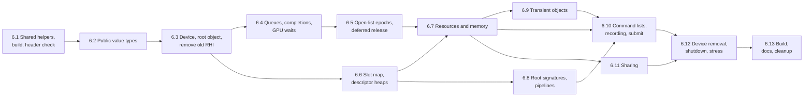

# Task 6 — RHI (render hardware interface)

| | |
|---|---|
| Design | [09 — RHI](../design/09-rhi.md): Part I (§0–§18) for the public interface, Part II (§19–§24) for the private side. Decisions D-05, D-18–D-20, D-25, D-64, D-72, D-74–D-79, D-81, D-84–D-96, A-23, A-39 ([99](../design/99-decisions-and-open-questions.md)). [07 §4.8 — Shared sender helpers](../design/07-io-layer.md#48-shared-sender-helpers-avisdetail) for 6.1 |
| Namespace | `avis::rhi` (public), `avis::rhi::detail` (sender templates, state access), `avis::rhi::d3d12` (private), `avis::detail` (shared sender helpers) |
| New public headers | `include/avis/rhi/`: `types.h`, `error.h`, `formats.h`, `configuration.h`, `render_hardware_interface.h` (rewritten), `queue.h`, `synchronization.h`, `completion_driver.h`, `transient.h`, `command_list.h`, `resources.h`, `memory.h`, `barriers.h`, `pipeline.h`, `root_signature.h`, `shared.h`, `detail/completion_waiter.h`, `detail/gpu_wait_sender.h`; `include/avis/detail/receiver_stop_callback.h` (moved) |
| New sources | `lib/avis/rhi/`: one `.cpp` per public header with out-of-line members ([09 §2.2](../design/09-rhi.md#22-private-implementation)); `lib/avis/rhi/d3d12/`: every file of [09 §20.1](../design/09-rhi.md#201-files), [§21.1](../design/09-rhi.md#211-files), [§22.1](../design/09-rhi.md#221-files), [§23.1](../design/09-rhi.md#231-files) and [§24.1](../design/09-rhi.md#241-files); `lib/avis/detail/safe_error.h` (moved generic half); `lib/avis/detail/check.h/.cpp` (`AVIS_CHECK`, 6.1) |
| Changed | `include/avis/io/detail/file_sender.h`, `include/avis/io/file_operations.h`, `lib/avis/io/detail/file_sender.cpp`, `lib/avis/io/file_operations.cpp`, `lib/avis/io/detail/safe_error.h` (6.1); `apps/visualizer/visualizer_driver.h/.cpp`, `apps/visualizer/CMakeLists.txt` (6.3); `lib/avis/CMakeLists.txt`, `tests/CMakeLists.txt` |
| Removed | `include/avis/rhi/buffer.h`, `command_context.h`, `gpu_resource.h`, `resource_allocator.h` and their `lib/avis/rhi/*.cpp`; `include/avis/rhi/com_ptr.h` moves to `lib/avis/rhi/d3d12/com_ptr.h` (D-85) |
| Tests | `tests/test_check.cpp`, `tests/test_rhi_public_headers.cpp`, `tests/test_rhi_types.cpp`, `tests/test_rhi_conversions.cpp`, `tests/test_rhi_device.cpp`, `tests/test_rhi_completions.cpp`, `tests/test_rhi_lifetime.cpp`, `tests/test_rhi_slot_map.cpp`, `tests/test_rhi_descriptor_heaps.cpp`, `tests/test_rhi_resources.cpp`, `tests/test_rhi_pipelines.cpp`, `tests/test_rhi_transient.cpp`, `tests/test_rhi_command_lists.cpp`, `tests/test_rhi_sharing.cpp`, `tests/test_rhi_device_removal.cpp`, `tests/test_rhi_stress.cpp`; helpers `tests/helpers/rhi_fixture.h/.cpp`, `tests/helpers/rhi_waits.h`, `tests/helpers/recorded_assertions.h` |
| Prerequisites | [Task 1](01-foundations.md) (`avis::error`, `avis::log`, `tests/helpers/log_capture.h`), [Task 3](03-parallel-scheduler.md) (`blocking_wait_forbidden()`, `sync_wait`), [Task 5](05-io-layer.md) (`avis::sender_of`, `receiver_stop_callback`, `safe_error`, the `enum_flags.h` fix, the `lib/` include path of `AVIS_TESTS`). The RHI doesn't use the IO layer itself ([09 §0](../design/09-rhi.md#0-summary)). |
| Reference | `external/D3D12MemoryAllocator-3.2.0/include/D3D12MemAlloc.h` (`CreateResource3`, `CreateAliasingResource2`, `GetBudget`); Windows SDK 10.0.26100 `d3d12.h` (enhanced barriers, `ID3D12Device10`, `ID3D12GraphicsCommandList7`); MiniEngine's `CommandAllocatorPool` for the allocator reuse scheme ([09 §24.2](../design/09-rhi.md#242-d3d12command_list_poolh)) |

> **Status (2026-10-29): task 6 done (6.1–6.13).** All 85 `[rhi]` test cases pass in Debug and ASan and 84 in Release (the watchdog test is Debug-only) on the RX 7800 XT, and the Release run also passes with `AVIS_TEST_ADAPTER=warp`. 20 random-order runs of the `[rhi]` tests passed in Debug and in ASan, with no test tagged `[no_asan]`. The whole Debug suite passes (223 test cases). The Visualizer starts and exits cleanly in Debug and Release.

The RHI is a D3D12-only layer over the device, memory, resources, descriptors, pipelines, queues, synchronization and command recording. It knows no frames, owns no thread and doesn't depend on the IO layer. Its public headers contain no D3D12, DXGI, D3D12MemoryAllocator or `<windows.h>` type ([09 §2.1](../design/09-rhi.md#21-public-headers)). Consumers reach it through subsystem views built from the root object ([09 §4.3](../design/09-rhi.md#43-subsystem-views)).

**Not in this task.** The graphics layer built on the RHI: the frame scheduler, the upload and readback queues, `gpu_completion_thread` ([17](../design/17-graphics-frames-and-transfers.md)), the shader library, binding layout, root signature registry and pipeline cache ([18](../design/18-graphics-shaders-and-pipelines.md)). Also out of scope: the render graph (10), the renderer (11) and the Visualizer's viewport integration (12). The render pass prototype (`include/avis/graphics/`, `lib/avis/graphics/`) and the Visualizer's `scene_renderer` leave the build in 6.3 and aren't ported here: the prototype executes no pass, and design 10 replaces its API. The render graph task brings them back, rewritten.

**Order.** The steps follow `device_state`'s construction order ([09 §19.3](../design/09-rhi.md#193-destruction-order)) rather than the reading order of Part II. The lifetime manager (§23.8) and the descriptor heaps (§22.2) come before the resource manager because it takes references to both. `device_state` grows one subsystem per step: each step adds its member and its `create` call in construction order, and its accessor.

6.8 only needs 6.6 and can run in parallel with 6.4, 6.5 and 6.7. 6.11 can run in parallel with 6.9 and 6.10.

## Conventions for this task
- **GPU tests.** Every test that creates a device uses `tests/helpers/rhi_fixture.h` (6.3), tagged `[rhi]`. Tests that need no device (value types, conversions, slot maps, epochs, the release queue) are tagged `[rhi][unit]` and run anywhere.
- **Debug layer on.** The fixture creates the RHI with the debug layer and routes the info queue to the "rhi" logger. A `log_capture` fails the test on any message at `error` level or above, so a D3D12 validation error fails the test that caused it ([09 §19.5](../design/09-rhi.md#195-testing-hooks)).
- **Deterministic waits.** Tests drive completions themselves. They submit, wait on the queue fence with a private event (fixture helper `wait_for(point)`), call `completion_driver::poll_completions()`, and check exactly which senders completed. No driver thread runs in tests.
- **Private headers in tests.** White-box tests include `lib/avis/rhi/d3d12/*.h` through the `lib/` include path of `AVIS_TESTS` (task 5.4). From 6.13 on, `AVIS_TESTS` links `D3D12MemoryAllocator` itself, because `AVIS_LIB` no longer exports it.
- **Testable debug checks.** The design asserts on programming errors in debug builds (stale handles in recording calls, resets with incomplete points, destroying a heap with live placed resources). Route these through `AVIS_RHI_CHECK(condition, message)` in `d3d12/check.h` (6.3), a one-line wrapper that passes the "rhi" logger to the library-wide `AVIS_CHECK` (6.1, [01 §6.1](../design/01-system-architecture.md#61-rules) rule 6). Both evaluate to the condition, so a call site writes `if (!AVIS_RHI_CHECK(…)) return;`. In debug builds a failed check logs at `critical` and calls the assertion handler; in release builds it logs at `error`, and the call goes on as the design says for release builds. The test hook `avis::detail::set_assertion_handler` installs a handler that only records the message, so tests can check an assertion in Debug without a death test. Throwing isn't an option, because many of these paths are `noexcept`.
- **ASan.** Every `[rhi]` test also runs in the AddressSanitizer build (a probe with the debug layer and GPU-based validation ran clean under ASan, see Open points). If a test hits a false positive or a crash inside the D3D12 runtime or the driver, tag only that test `[no_asan]`, filter it out of the ASan run with `~[no_asan]`, and record the stack and the reason in **As implemented**.
- **Public-header check.** Each step adds its new public headers to `tests/test_rhi_public_headers.cpp` (6.1).
- **Small utilities.** `small_vector` and `intrusive_list` are named in Part II. Use `std::vector` and a minimal intrusive list local to `lib/avis/rhi/d3d12/` until profiling asks for more ([09 §21.3](../design/09-rhi.md#213-d3d12resource_recordsh)).

## 6.1 Shared sender helpers, build setup, header check
The RHI's senders need the two helpers that today live in the IO layer ([07 §4.8](../design/07-io-layer.md#48-shared-sender-helpers-avisdetail)).

- [x] Move `include/avis/io/detail/receiver_stop_callback.h` to `include/avis/detail/receiver_stop_callback.h`, namespace `avis::detail`. Its contents are unchanged.
- [x] Split `lib/avis/io/detail/safe_error.h`. The generic half (`safe_error(error_domain, code, message)`, `current_exception_error()`) goes to `lib/avis/detail/safe_error.h` in `avis::detail`. The two IO overloads stay in `io::detail`, written on top of it.
- [x] Update the includes and qualifiers in `file_sender.h`, `file_operations.h`, `file_sender.cpp` and `file_operations.cpp`. No behaviour changes.
- [x] `lib/avis/detail/check.h/.cpp`, namespace `avis::detail` ([01 §6.1](../design/01-system-architecture.md#61-rules) rule 6):
  - `AVIS_CHECK(logger, condition, message)` evaluates `condition` once and yields it as a `bool`. When it's false, debug builds log `message` with the caller's `std::source_location` at `critical` on the named logger and call the assertion handler; release builds log at `error` and call nothing.
  - `set_assertion_handler(handler) noexcept` installs a `void(std::string_view message, std::source_location) noexcept` handler and returns the previous one. The default handler calls `__debugbreak()` when a debugger is attached, otherwise `std::abort()`.
  - No existing `assert` moves to it in this task.
- [x] Create `lib/avis/rhi/d3d12/` and `include/avis/rhi/detail/`. New RHI sources join `target_sources(AVIS_LIB …)` step by step.
- [x] `tests/test_rhi_public_headers.cpp` ([09 §2.1](../design/09-rhi.md#21-public-headers)) includes every new public RHI header before anything else. It fails with `#error` if any of these is defined afterwards: `_WINDOWS_`, `__d3d12_h__`, `D3D12MA_RECOMMENDED_ALLOCATOR_FLAGS` (D3D12MemAlloc.h has no include guard, only `#pragma once`), `ASIO_DETAIL_CONFIG_HPP`, or one of the `AVIS_IO_*` include guards. In this step it covers `avis/detail/receiver_stop_callback.h`, and each later step adds its headers.

**Tests:**
- [x] All `[io]` tests pass unchanged.
- [x] `tests/test_check.cpp` (`[check]`): with a recording handler installed, a failing `AVIS_CHECK` yields `false`, calls the handler once (Debug) with the message and the caller's file and line, and logs at `critical` on the named logger (`log_capture`). A passing check yields `true` and logs nothing. `set_assertion_handler` returns the previous handler, and the test restores it.
- [x] The header check compiles. A scratch translation unit that adds `<windows.h>` after the includes stops at the `#error`; don't commit it.

## 6.2 Public value types
Headers with no device behind them, so everything here is `[rhi][unit]`. The views and classes that need a device come in their own steps.

- [x] `rhi/types.h` ([09 §3.1–3.2](../design/09-rhi.md#31-rhitypesh)): `queue_type`, `gpu_address`, `bindless_index`, `adapter_luid`, `subresource`, `subresource_range`, `all_subresources`, `viewport`, `rectangle`, `comparison`; `handle<Tag>`, the seven handle aliases and `std::hash<handle<Tag>>`.
  - `detail::handle_access` is declared here and defined privately, in `lib/avis/rhi/d3d12/slot_map.h` (6.6). Until then, a test-only definition in the test file covers it.
- [x] `rhi/error.h` ([09 §3.4](../design/09-rhi.md#34-rhierrorh)): `error_kind`, `to_string`, `make_error` (in the existing `error_domain::rhi`), `is_error`, `device_lost`.
- [x] `rhi/formats.h` ([09 §3.5](../design/09-rhi.md#35-rhiformatsh)): `format`, `format_traits`, the `constexpr traits(format)` table, `to_string(format)`.
- [x] `rhi/configuration.h` ([09 §4.1](../design/09-rhi.md#41-configuration-rhiconfigurationh)): the four configuration structs with their defaults.
- [x] `rhi/barriers.h` ([09 §10](../design/09-rhi.md#10-barriers-rhibarriersh)): `pipeline_synchronization`, `resource_access`, `texture_layout`, `access_state`, `access_states::*`, `texture_barrier`, `buffer_barrier`, `global_barrier`. Add `ALLOW_FLAGS_FOR_ENUM` at global scope for the two flag enums and for `texture_usage` and `buffer_usage`. The `access_states` constants pass enums positionally (the brace form isn't `constexpr`, task 5.5).
- [x] The description types (no views yet):
  - `rhi/resources.h` ([09 §8.1](../design/09-rhi.md#81-descriptions), [§8.3](../design/09-rhi.md#83-persistent-views-and-bindless-indices), [§11.1](../design/09-rhi.md#111-copy-footprints)): usages, `memory_type`, `clear_value`, `texture_description`, `buffer_description`, `filter`, `address_mode`, `sampler_description`, `texture_view`, `copy_footprint`;
  - `rhi/memory.h` ([09 §8.5](../design/09-rhi.md#85-placed-resources-and-heaps-rhimemoryh)): `heap_kind`, `heap_description`, `allocation_requirements`;
  - `rhi/root_signature.h` ([09 §12.1](../design/09-rhi.md#121-root-signatures-rhiroot_signatureh)): `root_parameter_kind`, `shader_visibility`, `root_parameter`, `static_sampler`, `root_signature_description`;
  - `rhi/pipeline.h` ([09 §12](../design/09-rhi.md#12-pipelines-rhipipelineh)): the state enums and structs, `graphics_pipeline_state`, `graphics_pipeline_description`, `compute_pipeline_description`.
- [x] `rhi/queue.h`: `synchronization_point` and `latest()` ([09 §5](../design/09-rhi.md#5-queues-and-synchronization-rhiqueueh)). The `queue<Queue>` view follows in 6.4.

**Tests** (`tests/test_rhi_types.cpp`, `[rhi][unit]`):
- [x] A default handle is invalid. Distinct tags are distinct types: `static_assert(!std::is_same_v<graphics_pipeline_handle, compute_pipeline_handle>)`. `std::hash` works in a `std::unordered_set`.
- [x] `traits()` matches the table in §3.5 for every enumerator (BC formats: 4×4 blocks of 8 or 16 bytes; `d32_float` is depth; the `_srgb` formats are sRGB). `to_string` names every enumerator.
- [x] `make_error(error_kind::invalid_handle, "…")` is in `error_domain::rhi`, `is_error` recognises it, and `std::format` prints the kind. `device_lost` derives from `avis::runtime_error`.
- [x] `access_states::*` are usable in constant expressions. `latest()` picks the higher value on one queue.

## 6.3 Device, root object, removal of the old RHI
Foundations, device creation and the root object ([09 §20](../design/09-rhi.md#20-device-and-diagnostics), [§4](../design/09-rhi.md#4-render-hardware-interface)). The new root replaces the old class in the same header, so the old RHI goes in this step.

### 6.3.1 Remove the old RHI
- [x] Delete `buffer`, `command_context`, `gpu_resource` and `resource_allocator` (headers and sources). Move `com_ptr.h` unchanged to `lib/avis/rhi/d3d12/com_ptr.h` (D-85).
- [x] Remove `graphics/render_pass.cpp`, `render_pass_builder.cpp` and `render_pipeline.cpp` from `AVIS_LIB`, and the Visualizer's `scene_renderer` from `AVIS_VISUALIZER`. Their pass callbacks name the old context types. They stay in the tree, out of the build, as the starting point of the render graph task ([10 §1.1](../design/10-render-graph.md#11-relation-to-the-existing-code)), which rewrites them and puts them back. `render_pipeline::execute` runs no pass today, so the Visualizer loses no behaviour.
- [x] Port `apps/visualizer/visualizer_driver` to `render_hardware_interface::create`, with the debug layer on as before (`render_hardware_interface(false, true)`). Drop `resource_allocator_`, the `renderer_` member and its `render` call, and the `scene_renderer.h` include. The Visualizer builds and starts.

### 6.3.2 Foundations
- [x] `d3d12/d3d12.h` ([09 §20.2.1](../design/09-rhi.md#2021-d3d12d3d12h)): the single include point and the interface aliases. `unique_handle` in its own `d3d12/unique_handle.h`.
- [x] `d3d12/check.h/.cpp` ([09 §20.2.2](../design/09-rhi.md#2022-d3d12checkh)): `make_error(HRESULT, …)` (noexcept, classified; message `"<operation>: <system message> (HRESULT 0x…)"`), `check`, `check_device`, `is_device_removed_code`. Base them on `avis::detail::safe_error`. Also `AVIS_RHI_CHECK`, the wrapper over `AVIS_CHECK` (Conventions).
- [x] `d3d12/leaf_mutex.h` ([09 §19.4](../design/09-rhi.md#194-locking)): the mutex type of every RHI lock in the §19.4 table, from 6.4 on.
  - Release builds: a `std::mutex` whose constructor ignores the name (not an alias: `std::mutex` can't be constructed from a name).
  - Debug builds: a class over `std::mutex` with `lock`, `try_lock` and `unlock`, so `std::lock_guard`, `std::unique_lock` and `std::scoped_lock` work with it. One `thread_local bool` across all instances means "this thread holds an RHI lock". `lock` and `try_lock` check it's clear with `AVIS_RHI_CHECK`, naming the lock in the message, and set it once the lock is held; `unlock` clears it. A failed `try_lock` changes nothing.
  - Each `leaf_mutex` takes a `const char*` name for the message (ignored in release builds).
- [x] `d3d12/conversions/` ([09 §20.2.3](../design/09-rhi.md#2023-d3d12conversions)): `formats`, `queues`, `barriers`, `samplers`, `pipelines`, `resources`, each a header with a `.cpp`. Use casts where the values match D3D12 bit for bit, with a `static_assert` per enumerator. Use lookup tables elsewhere, also checked with `static_assert`s. Also the named variants (`to_native_typeless`, `to_native_depth_view`, `to_native_topology_type`, `to_native_filter`).
- [x] `d3d12/debug.h/.cpp` ([09 §20.3.3](../design/09-rhi.md#2033-d3d12debugh)): `debug_state` (`enable_before_device`, `attach`, `detach`, `device_removed_report`, `object_names`) and `set_debug_name`. Map severities to log levels, add the deny list, and break on error only when a debugger is attached.

### 6.3.3 Device creation
- [x] `d3d12/capability_gate.h/.cpp`: `check_capabilities` with one check per row of [09 §4.4](../design/09-rhi.md#44-capability-gate). The message names the check, the required value and the reported value. The optional fields are filled on success.
- [x] `d3d12/adapter_selector.h/.cpp` ([09 §20.3.2](../design/09-rhi.md#2032-creation-sequence-adapter_selectorh-capability_gateh-devicecpp-device_statecpp)): `enumerate` (LUID only, otherwise high-performance hardware adapters, then WARP when allowed), `select`, `rejections`, and the multi-line failure message.
- [x] `d3d12/device.h/.cpp` ([09 §20.3.1](../design/09-rhi.md#2031-d3d12deviceh-and-d3d12device_stateh)): `device::create` runs steps 1–8 of §20.3.2.
  - The OS check uses `RtlGetVersion` (looked up in `ntdll.dll` with `GetProcAddress`) and requires build 26100 or later, otherwise `unsupported_os`.
  - Also: `lost`, and `report_removed` (sticky flag, `std::once_flag` report, throws `device_lost`).
  - `~device` detaches the info queue and, in debug builds, reports live objects.
- [x] `d3d12/device_state.h/.cpp`: the composition root with `device_` only so far. Later steps append their members. `poll_completions`, `has_pending_work` and `wait_idle` are stubs until 6.4 and 6.5.
- [x] `rhi/render_hardware_interface.h` and `lib/avis/rhi/render_hardware_interface.cpp` ([09 §4.2](../design/09-rhi.md#42-the-root-object-rhirender_hardware_interfaceh)): `create` (configuration ranges → `invalid_argument`, then `device_state::create`), `capabilities`, and the destructor. `local_memory_budget` comes in 6.7 with the memory allocator and `wait_idle` in 6.4; declare both now. The class is not copyable or movable.
- [x] `render_hardware_interface::state()`, the views' one way into the private state (replaces the planned `rhi/detail/state_access.h`). Code that needs the state or the native device calls `rhi.state()` (`rhi.state().device().native()`); `d3d12/native_access.h` ([09 §20.2.4](../design/09-rhi.md#2024-d3d12native_accessh)) starts with `native_queue` in 6.4, and the other accessors join with their subsystems.

### 6.3.4 Test fixture
- [x] `tests/helpers/rhi_fixture.h/.cpp`: `make_test_rhi(overrides)` creates an RHI with `allow_software_adapter = true` and the debug layer on. It also attaches a `log_capture` on "rhi" that fails the test on `error`-level messages.
  - The environment variable `AVIS_TEST_ADAPTER=warp` selects WARP by its LUID, read from `adapter_selector::enumerate()`. Unset, the default order applies (hardware first).
  - When `create` fails with `debug_layer_unavailable`, the test fails, not skips. The message says the D3D12 debug layer comes from the Windows "Graphics Tools" optional feature and gives the install command, `Add-WindowsCapability -Online -Name Tools.Graphics.DirectX~~~~0.0.1.0` (elevated PowerShell). `[rhi][unit]` tests don't use the fixture and aren't affected.
  - `wait_for(point)` is added in 6.4.

**Tests** (`tests/test_rhi_conversions.cpp` `[rhi][unit]`, `tests/test_rhi_device.cpp` `[rhi]`):
- [x] Each conversion table is covered by its `static_assert`s. `to_native(texture_description)` sets the resource flags from the usages and never sets `ALLOW_SIMULTANEOUS_ACCESS`. A depth texture that is also sampled is created typeless, with `R32_FLOAT` for its SRV.
- [x] `leaf_mutex` (`[rhi][unit]`, Debug, with a recording assertion handler): locking two `leaf_mutex`es nested fires the check once and names the inner lock; `try_lock` on a second one while holding the first fires it too; sequential locks and locks on two threads at once fire nothing; after `unlock` the flag is clear again. In Release, `static_assert`s that `leaf_mutex` derives from `std::mutex` with the same size.
- [x] `check(E_OUTOFMEMORY, "x")` gives `out_of_memory`; `DXGI_ERROR_DEVICE_REMOVED` gives `device_lost`; an unknown `HRESULT` gives `native_error` with the hex code in the message.
- [x] `create` with default configuration succeeds on the test machine. `capabilities()` has a name, a LUID, a non-zero timestamp frequency and wave lane counts.
- [x] **WARP passes the gate.** With `AVIS_TEST_ADAPTER=warp`, `create` succeeds, and `capabilities()` reports a software adapter. This is a regression check for every machine and runner the tests run on ([09 §19.5](../design/09-rhi.md#195-testing-hooks)): if a WARP version fails the gate, the test fails with the `unsupported_hardware` message naming the check instead of skipping.
- [x] `enumerate()`: a configured LUID gives exactly one candidate; WARP comes last and only when allowed; an unknown LUID fails with `adapter_not_found`.
- [x] Invalid configurations (persistent plus transient count above one heap's limit, zero samplers) fail with `invalid_argument` before any device is created.
- [x] A deliberate D3D12 validation error is routed to the "rhi" logger at `error` level. Trigger one through `rhi.state().device().native()`, for example `CreateCommittedResource` with an invalid description.

## 6.4 Queues, completion tracking, GPU waits
[09 §5](../design/09-rhi.md#5-queues-and-synchronization-rhiqueueh), [§16](../design/09-rhi.md#16-sender-implementation-pattern), [§23.2–23.5](../design/09-rhi.md#232-d3d12device_queuesh).

- [x] `d3d12/device_queues.h/.cpp`: `device_queue` (`create`, `execute`, `signal`, `wait`, `last_submitted`, `completed` with its monotonic cache, `is_complete`, `native`, `fence`) and `device_queues`, which implements `completion_source` and provides `release_tag last_submitted()/completed()`.
  - `execute` drops waits that are already complete and keeps the highest value per queue. It runs `Wait`, then `ExecuteCommandLists`, then `Signal(next_value_++)` under `submission_mutex_`.
  - A removal code from `Signal`, or `UINT64_MAX` from `GetCompletedValue`, goes through `check_device`.
  - Declare `completion_source` (one virtual `is_complete(synchronization_point)`) in a small private header of its own, `d3d12/completion_source.h`.
- [x] `rhi/detail/completion_waiter.h` ([09 §23.4](../design/09-rhi.md#234-d3d12completion_trackerh)): the intrusive waiter node, free of `<windows.h>`.
- [x] `d3d12/completion_tracker.h/.cpp`: `add` (checks again under the mutex), `remove`, `process`, `event`, `signal`, `has_waiters`, `last_processed`, and `arm`. `attach` and `detach` come in 6.11 with shared fences.
  - Waiters are queued on one timeline at a time, sorted by value, and move to the next unreached timeline.
  - Arm only when the front value changes.
  - `process` uses `try_lock` with the `again_` handshake of §23.4 (steps 1–3).
  - Waiters complete outside the mutex.
  - In debug builds, a watchdog warns at most once per second when waiters have been pending for over a second and `process` hasn't run.
  - The destructor completes leftover waiters with `set_stopped` and logs them.
- [x] `rhi/detail/gpu_wait_sender.h` and `d3d12/gpu_wait_operation.cpp` ([09 §23.5](../design/09-rhi.md#235-sender-cores-on-the-tracker)): `gpu_wait_sender` with `completions<>`, a template operation state over `detail::gpu_wait_operation` (`start_wait` for points, `cancel_wait`), and the stop callback through `avis::detail::receiver_stop_callback`. A wait completes inline when everything is already reached or the device is lost. No allocation and no kernel object per wait. `static_assert(avis::sender_of<gpu_wait_sender>)`.
- [x] `device_state`: add `queues_` and `completions_`. `poll_completions()` calls `completion_tracker::process` (lifetime housekeeping follows in 6.5). `has_pending_work()` reports waiters. `wait_idle()` waits on every queue fence with a private event, then calls `poll_completions()`.
- [x] Views ([09 §4.3](../design/09-rhi.md#43-subsystem-views)), each in its header with a `.cpp`: `synchronization` (`is_complete`, both `when_complete` overloads) and `completion_driver` (`poll_completions`, `completion_event`, `has_pending_work`). Also `queue<Queue>` with `last_submitted` and `timestamp_frequency` (`GetTimestampFrequency`) and explicit instantiations; `submit` follows in 6.10 and `signal`/`wait` in 6.11.
- [x] `render_hardware_interface::wait_idle` ([09 §15](../design/09-rhi.md#15-threading)): throws `std::logic_error` when `threading::detail::blocking_wait_forbidden()` is true, then calls `device_state::wait_idle`. The destructor runs it too.
- [x] `native_access.h`: `native_queue`. Fixture helper `wait_for(point)`: `SetEventOnCompletion` on the queue's fence with a private event, wait, then `poll_completions()`. Tests get points by calling `device_queue::execute` with no lists (a bare `Signal`) through `rhi.state().queues()`.

**Tests** (`tests/test_rhi_completions.cpp`):
- [x] `when_complete` on a point that is already reached (value 0, or a completed `execute`) completes inline in `start()`. `is_complete` agrees.
- [x] A wait on a point that isn't reached yet. To get one, make the graphics queue wait on a test fence (`native_queue().Wait`), then `execute` with no lists: the returned point completes only once the test signals its fence from the CPU. Nothing completes before that signal. After it, `poll_completions()` returns 1 and completes exactly that sender, on the calling thread.
- [x] Waits on all three queues complete only after the last one is reached, after at most three moves.
- [x] `completion_event()` is signalled when a waited-for value is reached and stays unsignalled while nothing is due. Check with `WaitForSingleObject(…, 0)`.
- [x] A stop request before the point is reached completes with `set_stopped` on the requesting thread, and a later `poll_completions()` doesn't complete it again. Repeat 1000 times with the stop racing `poll_completions()` on another thread: exactly one completion each time, with no ASan report.
- [x] Concurrent `poll_completions()` from 4 threads while 10,000 waits complete: every sender completes exactly once, none is lost (the `again_` handshake).
- [x] A completion that starts a new wait from inside `on_reached` doesn't deadlock.
- [x] `has_pending_work()` is true while a waiter is pending and false afterwards. `wait_idle()` from a parallel worker, or inside a `forbid_blocking_waits` scope, throws `std::logic_error`.
- [x] Debug builds: a waiter pending for more than a second without `poll_completions()` logs the watchdog warning, seen through `log_capture`.

## 6.5 Open-list epochs and deferred release
[09 §23.7–23.8](../design/09-rhi.md#237-open-command-lists-and-release-grace-periods). No resources exist yet, so the tests use small test payloads.

- [x] `d3d12/open_list_epochs.h` with `enter`, `leave`, `current`, `try_advance`: two counters by epoch parity, lock-free.
- [x] `d3d12/deferred_release.h/.cpp`: `release_entry` (type-erased, one allocation, requires nothrow move and destruction), `release_tag`, `deferred_release` (`defer`, `tag_clean`, `collect` with a limit, `drain`). Entries are destroyed outside the mutex.
- [x] `d3d12/lifetime_manager.h/.cpp` ([09 §23.8.1](../design/09-rhi.md#2381-d3d12lifetime_managerh)): `list_opened`, `list_closed`, `destroy`, `housekeeping(limit = 256)` (advance, tag, collect; returns true while ready entries remain) and `drain`. It depends on `device_queues&` only. In debug builds it warns, with the list's debug name and acquiring thread, when an epoch stays open for more than a second; the name arrives with the command list pool in 6.10.
- [x] `device_state`: add `lifetime_` after `descriptors_` in the construction order of [09 §20.3.1](../design/09-rhi.md#2031-d3d12deviceh-and-d3d12device_stateh) (the descriptor heaps arrive in 6.6). `poll_completions()` now runs `process`, then `housekeeping`, and calls `completion_tracker::signal` when housekeeping reports leftovers. `has_pending_work()` also counts unfreed releases. `~device_state` runs `wait_idle`, then `lifetime_manager::drain`, then destroys members in reverse ([09 §19.3](../design/09-rhi.md#193-destruction-order)).

**Tests** (`tests/test_rhi_lifetime.cpp`; `[rhi][unit]` for the first two, `[rhi]` for the rest):
- [x] `open_list_epochs`: an entry parked while a list is open isn't reported clean until that list leaves, even after later lists enter and leave. 8 threads × 100,000 enter/leave pairs leave the counters at 0.
- [x] `release_entry` destroys its payload exactly once, when the entry is destroyed. A move-only payload works.
- [x] Through the lifetime manager on a real device: an entry destroyed with no list open is tagged right away and freed by the first `poll_completions()` after its tag completes. An entry destroyed while a "list" is open (`list_opened` called by the test) stays parked until `list_closed`, then waits for the tag.
- [x] 1000 entries become ready at once: one `poll_completions()` frees 256, `completion_event()` is signalled again, and four calls free them all.
- [x] `has_pending_work()` stays true until the last entry is freed. `drain()` frees everything after `wait_idle`.

## 6.6 Slot map and descriptor heaps
[09 §21.2](../design/09-rhi.md#212-d3d12slot_maph), [§22.2](../design/09-rhi.md#222-descriptor-heaps), [§9](../design/09-rhi.md#9-bindless-descriptor-model).

- [x] `d3d12/slot_map.h`: `slot_map<Record>` with chunked storage (1024 × 1024), a fixed atomic chunk table, odd/even generations, a lock-free `find` (bounds, chunk pointer, generation; never reads `size_`), `insert` and `extract` under `allocation_mutex_`, and `for_each`. Also `handle_bits` and the private definition of `detail::handle_access`. In debug builds, a per-instance tag in each record catches handles from another RHI ([09 §3.2](../design/09-rhi.md#32-handles)).
- [x] `d3d12/descriptor_heaps.h/.cpp` ([09 §22.2.1](../design/09-rhi.md#2221-d3d12descriptor_heapsh)):
  - `index_free_list`: a tagged lock-free stack.
  - `descriptor_lease`: move-only; returns its index when destroyed.
  - `descriptor_heaps` with the five heaps sized from `descriptor_heap_configuration`, and null descriptors at index 0 of the persistent region and at each range's first index.
  - Persistent `create_srv` and `create_uav`: written to the staging heap, then copied to the shader-visible heap.
  - `create_range` (first fit under `range_mutex_`), and `create_transient_srv`/`create_transient_uav` (written straight into the shader-visible heap; UAVs also into the staging heap at the same index, D-89).
  - Sampler, RTV and DSV free lists; `staging_cpu_handle`, `shader_visible_gpu_handle`, `shader_visible_heaps`.
- [x] `descriptor_range_state` ([09 §22.2.1](../design/09-rhi.md#2221-d3d12descriptor_heapsh)): its destructor returns the range. `transient_links` is declared in `d3d12/transient_upload.h` (6.9); declare that struct now if 6.9 hasn't started yet.
- [x] `view_cache` ([09 §22.2.3](../design/09-rhi.md#2223-rtvdsv-view-cache)): lazy RTV/DSV per packed key under a mutex; the destructor frees its entries without taking the lock.
- [x] `device_state`: add `descriptors_` (order 4, before `lifetime_`).

**Tests** (`tests/test_rhi_slot_map.cpp` `[rhi][unit]`, `tests/test_rhi_descriptor_heaps.cpp` `[rhi]`):
- [x] Slot map: insert, find, extract, then find of the old handle returns `nullptr`. A reused slot gets a new generation. Handles with chunk numbers out of range, unallocated chunks or even generations return `nullptr`. Record addresses stay stable across 1M inserts. 8 threads finding while 2 threads insert and extract other handles run without an ASan or TSan-style failure (100 iterations).
- [x] Free list: 16 threads × 100,000 pop/push pairs keep every index unique (no ABA), and the list is full again at the end.
- [x] Leases return their index when destroyed, and a moved-from lease returns nothing.
- [x] Ranges: carving until the region is full fails with `descriptor_heap_full`; destroying a range makes its indices reusable; each range's first index is a null descriptor.
- [x] With the configured counts, the shader-visible heap holds persistent plus transient descriptors, and the persistent region starts at 1 ([09 §22.2.2](../design/09-rhi.md#2222-index-layout)).

## 6.7 Resources and memory
[09 §8](../design/09-rhi.md#8-resources-rhiresourcesh-rhimemoryh), [§21.3–21.6](../design/09-rhi.md#213-d3d12resource_recordsh).

- [x] `d3d12/resource_records.h`: the records of §21.3, all movable. `placed_heap` holds the allocation and `live_resources`. `heap` is declared first in the texture and buffer records, so it is released last. The description's `debug_name` is cleared and the name lives in `name`.
- [x] `d3d12/memory_allocator.h/.cpp` ([09 §21.4](../design/09-rhi.md#214-d3d12memory_allocatorh)): `create` (D3D12MA on the device's adapter), plus:
  - `create_texture`/`create_buffer` with `CreateResource3` and an initial layout;
  - upload and readback buffers mapped once at creation;
  - `create_heap`, and `create_placed_texture`/`create_placed_buffer` with `CreateAliasingResource2`, initial layout `undefined`, and a `live_resources` increment;
  - `create_shared_texture` (committed, `HEAP_FLAG_SHARED`), `requirements` (`GetResourceAllocationInfo2`);
  - `local_budget` (`GetBudget`, local segment), with the 90% warning at most once per second.
- [x] `d3d12/resource_manager.h/.cpp` ([09 §21.6](../design/09-rhi.md#216-d3d12resource_managerh)): creation in the order native object, persistent descriptors, then slot map insert (per usage, [09 §8.3](../design/09-rhi.md#83-persistent-views-and-bindless-indices)), and the rest:
  - format/usage validation through `CheckFeatureSupport(FORMAT_SUPPORT1)` → `invalid_argument` naming both;
  - `create_sampler`, `create_heap`, placed creation (a stale heap handle → `invalid_handle`);
  - `destroy` extracts the record and hands it to `lifetime_manager::destroy`; for placed resources it decrements `live_resources` first, and `destroy(heap)` asserts the count is 0;
  - `find`, `create_internal_buffer`, `requirements`, `local_budget`.

  `create_shared_texture` and `export_shared_handle` come in 6.11.
- [x] `device_state`: add `resources_` (order 6). `render_hardware_interface::local_memory_budget` forwards to it.
- [x] Views: `resources` (everything of §4.3 except shared textures, including `copyable_footprint` through `GetCopyableFootprints1`) and `memory` (D-95). `native_access.h`: both `native_resource` overloads.

**Tests** (`tests/test_rhi_resources.cpp`):
- [x] Create a texture and a buffer for every usage combination the renderer needs. `srv`, `uav(mip)` and `buffer_address` return what the usage created; an index the usage didn't create returns 0, and the recording assertion handler sees the check.
- [x] A full mip chain (`mip_levels = 0`) gets one UAV per mip. A cube with `depth_or_layers = 2` has a native array size of 12.
- [x] Unsupported format/usage combinations (for example `bc1_unorm` with `render_target`) fail with `invalid_argument` naming the format.
- [x] `mapped_bytes` of an upload buffer is writable.
- [x] After a GPU copy into a readback buffer, the bytes match. Covered by the upload and readback round trip of 6.10.
- [x] `destroy` followed by any query of the stale handle: `find` returns `nullptr`, and `destroy` again is a no-op. The record is freed only after `poll_completions()`, which you can see from the persistent index being reused.
- [x] Placed resources: two placed textures at offset 0 of one heap alias. Destroying both and then the heap in the same frame frees the heap memory once, whatever order `collect` runs in. `destroy(heap)` with a live placed texture asserts.
- [x] `requirements()` reports 64 KiB alignment. `copyable_footprint` has 256-byte aligned row pitches and block rows for BC formats.
- [x] `local_memory_budget()` returns a non-zero budget.

## 6.8 Root signatures and pipelines
[09 §12](../design/09-rhi.md#12-pipelines-rhipipelineh), [§22.3–22.5](../design/09-rhi.md#223-d3d12root_signatureh). Only needs 6.6.

- [x] `d3d12/root_signature.h/.cpp`: `create_root_signature`. It validates the description first, then serialises version 1.1 with both `DIRECTLY_INDEXED` flags and no descriptor tables. Static samplers and visibilities go through `to_native`, and serialiser errors become `native_error`. Validation covers:
  - 64 DWORDs (constants count one each, root descriptors two);
  - register overlaps per class and visibility;
  - border colors;
  - the parameter is named in the message.
- [x] `command_signatures` (draw, draw indexed, dispatch), created without a root signature.
- [x] `d3d12/pipeline_factory.h/.cpp` ([09 §22.4](../design/09-rhi.md#224-d3d12pipeline_factoryh)): `create_root_signature`, both `create_pipeline` overloads, and `find` for each record kind.
  - Validation before any D3D12 call: live signature, non-empty shaders, at most 8 render targets with formats set, a depth format when depth testing is on.
  - The pipeline state stream is built without `d3dx12.h`, with `DEPTH_STENCIL1`.
  - `pipeline_creation_failed` carries the debug name and HRESULT.
  - No lock of its own.
- [x] `device_state`: add `pipelines_` (order 7). View: `pipelines`.
- [x] Test shaders: a minimal vertex/pixel pair and a compute shader, as HLSL under `tests/shaders/`, compiled at build time so the tests need no shader library.
  - `tests/CMakeLists.txt` runs `tools/dxc/bin/x64/dxc.exe` (the DXC of [13 §3](../design/13-build-and-quality.md#3-shader-build-pipeline)) once per entry with `add_custom_command`: `-T <stage>_6_6 -E <entry> -HV 2021 -WX -Fh <header> -Vn <name>`, writing headers with the bytecode as byte arrays to `${CMAKE_CURRENT_BINARY_DIR}/shaders/`, which is on `AVIS_TESTS`'s include path. The headers are generated, never checked in, and rebuilt when the HLSL changes (`DEPENDS`).
  - This doesn't wait for `avis_add_shaders`, which isn't implemented yet.
  - The configure step fails with a message naming the expected path when `dxc.exe` is missing.

**Tests** (`tests/test_rhi_pipelines.cpp`, on the fixture with the debug layer):
- [x] The cases of [09 §22.5](../design/09-rhi.md#225-testing):
  - a signature using every parameter kind;
  - 65 DWORDs, a duplicate register with overlapping visibility, a bad border color → `invalid_argument`;
  - `b0` as a vertex-only and a pixel-only parameter in one signature → accepted.
- [x] Graphics and compute pipelines from the test shaders succeed. An empty vertex shader → `invalid_argument`; a stale signature handle → `invalid_handle`; bytecode that doesn't match the signature → `pipeline_creation_failed` with the debug name.
- [x] `create_pipeline` from 8 parallel workers (`stdexec::bulk` on the parallel scheduler), 100 pipelines each, all succeed with distinct handles.
- [x] The two-signature recording case of §22.5 moves to 6.10, once lists exist.

## 6.9 Transient objects
[09 §6](../design/09-rhi.md#6-transient-memory-descriptors-and-timestamps-rhitransienth), [§23.6](../design/09-rhi.md#236-transient-upload-memory-and-reset-checks), [§24.4](../design/09-rhi.md#244-d3d12timestamp_query_set_stateh).

- [x] `d3d12/transient_upload.h/.cpp`: `transient_links`, `linear_upload_allocator_state`, `check_reset_allowed` (asserts each point in debug builds; does nothing in release builds).
- [x] `rhi/transient.h` and `lib/avis/rhi/transient.cpp`:
  - `linear_upload_allocator`: `allocate` (CAS loop with alignment, high-water mark, `transient_memory_exhausted` logged once per reset cycle), `write<T>` (256-byte aligned), `reset`, `capacity`, `high_water_mark`;
  - `descriptor_range`: `create_srv`/`create_uav` for textures and buffers, resolving handles through `links` and the `resources` pointer; `reset`; `capacity`;
  - `timestamp_query_set`: `queue`, `capacity`, `ticks`, `reset`.

  Each public destructor hands its state to `links.lifetime->destroy`.
- [x] `d3d12/timestamp_query_set_state.h/.cpp`: the query heap (`TIMESTAMP`, or `COPY_QUEUE_TIMESTAMP` for the copy queue) and the resolve buffer from `create_internal_buffer` (readback memory, mapped). The resolve itself comes in 6.10.
- [x] View `transient_objects`: the three `create_*` calls, which fill in `transient_links` from `device_queues` and `lifetime_manager`. A copy-queue set fails with `unsupported_hardware` when `capabilities().copy_queue_timestamps` is false; a count of 0 → `invalid_argument`.

**Tests** (`tests/test_rhi_transient.cpp`):
- [x] `allocate` from 16 threads × 10,000 small allocations: no overlaps, every offset aligned, and the high-water mark equals the total. Exhaustion returns `transient_memory_exhausted` and logs once until `reset`.
- [x] `write<T>` returns a 256-byte aligned address whose bytes in the mapping equal `T`.
- [x] `reset` with a point that isn't complete asserts in debug builds ([09 §19.5](../design/09-rhi.md#195-testing-hooks)); with complete points it rewinds to 0.
- [x] `descriptor_range`: views of placed textures get indices inside the range, `create_uav` also writes the staging copy (check `staging_cpu_handle`), and exhaustion fails. After `reset` the indices are reused.
- [x] Dropping a transient object while "in use" (a point not yet complete) defers its state: the range's indices aren't reusable until `poll_completions()` after the point.

## 6.10 Command lists, recording, submit
[09 §7](../design/09-rhi.md#7-command-lists-and-recorders-rhicommand_listh), [§10](../design/09-rhi.md#10-barriers-rhibarriersh), [§11](../design/09-rhi.md#11-copy-footprints-and-readback), [§24](../design/09-rhi.md#24-command-recording-and-timestamps).

- [x] `d3d12/command_list_pool.h/.cpp` ([09 §24.2](../design/09-rhi.md#242-d3d12command_list_poolh)):
  - `current_thread_slot` and `thread_slot_numbers` (lowest free number, given back by a `thread_local`'s destructor, D-64);
  - `recording_context`, `command_list_record`, `allocator_entry`, `command_allocator_pool` with its lock-free `returned` stack, `command_list_thread_slot`;
  - `command_list_pool`:
    - `acquire`: drain the hand-back stack and sort entries with a `last_use` into `in_flight`; take a free allocator, else the oldest in-flight one if it's complete, else create one; trim to 8 free allocators per queue type; find a free record; `Reset`, `SetDescriptorHeaps`, `list_opened`, debug name;
    - `submitted` and `discard`;
    - slot table growth by atomic pointer swap, with retired tables kept until shutdown;
    - a debug warning above 2 × `hardware_concurrency` live slots.
- [x] `device_state`: add `recording_` and `command_lists_` (order 8). View `command_lists` with `acquire<Queue>`, which returns `result` (D-86).
- [x] `rhi/command_list.h` and `lib/avis/rhi/command_list.cpp`: `command_recorder<Queue>` and `command_list<Queue>` with explicit instantiations for the three queue types, the aliases, and `narrow()` with its `requires` clause.
  - Every call maps to D3D12 as in the table of [09 §24.3](../design/09-rhi.md#243-recording).
  - Debug checks per call: generation, `recording` state, and the `recording_thread` swap. Release builds log errors and ignore the call.
  - Root calls are checked against the bound signature's parameters.
  - `set_pipeline` switches the root signature only when it changes.
  - `barrier` issues one `Barrier()` with up to three groups, on stack arrays up to 32 entries per group.
  - The copies check the 512-byte offset alignment.
  - `write_timestamp` extends or starts a run.
  - `~command_list` discards an unsubmitted list.
- [x] `queue<Queue>::submit` ([09 §5](../design/09-rhi.md#5-queues-and-synchronization-rhiqueueh)): for each list, `ResolveQueryData` for each timestamp run, then `Close`, then `device_queue::execute` with the waits, then `submitted` for each list (which calls `list_closed`). The lists and their recorders become invalid. In debug builds, an assertion catches two threads submitting to one queue at the same time.
- [x] `native_access.h`: `native_list`.

**Tests** (`tests/test_rhi_command_lists.cpp`, on the fixture with the debug layer):
- [x] `static_assert`s: `copy_recorder` has no `dispatch`; `compute_recorder` has no `draw`; `queue<graphics>::submit` doesn't accept a `graphics_recorder` or a narrowed recorder; `narrow<graphics>()` on a compute list doesn't compile (a `requires` check in the test).
- [x] **Upload and readback round trip:** write a pattern into an upload buffer, `copy_buffer` it on the copy queue into a GPU buffer, `copy_buffer` that on the graphics queue (waiting on the copy point) into a readback buffer, `wait_for`, and the bytes match. Repeat for a texture with `copy_buffer_to_texture` / `copy_texture_to_buffer` and `copyable_footprint`, including a BC format and a cube face.
- [x] **Compute:** a dispatch of the test compute shader writes a known pattern into a UAV buffer through `ResourceDescriptorHeap[index]` with root constants; the readback matches. `clear_unordered_access_uint` on a persistent texture, and on a placed texture with a range's UAV index (D-89), produce the cleared values.
- [x] **Graphics:** a draw of the test pipeline into a render target (lazy RTV through the view cache), then a readback. The cleared pixels and the drawn pixels match.
- [x] **Root signatures** ([09 §22.5](../design/09-rhi.md#225-testing)): two pipelines on different signatures recorded alternately in one list, with GPU-based validation on, report no mismatch. A root call before `set_pipeline` asserts in debug builds.
- [x] **Narrowed recorders:** a compute recorder narrowed from a graphics list dispatches on the graphics queue; its `submission_queue()` is `graphics`, and `write_timestamp` asserts on a compute-queue set.
- [x] **Timestamps:** two lists write interleaved indices into one set (list A: 0, 1, 4; list B: 2, 3). After both submissions complete, every tick is non-zero and the pairs are ordered, and no index was resolved by a list that didn't write it (GPU-based validation clean). A copy-queue set works when the capability is present; the test is skipped otherwise.
- [x] **Allocator reuse:** 1000 acquire/record/submit cycles on one thread create no allocators after the first few, according to the pool counters. A list destroyed without submit reuses its allocator at once.
- [x] **Threads:** 8 parallel workers each acquire, record and submit lists on the graphics queue, serialised by a test mutex around `submit`; every point completes. Threads that exit give their slot back, and a new thread inherits its number.
- [x] **Grace period:** `destroy` a buffer while a list that uses it is open. The release stays parked until that list is submitted, is then tagged, and is freed only after the submission completes. Check with `deferred_release` sizes and GPU-based validation.
- [x] Barriers with all three groups in one call validate cleanly under the debug layer, including an aliasing transition with `discard` on a placed render target.

## 6.11 Sharing
[09 §13](../design/09-rhi.md#13-cross-device-sharing-rhisharedh), [§21.5](../design/09-rhi.md#215-shared-textures-d3d12shared_objectsh), [§23.9](../design/09-rhi.md#239-shared-fences).

- [x] `d3d12/shared_objects.h/.cpp`: `export_texture` (created once, then the same handle), `shared_fence_state`, `export_fence`, `open_fence`.
- [x] `resource_manager::create_shared_texture` (requires `texture_usage::shared`) and `export_shared_handle`.
- [x] `completion_tracker::attach`/`detach`: the first waiter on a shared fence attaches its timeline, and the last one detaches it. `gpu_wait_operation::start_wait` gets the shared-fence overload.
- [x] `rhi/shared.h` and `shared.cpp`: `shared_handle`, `shared_fence` (destroyed through the deferred release, `completed_value`) and the `sharing` view (`create_shared_texture`, both `export_shared_handle` overloads, `create_shared_fence`, `import_shared_fence`, `when_reached`).
- [x] `queue<Queue>::signal` and `wait` on a shared fence.

**Tests** (`tests/test_rhi_sharing.cpp`):
- [x] **Two RHIs on the same adapter in one process** (Qt's role is played by the second): RHI A creates a shared texture and fence and exports both; RHI B opens the fence and signals it from its queue. `when_reached` on A completes after `poll_completions()` on A. `completed_value()` on A follows B's signals.
- [x] `export_shared_handle` returns the same value twice. The texture's heap flags include `SHARED` (through `native_resource`). Creating a shared texture without `texture_usage::shared` fails with `invalid_argument`.
- [x] A shared fence with no waiters isn't polled: `has_pending_work()` is false. Destroying the fence while a `Signal` is in flight defers its state.
- [x] `when_reached` is stopped by its stop token like `when_complete`.

## 6.12 Device removal, shutdown, stress
[09 §4.7](../design/09-rhi.md#47-device-removal), [§20.4](../design/09-rhi.md#204-device-removal), [§19.3](../design/09-rhi.md#193-destruction-order), [§19.4](../design/09-rhi.md#194-locking).

- [x] Go over every path that touches a queue or fence (`submit`, `signal`, `wait`, `wait_idle`, `acquire`, `poll_completions`) and check that it consults `device::lost()` and goes through `check_device`. Senders complete with `set_error(device_lost)`; the tracker's `process` fails every waiter once the device is lost.

**Tests** (`tests/test_rhi_device_removal.cpp`, `tests/test_rhi_stress.cpp`):
- [x] **Device removal** ([09 §20.4](../design/09-rhi.md#204-device-removal)): with 10 pending `when_complete` senders, `ID3D12Device5::RemoveDevice` through `rhi.state().device().native()`, then `poll_completions()`.
  - Every sender completes with `device_lost`.
  - `submit` and `wait_idle` throw `rhi::device_lost`.
  - A new `when_complete` completes inline with `device_lost`.
  - The DRED report is logged exactly once, even with 4 threads hitting the removal at once.
  - The RHI's destructor still runs without hanging.
- [x] **Shutdown order:** destroy the RHI right after a burst of `destroy` calls and submissions. Everything is freed, the debug layer's live-object report lists nothing of the RHI's, and the destructor waits for the GPU. A pending sender at destruction completes with `set_stopped` and is logged.
- [x] **Concurrent use:** for 10 s, 8 workers create and destroy buffers and textures, record and submit lists (one mutex per queue), and wait with `when_complete`, while 2 threads call `poll_completions()`. No ASan report, no debug layer error, and memory usage settles (allocator pool counters and slot map sizes stop growing).
- [x] **Leaf locks:** the stress test runs in Debug, where every RHI mutex is a checking `leaf_mutex` (6.3.2), and no `AVIS_RHI_CHECK` about a nested RHI lock fires.
- [x] 20 random-order runs of every `[rhi]` test in Debug and ASan (in ASan, every test not tagged `[no_asan]`).

## 6.13 Build, docs, cleanup
- [x] **Visualizer:** starts and exits cleanly on the new RHI (without `scene_renderer`, which the render graph task brings back).
- [x] **Build:** `AVIS_LIB` links `D3D12MemoryAllocator` `PRIVATE`, since no public header includes it any more; `d3d12.lib` and `dxgi.lib` still reach the executables as link-only dependencies. `AVIS_TESTS` links `D3D12MemoryAllocator` for the white-box tests. `grep -rn "command_context\|resource_allocator\|gpu_resource\|rhi/buffer.h\|rhi/com_ptr.h" apps include lib tests` returns nothing outside the parked prototype files (`include/avis/graphics/`, `lib/avis/graphics/`, `apps/visualizer/rendering/`).
- [x] The public-header check covers every header in `include/avis/rhi/`. Generate its include list in CMake from the directory, or fail the configure step when a header is missing from the list.
- [x] **Docs:**
  - Update [09](../design/09-rhi.md) wherever the implementation differs from it.
  - Fold 16 (shared sender helpers) into 07 and 13 as its status line said, retarget the links to it, and delete it.
  - Update the "existing code diverges" note in 99 for the RHI.
  - Add an **As implemented** section here.

## As implemented
Per step, the differences from the plan and from [09](../design/09-rhi.md). 09 itself was updated to match in 6.13, so these notes are the history; 09 is the reference.

### 6.1 (2026-10-26)
- **Moves.** `receiver_stop_callback.h` moved with `git mv` to `include/avis/detail/`, namespace `avis::detail`, include guard `AVIS_DETAIL_RECEIVER_STOP_CALLBACK_H`. The IO headers name it as `avis::detail::receiver_stop_callback`, because inside `avis::io::detail` an unqualified `detail::` means the IO namespace.
- **`safe_error` split.** `lib/avis/detail/safe_error.h` has `safe_error(error_domain, code, const char* message)` (a null message gives an empty one) and `current_exception_error()`. `io::detail::safe_error(error_kind, message)` is now a direct call to it; the `std::error_code` overload keeps its own `try`, because formatting is the step that can throw, and falls back to the generic one. `file_sender.cpp` and `file_operations.cpp` reach `current_exception_error` through `using avis::detail::current_exception_error;` (in the anonymous namespace and at `avis::io` scope respectively).
- **Include path.** `AVIS_LIB` has `lib/` as a `PRIVATE` include directory, so library sources include shared private helpers as `"avis/detail/safe_error.h"` and `"avis/detail/check.h"`, the same way the white-box tests do. Later RHI sources under `lib/avis/rhi/d3d12/` use the same spelling.
- **`AVIS_CHECK`.** `assertion_handler` is a plain function pointer (`void (*)(std::string_view, std::source_location) noexcept`), held in a `std::atomic`. `set_assertion_handler(nullptr)` reinstalls the default. The failure path is the out-of-line `check_failed(logger, message, location)`, which logs `check failed: <message> (<file>:<line>)`; logging failures are swallowed so the handler still runs. In Release the `[check]` test checks the `error`-level log and that the handler isn't called.
- **Header check.** `D3D12MEMALLOC_H` doesn't exist: D3D12MemAlloc.h uses `#pragma once`. The test checks `D3D12MA_RECOMMENDED_ALLOCATOR_FLAGS`, which the header always defines; 09 §2.1 is updated. The `AVIS_IO_*` guards are listed one by one (the preprocessor can't match a prefix); a new IO header must be added to the list. A scratch copy with `<windows.h>` after the includes stopped at `fatal error C1189: "a public RHI header includes <windows.h>"`.
- **Directories.** `lib/avis/rhi/d3d12/` and `include/avis/rhi/detail/` exist on disk but stay empty until 6.2/6.3, so git doesn't track them yet.
- **ASan runs** need the MSVC ASan runtime (`clang_rt.asan_dynamic-x86_64.dll`) on `PATH`; outside a Visual Studio prompt the test binary fails to start with `0xC0000135`.

### 6.2 (2026-10-26)
- **Headers.** `types.h`, `error.h`, `formats.h`, `configuration.h`, `barriers.h`, `queue.h`, `resources.h`, `memory.h`, `root_signature.h`, `pipeline.h` under `include/avis/rhi/`, with `lib/avis/rhi/error.cpp` and `formats.cpp` for the out-of-line members. Each header compiles on its own (checked with one scratch translation unit per header, each including it twice), and all of them are in the public-header check.
- **`buffer_description::usage`** is initialised with `{ avis::empty }`: `avis::flags`' default constructor leaves its value uninitialised, so 09 §8.1's `avis::flags<buffer_usage> usage;` would have held garbage. 09 §8.1 is updated. `texture_description::usage` already had an initialiser.
- **`std::hash<handle<Tag>>`** is a friend of `handle`, because it reads the private index and generation. It hashes `index << 32 | generation`.
- **`std::formatter<rhi::error_kind>`** prints the kind's name, so `std::format("{}", kind)` gives `invalid_handle`. Formatting an `avis::error` still prints the numeric code (`[rhi:9] …`), as for every domain.
- **`latest()`** returns the other point when one has value 0, whatever its queue, since value 0 waits for nothing. Two non-zero points on different queues are a precondition violation (`assert`).
- **`to_string`** returns `"invalid"` for a `format` outside the enum and `"unknown"` for an `error_kind` outside it (`format::unknown` is a real enumerator, so it can't use `"unknown"`). `traits()` is a `constexpr` switch.
- **Flags.** `ALLOW_FLAGS_FOR_ENUM` for `pipeline_synchronization` and `resource_access` is in `barriers.h`, and for `texture_usage` and `buffer_usage` in `resources.h`, each at global scope between the enum and its first use in `avis::flags`.
- **`detail::handle_access`** is only declared in `types.h`. `tests/test_rhi_types.cpp` defines it for the tests; that definition must move or go when `slot_map.h` defines it in 6.6.
- **Old RHI headers.** The old `include/avis/rhi/` files (`buffer.h`, `command_context.h`, …) are still there until 6.3. Their names don't clash with the new headers, and no translation unit includes both.

### 6.3 (2026-10-28)
- **Old RHI removed.** `buffer`, `command_context`, `gpu_resource` and `resource_allocator` (headers and sources) are deleted. They were never in git, and a backup attempt before deleting failed, so no copy of them exists. `com_ptr.h` moved to `lib/avis/rhi/d3d12/com_ptr.h`; the class and its namespace (`avis::rhi`) are unchanged, but it now includes `d3d12/d3d12.h` instead of `<Unknwn.h>`: included first, `<Unknwn.h>` pulled in `<windows.h>` without `NOMINMAX` and broke `std::min`.
- **Prototype parked.** `graphics/render_pass.cpp`, `render_pass_builder.cpp`, `render_pipeline.cpp` and the Visualizer's `rendering/scene_renderer.cpp` are out of the build and stay in the tree.
- **Visualizer.** `visualizer_driver` creates the RHI with the debug layer on. If `create` fails it logs the error on the "ui" logger and keeps `rhi_` null; `on_render` is empty until the render graph task. The Visualizer built in Debug and Release, started, ran for 6 seconds and closed with exit code 0. The log wasn't checked, so it isn't confirmed that the RHI was created there (the driver is a QML singleton).
- **`d3d12.h`** keeps `<windows.h>`, `<d3d12.h>`, `<dxgi1_6.h>`, `D3D12MemAlloc.h` in that order inside a `clang-format off` block; clang-format would sort `D3D12MemAlloc.h` first.
- **`leaf_mutex` in release builds** derives from `std::mutex` with a constructor that ignores the name, instead of being an alias: every RHI lock is constructed with a name, and `std::mutex` can't be. Same size; 09 §19.4 is updated. Its test is in `tests/test_rhi_leaf_mutex.cpp`; the `check()` tests are in `tests/test_rhi_conversions.cpp`.
- **Conversions.** The dense enums use `std::array<std::pair<Source, Target>, N>` tables, checked at compile time by `detail::rows_in_enum_order` (`conversions/table.h`) plus a check on the last enumerator. `pipeline_synchronization` and `resource_access` are casts with one `static_assert` per enumerator. `conversions/resources.h` also has `mip_level_count` (full chain resolved) and `array_size` (6 × cubes), which the subresource-range conversion uses. `to_native(subresource_range, texture)` returns D3D12's "all subresources" form for `all_subresources`.
- **`debug_state`** keeps the configuration from `enable_before_device`, so `attach(device)` takes no configuration. GPU-based validation is set on or off explicitly each time, because the setting is process-wide. The deny list holds the two clear-value mismatch messages. `to_utf8` lives in `debug.h`. The live-object report uses `ID3D12DebugDevice::ReportLiveDeviceObjects`, after the callback is detached, so it goes to the debugger output only.
- **Capability gate.** `ID3D12GraphicsCommandList7` is checked with `CreateCommandList1` (a closed list, no allocator). The timestamp frequency comes from a short-lived direct queue. Messages read `capability gate: <check> requires <value>, the adapter reports <value>`.
- **`device::create`** runs steps 2–8; step 1 (configuration ranges) is in `render_hardware_interface::create`. A `DXGI_ERROR_SDK_COMPONENT_MISSING` from `CreateDXGIFactory2` is also `debug_layer_unavailable`. `check_device` takes a `std::source_location` like `check`.
- **Configuration ranges.** Persistent plus transient descriptors at most 1,000,000 (`D3D12_MAX_SHADER_VISIBLE_DESCRIPTOR_HEAP_SIZE_TIER_2`, which every tier 3 device supports), persistent at least 1, samplers 1–2,048, RTV and DSV counts at least 1.
- **`unique_handle`** has its own header, `d3d12/unique_handle.h`, instead of living in `d3d12.h` (changed on request after 6.3). Its validity test (neither `nullptr` nor `INVALID_HANDLE_VALUE`) is a private `is_valid()` that both `operator bool` and `reset` use. 09 §20.1, §20.2.1 and §21.3 are updated.
- **`state()` on the root.** The views' accessor to `device_state` is a public member, `render_hardware_interface::state()`, instead of the planned `detail::state_access` struct (changed on request after 6.3). It keeps the "one accessor, no friend list" property; `device_state` stays an incomplete type outside `lib/avis/rhi/`. 09 §2.1, §2.2, §4.2, §4.3, D-90, §20.2.4, §20.3.1 and 99 are updated.
- **Declared, not defined yet.** `render_hardware_interface::local_memory_budget` (6.7) and `wait_idle` (6.4). `device_state`'s `poll_completions`, `has_pending_work` and `wait_idle` are stubs.
- **Fixture.** `avis::tests::test_rhi` owns the "rhi" capture and the RHI (capture first, so creation and destruction messages count); its destructor fails the test on `[error]`/`[critical]` lines unless `accept_errors()` was called. `make_test_rhi(overrides)` returns one by guaranteed copy elision; `test_rhi_configuration` and `warp_luid` are exposed for tests that call `create` themselves. The WARP test always runs on WARP, with or without `AVIS_TEST_ADAPTER`.
- **D3D12 devices are singletons per adapter.** Two RHIs on one adapter share the native device; each registers its own info-queue callback and unregisters only its own.
- **Python edits** to this file had written a few dashes as Windows-1252 bytes; they are repaired, and the file is UTF-8 again.

### 6.4 (2026-10-28)
- **Files.** `d3d12/completion_source.h` holds the `completion_source` interface and `release_tag` (`std::array<std::uint64_t, 3>`), which `device_queues` (6.4) and the release queue (6.5) both use. `native_access.h` is back with `native_queue`. `device_lost_error(message)` in `check.h` is the `noexcept` error every wait completes with after removal.
- **`device::mark_removed(operation) noexcept`** is new: it sets the sticky flag and logs the DRED report once. `report_removed` calls it and then throws. The `noexcept` paths need it: `device_queue::completed()` (a fence at `UINT64_MAX`), `SetEventOnCompletion` in the tracker. They mark the device lost instead of throwing, keep the cached value, and the next `poll_completions()` fails every waiter with `device_lost`.
- **`device_queue`.** `create(device, siblings, type)` also gets the `device_queues` it belongs to, so `execute` can reach the producers' fences for its waits. `signal` and `wait` (shared fences, 6.11) return `result<void>`. The timestamp frequency is read once at creation (0 when `GetTimestampFrequency` fails, as on a copy queue without timestamps). Debug names: "graphics queue", "graphics queue fence", and so on.
- **Waiters and stops.** `completion_waiter` has a third virtual, `on_stopped()`, used only by the tracker's destructor, and a private `waiter_state` (idle, queued, taken, cancelled) guarded by the tracker's mutex. The shared-fence members wait for 6.11. The operation state installs its stop callback **before** `add`, so a stop that lands between the two isn't lost: `remove` on a waiter that isn't queued yet marks it cancelled, and `add` then returns `stopped`. So `add` returns an `add_outcome` (`added`, `reached`, `stopped`, `failed`) instead of a `bool`, and `gpu_wait_operation::start_wait` returns the matching `start_outcome`.
- **`gpu_wait_sender`** holds the `device_state*` and the three reduced values; `synchronization::when_complete` does the reduction, so the sender owns no span. `gpu_wait_operation` holds the `device_state*` instead of `render_hardware_interface*`. `connect` is `const`, so the sender is copyable and reusable.
- **Tracker.** The intrusive list is the tracker's own (front and back pointers on each `timeline`, through the waiter's private links), as the Conventions allow. `process` reads each timeline's fence once, moves due waiters to their next unreached timeline (a later one, so the same pass still visits it), and fails every waiter as soon as the device is lost. The event is `unique_handle`. When arming fails, the tracker signals the event anyway, so a driver calls back and finds the removal.
- **Watchdog.** Checked in `add` only; `submit` arrives in 6.10. The message says nothing completes a GPU wait unless something drives the RHI.
- **`render_hardware_interface::wait_idle`** throws `std::logic_error` when `threading::detail::blocking_wait_forbidden()` is true, then calls `device_state::wait_idle`. The destructor needs no call of its own: `~device_state` runs `wait_idle` first. `device_state::wait_idle` throws `device_lost` after removal, and the destructor catches it.
- **Test helpers.** `tests/helpers/rhi_waits.h` has `rhi_gate` (a test fence the queues wait on, so a test decides when a point is reached; its destructor opens fully and calls `wait_idle`, so a test that stops early never leaves a queue blocked), `bare_signal`, and `started_waits` (connected senders with their stop sources and completion counts). `test_rhi::wait_for(point)` returns what `poll_completions()` completed.
- **Results.** `tests/test_rhi_completions.cpp`, 10 test cases. The 1000-round stop race and the 4-thread, 10,000-wait test ran 20 times each in Debug and ASan with no failure.

### 6.5 (2026-10-28)
- **`open_list_epochs`.** `enter` returns the epoch as `std::uint64_t` (and `list_opened` too), not `std::uint32_t`. `enter` re-reads the epoch after counting the list and retries when it moved, so a list is always counted in its own epoch's parity. The epoch starts at 1. `try_advance` returns the first epoch that **isn't** clean (entries parked earlier can be tagged), which is always `current() - 1`. It advances up to twice per call, so with no list open a release is tagged in the `destroy` that parked it. `open_lists()` is for tests and the warning. The invariant is in the header.
- **`deferred_release`** has no epoch policy: `park(epoch, entry)` instead of `defer(entry)`, and `tag_clean(clean_before, last_submitted)`. A `park` with an older epoch than the newest group joins that group, which only delays it and keeps the groups sorted. `collect` returns `{ freed, more_ready }`. `pending()`, `parked()` and `tagged()` are atomic counters for `has_pending_work` and white-box tests.
- **`lifetime_manager`.** `destroy` parks under the current epoch, then advances and tags. `housekeeping` advances, tags with `last_submitted`, collects against `completed`, and returns `more_ready`. It exposes `pending()`, `releases()` and `epochs()`. The debug warning fires only while parked releases are held back (parked entries, open lists, and an epoch that didn't move) for over a second, at most once a second.
- **`device_state`.** `lifetime_` follows `completions_` for now; `descriptors_` goes between them in 6.6. A `device_state` whose creation failed part way skips `wait_idle` and `drain`.
- **Results.** `tests/test_rhi_lifetime.cpp`: 4 `[rhi][unit]` test cases (epochs and `release_entry`) and 5 `[rhi]` ones, including one that checks destroying the RHI frees what is still pending.

### 6.6 (2026-10-28)
- **Instance tag in the handle, not the record.** A 64-bit handle has no room for a separate tag, and a tag kept only in the record can't be compared with anything. So each `slot_map` takes a 12-bit tag (1–4095, from a process-wide counter) and puts it in the top bits of the handle's index: bits 31–20 the tag, 19–10 the chunk, 9–0 the slot. `find` rejects a foreign tag in every build at no cost, and in debug builds also reports it through `AVIS_RHI_CHECK`. This catches handles from another RHI and from another kind's map. A default handle (generation 0) finds nothing without an assertion. `make_bits(slot, generation)` builds bits for white-box tests.
- **`handle_access`** is defined in `slot_map.h` with `bits(handle)` and `make<Tag>(bits)`; `to_bits` and `to_handle<Handle>` wrap them. `tests/test_rhi_types.cpp` now uses `to_handle` instead of its own test-only definition, which would have broken the one-definition rule. `allocation_mutex_` is a `leaf_mutex`.
- **`index_free_list::initialise(begin, end)`** takes a half-open range rather than `(first, count)`. Indices below `begin` are never handed out. `count()` walks the list, for tests only.
- **Sampler index 0 is reserved too.** It holds a default linear/wrap sampler, so a default `bindless_index` used as a sampler index samples something valid under GPU-based validation. The design only described the persistent region's null descriptor.
- **Ranges.** `create_range(count)` counts the null descriptor, so `count` must be at least 2 (`invalid_argument` otherwise). A full region is `descriptor_heap_full`, and a full range is `transient_memory_exhausted`. `free_range` keeps the free list sorted and merges neighbours. `descriptor_range_state` has a constructor; its `links` and `resources` are set by the `transient_objects` view in 6.9. `transient_upload.h` declares only `transient_links` so far.
- **Extra accessors** on `descriptor_heaps`: `shader_visible_cpu_handle`, `sampler_cpu_handle`, `configuration()`, and `free_persistent_count()` / `free_sampler_count()` for tests.
- **View cache.** Entries live in a `std::vector`; key bit 63 marks a depth-stencil view. A 3D texture asks for a depth view: `invalid_argument`. `size()` is for tests.

### 6.7 (2026-10-28)
- **`com_ptr`'s move constructor, default constructor and assignment are `noexcept` now.** `release_entry` requires nothrow-movable payloads, and every record holds `com_ptr`s. `resource_records.h` checks this with `static_assert`s. Root signature and pipeline records come with 6.8.
- **Allocator.** Textures and buffers are placed by D3D12MA (sub-allocated or committed, as it decides). Heaps are `AllocateMemory` with `ALLOCATION_FLAG_COMMITTED`, so each is a dedicated `ID3D12Heap`. Heap kinds map to `ALLOW_ALL_BUFFERS_AND_TEXTURES`, `ALLOW_ONLY_BUFFERS` and `DENY_BUFFERS`. Shared textures are committed and keep their `Allocation` (it owns the resource). The 90% budget warning is checked inside `local_budget()` only, not on every creation.
- **Validation.** Each usage is checked through `FORMAT_SUPPORT1`: `SHADER_LOAD`, `TYPED_UNORDERED_ACCESS_VIEW`, `RENDER_TARGET`, `DEPTH_STENCIL`, and the dimension bit. A sampled depth texture is checked through its depth view format (`R32_FLOAT`). The message reads `texture '<name>': format <format> doesn't support <usage> on this device`. Other rules:
  - textures: `render_target` with `depth_stencil` is refused; `shared` usage goes through `sharing` (6.11);
  - buffers: no `unordered_access` in upload or readback memory, and no `shader_resource` in readback memory; a raw view needs a size that is a multiple of 4, and a structured one a multiple of the stride;
  - samplers: anisotropy 1–16;
  - placed resources: the offset must be aligned and fit in the heap (`invalid_argument`), and placed buffers are `gpu_only`.
- **Placed textures with `render_target` or `depth_stencil` get a view cache**, since the render graph renders into them. They get no persistent SRV or UAV (§8.4), and asking for one asserts.
- **`destroy` of a stale or invalid handle** is a no-op that asserts in debug builds, as §8.2 says, including for a default handle. `resource_manager::find(heap_handle)` exists for placed creation and tests.
- **Views.** `description` of a stale handle asserts and returns a default description. `mapped_bytes` of a `gpu_only` buffer asserts and returns an empty span. `copyable_footprint` resolves a full mip chain before `GetCopyableFootprints1`.
- **Test helper.** `tests/helpers/recorded_assertions.h` installs a recording assertion handler. Tests that provoke checks call `accept_errors()`, because a failed check logs at `critical` (Debug) or `error` (Release).
- **Results.** `tests/test_rhi_slot_map.cpp` has 6 test cases, `tests/test_rhi_descriptor_heaps.cpp` 4, and `tests/test_rhi_resources.cpp` 8. The slot map and free list concurrency tests ran 10 times each in Debug and ASan with no failure. The readback-copy check needs command lists and moved to 6.10.

### 6.8 (2026-10-29)
- **Records.** `root_signature_record` keeps the native signature and a copy of its `root_parameter`s, so the recorder checks root calls against them. `graphics_pipeline_record` keeps its topology (`D3D_PRIMITIVE_TOPOLOGY`), set by `set_pipeline`.
- **Validation messages.** Too many DWORDs: "takes N DWORDs". Overlaps name both parameters ("parameter i and parameter j"), border colors name the static sampler ("static sampler i"). Cull mode, blend factor and blend op conversions are local to `pipeline_factory.cpp`.
- **Test shaders.** `tests/shaders/rhi_test_triangle.hlsl` (a full-screen triangle; the pixel shader returns a color from `b0`) and `rhi_test_fill.hlsl` (writes `base + i` through `ResourceDescriptorHeap`). `avis_test_shader()` in `tests/CMakeLists.txt` generates `rhi_test_vertex_shader`, `rhi_test_pixel_shader` and `rhi_test_compute_shader`.
- **Results.** `tests/test_rhi_pipelines.cpp`, 3 test cases. The two-signature recording case is in `test_rhi_command_lists.cpp`.

### 6.9 (2026-10-29)
- **`transient_links` lives in its own header**, `d3d12/transient_links.h`, which `descriptor_heaps.h` includes. Declaring it in `transient_upload.h` made an include cycle through `resource_records.h`.
- **View descriptions.** `d3d12/view_descriptions.h/.cpp` builds the SRV and UAV descriptions for textures and buffers. `resource_manager` and `descriptor_range` share it.
- **`descriptor_range::capacity()`** is the count asked for: the range is created with one more slot for the null descriptor.
- **Exhaustion** logs "<label> is exhausted" once per reset cycle (`exhaustion_logged`).
- **Results.** `tests/test_rhi_transient.cpp`, 6 test cases.

### 6.10 (2026-10-29)
- **Records.** `command_list_record` also holds its `command_list_pool*` (so `submit` hands it back) and an `epoch`. `recording_context` holds a non-const `device&`.
- **Private access.** `d3d12::recorder_access` (a friend of `command_recorder` and `command_list`) backs `native_list` in `native_access.h`.
- **Checks.** A `recording_call` RAII helper checks generation and state per call, and the recording thread in debug builds. A root call before `set_pipeline` says "no pipeline is bound yet"; a timestamp on another queue's set says "another queue".
- **Submit.** `device_queue::enter_submit`/`leave_submit` (an atomic flag) catch two threads submitting to one queue at once. When `execute` fails, the lists are handed back with value 0 (their allocators are reusable at once) and invalidated. `acquire` returns `device_lost` once the device is lost. Copy lists skip `SetDescriptorHeaps`.
- **Results.** `tests/test_rhi_command_lists.cpp`, 12 test cases, including the upload/readback round trips that close the 6.7 readback check. All 77 `[rhi]` test cases pass in Debug.

### 6.11 (2026-10-29)
- **`gpu_wait_target`.** `gpu_wait_sender` takes a target: the three queue values, or a shared fence and its value. The queue fast path runs only without a shared fence. `completion_waiter` gets `shared_fence` and `shared_value`, and timeline index 3 means "shared".
- **`attach` and `detach` stay inside the tracker.** `add` attaches a shared fence's timeline on its first waiter; `remove` and `process` detach it when its last waiter leaves. `fail_all` and the destructor include the attached shared timelines.
- **Shared `signal` and `wait` also advance the queue's timeline.** Each one is followed by a Signal of the queue's next value, so `last_submitted` covers it: a shared fence destroyed right after a queued signal is tagged behind it.
- **Export.** `resource_manager` serialises texture exports under its own `leaf_mutex`; `shared_fence_state` has an `export_mutex`. The message for a texture without the flag is "create_shared_texture requires texture_usage::shared".
- **Results.** `tests/test_rhi_sharing.cpp`, 4 test cases. Two RHIs on one adapter: the importer opens the texture handle with `OpenSharedHandle` and signals the exporter's fence; the exporter's compute queue waits on it and signals back.

### 6.12 (2026-10-29)
- **Audit.** `execute`, shared `signal` and `wait`, `wait_idle`, `acquire` and `poll_completions` already checked `lost()` and went through `check_device`. One gap: `shared_fence::completed_value` now marks the device lost when it reads `UINT64_MAX`.
- **Removal tests.** `tests/test_rhi_device_removal.cpp`, 2 test cases tagged `[rhi][removal]`. The tests poll until `device::lost()` is set after `RemoveDevice`, because D3D12 applies the removal asynchronously. D3D12 keeps one device per adapter in a process; destroying the RHI releases it, so later tests get a fresh device.
- **Live objects.** The debug layer's live-object report goes to the debugger output (the callback is detached by then), so the shutdown test checks the same thing another way: it holds a reference to the native device across the RHI's destruction, and its `Release` returns 0. Every D3D12 child object holds a reference to its device, so nothing of the RHI's is alive. It also holds the queue fences, to check that each reached the last submitted value.
- **Stress counters.** `slot_map::slots_used()` (an atomic copy of the high-water mark) and `resource_manager::texture_slots_used`/`buffer_slots_used` let the stress test check that the maps stop growing. A typical Debug run does about 80,000 rounds; allocators (24), texture slots (8) and buffer slots (16) are the same halfway and at the end.
- **Results.** `tests/test_rhi_stress.cpp`: the shutdown test (`[rhi]`) and the 10 s stress test (`[rhi][stress]`). Workers report failures through an exception instead of Catch2 assertions, which aren't thread-safe. `tests/helpers/rhi_waits.h` counts `device_lost` errors separately. No test needed `[no_asan]`.

### 6.13 (2026-10-29)
- **Visualizer.** Built in Debug and Release; each started, ran for 8 seconds and exited with code 0 when its window was closed. The Visualizer writes no log file yet, so the exit code is the check.
- **Link.** `D3D12MemoryAllocator` is `PRIVATE` on `AVIS_LIB`. `d3d12.lib`, `dxgi.lib` and `dxguid.lib` come from its `PUBLIC` links and reach the executables as link-only dependencies of the static library; the Visualizer and the tests link. `AVIS_TESTS` links `D3D12MemoryAllocator` directly. 13 §2.1 says so.
- **Old names.** The grep for `command_context`, `resource_allocator`, `gpu_resource`, `rhi/buffer.h` and `rhi/com_ptr.h` finds nothing outside the parked prototype files.
- **Header check.** `tests/CMakeLists.txt` globs `include/avis/rhi/**/*.h` (`CONFIGURE_DEPENDS`) and writes `generated/rhi_public_headers.h` with `file(CONFIGURE)`, so the list only changes when a header is added or removed. `detail/` headers are included too. A temporary `include/avis/rhi/zz_leak_probe.h` with `<windows.h>` stopped the build at `C1189` without any list being edited. The `AVIS_IO_*` guards are still listed by hand (13 §9.3).
- **Docs.**
  - 09: every difference recorded in these notes for 6.8–6.12 is now in 09: the `transient_links.h` and `view_descriptions.h` files, `gpu_wait_target`, the tracker's private `attach`/`detach`, shared `signal`/`wait` advancing the timeline, `enter_submit`, `recording_call` and its Release behaviour, the record and pool fields, `recorder_access`, the export mutexes, `slots_used` and the testing hooks. 6.1–6.7 had updated 09 as they went.
  - 16 is folded into 07 §4.8 (the helpers) and 13 §9.3 (layering), its links in 09, 99, this file and two source comments point there, and the file is deleted.
  - 99: the RHI is no longer in the "existing code diverges" note.
- **Results.** All 85 `[rhi]` test cases pass in Debug and ASan, 84 in Release; the whole Debug suite passes (223 test cases).

## Acceptance criteria
- Every public RHI header compiles without D3D12, DXGI, D3D12MemoryAllocator, `<windows.h>`, asio or `avis/io/` (the header check).
- `render_hardware_interface::create` passes the capability gate on the development GPU, and refuses unsupported OS builds, adapters and configurations with the error kinds of §3.4 and readable messages.
- Every RHI sender satisfies `avis::sender_of`. GPU waits complete only inline or from `poll_completions()`, on the calling thread. Stop requests and device removal complete every pending wait exactly once.
- Destroyed objects are freed only after every list open at `destroy` has been submitted and the GPU has finished, at most 256 per `poll_completions()` call, and all of them by the time the RHI is destroyed.
- Copies, compute dispatches, draws, UAV clears, barriers and timestamps produce the expected GPU results, with no debug layer or GPU-based validation error.
- Steady-state recording creates no allocators and, after a thread's first `acquire`, takes no lock apart from the per-texture view cache lock in `set_render_targets` ([09 §19.4](../design/09-rhi.md#194-locking)).
- Every RHI mutex is a `leaf_mutex`, and no Debug test run reports a nested RHI lock.
- The old RHI classes are gone. The Visualizer builds against the new API; the render pass prototype and `scene_renderer` are out of the build until the render graph task.
- All tests above pass in Debug, Release and ASan (except any test tagged `[no_asan]`, each with its reason in **As implemented**), including 20 random-order runs of the `[rhi]` tests.

## Open points
- ~~**WARP in CI.**~~ *Resolved (2026-10-26).* A probe on Windows build 26200 showed the inbox WARP passes every check of the capability gate ([09 §4.4](../design/09-rhi.md#44-capability-gate)): SM 6.8, binding tier 3, heap tier 2, enhanced barriers, typed UAV loads, `ID3D12Device10`, `ID3D12GraphicsCommandList7`, and copy-queue timestamps. So the `[rhi]` tests can run without a GPU. The 6.3 WARP test keeps checking it on each machine, including the `windows-2025` runners (build 26100) suggested in [13 §10](../design/13-build-and-quality.md#10-continuous-integration-suggested).
- ~~**Debug layer availability.**~~ *Resolved (2026-10-26).* A missing debug layer (`debug_layer_unavailable`) **fails** the `[rhi]` tests with a message naming the Graphics Tools install command (6.3.4). Skipping would let a machine without Graphics Tools report green while checking nothing on the GPU: every fixture test relies on the debug layer to fail on validation errors, and the GPU-based validation checks of 6.8 and 6.10 prove nothing without it. The project doesn't use the Agility SDK (D-05), so Graphics Tools is the only source of the debug layer; CI installs it before the tests ([13 §10](../design/13-build-and-quality.md#10-continuous-integration-suggested)).
- ~~**ASan with D3D12.**~~ *Resolved (2026-10-26).* A probe built with `/fsanitize=address /MDd` ran clean on WARP and on an AMD RX 7800 XT, with the debug layer and GPU-based validation on. It ran 50 upload/copy/readback round trips with buffer creation and release, 20 compute pipeline creations (the driver's shader compiler runs in-process), a dispatch with readback, and a full shutdown, with no ASan report or crash. So every `[rhi]` test runs under ASan. Not covered by the probe: `RemoveDevice` and shared handles. If those, or anything else, hit a false positive in the runtime or driver, the `[no_asan]` fallback of the Conventions applies to that test only.
- ~~**Test shaders.**~~ *Resolved (2026-10-26).* Compiled at build time with `tools/dxc` and `-Fh` (6.8), not checked in. The bytecode can't drift from its HLSL, and the tests use the same DXC as every other shader in the project. The DXC binaries in `tools/dxc/bin/` are tracked in git (commit `dd0662db`), so a fresh clone can build the test shaders.
- ~~**Prototype port in 6.13.**~~ *Resolved (2026-10-26).* Not ported in this task. The prototype executes no pass (`render_pipeline::execute` has its call commented out), and design 10 replaces its API: `render_pipeline` becomes `render_graph`, and execute lambdas take a pass context that hands out the recorder. A port to bare recorders would be an intermediate API that task 10 rewrites. The files leave the build in 6.3 and stay in the tree; the render graph task brings them and `scene_renderer` back ([README](README.md)).
- ~~**Assertion handler.**~~ *Resolved (2026-10-26).* Built library-wide from the start, in `lib/avis/detail/check.h` (6.1): `AVIS_CHECK` and `avis::detail::set_assertion_handler`, with `AVIS_RHI_CHECK` as the RHI's one-line wrapper. Nothing in the planned macro was RHI-specific apart from the logger name, so an RHI-only version would have been copied or moved by the next layer that needs one. Recorded in [01 §6.1](../design/01-system-architecture.md#61-rules) rule 6 and [09 §19.5](../design/09-rhi.md#195-testing-hooks). Moving the library's existing `assert`s and the runtime's `make_runtime_accessors_throw` onto it is a later cleanup; `include/avis/virtual_clock.h` is a public header and can't use the private macro.
- ~~**Lock-order check.**~~ *Resolved (2026-10-26).* On in every debug build, through `leaf_mutex` (6.3.2). The recording path takes only one RHI lock, the per-texture view cache lock in `set_render_targets`; every other lock is on create, destroy, submit or wait paths. The check adds one `thread_local` read and two writes per lock, in Debug only. No RHI mutex is used with a condition variable, so the wrapper needs nothing beyond `lock`, `try_lock` and `unlock`. Release builds use a plain `std::mutex`. Recorded in [09 §19.4](../design/09-rhi.md#194-locking).
