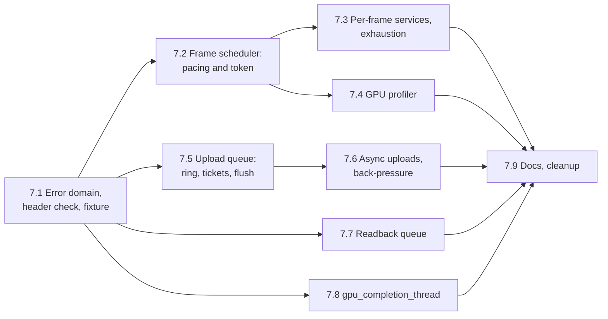

# Task 7 — Graphics layer: frames and transfers

| | |
|---|---|
| Design | [17 — Graphics layer: frames and transfers](../design/17-graphics-frames-and-transfers.md). [09 §5.2](../design/09-rhi.md#52-driving-completions) for `gpu_completion_thread`. Decisions D-93, D-94, D-96–D-103 ([99](../design/99-decisions-and-open-questions.md)) |
| Namespace | `avis::graphics` (public), `avis::graphics::detail` (sender templates and operation states) |
| New public headers | `include/avis/graphics/`: `error.h`, `frame_scheduler.h`, `gpu_profiler.h`, `upload_queue.h`, `readback_queue.h`, `gpu_completion_thread.h`, `detail/frame_sender.h`, `detail/upload_sender.h`, `detail/readback_sender.h` |
| New sources | `lib/avis/graphics/`: `error.cpp`, `frame_scheduler.cpp`, `gpu_profiler.cpp`, `upload_queue.cpp`, `readback_queue.cpp`, `gpu_completion_thread.cpp` |
| Changed | `include/avis/error.h` and `lib/avis/error.cpp` (`error_domain::graphics`), `lib/avis/CMakeLists.txt`, `tests/CMakeLists.txt` |
| Tests | `tests/test_graphics_public_headers.cpp`, `tests/test_graphics_error.cpp`, `tests/test_graphics_frame_scheduler.cpp`, `tests/test_graphics_gpu_profiler.cpp`, `tests/test_graphics_upload_queue.cpp`, `tests/test_graphics_readback_queue.cpp`, `tests/test_graphics_gpu_completion_thread.cpp`; helper `tests/helpers/graphics_fixture.h/.cpp` |
| Prerequisites | [Task 6](06-rhi.md): every RHI view used here (`synchronization`, `transient_objects`, `resources`, `command_lists`, `queue<Queue>` with a thread-safe `submit`, D-101), `copyable_footprint`, the test fixture `tests/helpers/rhi_fixture.h` and `tests/helpers/rhi_waits.h`. [Task 2](02-thread-pool.md) for `gpu_completion_thread`. |

The graphics layer's first policies on top of the RHI: frame pacing with *F* frames in flight and the per-frame services (frame scheduler), named GPU timings (GPU profiler), CPU→GPU uploads (upload queue), GPU→CPU readbacks (readback queue), and the thread that drives an RHI's completions for applications without an event loop (`gpu_completion_thread`). Everything here uses only public RHI calls, through the views it takes as parameters (D-96). None of it takes `rhi::completion_driver` except `gpu_completion_thread`, whose job is to drive.

**Not in this task.** The shader library, binding layout, root signatures and pipeline cache ([task 8](08-graphics-shaders-and-pipelines.md)); the render graph and its transient resource pool ([task 9](09-render-graph.md)); the renderer's use of these pieces (11) and the Visualizer's frame chain and Qt completion driver (12).

**Order.** 7.2–7.4 (frames), 7.5–7.6 (uploads), 7.7 (readbacks) and 7.8 are independent of each other once 7.1 is done. 7.6 is the most delicate step (waiters, stop callbacks, a wait whose continuation runs from `poll_completions()`), so it gets a step of its own after the synchronous path works.

## Conventions for this task
- **Tests on the RHI fixture.** Every test that needs a device uses `make_test_rhi()` from task 6, with the debug layer on, and is tagged `[graphics]`. Tests that need no device are tagged `[graphics][unit]`.
- **Deterministic waits.** As in task 6: tests drive completions themselves with `poll_completions()` and `test_rhi::wait_for(point)`, and check which senders completed. No driver thread runs, apart from the `gpu_completion_thread` test. `rhi_gate` (task 6.4) holds a queue back, so a test decides when a point is reached.
- **Public RHI only.** Sources in `lib/avis/graphics/` include `avis/rhi/*.h` and never `lib/avis/rhi/d3d12/`. White-box tests may still reach the private RHI through the fixture, for example to read release counters.
- **Debug checks.** Programming errors the design asserts on (two `begin_frame`s outstanding, `begin_timing` for a frame that wasn't prepared, a ticket from another queue, a token outliving its scheduler) go through `AVIS_CHECK` with the "graphics" logger, so tests check them with the recording assertion handler (`tests/helpers/recorded_assertions.h`) instead of a death test.
- **Logger.** The graphics layer logs on a new "graphics" logger, registered next to "rhi" ([01 §7](../design/01-system-architecture.md)).
- **Senders.** Every named sender gets a `static_assert(avis::sender_of<…>)` in its header. Operation states take their stop callback through `avis::detail::receiver_stop_callback`, and errors through `avis::detail::safe_error` where an exception can escape.

## 7.1 Error domain, header check, fixture
[17 §2](../design/17-graphics-frames-and-transfers.md#2-graphicserrorh).

- [x] `error_domain::graphics` in `include/avis/error.h`, with its name in `to_string(error_domain)`.
- [x] `graphics/error.h` and `error.cpp`: `error_kind` with every kind of 17 §2 (the shader and root-signature kinds are used by task 8), `to_string`, `make_error`, `is_error(const avis::error&, error_kind)`, and a `std::formatter<error_kind>` like the RHI's.
- [x] Create `include/avis/graphics/detail/`. The parked prototype headers in `include/avis/graphics/` stay out of the build until task 9 and must not be included by anything new.
- [x] `tests/test_graphics_public_headers.cpp`: the same check as the RHI's, generated from a glob in `tests/CMakeLists.txt` over the headers this task and task 8 add. It fails if `_WINDOWS_`, `__d3d12_h__`, `D3D12MA_RECOMMENDED_ALLOCATOR_FLAGS` or `ASIO_DETAIL_CONFIG_HPP` is defined after the includes. The glob excludes the parked prototype headers until task 9 replaces them.
- [x] `tests/helpers/graphics_fixture.h/.cpp`: small helpers on top of `test_rhi` that create the graphics objects of each step with test-sized configurations (a 1 MiB staging ring, 64 KiB of frame memory, 64 descriptors per frame), and `submit_marker<Queue>(rhi)`, which acquires a list, records nothing, submits it and returns the point.

**Tests** (`tests/test_graphics_error.cpp`, `[graphics][unit]`):
- [x] `make_error(error_kind::upload_queue_full, "…")` is in `error_domain::graphics`, `is_error` recognises it, `std::format` prints the kind, and `to_string` names every enumerator.
- [x] The header check compiles.

## 7.2 Frame scheduler: pacing and the frame token
[17 §3–5](../design/17-graphics-frames-and-transfers.md#3-frame-scheduler-concepts).

- [x] `frame_scheduler_configuration` with its defaults. `create` checks `frames_in_flight` in 1..3 and non-zero sizes (`invalid_argument`), then creates one `linear_upload_allocator` and one `descriptor_range` per context through `transient_objects`, named `"frame context <c> upload"` and `"frame context <c> descriptors"`. RHI errors pass through, including `transient_memory_exhausted` when *F* ranges don't fit the transient region.
- [x] Private context state: the allocator, the range, the last submissions (`std::array<rhi::synchronization_point, 3>` plus a count, one per queue) and the frame index it last held.
- [x] `frame_token`: move-only, as in 17 §4. The destructor and the move assignment end an un-ended frame with `end_frame(*this, {})` and log it at `debug` level. A moved-from token ends nothing. `recycled_submissions()` points into the context state.
- [x] `detail/frame_sender.h`: `frame_sender` and its operation state template over `rhi::synchronization::when_complete(points)`. `completion_signatures`: `set_value_t(frame_token)`, `set_error_t(avis::error)`, `set_stopped_t()`. The value path runs the recycle step (§5) before `set_value`; `device_lost` is forwarded; a stop before the context is free starts no frame. `static_assert(avis::sender_of<frame_sender, frame_token>)`.
- [x] Recycle (17 §5), in order: publish the completed index (the newest frame whose context is known complete, at least *N − F*), `reset(last_submissions)` on the allocator, then on the range. Keep the recycled points for `recycled_submissions()` before clearing them.
- [x] `begin_frame()`, `try_begin_frame()` (never waits: `std::nullopt` when the context isn't free; it uses `synchronization::is_complete`), `end_frame(token, last_submissions)` (stores the latest point per queue), `frames_in_flight()`.
- [x] Debug checks: one `begin_frame` outstanding, and the next only after the current token is ended; `end_frame` with a token of another scheduler; points of one queue that aren't the latest are reduced with `rhi::latest`; the destructor checks no frame is outstanding.

**Tests** (`tests/test_graphics_frame_scheduler.cpp`):
- [x] With *F* = 2: frames 1 and 2 begin inline. Frame 3's `begin_frame` doesn't complete while frame 1's submission is held by an `rhi_gate`; it completes on the thread that calls `poll_completions()` after the gate opens.
- [x] `index()`, `context_index()` and `completed_index()` follow 17 §3. `recycled_submissions()` is empty for the first *F* tokens, then holds exactly the points `end_frame` recorded for frame *N − F*.
- [x] After a recycle, the context's allocator and range are empty (an allocation of the full capacity succeeds) and the other context is untouched.
- [x] `try_begin_frame` returns `nullopt` while the context is busy and a token once it's free.
- [x] **Stopped frames:** `end_frame(frame, {})` with an acquired but unsubmitted list frees the context at once. Dropping a token, move-assigning over one, and `when_all(begin_frame(), stopped_sender)` after the token was delivered each end the frame (seen in the `debug` log), and the next `begin_frame` completes. A moved-from token ends nothing.
- [x] A stop request while frame 3 waits completes `begin_frame` with `set_stopped`, and the next `begin_frame` still works.
- [ ] Reset checks: ending frame 1 with points that don't cover a submission that used its frame memory trips the RHI's debug assertion when frame 3 recycles the context (recording assertion handler, Debug only).
- [x] Device removal while frame 3 waits completes it with `device_lost`.
- [x] Debug: a second `begin_frame` while one is outstanding fires the check.

## 7.3 Per-frame services and exhaustion
[17 §4](../design/17-graphics-frames-and-transfers.md#4-graphicsframe_schedulerh) (per-frame services, exhaustion), D-98.

- [x] `allocate_frame_memory`, `write_frame_constants<T>`, and the four `create_frame_srv/uav` overloads, forwarding to the token's context. They take no lock, and debug builds check that the token is the current one.
- [x] Exhaustion: the RHI's `transient_memory_exhausted` passes through unchanged. The scheduler also logs one warning per frame with the allocator's `high_water_mark()` and its capacity (or the range's capacity), so the budget can be raised. An atomic flag per context, cleared by the recycle, keeps it to one warning.

**Tests** (in `tests/test_graphics_frame_scheduler.cpp`):
- [x] `write_frame_constants` returns a 256-byte aligned address; a compute dispatch reading it through a root CBV writes the value into a buffer, and the readback matches.
- [x] `create_frame_srv`/`uav` of a placed texture return indices inside the context's range, and the indices are reused after the context is recycled.
- [x] 16 threads allocating at once for the current frame get no overlapping ranges.
- [x] Allocating past `upload_memory_per_frame` (and past `descriptors_per_frame`) fails with `transient_memory_exhausted` and logs one warning with the high-water mark (`log_capture`); `end_frame(frame, {})` after it, and the frame that reuses the context allocates normally.

## 7.4 GPU profiler
[17 §6](../design/17-graphics-frames-and-transfers.md#6-graphicsgpu_profilerh), D-97.

- [x] `gpu_profiler_configuration`, `gpu_scope_id`, `gpu_timing`. `create` makes one `timestamp_query_set` per queue type per context through `transient_objects`. A copy-queue set that fails with `unsupported_hardware` is skipped, and copy-queue scopes become no-ops; any other error fails `create`. Each queue's `timestamp_frequency()` is read once.
- [x] Per context: the query sets, an atomic next-index counter per queue, the scope records (name, queue, depth, first and second index), two name arenas, the results, and the index of the frame that last wrote it.
- [x] `prepare_frame(frame)`: debug checks that frame indices only increase and that each token is prepared once. When the context was last written by frame *N − F*, read its ticks with `timestamp_query_set::ticks`, convert them with the queue's frequency relative to that frame's first timestamp on the queue, and fill the results. Otherwise drop them. Then swap the name arenas, clear the collecting one and `reset(frame.recycled_submissions())` the query sets (17 §6 explains why that's safe after a skipped frame).
- [x] `begin_timing(frame, recorder, name)` takes two consecutive indices of the set for `recorder.submission_queue()`, writes the first timestamp, copies the name and pushes the scope's depth; `end_timing` writes the second timestamp and pops. Debug check: the frame is the prepared one. Running out of indices drops the scope (an invalid `gpu_scope_id`, which `end_timing` ignores) with one warning per frame.
- [x] Nesting depth: see Open points for what the per-list stack is keyed by.
- [x] `completed_gpu_timings(frame)` returns frame *N − F*'s results until the next `prepare_frame`.

**Tests** (`tests/test_graphics_gpu_profiler.cpp`, with a frame scheduler and `poll_completions()` in the test):
- [x] Nested scopes on the graphics and compute queues give the expected names, queues and depths, non-negative durations, and an inner scope inside its outer one.
- [x] `completed_gpu_timings` is empty for the first *F* frames, then returns frame *N − F*'s scopes, whose names stay valid while frame *N* records new ones.
- [x] With *F* = 2, skipping frame 3's `prepare_frame` leaves frame 5's results empty (not frame 1's relabelled), and frame 6 times normally.
- [x] Overflow: more scopes than `timestamps_per_frame / 2` drops the rest with one warning.
- [x] A narrowed compute recorder on a graphics list times on the graphics queue.
- [x] Copy-queue scopes work when `capabilities().copy_queue_timestamps` is set; otherwise they're skipped and the other queues still time.
- [x] Debug: `prepare_frame` twice for one frame, and `begin_timing` for a frame that wasn't prepared, fire the check.

## 7.5 Upload queue: staging ring, tickets, flush
[17 §7–7.1](../design/17-graphics-frames-and-transfers.md#7-graphicsupload_queueh), D-100, D-103.

- [x] `upload_queue_configuration`, `upload_ticket`, `subresource_data`. `create` makes the ring (`memory_type::upload`, mapped for its lifetime through `mapped_bytes`) and takes a process-unique `queue_id` from an atomic counter.
- [x] Private state (17 §7.1): the atomic `head`, and under `mutex_` the `tail`, the pending copies, the dedicated buffers, the in-flight flushes, the flush index and the last flush's point.
- [x] `upload_buffer`: reject a destination that isn't a `gpu_only` buffer, or a range outside it (`invalid_argument`). Reserve ring space with a CAS on `head` (wrapping to the start when the request doesn't fit before the end, padding counted as used), copy the bytes without a lock, then queue the copy under `mutex_` and return a ticket with the next flush index. When the space isn't free, retire and retry once, then fail with `upload_queue_full`.
- [x] `upload_texture`: footprints from `rhi::resources::copyable_footprint` per subresource; copy the caller's rows (`row_pitch`, `slice_pitch`) into the footprint's row pitch, with BC formats in block rows. Reject subresources outside the texture and data that's too short (`invalid_argument`).
- [x] Requests larger than half the ring get a dedicated upload buffer, created before `mutex_` is taken and destroyed right after the flush that carries it is submitted.
- [x] `flush()`: the sequence of 17 §7.1 (nothing queued → the last flush's point; acquire a copy list without the lock; under the lock record, submit, push `in_flight_flush`, advance the index; without the lock destroy the dedicated buffers). An acquire or submit failure returns the error and keeps the copies queued.
- [x] Retiring: drop the in-flight flushes whose points are complete and advance `tail`; run in every upload call and in `flush`.
- [x] `point(ticket)`: the flush's point while it's in flight, a default point once retired, `nullopt` before its flush. Debug check: the ticket's `queue_id` is this queue's.
- [x] Destructor: debug check that no async upload is outstanding (7.6); the ring and any dedicated buffers go to the RHI's deferred release.

**Tests** (`tests/test_graphics_upload_queue.cpp`):
- [x] A buffer upload, `flush`, a graphics-queue copy into a readback buffer waiting on the ticket's point: the bytes match.
- [x] Tickets: `nullopt` before the flush, the flush's point after it, the default point once retired. A copy-queue submission between upload and flush (`submit_marker<copy>`) doesn't complete the ticket. A ticket from a second upload queue fires the check (Debug).
- [x] `flush()` with nothing queued returns the last flush's point, without a submission.
- [x] The ring wraps: with a 1 MiB ring, 100 uploads of 300 KiB each with a flush and `wait_for` every third one all succeed and read back correctly. Without flushing, the fourth fails with `upload_queue_full`.
- [x] Textures: an upload with a tight caller `row_pitch` (not 256-aligned), a full mip chain, a BC1 texture and a cube face read back identical texels (through the readback queue once 7.7 exists, through a hand-recorded copy until then). The texture is in `common` afterwards (no barrier needed on the copy queue).
- [x] A 3 MiB upload into a 1 MiB ring uses a dedicated buffer, never fails for ring space, and the buffer is freed after the flush completes (RHI release counters).
- [x] An upload into an `upload` buffer, a range past the end, and a missing subresource fail with `invalid_argument`.
- [x] 8 threads uploading and 1 thread flushing concurrently: every upload reads back correctly.

## 7.6 Asynchronous uploads and back-pressure
[17 §7.2](../design/17-graphics-frames-and-transfers.md#72-asynchronous-uploads-and-back-pressure).

- [x] `detail/upload_sender.h`: `upload_sender` (`set_value_t(upload_ticket)`, `set_error_t(avis::error)`, `set_stopped_t()`) and its operation state template over a private waiter node (an intrusive FIFO entry). `static_assert(avis::sender_of<upload_sender, upload_ticket>)`.
- [x] `start()`: try the synchronous path; complete inline on success or on any error but `upload_queue_full`; otherwise queue the waiter under `mutex_` and, when a flush is in flight and no space wait is running, start one.
- [x] Space wait: one `when_complete` on the oldest in-flight point at a time, connected into storage owned by the queue. Its continuation (from `poll_completions()`) retires, unlinks the waiters that now fit under `mutex_` (stopping at the first that doesn't), releases the lock, resumes them, and starts the next wait if waiters remain. A resumed waiter retries the synchronous path; if it loses the space, it goes back to the front.
- [x] `flush()` starts the space wait when waiters exist and none is running (all space queued, nothing in flight before).
- [x] Stop: the stop callback removes a queued waiter under `mutex_` and completes it with `set_stopped` after releasing the lock. A waiter already unlinked completes through its retry.
- [x] Destructor: debug check that no waiter is queued and no space wait is running.

**Tests** (in `tests/test_graphics_upload_queue.cpp`):
- [x] With a small ring and a gated copy queue: an async upload that doesn't fit doesn't complete; after the gate opens and `poll_completions()` runs, it completes with a ticket of the next flush, and its data reads back correctly.
- [x] Ten queued waiters complete in FIFO order; a large one at the front isn't overtaken by smaller ones behind it.
- [x] A stop request completes a queued waiter with `set_stopped` on the requesting thread, and a later `poll_completions()` doesn't complete it again. 1000 rounds of a stop racing `poll_completions()` on another thread: exactly one completion each, with no ASan report.
- [x] An async upload that fits completes inline, and one with bad arguments completes with `invalid_argument`.

## 7.7 Readback queue
[17 §8](../design/17-graphics-frames-and-transfers.md#8-graphicsreadback_queueh), D-99.

- [x] Pool: size classes of powers of two from 64 KiB, each a list of `memory_type::readback` buffers, created on demand and trimmed above 4 entries when a lease returns. Larger requests get an exact-size buffer that isn't pooled. One mutex.
- [x] `readback_data` and `readback_image`: move-only leases holding the queue, the buffer and its size class; the destructor returns the buffer to the pool. `readback_image` adds width, height, the footprint's row pitch and the format.
- [x] `detail/readback_sender.h`: `readback_buffer_sender` and `readback_texture_sender`, with `static_assert(avis::sender_of<…>)` for `readback_data` and `readback_image`. `start()` takes a pooled buffer, acquires a list on the requested queue, records the copy (`copy_buffer` or `copy_texture_to_buffer` with `copyable_footprint`), submits, and waits with `when_complete` on the point. Acquire and submit failures complete with `set_error`. The queue type is a runtime argument, so the operation state switches on it to the matching `command_lists::acquire<Queue>` and `queue<Queue>`.
- [x] Stop before completion: the copy is already submitted, so the buffer is `destroy`ed instead of pooled and the RHI frees it after the GPU is done.
- [x] Destructor: debug check that no lease and no readback is outstanding; the pool's buffers are destroyed.

**Tests** (`tests/test_graphics_readback_queue.cpp`):
- [x] A buffer read on the copy queue and a texture read on the graphics queue (source in `copy_source`) return the uploaded bytes, the right width, height, format and a 256-byte aligned row pitch.
- [x] Pool reuse: two reads of the same size class one after the other use one buffer; five leases held at once leave at most 4 buffers in the class after they're destroyed.
- [x] A 200 MiB read gets an exact-size buffer that isn't pooled.
- [x] A stopped read completes with `set_stopped`, its buffer is destroyed, not pooled (pool counters), and the RHI frees it after the copy completes.

## 7.8 `gpu_completion_thread`
[09 §5.2](../design/09-rhi.md#52-driving-completions).

- [x] `graphics/gpu_completion_thread.h/.cpp`: starts one long-running body named "gpu-completions" on the given `threading::thread_pool`. The body waits with `WaitForMultipleObjects` on `completion_driver::completion_event()` and a private stop event, and calls `poll_completions()` when the completion event fires. The destructor signals the stop event and joins the thread. `<windows.h>` stays in the `.cpp`.
- [x] Creation: `thread_pool::start` returns a `result`, so creation can fail. See Open points for the shape.

**Tests** (`tests/test_graphics_gpu_completion_thread.cpp`):
- [x] With the thread running, a `when_complete` on a gated point completes on the "gpu-completions" thread once the gate opens, with no `poll_completions()` in the test.
- [x] A frame scheduler with *F* = 2 runs 100 frames of `begin_frame` → submit → `end_frame` driven only by the thread.
- [x] Destroying it while nothing is pending returns promptly; destroying the RHI after it leaves nothing pending.

## 7.9 Docs and cleanup
- [x] Update [17](../design/17-graphics-frames-and-transfers.md) wherever the implementation differs, and remove its draft status once task 8 has settled 18's shared parts (the error domain). Apply 17 §11's "left to apply": 11 §5.1 and §12.1 point at `graphics::readback_queue` for standalone readbacks.
- [x] 09 §5.2: `gpu_completion_thread`'s creation as implemented.
- [x] The "existing code diverges" note in 99 no longer lists the frame scheduler, the upload and readback queues or the profiler.
- [x] Add an **As implemented** section here.
- [ ] 20 random-order runs of the `[graphics]` tests in Debug and ASan.

## As implemented
Per step, the differences from the plan and from [17](../design/17-graphics-frames-and-transfers.md) as first drafted. 17, 09 §5.2, 11 and 99 were updated to match in 7.9, so these notes are the history; 17 is the reference.

### 7.1 (2026-10-30)
- **Logger.** "graphics" is registered in `component_loggers` (`include/avis/log.h`), next to "rhi".
- **`is_error` and `std::formatter<error_kind>`** are in `graphics/error.h` next to `to_string` and `make_error`; the formatter prints the kind's name, like the RHI's.
- **Header check.** The glob in `tests/CMakeLists.txt` covers `include/avis/graphics/**/*.h` and excludes the parked prototype headers (`render_pass`, `render_pass_builder`, `render_pipeline`, `resource`, `resource_bag`, `texture`) by name.
- **Fixture.** `graphics_fixture.h` gained a helper per step: `make_test_frame_scheduler`, `begin_frame_inline` and `started_frame` (7.2), `make_test_gpu_profiler` (7.4), `make_test_upload_queue` (7.5) and `make_test_readback_queue` (7.7).

### 7.2 (2026-10-30)
- **`frame_token` has its own header**, `graphics/frame_token.h`, because `detail/frame_sender.h` delivers it and can't include `frame_scheduler.h`.
- **The GPU wait is connected in `start()`,** not in `connect()`: the context's last submissions are only final once the previous frame was ended, which may happen between the two. The wait's receiver is a namespace-scope template, because a receiver nested in the operation state can't name its environment while the state is incomplete.
- **Pacing state** is one atomic (idle, waiting, recording). A second `begin_frame` while one is outstanding asserts and completes with `generic_error_kind::logic_error`.
- **Reset-check test dropped** (the one unticked box in 7.2). The RHI's reset check only asserts that the points it's given are complete. A frame ended with points that miss one of its submissions trips nothing when that submission is complete by the time the context is recycled, which is always the case in a deterministic test. Catching it would need the RHI to track which submissions used an allocator, which 09 doesn't plan.

### 7.3 (2026-10-30)
- **Stale tokens.** A per-frame service called with a token that isn't the frame being recorded (ended, or of another scheduler) asserts and returns `invalid_argument`, in every build.
- **One warning per frame** for memory and one for descriptors: two atomic flags per context, cleared by the recycle.
- **Test name.** The descriptor exhaustion test's scheduler is named `few_descriptors`, because `small` is a macro in the Windows headers.

### 7.4 (2026-10-30)
- **Open points settled as recommended.** Nesting depth is a `thread_local` per profiler, so a scope begins and ends on one thread. Name arenas are fixed buffers sized from `timestamps_per_frame` (64 bytes per scope) with an atomic bump offset; a long name is truncated, and empty once the arena is full.
- **`gpu_scope_id`** encodes the queue and the scope index (`(queue + 1) << 24 | scope`). The default value is a dropped scope with `is_valid()` false, which `end_timing` ignores.
- **Results** are converted only when the context was last written by frame *N − F*. After a skipped `prepare_frame` they stay empty instead of showing an older frame's ticks.

### 7.5 (2026-10-30)
- **Reservations take the mutex** instead of the planned CAS on an atomic `head`. With the CAS, an upload could reserve ring space before a flush and queue its copy after it, and retiring that flush would free space whose copy hadn't run. Reservations are now taken under `mutex_` and kept in ring order with the flush that carries them, and the tail only advances over leading reservations whose own flush is complete. The bytes are still copied without the lock.
- **`upload_ticket` and `subresource_data`** are in `graphics/upload_ticket.h`, so `detail/upload_sender.h` can name them.
- **Placement.** Every reservation is 512-byte aligned (texture copy placement), and the ring is rounded up to a multiple of 64 KiB.

### 7.6 (2026-10-30)
- **Space waits are heap-allocated** and owned by the queue. A wait whose point is already complete completes inside its own `start()`, and the next wait it starts would have overwritten a fixed slot that was still running. Finished waits are freed only once no space-wait completion is running.
- **Order.** A new async upload first tries the synchronous path, so one that fits right away doesn't wait. One that doesn't fit queues at the back, and only goes ahead of the queue when it's empty. A resumed waiter that loses its space goes back to the front.
- **Stop race.** A waiter sets an atomic stop flag before taking `mutex_` in its stop callback, and checks it under `mutex_` before linking itself, so a stop during the first attempt isn't lost.
- **Use-after-free fixed in 7.7** (commit `983a9cc7`). The stop callback destroyed itself (`stop_callback_.reset()`) and then read the operation pointer from its freed storage. ASan found it in the 1000-round race test once ASan runs were possible again; the pointer is now copied first.
- **Test sizes.** The async tests use a 64 KiB ring with 30, 24, 32 and 8 KiB uploads, because a request larger than half the ring takes the dedicated-buffer path and never waits.

### 7.7 (2026-10-30)
- **Leases** are in `graphics/readback_data.h`, and both senders are aliases of `detail::readback_sender<Value>`. `read_buffer` and `read_texture` are `noexcept`; every error arrives through `set_error`. The queue type stays a runtime argument (open point), switched to the matching template calls inside the operation.
- **Pool limits.** Size classes from `smallest_pooled_size` (64 KiB) to `largest_pooled_size` (64 MiB), `buffers_per_class` = 4. `statistics()` reports buffers created and destroyed, pooled buffers, live leases and outstanding readbacks; the tests check reuse, trimming and the stopped readback with it.
- **Texture bytes** are `row_pitch × rows × depth`, rows being block rows for BC formats; the buffer is sized to whole rows.
- **Failures.** A stop before `start()` submits nothing. An acquire or submit failure returns the buffer to the pool, since nothing was submitted.
- **Shared helper.** The mip and layer counts moved to the private `lib/avis/graphics/texture_subresources.h`, used by both queues.

### 7.8 (2026-10-30)
- **`create`** returns `result<std::unique_ptr<gpu_completion_thread>>` (open point, as recommended). It fails with the pool's errors, or a system error when the stop event can't be created.
- **Stopping.** The body waits on the stop event first, so stopping wins when both events are set. A `std::stop_callback` on the body's stop token sets the stop event too, so the pool stopping first also ends the body. If joining fails, the destructor leaks the event rather than closing it under a running thread.
- **Thread name.** The pool prefixes names, so the thread appears as `avis-gpu-completions` in logs and debuggers.

### 7.9 (2026-10-30)
- 17 records the differences above in **As implemented** notes. Its draft status stays until task 8 settles 18's shared parts (the error domain).
- 11 §5.1 no longer names `rhi::readback_buffer`; it and §12.1 point standalone readbacks at `graphics::readback_queue`. 09 §5.2 shows `create`. 99's diverging-code note names only the parked render pass prototype.

## Acceptance criteria
- Every graphics header of this task compiles without D3D12, DXGI, D3D12MemoryAllocator, `<windows.h>` or asio (the header check).
- `begin_frame` completes inline when the context is free, otherwise only from `poll_completions()`, and never blocks a thread. Every token is ended exactly once, explicitly or by its destructor, and the next `begin_frame` then works.
- Exhausting frame memory or descriptors fails with `transient_memory_exhausted` and one warning, and the next frame on that context works.
- GPU timings for frame *N − F* are correct after skipped and normal frames, with names that stay valid.
- Uploads read back byte-identical through buffers and textures (BC formats, unaligned caller pitches, mip chains, cube faces). Tickets resolve only through their own flush, and no other copy-queue work can complete them.
- Async uploads wait without a thread, complete in FIFO order, and stop cleanly.
- Readback leases recycle their buffers, and a stopped readback leaks nothing.
- All tests pass in Debug, Release and ASan, including 20 random-order runs of the `[graphics]` tests.

## Open points
- **Profiler nesting key** (settled: (a), see *As implemented*, 7.4). 17 §6 keeps the nesting stack "per list, keyed by the list", but the public `command_recorder` has no list identity. Options: (a) a `thread_local` depth per profiler, which is enough because a scope's `begin_timing` and `end_timing` run on one thread inside one pass (the render graph times each pass from the thread recording it); (b) a public, opaque `command_recorder::list_id()` in the RHI. Recommended: (a), and record the restriction "a scope begins and ends on one thread" in 17 §6.
- **`gpu_completion_thread` creation** (settled as recommended, see 7.8). 09 §5.2 shows a constructor, but `thread_pool::start` returns `result<thread_handle>`. Recommended: `static result<std::unique_ptr<gpu_completion_thread>> create(threading::thread_pool&, rhi::completion_driver)`, like every other graphics-layer object, and update 09 §5.2.
- **Name arenas** (settled: the lock-free buffer, see 7.4). 17 §6 doesn't say how concurrent `begin_timing` calls copy names. A fixed-capacity character buffer per arena with an atomic bump offset (sized from `timestamps_per_frame`, a truncated name on overflow) keeps it lock-free; a mutex is also acceptable at one call per pass. Pick one in 7.4 and record it.
- **Readback queue type** (settled: a runtime switch, see 7.7). `read_buffer`/`read_texture` take the queue as a runtime `rhi::queue_type`, while the RHI's lists and queues are templates. A switch inside the operation state works; a template parameter would be simpler but changes 17 §8's signatures.
