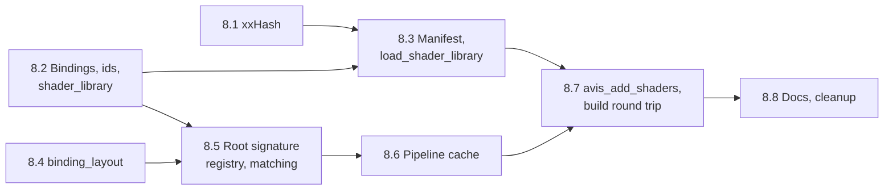

# Task 8 — Graphics layer: shaders and pipelines

| | |
|---|---|
| Design | [18 — Graphics layer: shaders and pipelines](../design/18-graphics-shaders-and-pipelines.md). [13 §3](../design/13-build-and-quality.md#3-shader-build-pipeline) and [§4](../design/13-build-and-quality.md#4-dependency-management) for the shader build and xxHash. [09 §12–12.1](../design/09-rhi.md#12-pipelines-rhipipelineh) for the RHI side. Decisions D-73, D-74, D-82, D-83, D-87, D-104–D-106 ([99](../design/99-decisions-and-open-questions.md)) |
| Namespace | `avis::graphics`, `avis::graphics::binding_layout`, `avis::graphics::literals` |
| New public headers | `include/avis/graphics/`: `shader_bindings.h`, `shader_library.h`, `shader_manifest.h`, `shader_loading.h`, `binding_layout.h`, `root_signature_registry.h`, `pipeline_cache.h`, `detail/shader_library_load_sender.h` |
| New sources | `lib/avis/graphics/`: `shader_library.cpp`, `shader_loading.cpp`, `binding_layout.cpp`, `root_signature_registry.cpp`, `pipeline_cache.cpp` |
| New build files | `external/xxHash-0.8.4/` (the unmodified upstream release, already in place; built through its own `build/cmake/`), `cmake/AvisShaders.cmake` (`avis_add_shaders`) |
| Changed | `external/CMakeLists.txt`, `external/README.md`, root `CMakeLists.txt` (`include(AvisShaders)` replaces the commented `ShaderSupport`), `lib/avis/CMakeLists.txt`, `tests/CMakeLists.txt` |
| Tests | `tests/test_graphics_shader_library.cpp`, `tests/test_graphics_shader_loading.cpp`, `tests/test_graphics_binding_layout.cpp`, `tests/test_graphics_root_signature_registry.cpp`, `tests/test_graphics_pipeline_cache.cpp`, `tests/test_graphics_shader_build.cpp`; shaders under `tests/shaders/graphics/` |
| Prerequisites | [Task 6](06-rhi.md) (root signatures, pipelines, the `pipelines` view, test shaders compiled with `tools/dxc`), [Task 5](05-io-layer.md) (`io::read_file`, `avis::sender_of`), [Task 7.1](07-graphics-frames-and-transfers.md#71-error-domain-header-check-fixture) (the graphics error domain and header check). `tools/data-trace`'s `shader-manifest` command and its tests exist already ([18 §6](../design/18-graphics-shaders-and-pipelines.md#6-reflection-data-sources)). |

> **Status (2026-10-30): done.** The full suite passes in Debug (301 test cases), Release (299: the debug-only checks are compiled out) and an AddressSanitizer build, including 20 random-order runs of `[graphics]` each in Debug and ASan. Decisions made while implementing are under *As implemented*.

Everything above "create a root signature from a description" and "create a PSO from bytecode": a shader library keyed by hashed ids, loading it from a manifest, the reflection record of what each shader binds, the Avis standard binding layout, choosing a root signature per pipeline, and a pipeline cache. Also the build side the manifest comes from: `avis_add_shaders`, which compiles HLSL and runs `dt shader-manifest`.

**Not in this task.** The Visualizer's manifest parser and its startup loading ([12a](../design/12a-visualizer-shader-manifest.md), including manifest format 2 in that parser), `bindless.hlsli` and the renderer's `pipeline_variant_registry` (11), and runtime reflection (18 §6 option B). The Visualizer's shaders move to `avis_add_shaders` with the renderer.



**Order.** 8.1, 8.2 and 8.4 are independent. The matching logic in 8.5 is a pure function over descriptions and bindings, so it's tested without a GPU before the registry wraps it.

## Conventions for this task
- Tags: `[graphics][unit]` for tests without a device (ids, library, manifest checks, matching), `[graphics]` for tests on the RHI fixture (registry, pipeline cache), `[graphics][shader_build]` for the build round trip of 8.7.
- **Test shaders.** The existing RHI test shaders stay as they are. New HLSL for this task goes under `tests/shaders/graphics/`, compiled with the existing `avis_test_shader()` (bytecode headers) for 8.2–8.6, and with `avis_add_shaders` in 8.7. Shaders whose bindings a test needs list them by hand next to the test until 8.7, which checks the hand-written bindings against the build's reflection.
- **Errors** are `graphics::error_kind` (task 7.1). Messages name the shader id string (not only the hash) and the pipeline's debug name where there is one.
- `shader_loading` is the only part that depends on the IO layer; `shader_library`, the registry and the cache depend on the RHI only ([13 §9.3](../design/13-build-and-quality.md#93-layering-between-io-the-rhi-and-the-shared-helpers)).

## 8.1 Vendor xxHash
[13 §4](../design/13-build-and-quality.md#4-dependency-management): xxHash is used for every xxh3 hash on the C++ side, so C++ and the Python tools agree.

- [x] The xxHash 0.8.4 release is in `external/xxHash-0.8.4/`, unmodified (the whole upstream tree: `xxhash.h`, `xxhash.c`, `LICENSE`, the `xxhsum` CLI, tests, and its CMake project in `build/cmake/`). It isn't committed or built yet.
- [x] `external/CMakeLists.txt`: add it like every other library, following upstream's "Add as Subdirectory" method ([`build/cmake/README.md`](../../external/xxHash-0.8.4/build/cmake/README.md)), options first, at the end of the file after yaml-cpp:
  ```cmake
  # Set xxHash build options. Upstream's CMake project is in build/cmake. It builds a static library from xxhash.c;
  # BUILD_SHARED_LIBS is pinned OFF because its own option() defaults to ON when the cache has no value yet.
  set(XXHASH_BUILD_XXHSUM OFF)
  option(BUILD_SHARED_LIBS "Build shared libraries" OFF)
  add_subdirectory(xxHash-0.8.4/build/cmake xxHash-0.8.4 EXCLUDE_FROM_ALL)
  ```
  - The second argument names the binary directory: the source directory is two levels down, so the build tree gets a readable `external/xxHash-0.8.4/` folder.
  - `XXHASH_BUILD_XXHSUM OFF` skips the `xxhsum` CLI, which is GPLv2. Only the BSD 2-Clause library is built and linked. A plain `set` is enough for it because upstream sets policy CMP0077 to `NEW` before its `option()` calls.
  - Added from `external/`, upstream's CMake runs in *bundled mode* (`XXHASH_BUNDLED_MODE` is `ON`): it installs nothing, writes no package or pkg-config files, and forces a static library.
  - `BUILD_SHARED_LIBS` is already `OFF` in the cache today, because D3D12MemoryAllocator's `option()` runs first. The explicit `option(… OFF)` keeps it that way if the order changes. Upstream's own `option(BUILD_SHARED_LIBS … ON)` would otherwise create the cache entry as `ON` for every library added later.
  - `DISPATCH` stays undefined, so `xxh_x86dispatch.c` isn't built. Upstream's project enables only C, which the root project already enables (`LANGUAGES C CXX ASM`). In Debug it adds `XXH_DEBUGLEVEL=1` to its own directory only. It doesn't touch `CMAKE_BUILD_TYPE`, because the presets set it.
  - The ASan build's `-fsanitize=address` is in `CMAKE_C_FLAGS` too, so the library is instrumented like the rest.
- [x] `external/README.md`: a row with version 0.8.4, folder `xxHash-0.8.4` (CMake project in `build/cmake`), licence BSD 2-Clause (`LICENSE`; the unused `xxhsum` CLI is GPLv2), upstream https://github.com/Cyan4973/xxHash, target `xxHash::xxhash` (static), and options `XXHASH_BUILD_XXHSUM` `OFF`, `BUILD_SHARED_LIBS` `OFF`.
- [x] `AVIS_LIB` links `xxHash::xxhash` `PRIVATE`: no public header includes `xxhash.h`. `AVIS_TESTS` links it too, for its own test. No `XXH_INLINE_ALL`: the library provides the symbols.
- [x] Configure and check that nothing is downloaded and nothing is written into `external/` (`git status external/` shows only the new folder until it's committed). The `xxhash` target builds only because `AVIS_LIB` links it (`EXCLUDE_FROM_ALL`), and no `xxhsum` target exists.
- [x] 13 §4 says xxHash is "vendored header-only". Change it to "vendored, built as a static library through upstream's CMake (`xxHash::xxhash`)".

**Tests:**
- [x] `tests/test_external_dependencies.cpp`: `XXH3_64bits` of a fixed input equals the value Python's `xxhash.xxh3_64` gives for it (hard-coded in the test, with the Python one-liner that produced it in a comment). Also `static_assert(XXH_VERSION_NUMBER == 804)`, so updating the folder without updating `external/README.md` fails the build.

## 8.2 Shader bindings, shader ids, `shader_library`
[18 §2](../design/18-graphics-shaders-and-pipelines.md#2-graphicsshader_libraryh), [§5](../design/18-graphics-shaders-and-pipelines.md#5-graphicsshader_bindingsh).

- [x] `graphics/shader_bindings.h`: `constant_buffer_binding`, `buffer_binding_kind`, `buffer_binding`, `sampler_binding`, `shader_bindings`, each with a defaulted `operator==` (the 8.7 round trip compares them).
- [x] `graphics/shader_library.h`: `shader_id` with the 64-bit FNV-1a hash, `make_shader_id(std::string_view)` as a `constexpr` function the literal and the library both use, `literals::operator""_shader_id` (`consteval`), and `shader_stage`, `shader_blob`.
- [x] `shader_library::create(blobs, name)`: rejects an empty id or bytecode (`invalid_argument`) and a duplicate id or two ids with the same hash (`duplicate_shader_id`, naming both ids). Storage: the blobs moved into a vector, plus a sorted vector of `(hash, index)` for `find` by binary search (or an `std::unordered_map`; the library is immutable, so either is safe to read from many threads).
- [x] `find`, `size`, `name`, `serial` (from a process-wide atomic counter, never 0). The library is movable; a moved-from library is empty.
- [x] Debug check (optional in 18 §2): compare the declared stage with the shader kind in the DXIL container's `PSV0` or program header, and fail `create` with `invalid_argument` naming the id on a mismatch. If the container parsing turns out to be more than a few lines, leave it out and note it under As implemented.

**Tests** (`tests/test_graphics_shader_library.cpp`, `[graphics][unit]`):
- [x] `"lighting.main.cs"_shader_id` equals `make_shader_id("lighting.main.cs")` and the FNV-1a reference value; the literal is usable in a `static_assert`.
- [x] `find` by literal returns the stage, the bytecode and the bindings pointer (null when the blob had none); an unknown id returns `nullopt`.
- [x] Duplicate ids, a crafted pair of ids with the same 64-bit FNV-1a hash (constructed in the test, see Open points), an empty id and empty bytecode each fail with the expected kind and a message naming the ids.
- [x] Two libraries have different serials, and a moved library keeps its serial.

## 8.3 Manifest and `load_shader_library`
[18 §3–4](../design/18-graphics-shaders-and-pipelines.md#3-graphicsshader_manifesth).

- [x] `graphics/shader_manifest.h`: `shader_manifest_entry` and `shader_manifest`, as in 18 §3.
- [x] `graphics/shader_loading.h` and `detail/shader_library_load_sender.h`: both `load_shader_library` overloads (default IO context, or an explicit `io::io_context&`) returning the named `shader_library_load_sender`. `static_assert(avis::sender_of<shader_library_load_sender, shader_library>)`.
- [x] The operation: one `io::read_file(directory / entry.blob)` per entry, all started at once in a counting scope; when the scope is empty, continue on the parallel scheduler, check each entry's `content_hash` with `XXH3_64bits` where present, move the bytes into `shader_blob`s (with the entry's `bindings`) and call `shader_library::create`. Name the library after the directory.
- [x] Errors: the first failure wins. An IO error passes through with the path in its message. A hash mismatch is `shader_hash_mismatch` naming the id, the file, and both hashes in hex. A blob path that leaves the directory (root path or a `..` element) is `invalid_argument`, checked before any read. `shader_library::create`'s errors pass through. A stop request stops the outstanding reads and completes with `set_stopped`.

**Tests** (`tests/test_graphics_shader_loading.cpp`, `[graphics][unit]`, in a `temporary_directory`):
- [x] A manifest of three entries with correct hashes loads; each `find` returns the file's bytes and the entry's stage and bindings.
- [x] A changed byte gives `shader_hash_mismatch` naming the entry. A missing file gives the IO error with the path. Entries without `content_hash` load unchecked. An entry with `../x.cso` fails with `invalid_argument` before any read.
- [x] Both overloads work; the one with an explicit `io_context` uses it.
- [x] An empty manifest gives an empty library.

## 8.4 `binding_layout`
[18 §9](../design/18-graphics-shaders-and-pipelines.md#9-graphicsbinding_layouth).

- [x] `graphics/binding_layout.h` and `binding_layout.cpp`: the constants, `static_sampler`, `standard_description()` (16 root constants at `b0`, root CBVs at `b1` and `b2`, the six static samplers of 18 §9 at `s0`–`s5`, all with visibility `all`; static storage, valid for the program's lifetime), `push_draw_constants` with its `static_assert`, `set_pass_constants`, `set_view_constants`, explicitly instantiated for the three queue types where they aren't inline.
- [x] The sampler states follow 18 §9: `shadow_comparison` is a linear comparison sampler with `greater_equal` (reverse-Z).

**Tests** (`tests/test_graphics_binding_layout.cpp`):
- [x] `[graphics][unit]`: `standard_description()` has the parameter kinds, registers, counts and visibilities above; `static_assert(!requires { push_draw_constants(recorder, too_large) })` for a 17-DWORD struct.
- [x] `[graphics]`: `create_root_signature(standard_description())` succeeds on the fixture. A compute pipeline on it, using `push_draw_constants` and `set_pass_constants` with a frame-memory address (or an upload buffer's address if task 7 isn't merged), writes the expected values into a UAV buffer.

## 8.5 Root signature registry and matching
[18 §10](../design/18-graphics-shaders-and-pipelines.md#10-graphicsroot_signature_registryh).

- [x] A private, pure compatibility check in `root_signature_registry.cpp`, exposed to tests through a header under `lib/avis/graphics/` (`root_signature_matching.h`): `first_mismatch(const rhi::root_signature_description&, std::span<const stage_bindings>) -> std::optional<std::string>`. It applies the table of 18 §10.1, with visibility per stage (a compute shader sees only `all`). The message names the stage, the register and space, and for constant buffers the size: `"pixel shader b3 space0 (64 bytes) not visible"`, `"compute shader s4 space0: no static sampler"`, `"vertex shader b0 space0 (96 bytes): root constants hold 64"`.
- [x] `root_signature_registry`: `add` creates the RHI signature through `rhi::pipelines` and appends a candidate with an owned copy of the description (deep-copy the parameter and sampler spans); `find_compatible` returns the first candidate with no mismatch, or `no_compatible_root_signature` listing every candidate's name with its first mismatch; `check_compatible` on a handle returns `root_signature_incompatible` with the mismatch, or `invalid_argument` for a handle that isn't registered. A `std::shared_mutex`: `add` exclusive, lookups shared.
- [x] A stage with `bindings == nullptr` is the caller's error (the pipeline cache reports `shader_bindings_missing` before calling); debug check.

**Tests** (`tests/test_graphics_root_signature_registry.cpp`):
- [x] `[graphics][unit]` on `first_mismatch`, for each row of 18 §12.2: a constant buffer within the root constants; one too large for root constants but fine for a root CBV; a missing sampler register; a pixel shader's binding provided only by a vertex-only parameter (fails); a vertex shader's `b0` and a pixel shader's `b0` matched by two stage-limited parameters (passes); a compute shader's binding provided only by a stage-limited parameter (fails); a `t`/`u` buffer by register against root SRV/UAV of the right and the wrong kind; unused parameters are fine; empty bindings match anything.
- [x] `[graphics]`: with the standard signature and a second one registered, `find_compatible` returns the first compatible in registration order; a pipeline only the second fits gets the second; one neither fits fails with a message naming both candidates. `check_compatible` on the standard handle passes and fails as expected.

## 8.6 Pipeline cache
[18 §11](../design/18-graphics-shaders-and-pipelines.md#11-graphicspipeline_cacheh), D-87, D-104, D-105.

- [x] `graphics_pipeline_description` and `compute_pipeline_description` as in 18 §11.
- [x] Key: a 64-bit hash (xxh3 over a packed key buffer) of every field of `rhi::graphics_pipeline_state` (not `debug_name`), the library's serial, the shader ids and the explicit root signature, if any. Write the packing field by field, never by hashing the struct's bytes (padding), and add a `static_assert` on `sizeof(rhi::graphics_pipeline_state)` next to it so a new state field fails the build until the packing covers it.
- [x] `get_or_create`: shared-locked lookup; on a miss, without the lock: resolve each id (`shader_not_found` naming the id and the debug name), check its stage against its slot (`shader_stage_mismatch`), resolve the root signature (a named one through `check_compatible`; otherwise `shader_bindings_missing` when a stage has no bindings, else `find_compatible`), build the RHI description with the library's bytecode spans and call `create_pipeline`; then insert under the exclusive lock, returning the existing handle if another worker inserted first (the rare duplicate PSO stays alive unused, D-105). A `pixel_shader` of `{}` means depth-only.
- [x] `debug_name` is a `std::string_view`; the RHI copies it at creation, so the cache keeps nothing of it.

**Tests** (`tests/test_graphics_pipeline_cache.cpp`, `[graphics]`, shaders from `tests/shaders/graphics/` with hand-written bindings):
- [x] Equal descriptions return the same handle; a different state field, a different explicit signature, or the same ids from a different library create a new one. A different `debug_name` alone doesn't.
- [x] An unknown id and a shader in the wrong slot fail before any RHI call (the RHI's pipeline count doesn't change, read through the fixture).
- [x] A shader without bindings and no explicit signature fails with `shader_bindings_missing`; with an explicit signature it's created without a check.
- [x] Matching runs once per key: a second `get_or_create` with the same description doesn't call the registry (a counter in the test's registry wrapper, or the registry's lookup count).
- [x] 8 workers in a `stdexec::bulk` call `get_or_create` on 50 descriptions in a shuffled order each: every worker gets one handle per description, and the RHI created at most one extra PSO per description.
- [x] A depth-only pipeline (`pixel_shader = {}`) works.

## 8.7 `avis_add_shaders` and the build round trip
[13 §3](../design/13-build-and-quality.md#3-shader-build-pipeline), [18 §6](../design/18-graphics-shaders-and-pipelines.md#6-reflection-data-sources) (Q3 decided A). The `dt shader-manifest` command exists; this step adds the CMake side.

- [x] `cmake/AvisShaders.cmake` with `avis_add_shaders(TARGET … SOURCES … OUTPUT_DIRECTORY … [DEFINES …] [INCLUDE_DIRECTORIES …])`, included from the root `CMakeLists.txt` (replacing the commented `include(ShaderSupport)`):
  - parses the `// @avis-shader entry=… stage=… [permutations=…]` header comments at configure time, with a configure error naming the file and line for a malformed comment;
  - one `add_custom_command` per entry and permutation with the DXC command line of 13 §3 (`-Fo`, `-Fd`, `-Fre`, `-Qstrip_reflect`, `-Zi -Qembed_debug -Od` in Debug, `-O3` otherwise), depfiles with `-MF` and `DEPFILE` where the generator supports them;
  - writes the shader list `shaders.yaml` (`avis_shader_list: 1`) with `file(GENERATE)`;
  - a final custom command runs `uv run --project tools/data-trace dt shader-manifest <list> --output <directory>/manifest.yaml --dxc tools/dxc/bin/x64`, with `WORKING_DIRECTORY` in the build tree and `DEPENDS` on every `.cso`, `.ref` and the list, attached to a custom target the given `TARGET` depends on;
  - the configure step fails with a clear message when `uv` or `dxc.exe` is missing.
- [x] `tests/CMakeLists.txt`: compile the graphics test shaders with `avis_add_shaders(TARGET AVIS_TESTS … OUTPUT_DIRECTORY ${CMAKE_BINARY_DIR}/bin/data/shaders/tests)`, including one shader with a permutation and one with a constant buffer, a register-bound structured buffer and a static sampler. Pass the directory to the test with a compile definition.
- [x] A shader that binds a texture by register fails the build with the shader id, the resource and the register. Check it once by hand with a scratch shader; don't commit it.

**Tests** (`tests/test_graphics_shader_build.cpp`, `[graphics][shader_build]`):
- [x] The test reads `manifest.yaml` with yaml-cpp (a minimal reader in the test file, not a library parser, D-73), builds a `shader_manifest` from it, and loads it with `load_shader_library`: every hash matches.
- [x] The bindings the build wrote for each test shader equal the hand-written ones the earlier tests used.
- [x] Pipelines created from the loaded library through the pipeline cache match the standard signature, and the shader that needs the second signature gets it.
- [x] Touching an included header recompiles only its dependents, and an unchanged build doesn't rewrite `manifest.yaml` (checked by hand, recorded under As implemented).

## 8.8 Docs and cleanup
- [x] Update [18](../design/18-graphics-shaders-and-pipelines.md) and [13 §3](../design/13-build-and-quality.md#3-shader-build-pipeline) wherever the implementation differs; 18 §6's status line says `avis_add_shaders` exists.
- [x] 12a still has format 2 "left to apply" (18 §13); leave it for the Visualizer task, and say so in 18 §13.
- [x] The "existing code diverges" note in 99 no longer lists the shader library and the pipeline cache.
- [x] Add an **As implemented** section here.
- [x] 20 random-order runs of the `[graphics]` tests in Debug and ASan.

## As implemented
Per step, the differences from the plan and from [18](../design/18-graphics-shaders-and-pipelines.md) and [13 §3](../design/13-build-and-quality.md#3-shader-build-pipeline) as first drafted. 18, 13 §3 and 99 were updated to match in 8.8, so these notes are the history; 18 and 13 are the reference.

### 8.1 (2026-10-30)
- **Reference hash.** The Python one-liner in the test produced `0xb8cb7f355f950193` for `"avis shader blob"`. Windows Application Control blocked the `xxhash` extension in `tools/data-trace`'s environment that day, so the value came from a throwaway `uv` environment with the same package; the block was gone by 8.6.
- **Configure check.** Nothing is downloaded or written into `external/` (the one ignored file there, `tests/bench/.clang_complete`, ships with the release and is excluded by upstream's `.gitignore`). No `xxhsum` target exists, bundled mode is on and `BUILD_SHARED_LIBS` is `OFF`.

### 8.2 (2026-10-30)
- **Collision test hook.** `detail::create_shader_library(blobs, name, hashes)` takes the id hashes; `shader_library::create` computes them and calls it. It's declared in the public header, because the library befriends it, and documented as not for application code. `lib/avis/graphics/shader_library_internal.h` exposes the DXIL parser to tests.
- **DXIL stage check** is in, in debug builds: about 30 lines read the program version of the container's `DXIL` part (shader kind in the upper 16 bits). Bytes that aren't a DXIL container are skipped, so tests can use fake bytecode.
- **Moves.** A moved-from library has no shaders, an empty name and serial 0. The bytecode doesn't move, so views taken before a move stay valid.

### 8.3 (2026-10-30)
- **No counting scope.** The operation state owns the connected `read_file` operations on the heap and counts them with an atomic (one reference per read plus one while they start), the fallback the open point named. The receiver-facing template is in `detail/shader_library_load_sender.h`; the rest, reads included, is in `shader_loading.cpp`.
- **A read stopped by its IO context** (the context is stopping) completes the load with `set_stopped`. The first version went on with an empty buffer and reported a misleading hash mismatch; the explicit-context test caught it.
- **Header check.** `test_graphics_public_headers.cpp` also rejects `xxhash.h` now (acceptance criterion).

### 8.4 (2026-10-30)
- **The size check is a constraint**, not a `static_assert`: the planned test, `!requires { push_draw_constants(recorder, too_large) }`, can only be false when the size is part of the signature. A `static_assert` in the body would break the build instead. The test uses a concept, since a requires-expression outside a template can't contain an invalid expression.
- **No copy-queue helpers.** `set_pass_constants` and `set_view_constants` are instantiated for the graphics and compute queues: copy recorders have no root calls, so a copy instantiation can't compile.
- **Sampler states** beyond 18 §9's shadow sampler were chosen here: point and linear samplers filter mips like texels, `anisotropic_wrap` is 16x, and `shadow_comparison` clamps and uses point mips.
- **GPU test** with frame memory: `binding_layout_test.hlsl` reads `b0`, `b1` and `b2`, with the pass and view constants written by `frame_scheduler::write_frame_constants`.

### 8.5 (2026-10-30)
- **Messages** say whether a slot is missing (`no root parameter`, `no static sampler`, `no root shader resource`), hidden from the stage (`not visible`) or too small (`root constants hold N`).
- **`add` rejects empty and duplicate names**, so a mismatch list always names one candidate, and the RHI signature's debug name defaults to the candidate's name.
- **`lookup_count()`** counts `find_compatible` and `check_compatible` calls, for 8.6's "matching runs once per key" test.

### 8.6 (2026-10-30)
- **Pipeline counts.** `rhi::d3d12::pipeline_factory` gained `graphics_pipeline_count()` and `compute_pipeline_count()` (each slot map's high-water mark: pipelines are never destroyed), read by the white-box tests through `render_hardware_interface::state()`.
- **Unknown ids** are reported by their hash: there's no string for an id that isn't in the library.
- **A named signature is checked against the stages with bindings only**; the others aren't checked, as 18 §5 says for shaders without bindings.
- **Test shaders.** `pipeline_test_draw.hlsl` (vertex and pixel, with a `TINTED` permutation) and `pipeline_test_buffers.hlsl` (a constant buffer, a register-bound `StructuredBuffer` and `RWStructuredBuffer`, a static sampler) carry their `@avis-shader` headers from the start. Their hand-written bindings and the second signature are in `tests/helpers/graphics_test_shaders.h`, shared with 8.7.
- **Reflected sizes.** Constant buffer sizes are padded to 16 bytes by reflection, so `binding_layout_test`'s 8- and 4-byte structs bind 16 bytes each; the hand-written bindings follow reflection.
- **Parallel test.** The ≤ one extra PSO per description bound held in 40 separate runs of the 8-worker test.

### 8.7 (2026-10-30)
- **`-Fd` in Debug only.** DXC rejects `-Fd` without debug info (`-Zi`), so it's part of the debug options.
- **Depfiles.** `-MD -MF` make DXC write the dependency file and compile nothing, and it names the source rather than the output as the target, which Ninja treats as always dirty. Each shader's command therefore runs `dxc -M -MF`, then `AvisShaders.cmake` in script mode to rewrite the target to the `.cso`, then the compile. Generators other than Ninja and Makefiles get no `DEPFILE`.
- **Permutations** apply to every entry of their comment line, and appear in lower case in the id (12a's `gbuffer.vertex_main.alpha_mask.vs`).
- **Paths.** The shader list uses absolute paths (the tool accepts both). The custom target is `<TARGET>_shaders`, one call per target.
- **Checked by hand** with scratch shaders, not committed: an unchanged build does nothing; touching an included header recompiles only the shader that includes it, and the manifest step runs but leaves `manifest.yaml` untouched (same modification time), so the next build does nothing again; changing the header's content rewrites the manifest. A texture bound by register fails the build with `Shader scratch_includer.main.ps: 'albedo' (t3 space0): a texture bound by register can't be provided by a root signature`. A malformed comment fails the configure step with the file and line.
- **`tools/data-trace`.** The build runs `dt shader-manifest` from the working tree of `tools/data-trace`.

### 8.8 (2026-10-30)
- **Random-order runs.** 20 runs of `[graphics]` in Debug and 20 in ASan, each with a random seed: all passed, with no ASan report.
- 18 records the differences above in **As implemented** notes, its status line names task 8, §6 says `avis_add_shaders` exists, and §13 leaves 12a's format 2 to the Visualizer task. 13 §3 describes the permutation ids, the debug-only `-Fd`, the depfile steps and the tool checks. 99's diverging-code note says task 8's pieces follow 18 and 13.
- 17's status line still keeps its draft status "until task 8 settles the parts shared with 18"; task 8 used the error domain as 17 defines it, so that condition no longer holds.

## Acceptance criteria
- The graphics headers of this task compile without D3D12, `<windows.h>`, asio or `xxhash.h` (the header check of task 7.1).
- Shader ids are compile-time constants; the library rejects duplicates and collisions with messages naming both ids.
- `load_shader_library` loads a manifest without blocking a thread and fails on hash mismatches, missing files and paths outside its directory with messages naming the entry.
- Root signature matching follows 18 §10.1 with per-stage visibility, picks the first compatible candidate in registration order, and explains every candidate's mismatch on failure.
- The pipeline cache returns one handle per distinct description, checks shaders before any RHI call, runs matching once per key, and never serialises PSO creation across workers.
- `avis_add_shaders` builds shaders and a manifest whose hashes and bindings `load_shader_library` and the pipeline cache accept.
- All tests pass in Debug, Release and ASan.

## Open points
- **xxHash version** *(resolved 2026-10-30: 0.8.4, vendored in `external/xxHash-0.8.4/`)*. 0.8.3 was the latest release known when this task was written; 0.8.4 is the newest 0.8.x and is now in `external/`.
- **Hash collision test** (settled: the test hook, see 8.2). A 64-bit FNV-1a collision between two readable strings isn't practical to find. Options: build the colliding pair with a meet-in-the-middle search once (offline) and hard-code it, or give `shader_library::create` a test hook (a `lib/` header) that takes pre-hashed ids. Recommended: the test hook, since it tests the same branch without a search.
- **Load sender without type erasure** (settled: the atomic count, see 8.3). D-66 rules out a type-erased sender, and the number of reads is only known at runtime. The operation state can own a `counting_scope` and spawn the `read_file` senders into it, then connect the continuation when the scope empties. If stdexec's scope types make the named operation state awkward, an `std::atomic` count of outstanding reads in a hand-written operation state is the fallback.
- **DXIL stage check** (settled: implemented, see 8.2). Optional in 18 §2; decide in 8.2 whether it's worth parsing the container header.
- **`uv` as a build dependency** (partly settled, see 8.7). 13 §3 makes the shader build need `uv`. Fresh machines and CI must have it before configuring; record the requirement in the README's build instructions in 8.7. There is no README with build instructions yet: the configure step's error says to install `uv`, and 13 §1 lists Python with `uv` as a requirement of the shader build.
