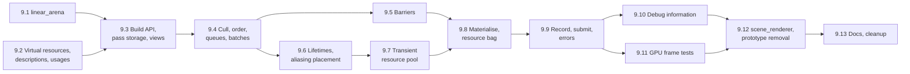

# Task 9 — Render graph

| | |
|---|---|
| Design | [10 — Render Graph](../design/10-render-graph.md). [17 §4, §6](../design/17-graphics-frames-and-transfers.md#4-graphicsframe_schedulerh) for the frame scheduler and profiler it uses; [18 §9](../design/18-graphics-shaders-and-pipelines.md#9-graphicsbinding_layouth) for the helpers its examples use. Decisions D-26, D-27, D-29, D-30, D-86, D-88, D-92, D-95–D-98, D-101–D-103, A-38, A-39 ([99](../design/99-decisions-and-open-questions.md)) |
| Namespace | `avis::graphics` (public), `avis::graphics::detail` (pass storage, trampolines, compiler tables) |
| New public headers | `include/avis/graphics/`: `linear_arena.h`, `resource.h` (rewritten), `texture.h` (rewritten), `buffer.h`, `resource_bag.h` (rewritten), `pass_context.h`, `render_pass_builder.h` (rewritten), `render_graph.h`, `view_scope.h`, `transient_resource_pool.h`, `graph_debug_information.h`, `detail/render_pass_storage.h` |
| New sources | `lib/avis/graphics/`: `linear_arena.cpp`, `resource_bag.cpp`, `pass_context.cpp`, `render_pass_builder.cpp` (rewritten), `render_graph.cpp`, `transient_resource_pool.cpp`; private `lib/avis/graphics/render_graph_compiler.h/.cpp`, `render_graph_tables.h`, `render_graph_executor.h/.cpp` |
| Changed | `apps/visualizer/rendering/scene_renderer.h/.cpp` (ported, back in the build), `apps/visualizer/visualizer_driver.h/.cpp`, `apps/visualizer/CMakeLists.txt`, `lib/avis/CMakeLists.txt`, `tests/CMakeLists.txt` |
| Removed | `include/avis/graphics/render_pass.h`, `render_pipeline.h`, `lib/avis/graphics/render_pass.cpp`, `render_pipeline.cpp` (replaced by `render_graph`, A-38) |
| Tests | `tests/test_graphics_linear_arena.cpp`, `tests/test_render_graph_build.cpp`, `tests/test_render_graph_compile.cpp`, `tests/test_render_graph_barriers.cpp`, `tests/test_render_graph_aliasing.cpp`, `tests/test_transient_resource_pool.cpp`, `tests/test_render_graph_execute.cpp`, `tests/test_render_graph_frame.cpp`; shaders under `tests/shaders/render_graph/` |
| Prerequisites | [Task 6](06-rhi.md) (the RHI views, recorders and `narrow()`, `memory` for placed resources), [Task 7](07-graphics-frames-and-transfers.md) (`frame_scheduler`, `frame_token`, `gpu_profiler`, `upload_queue` for `ready_after` in tests, the graphics error domain and header check). [Task 8](08-graphics-shaders-and-pipelines.md) only for `binding_layout` in the GPU tests; without it they set root arguments with the RHI's generic calls. |

The render graph groups graphics, compute and copy work into passes, rebuilt every frame: **build** (passes declare virtual resources and their reads and writes), **compile** (cull, order, assign queues, lifetimes, barriers, aliasing) and **execute** (bind virtual resources to placed RHI resources, record in parallel, submit in order per queue). It replaces the parked prototype in `include/avis/graphics/` and brings the Visualizer's `scene_renderer` back into the build.

**Not in this task.** The renderer's passes, `view_history`, the debug blit pass and the pipeline variant registry (11), the Visualizer's frame chain, shared texture ring and Qt completion driver (12). `scene_renderer` comes back as a ported skeleton that builds and compiles a graph, not as a renderer.

**Order.** 9.1 and 9.2 are independent. 9.4–9.6 are pure computations on the graph's tables and need no device; 9.5 and 9.6 can run in parallel. The device-facing parts (9.7–9.9) come once the compiled output is fixed.

## Conventions for this task
- **The compiler is pure.** Compile reads the build tables and writes `compiled_graph`; it calls the RHI for nothing. Allocation sizes come in through a callback (`allocation_requirements(const texture_description&)` and the buffer overload) that `render_graph` binds to `rhi::memory::requirements` through the pool and that tests replace with fixed sizes. This is how 10 §10's "null RHI recorder" is realised: tests check barriers, batches, waits, signals and placements on `compiled_graph` directly, without a GPU (see Open points).
- **Tags.** `[render_graph][unit]` for tests without a device (the arena, the usage tables, the pure compiler functions on hand-built tables), `[render_graph]` for tests on the RHI fixture. Build and compile tests use the fixture only because the graph's constructor takes RHI views; they record and submit nothing.
- **Flat tables.** Passes, resources, versions, edges and compiled spans live in the graph's `linear_arena`, indexed by `std::uint32_t`; no per-node heap allocation (10 §4). `render_graph_tables.h` holds these structs, shared by the compiler and the executor.
- **Debug checks** through `AVIS_CHECK` on the "graphics" logger, testable with the recording assertion handler: writing an old version, reading a handle of another frame, nested or duplicate view scopes, compile with an open scope, undeclared access in the resource bag, `allocate_constants` outside execute.
- **Configuration.** The graph takes a `render_graph_configuration { bool async_compute = true; bool aliasing = true; std::uint32_t passes_per_group_without_timings = 4; double group_target_milliseconds = 1.0; }` (see Open points). The application maps `render.async_compute` and `render.graph_aliasing` onto it.

## 9.1 `linear_arena`
[10 §3.5](../design/10-render-graph.md#35-per-frame-linear-arena-linear_arena), D-30.

- [x] `graphics/linear_arena.h` and `.cpp`: `linear_arena_configuration`, `linear_arena` (`allocate`, `create<T>`, `allocate_array<T>`, `reset`, `bytes_used`, `bytes_reserved`), and `arena_allocator<T>` with `==` between allocators of the same arena.
- [x] Blocks of `block_size` bytes; requests larger than half a block get a dedicated block of their own size, which `reset` frees. Alignment padding inside a block; `alignment` must be a power of two (debug check).
- [x] Destructor records (pointer plus `void(*)(void*)`) allocated in the arena itself as an intrusive singly linked list; `create<T>` registers one only when `T` isn't trivially destructible. `reset` runs them in reverse creation order, then rewinds to the first block and releases blocks beyond `maximum_retained_blocks`.
- [x] `allocate_array<T>` requires `std::is_trivially_copyable_v<T>` (`static_assert`).
- [x] Not thread-safe; no locking.

**Tests** (`tests/test_graphics_linear_arena.cpp`, `[graphics][unit]`):
- [x] Alignments 1–4096 are honoured; allocations don't overlap.
- [x] A request of 3 × `block_size` gets its own block and is freed by `reset`.
- [x] Destructors run in reverse creation order on `reset` and on destruction; trivially destructible types register nothing (`bytes_used` doesn't include a record).
- [x] After a steady-state frame pattern, `bytes_reserved` stays constant across 100 resets (no OS allocation, checked with the allocation-failure helper of task 1); blocks above the retention limit are released.
- [x] `std::vector<int, arena_allocator<int>>` grows to 100,000 elements.

## 9.2 Virtual resources, descriptions and usages
[10 §2, §3.1](../design/10-render-graph.md#31-building), D-26, A-38.

- [x] `resource` (index, version, `valid()`), `texture` and `buffer` derived from it, rewritten in `resource.h`, `texture.h` and the new `buffer.h`. A default handle is invalid. Each handle also carries the graph's frame serial (in debug builds only, see Open points), so a handle from an earlier frame is caught.
- [x] `texture_description` (replaces the prototype's `texture_descriptor`): `size` as either `absolute(width, height)` or `view_relative(scale)` (`size_mode`), `depth_or_layers`, `mip_levels`, `format`, `dimension`, optional `clear_value`; `buffer_description`: `size`, `stride` and `raw` for views. The render graph derives RHI usages (render target, depth stencil, shader resource, unordered access) from the declared accesses at compile time, so the description carries no usages.
- [x] Usage enums `texture_read`, `texture_write`, `buffer_read`, `buffer_write` (10 §3.1), and the mapping table to `rhi::access_state` of 10 §6.3 as a `constexpr` function, with `common` substituted for `copy_source`/`copy_destination` on the copy queue.
- [x] `subresource_range` and `all_subresources` are the RHI's (`rhi::subresource_range`), re-exported with `using` in `avis::graphics`.

**Tests** (in `tests/test_render_graph_build.cpp`, `[render_graph][unit]`):
- [x] The access-state table matches 10 §6.3 row by row (`static_assert`s).
- [x] `view_relative(0.5)` resolves to half the view size, rounded up, never 0.

## 9.3 Build API, pass storage, view scopes
[10 §3.1, §3.3, §5, §8](../design/10-render-graph.md#31-building), D-27.

- [x] `pass_context.h`: `graphics_pass_context`, `compute_pass_context`, `copy_pass_context` as in 10 §3.1 (recorder, `allocate_constants` overloads except on copy contexts, `render_width`, `render_height`). Each holds a recorder pointer, the frame token, the scheduler and the pass's render area; they're created by the executor (9.9). The `allocate_constants` failure path throws `avis::runtime_error` with `transient_memory_exhausted` (10 §7).
- [x] `detail/render_pass_storage.h`: the pass node (name, `pass_type`, `compute_queue_hint`, side-effects flag, render area, pointers to `PassData` and the execute callable, the trampoline `void(*)(const void* callable, const void* data, const resource_bag&, context&)`, and the spans of its declared accesses).
- [x] `render_graph::add_graphics_pass`, `add_compute_pass`, `add_copy_pass`: create `PassData` (default-constructed) and the decayed execute callable with `linear_arena::create`, run setup inline with a `render_pass_builder` bound to the new pass, and return `const PassData&`. The `requires` clauses fix the context type (10 §3.1).
- [x] `render_pass_builder`: `create_texture`, `create_buffer` (version-0 entries with the pass as creator), `read` (records the access on the given version), `write` (bumps the version, records the pass as producer of the new one, returns the new handle; writing a version that already has a successor is a debug check), `set_side_effects`, `set_render_area`. Accesses are appended to the pass's arena-backed list.
- [x] `import_texture` and `import_buffer`: version-0 entries flagged imported, with initial and final states, the RHI handle and the optional `ready_after` point.
- [x] `view_scope` and `begin_view` (10 §8.1–8.2): names of passes, resources and imports get `"<view>/"` while a scope is alive; qualified names are built in the arena. Debug checks for the rules: no nesting, unique per frame, non-empty without `/`, and none open at `compile()`.
- [x] `reset()`: destroys the previous frame's tables, runs the arena's `reset`, and bumps the frame serial.
- [x] Constructor as in 10 §3.1, plus the configuration (Conventions). Not copyable or movable: passes keep pointers to it.

**Tests** (`tests/test_render_graph_build.cpp`, `[render_graph]`, a graph on the fixture's views that executes nothing; see Open points):
- [x] Setup runs inside `add_*_pass`, in declaration order, on the calling thread; the returned reference is stable while 1,000 more passes are added.
- [x] Versioning: `write` returns a new version; reading the new version records an edge from the writer; writing the old version again fires the check.
- [x] A `PassData` with a `std::string` member and an execute lambda capturing a `std::shared_ptr` are destroyed on `reset()` (use counts drop).
- [x] View scopes: names are qualified inside the scope and unqualified outside; nesting, a duplicate name, a name with `/`, and `compile()` with an open scope each fire their check.
- [x] Compile-time (`static_assert` on `requires`): `add_compute_pass` doesn't accept an execute lambda taking `graphics_pass_context&`; `compute_pass_context::recorder()` has no `draw`; `copy_pass_context` has no `allocate_constants`.

## 9.4 Culling, order, queue assignment, batches
[10 §6.1–6.2](../design/10-render-graph.md#61-culling).

- [x] `render_graph_compiler.h/.cpp` (private) with one function per phase, each taking the tables and the arena: `cull`, `assign_queues`, `build_batches`, then (9.5, 9.6) `place_barriers`, `place_resources`. `render_graph::compile()` runs them in order and stores `compiled_graph` (10 §6.5).
- [x] Culling with reference counts (10 §6.1): passes that write an import or have side effects are roots; a resource version nobody reads releases its producer. The culled flag is kept for the debug information.
- [x] Queue assignment (10 §6.2): compute passes hinted `async_compute` go to the compute queue when `configuration.async_compute` is on; copy passes go to the copy queue only when every texture they touch is in `common` at that point (imports in `common`, or transitioned there) and every other resource is a buffer, otherwise graphics.
- [x] Batches: consecutive passes on one queue form a batch. Each cross-queue edge makes the producer's batch end with a signal and the consumer's batch begin with a wait on it. Redundant waits are removed by tracking, per queue, the latest batch of each other queue already waited on (transitive reduction).
- [x] Imports with `ready_after`: the first batch that uses the resource waits on the point (a point that's already complete is dropped at submit, 9.9).

**Tests** (`tests/test_render_graph_compile.cpp`, `[render_graph]`, nothing executed):
- [x] Culling: a chain whose end nobody reads is culled entirely; a pass with side effects keeps its producers; a pass writing an import is kept; two branches where only one feeds the import keep only that one.
- [x] Order is declaration order minus culled passes.
- [x] Queues: an async-hinted compute pass goes to compute, and to graphics with `async_compute = false`; a copy of two buffers goes to copy; a copy of a render-target texture goes to graphics (the §3.6 case).
- [x] Batches and fences: graphics → async compute → graphics gives three batches with one signal and one wait each way; a second consumer on graphics doesn't wait again; an async pass whose output nobody on graphics consumes adds no wait on graphics.
- [x] Compiling a 100-pass graph, built on a fixed pattern of reads and writes, takes under 0.2 ms in Release (a `[!benchmark]`-style check that only reports in Debug).

## 9.5 Barriers
[10 §6.3](../design/10-render-graph.md#63-barriers).

- [x] For each resource, walk its accesses in execution order and emit transitions into the consuming pass's `barrier_batch` (texture, buffer and global barrier lists, arena-backed), using the 9.2 mapping:
  - consecutive reads with a compatible layout merge, without a barrier between them; their synchronization and access bits are combined into the earlier barrier;
  - UAV → UAV in consecutive passes gives an access-only barrier;
  - textures with partial ranges are tracked per mip and layer, and emit one barrier per range that changes;
  - the first use of a transient texture transitions from `undefined` with `discard` (aliasing, 9.6);
  - imports start from their `initial` state; after their last use, a transition to `final` goes into the end-of-frame list of the last queue that used them (10 §7 step 4).
- [x] Cross-queue edges: the transition is placed at the end of the producer's batch, into a layout valid on both queues (`common`, `shader_resource` or `unordered_access`), and the consumer's first access starts from it.

**Tests** (`tests/test_render_graph_barriers.cpp`, `[render_graph]`, nothing executed):
- [x] The §3.6 frame gives `render_target → copy_source` on `color` and `common → copy_destination` then `copy_destination → common` (end of frame) on `output`.
- [x] Two passes reading one SRV: one barrier before the first, none before the second.
- [x] Two UAV passes on one buffer: an access-only barrier between them.
- [x] A depth mip-chain pass writing mip *n* from mip *n − 1* emits per-mip barriers, never a whole-resource one.
- [x] A texture produced on async compute and read on graphics is transitioned on the compute queue, before the signal.
- [x] A transient texture's first barrier is from `undefined` with `discard`.

## 9.6 Lifetimes and aliasing placement
[10 §6.4](../design/10-render-graph.md#64-aliasing-and-transient-memory) steps 1, 2, 5, 6.

- [x] Lifetime per transient resource: `[first use, last use]` in execution order. Resources used by async compute batches are widened to the span between the fences that bound those batches.
- [x] Placement: sort by size (descending), then greedy interval allocation in one heap of `heap_kind::all_resources` (the capability gate requires resource heap tier 2, [09 §8.5](../design/09-rhi.md#85-placed-resources-and-heaps-rhimemoryh)): a resource takes the lowest aligned offset whose occupants' lifetimes don't overlap its own. Sizes and alignment come from the requirements callback. The result is the heap size and an offset per resource.
- [x] With `configuration.aliasing` off, and for resources excluded from aliasing (9.10), every resource gets its own range.
- [x] Partial writes: a pass that writes only part of a fresh aliased texture (a partial `subresource_range` on its first access) and isn't flagged `needs_clear` fails the compile with a debug check naming the pass and resource. See Open points for the builder call.
- [x] `memory_statistics`: aliased and non-aliased bytes.

**Tests** (`tests/test_render_graph_aliasing.cpp`, `[render_graph][unit]` on the placement function with hand-built lifetimes and fixed sizes):
- [x] No two resources with overlapping lifetimes overlap in memory (checked over every pair, for 1,000 random graphs with a fixed seed).
- [x] Two resources with disjoint lifetimes share offset 0; three of decreasing size nest as expected.
- [x] A fixed graph gives the same placement on every run (a golden table in the test).
- [x] An async resource whose interval overlaps a graphics resource's only through the widened span doesn't share memory with it.
- [x] With aliasing off, the heap size is the sum of the aligned sizes.

## 9.7 Transient resource pool
[10 §6.4](../design/10-render-graph.md#64-aliasing-and-transient-memory) steps 3–4, D-95.

- [x] `graphics/transient_resource_pool.h/.cpp`: created from `rhi::memory`, `rhi::resources` and the scheduler's `frames_in_flight()`. Per frame context: one heap (`heap_kind::all_resources`) and a cache of placed textures and buffers keyed by `(description hash, heap, offset)`.
- [x] `requirements(description)` forwards to `rhi::memory::requirements`, cached by description hash (the compiler calls it per resource per frame).
- [x] `prepare(context_index, heap_size)`: grows the context's heap in 64 MiB steps when it's too small (destroy the cached resources of the old heap, then the heap, through the RHI's deferred release; then create the new one), and tracks the high-water mark; after 120 frames below it, shrinks to the high-water mark rounded up to 64 MiB.
- [x] `acquire_texture(context_index, description, offset)` / `acquire_buffer(…)`: return a cached placed resource or create one with `create_placed_texture`/`create_placed_buffer`. Entries unused for 120 frames are destroyed.
- [x] RHI descriptions are built from the graph's descriptions plus the usages derived from the accesses (9.2), resolved sizes, and the declared `clear_value`.
- [x] Destructor: destroys every cached resource, then the heaps; no frame may be executing.

**Tests** (`tests/test_transient_resource_pool.cpp`, `[render_graph]`):
- [x] A steady-state sequence of 10 frames with the same graph creates placed resources only in the first *F* frames (pool counters and RHI slot counts).
- [x] Growing past 64 MiB replaces the heap; the old one is freed after `poll_completions()` once its frame is complete; shrinking happens after 120 small frames.
- [x] Two cached resources placed at the same offset of one heap alias (a write through one is visible through the other after an aliasing barrier).

## 9.8 Materialise and the resource bag
[10 §3.4, §7](../design/10-render-graph.md#34-resource-bag) step 1.

- [x] `resource_bag`: flat arena arrays indexed by the virtual resource index, holding the RHI handle, the GPU address (buffers), SRV and UAV indices (a UAV per mip for textures), and the resolved description. Every accessor of 10 §3.4. `render_target_view`/`depth_stencil_view` build `rhi::texture_view`s.
- [x] Materialise in `execute`: `pool.prepare` for the frame's context, then for each live transient resource `acquire_*` and its views through `frame_scheduler::create_frame_srv/uav` (only the views its accesses need); imports map directly to their handle and its persistent views. A failure from the scheduler completes `execute` with that error before anything is recorded.
- [x] Debug builds: each bag lookup checks the resource against the current pass's declared accesses (the executor sets the current pass per recording thread with a `thread_local`), and fires the check on undeclared access.

**Tests** (in `tests/test_render_graph_execute.cpp`, `[render_graph]`):
- [x] A pass that looks up a resource it didn't declare fires the check (Debug).
- [x] `width`/`height` of a `view_relative(0.5)` texture are half the view size; `description` returns the resolved one.
- [x] With 16 descriptors per frame and a graph needing more, `execute` completes with `transient_memory_exhausted` and submits nothing.

## 9.9 Recording, submission and errors
[10 §7](../design/10-render-graph.md#7-execution-phase), D-86, D-92, D-98, A-39.

- [x] Recording groups: split each queue's ordered pass list into groups of about `group_target_milliseconds` from the profiler's `completed_gpu_timings` (matched by pass name), or of `passes_per_group_without_timings` passes without a profiler or timings. A group never spans two batches.
- [x] `execute(frame)` returns a sender: `stdexec::bulk` over the groups on the parallel scheduler, then the ordered submit. Each group acquires one list of its queue type (`command_lists::acquire<Queue>`), and for each pass: emits the barrier batch, `begin_event(name)`, `begin_timing` with a profiler, calls the trampoline with a context whose recorder is the list's own or `narrow()`ed for compute and copy passes on graphics, then `end_timing` and `end_event`. The `submitted_frame` sender type is named (`render_graph_execute_sender`), satisfying `avis::sender_of<…, submitted_frame>`.
- [x] Errors: an acquire failure, materialise failure, or a `transient_memory_exhausted` thrown by `allocate_constants` and caught by the group completes `execute` with `set_error` once all groups finished, and nothing is submitted; the lists are destroyed (discarded). A stop request completes with `set_stopped`, also without submitting.
- [x] Submit: after all groups, per batch in order, `queue<Queue>::submit` with the batch's waits (cross-queue points from earlier batches of this frame, and `ready_after` points not yet complete); the returned point is the batch's signal. Then the trailing end-of-frame list per queue with the imports' final transitions.
- [x] `submitted_frame` holds the last point of every queue that was used.

**Tests** (`tests/test_render_graph_execute.cpp`, `[render_graph]`):
- [x] Execute lambdas run on parallel workers, and each runs exactly once; a graph of 20 passes gives 5 groups without a profiler.
- [x] A compute pass on the graphics queue sees `recorder().submission_queue() == graphics`.
- [x] An import with a `ready_after` from an upload queue flush (task 7) is waited on: the pass reads the uploaded data. A complete `ready_after` adds no wait.
- [x] `submitted_frame` covers every queue used: an async compute pass nobody waits on still contributes its point.
- [x] An execute lambda that throws `transient_memory_exhausted` (frame memory exhausted) completes `execute` with that error, and the RHI's submission counters show nothing submitted; the scheduler's next frame works after `end_frame(frame, {})`.
- [x] With a profiler, every pass has a timing named after it, and the second frame after timings exist sizes groups from them.

## 9.10 Debug information
[10 §9](../design/10-render-graph.md#9-debug-introspection).

- [x] `graph_debug_information`: per pass (qualified name, queue, culled flag, GPU time of frame *N − F* when there is a profiler) and per resource (qualified name, description, producer and consumer passes, imported flag, heap offset, lifetime interval), all valid until the next `reset()`.
- [x] Debug blit support: a way for the builder to keep a selected resource alive and out of aliasing. See Open points for the call; with it, the blit pass's read keeps the producer chain (normal culling) and the resource gets its own range.

**Tests** (in `tests/test_render_graph_compile.cpp`): the debug information of a fixed graph lists culled passes and the expected producers, consumers and intervals; a resource read by a pass flagged for the debug selection isn't aliased.

## 9.11 GPU frame tests
[10 §3.6, §8, §10](../design/10-render-graph.md#36-complete-minimal-frame).

**Tests** (`tests/test_render_graph_frame.cpp`, `[render_graph]`, with a frame scheduler, a profiler and `poll_completions()` in the test):
- [x] **The minimal frame of 10 §3.6**, with the test triangle shaders from task 6: clear, full-screen triangle, copy into an imported texture; a readback (task 7's readback queue) matches the clear color where the triangle doesn't cover and the triangle color where it does. No debug-layer or GPU-based validation error.
- [x] **Async compute:** a compute pass on the compute queue writes a buffer that a later graphics pass copies; the result reads back correctly, and the compiled batches have one cross-queue wait.
- [x] **Aliasing on the GPU:** two transient render targets with disjoint lifetimes share memory and both produce correct output, with GPU-based validation on.
- [x] **Multi-view:** the same pass functions inside `begin_view("main")` and `begin_view("topdown")` write two imported outputs, and each reads back correctly; names are qualified in the debug information.
- [x] **Frame chain:** 100 frames of `begin_frame → build → compile → execute → end_frame` with *F* = 2 complete; after the first *F* frames no placed resource and no allocator is created.

## 9.12 `scene_renderer` and the prototype
The parked files come back on the new API ([README](README.md), task 6.3.1).

- [x] Delete `render_pass.h`, `render_pipeline.h`, `render_pass.cpp` and `render_pipeline.cpp`; their content is replaced by `render_graph` and `detail/render_pass_storage.h`. `resource_bag.h`, `resource.h`, `texture.h` and `render_pass_builder.h/.cpp` are the rewritten versions.
- [x] Port `apps/visualizer/rendering/scene_renderer` to `render_graph`: its depth, linearise, G-buffer, lighting and ambient occlusion passes declare their resources with `texture_description`s, and their execute lambdas take the typed contexts and record nothing yet (the renderer's pipelines come with 11). `render` takes the graph and builds and compiles it; nothing writes an import yet, so every pass is culled, which the comment says.
- [x] Put `scene_renderer.cpp` back into `AVIS_VISUALIZER` and the graphics sources into `AVIS_LIB`. The Visualizer owns a `render_graph`, a `frame_scheduler` and a `transient_resource_pool` when the RHI exists, and calls `scene_renderer::render` from `on_render` with build and compile only. Executing frames needs the frame chain and a completion driver (12); see Open points.
- [x] `grep -rn "render_pipeline\|texture_descriptor\|graphics_context\|config_callback_type" apps include lib tests` returns nothing.

**Tests:**
- [x] The Visualizer builds in Debug and Release, starts, and exits cleanly.
- [x] The public-header check (task 7.1) now covers every header in `include/avis/graphics/`, with no exclusions.

## 9.13 Docs and cleanup
- [x] Update [10](../design/10-render-graph.md) wherever the implementation differs: the configuration struct, the compiler's requirements callback, the frame serial in handles, the debug-selection and `needs_clear` calls, and the testing approach of §10.
- [x] Update the "Parked for the render graph task" paragraph in the [README](README.md): done.
- [x] The "existing code diverges" note in 99 no longer lists the render graph.
- [x] Add an **As implemented** section here.
- [x] 20 random-order runs of the `[render_graph]` and `[graphics]` tests in Debug and ASan.

## As implemented
Per step, the differences from the plan and from [10](../design/10-render-graph.md) as first drafted. 10, the README and 99 were updated to match in 9.13, so these notes are the history; 10 is the reference.

### 9.1 (2026-10-30)
- **Dedicated blocks** are used for requests larger than half a block, and also for requests whose alignment padding wouldn't fit a block.
- **Block header** is `alignas(std::max_align_t)`, so a block's first allocation is aligned without padding.

### 9.2 (2026-10-30)
- **Copy queue layouts.** `usage_access_state` takes the pass type and the queue: copies use `common` on the copy queue, UAVs and depth reads synchronise with the shading stage of the pass's type.
- **Frame serial** (Open points): debug builds carry it in every handle; `detail::resource_handles::make` builds handles for the graph and for tests on hand-built tables.

### 9.3 (2026-10-30)
- **View sizes.** `view_relative` textures needed a view size the API didn't have; `begin_view(name, view_size)` and `render_graph::set_view_size` were added in 9.6 (Open points).
- **Arena-backed names.** Qualified pass, resource and view names are copied into the arena, so callers may pass temporaries (`std::format` results).

### 9.4 (2026-10-30)
- **Phase order.** `compile` runs `cull`, `assign_queues`, `build_batches`, `compute_lifetimes`, `place_resources`, `place_barriers`: placement before barriers, so the first use of shared memory knows to wait for earlier work. The plan listed barriers first.
- **`ready_after` per queue.** Each queue's first batch using an import waits on its point, so an async compute batch isn't unordered against the upload.
- **Benchmark.** 27.7 µs in Release for the 100-pass graph after 9.5–9.8, 44.9 µs once compile also builds the debug information (9.10); the limit is 200 µs.

### 9.5 (2026-10-30)
- **Extra cross-queue waits.** `build_batches` also waits for other queues before a write or a texture layout change of a resource they used, not only before reading another queue's output, so the handoff barriers are ordered.
- **Handoffs.** A texture written on another queue, or in a layout the consumer's queue doesn't know, is transitioned at the end of the producer's batch; a texture only read there, in a layout both know, is transitioned on the consumer's queue after its wait. Buffers need no handoff: the fence suffices.
- **No global barriers.** Nothing needed them; `barrier_batch` holds texture and buffer transitions on virtual resources, and the executor fills in the handles.
- **Aliased first use.** When a transient resource's memory is shared with an earlier one, its first barrier waits for all earlier work (`synchronization: all`), since the earlier occupant's last access isn't tracked per resource. A transient buffer with memory of its own needs no first barrier.
- **Final transitions** whose layout the last queue doesn't know go into the graphics queue's trailing list, which waits for that queue's batch.

### 9.6 (2026-10-30)
- **Async widening** applies to compute and copy batches: their resources' lifetimes cover the positions between the last batch of each other queue they wait for and the first batch of each other queue that waits for them.
- **`needs_clear`** is `write_flags::needs_clear` on `render_pass_builder::write`. The check applies to every aliasable transient texture while aliasing is on, not only those sharing memory: the content is undefined either way. The executor doesn't clear flagged textures yet (Open points).
- **Statistics** add the heap size; aliased and non-aliased bytes are aligned sizes.

### 9.7 (2026-10-30)
- **Cache key** is the description hash and offset per frame context (a context's cache is emptied when its heap is replaced); the debug name isn't part of it.
- **Shrinking** uses the most the 120 frames below the heap size needed, rounded up to 64 MiB; a frame at the heap's size restarts the count.
- **Retention** counts `prepare` calls, one per frame, so an entry of a context unused for 120 frames goes even with *F* contexts.

### 9.8 (2026-10-30)
- **`render_graph::materialise(frame)`** is public: 9.8's tests ran it before `execute` existed, and the GPU tests still use it for the bag.
- **Imports' views** are looked up through `rhi::resources` on each bag call (their persistent views), not copied into the bag.
- **Undeclared access** is checked per thread through `detail::current_pass_scope`, in the private executor header.

### 9.9 (2026-10-30)
- **Executor.** One `detail::render_graph_executor` per graph, created with it and reused across frames: its group, slot and submit vectors keep their capacity across frames. With a profiler, the map of timings by pass name still allocates its entries each frame. The sender's operation hands itself to it (`detail/render_graph_execute_sender.h`, the same pattern as the shader library loader).
- **Barrier conversion** happens on the starting thread before the bulk, into the arena; the recording threads only read.
- **Trailing lists** are acquired and recorded on the starting thread too, so an acquire failure stops the frame before recording.
- **Profiler.** `execute` doesn't call `prepare_frame`: the frame chain does (Open points). Timings are matched by pass name at depth 0.
- **Stops** are checked when the operation starts and once recording finished; the bulk always runs to its end.

### 9.10 (2026-10-30)
- **`read_for_debug`** (texture and buffer overloads) is the debug selection call (Open points); `resource_debug_information::debug_selected` shows it.
- **GPU times and the group count** are filled in by `execute`, from the timings it reads for the group sizes.

### 9.11 (2026-10-30)
- **No new shaders.** The tests use task 6's triangle and fill shaders; `tests/shaders/render_graph/` wasn't needed. The triangle's viewport covers the left half of the target.
- **Fixture.** `render_graph_fixture_options` adds the profiler, GPU-based validation, frames in flight and the descriptor budget; the tests that execute declare a small runtime for the parallel scheduler.
- **Allocator warm-up.** Which worker records which queue's group varies, so the frame-chain test checks command allocators from frame 10, and placed resources, heaps and slots from frame *F* (Open points).

### 9.12 (2026-10-30)
- **Passes.** `scene_renderer` declares depth, linearise depth (compute), G-buffer, ambient occlusion (async compute, half resolution) and lighting, which reads the ambient occlusion. Execute callbacks record nothing; nothing writes an import, so every pass is culled.
- **Visualizer.** The driver builds and compiles the graph at a fixed 1280 × 720 view size until the viewport's size comes with the frame chain (12). It starts and exits cleanly in Debug and Release.
- **Commits.** The Visualizer's rework (the driver, the viewport, the scene library) was committed with the port, since the port depends on it.

### 9.13 (2026-10-30)
- **Docs.** 10 records the configuration, the requirements callback, frame serials, view sizes, `write_flags::needs_clear`, `read_for_debug`, the extra cross-queue waits, the compiled output, the one transient heap per context and the testing approach. The README's parked paragraph is marked done, its task 9 open points resolved, and 99 no longer lists the render graph as diverging.
- **Random-order runs.** 20 runs each in Debug and ASan of the `[render_graph]` and `[graphics]` tests (136 test cases) in random order, seeds 1001 to 1020: all passed.

## Acceptance criteria
- The graphics headers compile without D3D12, `<windows.h>` or asio, and the prototype's old API is gone.
- Setup runs inline; pass data and callables live in the arena with stable addresses and are destroyed on `reset()`; a steady-state frame allocates nothing from the OS for the graph.
- Compile culls, orders, assigns queues, places barriers and cross-queue fences, and aliases transient memory as 10 §6 says, verified without a GPU on fixed and random graphs; a 100-pass compile takes under 0.2 ms in Release.
- Execute records in parallel with typed contexts, submits in a fixed order per queue, and reports a `submitted_frame` covering every queue used; failures and stops submit nothing.
- The minimal frame, async compute, aliasing and multi-view GPU tests produce correct readbacks with the debug layer and GPU-based validation clean.
- After the first *F* frames, a steady-state frame creates no placed resource, no heap and no command allocator.
- The Visualizer builds and runs with `scene_renderer` back in the build.
- All tests pass in Debug, Release and ASan.

## Open points
- **Testing without a "null RHI recorder".** 10 §10 asks for a test double that records barriers and submissions, but the RHI's recorders are concrete classes. This task tests the compiler's output (`compiled_graph`) directly and the executor on the GPU (WARP or hardware). An RHI-level test double would need an interface the RHI doesn't have. Recommended: keep it this way and change 10 §10's wording.
- **Configuration.** 10 mentions `render.async_compute` and `render.graph_aliasing` and an async-compute capability, but the constructor in 10 §3.1 takes neither, and the views don't expose `capabilities()`. Proposed: a `render_graph_configuration` constructor argument (Conventions), filled by the application from its configuration and the root's capabilities.
- **`needs_clear`.** 10 §6.4 step 5 names a `needs_clear` declaration but the builder has no call for it. Proposed: a `texture_write` flag or `render_pass_builder::write(texture, texture_write, subresource_range, write_flags::needs_clear)`, and the executor clearing the texture (render target, depth or UAV clear) before the pass when set.
- **Debug blit selection.** 10 §9 says the selected resource is "excluded from aliasing", but not how the graph learns which one. Proposed: `render_pass_builder::read_for_debug(resource, …)`, which reads like `read` and excludes the resource from aliasing; the renderer's debug pass (11 §11) uses it.
- **Handle frame serial.** A version-and-index handle from an earlier frame looks valid in the next one. A frame serial in debug builds catches it at the cost of a larger handle in Debug only. Alternative: no check, as 10 describes the handles.
- **Graph construction in unit tests.** The constructor takes RHI views, a pool and a scheduler, so even build-only tests need a device. Either the build and compile tests run on the fixture (cheap, no GPU work), or `render_graph` gets a test-only constructor without execution dependencies. Recommended: the fixture, and keep `[render_graph][unit]` for the pure compiler functions called on hand-built tables.
- **View size.** `view_relative` textures need the view's size, but `begin_view` takes only a name. Implemented: `begin_view(name, texture_extent view_size)` next to `begin_view(name)`, and `render_graph::set_view_size` for resources created outside a scope (kept across `reset()`, 1 × 1 until set). Textures resolve their size when created.
- **Materialise before execute.** 9.8's exhaustion test runs `render_graph::materialise(frame)` directly, since `execute` comes with 9.9; 9.9 calls it first and completes `execute` with its error.
- **Profiler preparation.** `execute` doesn't call `gpu_profiler::prepare_frame`: the frame chain does, once per token, since other recording may time scopes too (17 §6). `execute` reads `completed_gpu_timings` for the group sizes and the debug information.
- **Extra cross-queue waits.** Since 9.5, a batch also waits for other queues before writing a resource they used or changing a texture's layout, not only before reading another queue's output, so the handoff barriers are ordered.
- **`needs_clear` clears.** 9.6 checks the flag; the executor doesn't clear flagged textures yet. Proposed: a clear (render target, depth or UAV, by usage) before the pass, when the renderer first needs it.
- **Allocator warm-up.** Which worker records which queue's group varies between frames, so the frame-chain test checks command allocators from frame 10, and placed resources, heaps and slots from frame *F*.
- **Debug selection.** Implemented as `render_pass_builder::read_for_debug(resource, usage, range)`: a read that also keeps the resource out of aliasing (`resource_debug_information::debug_selected`).
- **Visualizer execution.** Running frames needs the frame chain, the shared texture ring and the Qt completion driver of 12. This task only builds and compiles the graph in the Visualizer; executing it is the Visualizer task's first step.
