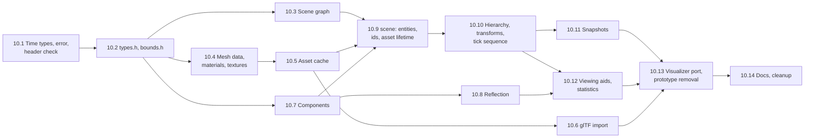

# Task 10 — Scene management

| | |
|---|---|
| Design | [08 — Scene Management](../design/08-scene-management.md), its interface in §9. [03 §2, §5.2](../design/03-simulation-core.md) for the simulation time types; [11 §3.1, §3.2](../design/11-renderer.md#31-scene-input) for what the snapshot carries; [07](../design/07-io-layer.md) for `read_file`. Decisions D-32, D-41, D-42, D-56, A-03, A-15, A-20, A-58 ([99](../design/99-decisions-and-open-questions.md)) |
| Namespace | `avis::scene` (public), `avis::scene::components` (components), `avis::scene::detail` (slot tables, owner checks), `avis::simulation` (time types only) |
| New public headers | `include/avis/simulation/time.h`; `include/avis/scene/`: `types.h`, `bounds.h`, `error.h`, `scene_graph.h` (rewritten), `reflection.h`, `snapshot.h`, `statistics.h`, `scene.h` (rewritten), `components/identity.h`, `spatial.h`, `rendering.h`, `vehicle.h`, `sensor.h`, `driver.h`, `viewing.h`, `assets/mesh_data.h`, `mesh_builder.h`, `material.h`, `texture_data.h`, `asset_cache.h`, `gltf.h` |
| New sources | `lib/avis/scene/`: `types.cpp`, `bounds.cpp`, `error.cpp`, `scene_graph.cpp` (rewritten), `scene.cpp` (rewritten), `snapshot.cpp`, `reflection.cpp`, `labels.cpp`, `trails.cpp`; `lib/avis/scene/assets/`: `mesh_data.cpp`, `mesh_builder.cpp`, `asset_cache.cpp`, `gltf_import.cpp`, `gltf_import.h` (private), `wic_decoder.h/.cpp` (private) |
| Changed | `apps/visualizer/visualizer_driver.h/.cpp` (owns an `asset_cache`), `apps/visualizer/rendering/scene_renderer.h/.cpp` (registry views instead of `view_entities`), `lib/avis/CMakeLists.txt` (sources, `windowscodecs`), `tests/CMakeLists.txt` (tests, scene header check, fixtures) |
| Removed | `include/avis/scene/components/mesh.h`, `components/material.h` (replaced by `components/rendering.h`); `scene::view_entities`, `scene_graph::get_node`, `mark_dirty`, `scene_node`, `transform::to_matrix` |
| Tests | `tests/test_scene_types.cpp`, `test_scene_bounds.cpp`, `test_scene_error.cpp`, `test_scene_public_headers.cpp`, `test_scene_graph.cpp`, `test_scene_mesh_data.cpp`, `test_scene_asset_cache.cpp`, `test_scene_gltf.cpp`, `test_scene_components.cpp`, `test_scene_reflection.cpp`, `test_scene.cpp`, `test_scene_transforms.cpp`, `test_scene_snapshot.cpp`, `test_scene_snapshot_buffer.cpp`, `test_scene_viewing_aids.cpp`, `test_scene_statistics.cpp`; fixtures under `tests/data/gltf/` |
| Prerequisites | [Task 1](01-foundations.md) (`avis::error`, `avis::result<T>`, `avis::log`, the recording assertion handler), [Task 3](03-parallel-scheduler.md) (`stdexec::get_parallel_scheduler()` for image decoding), [Task 5](05-io-layer.md) (`read_file`, `avis::sender_of`, `sync_wait_result`), [Task 0](00-external-dependencies.md) (fastgltf, simdjson), [Task 8.1](08-graphics-shaders-and-pipelines.md) (xxHash for the content hash). No GPU: nothing in this task touches the RHI. |

The scene library holds the Visualizer's world: an EnTT registry with the components of 08 §3, a scene graph that owns transforms, a CPU-only asset cache with versioned, immutable meshes, materials and textures, glTF import, and the double-buffered snapshot the renderer reads. It also provides the generic parts of the viewing aids (label formatting, trail sampling, world bounds, update stamps, statistics). It replaces the prototype in `include/avis/scene/`.

**Not in this task.** Everything in the Visualizer that uses the library (12):
- `scene_stream` and the `driver_entity_index`, which apply the Driver's messages (08 §3.1)
- the scene representation, which turns display shapes, belief geometry, lidar sweeps, labels, trails and staleness into meshes (08 §8.1, §8.2, §8.4)
- the font atlas and `dt font-atlas`
- the Qt signals for the tree, inspector and statistics (08 §7)

The renderer's extraction and residency cache (11) are also out of scope. So are the parts of 08 §10's tests that need those: the Driver mapping test, the label mesh rebuild throttling and staleness. This task tests the library on its own, with entities and components created by the tests.

**Order.** After 10.2, three strands are independent: the scene graph (10.3), the assets (10.4–10.6) and the components (10.7, 10.8). They meet in `scene` (10.9). glTF import (10.6) is needed only at the end, by the Visualizer port's proxy mesh (10.13).

## Conventions for this task
- **Tags.** `[scene][unit]` for everything that needs no runtime (types, bounds, the scene graph, mesh data, components, reflection, `scene` itself). `[scene]` for tests on the runtime fixture, which are the ones that use the IO layer or the parallel scheduler: glTF import and the snapshot buffer's stress test.
- **Debug checks** go through `AVIS_CHECK` on the "scene" logger, and are testable with the recording assertion handler. They cover:
  - a stale node or asset handle
  - a call from a thread other than the simulation thread
  - writing a component that `scene` owns
  - a non-unit scale on a Driver entity's node
  - the tick order of 08 §9.6
  - reading `world` on a dirty node
  - a second concurrent `acquire`

  In release builds a stale handle makes setters do nothing and getters return defaults (08 §9.3).
- **Simulation thread.** `scene` records the thread that constructed it and checks it in debug builds. Tests construct and use a `scene` on one thread. The snapshot buffer stress test uses two.
- **No GPU, no Windows headers in public headers.** WIC and fastgltf stay in `lib/avis/scene/assets/`. The public-header check of 10.1 enforces it.
- **Eigen alignment.** Components holding `Eigen::Affine3f` or `Eigen::Quaternionf` are stored in EnTT pools and `std::vector`s. Use the unaligned types where a fixed-size vectorisable type would need `EIGEN_MAKE_ALIGNED_OPERATOR_NEW`, or check that the build sets `EIGEN_MAX_STATIC_ALIGN_BYTES` so it isn't needed. Decide this once in 10.2 (see Open points).

## 10.1 Simulation time types, error domain, header check
[03 §2](../design/03-simulation-core.md), 08 §9.1, [01 §6](../design/01-system-architecture.md#6-error-handling-policy).

- [x] `simulation/time.h` with only the types that the scene needs from 03:
  - `simulation_clock`, `simulation_duration` (`std::chrono::nanoseconds`), `simulation_time_point`, `step_index`, `time_of_step`
  - `time_anchor { simulation_duration t_base; std::chrono::steady_clock::time_point wall_base; double rate; }` (03 §5.2)

  The clock state machine stays with the simulation core task. Namespace `avis::simulation`.
- [x] `scene/error.h` and `error.cpp`: `error_kind` as in 08 §9.1, `to_string`, `make_error`, `is_error`, in the existing `error_domain::scene`. Same shape as the IO and graphics error headers.
- [x] `tests/CMakeLists.txt`: a generated `scene_public_headers.h` over every header in `include/avis/scene/` and `include/avis/simulation/`, using the same glob and `file(CONFIGURE)` pattern as the RHI and graphics checks.
- [x] `test_scene_public_headers.cpp` includes them in a translation unit with no other includes. It fails when `<windows.h>`, `wincodec.h` or a fastgltf header is reached: check `_WINDOWS_`, `__wincodec_h__` and `FASTGLTF_` macros.

**Tests** (`test_scene_error.cpp`, `test_scene_public_headers.cpp`, `[scene][unit]`):
- [x] Every `error_kind` has a distinct `to_string`; `is_error` matches on domain and kind, and `make_error` keeps the message and source location.
- [x] `time_of_step(10, 100ms) == 1s`.

## 10.2 `types.h`, `bounds.h`
08 §9.1, §8.3, §4.1.

- [x] `types.h`:
  - `entity`, `object_id`, `helper_source`, `is_helper`
  - `entity_category` and `entity_category_count`
  - `color` with `from_srgb8`, using the exact sRGB transfer function, not a 2.2 gamma
  - `transform` with `to_affine` (`Translation · Rotation · Scaling`) and `from_affine` (polar decomposition; rotation normalised, positive scale)
  - `node_handle` with `valid` and `<=>`
- [x] `bounds.h`: `aabb` with `empty`, `extend` (also an overload for a point) and `transformed`. `transformed` uses Arvo's method: the centre is transformed, and the extent is the absolute linear part times the half-size. An empty box stays empty.
- [x] Decide the Eigen alignment rule (Conventions) and write it in a comment in `types.h`.

**Tests** (`test_scene_types.cpp`, `test_scene_bounds.cpp`, `[scene][unit]`):
- [x] `to_affine` matches a hand-computed `T · R · S` matrix for a non-uniform scale and a 30° rotation, and differs from the prototype's order (the 08 §4.1 fix).
- [x] `from_affine(to_affine(t))` round-trips within 1e-5 for random TRS. For a sheared matrix it returns the closest TRS, with no NaN.
- [x] `from_srgb8({ 0, 128, 255, 255 })` matches the reference values. Alpha is linear.
- [x] `aabb::transformed` equals the box of the eight transformed corners, for 1,000 random boxes and transforms. Empty boxes stay empty, and `extend` with an empty box changes nothing.
- [x] `is_helper` holds for `0xFF << 56` and fails for a Driver id with source 1.

## 10.3 Scene graph
08 §4, §4.1, §9.3.

- [x] Rewrite `scene_graph.h` and `.cpp` as in 08 §9.3. The private node data is:
  - parent, first child, next sibling and previous sibling (so unlinking is O(1))
  - the local `transform` and the world `Eigen::Affine3f`
  - the payload `entity`
  - `dirty` and `jumped` bits

  Slots are generational, with a free list, and `roots_` is an intrusive list or vector. `scene_node`, `get_node` and `mark_dirty` go.
- [x] `create_node` links the node as the first child of `parent`, or as a root. `destroy_node` destroys the subtree children first, appends payloads to `destroyed`, bumps each generation and returns the slots to the free list.
- [x] `reparent`:
  - rejects a dead parent (`invalid_parent`) and a parent inside the node's own subtree (`cycle`)
  - accepts a null parent, which makes the node a root
  - with `keep_world`, sets the local transform to `from_affine(world(parent)⁻¹ · world(node))`. When the parent's world scale isn't uniform, it logs a debug warning once per call.
  - marks the node dirty
- [x] `set_local` stores the TRS and sets `dirty`, and also `jumped` when `discontinuity`.
- [x] `update_transforms(jumped)` walks from the roots depth-first with an explicit stack of `{ node, parent world, ancestor dirty, ancestor jumped }`:
  - It skips clean subtrees, recomputes `world` for dirty nodes and their descendants, and calls `jumped(node)` for every node that jumped itself or through an ancestor.
  - It clears both bits and touches every node at most once.
  - The stack is a member, so a steady state doesn't allocate.
  - The overload without a callback ignores jumps but still clears the bits.
- [x] `for_each_in_subtree`, `alive`, `payload`, `parent`, `roots`, `local`, `world`, `size`, `clear`. `world` on a dirty node is a debug check.
- [x] `apps/driver/simulator_driver.h` holds a `scene_graph` member. The Driver has no build target (task 5 Open points), so leave it. Note in its header that it uses the old API only if it calls `get_node` or `mark_dirty` (check with grep).

**Tests** (`test_scene_graph.cpp`, `[scene][unit]`):
- [x] Create and destroy a subtree: the payloads come back children first; stale handles fail `alive`, and slots are reused with a higher generation.
- [x] Reparent with `keep_world`: exact (1e-5) under a parent with uniform scale. Under a parent with non-uniform scale, the closest TRS is kept and a warning is logged. A cycle and a dead parent are rejected, and the tree is unchanged.
- [x] Dirty propagation: after random `set_local` calls on a 10,000-node random tree, every `world` equals a brute-force recomputation from the roots, and an update with nothing dirty visits no node (counted through a test hook or timing).
- [x] A discontinuity on a parent reports it and every descendant through `jumped` exactly once. The next update reports none.
- [x] Debug checks: `set_local` on a stale handle, and `world` on a dirty node.
- [x] 10,000 nodes with 10% dirty update in under 0.2 ms in Release (a `[!benchmark]` test, not run by default).

## 10.4 Mesh data, materials, textures
08 §5.1, §9.4, [11 §3.2, §3.3](../design/11-renderer.md#32-geometry).

- [x] `assets/mesh_data.h`:
  - forward declarations of `mesh_asset`, `material_asset` and `texture_asset`
  - `asset_handle<T>` and its aliases
  - `mesh_topology`, `vertex_attribute` (with `ALLOW_FLAGS_FOR_ENUM`), `mesh_primitive` and `mesh_data`
  - `mesh_data::byte_size()`: vertex and index bytes of the encoded streams
- [x] `detail::validate_and_bound(mesh_data&)` (private, used by the cache) checks four things:
  - every present attribute stream has `positions.size()` entries, and absent ones are empty
  - indices are in range
  - there's at least one primitive, and each primitive lies within the streams
  - `indices` is empty when every primitive has `index_count == 0`

  It then computes each primitive's bounds and their union. A failure returns `invalid_mesh` with the first problem found.
- [x] `assets/mesh_builder.h` and `.cpp`:
  - The builder encodes normals and tangents as octahedral `u16x2` and `uv` as f16 bit patterns.
  - `add_vertex` starts a vertex; the attribute calls apply to the last one. The first vertex fixes the attribute set, and a mismatch is a debug check and an `invalid_mesh` from `build`.
  - `end_primitive` closes the range since the previous primitive.
  - `build() &&` closes an open primitive and returns `mesh_data`, without bounds (the cache computes them).
- [x] `assets/material.h`: `shading_model`, `alpha_mode`, `blend_operation`, `material_description` as in 08 §9.4.
- [x] `assets/texture_data.h`: `texture_format`, `texture_data`, and `texture_data::byte_size()`.

**Tests** (`test_scene_mesh_data.cpp`, `[scene][unit]`):
- [x] Octahedral encoding round-trips unit normals within 1e-3 rad, including ±Z and the octahedron's folds. f16 uv round-trips 0, 1, 0.5 and 1/3 to f16 precision.
- [x] A builder with two primitives gives the right ranges. A vertex missing an attribute that the first one has fails.
- [x] Validation rejects: an index out of range, a stream of the wrong length, no primitives, and a primitive past the end. The bounds equal a brute-force scan, and empty positions give empty bounds.
- [x] `byte_size` matches the stream sizes.

## 10.5 Asset cache
08 §5.1, §5.2, §8.5, §9.4.

- [x] `assets/asset_cache.h` and `.cpp`, without `load_gltf` (10.6).
  - `versioned<T>` and its aliases, and `asset_statistics`.
  - Three slot tables (mesh, material, texture). Each slot holds the generation, a reference count, the version counter and the current `versioned<T>`. A `std::shared_mutex` guards the tables: shared for `current` and `retain`, exclusive for `create_*`, `update_*` and the last `release` (08 §9.4).
- [x] `create_mesh` and `update_mesh` call `validate_and_bound` and store the data in a `std::shared_ptr<const mesh_data>`. The pointer is created with a deleter that subtracts `byte_size()` from the byte counters:
  - `current_geometry_bytes` while the version is current
  - `retained_geometry_bytes` after `update_mesh` or the last `release` supersedes it

  A version moves from current to retained under the exclusive lock. The deleter decrements whichever counter holds the version (keep a per-version atomic flag in a small control block next to the data). Versions start at 1 and only increase. A failed update keeps the old version.
- [x] `create_material` and `update_material` check that each texture handle is alive (`invalid_material` otherwise) and retain each texture. A freed material releases its textures.
- [x] `create_texture` stores the data; texture bytes aren't geometry bytes, so they aren't counted in the §8.5 counters.
- [x] `retain`, `release` and `release_all`. A slot is freed when its count reaches 0: the cache's `versioned` is dropped and the generation bumps. The CPU data lives on while a snapshot holds a `shared_ptr` (§5.2).
- [x] The destructor asserts that every slot is free (08 §9.4: "only the cache's own references remain").
- [x] `statistics()` reads the counts and the atomics.
- [x] Deduplication by path and content hash belongs to `load_gltf` (10.6); `create_*` never deduplicates.

**Tests** (`test_scene_asset_cache.cpp`, `[scene][unit]`):
- [x] `update_mesh` bumps the version and leaves a `shared_ptr` to the earlier version valid with its old contents.
- [x] Once the cache and every outside `shared_ptr` (standing in for snapshot slots) drop a version, its deleter runs, and `retained_geometry_bytes` returns to its starting value.
- [x] Reference counts: create, retain, release and release free the slot; a handle to a freed slot is stale (debug check on `current`); a new create reuses the slot with a higher generation.
- [x] `create_material` with a dead texture fails with `invalid_material`. Freeing a material releases its textures, so a texture created, used by one material and released is freed when the material is.
- [x] Concurrency: four threads each run 10,000 random creates, updates, `current`s, retains and releases, while a fifth drops old `shared_ptr`s. After joining, the counts and both byte counters match a recomputation. Run it under ASan.
- [x] The destructor's check fires with a live handle (recording assertion handler).

## 10.6 glTF import
08 §5.1, §5.3, §9.4, A-03.

- [x] `assets/gltf.h` (public):
  - `gltf_node` and `gltf_asset_set`
  - the named sender `gltf_load_sender`, with `static_assert(avis::sender_of<gltf_load_sender, gltf_asset_set>)`, D-66
  - `asset_cache::load_gltf(std::filesystem::path)`

  The sender's operation state lives in the private `gltf_import.h`, so fastgltf stays out of the public headers.
- [x] The pipeline runs in four steps:
  1. `io::read_file` (on the IO context the cache was given).
  2. Then, on the parallel scheduler: parse with `fastgltf::Parser` from the bytes (`.gltf` with external `.bin` files resolved relative to the path and read through `read_file` as well, and `.glb`). `fastgltf` errors become `gltf_invalid` with the path and fastgltf's message. Required extensions outside the supported set, skinning and morph targets become `gltf_unsupported`.
  3. Decode the images with one parallel operation per image, through `stdexec::bulk` or `when_all` over the images.
  4. Create the assets in the cache and complete with the set.

  Stop requests are honoured between stages. A failure releases everything created so far.
- [x] Geometry:
  - each glTF primitive becomes one `mesh_primitive` of the mesh, in the Avis vertex format (normals, tangents, `TEXCOORD_0`, `COLOR_0` to sRGB u8x4)
  - generated flat normals when the primitive has none
  - triangles only (glTF modes 4, 5 and 6 converted to lists); lines and points pass through
  - the Y-up to Z-up axis change ([00 §4.1](../design/00-overview.md#41-coordinate-systems-and-units)) applied once to positions, normals, tangents and node transforms, so no runtime transform is needed
- [x] Materials:
  - `pbrMetallicRoughness`, the normal, occlusion and emissive textures, and `alphaMode`, `alphaCutoff` and `doubleSided` map to `material_description`
  - `KHR_materials_emissive_strength` multiplies `emissive_factor`
  - `KHR_texture_transform` is supported on `base_color_texture` for offset and scale: bake it into the uvs when only one transform is used per mesh, else log a warning and ignore it (see Open points)
  - other extensions log a warning and are ignored
- [x] Textures:
  - PNG and JPEG are decoded with WIC (`wic_decoder.cpp`) into `rgba8_srgb` for colour textures and `rgba8_unorm` for data textures (normal, metallic-roughness, occlusion), with `generate_mips = true`
  - a WIC failure is `image_decode_failed`, naming the image and the file
  - COM is initialised per worker thread, as described in Open points
  - DDS and KTX2 BCn images (`MSFT_texture_dds`, `KHR_texture_basisu`) are deferred; see Open points
- [x] Nodes become `gltf_node`s, parents before children, each with its local transform, mesh and materials.
- [x] Deduplication: the cache keeps `canonical path + XXH3-64 of the file bytes → gltf_asset_set`. A second load of the same unchanged file retains every handle and completes with a copy of the set, without parsing.
- [x] Link `windowscodecs` in `lib/avis/CMakeLists.txt`.
- [x] Add the fixtures: the Khronos sample models Box, BoxTextured and DamagedHelmet (glTF-Binary and glTF) under `tests/data/gltf/`, with their licence files. Also add a hand-written glTF with a required unknown extension and one with a broken accessor.

**Tests** (`test_scene_gltf.cpp`, `[scene]`, runtime fixture):
- [x] Box: one mesh, one primitive, 24 vertices and 36 indices. Its bounds after the axis change are Z-up, so the box's glTF Y extent is now along Z. The node has the expected transform.
- [x] BoxTextured: the base-colour texture decodes to the expected size, and one sampled texel has the expected colour; the material references it.
- [x] DamagedHelmet: five textures, the emissive factor, and normals and tangents present. A second load hits the deduplication: the same handles and one more reference each.
- [x] Errors: a missing file is an IO error passed through unchanged; a required unknown extension is `gltf_unsupported`; a broken accessor is `gltf_invalid`; a corrupt PNG is `image_decode_failed`. In each case the cache's statistics are back to their starting values.
- [x] A stop request during decoding completes with `set_stopped` and leaks nothing.

## 10.7 Components
08 §3, §8, §9.2.

- [x] The headers of 08 §9.2's table, with the fields of 08 §3 and §8:
  - `identity` and `represents`
  - `node_reference` and `previous_world`
  - `mesh`, `material`, `render_options`, `visibility` and `light` (with `light_kind`)
  - `vehicle` and `vehicle_state`
  - `sensor` and `sensor_kind`
  - `driver_entity`, `display_shape` (with `shape_kind`), `properties`, `property_value`, `property_entry`, `belief_geometry` and `lidar_points`
  - `label`, `label_style`, `trail`, `trail_settings`, `trail_sample`, `update_stamp` and `update_time`
- [x] The shared enums go in `avis::scene`: `instance_flags`, `draw_layer` and `driver_entity_flags` (with `ALLOW_FLAGS_FOR_ENUM`), plus `entity_category` from 10.2. Put them in `types.h` or a `scene/flags.h`, so the snapshot can use them without the components.
- [x] `properties`: a `std::vector<property_entry>` in insertion order, plus a sorted index of `{ key, position }`. The interface:
  - `set(key, value, unit)` replaces a value in place or appends
  - `remove(key)` erases and rebuilds the index
  - `find(key)` returns `const property_entry*`
- [x] `update_stamp::latest()`.
- [x] `trail::samples` is a `std::deque<trail_sample>`, as 08 §8.2 specifies.
- [x] Delete `components/mesh.h` and `components/material.h`.

**Tests** (`test_scene_components.cpp`, `[scene][unit]`):
- [x] `static_assert`s: every component is default-constructible and nothrow-move-constructible, and none is a pointer type.
- [x] `properties` keeps insertion order across `set`, replace and `remove`, and `find` uses the index (correct after 1,000 random operations, compared against a linear search).
- [x] `update_stamp::latest()` picks the newest of the four, by step.
- [x] `avis::flags<instance_flags>` combines and tests flags.

## 10.8 Reflection
08 §3, §9.7.

- [x] `reflection.h`: `field_value`, `field_description`, the primary template `reflection<T>` (undefined), `reflected_field`, `reflected_component` and `reflected_entity`.
- [x] Specialisations next to each component that the inspector shows, with `constexpr` tables and plain-function readers:
  - `identity`, `vehicle` (with `vehicle_state` fields flattened), `sensor`, `light`, `display_shape`, `render_options`, `visibility`, `label`, `trail` (settings and sample count) and `update_stamp`
  - `mesh` and `material`, as handles and counts only

  `properties` is not reflected: `reflected_entity::properties` carries it as rows (08 §3). `node_reference`, `previous_world`, `represents`, `belief_geometry` and `lidar_points` have no specialisation; the last two show chunk and sweep counts through a `geometry` pseudo-component (see Open points).
- [x] A `detail::reflected_components` type list in the order of the headers in 08 §9.2. `scene::reflect` (10.9) iterates it.

**Tests** (`test_scene_reflection.cpp`, `[scene][unit]`):
- [x] Each specialisation's field names are unique, and its units are from the set used by 08 (`""`, `"m"`, `"m/s"`, `"m/s²"`, `"rad"`, `"rad/s"`, `"s"`, `"lx"`, `"cd"`).
- [x] The readers return the stored values for a hand-filled `vehicle`.
- [x] The tables are `constexpr` (`static_assert` on `reflection<vehicle>::fields.size()`).

## 10.9 `scene`: entities, ids, asset lifetime
08 §2, §9.2, §9.5.

- [x] Rewrite `scene.h` and `scene.cpp` with the members of 08 §9.5. Also add `entity_description`, `destroyed_entity`, `tree_change_kind` and `tree_change`. `view_entities` goes.
- [x] `create_entity`:
  - rejects a duplicate id (`duplicate_id`) and a dead or non-spatial parent (`invalid_parent`)
  - allocates a helper id when `id == 0`, through `allocate_helper_id`, a counter in the helper range
  - emplaces `identity`
  - for a spatial entity, creates a node with the local transform and emplaces `node_reference`, but no `previous_world` yet (08 §6.3)
  - inserts into the id index and records an `added` tree change
- [x] `destroy_entity`:
  - destroys the node subtree through `scene_graph::destroy_node`
  - destroys each payload in the registry
  - removes each id from the index and returns `destroyed_entity`s for the whole subtree, root included
  - records `removed` changes

  A non-spatial entity destroys only itself.
- [x] `clear` destroys every entity, resets the helper-id counter, and records one `removed` change per root.
- [x] `find`, `alive`, `selection_target` (follows `represents` until an entity without it; a cycle is a debug check), `registry()` and `assets()`.
- [x] Owned components (08 §9.2): `identity`, `node_reference`, `previous_world` and `trail::samples`. `scene` connects `on_construct`, `on_update` and `on_destroy` for the first three. It holds a `detail::owner_scope` flag while it writes them, and the signal handlers assert unless the flag is set. `trail::samples` can't be guarded by signals, so `update_trails` checks in debug builds that the sample count only changed through it (keep the count per trail entity). `on_destroy` is allowed when the entity itself is being destroyed by `scene`.
- [x] Asset lifetime (08 §9.5): `on_construct` and `on_update` for `mesh` and `material` retain the new handles. On `on_update` the previous handles are released: keep a shadow copy per entity in a private storage, since EnTT's `on_update` doesn't pass the old value. `on_destroy` releases them.
- [x] Statistics counters: `on_construct` and `on_destroy` for `identity` keep the entity count and the count per category; `label` and `trail` keep theirs.
- [x] Tree changes: create, destroy and `set_parent` (10.10) append `tree_change`s. `hidden` is set for entities that have `represents` when the change is recorded, so the representation must emplace `represents` before the next `take_tree_changes`. A later `emplace<represents>` records a `renamed` change with `hidden` set (see Open points). `take_tree_changes` moves the list out. `scene_version` increments on each structural change.
- [x] Thread check: every public member checks the constructing thread in debug builds (Conventions).

**Tests** (`test_scene.cpp`, `[scene][unit]`):
- [x] `destroy_entity` on a vehicle with four sensors and a child helper returns six entries with their ids. `find` fails for each afterwards, and `alive` is false.
- [x] `find` resolves Driver ids and helper ids. A duplicate id fails without creating anything; a dead parent fails.
- [x] `selection_target` of a label helper (`represents { vehicle }`) is the vehicle.
- [x] Assets: emplacing `mesh` and `material` retains them. `replace` releases the old handles and retains the new ones. `remove` and `destroy_entity` release them. After `clear`, the cache's counts are back to what the test itself holds.
- [x] Owned components: `registry().emplace<identity>` or `patch<node_reference>` from the test asserts (recording assertion handler).
- [x] Tree changes: create, create a child, destroy the parent: `added`, `added`, then one `removed` for the root (see Open points). `hidden` is set for a helper with `represents`.
- [x] A call from another thread asserts.

## 10.10 Hierarchy, transforms, tick sequence
08 §4, §4.1, §4.3, §9.5, §9.6.

- [x] `set_parent(entity, parent, keep_world)` forwards to `scene_graph::reparent`, maps its errors, and records a `moved` change. A null parent makes the entity a root.
- [x] `set_local(entity, local, discontinuity)`. In debug builds it asserts unit scale on entities with `driver_entity` (tolerance 1e-4, 08 §4.3).
- [x] `local`, `world` and `relative_transform`. An entity without a node is a debug check, and returns the identity.
- [x] `update_world_transforms()` calls `scene_graph::update_transforms` with a callback that writes `previous_world = world` for each jumped node's payload. It emplaces `previous_world` when it's missing, so a jump on a new entity doesn't make it pop in twice. Time it for the statistics.
- [x] `end_tick()`:
  - writes `previous_world = world` for every entity with a node, emplacing it where missing, so a new entity interpolates from its second snapshot onwards
  - records the tick's timings
  - advances the tick-order state

  Iterate `view<node_reference>` once; 10,000 entities should take under 0.1 ms.
- [x] Tick-order checks (08 §9.6) are a small state machine in debug builds:
  - `make_snapshot` asserts when a `set_local`, `create_entity` or `set_parent` came after the last `update_world_transforms`
  - `end_tick` twice without any change or `update_world_transforms` in between asserts
  - a republish (`make_snapshot` without `end_tick`) is allowed

**Tests** (`test_scene_transforms.cpp`, `[scene][unit]`):
- [x] A discontinuity on a parent: in the snapshot after the tick, `world_previous == world_current` for it and its whole subtree. The next tick interpolates normally. Use 10.11's `make_snapshot` or read `previous_world` directly if 10.11 isn't done yet.
- [x] `previous_world` after `end_tick` equals the world of that tick. An entity created this tick has none until `end_tick`.
- [x] `relative_transform(vehicle, sensor)` equals the sensor's local transform.
- [x] `set_local` with scale 2 on a Driver entity asserts; on a helper it doesn't.
- [x] Tick order: `make_snapshot` after an unpropagated `set_local` asserts, and so does `end_tick` twice. The republish sequence of 08 §9.6 doesn't.

## 10.11 Snapshots
08 §6, §9.8, A-15, D-42.

- [x] `snapshot.h`:
  - `render_instance`, with `object_id`, the mesh, submesh and material, both matrices, `layer`, `layer_priority`, `flags` and `maximum_view_distance`
  - `light_kind` if it isn't in the components, `light_instance` and `environment_settings`
  - `versioned_mesh_entry` and `versioned_material_entry`, with the material's textures
  - `snapshot`, with the step fields, the `time_anchor` from 10.1, `scene_version` and `publish_sequence`
  - `snapshot_reference` and `snapshot_buffer`
- [x] `snapshot_buffer`:
  - two slots, a front index and a reader-holds bitmask, guarded by a short spinlock (an `std::atomic_flag` with a pause loop)
  - `begin_write` waits while the reader holds the back slot, logging a debug warning past 2 ms, then clears the slot's vectors without freeing their capacity
  - `publish` swaps the slots and increments `publish_sequence`, and asserts there was exactly one `begin_write`
  - `acquire` marks the front slot as held; a second concurrent `acquire` asserts, and before the first publish it returns an empty reference
  - the destructor asserts that no reference is alive
- [x] `scene::make_snapshot(snapshot&)`:
  - **Order.** Keeps a `std::vector<entity>` of `view<node_reference, mesh, material>`'s entities sorted by `identity::id`, rebuilt when `scene_version` changed since the last build or an entity gained or lost `mesh` or `material`. Track the latter with the 10.9 signals, which set a "sort dirty" flag.
  - **Instances.** One instance per primitive in `mesh.primitive_first … + primitive_count`, with the matching material index (the last material repeats if there are fewer). `object_id` is `identity::id`, and `world_current` is `world(entity).matrix()`. `world_previous` is `previous_world`, or the invalid marker when the entity has none (see Open points). Layer, priority, flags and distance come from `render_options` or its defaults. `visibility.visible == false` clears `instance_flags::visible`.
  - **Lights.** One light per `view<node_reference, light>`, with the world matrix.
  - **Asset tables.** Distinct mesh and material handles go into small sorted vectors, filled with `assets().current(…)`. Each material's textures are added too.
  - **Timing.** The call is timed for the statistics.
  - **Allocation.** It reuses the snapshot's capacity; a steady state allocates nothing, apart from the `shared_ptr` copies, which only change reference counts.
- [x] `environment_settings` comes from a non-spatial entity with an `environment` component, or from a `scene::set_environment` setter (see Open points); `make_snapshot` copies it.

**Tests** (`test_scene_snapshot.cpp` `[scene][unit]`, `test_scene_snapshot_buffer.cpp` `[scene]`):
- [x] Instances come out sorted by `identity::id`, also after creating and destroying entities in random order. Each mesh and material appears once in the tables, even when 100 instances share them, and every referenced handle is in its table.
- [x] A mesh with three primitives and two materials gives three instances, and the third uses the second material.
- [x] `world_previous` is the previous tick's world, and invalid for an entity created this tick.
- [x] A snapshot holding an old mesh version keeps it alive after `update_mesh`; reusing that slot twice frees it (retained bytes back to the start).
- [x] Steady state: building the same scene 100 times allocates nothing after the first build (allocation-failure helper of task 1, ignoring `shared_ptr` reference counts).
- [x] Buffer semantics: `acquire` before the first publish is empty. Between publishes it returns the same snapshot. Holding a reference across one publish doesn't block `begin_write`; holding it across two blocks until it's released. A second concurrent `acquire` asserts.
- [x] Stress (08 §10): a writer at 1 kHz for 5 s writes a snapshot whose instances all carry its `publish_sequence`. A reader at 240 Hz checks that every instance in what it reads has the same sequence (no torn reads) and that sequences never go backwards. Run it under ASan, and in Release with the invariant checker enabled.

## 10.12 Viewing aids and statistics
08 §8.1–§8.5, §9.5.

- [x] `scene::format_label(entity)` parses the template once per call. The `labels.cpp` parser is small and allocation-light, and keeps a per-template cache keyed by the template string's hash (see Open points):
  - `{name}` and `{id}` come from `identity`
  - `{property:<key>[:<format>]}` formats with `std::vformat` and the spec. Numbers get the spec; strings and booleans ignore it; vectors are formatted as `(x, y, z)` with the spec per element. The unit is appended after a space.
  - a missing key, an entity without `properties`, or a bad format spec gives `–`, and a bad spec also logs once per template
  - `{{` and `}}` are escapes
- [x] `scene::update_trails(time)` follows 08 §8.2 for `view<node_reference, trail>`:
  - It appends the world origin when the node moved at least `minimum_spacing` from the last sample, or when there's no sample yet.
  - It appends with `starts_segment` when the node jumped this tick. Record the jumped set in `update_world_transforms` and clear it in `end_tick`.
  - It drops samples older than `time − duration_seconds`.
  - It counts the samples for the statistics.
  - It's a debug check to call it twice in one tick.
- [x] `scene::world_bounds(entity)` follows 08 §8.3:
  - It walks the subtree and, for each entity with `mesh`, extends by the union of the current version's primitive bounds in the mesh's range, transformed by the node's world.
  - It skips `screen_aligned` instances and empty bounds.
  - It returns `nullopt` when nothing was added.
- [x] `scene::reflect(entity)` walks `detail::reflected_components`, adding a `reflected_component` for each component the entity has. It also copies `properties`, `update_stamp` (default when missing) and `world_bounds`.
- [x] `statistics.h` has `scene_statistics` as in 08 §8.5, and `scene::statistics()` fills it from the 10.9 counters, `scene_graph::size()`, the last snapshot's instance and light counts, `asset_cache::statistics()` and the timings. It's O(1).

**Tests** (`test_scene_viewing_aids.cpp`, `test_scene_statistics.cpp`, `[scene][unit]`):
- [x] Labels:
  - `"{name} · {property:perception.speed:.1f}"` with speed 8.333 and unit `m/s` gives `car 1042 · 8.3 m/s`
  - `{id}`, escapes, a missing key (`–`), a bad spec (`–`, logged once), a string property, a boolean property and a vector property all format as described
- [x] Trails:
  - samples respect spacing and duration
  - a discontinuity gives a sample with `starts_segment`
  - no `update_trails` call, no sample
  - trails disappear with their entity
  - 08 §8.2's block chunking is the representation's (12) and isn't tested here
- [x] World bounds:
  - a vehicle with a proxy mesh child and two sensor frustum children gives the union of all three
  - a `screen_aligned` label child is skipped
  - an entity with nothing drawn returns `nullopt`
  - the result matches a brute-force transform of the meshes' vertices
- [x] `reflect` lists components in the 08 §9.2 header order, whatever order they were emplaced in.
- [x] Statistics:
  - after 10,000 random creates and destroys, the counts match a full registry scan
  - geometry bytes go back to their starting value once every mesh is released and both snapshot slots are reused
  - the timings are non-zero after a tick

## 10.13 Visualizer port and prototype removal
- [x] `visualizer_driver` owns an `avis::scene::asset_cache` (constructed with the runtime's IO context) declared before the `scene`, which now takes it.
- [x] `scene_renderer`'s comment and its unused `current_scene` parameter switch from `view_entities<mesh, material>` to `registry().view<…>()`. The renderer still draws nothing (11); in the target design it reads snapshots, not the scene, so leave a `// TODO(11)` noting that `render` will take a `snapshot_reference`.
- [x] `lib/avis/CMakeLists.txt` lists the new sources; `tests/CMakeLists.txt` lists the new tests and copies `tests/data/gltf/` next to the test binary, or passes its path as a definition like `AVIS_TEST_BUILT_SHADER_DIRECTORY`.
- [x] `grep -rn "view_entities\|get_node\|mark_dirty\|to_matrix\|scene_node\b" apps include lib tests` returns nothing, apart from the Driver's sources (not built; see 10.3).
- [x] Optionally, load `data/assets/vehicle_proxy.glb` at Visualizer startup if the file exists. The asset itself comes with the representation task (see Open points).

**Tests:**
- [x] The Visualizer builds in Debug and Release, starts and exits cleanly. The cache's destructor check passes at shutdown.
- [x] The public-header check covers every header in `include/avis/scene/`.

## 10.14 Docs and cleanup
- [ ] Update [08](../design/08-scene-management.md) wherever the implementation differs:
  - the time-type header
  - the owner checks for `trail::samples`
  - the `on_update` shadow copies
  - the invalid `world_previous` marker
  - the environment's source
  - the tree-change rules for helpers
  - the glTF features left out (DDS, KTX2, `KHR_texture_transform` on more than one texture)
- [ ] Update 99's "existing code diverges" note: `transform::to_matrix` is gone, and the scene follows 08.
- [ ] Add rows to the [README](README.md) and its open-points table.
- [ ] Add an **As implemented** section here.
- [ ] Run the `[scene]` tests 20 times in random order, in Debug and ASan.

## Acceptance criteria
- The scene headers compile without `<windows.h>`, WIC or fastgltf, and the prototype API is gone.
- `T · R · S` composition is correct. Transform propagation matches brute force on random trees, touches only dirty subtrees, and carries discontinuities to the whole subtree.
- `scene` keeps ids, nodes and the registry consistent through creates, subtree destroys, reparents and `clear`. Mesh and material references are released automatically, and writes to scene-owned components and out-of-order tick calls are caught in debug builds.
- The asset cache's versions are immutable and freed exactly when the cache and every snapshot drop them, with the counts and byte counters exact under concurrent use.
- glTF import loads the Khronos fixtures Z-up, with materials and decoded textures, and deduplicates repeated loads. Each failure maps to its error kind and leaks nothing.
- Snapshots are in stable id order, list each asset once, and a steady-state build allocates nothing. The double buffer survives the 1 kHz / 240 Hz stress test with no torn reads.
- Labels, trails, world bounds, reflection and statistics behave as 08 §8 and §9.7 specify.
- The Visualizer builds and runs with the new scene and asset cache.
- All tests pass in Debug, Release and ASan.

## Open points
- **Simulation time types.** 08 needs `simulation_duration`, `step_index` and `time_anchor`, which 03 places in `include/avis/simulation/time.h`. Nothing provides them yet. 10.1 adds just those types; the clock and its state machine stay with the simulation core task.
- **Invalid `world_previous`.** 08 §6.3 and 03 §5 say an entity created this tick has its `world_previous` "marked invalid" so it pops in, but `render_instance` has no field for it. Options:
  - (a) `world_previous = world_current`, which interpolates to the same place and gives zero motion vectors, so it's equivalent for the renderer
  - (b) an `instance_flags::history_invalid` bit, which also lets TAA reset the instance's history

  Recommended: (b), since 11's TAA can use it; it needs a line in 11 §3.1.
- **Environment source.** 08 §6.1 puts `environment_settings` in the snapshot but doesn't say where `scene` gets it. Proposed: `scene::set_environment(const environment_settings&)`, called by the Visualizer from the scenario's `visualization.environment` (a presentation command, D-42), rather than a component on a non-spatial entity.
- **Owner checks for `trail::samples`.** EnTT signals fire per component, not per field, so writes to `trail::samples` from outside `scene` can't be caught by signals. 10.9 checks the sample count instead. Alternative: move the samples into a scene-owned `trail_samples` component next to `trail`, which signals can guard. That's cleaner, but it changes 08 §8.2's component table.
- **`on_update` and the previous handles.** EnTT's `on_update` runs after the new value is stored, so releasing the previous mesh or material handles needs a shadow copy (10.9). Alternative: forbid `replace`/`patch` on `mesh` and `material` and require `remove` + `emplace`. The shadow copy is cheap and keeps the interface of 08 §9.5.
- **Tree changes for helpers.** `hidden` is decided when the change is recorded. If the representation emplaces `represents` after `create_entity`, the change is already recorded as visible. 10.9 records a follow-up `renamed` change with `hidden` set. Alternative: an `entity_description::represents` field, so `create_entity` knows it up front. This is simpler and avoids the extra change; recommended, with a line in 08 §9.5.
- **Destroyed subtrees in tree changes.** Whether `destroy_entity` records one `removed` change for the root (the GUI drops the subtree) or one per entity. One per root is smaller and matches how a tree model removes rows; recommended.
- **Reflection of geometry components.** `belief_geometry` and `lidar_points` are too large to reflect field by field. 10.8 proposes a `geometry` pseudo-component with chunk, sweep, vertex and byte counts. 08 §9.7 doesn't mention it.
- **Label template cache.** `format_label` runs for up to 200 labels per tick (12). Parsing the template each time is cheap, but a cache keyed by the template is easy. Decide after measuring.
- **WIC and COM.** WIC needs COM initialised on the decoding thread, and the parallel scheduler's workers don't initialise it. Options:
  - `CoInitializeEx(COINIT_MULTITHREADED)` per decode, with a matching `CoUninitialize`, which is cheap after the first call on a thread
  - a once-per-thread `thread_local` guard

  Recommended: the `thread_local` guard.
- **DDS, KTX2 and BCn.** 08 §5.1 mentions direct use of DDS and KTX2 BCn images. This task decodes only PNG and JPEG. DDS through `MSFT_texture_dds` is small to add (a header parse, no decode); KTX2 with Basis needs a transcoder library. Proposed: DDS when the first asset needs it, KTX2 later (99 open question).
- **`KHR_texture_transform`.** The material description has no uv transform, so a transform can only be baked into the uvs, and only when every texture of the primitive uses the same one. Either add a `texture_transform` to `material_description` and the renderer's material constants (11 §3.3), or keep the bake-or-warn of 10.6.
- **Fixtures.** The Khronos sample models are under CC-BY 4.0 (DamagedHelmet) and CC0 or CC-BY (Box, BoxTextured). Check the licence files, and whether checking them into `tests/data/` is acceptable or a download step is preferred. DamagedHelmet is about 3.7 MB.
- **Vehicle proxy mesh.** `data/assets/vehicle_proxy.glb` (08 §5.1) doesn't exist yet. Its creation (a model with a redistributable licence, or a simple procedural one) belongs to the representation task.
- **Eigen alignment.** `Eigen::Affine3f` (4 × 4 floats, 16-byte aligned) in EnTT pools and `std::vector` is fine with C++17's aligned `new`. `Eigen::Quaternionf` and `Vector4f` are too. Confirm that the build doesn't set `EIGEN_DONT_ALIGN_STATICALLY` or similar, and that EnTT's pools use `std::allocator` (they do by default).
