# Task 11 — Scene renderer

| | |
|---|---|
| Design | [11 — Scene Renderer](../design/11-renderer.md). It builds on: • [10](../design/10-render-graph.md) for passes, views and `view_history` (§8) • [17](../design/17-graphics-frames-and-transfers.md) for the frame token, upload and readback queues and the profiler • [18](../design/18-graphics-shaders-and-pipelines.md) for the shader library, `binding_layout` and the pipeline cache • [12a](../design/12a-visualizer-shader-manifest.md) for the manifest parser • [08 §6](../design/08-scene-management.md#6-simulation--render-synchronisation-snapshots) for the snapshot it reads Decisions: D-32–D-35, D-41, D-42, D-56, D-92, D-100, D-103, D-106, A-15 ([99](../design/99-decisions-and-open-questions.md)) |
| Namespace | `avis::visualizer::rendering` |
| New target | `AVIS_VISUALIZER_RENDERING`, a static library in `apps/visualizer/rendering/CMakeLists.txt`, linked by `AVIS_VISUALIZER` and `AVIS_TESTS`. See Open points. |
| New sources | `apps/visualizer/rendering/`: • `render_settings.h/.cpp`, `shader_manifest_parser.h/.cpp`, `renderer_shaders.h/.cpp` (shader ids and startup loading) • `geometry_arena.h/.cpp`, `residency_cache.h/.cpp`, `extraction.h/.cpp` • `sort_key.h`, `draw_lists.h/.cpp`, `range_walker.h/.cpp`, `pipeline_variant_registry.h/.cpp` • `view.h`, `cascades.h/.cpp`, `environment_baker.h/.cpp`, `progressive_lod.h/.cpp` • `picking.h/.cpp`, `debug_blit.h/.cpp`, `screenshot_capture.h/.cpp` • `scene_renderer.h/.cpp` (rewritten) Passes under `apps/visualizer/rendering/passes/`, one `.h/.cpp` per pass family |
| Shaders | `data/shaders/visualizer/scene/*.hlsl`, `data/shaders/visualizer/include/*.hlsli`. The Qt blit shaders move to `data/shaders/visualizer/qt/`. |
| Changed | `apps/visualizer/CMakeLists.txt` (the library target, `avis_add_shaders`, the include directory for `shared_types.hlsli`), `apps/visualizer/visualizer_driver.h/.cpp`, `tests/CMakeLists.txt`, `include/avis/rhi/command_list.h` (stencil reference, see 11.9) |
| Removed | The skeleton passes in `scene_renderer.cpp` (task 9.12), and `apps/visualizer/shaders/` (moved) |
| Tests | `tests/visualizer/rendering/`: • `test_shader_manifest_parser.cpp`, `test_render_settings.cpp` • `test_geometry_arena.cpp`, `test_residency_cache.cpp`, `test_extraction.cpp` • `test_sort_key.cpp`, `test_draw_lists.cpp`, `test_range_walker.cpp`, `test_pipeline_variant_registry.cpp` • `test_cascades.cpp`, `test_progressive_lod.cpp` • `test_renderer_frames.cpp`, `test_renderer_passes.cpp`, `test_renderer_picking.cpp`, `test_renderer_screenshot.cpp` Helpers in `tests/helpers/renderer_fixture.h/.cpp`; reference data under `tests/data/renderer/` |
| Prerequisites | • [Task 6](06-rhi.md): the RHI, readback buffers, comparison samplers, cube textures • [Task 7](07-graphics-frames-and-transfers.md): `frame_token`, `upload_queue`, `readback_queue`, `gpu_profiler` • [Task 8](08-graphics-shaders-and-pipelines.md): `shader_library`, `load_shader_library`, `binding_layout`, `root_signature_registry`, `pipeline_cache`, `avis_add_shaders` with manifest format 2 • [Task 9](09-render-graph.md): `render_graph`, `begin_view`, `read_for_debug`, `write_flags::needs_clear` • [Task 10](10-scene-management.md): `scene::snapshot`, `snapshot_buffer`, asset data, `mesh_builder` |

The scene renderer turns one `scene::snapshot` into an image for one or more views. It is scene-agnostic: it sees mesh instances, materials, lights and an environment (11 §2.1). It uses clustered deferred shading for opaque geometry, forward shading for transparent geometry, cascaded shadow maps, GTAO, TAA, automatic exposure and tonemapping, then the overlays, an optional debug blit, picking and screenshots. Draws are sorted on 64-bit keys (11 §4).

**Not in this task.** The Visualizer's frame chain (`frame_loop`), the shared texture ring with Qt and the completion driver (12 §3), and the *Render Debug* panel and its model (12 §6). This task delivers a renderer that renders a frame given a `frame_token`, the snapshot and the views. The output goes to a texture the caller imports. The tests drive it headless on the render-graph fixture (WARP or hardware) and read the output back. `present_to_shared` (pass 16) is an output import here; 12 points it at a ring slot.

```mermaid
flowchart LR
    s1[11.1 Target, settings,<br/>manifest, shaders] --> s2[11.2 Renderer interface,<br/>test harness]
    s2 --> s3[11.3 Geometry arena,<br/>mesh residency]
    s2 --> s4[11.4 Textures,<br/>materials]
    s1 --> s6[11.6 Sort keys]
    s2 --> s7[11.7 Pipeline variants]
    s3 --> s5[11.5 Extraction,<br/>pass 0]
    s4 --> s5
    s5 --> s8[11.8 Draw lists]
    s6 --> s8
    s7 --> s9[11.9 Range walker]
    s8 --> s9
    s9 --> s10[11.10 Depth, G-buffer,<br/>linearize, points/lines]
    s10 --> s11[11.11 Clusters, lighting,<br/>sky, IBL]
    s10 --> s12[11.12 Shadows]
    s10 --> s13[11.13 GTAO]
    s11 --> s14[11.14 Forward transparent]
    s12 --> s11
    s13 --> s11
    s14 --> s15[11.15 TAA]
    s15 --> s16[11.16 Exposure, tonemap]
    s16 --> s17[11.17 Overlay, selection]
    s10 --> s18[11.18 Progressive LOD]
    s17 --> s19[11.19 Picking]
    s17 --> s20[11.20 Debug blit]
    s17 --> s21[11.21 Screenshots]
    s19 --> s22[11.22 Visualizer wiring]
    s20 --> s22
    s21 --> s22
    s18 --> s22
    s22 --> s23[11.23 Performance, docs]
```

**Order.**
- 11.1 and 11.2 come first.
- The CPU-side strands then run in parallel, with no GPU work beyond uploads: residency (11.3, 11.4), sort keys (11.6) and pipeline variants (11.7).
- The passes follow the frame in order. Each step adds its passes to the graph and its shaders to `data/shaders/visualizer/scene/`, so the frame is complete and testable at every step from 11.10 on.
- Shadows (11.12) and GTAO (11.13) can be done in either order, before the lighting pass reads them. Until then, lighting binds a 1 × 1 white AO texture and an all-lit shadow map.

## Conventions for this task
- **Tags.**
  - `[renderer][unit]`: CPU-only tests (settings, the parser, sort keys, draw lists, the arena allocator, cascade maths, LOD maths). They are hand-built and need no device.
  - `[renderer]`: tests on the renderer fixture (11.2), which run passes and read back images.
  - `[renderer][!benchmark]`: the 11 §15 targets, not run by default.
- **Image checks.** Tests check images by **measured properties**, not golden images where they can be avoided:
  - a pixel's value against an analytic expectation, such as a flat-shaded unlit quad or the lit centre of a sphere under a known sun
  - coverage counts, symmetry, or the absence of NaN/Inf
  - a difference between two renders

  Where a reference image is unavoidable (TAA, GTAO), it's a small (128 × 72) PNG under `tests/data/renderer/`, rendered on WARP and compared with a per-channel tolerance and a maximum count of differing pixels (see Open points).
- **Determinism.** The fixture fixes the jitter phase, the noise frame index and the exposure (manual EV100), so a test frame is reproducible.
- **No semantics.** Nothing in `rendering/` includes `avis/scene/components/` or reads the registry. A grep check is part of 11.23.
- **Shared types.** C++/HLSL shared structs are defined once in `data/shaders/visualizer/include/shared_types.hlsli`, through a small `#ifdef __cplusplus` prelude that maps `float4x4`, `uint` and similar to C++ types with `static_assert`ed sizes and offsets. This covers `instance_data`, `light_data`, `material_data`, the view constants and the per-pass constants.
- **Debug checks** use `AVIS_CHECK` on a "renderer" logger, testable with the recording assertion handler. They cover:
  - a `screen_aligned` instance in the `world` layer (11 §3.4)
  - a sort-key field out of range (11 §4.2)
  - a command touching an undeclared attachment (11 §4.7)
  - an upload ticket resolving to `nullopt` (11 §3.6)

## 11.1 Target, settings, shader manifest, shader build
11 §13, §14, 12 §10, 12a.

- [x] Create the `AVIS_VISUALIZER_RENDERING` static library from `apps/visualizer/rendering/*.cpp` (except anything Qt), linking `AVIS_LIB` and yaml-cpp. Its include directories are `apps/visualizer` and `data/shaders/visualizer/include`. `AVIS_VISUALIZER` links it; `AVIS_TESTS` links it and compiles `tests/visualizer/rendering/*.cpp`. The library must not depend on Qt (a CMake check: no `Qt6::` in its link interface).
- [x] `render_settings.h/.cpp`: `render_settings` with the keys and defaults of 11 §14, and `parse_render_settings(const YAML::Node&)`, which returns `result<render_settings>`. Errors carry the key path. The validation rules:
  - `shadows.cascades` is between 1 and 4
  - `draw_sorting.opaque_depth_bands` is a power of two, at most 2²⁴
  - `progressive.shadow_lod_scale` is in (0, 1]
  - `tonemapper` is `aces` or `agx`, and `exposure.mode` is `auto` or `manual`

  Reading `visualizer.yaml` itself is 12's job.
- [x] `shader_manifest_parser.h/.cpp` as in 12a §3–§4, with **format 2** (18 §7, task 8.7). It accepts `avis_shader_manifest: 1` and `2`, and reads `bindings` into `shader_manifest_entry::bindings`. Unknown keys are handled as 12a Q1 decides (see Open points). This replaces task 8's minimal reader in `test_graphics_shader_build.cpp`, which switches to the parser.
- [x] `renderer_shaders.h/.cpp`:
  - `load_renderer_shaders(directory)`, the sender pipeline of 12a §5 (`read_file`, then parse on a parallel worker, then `load_shader_library`)
  - `resolve_shader_directory(settings, executable_directory)`
  - the `constexpr` shader ids of every renderer shader (`<file>.<entry>[.<permutation>].<stage>`, as `avis_add_shaders` names them)
- [x] Shader layout:
  - Move `apps/visualizer/shaders/*` to `data/shaders/visualizer/qt/`; `qt6_add_shaders` keeps building them.
  - Add `data/shaders/visualizer/include/`: `bindless.hlsli` (the 18 §9 contract), `shared_types.hlsli`, `packing.hlsli` (octahedral, f16, sRGB, R11G11B10 helpers), `vertex_pulling.hlsli` (empty stubs for now; filled in by 11.10) and `brdf.hlsli` (11.11).
  - `avis_add_shaders(TARGET AVIS_VISUALIZER_RENDERING SOURCES data/shaders/visualizer/scene/*.hlsl OUTPUT_DIRECTORY <bin>/data/shaders/visualizer)`, with `data/shaders/visualizer/include` on the DXC include path.
- [x] A probe shader `binding_probe.hlsl`, compiled with the scene shaders, that includes `bindless.hlsli` and declares every binding it names. A test checks its reflected bindings against `graphics::binding_layout`'s constants (11 §13).

**Tests** (`[renderer][unit]`, except where noted):
- [x] Settings: the defaults equal 11 §14, and each validation rule rejects its bad value with the key path.
- [x] Manifest parser: 12a §6's hand-written cases (format 1 and 2, missing keys, wrong types, duplicate ids, the `file:line:column` and key path of an error) and the manifest the build actually wrote for the renderer's shaders.
- [x] `[renderer]`: `load_renderer_shaders` on the built directory loads every id in `renderer_shaders.h`. A missing manifest is an IO error naming the directory.
- [x] The probe's bindings match `binding_layout`.
- [x] `static_assert`s on the sizes and offsets of every struct in `shared_types.hlsli`.

## 11.2 Renderer interface and test harness
11 §2.2, §3.5, §12; 10 §8.

- [x] `view.h`:
  - `view_description { std::string name; camera camera; graphics::texture_extent size; float device_pixel_ratio; output_target output; view_options options; }`
  - `camera`: `Eigen::Affine3f world_from_view`, a vertical field of view, near (0.1 m) and an optional far (infinite reverse-Z by default)
  - `output_target`: the RHI texture to write, its initial and final states, and an optional `ready_after`
  - `view_options`: TAA on, debug selection, a picking request, the progressive budget override

  Views come from the caller (11 §2.1); the renderer never reads a camera from the snapshot.

  *As implemented:* `output` is a `std::optional<output_target>` (none: the view's passes are culled). `view_options` also has `reset_history` (11.15), and `debug_selection` and `pick_request` are minimal until 11.19 and 11.20 extend them. `camera` has `view_from_world()` and a reverse-Z `projection(aspect_ratio)`.
- [x] `scene_renderer` (rewritten):
  - `static result<std::unique_ptr<scene_renderer>> create(renderer_dependencies, const render_settings&, graphics::shader_library&)`. The dependencies are the RHI views, the render graph, the pool, the frame scheduler, the profiler, the pipeline cache, the root signature registry and a per-frame `upload_queue`. `create` registers the standard root signature, creates the base pipeline sets with a startup `bulk` (11.7) and the persistent resources.
  - `render(frame_token&, const scene::snapshot&, std::span<const view_description>, time_point wall_now)`: builds and executes the frame's graph, and returns a sender of `submitted_frame` (10 §7).
  - `retire(completed_frame_index)`, called by the caller when `begin_frame` recycles a context (11 §3.6).
  - `debug_information()` for 12's panel (11.20).

  The skeleton passes of task 9.12 go.

  *As implemented:* `render` builds and compiles the graph on the calling thread, then returns a sender that executes it; a frame that can't be built (an invalid view, history resources that can't be created) completes with that error and submits nothing. Until the pass chain exists, each view's frame is a placeholder `tonemap` pass that clears `ldr_color` to `background_color`, then `present_to_shared`. The caller calls `gpu_profiler::prepare_frame`. No base pipeline sets yet (11.7).
- [x] Persistent per-view state goes in a `view_history` store keyed by view name, as in 10 §8. It holds TAA history, previous depth, exposure and previous view-projection. Its resources are imported each frame with ping-pong indices, and released after 60 unused frames.
- [x] `present_to_shared` (pass 16) copies `ldr_color` into the view's `output_target`, imported with `final = common` (11 §12). Without an output, the view renders nothing after `tonemap` (the graph culls it).
- [x] `tests/helpers/renderer_fixture.h/.cpp`:
  - the render-graph fixture of task 9, plus a runtime
  - the renderer created from the built shader directory
  - an output texture (RGBA8, 128 × 72 by default)
  - a scene built with task 10's `scene` and `asset_cache` and published to a `snapshot_buffer`
  - helpers to add a unit cube, a sphere (`mesh_builder`), a ground plane, a sun, a point light and an unlit quad
  - `render_and_read(views, frames = 1)`, which runs frames through the scheduler and `readback_queue` and returns the pixels
  - `read_texture(name)`, which reads any graph resource through the debug selection (11.20), or through the debug information once 11.20 exists. *Left for 11.20, which brings the debug selection it reads through.*

**Tests** (`test_renderer_frames.cpp`, `[renderer]`):
- [x] An empty snapshot with a sun renders the sky colour of the environment's sun direction (from 11.11 on; until then, the clear colour), with no debug-layer or GPU-based-validation messages.
- [x] Two views of different sizes render in one frame into two outputs.
- [x] Destroying the renderer after 10 frames leaks nothing: the debug layer's live-object report is clean once the frames retire. *As implemented:* the live-object report only goes to the debugger output, so the test checks that nothing waits for deferred destruction once the GPU is idle, and that a second renderer reuses every texture and buffer slot the first one freed.

## 11.3 Geometry arena and mesh residency
11 §3.2, §3.6, D-41, D-103.

- [x] `geometry_arena.h/.cpp`: two persistent `gpu_only` buffers, vertices and indices, sized from `geometry.arena_mib` (split by a fixed ratio, see Open points), each sub-allocated by an offset allocator. The allocator uses a free list ordered by offset, best fit, and coalesces neighbours on free; alignment is 16 bytes for vertices and 4 for indices. `allocate(vertex_bytes, index_bytes)` returns `std::optional<geometry_range>`. Vertex streams are laid out per range as structure of arrays (positions, then each present attribute), with offsets in `geometry_range`.

  *As implemented:*
  - The split is 80% vertices, 20% indices. Each buffer must stay below 4 GiB, because `geometry_range` and the shaders use 32-bit offsets; `create` fails with `invalid_argument` otherwise.
  - `offset_allocator` keeps a second index by size, so best fit is a `lower_bound`; ties go to the lowest offset.
  - Each stream starts on a 16-byte boundary, in the order position (f32x3), normal, tangent, uv0, color0 (4 bytes each). The tangent's bitangent sign is bit 0 of its second octahedral component (1 = −1). Indices are u32.
  - A second `allocate(vertex_stream_layout, index_bytes)` fills in the absolute stream offsets. `last_exhausted()` says which buffer was full, for the warning.
- [x] `residency_cache.h/.cpp` as in 11 §3.6, for meshes:
  - `update(snapshot, frame_index)` walks `snapshot.meshes`. For each `(handle, version)` that isn't resident, it allocates a range and calls `upload_queue::upload_buffer` for every stream, keeping the tickets. The version becomes the newest resident version **after** the flush; until then the previous version keeps drawing.
  - It marks every referenced entry with `last_used_frame`, and drops its `shared_ptr` to the CPU data once `upload_buffer` has returned.
  - `after_flush()` resolves each ticket with `point()` into `ready_after`; `nullopt` is a debug check.
  - `find(handle)` returns the newest resident version, with its `geometry_range`, counts, attribute mask, topology, `progressive` flag and bounds.
  - `retire(completed)` frees ranges that are superseded, or absent from the latest snapshot, and whose `last_used_frame ≤ completed`.
  - When the ring is full (`upload_queue_full`) or the arena can't fit a version, the upload is retried next frame. A warning is logged, rate-limited to once per second per handle.

  *As implemented:*
  - `after_flush()` also marks the version each mesh draws this frame (the newest ready one) with `last_used_frame`, so a version replaced in the same frame isn't marked as drawn by it.
  - A ring that fills partway through a version's streams keeps the streams already queued: the retry continues from the stream that failed, and the CPU data is held until every stream is queued.
  - A version still uploading when a newer one arrives, or when its mesh leaves the snapshot, is *abandoned*: it never draws, and `retire` frees it like a superseded one.
  - `retire` frees a range only when its `last_used_frame ≤ completed` **and** its copies are complete. That covers abandoned versions, whose copies no frame waited on. For that check `renderer_dependencies` gained an `rhi::synchronization` view.
  - `statistics()` (residency counts, pending uploads, uploaded bytes, deferred attempts, arena use) is in `renderer_debug_information::residency`.
- [x] The arena buffers are imported into the graph every frame with the newest `ready_after` of the versions this frame uses (D-103). The prepare stage calls the queue's `flush()` after `update` and before building the graph.

  *As implemented:* they're imported outside any view as `geometry_vertices` and `geometry_indices` (`frame_geometry`, for the passes of 11.10), with `frame_ready_after()`. A failed flush fails the frame: nothing is submitted, and the copies stay queued for the next one.

**Tests** (`test_geometry_arena.cpp` `[renderer][unit]`, `test_residency_cache.cpp` `[renderer]`):
- [x] Allocator: random allocate and free sequences never overlap, coalescing restores one free block once everything is freed, and best fit avoids a split that first fit would make.
- [x] A new version draws only after its flush. The previous version draws in the meantime and is freed only after `retire` passes its `last_used_frame`.
- [x] Ten versions of one mesh published while no frame completes keep all their ranges, and they're freed in order as frames retire (11 §3.6: "never freed while a frame can still read it").
- [x] A full ring: the upload is retried next frame and the old version keeps drawing. A mesh with no resident version isn't drawn.
- [x] After the CPU `shared_ptr` is dropped, the asset cache's retained bytes go down (task 10 statistics).

*As implemented:* until 11.10 draws, "draws" means `find()` returns that version. Further tests cover:
- the stream layout, the arena split, and an arena that is full in either buffer
- a full arena, with its warning given at most once a second
- a mesh leaving the snapshot
- the `nullopt` ticket debug check
- the renderer making a cube resident, importing both buffers, and freeing the range once the cube is destroyed and its frames retire

`renderer_fixture` now uses a 16 MiB arena (`test_render_settings()`) and takes a `staging_ring_size`.

## 11.4 Textures and materials
11 §3.3, §3.6.

- [x] The texture residency follows the same path as meshes:
  - Each new version gets an RHI texture with a bindless SRV, and its mips are uploaded with `upload_queue::upload_texture`.
  - Decoded PNG/JPEG data (`generate_mips = true`) uploads mip 0, then a compute downsample pass (`generate_mips.hlsl`) fills the chain on first use. It's added to the graph as a compute pass importing the texture with `ready_after`, and runs once.
  - sRGB textures downsample in linear space.

  *As implemented* (`texture_residency.h/.cpp`):
  - **Scratch copy.** The RHI refuses UAVs on sRGB formats, which have no typed UAV support. So the chain is generated in an RGBA8_UNORM scratch texture of the graph:
    - a copy pass seeds mip 0;
    - one `generate_mips` compute pass per mip runs a 2 × 2 box filter, decoding and re-encoding sRGB in the shader, with odd sizes clamped at the edge;
    - a copy pass stores mips 1 and up into the texture (UNORM and UNORM_SRGB copy as one typeless family).
  - **When it's current.** The passes run in the frame after the upload's flush: `mip_requests()`, then `mips_recorded()` once the graph is built. The version is current from the next frame on, so later frames' bindless reads come after the generation on the graphics queue. If the frame fails to build, the requests come again next frame.
  - **Failures.** A full ring retries the upload next frame. A texture the RHI or the queue refuses (no texels, a bad size) is marked `failed` and not retried.
  - **Retirement.** Superseded versions are destroyed like geometry ranges. A slot that draws marks the texture versions it references (`mark_used`), so a version stays alive while an in-flight slot points to it.
- [x] Defaults: 1 × 1 white, black, flat normal (0.5, 0.5, 1) and a 1 × 1 "missing" magenta, bound when a texture isn't resident yet. A material whose textures aren't resident draws with the defaults, not skipped.

  *As implemented:* the stand-ins are white for base colour, metallic-roughness and occlusion, the flat normal for normals, and black for emissive (no glow until the texture arrives). Magenta is for a texture that failed or isn't in the snapshot. A field without a texture stays 0 ("none"). The defaults are uploaded at `create` and flushed with the first frame.
- [x] Materials: a persistent `material_data[]` buffer (11 §3.3, from `shared_types.hlsli`) with up to 2¹⁷ slots, indexed by the material's residency slot. A new material version writes its slot through the upload queue with texture indices resolved against resident textures, and rewrites it again when a referenced texture becomes resident. Slots are freed by retirement like ranges.

  *As implemented* (`material_table.h/.cpp`):
  - **Copy-on-write.** A rewrite goes into a **new slot**, never the old slot in place: frames still in flight read the old slot while the copy queue would write it. The old slot is freed by retirement. `statistics().rewrites` counts these writes.
  - **Default slot.** Slot 0 is the default material (white, lit, opaque), used for an instance without a material or whose material has no current slot yet.
  - **Imports.** The table is imported into each frame's graph as `materials`, outside the views (`frame_materials`). It waits on the newest point of the slots and textures the frame draws.
- [x] Samplers: static samplers in the standard root signature (18 §9): linear-wrap with 16× anisotropy, linear-clamp, point-clamp, and the shadow comparison sampler (`s4`, 11 §7). `material_data::sampler_index` selects between the first two.

  *As implemented:* the standard root signature of task 8 already has them (`binding_layout::static_sampler`, s0–s5, with the anisotropic sampler at s3, apart from linear-wrap). The material description has no sampler field, so every slot uses `anisotropic_wrap`, glTF's default wrapping.

**Tests** (`[renderer]`):
- [x] A 256 × 256 checkerboard texture's mip chain reads back with the averaged values on mip 4, and sRGB averaging is correct (50% grey in linear, not in sRGB values).
- [x] A material referencing a texture that's still uploading draws with the default, then with the texture once it's resident, and its slot is rewritten once.
- [x] 1,000 material versions over 100 frames leave the slot count bounded by the live materials plus *F* frames of superseded ones.

*As implemented* (`test_renderer_materials.cpp`):
- The checkerboard is a 1-texel one, for UNORM and sRGB: mips 4 and 8 read 128 and 188 (±1).
- "Draws with" is the slot's data until 11.10 draws.
- Further tests cover the default textures' texels and the default slot, a texture that can't be made resident drawing as missing, `full_mip_count` and the format mapping.

`renderer_fixture::read_subresource` reads any texture's mip back.

## 11.5 Extraction, interpolation, pass 0
11 §3.5, D-42, D-56, A-15.

- [x] `extraction.h/.cpp`, `extract(snapshot, wall_now, previous_state) → extraction_result`, in four steps:
  1. **Interpolation.** `alpha` and `t_render` come from the `time_anchor` (03 §5.2). `alpha` is 1 when `rate == 0`, and clamped to [0, 1].
  2. **Instances.** It builds `instance_data[]` with the interpolated world (translation lerp, rotation slerp and scale lerp of the decomposed matrices; see Open points), the previous **rendered** world, the inverse transpose for normals, the mesh range, the material slot, the flags and the object id.
  3. **Previous transforms.** The previous rendered world is kept per `object_id` in a hash map. An entry is new when its id wasn't drawn last frame, or when `history_invalid` / `world_previous == world_current` signals a pop-in or jump (task 10, Open points), and then previous equals current. Entries for ids not drawn this frame are dropped.
  4. **Lights.** It builds `light_data[]` from `snapshot.lights` (up to 4,096; more is a warning and a truncation). The first directional light is the sun.

  Instances whose mesh isn't resident are skipped (11 §3.5 step 2).

  *As implemented:*
  - Residency is reached through an `extraction_lookup` (the resident version of a mesh, the slot of a material), so extraction is CPU-only. The renderer extracts after the upload flush and `after_flush`, so a version made resident this frame is drawn this frame.
  - `instance_data::mesh` indexes `extraction_result::meshes`, the frame's `(handle, version)` list in order of first use; 11.10 turns it into the mesh table the vertex shaders read. `instance_sources` gives each instance's index in `snapshot.instances`, for the draw lists (11.8).
  - `interpolate_world` decomposes with `scene::transform::from_affine`; alpha 0 and 1 return the matrices exactly. The normal matrix is the inverse transpose of the upper 3 × 3 (identity for a singular one).
  - Invisible instances are skipped, and a `screen_aligned` instance in the `world` layer fails the debug check and is skipped.
  - Lights: the direction is the world's −Z, the colour is copied as linear RGB (`shared_types.hlsli` said "unit luminance"; the comment now says the intensity scales it), and only the sun gets `casts_shadows`. The sun is `extraction_result::sun`, an index; the lights stay in snapshot order. The truncation warning is rate-limited to once a second.
- [x] The **reuse shortcut** (11 §3.5): when `publish_sequence` and `alpha` equal the previous frame's, residency and extraction are skipped, and the previous instance-buffer slot is reused and pinned. Culling and draw lists always run.

  *As implemented:* two more conditions.
  - **No motion.** The previous arrays must be *stationary* (every `world_previous` equals its `world`). Otherwise, while paused, the reused arrays would keep the motion of the last moving frame, and every reused frame would have that motion. So pausing extracts one more frame (now without motion) and reuses from the frame after.
  - **Residency idle.** No mesh upload to retry, no texture uploading or waiting for its chain, no material write pending, and no texture status change since the material table's last update (`texture_residency::status_changes()`), because the material rewrite for a texture that just became ready happens one update later.

  A frame that fails to build or execute `forget()`s its slots, so the next one doesn't reuse arrays that were never copied. The reused instance and light slots are marked as used by every frame that reads them, which pins them.
- [x] Pass 0, `upload_frame_data`: the frame's `instance_data`, `instance_indices` (from 11.9) and `light_data` go into frame memory and are copied on the copy queue into persistent ring-indexed `gpu_only` buffers (*F* slots, grown on demand by doubling and reallocated when no frame uses the old buffer). Small constants (view, frame) are root CBVs from the frame allocator.

  *As implemented* (`frame_data.h/.cpp`):
  - **Staging.** The frame allocator gives a GPU address but no buffer handle, and `copy_buffer` needs one. So the renderer keeps its own `upload`-heap staging buffer per frame context (grown by doubling), reused once its context is recycled. The staging buffer isn't in the graph: the CPU writes it before submission, and a copy from an upload heap needs no barrier.
  - **Rings.** `frame_buffer_ring` holds *F* slots per array. A slot is free once its `last_used_frame` is complete; `acquire` takes the free slot used longest ago, and adds a slot if none is free. The buffers start at 256 instances, 1,024 indices and 64 lights, so every slot has a buffer the passes can bind.
  - **Graph.** The slots are imported every frame as `frame_instances`, `frame_instance_indices` and `frame_lights` (`frame_buffers`, with their SRVs and counts), and pass 0 writes them as `copy_destination`. A frame with nothing to copy (a reused frame until 11.9 adds the indices) has no pass 0.
  - The instance indices are empty until 11.9. The view and frame constants come with the passes that read them (11.10).

**Tests** (`test_extraction.cpp`, `[renderer][unit]` on hand-built snapshots):
- [x] `alpha` for an anchor at rate 1 halfway between ticks is 0.5. At rate 0 it's 1, and after the end of the tick it's clamped to 1.
- [x] A 90° rotation interpolates through 45° at `alpha = 0.5` (slerp, not a matrix lerp).
- [x] Previous transforms: the second frame's previous world equals the first frame's interpolated world, not the previous tick's. A new id, or a jumped one, has previous equal to current.
- [x] Reuse shortcut: two frames on the same snapshot and `alpha` write no new instance slot. A changed `alpha` does.

*As implemented:* the reuse tests are `[renderer]` tests through the renderer, since the shortcut lives in its prepare stage. Further tests cover the instance fields (mesh indices, material slots, flags, the split object id, skipped instances), the normal matrix, `history_invalid`, dropped ids, the lights and the sun, the light limit, the `screen_aligned` debug check, a moving instance that is extracted once more before it is reused, and pass 0 in the renderer's graph. `renderer_fixture` gained `anchor`, `time_previous` and `time_current` (copied into every publish) and `wall_now` (for `render_frame`).

## 11.6 Sort keys
11 §4.2, §4.3.

- [ ] `sort_key.h`:
  - the field enums: `fullscreen_layer`, `viewport` (`camera`, `shadow_cascade(c)`), `viewport_layer`, `translucency`, `command_opcode`
  - `constexpr` `make_draw_key`, `make_command_key` and `decode_key`, with `static_assert`ed widths and positions per 11 §4.2 tables, and a debug check for every field
  - `key_prefix(…)` and `prefix_range(prefix)` for group lookups
- [ ] `quantize_depth(view_distance)`: logarithmic over [0.1 m, 2 km] into 24 bits, clamped. Plus the per-group depth fields of 11 §4.3:
  - opaque: bands in the top `log2(bands)` bits
  - translucent: `2²⁴ − 1 − q`
  - overlay: `layer_priority` in bits 23–16 and a 16-bit back-to-front depth (or 0 when opaque)
  - `fullscreen_effects`: the stacking index
- [ ] Callback commands: a function pointer encoded in 47 bits, with a debug check that it is below 2⁴⁷.

**Tests** (`test_sort_key.cpp`, `[renderer][unit]`):
- [ ] Round trip: `decode_key(make_*_key(fields)) == fields` for random fields. Out-of-range fields assert.
- [ ] Ordering:
  - a command sorts after every draw of its group and before the next group
  - the translucency order is opaque < blended < additive < subtractive
  - `overlay` sorts before `overlay_on_top`
  - opaque items in one band sort by pipeline set, then material
  - translucent items sort far to near
- [ ] `quantize_depth` is monotonic and gives 0 at 0.1 m and 2²⁴ − 1 at 2 km. With 16 bands, items 1 m and 1.1 m away share a band.

## 11.7 Pipeline variant registry
11 §4.4, §4.7, 18 §10, §11, D-106.

- [ ] `pipeline_variant_registry.h/.cpp`:
  - `pipeline_set_key { shading_model, alpha_mode, blend_operation, topology, attribute_mask, double_sided, screen_aligned }`, mapped to a 12-bit set index
  - each set has one slot per pass kind (`depth`, `shadow`, `gbuffer`, `gbuffer_picking`, `forward`, `forward_picking`, `overlay`, `overlay_picking`). A slot holds the PSO handle and its `root_signature_handle`, or "not drawn by this pass".
- [ ] Each pass kind's pipeline description is built from the key:
  - shader ids with permutations by topology and attributes
  - blend state from `blend_operation`: premultiplied alpha for `blended`, additive for `additive`, reverse-subtract for `subtractive`
  - cull mode from `double_sided`
  - depth state per pass: equal and no write for the G-buffer, reverse-Z greater-equal elsewhere
  - render-target formats from the pass's attachments
- [ ] Startup creates every base set that the material model can produce, in a `bulk` through `pipeline_cache` (18 §11). There are 2 shading models × 3 alpha modes × the blend ops for `blend` × 3 topologies × the attribute masks the vertex shaders support × 2 sidedness values. Lower indices go to the common sets: lit, opaque, triangles, with normals and uv0. A key outside the base set is created on first use (logged) and gets the next free index.
- [ ] Write-mask override variants (11 §4.7) are created on first use and cached by `(set, pass kind, mask)`.
- [ ] `find(key)` returns the set index. It's O(1) through a hash map, and read-only after startup except for first-use insertions, which happen on the frame chain's prepare stage, never during parallel recording.

**Tests** (`test_pipeline_variant_registry.cpp`, `[renderer]`):
- [ ] Startup creates the base sets without errors, and every set's depth, shadow and G-buffer slots are filled exactly for the `opaque`/`mask` keys.
- [ ] Set indices are stable across two renderer creations.
- [ ] A new key creates a set on first use, and a second lookup returns the same index without creating PSOs (pipeline-cache hit counters).
- [ ] Each slot records the root signature its PSO was matched to (18 §10).

## 11.8 Draw lists: cull, items, sort
11 §4.1, §4.4–§4.6.

- [ ] `draw_lists.h/.cpp`: `build_draw_list(view, extraction_result, cascades, registry, arena) → draw_list`, single-threaded, in five steps:
  1. **Records.** Count the visible instances per `(mesh, submesh)`, take a prefix sum, and scatter `draw_record`s (11 §4.4) into the frame's `linear_arena`, mesh-major.
  2. **Cull per viewport.**
     - `camera`: the frustum against the world bounds (mesh bounds transformed by the interpolated world, Arvo's method), plus `maximum_view_distance` from the bounds centre.
     - `shadow_cascade[c]`: each cascade's frustum (11.12), for `casts_shadows` instances only.
     - `screen_aligned` instances are tested by their anchor against the frustum widened by the pixel bounds at the anchor's depth (11 §4.5).
  3. **Items.** Generate `(key, value)` items per 11 §4.2's mapping table, plus the renderer's command items, into one arena array sized from the cull counts.
  4. **Sort** with `std::ranges::sort`.
  5. **Index** the group starts with a binary search per prefix, giving `draw_list::range(prefix)`.
- [ ] Debug check: `screen_aligned` in `world`.
- [ ] `material` with `alpha_mode = blend` in `world` takes the translucency from `blend_operation`. Overlay instances take `opaque`, or the value from `blend_operation`.

**Tests** (`test_draw_lists.cpp`, `[renderer][unit]` with hand-built extraction results):
- [ ] 1,000 random instances: each visible camera instance appears once in `camera` and once per cascade it's a caster in. Culled instances (outside the frustum, beyond the distance, not casters) don't.
- [ ] The ranges cover the list without gaps, and an absent prefix gives an empty span.
- [ ] Mesh-major: in a group with equal keys, records of the same mesh are adjacent.
- [ ] The output is identical across two builds with shuffled input instances (total order).
- [ ] A screen-aligned anchor just outside the frustum, whose pixel bounds reach inside, is kept.
- [ ] `[!benchmark]`: 10,000 instances with one or two cascades each build and sort in under 1.5 ms in Release (11 §15).

## 11.9 Range walker, commands, recording groups
11 §4.6–§4.8.

- [ ] `range_walker.h/.cpp`, `walk(range, pass_kind, recorder, context)`:
  - **Commands** run through the pass context. `clear_*` checks the attachment against the pass's declared writes (debug check).
  - **Draw runs.** A run continues while the key is equal and the mesh and submesh match. Each run becomes one instanced draw: write the run's instance indices contiguously into this frame's `instance_indices` (preallocated from the draw-list size), then push `{ instance_index_offset, material slot, mesh range offsets, attribute mask }` as draw constants with `binding_layout::push_draw_constants`, and call `draw_indexed` or `draw`.
  - **Progressive meshes** draw one instance per run with their own vertex count (11.18).
  - **Translucent groups** merge only identical keys.
- [ ] Redundant-state filter: the last pipeline, root signature, draw constants, viewport and scissor. A signature switch forgets the root arguments (18 §10.3). The index buffer is bound once per recording group.
- [ ] Viewport changes: a new value of the key's viewport field binds that viewport's array slice (a DSV per cascade slice), viewport and scissor.
- [ ] PIX markers: one `begin_event` / `end_event` per group, named from the prefix.
- [ ] Recording groups: a range longer than `passes_per_group` × the target item count is split at run boundaries into groups recorded in parallel (10 §7). Each starts with a clean filter. The instance-index offsets are computed in a serial prefix pass before recording, so groups don't race.
- [ ] `command_list.h`: add `set_stencil_reference(std::uint32_t)` (missing from the RHI) and `clear_depth_stencil(view, depth, stencil, flags)` if `clear_depth` doesn't cover stencil. Neither has a caller in iteration 1 except the command table; see Open points.

**Tests** (`test_range_walker.cpp`, `[renderer]`, recording into a test recorder on the fixture and counting through debug information):
- [ ] 100 instances of one mesh and material give one draw with 100 instances. Two meshes give two draws. Interleaved translucent items keep back-to-front order and aren't merged.
- [ ] The filter emits one `set_pipeline` per set per band in the common case (11 §15), counted with a recorder-call counter in debug builds.
- [ ] A clear command on an undeclared attachment asserts.
- [ ] Splitting into four groups gives the same image as one group, read back.

## 11.10 Depth prepass, G-buffer, linearize depth, points and lines
11 §2.3 passes 1, 2, 4, §3.2, §5, §9.1, §9.2.

- [ ] `vertex_pulling.hlsli` reads positions and attributes from the arena's `ByteAddressBuffer`s by the range offsets and attribute mask, and `instance_data` through `instance_indices[offset + SV_InstanceID]`. It decodes octahedral normals and tangents, f16 uvs and sRGB vertex colours.
- [ ] Topology expansion in the vertex shader (11 §9.1, §9.2):
  - **Points** are six vertices per point from `SV_VertexID`, forming a camera-facing quad of `point_size` metres (at least 1 px). The pixel shader discards outside the circle and writes depth. The normal is the vertex normal, or camera-facing.
  - **Lines** are a screen-space quad per segment, `line_width` px wide, with analytic edge coverage.
- [ ] `depth_prepass`: D32F reverse-Z, cleared to 0, walking `scene/camera/world/opaque` with each set's depth PSO. `mask` materials sample alpha and clip.
- [ ] `linearize_depth`: a compute pass writing `linear_depth` (R32F, view-space Z) and a 5-mip min/max chain `depth_mips` (min and max in two channels, or two textures; see Open points).
- [ ] `gbuffer`: the targets of 11 §5 (albedo with material AO, octahedral normal, metallic/roughness/shading model/flags, emissive, velocity), depth `EQUAL` with no writes.
  - Velocity is the current minus previous unjittered UV, computed from the current and previous world matrices and view-projections.
  - The camera jitter is applied here and in the depth prepass (Halton(2,3), 16 samples, 11 §10.2), and only when TAA is enabled for the view.
- [ ] The view constants hold the view, projection (jittered and unjittered), inverses, previous view-projection, the jitter, the size, the near plane and the device pixel ratio.

**Tests** (`test_renderer_passes.cpp`, `[renderer]`):
- [ ] A unit cube 5 m in front of the camera: `linear_depth` at the centre is 4.5 m, within 1e-3. The depth buffer is reverse-Z, so far is 0. The G-buffer normal at the centre is the cube's face normal.
- [ ] Velocity is zero for a static scene with a static camera. A camera translated by one pixel's worth gives a velocity of 1 px (to 0.05) everywhere.
- [ ] Points: 1,000 points of 0.1 m at 10 m cover the expected pixel count within 10%. Lines of 3 px width have 3 px coverage at their centre.
- [ ] `mask` materials clip below `alpha_cutoff`.
- [ ] The `depth_mips` chain's min/max per tile matches a CPU reduction of `linear_depth`.

## 11.11 Clustered lighting, deferred lighting, sky, IBL
11 §6, passes 3, 8, 9.

- [ ] `brdf.hlsli` per 11 §6.1: GGX `D`, height-correlated Smith `V`, Schlick `F`, Lambert diffuse with `(1 − F)(1 − metallic)`, roughness ≥ 0.045, and the Toksvig term from the normal map's mips.
- [ ] Lights per 11 §6.2: directional illuminance in lux, point luminous power in lm converted to intensity (`Φ / 4π`), the windowed inverse-square falloff, and spot angular attenuation.
- [ ] `cluster_build` and `light_cull` on async compute (`compute_queue_hint::async_compute`):
  - The grid is 16 × 9 × 24 exponential slices (0.1 m–2 km). Cluster AABBs are rebuilt only when the projection changes; they're kept in `view_history`.
  - `light_cull` tests light spheres and cones against the AABBs and appends into a per-cluster offset/count buffer and a global index list (at most 256 per cluster, with a counter of overflow drops for the debug information).
  - Tiles are skipped by `depth_mips` min/max.
  - The passes are declared before `gbuffer` (11 §2.3, overlap plan).
- [ ] `deferred_lighting` (compute, 8 × 8) per 11 §6.5:
  - reconstructs position from depth and loops over the cluster's lights
  - adds the sun with its shadow (11.12; until then, all lit), the ambient IBL with AO (11.13; until then, 1) and emissive
  - passes `unlit` pixels through with their base colour
  - writes `hdr_color` RGBA16F pre-exposed with the previous frame's exposure (11.16; until then, the manual EV100)
- [ ] `environment_baker.h/.cpp` (11 §6.4):
  - Hosek–Wilkie sky coefficients, computed on the CPU from turbidity, ground albedo and sun elevation, using the published datasets (see Open points)
  - when the snapshot's `environment` changes, a compute bake of the 256² sky cubemap, a GGX prefiltered cubemap (6 mips) and SH9 irradiance (a reduction into a small buffer)
  - the split-sum BRDF LUT (RG16F 128²), generated once at startup

  The baked resources live in persistent imported textures and are re-baked only on change.
- [ ] `sky` (graphics): a fullscreen pass writing `hdr_color` where depth == 0, from the same sky model as the bake.

**Tests** (`[renderer]`):
- [ ] White furnace: a white lit sphere (roughness 1, metallic 0) under a uniform white environment with no sun reads back within 5% of the environment radiance at every pixel.
- [ ] A sun at 45° on a white Lambertian plane gives `illuminance · cos 45° / π · exposure` within 2% (manual exposure, no tonemap: read `hdr_color`).
- [ ] Clusters: 64 point lights randomly placed match a CPU brute-force light count per cluster. `cluster_light_count` (11.20) is used for the readback once it exists, or a raw buffer readback before that.
- [ ] A point light's falloff reaches zero at its range.
- [ ] The BRDF LUT matches reference values at (NoV, roughness) = (0.5, 0.5) and (1, 0) within 1e-2.
- [ ] The bake runs once for an unchanged environment over 10 frames, and again after a sun change.

## 11.12 Cascaded shadow maps
11 §7, pass 7.

- [ ] `cascades.h/.cpp`, CPU:
  - practical splits (λ = 0.8) up to `shadows.distance`
  - bounding-sphere fitting per cascade
  - texel-snapped light-space origins
  - reverse-Z orthographic projections
  - the cascade frustums for culling (11.8)
  - the blend ranges (the last 10%)

  `cascades` ≤ 4 (11 §14).
- [ ] `shadow_cascades` (graphics): one D32F Texture2DArray of `cascades × resolution²`, walking `scene/shadow_cascade[0–3]/world/opaque` with each set's shadow PSO. The PSO has a slope-scaled bias, and the viewport per slice comes from the key's viewport field (11.9). The pass is declared after GTAO (11 §2.3).
- [ ] Receiver: a normal-offset bias, 16-tap Poisson PCF with the comparison sampler, interleaved-gradient-noise rotation, and cascade blending. A `cascade_index` debug output is written for 11.20.
- [ ] Progressive meshes use `shadow_lod_scale` in shadow viewports (11.18).

**Tests** (`test_cascades.cpp` `[renderer][unit]`, passes `[renderer]`):
- [ ] The splits are monotonic and end at `distance`. With λ = 0, they're uniform.
- [ ] Stabilisation: moving the camera by less than one texel along the light-space axes leaves the cascade origins unchanged, and by more moves them by whole texels.
- [ ] A cube on a plane under a 45° sun: the shadowed region of the plane matches the analytic shadow polygon to within two texels at cascade 0. Nothing is shadowed outside it (no acne on the lit plane at 1% tolerance).
- [ ] Casters outside the camera frustum but inside a cascade still cast.

## 11.13 GTAO
11 §8, passes 5, 6.

- [ ] `gtao.hlsl`, written from scratch per 11 §8:
  - half resolution by default
  - `slice_count` slices and `steps_per_side` steps with quadratic distribution
  - radius and falloff
  - mip selection by step distance
  - the analytic cosine-weighted integral, with projected-normal weighting
  - Hilbert × R2 spatio-temporal noise from the frame index

  Its output is AO (R8) plus packed edges (R8).
- [ ] `gtao_denoise`: an edge-aware 3 × 3 filter, run once or twice. The lighting pass does the optional depth-aware upsample. Both GTAO passes run on async compute, declared after the G-buffer.
- [ ] Specular occlusion uses Lagarde's approximation in `deferred_lighting`; `diffuse_ao = min(gtao, material_ao)`.
- [ ] The AO parameters come from `render_settings.ao` and can be changed at runtime through `scene_renderer::set_ao_parameters`, for 12's debug UI.

**Tests** (`[renderer]`):
- [ ] A flat plane facing the camera gives AO ≥ 0.98 everywhere away from the edges.
- [ ] A 90° concave corner (two planes) gives AO that falls towards the crease, and matches the reference image within tolerance (Conventions).
- [ ] Half and full resolution give the same mean AO within 3% on the corner scene.
- [ ] `[!benchmark]`: under 0.8 ms at 1920 × 1080 half resolution on the reference GPU.

## 11.14 Forward transparent pass
11 §10.1, pass 10.

- [ ] `forward_transparent` (graphics) walks `scene/camera/world/blended…subtractive`. The pipeline tests depth against the prepass, writes no depth and blends premultiplied into `hdr_color`. Shading uses the same BRDF, clusters, CSM and IBL as deferred lighting, without SSAO.
- [ ] It writes `reactive_mask` (R8) with the coverage × luminance change, for TAA.

**Tests** (`[renderer]`):
- [ ] A 50% white unlit quad over a black background gives 0.5 in `hdr_color` (pre-exposure 1).
- [ ] Two overlapping translucent quads blend back to front in either submission order.
- [ ] Additive and subtractive give `dst + src` and `dst − src`.
- [ ] A translucent quad behind an opaque cube is hidden where the cube covers it.

## 11.15 TAA
11 §10.2, pass 11, 10 §8.

- [ ] `taa_resolve` (compute):
  - velocity dilation (closest depth in 3 × 3)
  - 5-tap Catmull-Rom history sampling
  - YCoCg variance clipping (γ = 1)
  - base blend 0.1, raised by the reactive mask and by disocclusion (previous-depth rejection)
  - Karis luminance weighting

  It writes `taa_output`, which becomes the view's history (ping-pong in `view_history`).
- [ ] History invalidation on a camera cut, a resize and a scene reload, through `view_options::reset_history`. On a resize, the history is reallocated.
- [ ] `taa.enabled = false` skips jitter and the resolve; `taa_output` is then `hdr_color`.

**Tests** (`[renderer]`):
- [ ] A static scene converges: after 32 frames, the image changes by less than 1/255 between frames, and a thin diagonal line's edge pixels are anti-aliased (intermediate values) where TAA off gives hard steps.
- [ ] A cube moving one pixel per frame leaves no ghost trail past four frames behind it: pixels behind it return to the background within tolerance.
- [ ] A history reset gives the unaccumulated, jittered frame.

## 11.16 Exposure and tonemapping
11 §10.3, §10.4, passes 12, 13.

- [ ] `exposure` (compute): a 128-bin log-luminance histogram of `taa_output` (accounting for pre-exposure), the average ignoring the darkest 50% and brightest 5%, and asymmetric adaptation with frame time. It writes a persistent per-view buffer (`view_history`) read next frame by lighting, forward and tonemap. Manual EV100 bypasses the histogram.
- [ ] `tonemap` (compute): ACES fitted (Hill) or AgX, with sRGB encoding in the shader into `ldr_color` RGBA8_UNORM and ±0.5 LSB blue-noise dithering (a checked-in 64² blue-noise texture under `data/assets/textures/`; see Open points).

**Tests** (`[renderer]`):
- [ ] Manual EV100: a surface of known luminance maps to the expected exposure-scaled value before the tonemap.
- [ ] Auto exposure converges on a uniform grey scene to the key value within 5% after 60 frames. It brightens faster than it darkens.
- [ ] Tonemap curves: ACES and AgX match CPU reference implementations at 16 luminances within 1/255. sRGB encoding matches the exact transfer function.
- [ ] Dithering doesn't change the mean of a flat region by more than 0.25 LSB.

## 11.17 Overlay pass and selection outline
11 §3.4, §10.5, pass 14.

- [ ] `overlay` (graphics) walks `scene/camera/overlay…overlay_on_top` into `ldr_color`, after tonemapping:
  - `overlay` tests depth (read-only) against the scene depth with a small bias
  - `overlay_on_top` ignores depth
  - unlit material colour
- [ ] The screen-aligned vertex variant (11 §10.5) projects the instance's origin and adds the vertex offset in pixels × the device pixel ratio. The depth is the anchor's depth.
- [ ] Selection outline: selected instances write a `selection_mask` (R8) in the passes that draw them (G-buffer, forward and overlay, through the picking-style extra target). An edge-detect at the start of `overlay` draws a 2 px outline in the selection colour into `ldr_color`. See Open points for the mask's cost.

**Tests** (`[renderer]`):
- [ ] An overlay line behind a cube is hidden; with `overlay_on_top` it's visible. Overlay colours are exact (unlit, not tonemapped).
- [ ] A screen-aligned quad of 20 × 10 px covers 20 × 10 px at 5 m and at 50 m, and 40 × 20 px with a device pixel ratio of 2.
- [ ] `layer_priority` orders two overlapping overlay quads.
- [ ] A selected cube has an outline; an unselected one doesn't.

## 11.18 Progressive meshes
11 §9.3.

- [ ] `progressive_lod.h/.cpp`:
  - `n = clamp(k · projected_area_px, n_minimum, vertex_count)` per visible progressive instance and viewport
  - `k` rescaled each frame so the total stays under `progressive.vertex_budget`
  - per-instance rate limiting of `n` (at most ±25% per frame, keyed by `object_id`)
  - `shadow_lod_scale` in shadow viewports
- [ ] The range walker (11.9) draws progressive instances unmerged with their `n`. The budget override in `view_options` lifts the budget (screenshots, 11.21).

**Tests** (`test_progressive_lod.cpp` `[renderer][unit]`, plus one `[renderer]`):
- [ ] The total stays under the budget for 100 random instances, and a bigger projected area gets more vertices.
- [ ] The rate limit holds when the camera jumps.
- [ ] Shadow viewports get `scale × n`.
- [ ] `[renderer]`: a 1M-point progressive mesh with a budget of 100k draws 100k ± 1% vertices, counted through the debug information.

## 11.19 Picking
11 §5.1.

- [ ] On a frame with `view_options::pick { x, y }`, the passes listed in 11 §5.1 (`gbuffer`, `forward_transparent`, `overlay`) bind an extra `picking_id` R32G32_UINT target (cleared to 0) with their picking PSO variant. Only `pickable` records write it, and the forward pass writes it only where coverage ≥ 0.1.
- [ ] A `pick_readback` copy pass copies the 9 × 9 window (clamped at the edges) into an imported `readback` buffer from a small ring. When the frame's `submitted_frame` completes, the renderer reports the window. `pick_result` selects the non-zero id closest to the centre and returns `{ object_id, x, y }` through a callback or sender in `scene_renderer` (`take_pick_results()`; see Open points).
- [ ] No click, no picking target: the graph doesn't contain it.

**Tests** (`test_renderer_picking.cpp`, `[renderer]`):
- [ ] A click on a cube returns its id. A click on the background returns none.
- [ ] A translucent box in front of the cube wins. An overlay line in front of both wins.
- [ ] A 1 px line is picked by a click 3 px away.
- [ ] A non-`pickable` instance in front lets the one behind through.
- [ ] A click frame and a normal frame give identical `ldr_color`.

## 11.20 Debug blit and debug information
11 §11, 10 §9.

- [ ] `debug_selection { qualified name, mip, slice, channel mask, mode, value range, layout }` in `view_options`. The renderer resolves the name against the frame's resources, reads it with `render_pass_builder::read_for_debug` (task 9) and adds `debug_blit` (graphics) after `overlay`. Each blit is a `fullscreen_effects` draw item with the debug material, stacked by the depth field.
- [ ] `debug_blit.hlsl` covers the modes of 11 §11 (`raw`, `depth_linear`, `normal_octahedral`, `velocity`, `ao`, `cascade_index`, `cluster_light_count`, `luminance_heat`, `alpha_only`), with format-aware sampling (`Load` for integer formats, R32_FLOAT SRVs for depth).
- [ ] The pixel inspector reads back the selected resource's texel under a cursor position in `view_options`, through the same readback ring as picking (11.19), and reports it.
- [ ] `scene_renderer::debug_information()` returns the render graph's `graph_debug_information` plus the renderer's counters: instances, draws, pipeline changes per pass, items per group, cluster overflow drops, progressive vertices drawn, residency bytes and pending uploads, and GPU timings from the profiler.

**Tests** (`[renderer]`):
- [ ] Blitting `gbuffer_normal` in `normal_octahedral` mode shows a cube's face normals as the expected colours.
- [ ] Picture-in-picture leaves the rest of `ldr_color` unchanged.
- [ ] A selected transient resource isn't aliased (task 9's `debug_selected`).
- [ ] The pixel inspector returns the linear depth at the centre of the 11.10 cube scene.

## 11.21 Screenshots
11 §12.1.

- [ ] `screenshot_capture.h/.cpp`: `request(screenshot_request)`, latest-value and one at a time (a second request is queued).
  - **Viewport mode:** a `capture` copy pass after `overlay` (or `debug_blit`) copies `ldr_color` into an imported `readback` buffer. When the frame completes, a parallel worker encodes PNG with WIC (alpha forced to 255), adds the tEXt chunks of 11 §12.1 from a `screenshot_metadata` the caller supplies (scenario, step, time, Driver id, camera pose, settings), and writes it with the IO layer's atomic replace.
  - **Custom mode:** a temporary `screenshot` view at the requested size, with the presentation state frozen (snapshot, `alpha`, camera). TAA is off; 8 jittered sub-frames over 8 frames accumulate pre-exposed HDR into RGBA32F, tonemapped with the main view's exposure. Overlays are drawn once after the tonemap, and the progressive budget is lifted.
  - **Limits:** 7680 × 4320, and a refusal when the transient estimate exceeds 50% of the free VRAM budget (09 §8.2).
- [ ] File naming and the folder (`screenshots.folder`) come from the caller; the renderer writes to the path it's given and reports `{ id, path }` or an error.

**Tests** (`test_renderer_screenshot.cpp`, `[renderer]`, temporary directory helper):
- [ ] A viewport screenshot's pixels equal the output texture's, and the PNG's tEXt chunks hold the metadata.
- [ ] A 512 × 288 custom screenshot of the 11.10 cube has the cube's silhouette at the expected position, scaled, with anti-aliased edges, and takes exactly 8 frames.
- [ ] An 8K + 1 request is refused, and a second request during the first is queued and completes after it.
- [ ] A failing write (read-only directory) reports an error and leaves no partial file.

## 11.22 Visualizer wiring
- [ ] `visualizer_driver` creates the renderer once the RHI exists: it loads the shaders with `load_renderer_shaders`, then calls `scene_renderer::create`, and shows a startup error on failure (12a §5).
- [ ] Until 12's frame chain exists, `on_render` keeps doing what task 9.12 left: build and compile only. It now goes through `scene_renderer::render` with a single view, a placeholder camera and no output, so the graph culls everything after `tonemap`. A `// TODO(12)` marks where the frame chain takes over.
- [ ] `render_settings` defaults are used until 12 reads `visualizer.yaml`.
- [ ] `rendering/` has no Qt includes. `grep -rn "#include <Q" apps/visualizer/rendering` returns nothing.

**Tests:**
- [ ] The Visualizer builds in Debug and Release, starts with its shaders loaded, and exits cleanly.
- [ ] Starting with the shader directory removed shows the startup error and exits (manual check, recorded here).

## 11.23 Performance, cleanup, docs
- [ ] Run the `[renderer][!benchmark]` tests and an end-to-end benchmark scene matching 11 §15's frame budget: 20M progressive points, 500 instanced meshes, a sun and 64 point lights. Run them on the reference GPU class and record the numbers in **As implemented**. A miss is recorded with its cause rather than blocking the task.
- [ ] Run `grep -rn "avis/scene/components\|registry()" apps/visualizer/rendering`. It must return nothing (scene-agnostic, 11 §2.1).
- [ ] Update [11](../design/11-renderer.md) wherever the implementation differs. In particular:
  - `enum_flags` → `avis::flags` in §3.1 and §4.4
  - the `history_invalid` flag (task 10)
  - the `AVIS_VISUALIZER_RENDERING` target in the code placement table
  - the renderer interface and `view_description`
  - the `depth_mips` layout
  - the selection mask
  - the arena split
  - the pick result interface
  - the stencil additions to the RHI
- [ ] Fold 12a into 12 and 11 §13 (12a's status line): the parser exists, with format 2.
- [ ] Update 99's "existing code diverges" note and the [README](README.md).
- [ ] Add an **As implemented** section here.
- [ ] Run the `[renderer]` tests 20 times in random order, in Debug and ASan.

## Acceptance criteria
- The renderer reads only the snapshot and the views. It has no semantic code and no Qt dependency, and it builds as a library that the tests link.
- Every pass of 11 §2.3 exists, in the declared order, with async compute overlapping as 11 §2.3 plans. The full frame renders with the debug layer and GPU-based validation clean.
- Residency never stalls a frame, never frees a range a frame can still read, and keeps drawing the previous version when an upload can't be made.
- Draw lists are deterministic (a total order), batch instances of equal key and mesh into one draw, and set each pipeline once per band in the common case.
- Lighting, shadows, GTAO, transparency, TAA, exposure and tonemapping meet their measured checks (furnace, analytic sun, shadow polygon, convergence, curves).
- Overlays, screen-aligned instances, selection, picking, the debug blit and screenshots behave as 11 §3.4, §5.1, §10.5, §11 and §12.1 specify.
- The Visualizer starts with its shaders loaded through the manifest parser.
- All tests pass in Debug, Release and ASan. The 11 §15 numbers are recorded.

## Open points
- **The library target.** The code-placement table puts the renderer in `AVIS_VISUALIZER`, an executable the tests can't link. 12a already says its parser is "also compiled into `AVIS_TESTS`". Proposed: a static library `AVIS_VISUALIZER_RENDERING` for everything in `rendering/` that doesn't use Qt. The representation could later use the same pattern. *Done in 11.1.*
- **12a and manifest format 2.** The parser was planned for the Visualizer task (task 8, 18 §15), but the renderer can't load its shaders without it, so this task takes it. Before 11.1, decide 12a's Q1 (unknown keys: error or warning; recommended: error, since the build writes the file) and Q2 (`xxh3` required; recommended: yes, for format 2). *Decided for 11.1: unknown keys are errors, and `xxh3` (plus `bindings` in format 2) is required.*
- **The interface without a frame chain.** `render(frame_token&, snapshot, views)` returning a `submitted_frame` sender, plus `retire`, is this task's proposal. 12's `frame_loop` calls it. If 12 needs the prepare and record stages split (for example, to flush uploads at a different point), the interface splits into `prepare` and `record`. *11.2 implements the proposal; the build already runs eagerly inside `render`, which is the prepare stage.*
- **Image tests.** Measured properties first, small WARP-rendered references only for TAA and GTAO. Decide whether references are also accepted from hardware runs (tolerances differ), or whether `[renderer]` image tests are WARP-only in CI. Recommended: WARP-only references, and hardware runs check only the measured properties.
- **Invalid `world_previous`.** Extraction needs task 10's decision on how a pop-in or jump is marked (`history_invalid` flag or `world_previous == world_current`). Both work here; the flag also lets TAA reset that instance's pixels through the reactive mask.
- **Interpolating matrices.** The snapshot carries `Matrix4f`s, so interpolation decomposes them into TRS each frame (slerp for rotation). That's about 10k decompositions per frame, which is cheap. The alternative is carrying TRS in the snapshot, which would change 08 §6.1.
- **`depth_mips` layout.** 11 says "min/max per tile" for clusters but "view-space Z, 5 mips" for GTAO. Proposed: an RG32F chain with min in R and max in G. GTAO reads R. Alternative: two R32F chains.
- **Arena split.** `geometry.arena_mib` is one number, but there are two buffers. Proposed: 80% vertices, 20% indices, with a log line when either fills first. Alternative: one buffer holding both as raw ranges, which avoids the split; the index buffer view can point anywhere in a raw buffer. *Done in 11.3: 80% / 20%. The residency warning names the buffer that filled, its use and its largest free block.*
- **Selection mask.** 11 §10.5 describes "a stencil-like mask written by the selected instances". A stencil bit would need stencil in the depth format (D32_S8) and the new `set_stencil_reference`. An R8 extra target in the passes that draw selected instances needs no RHI change. Recommended: the R8 target, written only on frames with a selection, the same way as picking. In that case `set_stencil_reference` and `clear_depth_stencil` stay unused and can be left out of 11.9.
- **Pick and inspector results.** How results reach 12: a `take_pick_results()` poll on the frame chain, or a sender completed per request. Recommended: the poll. The frame chain posts results to the GUI with the rest of its per-frame state.
- **Hosek–Wilkie data.** The model's published coefficient tables (from the authors' reference implementation, under a BSD-style licence) need to be vendored, either as a header under `apps/visualizer/rendering/third_party/` or in `external/`. Check the licence first. Alternative: Preetham, which is simpler, analytic and lower quality.
- **Blue-noise texture.** The dithering and possibly GTAO want a 64² blue-noise texture. Either generate one offline (void-and-cluster, a `dt` command) or vendor a CC0 one.
- **Point and spot shadows.** These are out of iteration 1 (11 §6.2). Nothing to do; it's listed so 11.11 doesn't grow them.
- **Reference GPU.** 11 §15's targets are for an RTX 3060-class GPU. Record which machine the numbers come from; CI runs on WARP and doesn't check them.
