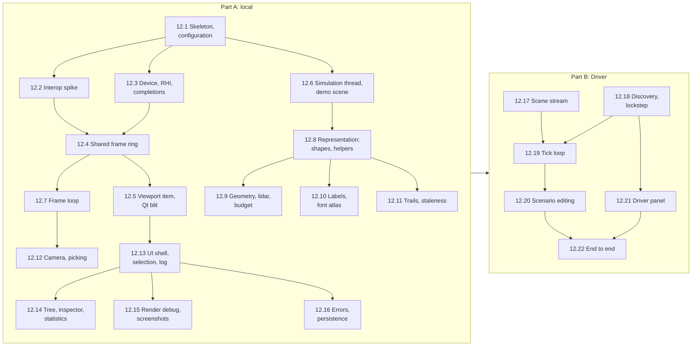

# Task 12 — Visualizer application

| | |
|---|---|
| Design | [12 — Visualizer Application](../design/12-visualizer.md). Related designs: • [01 §4.1, §7](../design/01-system-architecture.md#41-visualizer): threads and configuration • [03](../design/03-simulation-core.md): tick loop, republish, interpolation anchor • [08 §3.1, §7, §8](../design/08-scene-management.md): Driver mapping, UI sync, viewing aids • [09 §4.5, §5.2, §13](../design/09-rhi.md): adapter selection, completion driver, sharing • [11 §12](../design/11-renderer.md#12-output-to-qt): output to Qt and screenshots • [17 §4](../design/17-graphics-frames-and-transfers.md#4-graphicsframe_schedulerh): the frame chain • [02](../design/02-communication.md), [04](../design/04-scenario-and-dataset.md): Part B Decisions: D-32, D-41, D-42, D-56, D-93, D-94, D-96, D-98, D-102, A-54, A-58 ([99](../design/99-decisions-and-open-questions.md)) |
| Namespaces | `avis::visualizer`, `avis::visualizer::representation`, `avis::visualizer::rendering` (frame loop, ring), `avis::visualizer::ui` |
| New targets | `AVIS_VISUALIZER_REPRESENTATION` and `AVIS_VISUALIZER_SIMULATION`, static libraries without Qt, linked by `AVIS_VISUALIZER` and `AVIS_TESTS`, like task 11's `AVIS_VISUALIZER_RENDERING`. `AVIS_VISUALIZER_UI_TESTS` is a Qt Test executable for the UI models. See Open points. |
| New sources | The layout of 12 §2: `simulation/`, `representation/`, `rendering/frame_loop`, `rendering/shared_frame_ring`, `ui/`, `qml/`. Also `visualizer_configuration.h/.cpp` and `simulation/demo_scene.h/.cpp` (Part A's scene source, 12.6). |
| Changed | `apps/visualizer/main.cpp`, `visualizer_driver.h/.cpp` (rewritten as the controller), `apps/visualizer/CMakeLists.txt` (QML module `Avis.Visualizer`, the libraries), `tests/CMakeLists.txt` |
| Removed | `apps/visualizer/viewport.h/.cpp` (replaced by `ui/viewport_item`), `main.qml` (moved to `qml/`), `simulator_clock.h`, and the fixed-step `tick`/`on_update`/`on_render` loop in `visualizer_driver` |
| Tests | `tests/visualizer/`: • `test_visualizer_configuration.cpp` • `test_shared_frame_ring.cpp`, `test_frame_loop.cpp` • `test_simulation_thread.cpp` • `test_representation_shapes.cpp`, `test_representation_geometry.cpp`, `test_representation_budget.cpp`, `test_representation_labels.cpp`, `test_representation_trails.cpp` • `test_camera_controller.cpp` • Part B: `test_scene_stream.cpp`, `test_lockstep_coordinator.cpp`, `test_tick_loop.cpp` `tests/visualizer_ui/` (`AVIS_VISUALIZER_UI_TESTS`): `test_scene_tree_model.cpp`, `test_inspector_model.cpp`, `test_selection_model.cpp`, `test_scenario_commands.cpp` |
| Prerequisites, Part A | • [Task 6](06-rhi.md): sharing, `completion_driver`, adapter by LUID • [Task 7](07-graphics-frames-and-transfers.md): `frame_scheduler`, `frame_token`, queues, profiler • [Task 9](09-render-graph.md): the render graph • [Task 10](10-scene-management.md): scene, assets, snapshots • [Task 11](11-renderer.md): the renderer, shader loading, screenshots |
| Prerequisites, Part B | [Task 13](13-network.md) (network layer, protocol, fake Driver), [Task 14](14-simulation-core.md) (clock, pacing, anchors, `tick_controller`), [Task 15](15-scenario.md) (scenario model, validation, parameter schema). An end-to-end run also needs a **Driver** (05). |

The Visualizer is the application a user works in: it shows the Avis renderer's output in a Qt Quick UI, keeps the scene the Driver streams, owns the virtual clock, and edits scenarios. This task builds it in two parts:
- **Part A (12.1–12.16)** needs only finished tasks. It builds the application around a **local scene source**: device setup, the shared frame ring with Qt, the frame loop, the simulation thread's presentation path, the scene representation, the camera, the panels, screenshots and error handling. A built-in demo scene stands in for the Driver (12.6).
- **Part B (12.17–12.22)** connects a Driver: the scene stream, discovery, the lockstep coordinator, the tick loop, scenario editing and the Driver panel. It starts once the network, simulation core and scenario tasks exist.

**Order.**
- 12.2 is a short spike that comes first because it can change the ring protocol (12 §3.3: "verify early").
- After 12.1, three strands are independent: interop and frames (12.2–12.5, 12.7), the simulation thread with the representation (12.6, 12.8–12.11), and the UI shell (12.13).
- The representation steps 12.9–12.11 only need 12.8's shared meshes and can run in parallel.

## Conventions for this task
- **Qt stays at the edges.** `representation/`, `simulation/` and `rendering/` include no Qt header, so they build into the non-Qt libraries and the Catch2 tests link them. The simulation thread talks to the GUI through a `gui_sink` interface (tree changes, selected entity, statistics, follow target, status). `ui/` implements it with queued `QMetaObject::invokeMethod` calls. GUI → simulation goes through the `command_queue<simulation_command>` (12 §4).
- **Native D3D12 only in `ui/viewport_renderer.cpp`** (12 §3.2): Qt's native handles and `OpenSharedHandle`. Everything else sees `rhi::shared_handle`. A grep check enforces it (12.16).
- **Tags.**
  - `[visualizer][unit]`: CPU-only tests (configuration, the ring's protocol logic, the representation on a `scene` and `asset_cache`, the camera maths, the simulation thread's command handling).
  - `[visualizer]`: tests on the renderer fixture (task 11): the frame loop and the ring's GPU side.
  - The UI models are tested with Qt Test and `QAbstractItemModelTester` in `AVIS_VISUALIZER_UI_TESTS`. QML is checked through a manual checklist recorded in **As implemented** (see Open points).
- **Threads.** Every class documents which thread owns it (01 §4.1), and debug builds check it with `AVIS_CHECK` on a "visualizer" logger.
- **No semantics in the renderer.** The representation decides how things look (12 §9). The renderer task's grep check (task 11.23) must keep passing.

## Part A — Local Visualizer

## 12.1 Application skeleton and configuration
12 §2, §8, 01 §7.

- [x] Set up the source layout of 12 §2:
  - Move `main.qml` to `qml/` and rename the QML module to `Avis.Visualizer` (`qt_add_qml_module(URI Avis.Visualizer)`).
  - Create the `AVIS_VISUALIZER_REPRESENTATION` and `AVIS_VISUALIZER_SIMULATION` static libraries. Their only dependencies are `AVIS_LIB`, yaml-cpp and task 11's rendering library.
  - Remove `simulator_clock.h` and the fixed-step loop from `visualizer_driver`.

  *As implemented:* `qml/main.qml` is served under the alias `main.qml` at the module's root (`qrc:/avis/imports/Avis/Visualizer/main.qml`), next to its `qmldir`, so it sees the module's types without an import. Each library has its own `CMakeLists.txt` and the same no-Qt check as the rendering library (`_avis_check_no_qt_dependency`). The representation library holds `representation_settings.h/.cpp` for now; the simulation library holds `visualizer_configuration.cpp`, which reads every part's settings and must link into the Catch2 tests. With the fixed-step loop gone, nothing renders frames until the frame loop (12.7): the controller creates the renderer at startup, so startup errors still show, and publishes one snapshot.
- [x] `visualizer_configuration.h/.cpp` holds `visualizer_configuration`, with these sections:
  - `runtime` (task 4's `runtime_configuration::parse`)
  - `render` (task 11's `parse_render_settings`)
  - `representation` (12 §9; parsed here)
  - `screenshots` (12 §6.3)
  - `lockstep` and `network` (stored raw until Part B)
  - `ui` (last Driver, recent files)

  `load_visualizer_configuration(path)` returns `result<…>`. A missing file gives the defaults and is written out once. Errors carry the key path.

  *As implemented:*
  - `runtime` covers the `runtime` and `logging` sections, as `runtime_configuration::parse` reads both. `logging.file` is relative to the executable's directory, and defaults to `visualizer.log` next to it (`resolve_log_file`).
  - The `representation` section is parsed by `representation::parse_representation_settings` in the representation library, beside the settings it fills, as the renderer does with `parse_render_settings`. `labels.templates` and `trails` are keyed by entity category (any but `helper`) and merge with the defaults per category; `stale.categories` replaces the list.
  - Errors read `<file>:<line>:<column>: <key path>: <message>`. Unknown keys inside a section are ignored, as in `runtime_configuration::parse` and `parse_render_settings`; unknown category names are errors.
  - `to_yaml_text` writes every known key, then the unknown sections in file order; `save_visualizer_configuration` writes through a temporary file renamed over the old one. Comments aren't kept. `parse_render_settings` gained its writer, `rendering::to_yaml`.
  - `load_visualizer_configuration` returns a `loaded_configuration`: the configuration, whether the file was created, and why the defaults couldn't be written, if so. That failure is logged as a warning, not fatal.
  - The renderer's private settings reader moved into `rendering/yaml_reading.h` as `yaml_reading::section`, shared by the three settings parsers.
- [x] Add a `--configuration <path>` command-line option (default `%APPDATA%/Avis/visualizer.yaml`). `main.cpp` loads the configuration before creating the runtime. A configuration error is reported on stderr and in a message box, then the application exits.

  *As implemented:* `parse_command_line` reads the UTF-16 command line (`CommandLineToArgvW`), so non-ASCII paths work, and accepts `--configuration=<path>` too. Other arguments are left to Qt. The message box is Win32's `MessageBoxW`, since Qt doesn't exist yet at that point.
- [x] `visualizer_driver` (the controller, 12 §2) owns, in this order: configuration, asset cache, `scene`, `snapshot_buffer`, simulation thread, frame loop. It's a QML singleton, as now.

  *As implemented:* `main()` creates the controller with the loaded configuration, after `QGuiApplication` and before the QML engine, and the singleton's `create()` returns that instance (C++ ownership). The simulation thread and frame loop join in 12.6 and 12.7; until then it also holds task 11's graphics objects, after the snapshot buffer. The RHI still turns the debug layer on unconditionally; 12.3 takes `render.debug_layer` and `render.gpu_validation`.
- [x] Window geometry and panel layout are saved with `QSettings` (12 §8).

  *As implemented:* the window's normal geometry and maximised state, through QML's `Settings` (`QtCore`) in category `window`, under `HKCU\Software\Avis\Visualizer`. A maximised window keeps the normal geometry it had before. The panel layout joins it with the panels (12.13).

**Tests** (`test_visualizer_configuration.cpp`, `[visualizer][unit]`):
- [x] The defaults equal the YAML blocks of 12 §6.3 and §9, and 11 §14.
- [x] Every section rejects a bad value with its key path. Unknown sections are kept on save (round-trip).
- [x] A missing file writes the defaults, and loading them again gives the same configuration.

*As implemented:* the tests also cover a round trip with a changed value in every section, the per-category merge, a configuration that can't be written, the log file's location, and the command line. Manual check: the Visualizer started with `--configuration` on a path with a space wrote the defaults there, loaded its shaders, and saved the window geometry on exit.

## 12.2 Interop spike: `afterFrameEnd` timing
12 §3.3 rule 4.

- [x] Write a throwaway program, or a test in `AVIS_VISUALIZER_UI_TESTS`. It renders a `QQuickRhiItem` with the threaded render loop on Windows and checks that `QQuickWindow::afterFrameEnd` is emitted on the render thread after `QRhi::endFrame` has submitted. To check, signal a fence from `afterFrameEnd` and confirm, through the D3D12 queue's completed value and the frame's command list, that Qt's submission came before it.

  *As implemented:* a test that stays, so a Qt upgrade re-checks it: `tests/visualizer_ui/test_qt_interop.cpp` in the new Qt Test executable `AVIS_VISUALIZER_UI_TESTS` (`avis_visualizer_ui_tests.exe`, also a CTest test). Its `main.cpp` runs each Qt Test class in turn, ready for 12.13's models. The test needs a GPU and a desktop session. With its output piped or redirected, Qt Test printed nothing here; `-o <file>,txt` writes the log to a file.
  - The item's renderer stands in for `ui/viewport_renderer`. It opens the Avis RHI's shared texture and fences on Qt's device, waits on `produced` with Qt's queue, and draws the fullscreen triangle with the `qt/` shaders.
  - Each frame, `render()` writes the frame number into a readback buffer from Qt's command list (`WriteBufferImmediate`). The hook connected to `afterFrameEnd` then queues three things on Qt's queue: a signal of a fence, a wait on a gate fence that the CPU opens, and the signal of `consumed`. When the first fence completes, everything submitted before the hook has run, and anything submitted after it waits behind the gate. So the number is in the buffer exactly when Qt submitted before `afterFrameEnd`.
  - A control runs the same check from `afterRendering`, which Qt documents as emitted before submission, and expects no frame submitted. That shows the check can fail.
  - Qt's D3D12 debug layer is on (`QSG_RHI_DEBUG_LAYER`) and its info queue is checked for errors, as is the Avis RHI's log.
- [x] Record the result here and in 12 §3.3. Rule 4's direct path is used when it holds, and the fallback when it doesn't (signal `consumed` for the previous pick in the next `render()`).

  *As implemented:* it holds on Qt 6.11.1. In 100 of 100 frames, Qt's command list had run when the signal issued from `afterFrameEnd` completed, and in 0 of 100 from `afterRendering`. `afterFrameEnd` runs on the render thread. 12.5 uses rule 4's direct path. 12 §3.3 records the result and keeps the fallback in case a later Qt changes.
- [x] Also confirm that `QRhiTexture::createFrom` accepts a texture opened with `OpenSharedHandle` in state `COMMON` on Qt 6.11.1.

  *As implemented:* it does, and Qt samples exactly what the Avis RHI cleared the texture to. One addition: after sampling, Qt tracks the texture in `PIXEL_SHADER_RESOURCE` (0x80) and leaves it there. The renderer therefore records a native transition back to `COMMON` at the end of `render()` and tells Qt with `QRhiTexture::setNativeLayout(COMMON)`. Both debug layers stay free of errors. 12 §3.3 rule 4 now includes this, and so does 12.5.

## 12.3 Device setup, RHI ownership, completions
12 §3.2, §3.4, §7, D-93, D-94, D-96.

- [ ] `main.cpp` calls `QQuickWindow::setGraphicsApi(Direct3D12)` before the window exists. It's already done; keep it.
- [ ] `ui/viewport_renderer` reads `QRhiD3D12NativeHandles` on `sceneGraphInitialized` and passes the adapter LUID to the controller on the GUI thread.
- [ ] The renderer creates the RHI there, with `adapter = { luid_low, luid_high }` and the `render` settings (debug layer, GBV), and is its only holder (D-96). A capability-gate failure becomes the startup dialog of 12 §7, after which the application exits.
- [ ] Build the views of 12 §3.4 for each graphics object:
  - the frame scheduler with `frames_in_flight`
  - the GPU profiler
  - the render graph and its transient pool
  - the upload and readback queues
  - the pipeline cache and root signature registry
  - task 11's `scene_renderer`, created after `load_renderer_shaders`, whose failure is the shader startup dialog (12 §7, 12a §5)
- [ ] A `QWinEventNotifier` on `completion_driver::completion_event()`, in the GUI event loop, calls `poll_completions()` when it fires (D-93). Continuations doing work move to the parallel scheduler with `continues_on` (12 §3.4).
- [ ] The shutdown order of 12 §3.4, in four steps:
  1. Stop the frame loop's scope and wait for it to drain.
  2. Destroy the notifier.
  3. Destroy the graphics objects in reverse creation order.
  4. Destroy the RHI, whose destructor calls `wait_idle`.

  The simulation thread stops first, before the frame loop, because the snapshot buffer outlives both.

**Tests:**
- [ ] `[visualizer]`: on WARP, with no Qt, create the full object set from a LUID, run 10 empty frames through `poll_completions` driven by a test loop on the event, and shut down. The debug layer reports no live objects.
- [ ] Manual: the Visualizer starts on the GPU Qt picked (log the adapter name for both devices and check that they're equal).

## 12.4 Shared frame ring
12 §3.3, §3.4, 09 §13.

- [ ] `rendering/shared_frame_ring.h/.cpp`:
  - three shared `RGBA8_UNORM` textures at the viewport's pixel size, plus the shared fences `produced` and `consumed`, all created by Avis with exported `rhi::shared_handle`s
  - a `generation` number
  - the shared CPU state of 12 §3.3 (`latest_completed`, `picked[3]`, `showing`, `update_pending`) as atomics, each written by one side only
- [ ] Separate the protocol logic from the GPU objects in a `ring_protocol` class, so it can be tested on the CPU:
  - `try_acquire_slot()` picks a free slot (not `showing`, and `picked[i] == 0` or `consumed ≥ picked[i]`), preferring the one released longest ago
  - `publish(n, slot)` sets `latest_completed`
  - `qt_pick()` and `qt_consumed(m)` are the Qt side's calls
- [ ] `shared_slot_free()` is a named sender. It completes inline with a slot when one is free, and otherwise through `rhi::sharing::when_reached(consumed, picked[i])` for the slot that will free first. It never waits on the GPU.
- [ ] Resize:
  - `request_resize(size)`, debounced by 100 ms on the GUI side, sets a pending size
  - the frame loop creates a new ring at the start of its next frame with `generation + 1`
  - the old ring is kept until `consumed` has reached every `picked[i]` of it (the same check and sender), then destroyed

**Tests** (`test_shared_frame_ring.cpp`):
- [ ] `[visualizer][unit]`, protocol only:
  - Avis never gets the slot Qt is `showing`.
  - With Qt holding two slots (showing plus in-flight), one is always free.
  - When Qt stops picking, Avis alternates between the other two.
  - The slot released longest ago is preferred.
  - A random interleaving of 100,000 Avis and Qt operations never gives a slot to Avis while Qt still samples it (model check with a reference model).
- [ ] `[visualizer]`, on the RHI fixture with a second device standing in for Qt (`OpenSharedHandle` on a second WARP or hardware device):
  - frames written by Avis read back correctly on the second device after waiting on `produced`
  - `shared_slot_free()` completes through `when_reached` once the second device signals `consumed`
  - a resize keeps the old ring alive until it's released

## 12.5 Viewport item and Qt-side blit
12 §3.2 step 5, §3.3 rules 3–7.

- [ ] `ui/viewport_item.h/.cpp`: a `QQuickRhiItem` subclass, `QML_NAMED_ELEMENT(Viewport)`, replacing `viewport.h/.cpp`. It reports its pixel size (× device pixel ratio) and forwards input to the camera controller (12.12). `update()` is called from the frame loop's queued wake (rule 5).
- [ ] `ui/viewport_renderer.h/.cpp`, a `QQuickRhiItemRenderer`:
  - On a new `generation`, it opens the ring's textures and fences on Qt's device (`OpenSharedHandle`) and wraps the textures with `QRhiTexture::createFrom(…, D3D12_RESOURCE_STATE_COMMON)`.
  - In `render()`, it reads `latest_completed`, sets `picked` and `showing`, issues the GPU `Wait(produced, m)` through `QRhiD3D12NativeHandles::commandQueue`, and draws the fullscreen triangle with the `qt/` shaders. After the pass it transitions the texture back to `COMMON` and calls `setNativeLayout(COMMON)` (12 §3.3 rule 4, from 12.2).
  - It signals `consumed` in `afterFrameEnd` (12.2 confirmed this direct path on Qt 6.11.1), and clears `update_pending`.
  - With no completed frame yet, it draws the clear colour.
- [ ] The Qt blit shaders move to `data/shaders/visualizer/qt/` (done in task 11.1). `qt6_add_shaders` keeps them under the `/avis/visualizer` prefix.

**Tests:**
- [ ] Manual checklist:
  - the viewport shows the frame loop's output, with no tearing
  - resizing and maximising work without a `wait_idle`
  - minimising drops Avis to 5 fps (12.7), and restoring brings the rate back
  - a debugger break on the Qt render thread doesn't stall the Avis frame loop (frames continue on two slots)

## 12.6 Simulation thread (presentation path) and the demo scene
12 §4, §4.1, 03 §4.4, D-42.

- [ ] `simulation/simulation_thread.h/.cpp` is an application thread from the runtime's pool (task 4). It owns the `scene` and the representation, and runs the loop of 03 §4.2 **without steps** in Part A:
  - It drains `command_queue<simulation_command>` (MPSC with a condition variable).
  - It applies presentation commands (12 §4.1).
  - It republishes when the snapshot is dirty, coalesced to one republish per 16 ms (03 §4.4). The tick sequence of 08 §9.6 runs steps 4–6 only.
  - It sends to the `gui_sink`:
    - `take_tree_changes` after structural changes
    - the selected entity's `reflect` at up to 20 Hz
    - `statistics` at 2 Hz
    - the follow target's bounds when the target or its extent changes

  Part B adds the step handling (12.19).
- [ ] `simulation_command`: a variant of the simulation commands (start, pause, resume, single step, stop, set speed, placeholders until 12.19) and the presentation commands of 12 §4.1 (select, clear, entity and category visibility, helper toggles, representation settings, labels, trails, staleness, `visualization` edits, *Reset*).
- [ ] The time anchor is set to `{ t, now, 0 }` in Part A; `step` is 0.
- [ ] `simulation/demo_scene.h/.cpp`, a scene source that is used with `--demo-scene` and by tests, and that Part B keeps for offline UI work:
  - Each tick (a timer at 10 Hz, on the simulation thread) it writes the components that `scene_stream` writes in Part B (08 §3.1), through the same `scene` calls: `driver_entity`, `display_shape`, `vehicle`, `sensor`, `properties`, `belief_geometry` and `lidar_points`.
  - It creates a primary vehicle with two camera sensors and a lidar driving a circle, a shadow vehicle with a trajectory line, 30 boxes moving and appearing and disappearing, a drivable-area triangle chunk and a synthetic lidar sweep each tick.
  - It runs the full tick sequence (08 §9.6) with a fake step counter, so interpolation, trails and stamps work.
  - Ids use a Driver source byte of 1, never the helper range.

**Tests** (`test_simulation_thread.cpp`, `[visualizer][unit]`):
- [ ] 100 presentation commands within 16 ms give one republish, and the republish keeps the step fields and `world_previous`.
- [ ] *Reset* leaves only the helpers.
- [ ] Select and clear move the `selected` flag in the next snapshot.
- [ ] The `gui_sink` (a recording fake) gets tree changes after a structural change, the selected entity at no more than 20 Hz, and statistics at 2 Hz.
- [ ] The demo scene runs 1,000 ticks with no debug check firing, and its entity count stays bounded.

## 12.7 Frame loop
12 §3.4, 17 §4, D-98, D-102.

- [ ] `rendering/frame_loop.h/.cpp` runs the chain of 12 §3.4 in an `async_scope`:
  1. `when_all(begin_frame(), next_frame_tick(), shared_slot_free())`
  2. `continues_on(parallel)`, then the prepare stage: `prepare_frame`, then `snapshot_buffer::acquire`, then `scene_renderer::render` with the main view (camera from the latest-value state, the ring slot as output) and any screenshot view
  3. `present_to_shared`, then signal `produced` with `n`, then `end_frame`
  4. re-arm the next frame

  In parallel, per frame, `when_reached(produced, n)` publishes `latest_completed` and posts `viewport_item::update()` once (`update_pending`).
- [ ] `next_frame_tick()` is an `asio::steady_timer` sender on the IO context. Its rate is the screen's refresh rate (from the window, posted on change), or `render.maximum_fps`, or 5 fps when the window is minimised or occluded.
- [ ] GUI → renderer state goes into a latest-value block written by the GUI and read once per frame at prepare: camera, viewport size, debug selection, render settings, picking request and screenshot request (12 §4).
- [ ] Renderer → GUI: `scene_renderer::debug_information()` at about 4 Hz, plus pick results (task 11.19), pixel-inspector values and screenshot results, through a queued signal.
- [ ] Errors:
  - A `set_error` from device removal goes to the fatal path (12.16).
  - `transient_memory_exhausted` ends the frame with no submissions and re-arms, with a warning that names the budget (D-98).
  - A stop finishes the current frame. A dropped token ends itself (D-102).
- [ ] `retire` on the renderer is called when `begin_frame` recycles a context (task 11.2).

**Tests** (`test_frame_loop.cpp`, `[visualizer]` on WARP, with a fake Qt side driving `ring_protocol` from a test thread):
- [ ] 100 frames render with a demo-scene snapshot, and the ring sees increasing `latest_completed` values.
- [ ] The tick rate follows a configured `maximum_fps` within 10%.
- [ ] A fake Qt side that stops picking doesn't stall the loop.
- [ ] An injected `transient_memory_exhausted` (a tiny frame budget) skips frames and recovers.
- [ ] Stopping drains the scope with no leaked tokens.

## 12.8 Representation: system, shared meshes, display shapes, helpers
12 §9, 08 §4.3, §9.2, §9.6 step 4.

- [ ] `representation/representation_system.h/.cpp` runs at step 4 of the tick sequence (08 §9.6) and on presentation commands:
  - It visits entities with changed semantic components. It tracks them with EnTT `on_construct`/`on_update` observers on `display_shape`, `belief_geometry`, `lidar_points`, `label`, `trail` and `visibility`, and in the meantime re-runs everything when a setting changes.
  - It creates or updates helper child entities with `mesh`, `material`, `render_options` and `represents { owner }` (task 10). Helpers are created with `represents` up front (task 10's Open points recommend an `entity_description::represents` field).
  - It applies the selection and visibility flags to every instance the entity owns, its helpers included.
- [ ] A shared library, created once through the asset cache:
  - the unit cube
  - the unit-cube edge lines
  - the axes lines
  - the grid, a large line mesh, fading by distance through vertex alpha
  - the vehicle proxy from `data/assets/vehicle_proxy.glb`, via task 10's `load_gltf`; the asset is added here (see Open points)
  - the base materials

  The shared meshes are excluded from the budget (12 §9.1).
- [ ] `shape_representation` follows 12 §9's table:
  - `box`: faces in `world` with a translucent material (blend) in the entity's colour and opacity, plus edges in `overlay` with an unlit material and `boxes.edge_width`
  - `vehicle`: the proxy, with a ghost material when its opacity is below 1
  - `axes` and `frustum` in `overlay`, the frustum built from the angles and range

  The extent is applied to a representation-owned child node, never to the entity's node (08 §4.3).
- [ ] `helper_geometry`: the grid and the axes gizmo as Visualizer helpers under `helpers`. The sun light comes from `visualization.environment`, through `scene::set_environment` (task 10).
- [ ] Materials per colour and opacity are cached by value, so 30 boxes of three colours make three materials.

**Tests** (`test_representation_shapes.cpp`, `[visualizer][unit]` on a `scene` and `asset_cache`):
- [ ] A box entity gets a face instance and an edge instance, both with `represents`. The face is in `world` with `alpha_mode = blend`, and the edges are in `overlay`.
- [ ] Changing the extent changes the child node's scale, never the entity's (unit-scale check from task 10).
- [ ] A vehicle with opacity 0.5 uses the ghost material.
- [ ] Hiding an entity clears `visible` on all its instances. Selecting it sets `selected` on all of them.
- [ ] Destroying the entity destroys its helpers.
- [ ] The material cache gives three materials for three colours.

## 12.9 Representation: belief geometry, lidar, geometry budget
12 §9, §9.1, D-41.

- [ ] `geometry_representation`:
  - one mesh per `belief_geometry` chunk, created or updated with `create_mesh` / `update_mesh` (topology, vertex colours, normals)
  - a material from the chunk `style` (colour, opacity, lit or unlit, line width, point size)
  - `points` chunks are progressive, so their vertices are shuffled once when the mesh is built (a fixed-seed shuffle, for reproducibility)
  - a removed chunk releases its mesh
- [ ] `lidar_representation`:
  - one progressive point mesh per kept sweep, at the sweep's sensor pose (a helper node per sweep)
  - colour by `visualization.lidar.color_mode` (intensity, height, ring, uniform)
  - `lidar.maximum_points_per_sweep`, enforced by keeping a random prefix
  - a recolour on a mode change produces new mesh versions (presentation command)
- [ ] A `geometry_budget` counts the current-version bytes of every dynamic mesh the representation owns (trails included, labels excluded). Before a create or update that would exceed `geometry.budget_mib`, it frees space in the order of 12 §9.1:
  1. drop the oldest sweeps per sensor, down to one
  2. truncate progressive meshes to a prefix, largest first, down to 25%
  3. skip the new geometry, with a rate-limited warning

  When room returns, the reduction is undone in reverse order. The current reduction level (sweeps dropped, prefix fraction, chunks skipped) is reported with the statistics.

**Tests** (`test_representation_geometry.cpp`, `test_representation_budget.cpp`, `[visualizer][unit]`):
- [ ] A triangle chunk becomes a mesh with its colours. A second update of the same chunk bumps the version, and removing the chunk releases the mesh.
- [ ] A points chunk is progressive, and its shuffle is identical across two runs.
- [ ] Lidar: `retention` sweeps are kept, each at its own pose, and a colour-mode change creates new versions.
- [ ] Budget, with a 10 MiB budget fed by sweeps and chunks:
  - steps 1, 2 and 3 happen in order, and the budget is never exceeded
  - the reduction level is reported
  - freeing room restores the sweeps and the full prefixes
  - the asset cache's current geometry bytes match the budget's count

## 12.10 Representation: labels and the font atlas
08 §8.1, §8.6, 12 §9, 13 §5.

- [ ] Choose the font (08 §8.6, open): a licence that allows redistribution (OFL) and Latin-1 plus `·`, `±`, `°`, `–`.
- [ ] `dt font-atlas` in `tools/data-trace` (13 §5). It bakes the font to `data/assets/fonts/labels.png`, `labels@2x.png` and `labels.json` (glyph metrics: advance, bearing, uv rectangle, plus kerning pairs for the glyph set). The output is checked in, with the font's licence next to it.
- [ ] Load the atlas at startup into the asset cache as a texture with an unlit, alpha-blended material, choosing 1× or 2× by the screen's device pixel ratio.
- [ ] `label_representation`:
  - adds `label` components per category from `representation.labels.templates`, when labels are enabled for the category (*View* menu)
  - formats the text with `scene::format_label` (task 10)
  - lays out glyph quads in pixels relative to the anchor, plus a background quad
  - caches the mesh by text and style, rebuilding it only when the text changes and at most every 250 ms per label
  - creates a child helper at `anchor_offset` (default: the top of the display shape plus 0.3 m), in `overlay_on_top`, `screen_aligned`, not pickable, with the style's `maximum_view_distance` and a `layer_priority` above the box edges
- [ ] `labels.maximum_count`: only the nearest labels to the primary vehicle are kept; the others' helpers are hidden.

**Tests** (`test_representation_labels.cpp`, `[visualizer][unit]`, plus a `[visualizer]` render check):
- [ ] Layout: `"car 1042"` has eight glyph quads plus a background, advancing by the metrics, with the kerning applied.
- [ ] Rebuild throttling: a speed changing every 100 ms rebuilds the mesh at most every 250 ms, and an unchanged text never rebuilds it (08 §10).
- [ ] With 300 labelled objects and `maximum_count` 200, the 200 nearest are visible.
- [ ] An empty template adds no label.
- [ ] `[visualizer]`: a label renders at a constant pixel height at 5 m and 50 m and isn't drawn beyond `maximum_view_distance` (through task 11's fixture).

## 12.11 Representation: trails and staleness
08 §8.2, §8.4, 12 §9.

- [ ] `trail_representation`:
  - adds `trail` components per category from `representation.trails`, and per entity from the tree's context menu (presentation command)
  - gives each trailed entity a helper at the world root under `helpers`, named `<name> trail`, hidden from the tree, holding world-space line meshes in the `overlay` layer
  - blocks of 128 samples: completed blocks are immutable, the newest block is rewritten each tick, the oldest when samples expire from it, and consecutive blocks share their boundary sample
  - a `starts_segment` sample breaks the line
  - trail bytes count against the budget and are thinned with belief geometry in step 3 (12 §9.1)
- [ ] `stale_representation`, when `representation.stale.enabled` is set:
  - evaluated once per tick over the listed categories
  - an entity whose `update_stamp::latest()` is older than `after_seconds` switches its instances to dimmed material variants (opacity × 0.4, desaturated, one variant per material, cached), and switches back on the next update
  - the tree marker comes through the tree's model (12.14), from a stale flag in the selected-entity and tree data

**Tests** (`test_representation_trails.cpp`, `[visualizer][unit]`):
- [ ] 300 samples make three blocks. Per tick, only the newest and the oldest block get new versions (08 §10).
- [ ] The block boundaries share a sample, so the line has no gaps.
- [ ] A discontinuity splits the line.
- [ ] Turning a trail off destroys its helper and meshes.
- [ ] Staleness: an object switches to the dimmed variant after `after_seconds` and back on the next update. One variant is created per material, not per entity.

## 12.12 Camera controller and picking
12 §5.

- [ ] `ui/camera_controller.h/.cpp`. The camera maths sit in a Qt-free `simulation/camera.h` (or `rendering/`) so they can be tested; the Qt part only maps input events.
  - **Free fly:** RMB with WASD/QE to move, the mouse to look, Shift for 4× speed, the wheel to adjust speed.
  - **Follow:**
    - targets the primary vehicle by default, or the selected vehicle
    - uses `visualization.camera.follow`'s offset and lag, with a critically damped spring on the position
    - LMB drag orbits, and the orbit offset is kept
    - the offset is scaled by the target's bounding radius / 2.5 m, clamped to 0.5–4×, from the bounds the simulation thread posts
    - uses the interpolated target pose at render rate, read by the frame loop from the extracted instance of the target's `object_id`, so the camera matches what's drawn (see Open points)
  - Switching modes keeps the viewpoint. When the followed entity is deleted, the camera switches to free fly.
- [ ] **Frame selection** (`F`, or a double-click in the tree) switches to free fly and moves the camera along its view direction until the bounding sphere of the selection's world bounds fills the view with a 1.2 margin, in 0.3 s with an ease-out. An entity with nothing drawn is framed as a 2 m sphere.
- [ ] **Picking:** a click without a drag posts a picking request with the pixel position (× device pixel ratio). The pick result (`object_id`) is resolved on the simulation thread with `scene::find` and then `selection_target` (task 10), and goes to the selection model. Clicking empty space clears the selection.

**Tests** (`test_camera_controller.cpp`, `[visualizer][unit]`):
- [ ] The spring converges without overshoot.
- [ ] The follow offset scales by 0.5–4× with the radius, clamped at both ends.
- [ ] Frame selection fits a sphere of radius 5 m at the expected distance for a 60° vertical field of view and a 1.2 margin, and keeps the view direction.
- [ ] Switching modes keeps the viewpoint.
- [ ] A pick on a label helper selects its owner (through `selection_target`).

## 12.13 UI shell, selection model, log
12 §6.

- [ ] `qml/main.qml` lays out the window of 12 §6: menus, the scene tree, the viewport, the inspector, the simulation bar and the bottom tabs (Log, Render Debug, Driver). The panels can be shown and hidden from *View*, and their layout persists (12.1).
- [ ] The menus of 12 §6's table are wired to commands. Actions without a backend yet (Driver connection, scenario load and save, Start, Pause, Step, Stop) are disabled, with a tooltip saying they come with Part B.
- [ ] `ui/selection_model`: one selected entity id, shared by the tree, the inspector and picking. It sends select and clear presentation commands, and clears when the selected entity is removed (from the tree changes).
- [ ] `ui/log_model`: an spdlog sink (task 1) feeding a ring of the last 10,000 records into the model, with level, logger and text filters. Faults are highlighted. Driver logs join in Part B (02 §5.9).
- [ ] The simulation bar shows the time, step and status from the simulation thread's status messages. In Part A it shows "local scene".

**Tests** (`AVIS_VISUALIZER_UI_TESTS`):
- [ ] `selection_model` clears when its entity is removed, and doesn't resend the same selection.
- [ ] `log_model` passes `QAbstractItemModelTester`, its filters work, and the ring drops the oldest records.
- [ ] Manual checklist: every menu entry either works or is disabled with its tooltip.

## 12.14 Scene tree, inspector, statistics overlay
12 §6, 08 §7, §8.4, §8.5.

- [ ] `ui/scene_tree_model`, a `QAbstractItemModel`, is built from the `tree_change`s the simulation thread posts:
  - It shows the hierarchy, names, category icons and a visibility toggle (a presentation command).
  - It hides entities marked `hidden` (helpers with `represents`).
  - It shows the stale marker and a search filter (a proxy model).
  - It populates large groups lazily (`canFetchMore`/`fetchMore` past 500 children).
  - Selecting a row selects the entity, and an outside selection expands the parents and scrolls to the row.
  - Its context menu has *Frame selection* and *Show trail*.
- [ ] `ui/inspector_model` shows the posted `reflected_entity` (task 10): components with fields and units, properties grouped by dotted keys, the update stamps as *"pose: 1.2 s ago (step 1234)"* relative to the current simulation time, and the world bounds. It's read-only and refreshes at the rate posted (≤ 20 Hz) without resetting the view's expansion state (fine-grained `dataChanged`).
- [ ] The statistics overlay (*Render* menu) is a QML overlay on the viewport. It shows `scene_statistics` (2 Hz), the representation's reduction level and the renderer's GPU timings (4 Hz).

**Tests** (`AVIS_VISUALIZER_UI_TESTS`):
- [ ] The tree model passes `QAbstractItemModelTester` under 10,000 random added, removed, moved and renamed changes, and matches a reference tree.
- [ ] Hidden entities never appear.
- [ ] Lazy population: a group of 5,000 children fetches in pages.
- [ ] The inspector model keeps the row identity across value updates (no `modelReset`), and formats the stamps relative to a given time.

## 12.15 Render debug panel and screenshots
12 §6, §6.3, 11 §11, §12.1.

- [ ] `ui/render_debug_model` and `RenderDebugPanel.qml`:
  - the passes (queue colour, GPU ms, culled) and resources (qualified name, format, size, aliased) from the renderer's debug information
  - selecting a resource sets the debug selection (mode, channel, range, mip and slice, fullscreen or picture-in-picture)
  - memory statistics (aliased vs non-aliased)
  - Alt+hover sends pixel-inspector requests and shows the value
- [ ] The *Render* menu toggles AO, TAA and shadows, and sets the tonemapper and exposure. These are render settings in the latest-value block; no snapshot is needed (12 §4.1).
- [ ] Screenshots (12 §6.3):
  - **Viewport (F12):** a request with `include_debug_view`.
  - **Custom resolution (Shift+F12):** a dialog with the presets and the last used value, saved to `screenshots.custom`.
  - **Window with UI (Ctrl+F12):** `QQuickWindow::grabWindow()` on the GUI thread, saved as PNG on a parallel worker.
  - File names follow 11 §12.1 in `screenshots.folder`. The metadata comes from the simulation thread's status (scenario, step, time, Driver id) and the camera.
  - A toast shows *Open* and *Show in folder*, and errors appear as a toast and in the log.

**Tests:**
- [ ] `AVIS_VISUALIZER_UI_TESTS`: the render debug model maps a debug-information value to rows, and a selection produces the right `debug_selection`.
- [ ] Manual checklist: each screenshot kind writes its file with the expected name, and a custom 3840 × 2160 screenshot completes while the demo scene runs.

## 12.16 Error presentation and settings persistence
12 §7, §8.

- [ ] Errors:
  - **Startup:** capability, shader and configuration failures each get a modal dialog with the message (file, line and key path for manifests) and the log path, then exit. 12.1 and 12.3 report these; this step gives them one dialog component.
  - **Device lost:** a modal dialog with the log path, then a controlled exit, with an autosave hook for the scenario model (a no-op until 12.20).
  - **The banner:** a non-modal component over the viewport with actions, used by Part B's lockstep failures (12.19).
- [ ] Settings: recent files, the last Driver and UI preferences are written back to `visualizer.yaml` on exit and on change. Window geometry goes in `QSettings`.
- [ ] `grep -rn "d3d12\|ID3D12" apps/visualizer --include=*.cpp --include=*.h` returns only `ui/viewport_renderer.cpp` (12 §3.2).

**Tests:**
- [ ] Manual checklist:
  - starting with the shader directory removed shows the shader dialog
  - a forced device removal (`ID3D12Device5::RemoveDevice` behind a debug-only menu entry) shows the fatal dialog and exits cleanly
- [ ] `[visualizer][unit]`: recent files are capped at 10, de-duplicated, and survive a save and load.

## Part B — Driver connection
Starts once [task 13](13-network.md) (network), [task 14](14-simulation-core.md) (simulation core) and [task 15](15-scenario.md) (scenario) are done. Each step lists the pieces it uses from them.

## 12.17 Scene stream
02 §5.8, §6.3, 08 §3.1, §8.4. Uses task 13: the scene stream messages (13.10) and subscribers (13.3).

- [ ] `simulation/scene_stream.h/.cpp`:
  - stages scene stream messages per step from the network's lock-free queue
  - checks completeness against the step reply's stream range (02 §6.3)
  - on commit, applies them in stream-sequence order through a `driver_entity_index` (`entity_id → entt::entity`), following 08 §3.1's table:
    - creates with `identity`, `driver_entity`, `display_shape`, the local pose and `vehicle` or `sensor`
    - deletes through `destroy_entity`, then removes every destroyed id
    - `transform_update` and `vehicle_state` call `set_local` with the discontinuity flag; a non-root vehicle is a `protocol_error` (A-58)
    - `entity_properties` updates properties, `geometry_update` updates chunks, and `lidar_sweep` pushes sweeps with retention
  - stamps `update_stamp` for every message (08 §3.1)
- [ ] At the start of each run, every Driver entity is destroyed (`clear` followed by recreating the helpers, task 10).
- [ ] The demo scene (12.6) stays as an alternative source, selected by `--demo-scene`.

**Tests** (`test_scene_stream.cpp`, `[visualizer][unit]`, on scripted message sequences, 08 §10):
- [ ] Each message kind produces the expected components and stamps.
- [ ] Deleting a vehicle removes it, its sensors and their index entries.
- [ ] Out-of-order sequence numbers within a step are applied in order.
- [ ] An incomplete step isn't committed.
- [ ] A discontinuity reaches the scene's jump handling.

## 12.18 Driver discovery and the lockstep coordinator
02 §2, §5.1–§5.6a, §6, §7, 12 §6.2. Uses task 13: sessions, scouting, the query sender, liveliness and the protocol catalogue; its tests use task 13.11's fake Driver.

- [ ] `simulation/driver_discovery`:
  - Zenoh scouting started by the Visualizer, then `describe` to each peer
  - results with id, host, version, plug-ins and the bound flag
  - *Refresh*
  - a background scout at startup that reconnects the last Driver when it's available and unbound
- [ ] `simulation/lockstep_coordinator`: `connect`, `load_scenario` (diagnostics to the problems list), `step`, `unload`, `rescan` and `disconnect` as named senders. It applies the timeouts and long-step notices of 02 §6.2 from `lockstep` settings, and the debug-mode rules of 02 §7.1.
- [ ] `ConnectDriverDialog.qml` lists Drivers, with *Refresh* and *Connect*. The status light covers connected, busy (phase and duration from `driver_status`), unresponsive, faulted and disconnected, plus waiting (debug mode) and suspended?, with a tooltip.

**Tests** (`test_lockstep_coordinator.cpp`, `[visualizer]`): these use the network task's in-process Zenoh peer or a fake Driver (see Open points):
- [ ] connect, load, 100 steps and unload succeed
- [ ] silence for `communication_timeout` fails the step, but slowness alone never does
- [ ] a Driver in debug mode never times out
- [ ] a bound Driver is reported as bound

## 12.19 Tick loop and clock
03 §3–§5, 12 §4.1, §7. Uses task 14: `tick_controller` (14.5) holds the decisions; this step wires its actions to the coordinator and carries them out.

- [ ] The simulation thread runs the full loop of 03 §4.2:
  - `T` advances by wall time × `s` and is clamped one step ahead
  - a step request goes out when one is due, with at most one in flight
  - on commit, `apply_result` (03 §4.3): the scene stream, the representation, transforms and the snapshot
  - `s_effective` as an EMA over 8 commits (03 §5.1)
  - the anchors of 03 §5.2 for commit, pause, single step, resume and stop
  - `max` speed
- [ ] The simulation commands drive the clock state machine. *Start* validates the scenario (12.20) and loads it. *Stop* unloads it, so the plug-in DLLs can be rebuilt (12 §6.1).
- [ ] Lockstep failures pause and show the banner (12.16) with *Retry step*, *Reload plug-ins* and *Stop*. A pinned plug-in adds the Driver-restart note (12 §7).
- [ ] The simulation bar shows the time, step / `step_count`, `s_effective` and the Driver status.

**Tests** (`test_tick_loop.cpp`, `[visualizer][unit]` with a fake coordinator and a controllable clock):
- [ ] At 1× with a fast Driver, commits follow `Δt`, and `s_effective` converges to 1.
- [ ] A slow Driver clamps `T`, with no catch-up burst afterwards.
- [ ] Pause snaps the anchor to `t_k`, resume holds until the next commit, and a single step shows `t_k` at once.
- [ ] `max` sends the next step on commit.
- [ ] A failure pauses with the banner state set.

## 12.20 Scenario model and editing
04, 12 §6, §6.1. Uses task 15: `scenario_document`, YAML load/save, validation, the parameter schema and the catalogue view.

- [ ] `simulation/scenario_model` keeps the in-memory scenario and its dirty flag. *New*, *Open*, *Save*, *Save As* and *Recent* work on it, and the dirty flag shows in the title.
- [ ] `ui/commands/`: a `QUndoCommand` per edit. Undo and Redo are in *Edit*. Editing is allowed only in `stopped`, and a banner explains why when it's disabled.
- [ ] `ScenarioSettings.qml`, a form over `simulation`, `dataset`, `driver` and `visualization`:
  - the data source, frame range and sensors from the connected Driver's catalogue, or free text without a Driver
  - frame-range fields that show times and accept seconds (converted to the nearest frame)
  - plug-in parameter forms generated from `parameters_schema` (controls, defaults, ranges, units, live checks), with a raw YAML editor as the fallback
  - opening the editor sends `rescan`
- [ ] The problems list holds validation errors and the Driver's `load_scenario` diagnostics. Clicking an entry jumps to the field.
- [ ] Autosave on a fatal error (12.16's hook).

**Tests** (`test_scenario_commands.cpp`, `AVIS_VISUALIZER_UI_TESTS`):
- [ ] Undo and redo restore every edited field.
- [ ] Edits are rejected outside `stopped`.
- [ ] The seconds → frame conversion rounds to the nearest frame.
- [ ] A schema with an integer range rejects an out-of-range value as you type.

## 12.21 Driver panel
12 §6. Uses the protocol's `describe`, `rescan`, `driver_status` and telemetry.

- [ ] The Driver tab shows:
  - the connection details and the debug-mode indicator
  - the plug-in catalogue, with rejected and pinned plug-ins and their reasons, and *"plug-ins locked: run loaded"* while a run is loaded
  - *Rescan plug-ins*
  - the data sources
  - the per-step timing breakdown chart (replay, perception, model, physics, publishing)
  - the scene stream rate
- [ ] Driver logs (02 §5.9) feed the log model, with their logger names prefixed.

**Tests:** manual checklist against a Driver, recorded in **As implemented**.

## 12.22 End to end, docs
- [ ] With a Driver (05) and a packed KITTI-360 sequence (04), connect, edit and save a scenario, start, pause, single-step, resume, change the speed, stop and reset. Check the scene, trails, labels, picking, the inspector's stamps and a screenshot. Record the run as a manual checklist.
- [ ] Update [12](../design/12-visualizer.md) wherever the implementation differs:
  - the library targets and the `gui_sink`
  - the demo scene
  - the interop spike's result (§3.3 rule 4)
  - the follow camera's pose source
  - the font, and the label atlas files
  - the vehicle proxy asset
  - the UI test approach
- [ ] Update 99's "existing code diverges" note and the [README](README.md).
- [ ] Add an **As implemented** section here, with the manual checklists' results.

## Acceptance criteria
- **Part A:**
  - The Visualizer starts on Qt's adapter, renders the demo scene through the shared frame ring, and stays fluid when Qt stops rendering or the window is minimised.
  - It resizes without stalls and shuts down with no live GPU objects.
  - The representation turns every semantic component into meshes within the geometry budget, with the reduction order of 12 §9.1.
  - Labels, trails and staleness behave as 08 §8 specifies.
  - The tree, inspector, selection, picking, camera modes, frame selection, render debug panel, screenshots and error dialogs work as 12 §5–§7 describe.
  - Native D3D12 appears only in `viewport_renderer.cpp`.
- **Part B:** connected to a Driver, the Visualizer runs a scenario in lockstep, with the clock, anchors, silent slowdown, failure banner and scenario editing of 03 and 12 §6–§7.
- All tests pass in Debug, Release and ASan, and the manual checklists are recorded.

## Open points
- **Prerequisite tasks.** Part B needs tasks 13 (network, including vendoring Zenoh), 14 (simulation core) and 15 (scenario). Part A doesn't need them.
- **Library targets.** Like task 11's `AVIS_VISUALIZER_RENDERING`, the non-Qt parts (`representation/`, `simulation/`) build as static libraries so Catch2 tests can link them. The alternative is testing them only through the application.
- **UI tests.** Qt Test with `QAbstractItemModelTester` covers the models. QML and interaction are covered by manual checklists. Qt Quick Test (`qmltestrunner`) or Squish could automate them later; recommended: not in iteration 1.
- **Interop spike outcome.** Settled by 12.2: on Qt 6.11.1, `afterFrameEnd` follows the submission, so rule 4's direct path is used, and `createFrom` works on a shared texture in `COMMON`, with the hand-back to `COMMON` of rule 4. `test_qt_interop.cpp` re-checks both after a Qt upgrade.
- **Demo scene.** It isn't in design 12. It's proposed because Part A must run without a Driver, and it stays useful for offline UI work and screenshots in docs. It needs a line in 12 §2.
- **Follow camera pose.** 12 §5 says following uses "the interpolated vehicle pose at render rate". The camera is GUI state, but the interpolation happens in the renderer's extraction. Proposed: the frame loop computes the follow camera after extraction, from the target's interpolated instance, so the camera and the drawn vehicle never disagree. The GUI sends only the mode, target and orbit offset.
- **Font.** The label font is still open (08 §8.6). It needs an OFL-style licence and the glyph set listed there.
- **Vehicle proxy.** `data/assets/vehicle_proxy.glb` needs a model with a redistributable licence, or a simple procedural mesh built with `mesh_builder`. Recommended: the procedural mesh first (no licence question), with a glTF later.
- **Representation change tracking.** Re-running the representation for every entity each tick is simplest, but costs O(entities). EnTT observers on the semantic components give the changed set. Recommended: observers from the start, since lidar and geometry updates arrive every tick.
- **Lockstep tests without a Driver.** Part B's coordinator tests need a Driver-side counterpart. Either the network task provides a fake Driver (a queryable answering the protocol) or the tests use the real Driver binary. Recommended: a fake Driver in `tests/helpers/`, written with the network task.
