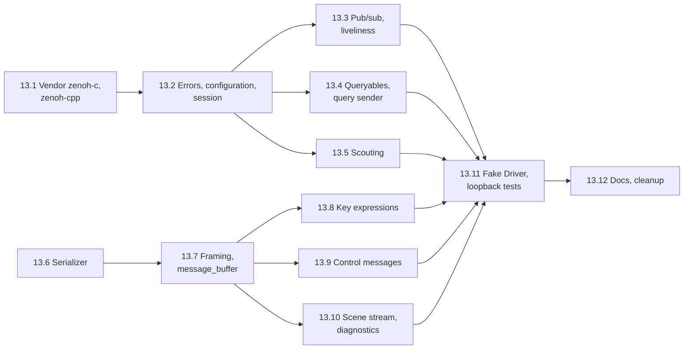

# Task 13 — Network layer and protocol catalogue

| | |
|---|---|
| Design | [02 — Communication & Lockstep](../design/02-communication.md) §1–§5, plus the key expressions of §3 and the size limits of §4. [13 §4, §6](../design/13-build-and-quality.md#4-dependency-management) cover vendoring and the protocol test strategy. Decisions D-36–D-39, D-66, A-05, A-47, A-53 ([99](../design/99-decisions-and-open-questions.md)). |
| Namespace | `avis::network` (Zenoh wrapper, framing, serializer, key expressions), `avis::network::protocol` (the message catalogue), `avis::network::detail` (zenoh-cpp glue) |
| New public headers | `include/avis/network/`: • `error.h`, `session_configuration.h`, `session.h`, `publisher.h`, `subscriber.h`, `queryable.h`, `liveliness.h`, `scout.h`, `query.h` • `message_buffer.h`, `framing.h`, `serializer.h` (moved from `apps/driver/`), `byte_views.h`, `key_expressions.h` • `protocol/`: `message_type.h`, `common_types.h`, `discovery.h`, `control.h`, `scene_stream.h`, `diagnostics.h`, `plugin_catalogue.h` |
| New sources | `lib/avis/network/`: `error.cpp`, `session.cpp`, `scout.cpp`, `query.cpp`, `framing.cpp`, `key_expressions.cpp`, `zenoh_configuration.cpp` (private), `zenoh_glue.h` (private); `lib/avis/network/protocol/*.cpp` |
| External | `external/zenoh-c-<version>/` (the prebuilt Windows release: DLL, import library, headers), `external/zenoh-cpp-<version>/` (header-only) |
| Changed | `external/CMakeLists.txt`, `external/README.md`, `lib/avis/CMakeLists.txt`, `tests/CMakeLists.txt`, `cmake/` (a post-build DLL copy for every executable), `apps/driver/serializer.h` (removed; it moves) |
| Tests | `tests/test_network_error.cpp`, `test_network_public_headers.cpp`, `test_network_serializer.cpp`, `test_network_framing.cpp`, `test_network_key_expressions.cpp`, `test_network_session.cpp`, `test_network_query.cpp`, `test_network_scout.cpp`, `test_protocol_messages.cpp`, `test_protocol_fake_driver.cpp`; helpers `tests/helpers/network_fixture.h`, `fake_driver.h/.cpp` |
| Prerequisites | [Task 1](01-foundations.md) (`avis::error`, logging), [Task 3](03-parallel-scheduler.md), [Task 4](04-library-runtime.md) (the runtime's IO context), [Task 5](05-io-layer.md) (`avis::sender_of`, the asio sender helpers, `sync_wait_result`), [Task 10.1](10-scene-management.md) (`simulation/time.h` for `step_index`) |

The network layer is a thin wrapper over zenoh-cpp, so applications never touch Zenoh types. It covers sessions, publishers, subscribers, queryables, liveliness and scouting, plus `query` as a named sender with a timeout. It also provides the Avis framing (a 24-byte header), the serializer and the full message catalogue of 02 §5, so the Visualizer (task 12 Part B) and the Driver build on the same types. A **fake Driver** test helper answers the protocol over a loopback session, for the Visualizer's lockstep tests.

**Not in this task.**
- The Visualizer's discovery, lockstep coordinator and scene stream (task 12.17–12.18).
- The Driver's service, state machine and scene publisher (the Driver task, design 05). The fake Driver here implements just enough of 02 §6.1 for tests.
- The Visualizer's inactivity timer and retry policy (02 §6.2), which belong to the coordinator. This task gives the coordinator the pieces: a query timeout as a backstop, and stop-request cancellation.

**Order.** The serializer, framing and message catalogue (13.6–13.10) need no Zenoh and can be done in parallel with the wrapper (13.1–13.5). They meet in the fake Driver (13.11).

## Conventions for this task
- **No Zenoh in public headers.** `include/avis/network/` never includes zenoh-cpp or zenoh-c headers. The wrapper classes hold their zenoh-cpp objects behind a pimpl or an opaque `std::unique_ptr<detail::…>`. The public-header check of 13.2 enforces it (13 §9).
- **Callbacks run on Zenoh threads.** Subscriber, queryable and liveliness handlers are called on Zenoh's own threads. Each wrapper documents this, and handlers must only copy data and post. The Visualizer pushes into lock-free queues (12 §4). Senders complete on the IO context (02 §1): Zenoh callbacks post their completion with `asio::post` onto the runtime's IO context.
- **Named senders** (D-66): `scout_sender` and `query_sender`, each with `static_assert(avis::sender_of<…, …>)`. Both complete with `set_value(T)`, `set_error(avis::error)` or `set_stopped()`. Here 02 §1's `sender_of<result<T>>` becomes a sender of `T` with errors on the error channel, matching the IO layer (task 5); see Open points.
- **Errors** use `error_domain::network` for transport failures (open, declare, timeout) and `error_domain::protocol` for framing and decoding failures (magic, version, size, truncated payload).
- **Tags.** `[network][unit]` covers the serializer, framing, key expressions and messages, with no session. `[network]` covers tests that open Zenoh sessions: loopback peer mode with multicast scouting **off** and explicit `tcp/127.0.0.1:<port>` endpoints, so tests don't touch the LAN. A few `[network][scouting]` tests use multicast on loopback and can be skipped where multicast is blocked (see Open points).
- **Ports.** Tests pick free ports through a helper, never fixed ones, so parallel runs don't collide.

## 13.1 Vendor zenoh-c and zenoh-cpp
13 §4, A-05.

- [ ] Vendor the prebuilt zenoh-c release for `x86_64-pc-windows-msvc` (DLL, import library, headers, licence) under `external/zenoh-c-<version>/`, and the matching header-only zenoh-cpp under `external/zenoh-cpp-<version>/`. The versions must match: zenoh-cpp is released together with zenoh-c. Pick the latest 1.x release at vendoring time and record it (see Open points).
- [ ] `external/CMakeLists.txt`:
  - an `IMPORTED` shared target `zenohc::lib` (DLL plus import library)
  - an `INTERFACE` target `zenohcxx::zenohc` linking it, with `ZENOHCXX_ZENOHC` defined
  - no download and no Rust toolchain
- [ ] `AVIS_LIB` links `zenohcxx::zenohc` **PRIVATE**, so no public header can depend on it. `AVIS_TESTS`, `AVIS_VISUALIZER` and later `AVIS_DRIVER` get a post-build step that copies `zenohc.dll` next to the executable (a function in `cmake/AvisRuntimeDependencies.cmake`, called per executable).
- [ ] `external/README.md`: an entry with the version, licence (EPL-2.0 or Apache-2.0) and upstream URLs.

**Tests:**
- [ ] `test_external_dependencies.cpp`: open and close a zenoh-cpp session in peer mode with scouting off (a smoke test, through the private glue header).
- [ ] A fresh configure downloads nothing new (same check as task 0).

## 13.2 Errors, configuration, session
02 §1, §2, 01 §7.

- [ ] `network/error.h` and `.cpp`:
  - `network_error_kind`: `session_open_failed`, `declaration_failed`, `invalid_key_expression`, `invalid_configuration`, `query_timeout`, `query_failed`, `no_reply`, `publish_failed`
  - `protocol_error_kind`: `bad_magic`, `unsupported_major_version`, `unknown_message_type`, `payload_size_mismatch`, `payload_too_large`, `truncated_payload`, `invalid_value`

  Both come with `to_string`, `make_error` and `is_error`, in the style of the IO and graphics error headers.
- [ ] `network/session_configuration.h`: `session_configuration` with these fields:
  - `mode` (peer, client)
  - `connect[]` and `listen[]` endpoints
  - `scouting { multicast_enabled, multicast_address, multicast_interface, timeout }`
  - `autoconnect` (none, peers, routers)
  - `lease` (for the Driver's debug mode, 02 §7.1)
  - `extra_json5`, an escape hatch for raw Zenoh settings (TLS, access control, 02 §8)

  `parse_session_configuration(const YAML::Node&)` parses the `zenoh` blocks of `visualizer.yaml` and `driver.yaml` (01 §7) and returns `result<…>` with key paths.
- [ ] `zenoh_configuration.cpp` (private) maps the configuration onto `zenoh::Config` with `insert_json5` per key, and reports invalid values as `invalid_configuration` with Zenoh's message.
- [ ] `network/session.h`: `session::open(configuration) → result<session>` (move-only), `connect(locators)`, the `declare_*` calls of 13.3–13.4, `query` (13.4), `zenoh_id()` as a hex string, and `close()` (also done by the destructor). Closing undeclares everything still declared. Handlers that are running finish first: zenoh-cpp's close waits for them, which is documented. A handler must never close its own session, and debug builds check for it.
- [ ] `test_network_public_headers.cpp`: a generated include list over `include/avis/network/`, like the RHI, graphics and scene checks. It fails when a Zenoh header is reached (check the `ZENOH_` and `ZENOHCXX_` macros).

**Tests** (`test_network_error.cpp` `[network][unit]`, `test_network_session.cpp` `[network]`):
- [ ] Every error kind has a distinct `to_string`.
- [ ] `parse_session_configuration` covers both modes, defaults, the endpoint syntax (`tcp/host:port`) and key-path errors.
- [ ] Two peer sessions on loopback with explicit endpoints open, see each other (13.3's pub/sub) and close cleanly. Opening with an invalid endpoint is `session_open_failed` with Zenoh's message.

## 13.3 Publishers, subscribers, liveliness
02 §1, §3.

- [ ] `network/publisher.h`:
  - `publisher_options { reliability; congestion_control; }`, with 02 §1's defaults (reliable, block)
  - `publisher::put(message_buffer)` returns `result<void>`; with `block`, it blocks while Zenoh applies back-pressure (02 §3)
  - move-only, undeclared on destruction
- [ ] `network/subscriber.h`: `using message_handler = std::move_only_function<void(message_view sample)>`, called on a Zenoh thread with the payload bytes and the key. `message_view` is valid only during the call; copy it out with `message_buffer::copy_of(view)`. The subscriber is move-only and undeclared on destruction, after which no handler runs.
- [ ] `network/liveliness.h`: `liveliness_token` (declared presence, undeclared on destruction) and `liveliness_watch` with `liveliness_handler(key, liveliness_event::{appeared, disappeared})`. The watch also reports the tokens that already exist at declaration (Zenoh's "history" option), so a Visualizer that starts after the Driver sees it.
- [ ] `message_buffer` (13.7) is the payload type. `put` hands its bytes to Zenoh without an extra copy (zenoh-cpp `Bytes` from a moved `std::vector<std::byte>`), and the subscriber's view reads Zenoh's contiguous slice when there is one, otherwise a copy (Zenoh fragments large payloads).

**Tests** (`[network]`, loopback):
- [ ] 1,000 reliable puts arrive in order on one topic. A 32 MiB payload arrives intact (fragmented by Zenoh).
- [ ] A best-effort publisher with `drop` never blocks, checked with a subscriber that sleeps in its handler.
- [ ] Liveliness:
  - a token declared before the watch is reported as `appeared`
  - undeclaring it reports `disappeared`
  - closing the declaring session reports `disappeared` within the lease
- [ ] A subscriber destroyed while messages are in flight gets no handler call afterwards.

## 13.4 Queryables and the query sender
02 §1, §3, §6.2.

- [ ] `network/queryable.h`: `query_handler(incoming_query)`, called on a Zenoh thread. `incoming_query` has `key()`, `payload()`, and `reply(message_buffer)` / `reply_error(message_buffer)`.
  - It's **movable out of the handler**, so the Driver's service thread can hold a query and answer later. That's the "held" step retry of 02 §6.1.
  - A query destroyed without a reply makes Zenoh finish it with no reply, which the querier sees as `no_reply`.
- [ ] `network/query.h`: `query_sender session::query(key, message_buffer payload, std::chrono::milliseconds timeout)`.
  - It completes with the first reply's `message_buffer` (02 queries have one queryable), with `query_timeout` after `timeout`, with `query_failed` on an error reply, and with `no_reply` when the queryable finishes without replying.
  - It's stoppable: a stop request cancels the pending query (zenoh-cpp's cancellation token, or by dropping the reply callback's target) and completes with `set_stopped`. A late reply is ignored.
  - The completion is posted to the IO context.
- [ ] The query sender is the backstop timeout of 02 §6.2. The coordinator's inactivity timer stops it earlier with a stop request (task 12.18).

**Tests** (`test_network_query.cpp`, `[network]`):
- [ ] A round trip with a 1 MiB request and reply.
- [ ] A queryable that never replies times out at the given timeout, within 20%.
- [ ] A queryable that holds the query and replies from another thread 500 ms later completes the sender.
- [ ] A query dropped unanswered gives `no_reply`.
- [ ] A stop request completes with `set_stopped`, and a reply arriving afterwards does nothing (no crash, no completion).
- [ ] 100 concurrent queries all complete with their own replies (correlation by payload).

## 13.5 Scouting
02 §2, D-39, A-53.

- [ ] `network/scout.h`: `scouted_node { std::string zenoh_id; node_kind kind; std::vector<std::string> locators; }` with `node_kind { peer, router, client }`.
- [ ] `scout_sender scout(configuration, timeout)` runs Zenoh scouting with the configuration's multicast settings. It collects every hello for `timeout` (default 1 s), de-duplicated by Zenoh id, then completes with the list on the IO context. It's stoppable.
- [ ] Driver-side settings: a session opened with `autoconnect: none` and multicast scouting enabled answers scouting but connects to nobody (02 §2). `session_configuration` expresses this, and a test checks it.

**Tests** (`test_network_scout.cpp`, `[network][scouting]`, multicast on loopback):
- [ ] A Driver-style session is found by `scout` with its locators, and `session::connect(locators)` connects to it.
- [ ] Two Driver-style sessions don't connect to each other: neither sees the other's publications.
- [ ] `scout` with nothing to find completes with an empty list after the timeout.
- [ ] These tests are skipped with a message when multicast isn't available.

## 13.6 Serializer
02 §4.

- [ ] Move `apps/driver/serializer.h` to `include/avis/network/serializer.h`, in namespace `avis::network`, keeping its concept: one `serialize(view)` per struct, used for both reading and writing.
- [ ] `network/byte_views.h` adds two views:
  - `byte_writer`: appends to a `std::vector<std::byte>`
  - `byte_reader`: reads from a `std::span<const std::byte>` with bounds checks. A short read sets a `truncated` error that sticks; reads after it return default values. `byte_reader::finish()` returns `result<void>` with `truncated_payload`.
- [ ] Both views handle:
  - fixed-width little-endian scalars, and `bool` as `u8`
  - enums through their underlying type, with a range check on read (`invalid_value`)
  - `std::string`: a `u32` length, then UTF-8 (not validated; see Open points)
  - `std::vector<T>`: a `u32` count, then elements. Trivially copyable `T` (scalars, `Eigen::Vector3f`, `std::array<std::uint8_t, 4>`) is written and read as one bulk block (`memcpy`), and the reader checks `count × size` against the remaining bytes before allocating.
  - `std::optional<T>`: a presence `u8`, then the value
  - Eigen fixed-size vectors and quaternions: raw components, with `w, x, y, z` order for quaternions (02 §5.7)
  - a `bulk_block<T>` wrapper for the lidar channel blocks of 02 §5.8.6, which have no count prefix and take their size from `point_count`
- [ ] **Forward compatibility:** the reader ignores trailing bytes after the last known field (02 §4). The writer never writes them.
- [ ] A maximum-allocation guard: a vector count larger than the remaining bytes divided by the element size fails before allocating, so a garbled count can't allocate gigabytes.

**Tests** (`test_network_serializer.cpp`, `[network][unit]`):
- [ ] Round trips for every supported type, including empty strings and vectors, absent optionals, and quaternions in `w, x, y, z` order.
- [ ] Little-endian layout checked byte by byte for `u16`, `i64` and `f64`.
- [ ] A bulk `std::vector<Eigen::Vector3f>` of 100,000 elements is one `memcpy` (checked by timing or by an instrumented view).
- [ ] Every truncation point of a sample struct gives `truncated_payload`, never a crash (fuzz loop over all prefixes, under ASan).
- [ ] A count of 2³² − 1 fails without allocating.
- [ ] A reader built for version *n* reads a struct written by version *n + 1* with an extra trailing field.

## 13.7 Framing and `message_buffer`
02 §4.

- [ ] `network/framing.h`:
  - `frame_header { magic; protocol_major; protocol_minor; message_type; flags; payload_size; sequence; }`, exactly 24 bytes little-endian (`static_assert` on the encoded size, not `sizeof`)
  - `inline constexpr protocol_version current_protocol { 1, 0 }`
  - `encode_message<T>(message_type, sequence, const T&) → message_buffer` (the header plus the serialized payload)
  - `decode_header(span) → result<frame_header>`, which checks the magic, the major version, a known type, `payload_size == remaining bytes` and the size limits
  - `decode_message<T>(span, expected_type) → result<std::pair<frame_header, T>>`
- [ ] Size limits (02 §4): 1 MiB for requests and replies, 32 MiB for scene stream messages, chosen per message type. Over the limit is `payload_too_large`. The encoder checks the limit too, so the Driver can turn an oversized message into a `data_error`.
- [ ] Flags: bit 0 (compressed) is reserved. Decoding a message with it set is `invalid_value` until compression exists. The other bits must be 0.
- [ ] `network/message_buffer.h`: an owned `std::vector<std::byte>` with `span()`, `copy_of(view)` and move-only semantics (copying is explicit through `clone()`), so payloads aren't copied by accident.
- [ ] `protocol/message_type.h`: `enum class message_type : std::uint16_t` with a value for every message and reply of 02 §5.1, grouped in ranges: 0x01xx discovery and session, 0x02xx control, 0x03xx scene stream, 0x04xx diagnostics. Values are fixed once released (a comment says so).

**Tests** (`test_network_framing.cpp`, `[network][unit]`):
- [ ] The header encodes to the 02 §4 table byte by byte.
- [ ] Decoding rejects a bad magic, another major version, an unknown type, a size mismatch either way, and an oversized payload. It accepts a higher minor version.
- [ ] Encode-decode round trip for a sample message, and `sequence` survives the round trip.
- [ ] `decode_message` with the wrong expected type fails without decoding the payload.

## 13.8 Key expressions
02 §3.

- [ ] `network/key_expressions.h` has `constexpr`-friendly builders for every row of 02 §3:
  - `driver_liveliness(driver_id)`, `driver_rpc(driver_id, rpc::describe | connect)`
  - `visualizer_liveliness(session)`, `session_rpc(session, driver_id, rpc::disconnect | load | step | unload | rescan)`
  - `scene_topic(session, driver_id, scene_topic::entity | transform | vehicle | properties | geometry | lidar)`
  - `driver_status(session, driver_id)`, `driver_log(…)`, `driver_telemetry(…)`
  - the wildcards `all_driver_describe()` (`avis/driver/*/rpc/describe`) and `all_driver_liveliness()`
- [ ] Ids are validated: `driver_id` and the session id use `[A-Za-z0-9_-]` only, because Zenoh reserves `/`, `*`, `$`, `#` and `?` in key expressions. An invalid id is `invalid_key_expression`.
- [ ] `generate_session_id()` returns 8 random lowercase hex characters (02 §2), from `std::random_device`. This is not simulation logic, so the determinism rules don't apply.

**Tests** (`test_network_key_expressions.cpp`, `[network][unit]`):
- [ ] Every builder gives the exact string of 02 §3's table.
- [ ] Ids with `/` or `*` are rejected.
- [ ] Session ids are 8 hex characters and differ across 1,000 calls.

## 13.9 Protocol: discovery and control messages
02 §5.2–§5.7, §5.6a.

- [ ] `protocol/common_types.h` (02 §5.7):
  - `entity_id` (`u64`) with `source_of(id)` and `make_entity_id(source, local)`
  - `pose { Eigen::Vector3d position; Eigen::Quaternionf orientation; }`
  - `color` (`std::array<std::uint8_t, 4>`, sRGB)
  - `property_value`, a variant with the 02 §5.7 tags
  - `diagnostic { severity, path, message }`
  - `step_timings`
- [ ] `protocol/plugin_catalogue.h`: `module_entry { name, version, file, parameters_schema }`, `plugin_file_reason { file, reason }`, and `plugin_catalogue { vehicle_models, perception_modules, rejected_plugins, pinned_plugins, files_locked }`.
- [ ] `protocol/discovery.h`:
  - `describe_request` and `describe_reply`, with the binding, data sources (`data_source` with sensors) and `debug_mode`
  - `connect_request` and `connect_reply` (`ok | busy | version_mismatch`)
  - `disconnect_request` and `disconnect_reply`
- [ ] `protocol/control.h`:
  - `load_scenario_request` (data source, sensors, timestep, seed, vehicle model, perception and shadow vehicle, with parameters as YAML text) and `load_scenario_reply` (status, message, diagnostics, effective parameters, `world_origin`, `step_count`, plugins)
  - `step_request` and `step_result` (status, fault message, `stream_first` / `stream_end`, timings)
  - `unload_request` and `unload_reply`
  - `rescan_request` and `rescan_reply`
- [ ] Each struct has one `serialize(view)` following the field order of 02's tables, and a `message_type` constant (`static constexpr message_type type = …`), so `encode_message(sequence, message)` needs no type argument.
- [ ] Status enums mirror 02 exactly. Readers reject unknown values with `invalid_value`, so a newer Driver's new status shows up as a protocol error rather than being misread (see Open points).

**Tests** (`test_protocol_messages.cpp`, `[network][unit]`):
- [ ] A round trip for every message, with every optional and vector field populated and empty.
- [ ] Golden bytes for `step_request` and `connect_reply`, checked in as hex in the test, so an accidental layout change fails.
- [ ] Each message's maximum realistic size fits its limit: a `describe_reply` with 50 modules and 10 data sources stays under 1 MiB.

## 13.10 Protocol: scene stream and diagnostics
02 §5.8, §5.9, §5.11.

- [ ] `protocol/scene_stream.h`. Every message starts with `step_index`:
  - `entity_update`, with `entity_operation` (`create` or `delete`, parent, name, category, flags, `display_description`, local pose)
  - `transform_update`: `transforms[]` with an optional extent, and `discontinuous[]`
  - `vehicle_state`, with all fields and `discontinuity`
  - `entity_properties`, with updates holding `set[]` and `removed[]`
  - `geometry_update`, with `geometry_chunk` (operation, topology, origin, positions, optional indices, normals and colours, `geometry_style`) and `clear`
  - `lidar_sweep`: encoding, scale, positions as a bulk block, the `channels` bitmask and one block per set channel in bit order, and retention. Positions are `f32x3` or `i16x3` by `encoding`.
- [ ] Helpers in the protocol layer (no scene types):
  - `lidar_sweep::decode_positions(std::vector<Eigen::Vector3f>&)`, which applies `quantized16 × scale`
  - `lidar_sweep::channel(kind)`, which returns the channel's span
  - `validate(const transform_update&)`, which checks that every `discontinuous[]` id is in `transforms[]` and returns a `protocol_error` otherwise (02 §5.8.2)
- [ ] `protocol/diagnostics.h`: `log_record`, `telemetry` (fields as 02 §5.9, with free-form named counters) and `driver_status` (state, step, phase, elapsed, published counts and bytes).

**Tests** (in `test_protocol_messages.cpp`, `[network][unit]`):
- [ ] Round trips for every message.
- [ ] A 120,000-point `quantized16` sweep with intensity encodes to about 0.85 MB (02 §5.8.6, within 5%) and decodes within 2.5 mm of the input positions (half of the 5 mm step).
- [ ] A sweep with `channels = intensity | ring` has its blocks in bit order.
- [ ] `validate` rejects a `discontinuous` id not in `transforms`.
- [ ] A 32 MiB `geometry_update` encodes, and 32 MiB + 1 fails with `payload_too_large`.

## 13.11 Fake Driver and loopback protocol tests
13 §6 (protocol tests), 02 §6.

- [ ] `tests/helpers/network_fixture.h`: two loopback sessions (a "Visualizer" and a "Driver") on free ports, created with the runtime fixture, plus `wait_for(predicate, timeout)`.
- [ ] `tests/helpers/fake_driver.h/.cpp` is a scriptable Driver on the Driver session. It implements:
  - liveliness, plus `describe` and `connect` (including `busy` for a second session id) with a configurable catalogue
  - the session-scoped queryables, the scene publishers (reliable, block) and the status publisher (best effort)
  - `load`, `step`, `unload` and `rescan` following 02 §6.1's state table:
    - `step` runs only when `k == next_step`
    - a retry of `next_step − 1` returns the cached result and **re-publishes** the cached stream messages with their original sequences
    - a retry of the step in progress is **held** and answered once
    - any other `k` gets `out_of_order`
    - `end_of_data` comes at `step_count − 1`
  - per-step **scripts** that set the scene messages to publish, a compute delay with heartbeats every 500 ms, a publish trickle rate, going silent, dropping one stream message, replying before or after the stream, and faults
  - watching the Visualizer's liveliness and unbinding when it disappears

  It's a test helper, not the Driver. The real Driver (design 05) reuses only the protocol types.
- [ ] Loopback tests of the protocol mechanics, with no Visualizer logic (`test_protocol_fake_driver.cpp`, `[network]`):
  - describe, connect, `busy` from a second session, and disconnect
  - load followed by 10 steps: each reply's stream range matches the sequences received on the scene topics, and sequences are contiguous across topics
  - a retry of the previous step re-publishes the same sequences; a retry of the step in progress is answered once and the step runs once
  - `out_of_order` for a skipped step index
  - heartbeats arrive every 500 ms during a 3 s compute delay
  - closing the Visualizer session makes the fake Driver unbind within the lease
- [ ] The inactivity-timeout scenarios of 13 §6 (20 s compute with heartbeats, 30 MB trickled over 10 s, silence mid-step, a late result after a pause) are **Visualizer** tests (task 12.18). The fake Driver provides the scripts they need.

## 13.12 Docs and cleanup
- [ ] Update [02](../design/02-communication.md) wherever the implementation differs:
  - the sender signatures (errors on the error channel rather than `sender_of<result<T>>`)
  - `incoming_query` being movable for held replies
  - the message type values
  - the status-enum policy for unknown values
  - the vendored Zenoh version
- [ ] Update 99's "existing code diverges" note: `serializer.h` has moved to `avis::network`.
- [ ] Update 13 §4 with the Zenoh version and the DLL copy function.
- [ ] Add rows to the [README](README.md), and an **As implemented** section here.
- [ ] Run the `[network]` tests 20 times in random order, in Debug and ASan.

## Acceptance criteria
- zenoh-c and zenoh-cpp are vendored with no download or Rust toolchain. `zenohc.dll` is deployed next to every executable, and no public Avis header includes Zenoh.
- Sessions, pub/sub, liveliness, queryables (including held replies), the query sender (with timeout and stop) and scouting work on loopback, and senders complete on the IO context.
- The serializer and framing match 02 §4 byte for byte, reject every malformed input without crashing or over-allocating, and are forward-compatible with trailing fields.
- Every message of 02 §5 round-trips, and the lidar encoding meets 02 §5.8.6's size.
- The fake Driver implements 02 §6.1's ordering, retry and hold rules, and the loopback protocol tests pass.
- All tests pass in Debug, Release and ASan.

## Open points
- **Zenoh version.** Pick the latest zenoh-c / zenoh-cpp 1.x release at vendoring time (the API was reworked for 1.0, so nothing older). Record it in 13 §4. Check the prebuilt package's MSVC runtime (`/MD`) and that it includes the import library.
- **Sender signatures.** 02 §1 writes `sender_of<result<std::vector<scouted_node>>>`. The IO layer (task 5) completes with values and puts errors on `set_error`. Proposed: the same here, so `let_error` and `into_internal_error` compose; 02 §1 is updated to match.
- **Unknown enum values.** A reader that meets a status value it doesn't know (a newer Driver with the same major version) can fail with `invalid_value` (proposed, strict) or map it to an "unknown" value. Strict is safer for lockstep, and new status values then need a minor-version check on the Visualizer side.
- **Multicast in CI.** Scouting tests need multicast on loopback, which some CI machines and VPNs block. They're tagged `[scouting]` and skip with a message when no hello comes back from the test's own session.
- **UTF-8 validation.** Strings aren't validated on read. Names reach Qt, which handles invalid UTF-8 by replacement. Validating would cost a pass per string; recommended: no validation.
- **Payload copies.** zenoh-cpp may hand fragmented payloads as several slices. The subscriber view copies them into one buffer in that case. If profiling shows large lidar sweeps copied twice, a slice-aware reader can be added later.
- **Shared-memory transport.** Zenoh's shared-memory transport could avoid copies when both processes are on one machine (01 §3, deployment 1). Not in iteration 1.
