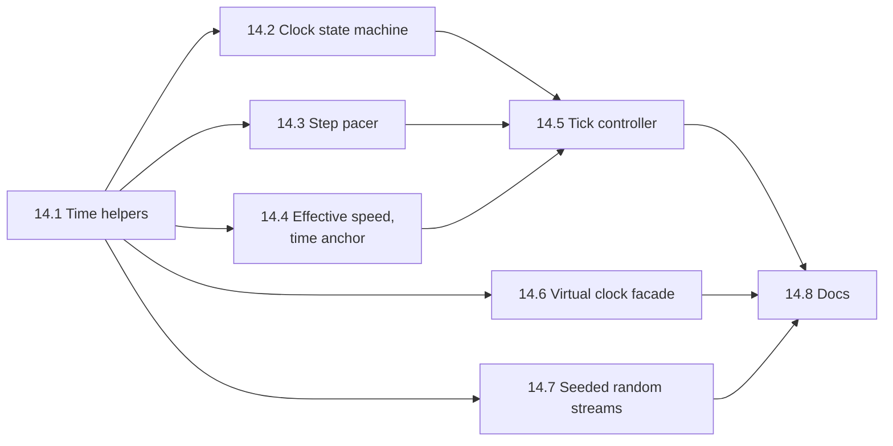

# Task 14 — Simulation core

| | |
|---|---|
| Design | [03 — Simulation Core](../design/03-simulation-core.md). [02 §6.2, §6.4](../design/02-communication.md#62-rules) cover the lockstep rules the pacing respects; [08 §6.1](../design/08-scene-management.md#61-snapshot-contents) covers the anchor in the snapshot. Decisions D-42, D-56, A-15 ([99](../design/99-decisions-and-open-questions.md)). |
| Namespace | `avis::simulation`, plus `avis` for the existing clock facade |
| New public headers | `include/avis/simulation/`: `time.h` (extended; task 10.1 added the types), `clock.h`, `step_pacer.h`, `effective_speed.h`, `time_anchor.h`, `tick_controller.h`, `random.h` |
| New sources | `lib/avis/simulation/`: `time.cpp`, `clock.cpp`, `step_pacer.cpp`, `effective_speed.cpp`, `time_anchor.cpp`, `tick_controller.cpp`, `random.cpp` |
| Changed | `include/avis/virtual_clock_state.h`, `lib/avis/virtual_clock_state.cpp` (reduced to the committed-tick facade, §14.6), `lib/avis/CMakeLists.txt`, `tests/CMakeLists.txt` |
| Tests | `tests/test_simulation_time.cpp`, `test_simulation_clock.cpp`, `test_step_pacer.cpp`, `test_effective_speed.cpp`, `test_time_anchor.cpp`, `test_tick_controller.cpp`, `test_simulation_random.cpp`, `test_virtual_clock.cpp` |
| Prerequisites | [Task 1](01-foundations.md) (`avis::error`, `AVIS_CHECK`), [Task 10.1](10-scene-management.md) (`simulation/time.h` with `simulation_duration`, `step_index`, `time_of_step`, `time_anchor`). The existing `avis::finite_state_machine` is used for the clock. |

The simulation core is the Visualizer's virtual clock. It covers time from step indices, the clock state machine (`stopped`, `loading`, `running`, `paused`), the pacing of step requests with silent slowdown, the effective speed, and the time anchor that the renderer interpolates with. It also provides the seeded random number streams that determinism needs (03 §6). Everything is a **pure, single-threaded component** driven by explicit wall times. There are no threads, no network and no sleeping, so all of 03 can be tested deterministically with a fake wall clock.

The loop that runs these components is the Visualizer's simulation thread. It's assembled in task 12: the presentation path in 12.6, and the step path in 12.19 with the lockstep coordinator of task 13. `tick_controller` (14.5) holds the decisions of 03 §4.2, so 12.19 only wires the inputs and carries out the actions.

**Not in this task.**
- The simulation thread, its command queue and condition-variable wait (task 12.6, 12.19).
- The lockstep coordinator and scene stream (task 12.17–12.18).
- The Driver's `--record-hashes` determinism check mode (03 §6), which the Driver task builds; 14.7 only provides the seeding helpers.
- Render interpolation of transforms (task 11.5). This task provides the `alpha` calculation the renderer calls.

## Conventions for this task
- **Integer simulation time.** Simulation time is always `step_index × delta_time` in `simulation_duration` (nanoseconds). Nothing accumulates floating-point time (03 §2). Scales and rates that touch simulation time are applied with integer ratio arithmetic (14.3). Floating point is allowed only in the presentation values: `s_effective`, the anchor's `rate`, and `alpha`.
- **Wall time is an input.** Every function takes `std::chrono::steady_clock::time_point wall_now` as a parameter and never reads the clock itself, so tests drive time explicitly.
- **Tags.** `[simulation][unit]` for everything. There's no device and no runtime.
- **Errors.** A command that isn't allowed in the current state (for example `single_step` while running) returns `result<void>` with `generic_error_kind::logic_error` and a message naming the state. It's not a debug check, since the UI can race with state changes.

## 14.1 Time helpers
03 §2.

- [ ] Extend `simulation/time.h` (task 10.1 added `simulation_clock`, `simulation_duration`, `simulation_time_point`, `step_index`, `time_of_step` and `time_anchor`) with:
  - `inline constexpr simulation_duration minimum_delta_time = 1ms;`, `maximum_delta_time = 100ms;` and `default_delta_time = 20ms;`
  - `result<simulation_duration> validate_delta_time(simulation_duration)`: between the minimum and maximum, and a whole number of nanoseconds (always true for `nanoseconds`; the check is for the scenario parser's input)
  - `constexpr step_index step_at_or_before(simulation_duration t, simulation_duration delta_time)`: the largest `k` with `t_k ≤ t`, for `t ≥ 0`
  - `constexpr step_index step_count_for(simulation_duration t_end, simulation_duration delta_time) = ceil(t_end / Δt) + 1` (04 §4.2a), used by the fake Driver and tests
  - `std::string format_simulation_time(simulation_duration)` as `12.340 s` for the simulation bar
- [ ] `time_of_step` has an overflow debug check: `k × Δt` must fit in `int64` nanoseconds, which allows about 292 years. That's never reached, but the check documents the limit.

**Tests** (`test_simulation_time.cpp`):
- [ ] `time_of_step(617, 20ms) == 12.34s` exactly. `step_count_for(1200 × 100ms, 20ms) == 6001`. `step_count_for` of a `t_end` that isn't a multiple rounds up.
- [ ] `validate_delta_time` rejects 0.5 ms, 101 ms and negative values.
- [ ] `format_simulation_time(12'340ms) == "12.340 s"`.

## 14.2 Clock state machine
03 §3.

- [ ] `simulation/clock.h`: `simulation_clock_state` with the states `stopped`, `loading`, `running` and `paused`, built on `avis::finite_state_machine`, with the transitions of 03 §3's diagram. The events are:
  - `start` (`stopped` → `loading`; the guard is the caller's validation result)
  - `driver_ready` (`loading` → `running`, after step 0 is committed)
  - `load_failed` (`loading` → `stopped`)
  - `pause`, `failure` and `fault` (`running` → `paused`)
  - `resume` and `retry_succeeded` (`paused` → `running`)
  - `stop` (`running` or `paused` → `stopped`)
  - `end_of_data` (`running` → `stopped`)
- [ ] `single_step` is allowed only in `paused`. It leaves the state unchanged but records "one tick requested", which the tick controller consumes (14.5).
- [ ] Queries:
  - `state()`
  - `ticks()`: true only in `running`, or while a single step is pending
  - `editing_allowed()`: only `stopped`
  - `pause_reason()`: user, failure or fault, with the message, for the UI banner
- [ ] Each event returns `result<void>`, with a `logic_error` for an event the state doesn't accept. The current state is unchanged in that case.
- [ ] State-change listeners: `on_state_changed(std::move_only_function<void(clock_state previous, clock_state next)>)`, called synchronously inside the event call. The tick controller uses it for the anchors.

**Tests** (`test_simulation_clock.cpp`):
- [ ] Every transition of 03 §3's diagram is accepted, and every other `(state, event)` pair is rejected and leaves the state unchanged (an exhaustive table test).
- [ ] `single_step` is accepted only in `paused`, and `ticks()` is true until it's consumed.
- [ ] `editing_allowed()` is true only in `stopped`.
- [ ] `pause_reason()` keeps the failure message until `resume`.
- [ ] Listeners see every change once, in order.

## 14.3 Step pacer
03 §4.1, §4.2, 02 §6.2 rule 1, §6.4.

- [ ] `simulation/step_pacer.h`, the virtual target time `T` of 03 §4.2 as a pure state.
  - `time_scale`: a rational `{ numerator, denominator }` for the finite scales of 12 §6 (0.1×, 0.25×, 0.5×, 1×, 2×, 4× and 10×), plus `max`. `from_double(s)` maps a double to the nearest scale in the list, and rejects values outside it.
  - `step_pacer::advance(wall_now)`: `T += (wall_now − wall_previous) × numerator / denominator`, computed in integer nanoseconds with 128-bit intermediates (or splitting) so it can't overflow, then clamped to `time_of_step(k_c + 1, Δt)`. At `max`, `T` isn't used.
  - `due()`: a step should be sent when `!in_flight` and either `T ≥ t_{k_c+1}` or the scale is `max`. It also returns true once for a pending single step.
  - `on_step_sent()`, `on_step_committed(k)` (sets `k_c`, clears `in_flight`) and `on_step_failed()` (clears `in_flight`; `T` stays clamped).
  - `next_due_wall_time(wall_now) → optional<time_point>`: when `T` will reach `t_{k_c+1}` at the current scale, so the simulation thread knows how long to wait. It's `nullopt` while a step is in flight or the clock is paused.
  - `resume(wall_now)` and `pause()`: `wall_previous` resets on resume, so a pause doesn't advance `T`.
- [ ] Silent slowdown is the clamp: a slow Driver leaves `T` at `t_{k_c+1}`, so nothing accumulates and there's no catch-up burst (03 §4.2).

**Tests** (`test_step_pacer.cpp`, with a fake wall clock):
- [ ] At 1× with Δt = 20 ms and instant commits, steps are due every 20 ms of wall time over 10 s: 500 steps ± 1.
- [ ] At 0.5×, due every 40 ms; at 10×, every 2 ms. At `max`, a step is due right after each commit.
- [ ] A slow Driver (commits take 100 ms at 1×) gives one step per 100 ms. When commits become instant again, the next step is due 20 ms after the last commit, with no burst.
- [ ] A pause of 5 s followed by a resume doesn't advance `T` by 5 s.
- [ ] A single step is due once while paused and doesn't change `T`'s clamp.
- [ ] `next_due_wall_time` is exact at 1× and 0.25×.
- [ ] 10× for a simulated hour: `T` never exceeds `t_{k_c+1}`, and there's no integer overflow.

## 14.4 Effective speed and time anchor
03 §5, §5.1, §5.2, D-56.

- [ ] `simulation/effective_speed.h`: `effective_speed` with `on_commit(k, wall_now)`, `on_pause()`, `on_resume()` and `value(scale)`:
  - The sample is `r = Δt / (wall_k − wall_{k−1})`, and the average is `ema += (r − ema) / 8`.
  - The first commit after start or resume only records its wall time.
  - Until there's a sample, the value is `s` (finite), or `Δt / round_trip` for `max`, given by the caller through `on_first_commit_round_trip`.
  - `value(s) = min(s, ema)` for a finite scale, and `ema` for `max`.
- [ ] `simulation/time_anchor.h` (the `time_anchor` struct is in `time.h`):
  - `anchor_on_commit(k, Δt, wall_now, s_effective) = { t_{k−1}, wall_now, s_effective }`
  - `anchor_hold(k, Δt, wall_now) = { t_k, wall_now, 0 }`, for pause, failure, single step, stop and end of data
  - resume keeps the current anchor (03 §5.2's table)
  - `render_time(anchor, wall_now, t_previous, t_current) → { t_render, alpha }`:
    - `t_render = clamp(t_base + (wall_now − wall_base) × rate, t_previous, t_current)`
    - `alpha = (t_render − t_previous) / (t_current − t_previous)`
    - `alpha = 1` when `t_current == t_previous` or `rate == 0`

  The renderer (task 11.5) calls `render_time`. It uses doubles freely, since it's presentation only.

**Tests** (`test_effective_speed.cpp`, `test_time_anchor.cpp`):
- [ ] At 1× with commits every 20 ms, `s_effective` converges to 1 within 1% after 40 commits. With commits every 40 ms, it converges to 0.5. It never exceeds `s` for a finite scale.
- [ ] The interval spanning a pause isn't sampled: a 10 s pause doesn't drop the EMA.
- [ ] `max` with commits every 5 ms at Δt = 20 ms converges to 4.
- [ ] `render_time`:
  - halfway between commits at rate 1 gives `alpha = 0.5`
  - rate 0 gives `alpha = 1`, and the image shows `t_k`
  - a late commit saturates at 1 instead of extrapolating
  - resume holds at `t_k` until the next commit's anchor
  - the 03 §5.2 table, row by row: each event's anchor gives the "what you see" column

## 14.5 Tick controller
03 §4.2, §4.4, §5.2, 02 §6.2, §6.4.

- [ ] `simulation/tick_controller.h` combines the clock (14.2), the pacer (14.3), the effective speed and the anchors (14.4) into the decisions of 03 §4.2's loop. It has no threads, network or scene.
  - **Inputs:**
    - `command(simulation_command_kind, wall_now)`: start (with the validation outcome), pause, resume, single step, stop, set scale
    - `load_completed(ok, step_count)`
    - `step_committed(k, wall_now)`, `step_failed(reason, message, wall_now)` and `end_of_data(k, wall_now)`
    - `presentation_changed()`
    - `update(wall_now)`
  - **Outputs:** a small `tick_actions` value returned from each call:
    - `send_step { k, simulation_time_ns, delta_time_ns }`
    - `send_load` and `send_unload`
    - `publish_snapshot { anchor }` after a commit
    - `republish { anchor }`
    - `wake_at` (the next due wall time or republish time)
    - `state_changed`

  It never decides on its own to talk to the Driver except through these actions.
- [ ] Rules carried over from 03 and 02:
  - **One step in flight** (02 §6.2 rule 1): `send_step` only when the pacer is due and nothing is in flight.
  - **Step 0** is sent right after a successful load (02 §6.2 rule 4). The clock moves to `running` once step 0 commits.
  - `end_of_data` commits the last step, then stops the clock with the anchor held at `t_k` (02 §6.2 rule 6, 03 §3).
  - Failures pause with `anchor_hold` and a republish (03 §4.2: "on failure").
  - Pause, single step, resume and stop set their anchors and republish through the presentation path (03 §5.2).
  - **Presentation republish coalescing:** at most one republish per 16 ms (03 §4.4). A commit clears the dirty flag, since its publish includes the change.
  - `set_scale` takes effect at the next `update` without resetting `T`.
- [ ] `step_index` and `simulation_time` queries for the simulation bar: `k_c`, `t_{k_c}`, `step_count`, `s_effective`.

**Tests** (`test_tick_controller.cpp`, scripted scenarios with a fake wall clock and a fake Driver that answers through the inputs):
- [ ] **Start to end:** start, then a successful load and step 0 committed puts the clock in `running`. Steps follow at Δt. `end_of_data` at `step_count − 1` stops the clock with the anchor held.
- [ ] **One in flight:** a slow commit never produces a second `send_step` (silent slowdown).
- [ ] **Pause and resume** follow the 03 §5.2 anchors, and resume doesn't send a step until it's due.
- [ ] **Single step** while paused sends exactly one step, and the anchor holds at the new `t_k`.
- [ ] **Failure** pauses with a republish. `retry_succeeded` resumes, and a late commit of the in-flight step is accepted (02 §7).
- [ ] **Presentation:** 50 changes within 16 ms give one `republish`, and a commit within the window gives none.
- [ ] **Commands in the wrong state** (resume while running, start while loading) return errors and produce no actions.
- [ ] **Determinism:** the sequence of `send_step` values (k, times) is identical across two runs with different wall-time jitter and the same commits. Only the timing of `send_step` changes.

## 14.6 Virtual clock facade
03 §2.

- [ ] Reduce `virtual_clock_state` to what 03 §2 describes: `now()` returns the time of the current **committed** tick, set by `set_committed(simulation_duration)`. Remove the wall-clock advancing (`resume`, `pause`, `set_scale`, `update_from_real_time`), which conflicts with determinism (03 §6: no wall clock in simulation logic). `reset()` stays. The mutex becomes an atomic, since one writer (the simulation thread) and possible readers suffice.
- [ ] `basic_virtual_clock<tls_state_policy>` stays the `std::chrono`-compatible facade. Add `using simulation_now_clock = basic_virtual_clock<tls_state_policy>` in `simulation/time.h`. The tick controller's owner binds the state on the simulation thread. The Visualizer's `simulator_clock.h` and its `static_state_policy` alias go (task 12.1 removes them).
- [ ] `apps/driver/simulator_driver.h` uses `virtual_clock_state`. The Driver isn't built (task 5's Open points), so leave a note for the Driver task. Run `grep -rn "set_scale\|resume()\|pause()" apps` to list the callers.

**Tests** (`test_virtual_clock.cpp`):
- [ ] `now()` returns what `set_committed` set, and doesn't move with wall time (sleep 50 ms and check).
- [ ] A state bound with `tls_state_policy` on one thread isn't visible on another.
- [ ] `basic_virtual_clock::time_point` arithmetic works with `std::chrono` durations.

## 14.7 Seeded random streams
03 §6.

- [ ] `simulation/random.h`:
  - `constexpr std::uint64_t splitmix64(std::uint64_t&)`
  - `constexpr std::uint64_t mix_seed(std::uint64_t scenario_seed, std::uint64_t subsystem_id)`: SplitMix64 over the seed XOR a fixed odd multiple of the subsystem id
  - `std::mt19937_64 make_subsystem_engine(scenario_seed, subsystem_id)`
  - a `pcg32` (the PCG-XSH-RR 64/32 reference algorithm, a small header implementation with a stream selector)
  - `subsystem_id` constants for the known subsystems: oracle noise, shadow vehicle, plug-in base. Plug-ins get `plugin_base + index`, in load order.
- [ ] A static analysis note in the header: never `std::random_device` in simulation logic (03 §6).

**Tests** (`test_simulation_random.cpp`):
- [ ] `splitmix64` matches the reference outputs for seed 0 (the first five values from the published reference implementation).
- [ ] `pcg32` matches its reference sequence for seed 42 and stream 54.
- [ ] Different subsystems with the same scenario seed produce different first values. The same inputs produce identical sequences across runs and builds.

## 14.8 Docs and cleanup
- [ ] Update [03](../design/03-simulation-core.md) wherever the implementation differs:
  - the rational `time_scale`
  - `tick_controller` placed in the library rather than only in the Visualizer's simulation thread (code placement table)
  - the reduced `virtual_clock_state`
  - the PRNG choice
- [ ] Update 12.19 in [task 12](12-visualizer.md): it wires `tick_controller`'s actions to the coordinator and the simulation thread.
- [ ] Add rows to the [README](README.md), and an **As implemented** section here.
- [ ] Run the `[simulation]` tests 20 times in random order, in Debug and ASan.

## Acceptance criteria
- Simulation time comes only from `k × Δt` in integer nanoseconds, and pacing uses integer ratio arithmetic.
- The clock state machine accepts exactly 03 §3's transitions.
- The pacer implements silent slowdown with no catch-up and one step in flight, and computes the next wake-up time.
- `s_effective` and the anchors match 03 §5.1–§5.2 row by row, and `render_time` never extrapolates.
- The tick controller produces 03 §4.2's actions from scripted inputs, and its step sequence doesn't depend on wall-time jitter.
- `virtual_clock_state` no longer reads wall time.
- All tests pass in Debug, Release and ASan.

## Open points
- **Where the tick logic lives.** 03's code placement puts the tick loop in `apps/visualizer/simulation/simulation_thread.*`. This task puts the pure decision logic (`tick_controller`) in `AVIS_LIB` so it's testable without the Visualizer, and leaves the loop (threads, queues, waits) in the Visualizer. The alternative is putting the controller in task 12's `AVIS_VISUALIZER_SIMULATION` library.
- **Rational scales.** 03 §4.2 asks for "integer arithmetic via ratio". A rational per listed scale does that exactly. A free-form scale from a slider would need a denominator such as 1000 (per-mille). Recommended: the fixed list of 12 §6, since the UI only offers those.
- **`max` speed's first sample.** 03 §5.1 seeds the EMA with `Δt` over the first step's round-trip time at `max`. The round trip is measured by the coordinator (send to commit), so the tick controller takes it as an input.
- **Removing `virtual_clock_state`'s wall-clock mode.** The Driver's prototype (`simulator_driver.h`) uses it. If the Driver task still wants a free-running clock for tools, it should be a separate type, not a mode of the simulation clock.
- **PRNG choice per subsystem.** 03 §6 allows `std::mt19937_64` or PCG32. Recommended: PCG32 for the plug-in-facing streams (small state, cheap to fork per object) and `mt19937_64` only where a standard engine is required by a library API.
