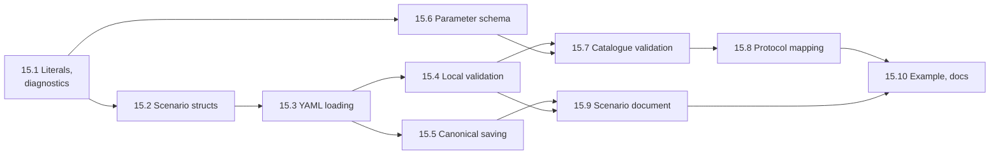

# Task 15 — Scenario model, YAML and validation

| | |
|---|---|
| Design | [04 — Scenarios & KITTI-360 Data](../design/04-scenario-and-dataset.md) §1, §2 and §3.1 (capabilities). Related: [05 §5.8](../design/05-driver.md#58-parameter-schema) for the parameter schema, [02 §5.2, §5.4](../design/02-communication.md#52-describe) for the catalogue and `load_scenario`, [03 §2, §3](../design/03-simulation-core.md) for the timestep and editing rules. Decision D-07 ([99](../design/99-decisions-and-open-questions.md)). |
| Namespace | `avis::simulation` |
| New public headers | `include/avis/simulation/`: `literals.h`, `diagnostic.h`, `scenario.h`, `scenario_yaml.h`, `scenario_validation.h`, `parameter_schema.h`, `data_catalogue.h`, `scenario_document.h`, `scenario_protocol.h` |
| New sources | `lib/avis/simulation/`: `literals.cpp`, `scenario_yaml.cpp` (yaml-cpp, private), `scenario_validation.cpp`, `parameter_schema.cpp`, `scenario_document.cpp`, `scenario_protocol.cpp`, `yaml_location.h` (private) |
| Data | `data/scenarios/example_drive_0000.avis.yaml` (the 04 §2.2 example), test fixtures under `tests/data/scenarios/` |
| Tests | `tests/test_simulation_literals.cpp`, `test_scenario_yaml.cpp`, `test_scenario_validation.cpp`, `test_parameter_schema.cpp`, `test_scenario_catalogue.cpp`, `test_scenario_document.cpp`, `test_scenario_protocol.cpp` |
| Prerequisites | [Task 0](00-external-dependencies.md) (yaml-cpp), [Task 1](01-foundations.md), [Task 5](05-io-layer.md) (`read_file`, `write_file` with atomic replace), [Task 14.1](14-simulation-core.md) (timestep limits). Only 15.8 needs [Task 13](13-network.md), for the protocol types. |

A scenario is a YAML file (`*.avis.yaml`) that fully describes one run. It names the data source, frame range and sensors, the plug-ins and their parameters, the timestep and seed, and the Visualizer's display settings. This task delivers the library side, which both applications use:
- typed scenario structs
- a YAML loader that reports every problem with `file:line:column` and a key path
- canonical saving
- local, catalogue and parameter-schema validation
- a small `scenario_document` that the Visualizer's undo commands edit

The **parameter schema** (05 §5.8) lives here too, because the Visualizer validates against it as you type, and the Driver validates against it at `load_scenario` with the same rules.

**Not in this task.**
- The sequence-pack readers (`avis::dataset`) and the packer tool (04 §4–§5). Only the Driver uses them, so they belong with the Driver and dataset tasks.
- The Visualizer's undo commands, settings form and problems list (task 12.20).
- Driver-side re-validation and the plug-in scan (design 05). The Driver calls this task's schema code.

**Order.** The parameter schema (15.6) is independent of the scenario structs and can be done in parallel with 15.2–15.5. Only 15.8 needs task 13.

## Conventions for this task
- **No yaml-cpp in public headers.** yaml-cpp is a private dependency of `AVIS_LIB` (13 §2). Public functions take and return text (`std::string_view`) and Avis types. Free-form parameter blocks are kept as **YAML text** (`std::string`), as they travel in the protocol (02 §5.4). `scenario_yaml.cpp` and `parameter_schema.cpp` use yaml-cpp internally.
- **Diagnostics, not first errors.** Loading and validation collect every problem (04 §2.3).
  - `diagnostic { severity (error, warning); std::string path; std::string message; std::optional<source_location> location; }`, where `source_location` is `{ file, line, column }` from yaml-cpp's `Mark`. This is the parse location, not `std::source_location`.
  - Paths use dots and indices: `driver.shadow_vehicle.parameters.wheelbase`, `dataset.sensors[2]`.
- **Results.** 04 §2.3 writes `result<scenario, std::vector<diagnostic>>`, which `avis::result<T>` can't express. Loading returns `scenario_load_result { std::optional<scenario> scenario; std::vector<diagnostic> diagnostics; }`. `scenario` is set when there are no errors; warnings can be present either way. File-level failures, such as IO errors and YAML syntax errors that stop parsing, are still `avis::error` (`error_domain::io` or `error_domain::parse`). See Open points.
- **Tags.** `[simulation][unit]` for everything, apart from the file round trip through the IO layer, which is `[simulation]` on the runtime fixture.

## 15.1 Literals and diagnostics
04 §2.2, §2.3.

- [ ] `simulation/literals.h`:
  - `parse_duration(std::string_view) → result<std::chrono::nanoseconds>`: an integer or decimal number followed by `ns`, `us`, `ms` or `s`, with no space (`20ms`, `0.3s`, `10s`). The result must be a whole number of nanoseconds, so `0.0000000001s` is an error.
  - `format_duration(ns)`: the largest unit that keeps it an integer (`20ms`, `10s`, `250us`).
  - `parse_angle(std::string_view) → result<double>` in radians: `deg` or `rad` suffixes (`135deg`, `0.61rad`), or a bare number meaning radians (see Open points). `format_angle` always writes `deg` with up to six significant digits.
  - Errors are `error_domain::parse` with the offending text.
- [ ] `simulation/diagnostic.h`: `diagnostic`, `diagnostic_severity`, `source_location`, `has_errors(span)`, and `format_diagnostic(const diagnostic&)` as `file:line:column: path: message`, or `path: message` without a location.

**Tests** (`test_simulation_literals.cpp`):
- [ ] Every unit parses (`20ms == 20'000'000ns`, `0.3s == 300ms`, `250us`, `5ns`).
- [ ] These are rejected: `20 ms` (space), `20min`, `-5ms` (see Open points), `1.5ns` (not whole) and an empty string.
- [ ] `format_duration(parse_duration(x)) == x` for canonical inputs.
- [ ] Angles: `135deg` ≈ 2.35619 rad, `0.61rad` and `45` (radians). Formatting round-trips within 1e-9.

## 15.2 Scenario structs
04 §2.2.

- [ ] `simulation/scenario.h`, plain aggregates that mirror schema version 1:
  - `scenario { int schema_version = 1; std::string name; std::string description; simulation_settings simulation; dataset_selection dataset; driver_settings driver; visualization_settings visualization; std::vector<unknown_key> unknown_keys; }`
  - `simulation_settings { simulation_duration timestep = 20ms; std::uint64_t random_seed = 0; double time_scale = 1.0; }`
  - `dataset_selection { std::string kind; std::string sequence; frame_range frames; std::vector<std::string> sensors; }` with `frame_range { std::uint32_t start; std::uint32_t end; }` (inclusive)
  - `driver_settings { std::string id; module_selection perception; module_selection vehicle_model; shadow_vehicle_settings shadow_vehicle; }`
    - `module_selection { std::string module; std::string parameters_yaml; }`
    - `shadow_vehicle_settings { bool enabled; shadow_dynamics dynamics; simulation_duration resync_interval; std::string parameters_yaml; }`
  - `visualization_settings`:
    - `lidar { lidar_color_mode color_mode; float point_size; }`
    - `environment { sun { double azimuth; double elevation; double illuminance; }; sky_model sky; }`
    - `camera { camera_mode mode; follow { Eigen::Vector3f offset; simulation_duration lag; } }`
- [ ] Enums with `to_string` and `from_string`: `shadow_dynamics` (`kinematic_bicycle`, `jolt_wheeled`), `lidar_color_mode` (`intensity`, `height`, `ring`, `uniform`), `sky_model` (`procedural`), `camera_mode` (`follow`, `free_fly`).
- [ ] `unknown_key { std::string path; std::string yaml; }` keeps unknown top-level and section keys, so saving doesn't drop them (forward compatibility, 04 §2.3). This is a proposal; see Open points.
- [ ] Defaults equal the values in 04 §2.2's example where the schema implies one: timestep 20 ms, time scale 1.0, intensity colouring, point size 0.05, the procedural sky and follow mode with its offset and lag.

**Tests:** covered with 15.3.

## 15.3 YAML loading
04 §2.3.

- [ ] `simulation/scenario_yaml.h`:
  - `scenario_load_result parse_scenario(std::string_view text, std::string_view source_name)`
  - a named sender `load_scenario_file(path)` that reads with `io::read_file`, then parses on the parallel scheduler and completes with `scenario_load_result`. IO errors go on `set_error`.
- [ ] Parsing:
  - `avis_scenario` is required and must be 1. Another version is an error naming the supported version.
  - Every field is read with type checks. A wrong type is an error with the path and location.
  - Durations and angles use 15.1.
  - `frames` accepts both the flow form `{ start, end }` and block form.
  - `parameters` blocks are re-emitted as YAML text with `YAML::Emitter`, so the plug-in sees the values, not the formatting.
  - Missing required sections (`simulation`, `dataset`, `driver`) are errors. A missing `visualization` gives the defaults.
- [ ] Unknown keys are **warnings** (04 §2.3), kept in `unknown_keys`. The keys of older drafts (`time:` under `dataset`, `end_behaviour`, `step_timeout`) get a specific warning message saying they're ignored (04 §2.3).
- [ ] A YAML syntax error is a single error diagnostic with yaml-cpp's location and message. Parsing stops there.
- [ ] Whether the text contained comments is recorded in `scenario_load_result::had_comments`, by a scan for `#` outside quoted strings using yaml-cpp's scanner positions or a small tokenizer (see Open points). It's used by the save notice (04 §2.4).

**Tests** (`test_scenario_yaml.cpp`):
- [ ] The 04 §2.2 example parses to the expected structs, field by field.
- [ ] Each required section missing gives an error with its path.
- [ ] A wrong type (`timestep: fast`, `random_seed: -1`, `sensors: velodyne`) gives an error with the path, line and column.
- [ ] An unknown key gives a warning and is kept. `end_behaviour` gives the "ignored" warning.
- [ ] A syntax error reports yaml-cpp's line.
- [ ] Several problems in one file are all reported.
- [ ] `[simulation]`: `load_scenario_file` reads a fixture and reports a missing file as an IO error.

## 15.4 Local validation
04 §2.3, 03 §2.

- [ ] `simulation/scenario_validation.h`: `std::vector<diagnostic> validate_local(const scenario&)`. It runs always, with no Driver, and checks:
  - `timestep` is within 1–100 ms and a whole number of ns (14.1)
  - `frames.start ≤ frames.end`
  - `dataset.kind`, `sequence` and `sensors` are non-empty, and `sensors` has no duplicates
  - `driver.perception.module` and `vehicle_model.module` are non-empty
  - `shadow_vehicle.resync_interval ≥ 0`
  - `time_scale` is one of the offered scales (task 14.3)
  - `visualization` values are in range: `point_size > 0`, elevation within ±90°, illuminance ≥ 0, lag ≥ 0
  - `parameters_yaml` blocks are YAML maps (or empty)
- [ ] Each problem is an error with its path, plus the location from loading when available. Loading keeps a `path → location` map in `scenario_load_result`, and validation looks paths up in it.

**Tests** (`test_scenario_validation.cpp`):
- [ ] One test per rule, with the expected path.
- [ ] A valid scenario gives no diagnostics.
- [ ] The locations point at the right lines in a fixture file.

## 15.5 Canonical saving
04 §2.4, D-07.

- [ ] `std::string format_scenario(const scenario&)` writes YAML in **canonical key order**: the order of 04 §2.2's example, with unknown keys appended at the end of their section in their original order. Durations and angles use the canonical literal forms. Parameter blocks are re-emitted from their YAML text in block style.
- [ ] A named sender `save_scenario_file(path, const scenario&)` writes with the IO layer's atomic replace (task 5).
- [ ] `autosave_path(path)` returns `<name>.avis.yaml.autosave` (04 §2.4). The 2-minute timer belongs to the Visualizer (12.20).
- [ ] `had_comments` from loading is returned to the caller for the one-time notice. The library doesn't show it.

**Tests** (in `test_scenario_yaml.cpp`):
- [ ] `parse(format(s)) == s` for the example and for 100 randomly generated valid scenarios (a structural equality operator on the structs).
- [ ] `format(parse(format(s))) == format(s)` byte for byte (canonical and idempotent).
- [ ] Unknown keys survive a round trip.
- [ ] A file with comments loads with `had_comments`, and saves without them (D-07).
- [ ] `[simulation]`: an atomic save to a temporary directory leaves no partial file when the write fails (task 5's fault injection).

## 15.6 Parameter schema
05 §5.8.

- [ ] `simulation/parameter_schema.h`:
  - `parameter_schema` and `parameter_field { name; type (number, integer, boolean, text, enum, vector3, map, list); default; minimum; maximum; values (enum); items (list item type); unit; description; std::vector<parameter_field> fields (map); }`
  - `result<parameter_schema> parse_parameter_schema(std::string_view yaml_text)` checks four things:
    - `avis_parameters: 1`
    - known types
    - a `default` for every non-map field, of the right type and within range
    - `values` for enums and `items` for lists

    A malformed schema is an `error_domain::parse` error with the field path. The Driver then puts the plug-in in `rejected_plugins` (05 §5.8).
- [ ] `parameter_validation validate_parameters(const parameter_schema&, std::string_view parameters_yaml, std::string_view base_path)` returns diagnostics and the **effective** parameters as YAML text, with defaults merged in:
  - A wrong type, a value out of range (for lists, the length is checked against `minimum`/`maximum`), or an unknown enum value is an error with the full path (`driver.vehicle_model.parameters.pid.kp`).
  - An unknown key is a warning, and the key is passed through untouched into the effective YAML.
  - Integers accept integral YAML scalars only. Numbers accept integers too. `vector3` needs exactly three numbers.
- [ ] Field metadata for UI forms (type, default, range, unit, description, enum values) is exposed through the `parameter_schema` structs, so the Visualizer's generated form (12.20) doesn't parse YAML itself.
- [ ] `validate_value(const parameter_field&, std::string_view yaml_scalar)` checks a single value as you type.

**Tests** (`test_parameter_schema.cpp`):
- [ ] The 05 §5.8 example schema parses. Each malformed variant fails with its path: no `avis_parameters`, an unknown type, a missing default, a default out of range, an enum without `values`, a list without `items`.
- [ ] Validation:
  - an empty block gives all the defaults
  - a value of the wrong type, out of range, a bad enum value or a `vector3` of two numbers each gives an error with the right path
  - an unknown key gives a warning and passes through
  - nested `map` fields work, and list lengths are checked
- [ ] The effective YAML of an empty block, parsed again, validates with no diagnostics.

## 15.7 Catalogue validation
04 §2.3, §3.1, 02 §5.2.

- [ ] `simulation/data_catalogue.h` is a protocol-independent view of what a Driver offers. The protocol's `describe_reply` maps onto it in 15.8.
  - `data_catalogue { std::vector<data_source_entry> data_sources; std::vector<module_entry> vehicle_models; std::vector<module_entry> perception_modules; }`
  - `data_source_entry { kind; sequence; split; capabilities; frame_first; frame_last; duration; std::vector<sensor_entry> sensors; }`
  - `module_entry { name; version; std::optional<parameter_schema> schema; std::string schema_error; }`
- [ ] `std::vector<diagnostic> validate_against_catalogue(const scenario&, const data_catalogue&)` checks:
  - the sequence exists for the kind
  - the frame range lies within `[frame_first, frame_last]`
  - the sensors exist
  - the perception module and vehicle model exist
  - the capability rules of 04 §3.1, as a table in `scenario_validation.cpp`:
    - `ground_truth_oracle` needs `boxes` (error)
    - `jolt_wheeled` needs `semantics` (error)
    - `kinematic_bicycle` without `semantics` is a warning, with 04 §3.1's message
  - each module's parameters against its schema, when it has one (15.6)

  The shadow vehicle's dynamics schemas come through the catalogue like the plug-ins' (05 §5.8: "the built-in modules publish schemas too"). A module without a schema skips the parameter check, and the raw YAML editor is used (12 §6.1).
- [ ] Frame-time helpers for the editor (12 §6): `approximate_time_of_frame(entry, frame)` and `nearest_frame_for_time(entry, seconds)`, computed from `duration` and the frame count. They're display-only; the exact end time comes back as `step_count` (04 §2.3).

**Tests** (`test_scenario_catalogue.cpp`):
- [ ] Each check produces its diagnostic with the path:
  - an unknown sequence
  - a frame range past `frame_last`
  - an unknown sensor
  - a missing module
  - the oracle on a test sequence without `boxes` (error, with 04's message)
  - `jolt_wheeled` without `semantics` (error), and `kinematic_bicycle` without `semantics` (warning)
- [ ] Parameter errors from schemas appear with full paths.
- [ ] `nearest_frame_for_time` rounds to the nearest frame, and the two frame-time helpers invert each other within one frame.

## 15.8 Protocol mapping
02 §5.2, §5.4. Needs task 13.

- [ ] `simulation/scenario_protocol.h` maps between the scenario model and the protocol:
  - `to_load_request(const scenario&) → network::protocol::load_scenario_request`: the name, the data source (kind, sequence, `frame_start`, `frame_end`), the enabled sensors, `timestep_ns`, the seed, and the three module blocks with their parameter YAML. `visualization` is never sent (04 §2.2).
  - `to_catalogue(const network::protocol::describe_reply&) → data_catalogue`, parsing each `parameters_schema` text with 15.6. A schema that fails to parse becomes `schema_error`. The Driver normally rejects such plug-ins first, but the Visualizer doesn't trust that.
  - `from_protocol(const network::protocol::diagnostic&) → diagnostic` and back. The Driver's `load_scenario` diagnostics join the problems list (04 §2.3).
- [ ] The header includes `avis/network/protocol/` only in this file, so `scenario.h` and the rest of the scenario headers don't depend on the network layer.

**Tests** (`test_scenario_protocol.cpp`):
- [ ] `to_load_request` of the example matches the expected request field by field and contains nothing from `visualization`.
- [ ] `to_catalogue` of a fake Driver's `describe_reply` (task 13's helper) validates the example scenario without diagnostics.
- [ ] A broken schema string becomes `schema_error`.
- [ ] Diagnostics round-trip.

## 15.9 Scenario document
04 §2.4, 03 §3.

- [ ] `simulation/scenario_document.h` holds the in-memory scenario the Visualizer edits:
  - `scenario_document` with `scenario()`, `path()`, `dirty()`, `revision()` and `had_comments()`
  - `new_document()`, `from_load(path, scenario_load_result)` and `mark_saved(path)`
  - typed setters for each editable value, used by the undo commands (12.20): `set_timestep`, `set_random_seed`, `set_time_scale`, `set_data_source(kind, sequence)`, `set_frame_range`, `set_sensor_enabled(name, bool)`, `set_module(slot, name)`, `set_parameters(slot, yaml)`, `set_shadow_vehicle(...)`, and the `visualization` setters
  - each setter returns the previous value, so a command can undo it
- [ ] `editing_allowed` is a predicate the owner sets, usually `clock.editing_allowed()` (task 14.2). Every setter returns a `logic_error` when it's false, as the second line of defence of 04 §2.4. `visualization` setters are exempt, because they're presentation edits that work in every clock state (12 §4.1). See Open points.
- [ ] Each successful setter bumps `revision` and sets `dirty`.

**Tests** (`test_scenario_document.cpp`):
- [ ] Each setter changes its field, returns the old value, bumps the revision and sets `dirty`. `mark_saved` clears `dirty`.
- [ ] With `editing_allowed` false, setters fail and change nothing, except the `visualization` setters.
- [ ] `set_sensor_enabled` doesn't duplicate a sensor.

## 15.10 Example scenario and docs
- [ ] `data/scenarios/example_drive_0000.avis.yaml` is the 04 §2.2 example in canonical form, and it validates locally (a test loads it).
- [ ] Update [04](../design/04-scenario-and-dataset.md) wherever the implementation differs:
  - the result type (`scenario_load_result`)
  - unknown keys kept on save
  - the bare-number angle rule
  - the `data_catalogue` view
  - the parameter schema living in `avis::simulation` (code placement table)
  - `visualization` setters allowed in every state
- [ ] Add rows to the [README](README.md), and an **As implemented** section here.

## Acceptance criteria
- Scenario files of schema version 1 load into typed structs. Every problem is reported with `file:line:column` and a key path, and unknown keys are warnings.
- Saving is canonical and idempotent, keeps unknown keys, and writes atomically.
- Local, catalogue (including the 04 §3.1 capability rules) and parameter-schema validation produce the diagnostics 04 §2.3 and 05 §5.8 describe.
- The parameter schema parses, validates and merges defaults identically for the Driver and the Visualizer, and rejects malformed schemas.
- The protocol mapping produces a `load_scenario_request` without `visualization`, and turns a `describe_reply` into a catalogue.
- No public scenario header includes yaml-cpp or (except `scenario_protocol.h`) the network layer.
- All tests pass in Debug, Release and ASan.

## Open points
- **Result type.** `avis::result<T>` carries one `avis::error`, and 04 §2.3 wants a list of diagnostics. Proposed: `scenario_load_result` with an optional scenario and the diagnostics. Alternative: a general `avis::result_with_diagnostics<T>` in `AVIS_LIB`, if more loaders need it.
- **Unknown keys on save.** 04 §2.3 says unknown keys are warnings for forward compatibility, but not whether saving keeps them. Proposed: keep them (`unknown_keys`), so a file from a newer version isn't silently stripped by an older Visualizer.
- **Bare-number angles.** 04 §2.2 writes angles with `deg`. Whether `45` alone means radians or degrees isn't specified. Proposed: radians, as in `rad`, with a warning suggesting a suffix. Alternative: require a suffix.
- **Negative durations.** No scenario field needs one. They're rejected by the parser. `resync_interval: 0` means never (04 §2.2), which is allowed.
- **Comment detection.** yaml-cpp drops comments without telling. A small scan for `#` outside scalars is needed for the one-time notice (04 §2.4). Proposed: scan the text with yaml-cpp's token stream if it's reachable, otherwise a tokenizer that skips quoted scalars and block scalars.
- **Where the parameter schema lives.** 05 describes it as part of the Driver's plug-in contract, but the Visualizer validates with it too. Proposed: `avis::simulation::parameter_schema` in `AVIS_LIB`, used by both. 05's code placement gets a line.
- **`visualization` edits outside `stopped`.** 04 §2.4 restricts all editing to `stopped`, while 12 §4.1 lists `visualization` edits as presentation commands "while stopped". Proposed: allow the `visualization` setters in every state, since they don't affect the Driver. Otherwise keep 04's rule and remove the exemption.
