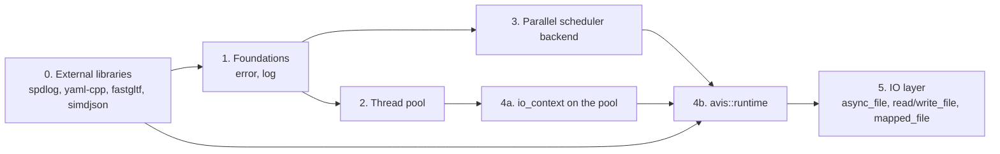

# Implementation tasks: library runtime, thread pool, parallel scheduler and IO layer

These documents break the designs in [`docs/design`](../design) into ordered, reviewable implementation steps. They cover:

- [06 — Thread Pool](../design/06-thread-pool.md)
- [15 — Parallel Scheduler](../design/15-parallel-scheduler.md)
- [14 — Library Runtime](../design/14-library-runtime.md)
- [07 — IO Layer](../design/07-io-layer.md)

plus integrating the newly vendored external libraries (spdlog, yaml-cpp, fastgltf, simdjson) and the parts of [01 §6](../design/01-system-architecture.md#6-error-handling-policy) and [13](../design/13-build-and-quality.md) these depend on.

| # | Document | Delivers | Depends on |
|---|---|---|---|
| 0 | [00-external-dependencies.md](00-external-dependencies.md) | spdlog 1.17.0, yaml-cpp 0.9.0, fastgltf 0.9.1 and simdjson 4.6.11 built and linked, `external/README.md` | — |
| 1 | [01-foundations.md](01-foundations.md) | `avis::error` / `avis::result<T>`, `avis::log`, test helpers | 0 |
| 2 | [02-thread-pool.md](02-thread-pool.md) | `avis::threading::thread_pool`, `thread_handle` | 1 |
| 3 | [03-parallel-scheduler.md](03-parallel-scheduler.md) | `avis::threading::parallel_backend` behind `stdexec::get_parallel_scheduler()`, `into_internal_error`, `sync_wait`; removes the earlier task system | 1 |
| 4 | [04-library-runtime.md](04-library-runtime.md) | Pool-hosted `avis::io::io_context`, `avis::runtime`, YAML runtime configuration | 0, 1, 2, 3 |
| 5 | [05-io-layer.md](05-io-layer.md) | `avis::sender_of`, `avis::io::async_file`, `read_file`/`write_file`, `mapped_file`, IO errors, `sync_wait_result`, cancel-then-drain IO shutdown | 1, 3, 4 |

Tasks 2 and 3 are independent: the parallel workers belong to `exec::static_thread_pool`, not to the thread pool. Task 3 replaces an earlier task 3 that built a custom task system (design decision D-60); that version is in the git history.

## Conventions for every task
- Code follows [13 §9](../design/13-build-and-quality.md#9-coding-standards): `snake_case`, **no abbreviations**, one variable per declaration, header guards in the style `AVIS_<DIRECTORY>_<FILE>_H`, members with a trailing `_`.
- Every new source file is added to `lib/avis/CMakeLists.txt` (`target_sources(AVIS_LIB …)`), every new test to `tests/CMakeLists.txt` (`AVIS_TESTS`).
- Run `clang-format-all.ps1` before committing.
- Failure paths return `avis::result<T>` or complete with `set_error(avis::error)`; exceptions only for unrecoverable conditions ([01 §6.1](../design/01-system-architecture.md#61-rules)).
- Each step ends with its tests green. A step is "done" when its checklist and its acceptance criteria are met.

## Points the design leaves open
Each task document has an **Open points** section. They are collected here so they can be decided up front:

| Document | Open point |
|---|---|
| 00 | A fully offline fresh configure needs Catch2 vendored and stdexec added without its rapids-cmake download (Task 0 only guarantees the new libraries add no downloads) |
| 03 | A grep or clang-tidy rule banning `stdexec::sync_wait` in `lib/` and `apps/` |
| 03 | Whether the frame chain's recording `bulk` needs the pool scheduler directly, if the type-erased parallel scheduler benchmarks too slow |
| 04 | *(Resolved by task 5)* How much of the IO layer (doc 07) is in scope: task 4 only migrates `io_executor` to a pool-hosted `io_context` |
| 05 | A benchmark for cache-hit reads on the IO thread, to check the revisit condition of D-69 |
| 05 | Whether `use_sender` takes an optional operation name for error messages |
| 05 | The Driver ports can't be compiled until the Driver has a build target |
