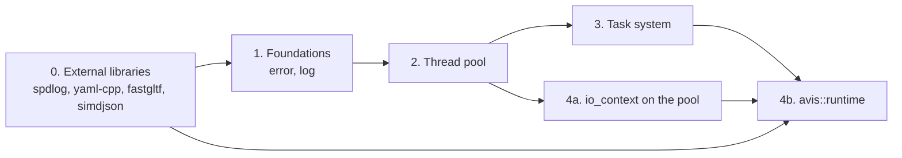

# Implementation tasks: library runtime, thread pool and task system

These documents break the designs in [`docs/design`](../design) into ordered, reviewable implementation steps. They cover:

- [06 — Thread Pool](../design/06-thread-pool.md)
- [15 — Task System](../design/15-task-system.md)
- [14 — Library Runtime](../design/14-library-runtime.md)

plus integrating the newly vendored external libraries (spdlog, yaml-cpp, fastgltf, simdjson) and the parts of [01 §6](../design/01-system-architecture.md#6-error-handling-policy), [07](../design/07-io-layer.md) and [13](../design/13-build-and-quality.md) these three depend on.

| # | Document | Delivers | Depends on |
|---|---|---|---|
| 0 | [00-external-dependencies.md](00-external-dependencies.md) | spdlog 1.17.0, yaml-cpp 0.9.0, fastgltf 0.9.1 and simdjson 4.6.11 built and linked, `external/README.md` | — |
| 1 | [01-foundations.md](01-foundations.md) | `avis::error` / `avis::result<T>`, `avis::log`, test helpers | 0 |
| 2 | [02-thread-pool.md](02-thread-pool.md) | `avis::threading::thread_pool`, `thread_handle` | 1 |
| 3 | [03-task-system.md](03-task-system.md) | Work-stealing `avis::threading::task_system`, stdexec scheduler, `bulk` | 1, 2 |
| 4 | [04-library-runtime.md](04-library-runtime.md) | Pool-hosted `avis::io::io_context`, `avis::runtime`, YAML runtime configuration | 0, 1, 2, 3 |

Phases 2 and 3 can overlap once the thread pool's `start` / `thread_handle` API is merged: the task system's lock-free building blocks (deque, inbox) don't need the pool at all.

## Conventions for every task
- Code follows [13 §9](../design/13-build-and-quality.md#9-coding-standards): `snake_case`, **no abbreviations**, one variable per declaration, header guards in the style `AVIS_<DIRECTORY>_<FILE>_H`, members with a trailing `_`.
- Every new source file is added to `lib/avis/CMakeLists.txt` (`target_sources(AVIS_LIB …)`), every new test to `tests/CMakeLists.txt` (`AVIS_TESTS`).
- Run `clang-format-all.ps1` before committing.
- Failure paths return `avis::result<T>` or complete with `set_error(avis::error)`; exceptions only for unrecoverable conditions ([01 §6.1](../design/01-system-architecture.md#61-rules)).
- Each step ends with its tests green. A step is "done" when its checklist and its acceptance criteria are met.

## Points the design leaves open
Each task document has an **Open points** section. They are collected here so they can be decided up front:

| Document | Open point |
|---|---|
| 00 | A fully offline fresh configure needs Catch2 vendored and stdexec added without its rapids-cmake download (Task 0 only guarantees the new libraries add no downloads) |
| 01 | Where generic error codes such as `pool_exhausted` are defined (proposal: one `avis::generic_errc` enum in `error.h`) |
| 03 | The design reads a victim's inbox with `try_pop` from thieves, but a Vyukov queue is single-consumer (proposal: serialise the consumer side with a try-lock) |
| 03 | How exceptions inside `then` bodies become `avis::error` "at the scheduler boundary" (stdexec delivers `std::exception_ptr`) |
| 03 | How "`sync_wait` from a worker asserts" is enforced (stdexec's `sync_wait` can't be hooked for arbitrary senders) |
| 04 | How much of the IO layer (doc 07) is in scope: this plan only migrates `io_executor` to a pool-hosted `io_context` |
