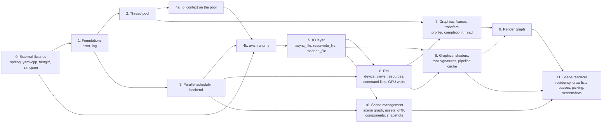

# Implementation tasks: library runtime, thread pool, parallel scheduler, IO layer, RHI, graphics layer, render graph, scene management and scene renderer

These documents break the designs in [`docs/design`](../design) into ordered, reviewable implementation steps. They cover:

- [06 — Thread Pool](../design/06-thread-pool.md)
- [15 — Parallel Scheduler](../design/15-parallel-scheduler.md)
- [14 — Library Runtime](../design/14-library-runtime.md)
- [07 — IO Layer](../design/07-io-layer.md)
- [09 — RHI](../design/09-rhi.md)
- [17 — Graphics layer: frames and transfers](../design/17-graphics-frames-and-transfers.md)
- [18 — Graphics layer: shaders and pipelines](../design/18-graphics-shaders-and-pipelines.md)
- [10 — Render Graph](../design/10-render-graph.md)
- [08 — Scene Management](../design/08-scene-management.md)
- [11 — Scene Renderer](../design/11-renderer.md), with the shader manifest parser of [12a](../design/12a-visualizer-shader-manifest.md)

plus integrating the newly vendored external libraries (spdlog, yaml-cpp, fastgltf, simdjson) and the parts of [01 §6](../design/01-system-architecture.md#6-error-handling-policy) and [13](../design/13-build-and-quality.md) these depend on.

| # | Document | Delivers | Depends on |
|---|---|---|---|
| 0 | [00-external-dependencies.md](00-external-dependencies.md) | spdlog 1.17.0, yaml-cpp 0.9.0, fastgltf 0.9.1 and simdjson 4.6.11 built and linked, `external/README.md` | — |
| 1 | [01-foundations.md](01-foundations.md) | `avis::error` / `avis::result<T>`, `avis::log`, test helpers | 0 |
| 2 | [02-thread-pool.md](02-thread-pool.md) | `avis::threading::thread_pool`, `thread_handle` | 1 |
| 3 | [03-parallel-scheduler.md](03-parallel-scheduler.md) | `avis::threading::parallel_backend` behind `stdexec::get_parallel_scheduler()`, `into_internal_error`, `sync_wait`; removes the earlier task system | 1 |
| 4 | [04-library-runtime.md](04-library-runtime.md) | Pool-hosted `avis::io::io_context`, `avis::runtime`, YAML runtime configuration | 0, 1, 2, 3 |
| 5 | [05-io-layer.md](05-io-layer.md) | `avis::sender_of`, `avis::io::async_file`, `read_file`/`write_file`, `mapped_file`, IO errors, `sync_wait_result`, cancel-then-drain IO shutdown | 1, 3, 4 |
| 6 | [06-rhi.md](06-rhi.md) | `avis::rhi`: device creation and capability gate, subsystem views, resources and placed memory, bindless descriptors, root signatures and pipelines, queues, GPU waits through `poll_completions`, deferred release, transient objects, command lists and recorders, sharing; replaces the old RHI classes | 1, 3, 5 |
| 7 | [07-graphics-frames-and-transfers.md](07-graphics-frames-and-transfers.md) | `avis::graphics`: error domain, `frame_scheduler` and `frame_token`, `gpu_profiler`, `upload_queue`, `readback_queue`, `gpu_completion_thread` | 2, 6 |
| 8 | [08-graphics-shaders-and-pipelines.md](08-graphics-shaders-and-pipelines.md) | xxHash, `shader_library`, `load_shader_library`, `binding_layout`, `root_signature_registry`, `pipeline_cache`, `avis_add_shaders` | 5, 6, 7.1 |
| 9 | [09-render-graph.md](09-render-graph.md) | `linear_arena`, `render_graph` (build, compile, execute), `resource_bag`, pass contexts, `transient_resource_pool`; replaces the render pass prototype and brings `scene_renderer` back | 6, 7 (8 for the GPU tests' helpers) |
| 10 | [10-scene-management.md](10-scene-management.md) | `avis::simulation` time types, `avis::scene`: types and bounds, `scene_graph`, mesh data and `mesh_builder`, `asset_cache`, glTF import, components, reflection, `scene`, snapshots and `snapshot_buffer`, label formatting, trails, world bounds, statistics; replaces the scene prototype | 1, 3, 5, 8.1 |
| 11 | [11-renderer.md](11-renderer.md) | `AVIS_VISUALIZER_RENDERING`: render settings, the shader manifest parser (format 2), residency, extraction, sort keys, draw lists, pipeline variants, every pass of 11 §2.3, picking, debug blit, screenshots; tested headless | 6, 7, 8, 9, 10 |

Task 6 needs task 5 only for `avis::sender_of` and the sender helpers it moves to `avis/detail/`. The RHI doesn't use the IO layer.

**Parked for the render graph task: done.** Task 6 took the render pass prototype (`include/avis/graphics/`, `lib/avis/graphics/`) and the Visualizer's `rendering/scene_renderer` out of the build, because they used the old RHI's command contexts. Task 9 (design [10](../design/10-render-graph.md)) replaced the prototype with `render_graph` and put `scene_renderer` back in the build on it (9.12), where the Visualizer builds and compiles a graph every frame. Executing frames in the Visualizer needs its frame chain and completion driver (design 12), which come after task 9.

Tasks 7 and 8 are independent apart from 8 needing 7.1 (the graphics error domain and header check). Task 9 needs task 7 (frame scheduler, profiler) and uses task 8 only in its GPU tests. Task 10 needs no GPU and is independent of tasks 6–9, apart from xxHash (8.1) for glTF deduplication. Task 11 needs tasks 6–10; it renders headless, and the Visualizer's frame chain and Qt ring (design 12) come after it.

Tasks 2 and 3 are independent: the parallel workers belong to `exec::static_thread_pool`, not to the thread pool. Task 3 replaces an earlier task 3 that built a custom task system (design decision D-60); that version is in the git history.

## Conventions for every task
- Code follows [13 §9](../design/13-build-and-quality.md#9-coding-standards): `snake_case`, **no abbreviations**, one variable per declaration, header guards in the style `AVIS_<DIRECTORY>_<FILE>_H`, members with a trailing `_`.
- Every new source file is added to `lib/avis/CMakeLists.txt` (`target_sources(AVIS_LIB …)`), every new test to `tests/CMakeLists.txt` (`AVIS_TESTS`).
- Run `clang-format-all.ps1` before committing.
- Failure paths return `avis::result<T>` or complete with `set_error(avis::error)`; exceptions only for unrecoverable conditions ([01 §6.1](../design/01-system-architecture.md#61-rules)).
- Each step ends with its tests green. A step is "done" when its checklist and its acceptance criteria are met.

## Points the design leaves open
Each task document has an **Open points** section. They are collected here so they can be decided up front:

| Document | Open point |
|---|---|
| 00 | A fully offline fresh configure needs Catch2 vendored and stdexec added without its rapids-cmake download (Task 0 only guarantees the new libraries add no downloads) |
| 03 | A grep or clang-tidy rule banning `stdexec::sync_wait` in `lib/` and `apps/` |
| 03 | Whether the frame chain's recording `bulk` needs the pool scheduler directly, if the type-erased parallel scheduler benchmarks too slow |
| 04 | *(Resolved by task 5)* How much of the IO layer (doc 07) is in scope: task 4 only migrates `io_executor` to a pool-hosted `io_context` |
| 05 | A benchmark for cache-hit reads on the IO thread, to check the revisit condition of D-69 |
| 05 | Whether `use_sender` takes an optional operation name for error messages |
| 05 | The Driver ports can't be compiled until the Driver has a build target |
| 06 | *(Resolved: it passes on build 26200)* Whether the inbox WARP passes the capability gate, so `[rhi]` tests can run in CI without a GPU |
| 06 | *(Resolved: fails, with the install command)* Whether a missing debug layer skips or fails the `[rhi]` tests |
| 06 | *(Resolved: all of them; `[no_asan]` for a test that hits a runtime false positive)* Which `[rhi]` tests can run under ASan with the D3D12 runtime |
| 06 | *(Resolved: compiled at build time)* Test shaders: checked-in DXC output or compiled at build time |
| 06 | *(Resolved: in the render graph task)* Port the render pass prototype in 6.13 or in the render graph task |
| 06 | *(Resolved: library-wide `AVIS_CHECK` in `lib/avis/detail/check.h`)* Record the assertion handler and `AVIS_RHI_CHECK` in 09 §19.5, or replace them with a library-wide mechanism |
| 06 | *(Resolved: always on in debug builds, through `leaf_mutex`)* Whether the leaf-lock check stays in debug builds or only in the stress test |
| 07 | Profiler nesting key: a `thread_local` depth (a scope begins and ends on one thread) or an RHI `command_recorder::list_id()` |
| 07 | `gpu_completion_thread` creation: a `result`-returning `create` instead of 09 §5.2's constructor |
| 07 | How concurrent `begin_timing` calls copy names into the profiler's name arenas |
| 07 | Readback queue: runtime `rhi::queue_type` argument or a template parameter |
| 08 | *(Resolved: 0.8.4, in `external/xxHash-0.8.4/`)* xxHash version to vendor (0.8.3 or newer 0.8.x) |
| 08 | Hash-collision test: a hard-coded colliding pair or a pre-hashed test hook |
| 08 | The load sender's operation state without type erasure (counting scope or an atomic count) |
| 08 | Whether to check the DXIL container's shader kind against the declared stage |
| 08 | `uv` as a build dependency for the shader manifest |
| 09 | *(Resolved: `compiled_graph` is tested directly; 10 §10 says so)* Testing the compiler's output directly instead of a "null RHI recorder" (10 §10) |
| 09 | *(Resolved: a constructor argument)* A `render_graph_configuration` for async compute, aliasing and group sizing |
| 09 | *(Resolved: `write_flags::needs_clear` on `write`)* The builder call for `needs_clear` (10 §6.4) |
| 09 | *(Resolved: `render_pass_builder::read_for_debug`)* The builder call for the debug blit selection (10 §9) |
| 09 | *(Resolved: in debug builds)* A frame serial in handles (debug builds) to catch handles from an earlier frame |
| 09 | *(Resolved: on the RHI fixture)* Build and compile tests on the RHI fixture or a test-only constructor |
| 09 | *(Resolved: the Visualizer task)* Executing frames in the Visualizer: this task or the Visualizer task |
| 09 | The executor clearing textures written with `write_flags::needs_clear` before their pass |
| 09 | *(Resolved: `begin_view(name, view_size)` and `set_view_size`)* The view size `view_relative` textures resolve against |
| 10 | Simulation time types: task 10 adds only `simulation/time.h`; the clock stays with the simulation core task |
| 10 | How an entity created this tick marks its `world_previous` invalid: `world_previous = world_current` or an `instance_flags::history_invalid` bit (recommended) |
| 10 | Where `scene` gets `environment_settings`: `scene::set_environment` (proposed) or a component |
| 10 | Owner checks for `trail::samples`: a sample-count check, or a separate scene-owned `trail_samples` component |
| 10 | Releasing previous asset handles on `replace`: a shadow copy (proposed) or forbidding `replace` on `mesh` and `material` |
| 10 | Helpers in tree changes: an `entity_description::represents` field (recommended) or a follow-up change; one `removed` change per destroyed root |
| 10 | WIC on parallel workers: a `thread_local` COM guard (recommended) |
| 10 | DDS/KTX2 BCn images and `KHR_texture_transform` beyond baking into uvs |
| 10 | Checking the Khronos sample models into `tests/data/gltf/` or downloading them |
| 10 | `data/assets/vehicle_proxy.glb` and its licence (the representation task) |
| 11 | A static library `AVIS_VISUALIZER_RENDERING` so the tests can link the renderer |
| 11 | 12a Q1 (unknown keys) and Q2 (`xxh3` required) before the parser is written |
| 11 | The renderer interface without a frame chain: `render(frame_token&, snapshot, views)` or split prepare/record stages |
| 11 | Image tests: WARP-only reference images (recommended) or hardware references too |
| 11 | Interpolating snapshot matrices by decomposition, or TRS in the snapshot |
| 11 | `depth_mips` layout: one RG32F min/max chain (proposed) or two R32F chains |
| 11 | Geometry arena: two buffers with an 80/20 split, or one raw buffer |
| 11 | Selection outline: an R8 mask target (recommended) or a stencil bit with `set_stencil_reference` |
| 11 | How pick and pixel-inspector results reach 12: a poll (recommended) or a sender per request |
| 11 | Vendoring the Hosek–Wilkie coefficient tables (licence check) or using Preetham |
| 11 | A blue-noise texture: generated offline or vendored (CC0) |
